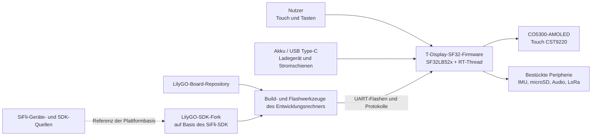

# LilyGO T-Display-SF32 { #lilygo-t-display-sf32 }

!!! warning "Drittanbieterprojekt – kein SiFli-Projekt"
    T-Display-SF32 wird von Xinyuan-LilyGO/LilyGO veröffentlicht und gepflegt, nicht von SiFli oder OpenSiFli. Für boardspezifische Hardware-, Firmware- und Supportentscheidungen sind die Repositories von LilyGO maßgeblich. SiFlis Quellen bleiben für das zugrunde liegende SF32-Gerät und SiFli-SDK maßgeblich; daraus folgt jedoch nicht, dass SiFli dieses LilyGO-Board validiert oder unterstützt.

## Was ist T-Display-SF32? { #what-is-t-display-sf32 }

[Xinyuan-LilyGO/T-Display-SF32](https://github.com/Xinyuan-LilyGO/T-Display-SF32) ist eine Entwicklungsplattform mit SF32LB52x-MCU und einem 2,16-Zoll-AMOLED-Display CO5300 mit Touchcontroller CST9220. Das Repository dokumentiert 16 MB Flash, 8 MB PSRAM, eine BHI260AP-IMU, LoRa mit SX1262, eine microSD-Schnittstelle, Audio, USB Type-C, Ladeunterstützung, Board-Pinbelegungen, Beispielanwendungen, Hardwaredateien, ein Verzeichnis mit Werksfirmware und einen boardspezifischen Stromverbrauchsbericht.

Damit eignet sich das Board zur Bewertung eines displayorientierten Wearables, eines Handheld-Controllers, eines mobilen Sensorterminals oder einer vernetzten HMI. Es ist eine Plattformreferenz, kein fertiges Produkt: Das Repository stellt zahlreiche Hardwarepfade bereit, doch das Produktteam muss die relevanten Pfade auswählen, eine bekannte Basis reproduzieren, sie auf genau seiner Board-Revision messen und Stromversorgung, RF, Sicherheit, Softwarepflege und Wiederherstellung qualifizieren.

Die Funktionsmatrix des Repositorys unterscheidet das eigenständige T-SF32-Display-Board von der optionalen T-SF32-Keyboard-Erweiterung. WLAN (ESP32-C6), GPS (L76K), Matrix-Tastatur und LEDs (TCA8418, AW21009, XL9555), BME280, Infrarotsender und Vibrationsmotor (AW86224) setzen diese Erweiterung voraus und gehören nicht zur Ausgangsbasis des eigenständigen Boards.

## Warum eine Umsetzung auf SF32-Basis? { #why-the-sf32-implementation }

T-Display-SF32 vereint Grafik-, Bluetooth-, Audio- und Energiesparfunktionen des SF32LB52x mit externen Display-, Touch-, Bewegungs-, Speicher- und LoRa-Bausteinen auf einem Board. LilyGO stellt außerdem Board-Konfiguration, dedizierte Gerätetreiber, Beispiele und einen separaten [LilyGO-SDK-Fork](https://github.com/Xinyuan-LilyGO/SlFli-SDK-Lilygo) bereit, der laut Dokumentation auf SiFli-SDK 2.4.0 basiert. Das kann die anfängliche Inbetriebnahme gegenüber einem unveränderten generischen SDK-Ziel verkürzen.

Der Preis dafür liegt in der Zuständigkeit. Board-Unterstützung, Treiberänderungen, Hardware-Revisionen, mitgelieferte Firmware und das Verhältnis zwischen LilyGOs SDK-Fork und dem SiFli-SDK-Upstream werden außerhalb von SiFli kontrolliert. Ein reproduzierbares Projekt muss daher beide Repositories auf Commits fixieren, ein funktionsfähiges Werks- bzw. Wiederherstellungsimage aufbewahren und jede Migration auf ein neueres Upstream-SDK als ausdrückliche technische Änderung testen.

## Ergebnis, Umfang und Eintrittskriterien { #outcome-scope-and-entry-criteria }

**Ergebnis:** eine versionsfixierte T-Display-SF32-Basis herstellen, Display/Touch, ausgewählte Peripherie, Stromverhalten und Wiederherstellung prüfen, einen Build aus dem Quellcode reproduzieren und anschließend eine klar begrenzte Anwendungsänderung mit Regressionsnachweisen umsetzen, die sich für eine Produktbewertung eignen.

Diese Seite belegt weder, dass jede Peripherie auf jeder Board-Variante bestückt ist, noch dass die Herstellerfirmware serienreif ist, noch dass der Stromverbrauchsbericht für andere Revisionen oder Arbeitslasten gilt, noch dass LoRa-Betrieb in jeder Region zulässig ist. Sie überträgt auch keine SiFli-Unterstützung auf LilyGO-spezifische Hardware oder Treiber.

Vor dem Start benötigen Sie:

- das konkrete T-Display-SF32-Board samt Hardware-Revision und Schaltplan oder Pinbelegung;
- ein strombegrenztes Labornetzteil oder einen geschützten Akku, dessen Spannung und Zustand überwacht werden können;
- ein geprüftes USB-Datenkabel, die dokumentierte Type-C-Flashverbindung und ein aufbewahrtes Recovery-Image;
- fixierte Commits des T-Display-SF32-Repositories und des LilyGO-SDK-Forks;
- die vom LilyGO-SDK-Fork dokumentierte Windows-/PowerShell-Umgebung für den ersten reproduzierbaren Build; andere Hostumgebungen müssen separat qualifiziert werden;
- Testzubehör nur für relevante Schnittstellen, zum Beispiel eine microSD-Karte, Kopfhörer oder eine Audiolast sowie einen LoRa-Gegenpart für ein zulässiges Frequenzband;
- eine Dokumentation von Firmwareversionen, Build-Protokollen, serieller Ausgabe, Fotos, Strommessungen sowie Fehler- und Wiederherstellungstests.

<div align="center"><em>Tabelle: Projektbasis und Nachweise für T-Display-SF32</em></div>

<div align="center" markdown>

| Bereich | Ausgangsbasis | Vor einer Anpassung erforderliche Nachweise |
|:-----|:------------------|:------------------------------------|
| Zuständigkeit | LilyGO-Board, Repository und SDK-Fork | Repository-Verantwortliche, Commits, Board-Revision und Supportgrenze |
| Hardware | SF32LB52x, 2,16-Zoll-AMOLED/Touch, externer Speicher und bestückte Peripherie | Prüfung von Schaltplan/Pinbelegung, Bestückungsprotokoll und Inventar der bestückten Bauteile |
| Firmware | Mitgeliefertes Werksimage oder unverändertes Repository-Beispiel | Image-Identität, Flash- und Bootprotokoll sowie Funktionsprotokoll |
| Stromversorgung | Von LilyGO dokumentierter USB-/Ladegerät-/Akku-Pfad | Versorgungsgrenzen, Startergebnis, Abschaltverhalten und gemessener Strom bei der vorgesehenen Arbeitslast |
| Anpassung | Jeweils nur ein Beispiel, eine UI-, Sensor-, Speicher-, Audio- oder Funkänderung | Geprüfte Änderung, Rollback-Image und vollständiges Regressionsergebnis |

</div>

## Hardware- und Software-Spezifikationen { #hardware-and-software-specifications }

### Hardware-Spezifikation { #hardware-specification }

<div align="center"><em>Tabelle: Hardware-Spezifikation von T-Display-SF32</em></div>

<div align="center" markdown>

| Komponente | Erforderliche Spezifikation | Aufgabe | Status | Bezugsquelle | Hinweise zu Kompatibilität und Ersatz |
|:-----------|:----------------------------|:--------|:-------|:-------------|:--------------------------------------|
| T-Display-SF32-Board | SF32LB52x; die dokumentierte Konfiguration umfasst ein 2,16-Zoll-CO5300-AMOLED, CST9220-Touch, 16 MB Flash, 8 MB PSRAM, BHI260AP-IMU, SX1262-LoRa, microSD, ein integriertes Mikrofon und einen Lautsprecherverstärker mit 3,5-mm-Audioanschluss sowie drei Benutzertasten | Integrierte Referenz für Rechenleistung, Anzeige, Sensorik, Funk, Speicher und Audio | Erforderlich | [LilyGO-Repository](https://github.com/Xinyuan-LilyGO/T-Display-SF32); [Hardwaredateien](https://github.com/Xinyuan-LilyGO/T-Display-SF32/tree/master/hardware) | Exakte Board-Revision und bestückte Bauteile dokumentieren; nicht davon ausgehen, dass jede Variante gleich bestückt ist |
| T-SF32-Keyboard-Erweiterung | Optionale Erweiterung mit ESP32-C6-WLAN, L76K-GPS, TCA8418/AW21009/XL9555-Tastatursubsystem, BME280, Infrarotsender und AW86224-Vibrationsmotor | Ergänzt die genannten Funk-, Positions-, Tastatur-, Umweltsensor-, IR- und Haptikfunktionen | Optional; nur für diese Funktionen erforderlich | [LilyGO-Repository](https://github.com/Xinyuan-LilyGO/T-Display-SF32); [Hardwaredateien](https://github.com/Xinyuan-LilyGO/T-Display-SF32/tree/master/hardware) | Diese Bauteile sind nicht auf dem eigenständigen T-SF32-Display-Board bestückt. WLAN und GPS teilen UART2; die gemeinsame Konfiguration der Erweiterung muss geprüft werden |
| USB-Type-C-Datenverbindung und kontrollierte Stromversorgung | Datenfähiges Kabel; strombegrenztes Netzteil oder geschützter Akku mit überwachter Spannung | Flashen, Logs und sichere Prüfung der Stromversorgung | Erforderlich | [LilyGO-Repository](https://github.com/Xinyuan-LilyGO/T-Display-SF32) | D+/D- von Type-C sind mit der CH343P-USB-UART-Brücke verbunden. Der Anschluss dient zum UART-Flashen und für Logs, nicht als native USB-Geräte-/Hostverbindung des SF32. Zusätzlich die boardspezifische Startbedingung von mehr als 3,5 V beachten |
| Schnittstellenspezifisches Testzubehör | microSD-Karte, Audiolast/Kopfhörer oder ein LoRa-Gegenstellenmodul im zulässigen Frequenzband, jeweils nur für den getesteten Pfad | Optionale Board-Schnittstellen prüfen | Optional; je Test auswählen | [Beispiele](https://github.com/Xinyuan-LilyGO/T-Display-SF32/tree/master/examples) | Vor dem Anschließen Stecker, Spannung, Region und Revision anhand der Board-Dateien prüfen |

</div>

### Software-Spezifikation { #software-specification }

<div align="center"><em>Tabelle: Software-Spezifikation von T-Display-SF32</em></div>

<div align="center" markdown>

| Paket oder Dienst | Erforderliche Version oder Revision | Aufgabe | Status | Bezugsquelle | Hinweise zu Kompatibilität und Aktualisierung |
|:------------------|:------------------------------------|:--------|:-------|:-------------|:---------------------------------------------|
| T-Display-SF32-Firmware/Quellcode | Einen Repository-Commit festlegen und dokumentieren; upstream nennt keine universelle getaggte Basisversion | Board-Beispiele, Konfiguration und Firmware | Erforderlich | [Repository](https://github.com/Xinyuan-LilyGO/T-Display-SF32) | Werksimage sichern und Board-Revision sowie Commit gemeinsam dokumentieren |
| LilyGO-Fork des SiFli-SDK | Einen Commit des Forks festlegen, der laut Dokumentation auf SiFli-SDK 2.4.0 basiert | Board-Unterstützung, Treiber, Build- und Flash-Umgebung | Erforderlich | [LilyGO-SDK-Fork](https://github.com/Xinyuan-LilyGO/SlFli-SDK-Lilygo) | Die Angabe „basiert auf 2.4.0“ nennt keine exakte Forkrevision; nicht stillschweigend durch das upstream SDK ersetzen |
| SCons und Flashwerkzeuge auf dem Host | Vom gewählten Fork bereitgestellte Versionen; Host-Betriebssystem und aufgelöste Versionen dokumentieren | Ziel `t-display-sf32_hcpu` bauen und flashen | Erforderlich | [LilyGO-SDK-Fork](https://github.com/Xinyuan-LilyGO/SlFli-SDK-Lilygo) | Der dokumentierte erste Buildpfad verwendet Windows/PowerShell; andere Hosts separat qualifizieren |
| Werksfirmware V1.2 | Image passend zur Board-/Repositoryrevision | Referenz für unverändertes Verhalten und Wiederherstellung | Optional, aber vor Änderungen sichern | [Verzeichnis der Werksfirmware](https://github.com/Xinyuan-LilyGO/T-Display-SF32/tree/master/firmware/T-SF32-Factory-V1.2) | Der Verzeichnisname allein belegt nicht die Kompatibilität zwischen Image und Board; vor dem Flashen prüfen |

</div>

## Unterstützte Referenzkonfiguration auswählen { #choose-a-supported-baseline }

Das Upstream-Repository verwendet derzeit den Branch `master` und weist kein getaggtes Release als allgemeingültige Softwarebasis aus. Dokumentieren Sie den genauen Commit, statt „latest“ zu notieren. Das Repository enthält das Verzeichnis `firmware/T-SF32-Factory-V1.2`; dessen Name ersetzt jedoch nicht die Dokumentation der passenden Board-Revision, des Repository-Commits und des Flash-Verfahrens.

<div align="center"><em>Tabelle: Auswahl der T-Display-SF32-Basis</em></div>

<div align="center" markdown>

| Basiselement | Empfohlener Ausgangspunkt | Wichtige Einschränkung |
|:-----------------|:------------------|:--------------------|
| Board | Ein fotografiertes T-Display-SF32-Gerät mit dokumentierter Revision | Pinbelegung und bestückte Peripherie nicht ungeprüft von einer anderen Revision oder einer Tastaturvariante übernehmen |
| Werkszustand | Mitgeliefertes Verzeichnis Factory V1.2 oder unveränderter `menu_app`-Build, je nach Gerät | Herkunft und Kompatibilität vor dem Flashen prüfen; Originalimage aufbewahren |
| Quellcode | Fixierter Commit des T-Display-SF32-Repositories | Das Repository entwickelt sich unabhängig vom SiFli-SDK weiter |
| SDK | Fixierter Commit des LilyGO-SDK-Forks, laut Dokumentation abgeleitet von SiFli-SDK 2.4.0 | Nicht stillschweigend durch eine andere SDK-Revision ersetzen; Board-Treiber und Konfiguration können abweichen |
| Buildziel | `t-display-sf32_hcpu` | LilyGO-Board-Ziel, kein generisches SF32LB52x-Ziel |
| Versorgungseingang | LilyGOs genannte Startbedingung von mehr als 3,5 V beachten und in eigener Firmware Spannungserkennung sowie Abschaltung bei niedrigem Akkustand implementieren | Als zu prüfende Herstelleranforderung behandeln, nicht als Ersatz für Chipdatenblatt, Akku-Grenzwerte oder gemessenes Brownout-Verhalten |

</div>

Die T-Display-SF32-README beschreibt nach Einrichtung der erforderlichen Umgebung folgenden Build- und Flashablauf unter Windows:

```powershell
cd T-Display-SF32\examples\rt_os\rt_driver\project
scons --board=t-display-sf32_hcpu -j8
build_t-display-sf32_hcpu\uart_download.bat
```

Dokumentieren Sie die tatsächlichen Repository- und SDK-Commits, das Ergebnis des Umgebungsexports, das vollständige Build-Protokoll, erzeugte Images sowie Flash- und Bootprotokoll. Die Zahl paralleler Jobs darf variieren, Buildziel und Quellrevisionen nicht.

## Projektphasen und Entscheidungspunkte { #delivery-map }

<div align="center"><em>Tabelle: Projektphasen und Entscheidungspunkte für T-Display-SF32</em></div>

<div align="center" markdown>

| Phase | Entscheidungsfrage | Erforderliches Ergebnis |
|:------|:---------------------|:----------------|
| 1. Herstellerbasis | Funktionieren das unveränderte Board und die Firmware wie identifiziert zusammen? | Versionsfixierte, fotografisch dokumentierte, nachweislich funktionsfähige Sitzung |
| 2. Peripherie und Wiederherstellung | Sind ausgewählte Schnittstellen, Stromzustände und Fehler beobachtbar und wiederherstellbar? | Protokoll zu Fehlerinjektion, Messung und Wiederherstellung |
| 3. Quellcode-Reproduktion | Kann das Team dasselbe Verhalten aus sauberen Quellen neu bauen und flashen? | Umgebung, Image, Flashprotokoll und Wiederholungsergebnis |
| 4. Kontrollierte Anpassung | Lässt sich ein Produktverhalten ändern, ohne die Basis zu beeinträchtigen? | Begrenzte Änderung, Rollback-Pfad und Regressionsergebnisse |
| 5. Produktbewertung | Eignet sich die Drittanbieterplattform für die weitere Arbeit an Prototypen oder eigener Hardware? | Zugeordnete Risiken und Entscheidung zum Fortfahren, Zurückstellen oder Stoppen |

</div>

## Systemarchitektur und Abhängigkeiten { #system-architecture-and-dependencies }

<div align="center"><em>Abbildung: Produkt- und Entwicklungsgrenzen von T-Display-SF32</em></div>



Betrachten Sie Fehler als getrennte Bereiche: Stromversorgung/Laden des Boards, Start und Flashen, Display/Touch, jede ausgewählte Peripherie, LilyGO-Board-Unterstützung und das zugrunde liegende SDK. Ein fehlgeschlagenes Displaybeispiel kann etwa auf Stromversorgung, Board-Revision, Panel-/Touchkonfiguration, Anwendung oder eine Unvereinbarkeit von SDK und Treiber zurückgehen. „Das SDK ist fehlgeschlagen“ ist keine ausreichende Diagnose.

## Phase 1 — Die unveränderte Herstellerbasis einrichten { #stage-1-establish-the-untouched-vendor-baseline }

**Ziel:** vor jeder Quellcodeänderung nachweisen, wie sich das gelieferte Board und die Herstellerbasis tatsächlich verhalten.

1. Fotografieren Sie beide Platinenseiten und dokumentieren Sie Kennzeichnungen, bestückte Peripherie, Display-/Touchbauteile, Speicher, Schalter, Anschlüsse und Repository-Commit.
2. Prüfen Sie Stromquelle und Polarität. LilyGO weist darauf hin, dass zum Start mehr als 3,5 V erforderlich sind. Verwenden Sie eine überwachte Stromquelle und keinen tiefentladenen Akku als Testmethode.
3. Flashen Sie nur eine nachweislich zum Board passende Basis oder führen Sie zunächst die vorhandene Firmware aus, sofern ihre Herkunft bekannt ist. Sichern Sie das Originalimage nach Möglichkeit.
4. Testen Sie das Menü auf dem Gerät oder unveränderte Beispiele für Display/Touch und jede für das Produkt ausgewählte Peripherie. Dokumentieren Sie nicht verfügbare oder nicht bestückte Funktionen, statt sie als Fehler zu werten.
5. Starten Sie zweimal kalt und sichern Sie Bootprotokolle, UI-Fotos, Touch-/Eingabeergebnisse sowie einen Stromverlauf für eine klar definierte Leerlauf-/Aktivitätslast.

**Aufzubewahrende Nachweise:** Board-Revision und Fotos, Repository-/Image-Identität, Angaben zu Versorgung und Akku, Flash- und Bootprotokolle, Inventar der bestückten Bauteile, Funktionsergebnisse und Bedingungen der Strommessung.

**Abnahmekriterium für Kontrollpunkt 1:** Zwei Kaltstarts reproduzieren die identifizierte Display-/Touch-Basis. Für jede relevante bestückte Peripherie liegt ein Ergebnis vor, und das Original- oder ein bekannt gutes Image lässt sich wiederherstellen.

## Phase 2 — Peripherie-, Strom- und Wiederherstellungsgrenzen validieren { #stage-2-validate-peripheral-power-and-recovery-boundaries }

**Ziel:** feststellen, ob Fehler ohne unsicheren Akkubetrieb oder undokumentiertes erneutes Flashen erkannt und behoben werden können.

<div align="center"><em>Tabelle: Fehler- und Wiederherstellungstests für T-Display-SF32</em></div>

<div align="center" markdown>

| Test | Vorgehen | Erfolgsnachweis |
|:-----|:-------|:--------------|
| Startverhalten im Spannungsbereich | Strombegrenztes Labornetzteil im vorgesehenen Betriebsbereich variieren, ohne dokumentierte Grenzwerte zu überschreiten | Start-/Abschaltschwellen und Verhalten sind gemessen; wiederholte Resets oder undefinierte Zustände werden nicht übergangen |
| Verhalten bei niedrigem Akkustand | Warn- und Abschaltschwellen kontrolliert mit einer Versorgung prüfen | Eigene Firmware warnt und schaltet ab, bevor die sichere Entladegrenze des ausgewählten Akkus erreicht wird |
| Laden im ausgeschalteten Zustand | Nach Abschaltung durch Werksfirmware USB-Strom anschließen und den dokumentierten Aufweckweg per Taste verwenden | Ladezustand und ausschließlich durch Tastendruck ausgelöstes Aufwecken entsprechen dem Herstellerhinweis; USB-Anschluss allein wird nicht fälschlich als Startweg gewertet |
| Display-/Touch-Unterbrechung | Während der UI-Nutzung zurücksetzen oder aus-/einschalten und Touchtests an Kanten/Ecken wiederholen | Display und Touch kehren ohne dauerhafte Beschädigung oder Fehleingaben in einen definierten Zustand zurück |
| Wechselbarer Speicher | Testkarte nur an kontrollierten Punkten entfernen, beschädigen oder ersetzen | Fehler durch fehlende/fehlerhafte Karte sind diagnostizierbar; die Anwendung beschädigt keinen unbeteiligten Zustand und hängt sich nicht auf |
| LoRa-Pfad | Gegenstelle im zulässigen Frequenzband und kontrollierter RF-Aufbau verwenden | Frequenz und Konfiguration sind dokumentiert; Timeout und Wiederverbindung sind sichtbar; ohne Messung wird keine Reichweite behauptet |
| Flash-Wiederherstellung | Einen Test-Flashvorgang nur auf einem wiederherstellbaren Gerät unterbrechen; anschließend den dokumentierten Type-C-/UART-Pfad verwenden | Das gesicherte, bekannte Image lässt sich mit dokumentierten Werkzeugen und Schritten wiederherstellen |

</div>

**Abnahmekriterium für Kontrollpunkt 2:** Jeder relevante Test hat ein reproduzierbares Ergebnis und einen Wiederherstellungsweg. Für jede eigene Firmware ist ein Schutz bei niedrigem Akkustand implementiert; kein ungelöster Fehler kann den Akku beschädigen oder das Board ohne dokumentierten Recovery-Pfad unbrauchbar machen.

## Phase 3 — Eine reproduzierbare Quellbasis erstellen { #stage-3-build-a-reproducible-source-baseline }

**Ziel:** einem zweiten Entwickler ermöglichen, dieselbe Basis aus sauberen, versionsfixierten Quellen zu bauen und zu flashen.

1. Checken Sie fixierte Commits des Board-Repositories und des LilyGO-SDK-Forks aus und dokumentieren Sie die angegebene Upstream-SDK-Basis des Forks.
2. Richten Sie die dokumentierte PowerShell-Umgebung ein und bauen Sie `t-display-sf32_hcpu` aus einem sauberen Verzeichnis.
3. Sichern Sie Nachweise zu Umgebung, Abhängigkeiten, Konfiguration, Speicher/Partitionen, Image, Flashvorgang und seriellen Protokollen.
4. Wiederholen Sie den Vorgang auf einem anderen Rechner oder nach Löschen sämtlicher Build-Ausgaben und führen Sie anschließend die vollständige Regression aus Phase 2 durch.

**Abnahmekriterium für Kontrollpunkt 3:** Um eine Firmware zu erzeugen, die Phase 2 besteht, sind weder veraltete Images noch nicht versionierte Board-Dateien noch undokumentierte SDK-Ersetzungen erforderlich.

## Phase 4 — Jeweils einen Produktpfad anpassen { #stage-4-adapt-one-product-path-at-a-time }

**Ziel:** eine nützliche Änderung umsetzen und dabei die funktionierende Hersteller- und Wiederherstellungsbasis erhalten.

<div align="center"><em>Tabelle: Reihenfolge kontrollierter Anpassungen für T-Display-SF32</em></div>

<div align="center" markdown>

| Änderungskategorie | Geeigneter erster Schritt | Erforderliche Regressionstests |
|:-------------|:------------------|:--------------------|
| UI | Eine Seite, ein Symbol, eine Schrift oder eine Touchaktion | Kaltstart, Vollbildaktualisierung, Touchgrenzen, Speicherbedarf und Wiederherstellung |
| Sensor | Ein IMU-Wert oder ein Ereignis | Geräteidentität, Messbereich, Abtastrate, Fehlerbehandlung, Ruhestrom und Aufweckverhalten |
| Speicher/Audio | Eine Dateioperation oder ein Wiedergabepfad | Fehlende Medien, fehlerhafte Daten, Lautstärke-/Ausgangsgrenzen, Stromunterbrechung und Dateisystemwiederherstellung |
| LoRa | Ein begrenzter Paketaustausch in einem zulässigen Frequenzband | Konfigurationsprotokoll, Timeout, Wiederholungen, Strom, Koexistenz und regulatorische Prüfung |
| Stromversorgung | Eine Änderung an Schlaf-/Aufweckverhalten oder Stromschienensteuerung | Alle Weckquellen, Display-/Peripheriezustand, Niedrigakkuabschaltung, Laden und wiederholte Zyklen |
| SDK-Migration | Ein Update-Kandidat für den LilyGO-Fork oder das Upstream-SDK | Diff der Board-Konfiguration, sauberer Build, Regression jeder Peripherie, Strommessungen und Rollback |

</div>

**Abnahmekriterium für Kontrollpunkt 4:** Die Änderung ist geprüft, das Originalimage wiederherstellbar und alle relevanten Tests für Display, Touch, Peripherie, Stromversorgung, Flashen und Wiederherstellung sind bestanden.

## Phase 5 — Produktreife-Überprüfung { #stage-5-product-readiness-review }

Vor einem Feldversuch oder einer eigenen Leiterplatte sind folgende Fragen zu beantworten:

- Wer verantwortet Board-Dateien, LilyGO-SDK-Fork, Treiberkorrekturen, Sicherheitsupdates und die Migration auf spätere SiFli-SDK-Versionen?
- Welche Board-Revisionen und bestückten Peripheriebausteine gehören zur Produktbasis, und wie werden eingehende Geräte identifiziert und geprüft?
- Wie hoch sind die gemessenen Ströme im Aktiv-, Leerlauf-, Schlaf-, Start- und Abschaltzustand bei vorgesehener Displayhelligkeit, Funk-Tastverhältnis, Speicher- und Sensorkonfiguration?
- Wie werden Akkuschutz, Laden, Temperaturverhalten, Gehäuse, Anschlusszugang und Wiederherstellung im ausgeschalteten Zustand verifiziert?
- Welche LoRa-Region, Antenne, Frequenzplanung, Sendeparameter und regulatorischen Pflichten gelten?
- Sind Hardwaredateien, Firmware, SDK-Fork, Beispiele, Assets und Drittanbieterkomponenten mit den Lizenzen für die geplante Verteilung vereinbar?
- Akzeptiert das Team die Abhängigkeit von einem Drittanbieterprototyp, oder hat es einen kontrollierten Fork und Supportplan qualifiziert?

**Abnahmekriterium für Kontrollpunkt 5:** Für jedes Restrisiko gibt es Verantwortliche, Nachweise und eine Behandlung. Das Team hat ausdrücklich entschieden, fortzufahren, zurückzustellen oder abzubrechen.

## Übergabe an das Produktdesign { #handoff-to-product-design }

In die nächste Entwicklungsphase gehören die genaue SF32-Variante und Speicherbausteine, Display-/Touch-Timing, bestückte Peripherie und Busse, Stromversorgungsbaum, Ladegerät und Akkurichtlinie, Antennen-/RF-Konzept, Boot-/Flashanschluss, Partitionsplan, Zugriff für Produktionstests, Zuständigkeit für den Software-Fork und der nachgewiesene Wiederherstellungsweg. Weiter geht es mit dem [Integrationspfad für SF32LB52x](../sf32-products/chips/SF32LB52x.md#integration-path), dem [SF32LB52x Hardware-Design-Leitfaden](../hardware/chip-guides/SF32LB52x_hardware_design_guide.md), [SiFli-SDK: Bauen, Flashen und Überwachen](../develop/platforms/sifli-sdk/build-flash-monitor.md) und [Design für die Produktion](../hardware/design-for-production.md).

## Maßgebliche Quellen { #authoritative-sources }

- [Repository Xinyuan-LilyGO/T-Display-SF32](https://github.com/Xinyuan-LilyGO/T-Display-SF32)
- [Chinesische README zu T-Display-SF32](https://github.com/Xinyuan-LilyGO/T-Display-SF32/blob/master/readme_cn.md)
- [Beispiele für T-Display-SF32](https://github.com/Xinyuan-LilyGO/T-Display-SF32/tree/master/examples)
- [Hardwaredateien für T-Display-SF32](https://github.com/Xinyuan-LilyGO/T-Display-SF32/tree/master/hardware)
- [Material zu Stromverbrauchstests für T-Display-SF32](https://github.com/Xinyuan-LilyGO/T-Display-SF32/tree/master/lowpowertest)
- [Repository Xinyuan-LilyGO/SlFli-SDK-Lilygo](https://github.com/Xinyuan-LilyGO/SlFli-SDK-Lilygo)
- [OpenSiFli/SiFli-SDK](https://github.com/OpenSiFli/SiFli-SDK)
