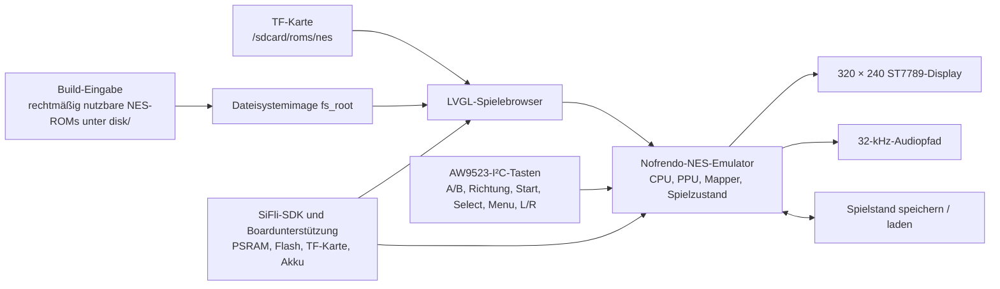

# Pocket Pi SF32 Handheld-Spielkonsole { #pocket-pi-sf32-handheld-game-console }

!!! note "Fixierter Quellstand"
    Sofern nicht anders angegeben, beziehen sich codebezogene Angaben in diesem Artikel auf den PocketPi-Commit [`7d9fac2`](https://github.com/SiFliSparks/PocketPi/commit/7d9fac2cb577d6c9b66a99521aebf3c9de0ae163). Der Upstream-Branch `main` kann sich ändern. Für die Reproduktion dieser Angaben muss der fixierte Commit ausgecheckt werden.

## Was ist Pocket Pi? { #what-is-pocket-pi }

[SiFliSparks/PocketPi](https://github.com/SiFliSparks/PocketPi) ist eine Referenz für eine tragbare Spielkonsole und einen Emulator auf SF32LB52-Basis. Der fixierte Quellstand integriert den Nofrendo-NES-Emulator, einen LVGL-Spielebrowser, einen 320 × 240 großen ST7789-Displaypfad mit 8080-Schnittstelle, Audio, Speichern und Laden von Spielständen, ein eingebettetes Dateisystem sowie ein ROM-Verzeichnis auf TF-Karte. Die öffentliche Build-Basis verwendet das Ziel Huangshan Pi / `sf32lb52-lchspi-ulp`.

Das Projekt eignet sich, um das Zusammenspiel lokaler Grafiken, Eingaben, Audio, externem Speicher, PSRAM-Belegung und Emulatorlast auf einem SF32LB52-System zu prüfen. Das Repository enthält keine kommerziellen Spiel-ROMs; Nutzer müssen `.nes`- oder `.NES`-Dateien bereitstellen, zu deren Verwendung sie berechtigt sind. Der öffentliche Quellcode ist außerdem kein vollständiges Design für eine serienreife Handheld-Konsole und ersetzt keine Prüfung von Akkusicherheit, Audio, EMV, Temperaturverhalten, Lizenzen oder Inhaltsweitergabe.


<div align="center"><em>Pocket Pi führt ein NES-Spiel auf SF32LB52 aus</em></div>

## Warum die SF32-Implementierung? { #why-the-sf32-implementation }

Die NES-Emulation bündelt mehrere typische Anforderungen eingebetteter Systeme in einem anschaulichen Testfall: CPU-Emulation, PPU-Grafik, Audioabtastung, Eingaben mit geringer Latenz, Dateizugriffe, Framebuffer und gespeicherte Spielstände müssen zusammenspielen. Ein System auf Basis des SF32LB52 stellt die dafür nötigen Anzeige-, Audio-, externen Speicher- und PSRAM-Ressourcen bereit; Huangshan Pi bietet zudem eine akkubetriebene Evaluierungsplattform.

Der Nutzen liegt nicht in der Behauptung, dass jeder NES-Titel vollständig kompatibel ist. Unterstützung für ROM-Mapper, Bildrate, Audio, Speicherverhalten, Spitzenbedarf an Arbeitsspeicher und Eingabelatenz können je nach Spiel variieren. Für jedes zusätzliche ROM und jeden Mapper sind Kompatibilität und Urheberrechte gesondert zu prüfen.

## Ergebnis, Umfang und Eintrittskriterien { #outcome-scope-and-entry-criteria }

**Ergebnis:** Aus dem in der Softwarespezifikation fixierten PocketPi-Commit ein reproduzierbares Image erstellen, mindestens ein rechtmäßig nutzbares Test-ROM starten, Display, Eingaben, Audio, Pause, Speichern, Laden, Beenden und Wiederherstellung prüfen und anschließend eine klar begrenzte Anpassung umsetzen.

Diese Seite garantiert weder die Unterstützung aller NES-Mapper noch PAL-/NTSC-Timing noch Audioverhalten in jedem Spiel noch ein bestimmtes Speicherformat noch die Funktion beliebiger ROMs Dritter. Sie gewährt keine Rechte zum Kopieren oder Verbreiten von Spielinhalten. Das Repository enthält in der fixierten Revision keine Lizenzdatei auf oberster Ebene. Vor der Übernahme von Code in ein Produkt oder der Verteilung von Binärdateien muss ein Verantwortlicher klären, welche Lizenzen für PocketPi, Nofrendo und sämtliche integrierten Komponenten Dritter gelten.

Halten Sie vor dem Start Folgendes bereit:

- [SF32LB52-DevKit-ULP / Huangshan Pi](../sf32-products/devkits/SF32LB52-DevKit-ULP.md) oder Hardware, die zur Boarddefinition `sf32lb52-lchspi-ulp` des Repositorys passt;
- das vom fixierten Quellstand erwartete 320 × 240 Display, den AW9523-I²C-Eingabeexpander, Tasten, Audio und optional den TF-Kartenpfad. Der Boardname allein belegt nicht, dass alle Peripheriegeräte bestückt sind;
- SiFli-SDK, SCons sowie Werkzeuge zum Flashen per UART und zur Protokollierung;
- ein selbst erstelltes, gemeinfreies oder ordnungsgemäß lizenziertes `.nes`-Test-ROM;
- das ROM im Verzeichnis `disk/` des Repositorys für das integrierte Dateisystem oder im von der Firmware konfigurierten ROM-Verzeichnis auf der TF-Karte. Der fixierte Quellstand durchsucht zur Laufzeit `/sdcard/roms/nes`; prüfen Sie anhand dieser Revision, ob der Einhängepfad der Karte dazu passt;
- eine Möglichkeit, Frameverhalten, Audio, Eingaben, Speicherbedarf und Stromaufnahme zu beobachten.

<div align="center"><em>Tabelle: Fixierte Pocket-Pi-Basis und Nachweise vor der Anpassung</em></div>

<div align="center" markdown>

| Bereich | Fixierte Quellbasis | Vor einer Anpassung erforderliche Nachweise |
|:-----|:------------------------|:------------------------------------|
| Board | `sf32lb52-lchspi-ulp` | Revisionen von Board, Expander, Display, Audio, Speicher und Stromversorgung |
| Inhalte | Der ROM-Scanner akzeptiert im fixierten Quellstand nur `.nes` und `.NES`; ein gleichnamiges `.jpg` kann als Titelbild dienen | Herkunft und Lizenz des ROMs, Dateihash, Mapper und Herkunft des Titelbilds |
| Speicher | Erstellt aus `disk/` ein Dateisystem `fs_root`; durchsucht zur Laufzeit zusätzlich `/sdcard/roms/nes` | Dateisystemimage, TF-Kartenformat, Verzeichnis sowie Fehler- und Wiederherstellungsprotokoll |
| Eingaben | Der fixierte Quellstand liest A/B, Richtungstasten, Start, Select, Menu, L/R und weitere Tasten über einen AW9523-I²C-Expander | Schaltplan-/Pinbelegung, vollständige Tastenmatrix und Ergebnisse für gleichzeitige Tastendrücke |
| Emulator | Nofrendo-NES-Kern, Display, 32-kHz-Audiopfad sowie Speichern und Laden von Zuständen | Nachweise zu Spielkompatibilität, Frame-/Audioverhalten, Zustand, Speicher und Reset |

</div>

## Hardware- und Software-Spezifikationen { #hardware-and-software-specifications }

### Hardware-Spezifikation { #hardware-specification }

<div align="center"><em>Tabelle: Hardware-Spezifikation von Pocket Pi</em></div>

<div align="center" markdown>

| Komponente | Erforderliche Spezifikation | Aufgabe | Status | Bezugsquelle | Kompatibilität und Hinweise zu Ersatzteilen |
|:-----------|:----------------------------|:--------|:-------|:-------------|:-------------------------------------------|
| Huangshan-Pi-/SF32LB52-DevKit-ULP-Basis | Ziel `sf32lb52-lchspi-ulp`; der PocketPi-Quellstand des fixierten Commits erwartet den 320 × 240 ST7789-Displaypfad, einen AW9523-I²C-Eingabeexpander, Audio und TF-Kartenschnittstelle | Führt Emulator sowie Display-, Eingabe-, Audio- und Speicherpfade aus | Erforderlich | [μForge-Boardreferenz](../sf32-products/devkits/SF32LB52-DevKit-ULP.md); [LCKFB-Boardseite](https://lckfb.com/project/detail/lckfb-hspi-sf32lb52-ulp?param=baseInfo); [Projektquellcode](https://github.com/SiFliSparks/PocketPi) | Genaue Baugruppe und bestückte Peripherie bestätigen; der Zielname allein belegt keine Boardgleichheit |
| TF-Karte | Vom Firmwarestand lesbare Karte und Dateisystem; Laufzeitpfad im fixierten Quellstand: `/sdcard/roms/nes` | Optionaler externer ROM-Speicher | Optional | [PocketPi-Quellcode](https://github.com/SiFliSparks/PocketPi) | Mountpfad, Kartenformat, Hot-Plug-Verhalten und Wiederherstellung für den festgelegten Stand prüfen |
| Build-Host und USB-Datenkabel | Host mit ausgewählter SiFli-SDK-Toolchain; Datenkabel für den dokumentierten Download-/Debugpfad des Boards | Bauen, flashen und serielle Logs erfassen | Erforderlich | [SiFli-SDK-Schnellstart](https://docs.sifli.com/projects/sdk/latest/sf32lb52x/quickstart/index.html) | Hostbetriebssystem/-architektur, Kabel/Adapter, Port und Wiederherstellungsweg dokumentieren; ein reines Ladekabel ist ungeeignet |

</div>

!!! warning "Die Peripheriebestückung des Huangshan Pi ist nicht als passend bestätigt"
    Der [Huangshan-Pi-Leitfaden von SiFli](https://wiki.sifli.com/en/board/sf32lb52x/SF32LB52-%E9%BB%84%E5%B1%B1%E6%B4%BE.html) beschreibt ein 1,85-Zoll-AMOLED-Display mit 390 × 450 Pixeln und Quad-SPI sowie die Funktions- und Einschalttasten des Boards. Der PocketPi-Quellstand des fixierten Commits erwartet dagegen einen 320 × 240 ST7789-Displaypfad mit 8080-Schnittstelle und AW9523-I²C-Eingabe. Aus dem offiziellen Board-Leitfaden geht nicht hervor, dass die beschriebene Baugruppe diese passenden Peripheriegeräte enthält. Prüfen Sie das tatsächliche Display, den Adapter und die Eingabehardware oder portieren Sie die betreffenden Softwarepfade und wiederholen Sie die Display-/Eingabe-Regressionstests, bevor Sie das Boardziel als ohne Anpassung nutzbar einstufen.

### Software-Spezifikation { #software-specification }

<div align="center"><em>Tabelle: Software-Spezifikation von Pocket Pi</em></div>

<div align="center" markdown>

| Paket oder Dienst | Erforderliche Version oder Revision | Aufgabe | Status | Bezugsquelle | Kompatibilität und Hinweise zu Updates |
|:------------------|:------------------------------------|:--------|:-------|:-------------|:--------------------------------------|
| SiFliSparks/PocketPi | Geprüfter Commit [`7d9fac2`](https://github.com/SiFliSparks/PocketPi/commit/7d9fac2cb577d6c9b66a99521aebf3c9de0ae163) | Anwendung, Nofrendo-Integration, Dateisystemimage und Boardziel | Erforderlich | [Repository](https://github.com/SiFliSparks/PocketPi) | Lizenzen und Hashes für Quellcode und ROM-Dateien getrennt verwalten |
| OpenSiFli/SiFli-SDK | Der Artikel legt keinen Commit fest; kompatible Revision auswählen und dokumentieren | RTOS, Boardunterstützung, Treiber, SCons-Build und Download-Werkzeuge | Erforderlich | [Repository](https://github.com/OpenSiFli/SiFli-SDK) | `main` nicht ungeprüft als kompatibel ansehen; App- und SDK-Commit gemeinsam dokumentieren |
| SCons-Umgebung und UART-Download-Werkzeuge | Mit der gewählten SiFli-SDK-Revision kompatible Versionen | Baut und lädt `sf32lb52-lchspi-ulp` | Erforderlich | [SiFli-SDK-Schnellstart](https://docs.sifli.com/projects/sdk/latest/sf32lb52x/quickstart/index.html) | Hostbetriebssystem, SDK-Einrichtung, Buildprotokoll und erzeugtes Download-Skript dokumentieren |
| Test-ROM | Vom Nutzer ausgewählte, rechtmäßig nutzbare `.nes`/`.NES`-Datei; Mapper und SHA-256 erfassen | Datei-Erkennung, Dekodierung, Emulation und Audio prüfen | Erforderlicher Testinhalt | PocketPi veröffentlicht keinen ROM-Download. Eine Datei mit geklärten Nutzungsrechten selbst bereitstellen; siehe [Projektquellcode](https://github.com/SiFliSparks/PocketPi) | Kompatibilität je Spiel und Mapper testen; Rechte und Hash getrennt vom Projektquellcode dokumentieren |
| Coverbild | Optionales `.jpg` mit gleichem Basisnamen wie das ROM; Herkunft, Rechte und SHA-256 erfassen | Coverdekodierung und Fallback im Spielebrowser prüfen | Optional | Vom Nutzer bereitzustellen; PocketPi veröffentlicht keine Coverbilder. Siehe [Projektquellcode](https://github.com/SiFliSparks/PocketPi) | Nur weiterverbreitbare Bilder in `disk/` ablegen; Herkunft und Hash dokumentieren |

</div>

## Unterstützte Referenzkonfiguration auswählen { #choose-a-supported-baseline }

Verwenden Sie die in der Softwarespezifikation fixierte PocketPi-Revision, statt den Commit zu bauen, auf den `main` gerade verweist:

```bash
git clone https://github.com/SiFliSparks/PocketPi.git
cd PocketPi
git checkout 7d9fac2cb577d6c9b66a99521aebf3c9de0ae163
cd project
scons --board=sf32lb52-lchspi-ulp -j8
```

Das Build-Skript wandelt `../disk` in ein Dateisystemimage um und bindet es als `fs_root` in die Firmware ein. Unter Windows enthält die erzeugte Datei `build_sf32lb52-lchspi-ulp_hcpu\uart_download.bat` den Ablauf zum Flashen. Auf anderen Hostsystemen sollte das entsprechende SiFli-SDK-Flashwerkzeug verwendet werden; dokumentieren Sie dabei gleichwertige Parameter.

<div align="center"><em>Tabelle: Auswahl der Pocket-Pi-Basis</em></div>

<div align="center" markdown>

| Element | Auswahl der Basis | Wichtige Einschränkung |
|:--------|:----------------|:--------------------|
| ROM | Mit einem kleinen `.nes`- oder `.NES`-ROM beginnen, dessen Nutzung erlaubt und dessen Mapper bekannt ist | Der Scanner akzeptiert im fixierten Quellstand nur `.nes` und `.NES`; ein Eintrag in der Liste belegt keine Emulator-Kompatibilität |
| Titelbild | Optionales `.jpg` mit gleichem Basisnamen im selben Verzeichnis | Bei einem Dekodierfehler sollte das Standardbild angezeigt werden, statt die Spieleliste zu blockieren |
| Display | Die Oberfläche des fixierten Quellstands hat 320 × 240 Pixel; der Quellcode wählt eine Drehung um 270° | Ein anderes LCD oder eine andere Ausrichtung erfordert vollständige Regressionstests für Display und Eingaben |
| Eingabe | AW9523-Zuordnung in `input.c` und `input.h` des fixierten Quellstands verwenden | Der README-Abschnitt zu direkten GPIOs, neun Tasten und Select-Tastenkombinationen ist veraltet |
| Spielstand | Im Pausenmenü die Aktionen Save State / Load State verwenden | Integrität nach Stromausfall, Slotformat und versionsübergreifende Kompatibilität müssen noch nachgewiesen werden |

</div>

!!! warning "Die README-Beschreibung der Eingaben weicht vom fixierten Quellstand ab"
    Das README beschreibt `key_pin_def[]`, GPIO-Abtastung mit 200 Hz und Select-Tastenkombinationen. Der Quellcode des fixierten Commits liest Tasten über einen AW9523-I²C-Expander an Adresse `0x5B`. Menu öffnet ein Pausenmenü mit Save State, Load State und Exit Game; L/R steuern die Audio-Shift-Einstellung. Reproduktion und Hardwaredesign müssen sich nach dem fixierten Quellcode und Schaltplan richten, nicht nach der veralteten GPIO-Tabelle.

## Projektphasen und Entscheidungspunkte { #delivery-map }

<div align="center"><em>Tabelle: Projektphasen und Entscheidungspunkte von Pocket Pi</em></div>

<div align="center" markdown>

| Phase | Entscheidungsfrage | Erforderliches Ergebnis |
|:------|:---------------------|:----------------|
| 1. Unveränderte Basis | Kann die Zielhardware ein rechtmäßig nutzbares ROM auflisten und ausführen? | Dokumentation von Version, Build, ROM, Start, Display und Audio |
| 2. Interaktion und Wiederherstellung | Funktionieren Eingabe, Pause, Speichern, Laden, Beenden und Reset zuverlässig? | Funktions- und Fehlerwiederherstellungsprotokoll auf Spielebene |
| 3. Reproduktion der Quelle | Kann ein zweiter Entwickler dasselbe Dateisystem und Image bauen? | Versionsgebundener Build, Artefakthashes und Wiederholungsergebnis |
| 4. Kontrollierte Anpassung | Lässt sich ein ROM, die Oberfläche oder Hardware ändern, ohne die Basis zu beschädigen? | Nachweise zu Änderung, Inhaltslizenz, Leistungsfähigkeit und Regression |
| 5. Produktbewertung | Reicht die Referenz für eine kundenspezifische Handheld-Hardware und Inhaltsstrategie aus? | Entscheidung zu Kompatibilität, Lizenzierung, Stromverbrauch und Risiken |

</div>

## Systemarchitektur und Abhängigkeiten { #system-architecture-and-dependencies }

<div align="center"><em>Abbildung: Laufzeitpfad von Pocket Pi</em></div>



Die wichtigsten Fehlerbereiche sind Dateisystem/ROM, Mapper/Emulator, PSRAM/Speicher, Display/Frame-Timing, AW9523-Eingabe, Audio, Spielstand sowie Stromversorgung/Reset. Bei einem schwarzen Bildschirm ist zunächst zu unterscheiden, ob das ROM nicht gefunden wurde, die Bilddatei nicht dekodiert werden konnte, der Mapper nicht unterstützt wird, die Framebuffer-Zuweisung fehlgeschlagen ist oder der LCD-Pfad nicht funktioniert. Melden Sie dies nicht pauschal als Emulatorfehler.

## Phase 1 — Die unveränderte Spielbasis einrichten { #stage-1-establish-the-untouched-game-baseline }

**Ziel:** Mit einem rechtmäßig nutzbaren Test-ROM den vollständigen Pfad von der Build-Eingabe bis zum laufenden Spiel prüfen.

1. Fixieren Sie die PocketPi- und SiFli-SDK-Commits sowie die Revisionen von Board und Peripheriegeräten.
2. Legen Sie ein rechtmäßig nutzbares `.nes`-ROM unter `disk/` ab. Falls Sie ein Titelbild verwenden, muss es ein gleichnamiges `.jpg` sein. Sichern Sie Hash, Herkunft und Mapper des ROMs.
3. Führen Sie einen sauberen Build aus und prüfen Sie, ob `fs_root` erzeugt und in die zum Flashen bestimmten Artefakte eingebunden wird.
4. Flashen Sie die Firmware und führen Sie einen Kaltstart durch. Prüfen Sie, ob das Spiel in der Liste erscheint, Titelbild oder Standardbild angezeigt wird und sich das Spiel starten lässt.
5. Dokumentieren Sie Startzeit, stabiles Bild, Tastenreaktion, Audio und serielle Protokolle. Setzen Sie das Gerät zurück und wiederholen Sie den Test.

**Aufzubewahrende Nachweise:** Repository- und SDK-Commits, Board und Peripheriegeräte, ROM-Hash und Lizenz, Build-Protokoll, Dateisystemimage, Flash- und serielle Protokolle sowie Fotos der Spieleliste und des laufenden Spiels.

**Abnahmekriterium für Kontrollpunkt 1:** Bei zwei Kaltstarts wird dasselbe ROM aufgelistet und ausgeführt; Display, grundlegende Richtungstasten/A/B/Start/Select und Audio verhalten sich reproduzierbar.

## Phase 2 — Eingabe, Zustand und Fehlerwiederherstellung validieren { #stage-2-validate-input-state-and-fault-recovery }

**Ziel:** Aus „das Spiel startet“ eine überprüfbare Handheld-Basis machen.

<div align="center"><em>Tabelle: Kernvalidierung von Pocket Pi</em></div>

<div align="center" markdown>

| Test | Vorgehen | Nachweis für bestanden |
|:-----|:-------|:--------------|
| Vollständiger Tastensatz | A, B, Richtungstasten, Start, Select, Menu, L und R einzeln sowie erforderliche Kombinationen prüfen | Keine dauerhaft ausgelösten oder vertauschten Tasten und keine unerklärlichen Wiederholungen; die Zuordnung stimmt mit dem fixierten Quellstand überein |
| Pausenmenü | Während des Spiels Menu drücken; Zurückkehren, Save State, Load State und Exit Game prüfen | Fokus, Pause/Fortsetzen und Beenden funktionieren reproduzierbar |
| Speichern/Laden | In einer erkennbaren Spielsituation speichern, Zustand ändern und anschließend laden | Erwarteter Zustand wird wiederhergestellt; Speicherdatei und Slot sind nachvollziehbar |
| Dateisysteme | Leeres `disk/`, ungültige Erweiterung, beschädigtes ROM, fehlendes/beschädigtes JPG und nicht verfügbare TF-Karte testen | UI stürzt nicht ab; serielle Ausgabe ist aussagekräftig; Standardbild und Root-Dateisystem bleiben nutzbar |
| Reset und Stromversorgung | Im Spiel, in der Pause, vor/nach dem Speichern sowie in Listenansichten zurücksetzen oder Strom trennen | Dateisystem bleibt intakt; Gerät kehrt zur wiederherstellbaren Liste oder in einen expliziten Fehlerzustand zurück |
| Dauerbetrieb | Ein repräsentatives Spiel über einen längeren Zeitraum ausführen | Kein anhaltender Speicherzuwachs, kein Einbruch von Audio/Bild, kein Verlust von Eingaben und kein ungewöhnlicher Temperaturanstieg |

</div>

**Abnahmekriterium für Kontrollpunkt 2:** Eingabe, Display, Audio, Pause, Speichern, Laden, Beenden und Reset sind für das ausgewählte ROM dokumentiert; jeder Fehler ist einem definierten Bereich zugeordnet.

## Phase 3 — Eine reproduzierbare Quell- und Inhaltsbasis erstellen { #stage-3-build-a-reproducible-source-and-content-baseline }

**Ziel:** Einem anderen Entwickler ermöglichen, dasselbe Firmware- und Inhaltsimage erneut zu erstellen.

1. Notieren Sie die Revisionen von PocketPi, SiFli-SDK und allen Cores von Drittanbietern.
2. Erstellen Sie für `disk/` ein Manifest mit Dateinamen, Hashes, Herkunft und Lizenzen aller ROMs und Titelbilder. Committen Sie keine ROMs, die Sie nicht weitergeben dürfen.
3. Bauen Sie in einem leeren Ausgabeverzeichnis und sichern Sie `fs_root`, Firmware, Speicher-/Partitionsausgaben, Flashskript und Hashes.
4. Wiederholen Sie den Build auf einem zweiten Rechner oder in einem sauberen Verzeichnis und führen Sie die wichtigsten Tests aus Phase 2 erneut aus.

**Abnahmekriterium für Kontrollpunkt 3:** Quell- und Inhaltsmanifeste erzeugen ein Image mit übereinstimmenden Hashes oder dokumentierten Abweichungen – ohne undokumentierte lokale Dateien.

## Phase 4 — Jeweils eine Variable anpassen { #stage-4-adapt-one-variable-at-a-time }

**Ziel:** Die Grenzen von Emulator, Inhalten und Hardware vermessen.

<div align="center"><em>Tabelle: Reihenfolge kontrollierter Pocket-Pi-Anpassungen</em></div>

<div align="center" markdown>

| Änderungskategorie | Geeigneter erster Schritt | Erforderliche Regressionstests |
|:-------------|:------------------|:--------------------|
| Inhalte | Ein rechtmäßig nutzbares ROM und optionales Titelbild hinzufügen | Erkennung, Mapper, Start, Bild-/Audioverhalten, Eingaben, Speichern und Lizenzierung |
| Oberfläche der Spieleliste | Schrift, Titelbild, Sortierung oder Hinweis bei leerer Liste ändern | Speicherbedarf, Scrollen, Standardbild, lange Dateinamen und beschädigte JPG-Dateien |
| Eingabe | Eine AW9523-Zuordnung oder das physische Layout ändern | Alle Tasten, gleichzeitige Eingaben, Menü, I²C-Fehler und Start |
| Display | Ausrichtung, LCD oder Framebuffer-Strategie ändern | 320 × 240 Geometrie, Frame-Timing, Tearing, Speicher und Wiederherstellung nach Verlassen |
| Audio | Lautstärke, Audio-Shift oder Ausgabehardware ändern | 32-kHz-Pfad, Verzerrung, Audio-Pufferunterlauf, gleichzeitige Display-/Speicherzugriffe und Stummschaltung |
| Speicher | Verzeichnis auf TF-Karte oder Richtlinie für Zustandsdateien ändern | Hot-Plug-Grenzen, Beschädigung, Stromausfall, voller Speicher und Ausweichpfad |

</div>

**Abnahmekriterium für Kontrollpunkt 4:** Änderung und Inhaltsrechte sind geprüft, das ursprüngliche Image ist wiederherstellbar und alle Phase-2-Tests für das ausgewählte ROM sind bestanden.

## Phase 5 — Produktreife-Überprüfung { #stage-5-product-readiness-review }

Klären Sie vor der Entwicklung kundenspezifischer Handheld-Hardware oder der Verteilung von Inhalten folgende Punkte:

- Welche Mapper benötigt die vorgesehene Spielesammlung, und wurden Bildrate, Audio, Speicherbedarf und Speicherverhalten jedes ROMs qualifiziert?
- Sind Lizenzen und Vertriebsrechte für PocketPi, Nofrendo, SiFli-SDK, Schriftarten, Titelbilder, Audiodateien und ROMs geklärt?
- Gibt es vollständige Schaltpläne, Stücklisten und Produktionstests für AW9523, LCD, Audio, TF-Karte, Akku und Ladeschaltung?
- Wie hoch sind Stromaufnahme im Spiel, in der Liste, Pause, im Schlaf und im ausgeschalteten Zustand sowie Akkulaufzeit, Temperatur und Verhalten bei niedrigem Akkustand?
- Wie werden Spielstände nach Stromausfall, Versionsupdate, vollem Speicher oder Datenbeschädigung geschützt und migriert?
- Wie lässt sich das Gerät nach beschädigtem Dateisystem, fehlgeschlagenem Update, schwarzem Bildschirm oder nicht startendem ROM wiederherstellen?

**Abnahmekriterium für Kontrollpunkt 5:** Für Kompatibilitätsmatrix, Inhalts- und Softwarelizenzen, Hardwareverantwortung, Stromversorgung und Wiederherstellungsrisiken sind Zuständige benannt und eine Entscheidung zum Fortfahren, Zurückstellen oder Abbrechen getroffen.

## Übergabe an das Produktdesign { #handoff-to-product-design }

Übernehmen Sie die Auswahl des SF32-Geräts oder -Moduls, den Spitzenbedarf an PSRAM und Flash, den Display-/Framebufferpfad, die AW9523-Tastenmatrix, Audioverstärker und Lautsprecher, TF-Karte und integriertes Dateisystem, das Spielstandsformat, Akku und Ladeschaltung, den Flash- und Wiederherstellungsanschluss, die ROM-/Mapper-Kompatibilitätsmatrix sowie das vollständige Lizenzmanifest in die nächste Designphase. Fahren Sie mit [SF32LB52x](../sf32-products/chips/SF32LB52x.md), [SF32LB52-DevKit-ULP](../sf32-products/devkits/SF32LB52-DevKit-ULP.md), [SiFli-SDK: Bauen, Flashen und Überwachen](../develop/platforms/sifli-sdk/build-flash-monitor.md) und [Design für die Produktion](../hardware/design-for-production.md) fort.

## Maßgebliche Quellen { #authoritative-sources }

- [SiFliSparks/PocketPi](https://github.com/SiFliSparks/PocketPi)
- [Fixierter Referenz-Commit `7d9fac2`](https://github.com/SiFliSparks/PocketPi/commit/7d9fac2cb577d6c9b66a99521aebf3c9de0ae163)
- [LCKFB Huangshan Pi SF32LB52-ULP-Board](https://lckfb.com/project/detail/lckfb-hspi-sf32lb52-ulp?param=baseInfo)
- [OpenSiFli/SiFli-SDK](https://github.com/OpenSiFli/SiFli-SDK)
- [SiFli Wiki: Leitfaden zum Huangshan-Pi-Entwicklungsboard](https://wiki.sifli.com/en/board/sf32lb52x/SF32LB52-%E9%BB%84%E5%B1%B1%E6%B4%BE.html)
- [SiFli-SDK – Getting Started Guide](https://docs.sifli.com/projects/sdk/latest/en/sf32lb52x/quickstart/get-started.html)
- [pebri86/esplay-retro-emulation](https://github.com/pebri86/esplay-retro-emulation)
- [LVGL-Dokumentation](https://docs.lvgl.io/latest/en/html/index.html)
