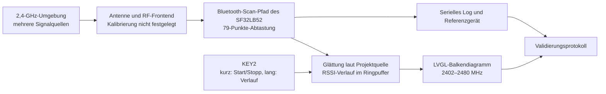

# Radiation Monitor – tragbare Signalstärkeanzeige für das Bluetooth-Band { #radiation-monitor-portable-signal-strength-detector }

## Was ist Radiation Monitor? { #what-is-radiation-monitor }

[SiFliSparks/RadiationMonitor](https://github.com/SiFliSparks/RadiationMonitor) ist ein tragbarer Anzeiger für die Signalstärke im Bluetooth-Band auf Basis von SF32LB52 und SiFli-SDK. Seine Firmware durchläuft 79 Frequenzpunkte von 2402 bis 2480 MHz und stellt die empfangenen Stärkewerte als LVGL-Balkendiagramm dar. KEY2 startet oder stoppt den Scan und blättert im gespeicherten Verlauf.

Das Projekt eignet sich zum Studium seines Scan-Pfads im Bluetooth-Band, der Echtzeit-Datenverarbeitung, der Frequenzvisualisierung und der Ein-Tasten-Bedienung. Es ist kein kalibrierter Spektrumanalysator und identifiziert nicht die Quelle des empfangenen Signals. Übertragungen im 2,4-GHz-Band in der Nähe und die Messbedingungen können das Diagramm beeinflussen. Ohne Kalibrierung und einen kontrollierten Vergleich sind seine Werte für regulatorische, Zertifizierungs- oder Präzisions-RF-Messungen ungeeignet.

<em>79-Punkte-Balkendiagramm-Oberfläche des Radiation Monitor</em>

## Warum die SF32-Implementierung? { #why-the-sf32-implementation }

SF32LB52 kombiniert Dual-Mode-Bluetooth 5.3, eine Dual-Core-MCU und Display-Fähigkeiten; das Projekt nutzt SiFli-SDK und LVGL, um Frequenzabtastung, Glättung, Verlaufspufferung und Bildschirmaktualisierung auf dem Gerät zu halten. Damit ist diese Referenz ein nützliches frühes Experiment für ein RF-Visualisierungspanel, einen Störungsanzeiger im Feld oder eine Diagnose-Oberfläche für die Produktion.

Das Repository legt weder ein Kalibrierverfahren noch ein Unsicherheitsbudget noch rückführbare Messbedingungen fest. Die Ergebnisse müssen daher für das genaue Silizium, die SDK- und Firmware-Revision, das Board, die Antenne, das Gehäuse, das Board-Rauschen und das Timing neu validiert werden. Die Übertragung der Methode auf ein anderes SF32LB52-Board oder eine Produkt-Leiterplatte erfordert eine erneute Validierung; eine erfolgreiche Kompilierung begründet keine Messgleichwertigkeit.

## Ergebnis, Umfang und Eintrittskriterien { #outcome-scope-and-entry-criteria }

**Ergebnis:** das 79-Punkte-Diagramm auf versionsgebundener SF32LB52-Hardware nachbauen, wiederholbares Starten/Stoppen prüfen, den tatsächlichen Glättungsalgorithmus und seine Tiefe anhand der festgelegten Quelle bestimmen, den dokumentierten Verlauf mit 10 Einträgen samt Wiederherstellung testen und dann genügend Nachweise sammeln, um zu entscheiden, ob Kalibrierung oder eigene Hardware eine Investition verdienen.

Diese Seite deutet die Balkenhöhe des RSSI nicht als Duty-Cycle, Durchsatz, Senderleistung, Protokollidentität oder regulatorische Spektralleistung. Sie behauptet auch nicht, dass das Repository ein vollständiges Produktionsdesign, eine Kalibriermethode oder eine ausdrückliche Softwarelizenz bereitstellt.

Halten Sie vor dem Start bereit:

- ein SF32LB52-Display-Board. Das README des Projekts nennt SF32LB52x und ein Ausgabeverzeichnis `build_sf32lb52-lchspi-ulp_hcpu`; die Liste der unterstützten Boards von SiFli nennt `sf32lb52-lchspi-ulp` für Huangshan Pi. Erfassen Sie die tatsächliche Board-Revision und prüfen Sie die Build-Konfiguration des Projekts;
- SiFli-SDK, SCons, einen Download-Pfad und die Aufzeichnung des seriellen Logs;
- eine steuerbare 2,4-GHz-Quelle oder mindestens zwei reproduzierbare Szenarien, etwa mit einem ausgewählten BLE-Advertiser, der ein- und ausgeschaltet wird;
- einen kalibrierten Spektrumanalysator oder ein Leistungsmessgerät sowie feste Bedingungen für Antenne, Abstand und Abschirmung, falls quantitative Genauigkeit gefordert ist;
- ein Testprotokoll für Bildschirmzustand, serielle Ausgabe, Board-Ausrichtung, Abstand, Versorgung und Umgebung.

<em>Tabelle: Projektbasis und Nachweise für den Radiation Monitor</em>

| Bereich | Festgelegte Quellbasis | Vor der Anpassung erforderliche Nachweise |
|:-----|:------------------------|:------------------------------------|
| Frequenz-Scan | 79 Punkte von 2402 bis 2480 MHz | Firmware-Commit, SDK-/Board-Revision und vollständiges Scan-Log |
| Verarbeitung | Die Modulbeschreibung im Upstream-README sagt, die vorherigen zehn Scans zu mitteln; die Übersicht nennt 30 Scans. Es bleibt offen, ob über lineare Leistung oder dBm gemittelt wird | Festgelegte Quellrevision, Mittelungsweise und -tiefe, Roh- und geglättete Ergebnisse sowie Vergleich mit stabiler Quelle |
| Verlauf | Ringverlauf mit zehn Einträgen | Protokoll zu Stoppen, Blättern, Umlauf und Neustart |
| UI | LVGL-Balkendiagramm mit nominaler Y-Achse von -110 bis -20 dBm | Bildschirmaufnahme und Prüfung der Zuordnung von Beschriftung zu Array |
| Messgrenze | Keine rückführbare Kalibrierung und keine Unsicherheitsangabe vorhanden | Referenzgerät, Messaufbau und Fehlerprotokoll oder ausdrückliche Kennzeichnung „nur relativer Trend“ |

## Hardware- und Software-Spezifikationen { #hardware-and-software-specifications }

### Hardware-Spezifikation { #hardware-specification }

<em>Tabelle: Hardware-Spezifikation des Radiation Monitor</em>

| Komponente | Erforderliche Spezifikation | Rolle | Status | Bezugsquelle | Hinweise zu Kompatibilität und Ersatz |
|:----------|:-----------------------|:-----|:-------|:----------------|:-------------------------------------|
| SF32LB52-LCHSPI-ULP / Huangshan Pi | Beginnen Sie mit dem SCons-Board-Target `sf32lb52-lchspi-ulp` von SiFli; erfassen Sie genaue Board-Revision, Antenne und Display-Bestückung | Führt Bluetooth-Scan, Diagramm, Bedienung und Verlaufs-UI aus | Erforderlich; genaue Bestückung ist zu bestätigen | [Zugehörige μForge-DevKit-ULP-Referenz](../sf32-products/devkits/SF32LB52-DevKit-ULP.md); [SiFli-Liste unterstützter Boards](https://docs.sifli.com/projects/sdk/latest/en/sf32lb52x/supported_boards/index.html); [LCKFB-Board-Seite](https://lckfb.com/project/detail/lckfb-hspi-sf32lb52-ulp?param=baseInfo); [Projektquelle](https://github.com/SiFliSparks/RadiationMonitor) | Das README-Ausgabeverzeichnis `build_sf32lb52-lchspi-ulp_hcpu` benennt weder die genaue Leiterplatte noch die Antennen- oder Display-Revision |
| Host, USB-Datenkabel und kontrollierte Stromquelle | Host mit den gewählten SiFli-SDK-Werkzeugen, datenfähiges Kabel, serielles Logging und überwachte Versorgung | Build, Download, Beobachtung und Wiederholung der Messungen | Erforderlich | [Schnellstart SiFli-SDK](https://docs.sifli.com/projects/sdk/latest/sf32lb52x/quickstart/index.html) | Erfassen Sie Port, Spannung, Host-/Werkzeugversionen und Wiederherstellungsmethode |

### Software-Spezifikation { #software-specification }

<em>Tabelle: Software-Spezifikation des Radiation Monitor</em>

| Paket oder Dienst | Erforderliche Version oder Revision | Rolle | Status | Bezugsquelle | Hinweise zu Kompatibilität und Aktualisierung |
|:-------------------|:-----------------------------|:-----|:-------|:----------------|:-------------------------------|
| SiFliSparks/RadiationMonitor | Festgelegter Commit [`670cf20`](https://github.com/SiFliSparks/RadiationMonitor/commit/670cf20b931e82b7ff1cd14fa6727e460c4f677a) | RF-Scan-Logik, 79-Punkte-Diagramm, Glättung und Verlauf | Erforderlich | [Repository](https://github.com/SiFliSparks/RadiationMonitor) | Die Beschreibungen der Glättung im README widersprechen sich; prüfen Sie die genaue Implementierung bei diesem Commit, bevor Sie eine Messbasis festlegen |
| OpenSiFli/SiFli-SDK | Der genaue Commit ist vom Projektartikel nicht festgelegt; wählen Sie eine kompatible Revision und erfassen Sie sie | RTOS, Bluetooth-Scan-Pfad, Display-Treiber sowie Build-/Download-Umgebung | Erforderlich | [Repository](https://github.com/OpenSiFli/SiFli-SDK) | Eine erfolgreiche Kompilierung begründet weder kalibrierte RF-Messungen noch Gleichwertigkeit auf einem anderen Board |
| SCons und SDK-Host-Werkzeuge | Versionen aus der gewählten SiFli-SDK-Umgebung | Target SF32LB52 bauen und herunterladen | Erforderlich | [Schnellstart SiFli-SDK](https://docs.sifli.com/projects/sdk/latest/sf32lb52x/quickstart/index.html) | Erfassen Sie das genaue Build-Target, das Host-Betriebssystem, die Werkzeugversionen und das erzeugte Image |

## Unterstützte Referenzkonfiguration auswählen { #choose-a-supported-baseline }

Verwenden Sie den festgelegten Projekt-Commit [`670cf20`](https://github.com/SiFliSparks/RadiationMonitor/commit/670cf20b931e82b7ff1cd14fa6727e460c4f677a) und nicht den beweglichen Branch `main`. Das README des Projekts nennt `build_sf32lb52-lchspi-ulp_hcpu` als Ausgabeverzeichnis; die Liste der unterstützten Boards von SiFli nennt `sf32lb52-lchspi-ulp` für Huangshan Pi / LCHSPI-ULP. Das legt den Board-Namen im SDK fest, nicht den genauen Projektbefehl oder die getestete Board-Bestückung. Das README gibt weder eine Board-Revision noch einen vollständigen SCons-Befehl an; bestätigen Sie daher die Build-Konfiguration des Projekts bei der ersten Reproduktion, statt anzunehmen, dass jedes SF32LB52x-Board unterstützt wird.

<em>Tabelle: Auswahl der Basis für den Radiation Monitor</em>

| Element | Wahl der Basis | Nicht annehmen |
|:--------|:----------------|:--------------|
| Board | Beginnen Sie mit dem SCons-Board-Argument `sf32lb52-lchspi-ulp` von SiFli; erfassen Sie die tatsächliche Leiterplatte und prüfen Sie die Projektkonfiguration | Dass das README-Ausgabeverzeichnis `build_sf32lb52-lchspi-ulp_hcpu` belegt, jeder Antennen- und Display-Pfad eines SF32LB52x-Boards sei gleichwertig |
| SDK | Erfassen Sie den SiFli-SDK-Commit, der erfolgreich baut | Nehmen Sie nicht an, dass das neueste SDK das Bluetooth-Scan-Verhalten des Projekts bewahrt |
| Glättung | Klären Sie die Abweichung im README zwischen 30 Scans und den vorherigen 10 Scans anhand des festgelegten Quellstands; prüfen Sie, ob über lineare Leistung oder dBm gemittelt wird, und bestimmen Sie die Tiefe | Die Modulbeschreibung nennt zehn Scans, die Übersicht 30, und keine nennt die Mittelungsweise |
| Timing | Das README nennt ein Datenaktualisierungsintervall von 30 ms; messen Sie die Zeit eines vollständigen 79-Punkte-Durchlaufs | Dass 30 ms eine garantierte Periode für die vollständige 79-Punkte-Aktualisierung sind |
| Lizenzierung | Bestätigen Sie die Lizenzen des Repositorys und des eingebundenen Codes vor Wiederverwendung oder Weitergabe | Dass öffentlich sichtbarer Quellcode automatisch Rechte zur Produktverbreitung gewährt |

!!! warning "Die Upstream-Dokumentation widerspricht sich bei der Glättungstiefe"
    Die Funktionsübersicht im README nennt eine Mittelung über 30 Scans, während die Modulbeschreibung die vorherigen zehn Scans nennt und `src/BT/bt_repeat.c` als Scan-Modul angibt. Es bleibt offen, ob die Werte als lineare Leistung oder in dBm gemittelt werden, und die beiden Zahlen belegen nicht, welches Verhalten der festgelegte Code umsetzt. Prüfen Sie genau diese Quellrevision und verifizieren Sie Mittelungsweise, Pufferlänge und Verhalten auf dem Gerät, bevor Sie eine der Zahlen als Messbasis behandeln. Das README nennt außerdem ein Datenaktualisierungsintervall von 30 ms, das nicht zwingend der Zeit für den Scan aller 79 Punkte entspricht.

## Projektphasen und Entscheidungspunkte { #delivery-map }

<em>Tabelle: Projektphasen und Entscheidungspunkte des Radiation Monitor</em>

| Phase | Entscheidungsfrage | Erforderliches Ergebnis |
|:------|:---------------------|:----------------|
| 1. Unveränderte Basis | Kann das Ziel-Board alle 79 Punkte zuverlässig scannen und anzeigen? | Protokoll zu Version, Board, Log, Bildschirm und kontrollierter Quelle |
| 2. Daten und Wiederherstellung | Sind Glättung, Stoppen, Verlauf und Reset-Verhalten vertrauenswürdig? | Deterministische Funktions- und Wiederherstellungstests |
| 3. Quellen-Reproduktion | Kann ein zweiter Ingenieur dasselbe Image neu bauen? | Sauberer Build, Image, Download und Wiederholungsergebnis |
| 4. Messanpassung | Lässt sich eine Änderung an Anzeige oder Kalibrierung ergänzen, ohne das Referenzverhalten zu verdecken? | Änderung, Vergleichsdaten, Fehler und Regressionsprotokoll |
| 5. Produktbewertung | Soll es ein Trendindikator bleiben oder zu einem Programm zur Entwicklung eines Messgeräts werden? | Genauigkeitsziel, Lizenzierung, Hardware und Risikoentscheidung |

## Systemarchitektur und Abhängigkeiten { #system-architecture-and-dependencies }

<em>Abbildung: Datenpfad des Radiation Monitor</em>

Die wesentlichen Fehlerdomänen sind RF-Eingang/Antenne, Scan-Verhalten und Kalibrierung, Datenverarbeitung, Verlaufspuffer, Zustandsautomat der Tasten, LVGL-Zuordnung und Versorgung. Ein hoher Balken bedeutet nur, dass die Implementierung einen relativ starken Empfangswert beobachtet hat; ohne kontrollierten Vergleich identifiziert er weder einen Sender noch eine Modulation noch einen Konformitätszustand.

## Phase 1 — Die unveränderte Scan-Basis herstellen { #stage-1-establish-the-untouched-scan-baseline }

**Ziel:** Nachweisen, dass die gewählte Hardware und Quelle eine wiederholbare 79-Punkte-Anzeige erzeugen.

1. Legen Sie die Commits von Repository und SiFli-SDK, die Board-Revision, die Antenne und den Display-Anschluss fest; bauen und laden Sie sauber herunter.
2. Starten Sie das Gerät bei unveränderter RF-Umgebung und erfassen Sie sein anfängliches Diagramm, die serielle Ausgabe und den Zustand von KEY2.
3. Drücken Sie KEY2 kurz, um den Scan zu starten. Bestätigen Sie Abdeckung und die X-Achsen-Referenzen bei 2402, 2441 und 2480 MHz.
4. Verwenden Sie einen kontrollierten BLE-Advertiser oder eine andere wiederholbare Quelle und erfassen Sie die Messwerte bei ein- und ausgeschalteter Quelle sowie bei verändertem Abstand und veränderter Board-Ausrichtung.
5. Setzen Sie zurück und wiederholen Sie; prüfen Sie, dass das 79-Punkte-Array und das Diagramm nicht verschoben sind und keine veralteten Daten behalten.

**Aufzubewahrende Nachweise:** Revisionen von Quelle/SDK/Board, Build-/Download-Logs, Beschreibung der Umgebung, Quelleneinstellungen, Abstand/Ausrichtung, serielles Log, Bildschirmaufnahmen und Reset-Ergebnis.

**Abnahmekriterium für Kontrollpunkt 1:** Bei zwei unabhängigen Starts werden 79 Punkte gescannt und angezeigt. Änderungen der kontrollierten RF-Umgebung schlagen sich im Diagramm reproduzierbar in der jeweiligen Richtung nieder; Display-Indizes und Frequenzbeschriftungen sind geprüft.

## Phase 2 — Verarbeitung, Verlauf und Wiederherstellung validieren { #stage-2-validate-processing-history-and-recovery }

**Ziel:** Nachweisen, dass die Benutzeroberfläche einen nachvollziehbaren Datenpfad darstellt und nicht bloß zufällige Balken anzeigt.

<em>Tabelle: Funktionsvalidierung des Radiation Monitor</em>

| Test | Methode | Nachweis des Bestehens |
|:-----|:-------|:--------------|
| Glättungsalgorithmus und -tiefe | Rohwerte und `rssi_res` für eine Frequenz aufzeichnen; mit der festgelegten Quelle vergleichen und die Abweichung im README klären | Mittelungsskala und -tiefe entsprechen der genauen Quellrevision und sind auf dem Gerät bestätigt |
| Start/Stopp | KEY2 während des Scans kurz drücken, dann fortsetzen | Stopp erhält den Verlauf; Fortsetzen läuft ohne Hänger weiter |
| Verlauf | Im gestoppten Zustand KEY2 mehrmals lang drücken | Bis zu zehn Einträge lassen sich rückwärts durchblättern und laufen korrekt um |
| Leerer Verlauf | Stoppen oder lang drücken, bevor ein gültiger Verlauf vorliegt | Kein Zugriff außerhalb der Grenzen und kein Absturz; die Benutzeroberfläche zeigt klar erkennbar an, dass keine Daten vorliegen |
| Reset | Reset während des Scans, im gestoppten Zustand und beim Blättern im Verlauf | Gerät kehrt in einen bekannten Anfangszustand ohne unerklärte veraltete Werte zurück |
| Änderung der Störsituation | Quelle, Abstand oder Abschirmung ändern | Reaktion ist wiederholbar; Latenz und Peak-Hold-Verhalten sind erfasst |

**Abnahmekriterium für Kontrollpunkt 2:** Glättung, Verlaufstiefe, Tastenzustand und Reset-Verhalten entsprechen der Quelle; abnormale Zustände sind sichtbar und bleiben nicht unbemerkt.

## Phase 3 — Eine reproduzierbare Quellbasis aufbauen { #stage-3-build-a-reproducible-source-baseline }

**Ziel:** Das Image aus Phase 2 in einer sauberen Umgebung reproduzieren.

1. Erfassen Sie Projekt-Commit, SDK-Commit, Host-Betriebssystem, Versionen von SCons/Compiler und das tatsächliche Board-Argument.
2. Entfernen Sie die Build-Ausgabe, konfigurieren Sie neu und bauen Sie erneut; sichern Sie Images, Speicher-/Partitionsausgabe und vollständige Logs.
3. Flashen Sie mit dem erzeugten Download-Skript und erfassen Sie Port, Baudrate und Ergebnis.
4. Wiederholen Sie dies auf einem zweiten Rechner oder in einem sauberen Verzeichnis und führen Sie die zentralen Prüfungen von Phase 2 erneut aus.

**Abnahmekriterium für Kontrollpunkt 3:** Das Projekt erzeugt ein im Verhalten gleichwertiges Image ohne nicht versionierte Board-Dateien, generierte Dateien oder veraltete Build-Artefakte.

## Phase 4 — Eine kontrollierte Mess- oder UI-Anpassung vornehmen { #stage-4-make-one-controlled-measurement-or-ui-adaptation }

**Ziel:** Eine Produktrichtung testen, ohne die ursprüngliche Basis zu verlieren.

Mögliche Änderungen sind Rohwert-Logging, ausdrückliche 1-MHz-Beschriftungen, Peak-Hold, ein anderer Verlaufsselektor, ein Kalibrier-Offset oder der Host-Export relativer Trends. Ändern Sie jeweils nur eine Klasse und bewahren Sie das ursprüngliche Image auf.

Definieren Sie bei einer Kalibrierung Referenzquelle, Frequenz, Eingangspegel, Antenne/Kabel, Abstand, Ausrichtung, Temperatur und Unsicherheit. Ein einziger globaler Offset reicht selten aus, um Frequenzgang, Board-Streuung und Gehäuseeffekte auszugleichen.

**Abnahmekriterium für Kontrollpunkt 4:** Die Änderung besteht die ursprünglichen Regressionstests für 79 Punkte, Start/Stopp, Verlauf, Reset und kontrollierte Quelle; jede Genauigkeitsaussage nennt das verwendete Referenzgerät und die Messbedingungen.

## Phase 5 — Prüfung der Produktreife { #stage-5-product-readiness-review }

Das Team muss beantworten:

- Braucht das Produkt nur relative Störungstrends oder rückführbare absolute RF-Leistung samt Messunsicherheit?
- Ist die Bluetooth-Scan-Implementierung des Projekts für das Ziel-Silizium und das SDK als unterstützt dokumentiert, und welche Grenzen gelten für Parallelbetrieb?
- Wie stark beeinflussen Antenne, Gehäuse, Display-Rauschen, DC/DC-Betrieb, Akkuladestand und Temperatur die Messergebnisse?
- Kann das Produkt während des Scans die erforderliche Bluetooth-Kommunikation aufrechterhalten, oder müssen sich die Funktionen gegenseitig ausschließen?
- Erfüllt die gemessene Latenz eines 79-Punkte-Scans mit quellengeprüfter Glättung die UI-Anforderung?
- Wie werden Vertrieb und kommerzielle Rechte geklärt, wenn RadiationMonitor und eingebundener Code keine ausdrückliche Lizenz auf oberster Ebene haben?

**Abnahmekriterium für Kontrollpunkt 5:** Für Messziel, Kalibrierplan, Strategie für den Funk-Parallelbetrieb, Lizenzierung sowie Hardware- und Softwareverantwortung sind Verantwortliche benannt und eine Entscheidung zum Fortfahren, Zurückstellen oder Stoppen ist dokumentiert.

## Übergabe an das Produktdesign { #handoff-to-product-design }

Übernehmen Sie das Ziel-SF32-Gerät, Board/Antenne, die Bluetooth-Scan-Implementierung und alle aus der festgelegten Quelle bestätigten Modus-/API-Einschränkungen, die Frequenz-/Datendefinition, Roh- und geglättete Aufzeichnungen, das UI-Aktualisierungsbudget, den Kalibrieraufbau, Tests des Versorgungsrauschens, den Wiederherstellungspfad und die Grenze des Produktionstests. Fahren Sie fort mit [SF32LB52x](../sf32-products/chips/SF32LB52x.md), [SF32LB52-DevKit-ULP](../sf32-products/devkits/SF32LB52-DevKit-ULP.md), dem [Hardware-Design-Leitfaden SF32LB52x](../hardware/chip-guides/SF32LB52x_hardware_design_guide.md) und den [RF-Leistungstests im SiFli-SDK](../develop/platforms/sifli-sdk/application-notes/rf-performance-tests.md).

## Maßgebliche Quellen { #authoritative-sources }

- [SiFliSparks/RadiationMonitor](https://github.com/SiFliSparks/RadiationMonitor)
- [Upstream-README auf `main`](https://github.com/SiFliSparks/RadiationMonitor/blob/main/README.md)
- [Festgelegter Referenz-Commit `670cf20`](https://github.com/SiFliSparks/RadiationMonitor/commit/670cf20b931e82b7ff1cd14fa6727e460c4f677a)
- [Projektkatalog von SiFli Sparks](https://sparks.sifli.com/#projects)
- [OpenSiFli/SiFli-SDK](https://github.com/OpenSiFli/SiFli-SDK)
- [Vom SiFli-SDK unterstützte Boards](https://docs.sifli.com/projects/sdk/latest/en/sf32lb52x/supported_boards/index.html)
- [RF-Testleitfaden des SiFli-SDK](https://docs.sifli.com/projects/sdk/latest/en/sf32lb52x/app_note/rf_test_guide.html)
- [Hardware-Überblick SF32LB52x](https://wiki.sifli.com/en/hardware/SF32LB52/SF32LB52-Overview-B3.html)
- [Schnellstart SiFli-SDK für SF32LB52x](https://docs.sifli.com/projects/sdk/latest/sf32lb52x/quickstart/index.html)
