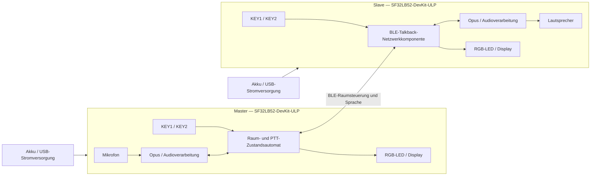

# SF32-BLE-Gegensprechanlage (Talkback) { #sf32-ble-talkback-intercom }

## Was ist Talkback? { #what-is-talkback }

[OpenSiFli Talkback](https://github.com/OpenSiFli/sifli-sdk-demo/tree/main/talkback) ist ein BLE-Sprechfunkbeispiel (Push-to-Talk, PTT) für mehrere Geräte auf dem `SF32LB52-DevKit-ULP`, auch bekannt als Huangshan Pi. Im Master-Modus erstellt ein Gerät einen Raum; im Slave-Modus sucht es nach einem Raum und tritt ihm bei. Nach dem Beitritt hält der Nutzer die Sprechtaste zum Senden gedrückt und lässt sie zum Beenden los. Die offizielle Referenz unterstützt bis zu acht Geräte und bis zu drei gleichzeitig sprechende Geräte.

Das Projekt verwendet Opus zur Sprachkodierung und kombiniert RGB-LED, Tasten und Display zu einer einfachen lokalen Benutzeroberfläche. Außerdem bietet es die Wiederverbindung eines Slaves per Tastendruck, die Anzeige von Akkuspannung und Akkustand, den Wechsel in den Schlafmodus nach 60 Sekunden ohne Eingabe sowie das Aus- und Einschalten per langem Tastendruck. Damit ist es eine nützlichere Referenz für ein tragbares Interkom als ein isoliertes Punkt-zu-Punkt-Audiobeispiel.

## Warum die SF32-Implementierung? { #why-the-sf32-implementation }

Dieser Pfad vereint BLE, Audio, Display, Tasten, Akkuüberwachung und Energiesparverhalten von SF32LB52 in einer funktionsfähigen Basis. Ein Team kann Netzwerk- und Audioleistung auf unterstützter Entwicklungshardware bewerten, bevor es in ein eigenes RF-, Audio- und Stromversorgungsdesign investiert.

„Bis zu acht Geräte und drei gleichzeitige Sprecher“ beschreibt eine Grenze der Upstream-Implementierung und ist keine Produkteigenschaft, die für jede Entfernung, Störung, Paketverlustrate und jedes Gleichzeitigkeitsmuster validiert wurde. Die Upstream-Unterlagen spezifizieren außerdem weder die Authentifizierung von Räumen noch die Verschlüsselungsrichtlinie der Verbindung noch eine Garantie für Sprachvertraulichkeit noch den regulatorischen Funkstatus noch die vollständigen Lizenzbedingungen der Binärkomponente `talk_back`. Jeder dieser Punkte muss separat für das Produkt geprüft werden.

**Hinweis zur Boardquelle:** Die chinesische SiFli-Wiki-Seite zum ULP-Board ist ausdrücklich als noch nicht verfügbar gekennzeichnet. Sie nennt nur den Einsatz für stromsparende Sensor- und Wearable-Anwendungen, 3- oder 6-Achsen-Sensoren sowie reservierte Messpunkte für den Energiesparbetrieb. Eine vollständige Boardspezifikation ist das nicht. Prüfen Sie Peripherie anhand der konkreten Boardrevision und des Schaltplans; die nachfolgend beschriebenen Talkback-Funktionen beruhen auf dem fixierten Anwendungscode.

## Ergebnis, Umfang und Eintrittskriterien { #outcome-scope-and-entry-criteria }

**Ergebnis:** Mit mindestens zwei Boards mit kontrollierter Revision Raumerstellung, Beitritt, PTT-Sprachübertragung, Verlassen/Wiederverbinden, Schlafen/Aufwachen und Akkustandsanzeige reproduzieren. Anschließend genügend Nachweise sammeln, um zu entscheiden, ob kundenspezifische Hardware gerechtfertigt ist.

**Nicht im Umfang:** Diese Seite weist keine große Reichweite, keine Sprachqualität bei schlechter Verbindung, keine Ende-zu-Ende-Verschlüsselung, keine Zertifizierung, keinen Stromverbrauch im Serienprodukt, keine Antennenkonstanz, keine regulatorische Konformität und keine Kompatibilität mit beliebigen BLE-Geräten nach.

**Eintrittskriterien:** Das Team kann eine SiFli-SDK-Buildumgebung installieren, Firmware per UART aufspielen, Protokolle untersuchen und Lautsprecher sowie Akku sicher anschließen. Für eine vollständige Sprachreferenz sind mindestens zwei Boards derselben Revision erforderlich.

<div align="center"><em>Tabelle: Projektbasis und Nachweise</em></div>

<div align="center" markdown>

| Bereich | Anforderung an die Basis | Vor dem Fortfahren zu sichernde Nachweise |
|:-----|:---------------------|:------------------------------------|
| Reproduktionsgrenze | Zuerst Upstream-Ziel, Abhängigkeiten und Standardbedienung unverändert übernehmen | Boardrevision, Anwendungs-Commit, SDK-Revision, Protokoll zur Abhängigkeitsauflösung und Firmware-Hash |
| Funktionsgrenze | Erstellen/Beitreten, PTT, Verlassen, Wiederverbinden des Slaves, Schlafen/Aufwachen und Akkuanzeige nachweisen | Ablaufprotokoll, UART-Protokolle, LED-Zustände und Ergebnisse der Fehlerwiederherstellung |
| Produktgrenze | Akustik, RF, Sicherheit, Datenschutz, Lizenzierung, Stromversorgung und Regulierung erfordern eine separate Produktvalidierung | Risiko, Verantwortlicher, Maßnahmenplan und Entscheidung zum Fortfahren oder Abbrechen |

</div>

## Hardware- und Software-Spezifikationen { #hardware-and-software-specifications }

### Hardware-Spezifikation { #hardware-specification }

<div align="center"><em>Tabelle: Hardware-Spezifikation</em></div>

<div align="center" markdown>

| Komponente | Erforderliche Spezifikation | Funktion | Status | Bezugsquelle | Hinweise zu Kompatibilität und Ersatz |
|:----------|:-----------------------|:-----|:-------|:----------------|:-------------------------------------|
| SF32LB52-DevKit-ULP / LCKFB-HSPI-SF32LB52-ULP | Ziel `sf32lb52-lchspi-ulp`; mindestens 2 und höchstens 8 Boards | Führt Talkback aus und stellt BLE, Mikrofon, Display, Tasten, RGB-LED sowie Strom- und Audiopfad bereit | Erforderlich | [μForge-Boardreferenz](../sf32-products/devkits/SF32LB52-DevKit-ULP.md); [LCKFB-Boardseite](https://lckfb.com/project/detail/lckfb-hspi-sf32lb52-ulp?param=baseInfo); [SiFli-Muster-/Kit-Shop](https://sifli.taobao.com/) | Jede Hardware-Revision dokumentieren; ein nicht validiertes SF32LB52-Board ist kein gleichwertiger Ersatz |
| Lautsprecher | Pro Board ein externer Lautsprecher mit 3 W/4 Ω oder 2 W/8 Ω am GH-1.25-mm-Stecker | Gibt empfangene Sprache wieder | Erforderlich | Häufig im Board-Kit enthalten; Lieferumfang vor dem Kauf anhand der [Boardreferenz](../sf32-products/devkits/SF32LB52-DevKit-ULP.md) prüfen | Keine Last anschließen, die außerhalb der Grenzen des Class-D-Verstärkers und Steckverbinders auf dem Board liegt |
| USB-Datenkabel und Host | Pro Board ein USB-C-Datenkabel; Host muss SiFli-SDK-Werkzeuge ausführen können | Stromversorgung, Firmwareübertragung per UART und Protokollierung | Erforderlich | Standard-USB-C-Datenkabel; Werkzeuge über [SiFli-SDK](https://github.com/OpenSiFli/SiFli-SDK) | Ladekabel ohne Datenleitungen können keine Firmware aufspielen; Portzuordnungen und Hostumgebung dokumentieren |
| Lithium-Einzelzellenakku | Muss zu Boardstecker, Polarität und Ladepfad passen | Mobiler Betrieb sowie Validierung von Schlaf-/Aufwachverhalten und Akkustandsanzeige | Für die Produktvalidierung erforderlich; für Labortests optional | Talkback veröffentlicht keinen separaten Bezugsweg; Schnittstelle vor der Beschaffung in der [Boardreferenz](../sf32-products/devkits/SF32LB52-DevKit-ULP.md) prüfen | Vor dem Anschluss Polarität, Spannungsbereich, Kapazität und Schutzschaltung prüfen; die Steckerform allein belegt keine Kompatibilität |
| Integriertes Mikrofon, Tasten, RGB-LED und Display | Originalkomponenten des Entwicklungsboards | Erfasst Sprache und zeigt Rolle, Kopplung, Sprechen, Empfang und Schlafzustand an | Integriert | Im Board enthalten; nicht separat beschafft | Ein Austausch von Audio- oder HMI-Hardware ist eine Anpassung und erfordert Regressionstests für Verstärkung, Timing, Tastencodes und Zustandszuordnung |

</div>

### Software-Spezifikation { #software-specification }

<div align="center"><em>Tabelle: Software-Spezifikation</em></div>

<div align="center" markdown>

| Paket oder Dienst | Erforderliche Version oder Revision | Funktion | Status | Bezugsquelle | Hinweise zu Kompatibilität und Aktualisierung |
|:-------------------|:-----------------------------|:-----|:-------|:----------------|:-------------------------------|
| OpenSiFli `sifli-sdk-demo/talkback` | Für diesen Artikel geprüfter Commit [`6fa55ac`](https://github.com/OpenSiFli/sifli-sdk-demo/commit/6fa55ac65b51fca5eac6660a7e481a30e07388ee) | Anwendung, Boardkonfiguration und Build-Einstiegspunkt | Erforderlich | [Talkback-Quellverzeichnis](https://github.com/OpenSiFli/sifli-sdk-demo/tree/main/talkback) | Upstream-Branch `main` ändert sich; vor dem Sammeln von Nachweisen einen Commit fixieren. Der aktuelle Pfad lautet `talkback/project`; der README-Pfad `example/ble/talkback/project` ist veraltet |
| SiFli-SDK | `conanfile.py` erklärt Kompatibilität mit `^2.4`; Upstream fixiert keinen exakten SDK-Commit | Grundlage für RT-Thread, BLE, Audio, Stromversorgung, Build und Firmwareübertragung | Erforderlich | [OpenSiFli/SiFli-SDK](https://github.com/OpenSiFli/SiFli-SDK) | Einen konkreten Commit auswählen, der `^2.4` erfüllt, und dokumentieren; ein beweglicher `main`-Branch ist keine Basisrevision |
| `talk_back/1.2@sifli` | `1.2` | BLE-Talkback-Netzwerk-/Audiokomponente | Erforderlich | Über das [Conan-Manifest](https://github.com/OpenSiFli/sifli-sdk-demo/blob/6fa55ac65b51fca5eac6660a7e481a30e07388ee/talkback/project/conanfile.py) des Projekts aufgelöst | Upstream veröffentlicht dort weder eigenständigen Quellcode noch Paket-Hash noch Paketserver noch vollständige Lizenzangaben. Vor Produkteinsatz Paket und Auflösungsprotokoll archivieren und dieses Risiko schließen |
| Opus- und WebRTC-AECM/AGC-Konfiguration | Wird gemeinsam durch fixierte Anwendung, SDK und Conan-Abhängigkeit bestimmt | Sprachkodierung, Echobehandlung und Verstärkungsregelung | Erforderlich | [Projektkonfiguration](https://github.com/OpenSiFli/sifli-sdk-demo/blob/6fa55ac65b51fca5eac6660a7e481a30e07388ee/talkback/project/proj.conf) und fixierte SDK-Abhängigkeiten | Nicht nur Feature-Makros dokumentieren; aufgelöste Bibliotheksversionen und Lizenzunterlagen sichern |
| SCons, Compiler und UART-Flashwerkzeuge | Versionen passend zum ausgewählten SiFli-SDK | Konfiguration, Build und Flashen der Images | Erforderlich | In der Umgebung des [ausgewählten SiFli-SDK](https://github.com/OpenSiFli/SiFli-SDK) enthalten | Hostbetriebssystem, Toolchain-Version, Buildbefehl und Hash des erzeugten Skripts dokumentieren |

</div>

## Unterstützte Referenzkonfiguration auswählen { #choose-a-supported-baseline }

Beginnen Sie mit zwei `SF32LB52-DevKit-ULP`-Boards derselben Revision. Fixieren Sie das Demo-Repository auf `6fa55ac`, wählen und dokumentieren Sie einen konkreten SiFli-SDK-Commit, der `^2.4` erfüllt, und sichern Sie die Conan-Auflösung für `talk_back/1.2@sifli`. Ändern Sie bei der ersten Reproduktion weder Audioparameter noch Rollenlogik noch Energiespar-Timing.

Wechseln Sie vom Repository-Stamm in den tatsächlich vorhandenen Pfad:

```bash
cd talkback/project
scons --board=sf32lb52-lchspi-ulp -j8
```

Unter Windows lautet der Dateiname des erzeugten Flashskripts `build_sf32lb52-lchspi-ulp_hcpu\uart_download.bat`. Führen Sie es aus und geben Sie bei Aufforderung den passenden COM-Port an. Verwenden Sie auf allen Geräten dasselbe Basisimage und dokumentieren Sie Boardkennung und Image-Hash jedes Geräts.

### Standardsteuerung und Statusanzeige { #default-controls-and-state-indication }

<div align="center"><em>Tabelle: Standardverhalten von Tasten und LEDs</em></div>

<div align="center" markdown>

| Zustand | KEY1 | KEY2 | LED |
|:------|:-----|:-----|:----|
| Standby | Ein Slave, der zuvor erfolgreich beigetreten ist, stellt mit kurzem Druck die Verbindung wieder her; andernfalls setzt kurzer Druck den Schlaf-Timer zurück | Kurzer Druck wechselt zwischen Master und Slave; langer Druck startet die Kopplung | Master dauerhaft blau; Slave dauerhaft rot |
| Kopplung | — | Master erstellt einen Raum; Slave sucht danach | Master blinkt blau; Slave blinkt rot |
| Warten auf den Start | — | Master bestätigt den Start mit langem Tastendruck | Master blinkt blau; Slave blinkt rot |
| Im Raum | Zum Verlassen zuerst KEY2 loslassen und dann kurz drücken | Zum Sprechen gedrückt halten; zum Beenden loslassen | Beim Sprechen dauerhaft grün; beim Empfang dauerhaft orange |
| Schlafmodus | Beliebige Taste weckt das Gerät auf | Beliebige Taste weckt das Gerät auf | Aus |

</div>

## Projektphasen und Entscheidungspunkte { #delivery-map }

<div align="center"><em>Tabelle: Projektphasen und Entscheidungspunkte</em></div>

<div align="center" markdown>

| Phase | Entscheidungsfrage | Mindestnachweise |
|:------|:-------------------|:-----------------|
| Unveränderte Basis etablieren | Lassen sich die fixierten Quellen zuverlässig bauen, flashen und starten? | Versionsmanifest, Protokoll eines sauberen Builds, Image-Hash und Startprotokoll |
| Sprache zwischen zwei Geräten validieren | Funktionieren Raumerstellung, Beitritt und PTT im Standardablauf? | Rollen, LEDs, Tastenaktionen und bidirektionaler Sprachtest mit zwei Geräten |
| Netzwerk und Wiederherstellung validieren | Sind die Grenzen für Verlassen, Timeout, Wiederverbindung und Gleichzeitigkeit akzeptabel? | Fehler-Injektionsmatrix, Wiederherstellungszeit, Protokolle und Fehlerzustände |
| Audio und Stromversorgung bewerten | Passen Akustik und Akkuverhalten zum vorgesehenen Formfaktor? | Messungen von Audioqualität, Latenz, Reichweite, Stromaufnahme, Schlaf- und Aufwachverhalten |
| Produktreife bewerten | Gibt es genügend Nachweise, um eigene Hardware zu finanzieren? | Risikoregister, Verantwortliche und Entscheidung zum Fortfahren, Zurückstellen oder Abbrechen |

</div>

## Systemarchitektur und Abhängigkeiten { #system-architecture-and-dependencies }

<div align="center"><em>Abbildung: Talkback-Geräterollen sowie Audio- und Steuerpfade</em></div>



Die wichtigsten Fehlerbereiche sind BLE-Scan und Raumerstellung, Synchronisierung des Raumzustands, Planung gleichzeitiger Sprecher, Opus-/Akustikpfad, Tastenereignisse, niedriger Akkustand und Schlafmodus, Wiederherstellung per Einschalttaste sowie nicht veröffentlichte Details zur Komponente und Lizenzierung. Prüfen Sie zuerst Rolle und Zustand und unterscheiden Sie anschließend Funk-, Audio- und lokale Stromversorgungsfehler.

## Phase 1 — Die unveränderte Quellbasis etablieren { #stage-1-establish-the-untouched-source-baseline }

**Ziel:** Nachweisen, dass fixierte Quellen, SDK und aufgelöste Abhängigkeiten reproduzierbar dasselbe Image erzeugen.

1. Fixieren Sie Anwendung und konkreten SDK-Commit; sichern Sie die Ausgabe der Abhängigkeitsauflösung.
2. Bauen Sie `sf32lb52-lchspi-ulp` in einem sauberen Verzeichnis und laden Sie die Firmware auf zwei Boards.
3. Prüfen Sie, dass jedes Gerät als Slave mit dauerhaft roter LED startet, und testen Sie anschließend Tasten, Display, Akku- und Lautsprecherpfad.

**Aufzubewahrende Nachweise:** vollständiges Versionsmanifest, Build- und Flashprotokolle, Firmware-Hashes, beide Boardrevisionen und Startprotokolle.

**Abnahmekriterium für Kontrollpunkt 1:** Dieselben Eingaben erzeugen reproduzierbar dasselbe Basisimage, das auf beide Geräte geladen wird; der Startzustand entspricht dem Upstream-Verhalten.

## Phase 2 — Raum-Setup und bidirektionales PTT validieren { #stage-2-validate-room-setup-and-bidirectional-ptt }

**Ziel:** Nachweisen, dass Nutzer ohne Eingriff über einen Debugger einen minimalen Raum erstellen und verwenden können.

1. Drücken Sie im Standby KEY2 kurz, um ein Gerät mit dauerhaft blauer LED zum Master zu machen; das andere bleibt der rote Slave.
2. Halten Sie KEY2 auf beiden Geräten gedrückt: Der Master erstellt einen Raum, der Slave sucht danach. Nach 30 Sekunden läuft die Kopplung ab.
3. Halten Sie im Wartezustand KEY2 am Master gedrückt, um zu starten. Im Sprechzustand halten Sie KEY2 zum Sprechen gedrückt und lassen die Taste zum Beenden los.
4. Prüfen Sie dauerhaftes Grün beim Senden, dauerhaftes Orange beim Empfangen sowie verständliche Sprache in beide Richtungen.

**Aufzubewahrende Nachweise:** Rollen, zeitlicher Bedienablauf, LED-Zustände, UART-Protokolle, Audioaufnahmen in beide Richtungen und Ergebnisse von Wiederholungsversuchen.

**Abnahmekriterium für Kontrollpunkt 2:** Mindestens zwei Geräte führen wiederholt bidirektionale PTT-Sitzungen aus; Anzeigen entsprechen der tatsächlichen Audiorichtung und der 30-Sekunden-Timeout führt in einen nachvollziehbaren Zustand zurück.

## Phase 3 — Verlassen, Wiederverbindung und Kapazitätsgrenzen validieren { #stage-3-validate-leave-reconnect-and-capacity-boundaries }

**Ziel:** Sicherstellen, dass Upstream-Wiederherstellungspfade und Kapazitätsgrenzen Nutzer nicht in einem unerreichbaren Zustand zurücklassen.

1. Lassen Sie im Sprechzustand KEY2 los, bevor Sie KEY1 kurz drücken, um den Raum zu verlassen. Während des Sendens kann ein Gerät den Raum nicht verlassen.
2. Ein Slave, der zuvor erfolgreich beigetreten ist, kann im Standby durch kurzes Drücken von KEY1 die Verbindung wiederherstellen. Für den Master gibt es keinen entsprechenden Wiederverbindungspfad.
3. Testen Sie Betrieb außerhalb der Reichweite, Kopplungs-Timeout, Verlust des Masters und Neustart nach Unterbrechung der Stromversorgung.
4. Falls Mehrparteienbetrieb erforderlich ist, skalieren Sie auf die vorgesehene Teilnehmerzahl und prüfen Sie die angegebenen Grenzen von acht Geräten und drei gleichzeitigen Sprechern.

**Aufzubewahrende Nachweise:** Anfangszustand, Auslöser, Wiederherstellungsaktion, Wiederherstellungszeit, Protokolle und abschließende Raumzugehörigkeit für jeden Fehlerfall.

**Abnahmekriterium für Kontrollpunkt 3:** Für jeden relevanten Fehlerfall existiert ein expliziter, reproduzierbarer und für Nutzer verständlicher Wiederherstellungspfad. Erforderliche Kapazität und Gleichzeitigkeit wurden in der RF-Umgebung des Zielprodukts gemessen und nicht lediglich aus einer Grenzwertangabe übernommen.

## Phase 4 — Audio, RF-Leistung und Energieverbrauch bewerten { #stage-4-qualify-acoustics-rf-and-low-power }

**Ziel:** Entscheiden, ob sich das Verhalten auf dem Entwicklungsboard auf das vorgesehene Gehäuse, die Reichweite und die Betriebsdauer übertragen lässt.

1. Dokumentieren Sie Verständlichkeit, Übersteuerung, Echo und abgeschnittene PTT-Anfänge/-Enden unter ruhigen Bedingungen, bei beidseitigem Sprechen im Nahbereich, Hintergrundgeräuschen und mehreren Lautstärkeeinstellungen.
2. Erfassen Sie Verbindung, Aussetzer und Wiederherstellung bei Zieldistanz, Hindernissen und 2,4-GHz-Störungen.
3. Prüfen Sie Schlafmodus nach 60 Sekunden ohne Eingabe, Rücksetzen der Rolle auf Slave, Aufwecken mit beliebiger Taste, Ein-/Ausschalten per langem Tastendruck und LED-Anzeige bei weniger als 20 % Akkuladung.
4. Messen Sie die Stromaufnahme im Standby, beim Senden und Empfangen, im Schlafmodus und beim Aufwachen. Setzen Sie Messwerte des Entwicklungsboards nicht mit der Akkulaufzeit des Endprodukts gleich.

**Aufzubewahrende Nachweise:** Umgebungsbedingungen, Ausrichtung von Board und Antenne, Audioaufnahmen, Abstand und Störungen, Stromverläufe, Akkubedingungen und Wiederherstellungsergebnisse.

**Abnahmekriterium für Kontrollpunkt 4:** Das Produktteam hat Akustik-, RF-, Strom- und Aufweckgrenzwerte für die Zielumgebung festgelegt und erreicht; für jede Abweichung sind Verantwortliche und Maßnahmen bestimmt.

## Phase 5 — Produktreife-Überprüfung { #stage-5-product-readiness-review }

Beantworten Sie vor der Entwicklung kundenspezifischer Hardware mindestens folgende Fragen:

- Wie identifiziert ein Raum vertrauenswürdige Geräte, und welche Authentifizierung, Verschlüsselung und welcher Replay-Schutz schützen Sprach- und Steuerdaten?
- Wer verantwortet Lizenzierung, Quellcodebereitstellung und Reaktion auf Sicherheitslücken für `talk_back/1.2@sifli`, Opus, WebRTC-Komponenten und Repository-Quellcode?
- Welche Reichweite, Latenz, Paketverluste und Wiederherstellung wurden mit der Zielantenne, dem Gehäuse, Körperabschattung und gleichzeitiger Nutzung gemessen?
- Wie erfüllen Mikrofon, Verstärker, Lautsprechergehäuse und Lautstärkegrenzen die Akustik- und Sicherheitsanforderungen?
- Wie stellt sich das Gerät nach niedrigem Akkustand, ungewöhnlichem Stromausfall, beschädigter Firmware oder fehlgeschlagenem Feldupdate wieder her?
- Welche Konformitätsaktivitäten für Bluetooth, EMV, Funk und Akku fallen an?

**Abnahmekriterium für Kontrollpunkt 5:** Das Risikoregister enthält Nachweise, Verantwortliche, Gegenmaßnahmen und eine ausdrückliche Entscheidung zum Fortfahren, Zurückstellen oder Abbrechen. Sicherheits-, Lizenz- und Regulierungsfragen dürfen nicht als Aufgaben für „später“ ohne Zuständigkeit offenbleiben.

## Übergabe an das Produktdesign { #handoff-to-product-design }

Das Übergabepaket sollte fixierte Quellen, SDK und Abhängigkeiten, Rollen und Zustandsautomat, Kapazitäts- und Wiederherstellungsmatrix, Audio-/RF-/Strommessungen, Antennen- und Akustikannahmen, Grenzen für Akku und Ladung, Sicherheits-/Datenschutzmodell, Lizenzunterlagen, Anforderungen an Produktionstests und Wiederherstellungsplan enthalten. Nutzen Sie den [Integrationspfad für SF32LB52x](../sf32-products/chips/SF32LB52x.md#integration-path), um Chip, Modul, Board, Hardware-Design-Leitfaden und Checkliste auszuwählen. Übertragen Sie validiertes Verhalten in Schaltplan und Layout der eigenen Hardware und prüfen Sie es erneut, statt Erkenntnisse vom Entwicklungsboard ungeprüft zu übernehmen.

## Maßgebliche Quellen { #authoritative-sources }

- [OpenSiFli-Talkback-Verzeichnis](https://github.com/OpenSiFli/sifli-sdk-demo/tree/main/talkback)
- [Geprüfter Anwendungs-Commit `6fa55ac`](https://github.com/OpenSiFli/sifli-sdk-demo/commit/6fa55ac65b51fca5eac6660a7e481a30e07388ee)
- [Offizielles Talkback-README](https://github.com/OpenSiFli/sifli-sdk-demo/blob/6fa55ac65b51fca5eac6660a7e481a30e07388ee/talkback/README.md)
- [Conan-Manifest von Talkback](https://github.com/OpenSiFli/sifli-sdk-demo/blob/6fa55ac65b51fca5eac6660a7e481a30e07388ee/talkback/project/conanfile.py)
- [Talkback-Projektkonfiguration](https://github.com/OpenSiFli/sifli-sdk-demo/blob/6fa55ac65b51fca5eac6660a7e481a30e07388ee/talkback/project/proj.conf)
- [OpenSiFli/SiFli-SDK](https://github.com/OpenSiFli/SiFli-SDK)
- [Offizielle SiFli-Wiki-Quelle zum SF32LB52-DevKit-ULP](https://github.com/OpenSiFli/SiFli-Wiki/blob/main/source/en/board/sf32lb52x/SF32LB52-DevKit-ULP.md)
- [Chinesische SiFli-Wiki-Quelle für SF32LB52-DevKit-ULP](https://github.com/OpenSiFli/SiFli-Wiki/blob/main/source/zh_CN/board/sf32lb52x/SF32LB52-DevKit-ULP.md)
