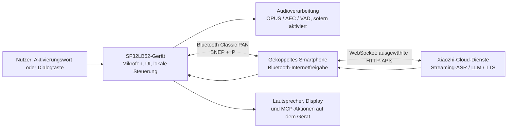

# SF32-Sprachassistent Xiaozhi { #sf32-xiaozhi-voice-assistant }

## Was ist Xiaozhi? { #what-is-xiaozhi }

[Xiaozhi](https://github.com/78/xiaozhi-esp32) ist ein Open-Source-Sprach-Chatbot auf Basis von MCP, der 2025 durch seine ESP32-Implementierung breite Bekanntheit erlangte. Er verbindet ein Gerät für Sprachinteraktion mit Cloud-Diensten für große Sprachmodelle sowie MCP-Erweiterungen auf dem Gerät oder in der Cloud. Damit ist er ein praktischer Ausgangspunkt für Hardware mit dialogbasierter KI und nicht nur eine Text-Chat-Anwendung.

## Warum die SF32-Implementierung? { #why-the-sf32-implementation }

[78/xiaozhi-sf32](https://github.com/78/xiaozhi-sf32) ist die SF32-Implementierung, verwendet jedoch bewusst ein anderes Verbindungskonzept. Während das ursprüngliche ESP32-Projekt WLAN und weitere direkte Netzwerkverbindungen unterstützt, bezieht die SF32-Version den Internetzugang über [Bluetooth PAN](../learn/bluetooth/pan.md) im Classic-Modus von einem gekoppelten Smartphone. Dadurch verlagert sich die Last der Weitverkehrsverbindung vom Gerät auf das Smartphone. Bei einem smartphonegebundenen Produkt kann das den netzwerkbedingten Stromverbrauch des Geräts deutlich senken; die tatsächliche Einsparung hängt jedoch vom Smartphone, den Funkbedingungen, dem Zeitanteil aktiver Dialoge und der Energierichtlinie ab. Der Ansatz eignet sich daher besonders für akkubetriebene, persönliche tragbare Produkte wie Anhänger, Abzeichen, kompakte Assistenten und kleine Wearables.

Die Referenz ist eine ungewöhnlich nützliche Produktreferenz, weil sie Bereiche zusammenführt, die oft getrennt betrachtet werden: Display- und Audiohardware, vom Smartphone bereitgestellte Netzwerkverbindung, Cloud-Sprachdienst, Aktivierungsablauf für Nutzer, Gerätesteuerung und Updates im Einsatz.

## Ergebnis, Umfang und Eintrittskriterien { #outcome-scope-and-entry-criteria }

Diese Seite beschreibt einen vollständigen technischen Weg, um die Referenz in eine Produktrichtung zu überführen. Sie behauptet **nicht**, dass Xiaozhi ein Offline-LLM auf dem Gerät ist, jede Upstream-Funktion für die Produktion qualifiziert wurde oder ein unterstütztes Entwicklungsboard einem zertifizierten Endprodukt entspricht. Das Gerät erhält den Internetzugang über Bluetooth PAN von einem gekoppelten Smartphone und nutzt für den Dialog die Xiaozhi-Cloud-Dienste. Vor einer Produktentscheidung sind Nutzungsbedingungen, Kontoinhaberschaft, Datenschutz, Sicherheit, Kosten, Verfügbarkeit und regionale Eignung zu klären.

**Ergebnis:** ein reproduzierbarer Sprach- und Displayassistent, der über ein Smartphone eingerichtet werden kann, einen Cloud-gestützten Dialog führt, eine sichere Gerätefunktion steuert, eine unterbrochene PAN-Verbindung wiederherstellt und die Nachweise für die Entscheidung über eigene Hardware liefert.

**Zielgruppe:** Firmware-, Hardware- und Produktentwickler, die bereits eine SF32-Basis bauen und flashen können und mit C/C++, Board-Schaltplänen, Bluetooth-Konfiguration und Cloud-Dienstintegration zu arbeiten bereit sind.

<div align="center"><em>Tabelle: Projektvertrag</em></div>

<div align="center" markdown>

| Bereich | Projektbasis | Nachweise vor der nächsten Phase |
|:-----|:-----------------|:-------------------------------|
| Hardware | Dokumentiertes SF32LB52-Xiaozhi-Ziel mit Audio-/Displaypfad, USB-Flashanschluss und Stromversorgung | Kaltstart, Tasten, Display, Mikrofon, Lautsprecher sowie Lade-/Akkuanzeige, sofern vorhanden |
| Verbindung | Smartphone, das als `sifli-pan` gekoppelt werden und Bluetooth-PAN-Internetfreigabe bereitstellen kann | Die Board-UI bestätigt PAN; Unterbrechung und Wiederverbindung sind reproduzierbar |
| Dienst | Xiaozhi-Konto, Geräteaktivierung und über die Xiaozhi-Konsole konfigurierter Agent | Eine Dialoganfrage erreicht den Dienst und die Antwort kehrt zum Board zurück |
| Firmware | Dokumentierter Upstream-Commit, SDK-Submodulrevision, Boardziel und Build-/Downloadmethode | Reproduzierbarer sauberer Build, Flashvorgang, serielles Protokoll und Firmwareartefakt |
| Produktanpassung | Eine bewusst begrenzte Änderung, etwa Markenauftritt der UI, Gerätename, Akkukurve oder ein sicherer MCP-gesteuerter Ausgang | Der ursprüngliche Sprachdialog funktioniert danach weiterhin |

</div>

## Hardware- und Software-Spezifikationen { #hardware-and-software-specifications }

Das folgende Manifest beschreibt eine konkrete Referenz für den Build aus Quellcode: **SF32LB52-DevKit-Nano-R16N16 V1.0.0** mit dem von SiFli dokumentierten externen Display und Audiokreis. Es ist keine allgemeingültige Stückliste für alle unterstützten Xiaozhi-Boards. Wenn Sie DevKit-ULP, DevKit-LCD oder Xiaotangyuan verwenden, ersetzen Sie das gesamte Hardwaremanifest durch die dokumentierte Bestückung dieses Boards und halten Sie die genauen Lieferantenteile und die Boardrevision fest.

### Hardware-Spezifikation { #hardware-specification }

<div align="center"><em>Tabelle: Hardwarespezifikation der Xiaozhi-Nano-Referenz</em></div>

<div align="center" markdown>

| Komponente | Erforderliche Spezifikation | Funktion | Status | Bezugsquelle | Hinweise zu Kompatibilität und Ersatz |
|:----------|:-----------------------|:-----|:-------|:----------------|:-------------------------------------|
| SF32LB52-DevKit-Nano-R16N16 V1.0.0 | SF32LB52JUD6, 16 MB OPI-PSRAM und 16 MB SPI-NOR-Flash | SF32-Verarbeitung, Bluetooth PAN, USB-Download/Debug, UI und Audioschnittstellen | Erforderlich | [SiFli-Produktseite](https://www.sifli.com/zh-hans/SF32LB52_DevKit_Nano); [offizieller SiFli-Shop](https://sifli.taobao.com/) | Die Nano-N4-Variante nicht ohne erneute Prüfung von Firmwareziel und Speicherbudget einsetzen. PCB-Revision des Boards und Bestelllink des Lieferanten dokumentieren. |
| 1,85-Zoll-AMOLED 390 × 450 mit FPC-Adapter 16 auf 22 Pins | QSPI-Displaybaugruppe und FPC-Pinbelegung gemäß offizieller Xiaozhi-Nano-Verdrahtung | Benutzeroberfläche | Erforderlich | [Offizielle Hardwareanleitung für Xiaozhi Nano](https://docs.sifli.com/projects/xiaozhi/get-started/SF32LB52-DevKit-Nano/) | Die offizielle Seite enthält keinen Bestelllink. Panelcontroller, FPC-Ausrichtung, Lieferanten-Teilenummer und Bezugslink fixieren, bevor die Basis als reproduzierbar gilt. |
| Analoges MEMS-Mikrofonmodul | Analogausgang kompatibel mit `MIC_BIAS`, `MIC_ADC` und GND | Sprachaufnahme | Erforderlich | [In der offiziellen Anleitung veröffentlichter Bauteillink](https://item.taobao.com/item.htm?id=595237371680) | Für Ersatz sind Bias, Ausgangspegel, Rauschen und Akustik zu validieren. |
| Verstärkermodul PAM8302 | Differenzeingang von `DACP`/`DACN`; Abschaltung über `PA30` | Lautsprecheransteuerung | Erforderlich | [In der offiziellen Anleitung veröffentlichter Bauteillink](https://item.taobao.com/item.htm?id=535743493142) | Einen anderen Verstärker als Hardwareanpassung behandeln; Enable-Polarität, Verstärkung, Ruhestrom und Rauschen erneut prüfen. |
| Lautsprecher mit Gehäuse | 8 Ω, 2–3 W | Sprachwiedergabe | Erforderlich | [In der offiziellen Anleitung veröffentlichter Bauteillink](https://item.taobao.com/item.htm?id=895176389650) | Bei anderem Gehäuse oder anderer Impedanz Akustik, Verstärkertemperatur und Strom erneut validieren. |
| Jumper-Kabel und Steckbrett mit 400 Kontakten | Kabelsatz und Steckbrett passend zum dokumentierten Nano-Prototyp | Prototypverdrahtung | Für den dokumentierten Prototyp erforderlich | [Jumper-Kabel](https://item.taobao.com/item.htm?id=39961676503); [Steckbrett mit 400 Kontakten](https://item.taobao.com/item.htm?id=39828824454) | Erst nach bestandener Prüfung der Referenzverdrahtung und exakter Übertragung der Pinbelegung durch eine geprüfte Leiterplatte ersetzen. |
| USB-Type-C-Datenkabel und Entwicklungsrechner | Datenfähiges Type-C-Kabel; Host mit Windows, Linux oder macOS | Stromversorgung, Flashen, Build und serielle Protokolle | Erforderlich | [Voraussetzungen für SiFli-SDK](https://docs.sifli.com/projects/sdk/latest/en/sf32lb52x/quickstart/get-started.html) | Ein reines Ladekabel kann weder flashen noch Protokolle aufzeichnen. Hostbetriebssystem und Architektur dokumentieren. |
| Android- oder iOS-Smartphone mit Bluetooth-Internetfreigabe | Muss sich als `sifli-pan` koppeln und Bluetooth-PAN-Internetzugang im Classic-Modus bereitstellen | Netzwerkpartner | Erforderlich | [Offizielle Xiaozhi-PAN-Einrichtung](https://docs.sifli.com/projects/xiaozhi/get-started/) | Smartphone-Modell und Betriebssystemversion dokumentieren. Verlust, erneute Kopplung und Freigabeverhalten für jede unterstützte Kombination aus Telefon und Betriebssystem validieren. |

</div>

Die oben genannten Links zu Drittanbieterkomponenten sind Marktplatzangebote aus der offiziellen SiFli-Nano-Anleitung und keine dauerhafte Zusicherung von Hersteller-Teilenummern. Bewahren Sie für die bewerteten Teile Screenshots oder Bestellnachweise auf und ersetzen Sie vor dem Produktdesign jede Marktplatzabhängigkeit durch eine qualifizierte Lieferanten-Teilenummer samt Datenblatt.

### Software-Spezifikation { #software-specification }

<div align="center"><em>Tabelle: Softwarespezifikation der Xiaozhi-Referenz</em></div>

<div align="center" markdown>

| Paket oder Dienst | Erforderliche Version/Revision | Funktion | Status | Bezugsquelle | Hinweise zu Kompatibilität und Updates |
|:-------------------|:-----------------------------|:-----|:-------|:----------------|:-------------------------------|
| Vorgefertigte Xiaozhi-SF32-Firmware | v1.4.0 | Unverändertes Referenzimage für Basis und Wiederherstellung | Für Phasen 1–2 erforderlich | [Release v1.4.0](https://github.com/78/xiaozhi-sf32/releases/tag/v1.4.0) | Für die Nano-R16N16-Basis `sf32lb52-nano_52j.zip` auswählen. Archive verschiedener Boards nicht vermischen. |
| Quellcode `78/xiaozhi-sf32` | Commit [`1d3ef641ace47fae68227e9173647fd5db01f6f5`](https://github.com/78/xiaozhi-sf32/commit/1d3ef641ace47fae68227e9173647fd5db01f6f5) | Anwendungsquellcode und Boardkonfiguration | Für Phasen 3–4 erforderlich | [Repository](https://github.com/78/xiaozhi-sf32) | Dies ist der für diesen Artikel geprüfte Quellstand. Spätere Commits als neue Basis dokumentieren und alle Prüfschritte wiederholen. |
| SiFli-SDK-Submodul | Commit [`0d2de1480f735e05017c41436e655a1688063881`](https://github.com/OpenSiFli/SiFli-SDK/tree/0d2de1480f735e05017c41436e655a1688063881) | SF32-Treiber, RTOS, Middleware, Toolchainskripte und SCons-Buildumgebung | Für Phasen 3–4 erforderlich | [OpenSiFli/SiFli-SDK](https://github.com/OpenSiFli/SiFli-SDK) über das `sdk`-Submodul des Repositories | Die im ausgewählten Anwendungskommit dokumentierte Submodulrevision verwenden; SDK innerhalb einer beibehaltenen Basis nicht unabhängig aktualisieren. |
| sftool-GUI | v1.2.1; SHA-256 des ausgewählten Betriebssystemartefakts aus der Release-Seite sichern | Flashen des vorgefertigten Images und lokale Wiederherstellung | Für den dokumentierten GUI-Pfad mit v1.4.0 erforderlich | [Release v1.2.1 und Plattformartefakte](https://github.com/OpenSiFli/sftool-gui/releases/tag/v1.2.1) | Hostbetriebssystem, Artefaktdateiname und Prüfsumme dokumentieren. Ein neueres Release vor dem Einsatz qualifizieren. |
| Buildwerkzeuge des Hosts | Installations-/Exportskripte aus dem fixierten SiFli-SDK; von diesen Skripten eingerichtete SCons-Umgebung | Quellcodekonfiguration und Build | Für Phasen 3–4 erforderlich | [Offizielle Xiaozhi-Anleitung zum Build aus Quellcode](https://docs.sifli.com/projects/xiaozhi/source-build/) | Hostbetriebssystem, Architektur, Skriptergebnis und exportierte Umgebung dokumentieren. Global installierte Werkzeuge dürfen die fixierte SDK-Umgebung nicht unbemerkt überschreiben. |
| Xiaozhi-Cloudkonsole und -dienst | Gehosteter Dienst unter `xiaozhi.me`; Validierungsdatum, Kontoinhaber, Agentkonfiguration und Endpunkt dokumentieren | Aktivierung, Streaming-ASR/LLM/TTS und Cloud-MCP | Für Dialog erforderlich | [Xiaozhi-Konsole](https://xiaozhi.me) | Für den gehosteten Dienst kann der Nutzer kein Release fixieren. Verhalten, Bedingungen, Verfügbarkeit und regionale Erreichbarkeit sind als extern kontrollierte Abhängigkeiten zu behandeln. |

</div>

## Unterstützte Referenzkonfiguration auswählen { #choose-a-supported-baseline }

Die SiFli-Schnellstartdokumentation für Xiaozhi nennt vier Ziele für vorgefertigte Firmware: SF32LB52-DevKit-ULP (Huangshan), SF32LB52-DevKit-LCD, SF32LB52-DevKit-Nano und das Xiaotangyuan-Steckmodul. Die Dokumentation zum Build aus Quellcode führt derzeit DevKit-ULP, DevKit-LCD und DevKit-Nano auf. Wenn Quellcodeanpassungen erforderlich sind, wählen Sie ein Board aus der Liste für den Quellcode-Build. Ein vorgefertigtes Image bedeutet nicht automatisch, dass ein dokumentiertes Quellcode-Buildziel existiert.

<div align="center"><em>Tabelle: Board-Auswahl</em></div>

<div align="center" markdown>

| Board | Geeignet, wenn | Hinweise für den Produkteinsatz |
|:------|:------------|:----------------------|
| [SF32LB52-DevKit-ULP](https://docs.sifli.com/projects/xiaozhi/get-started/SF32LB52-DevKit-ULP/) | Sie das dokumentierte ULP-Beispiel für den Quellcode-Build und einen auf Akkubetrieb ausgerichteten Evaluierungspfad benötigen. | Die Akkukurve für jeden Akku neu kalibrieren, der vom dokumentierten Referenzakku abweicht. |
| [SF32LB52-DevKit-LCD](https://docs.sifli.com/projects/xiaozhi/get-started/SF32LB52-DevKit-LCD/) | Sie eine konkrete Referenz für die Integration von Display und Lautsprecher benötigen. | Angaben zu 390 × 450-AMOLED, FPC-Ausrichtung, `SPK`-Anschluss, `KEY1` und `KEY2` gelten nur für dieses Board. |
| [SF32LB52-DevKit-Nano](https://docs.sifli.com/projects/xiaozhi/get-started/SF32LB52-DevKit-Nano/) | Sie eine kompaktere, dokumentierte SF32LB52-Basis suchen. | Display-, Audio-, Stromversorgungs- und Eingabekonfiguration genau prüfen, bevor Sie Verdrahtung eines anderen Boards übernehmen. |
| [Xiaotangyuan-Steckmodul](https://docs.sifli.com/projects/xiaozhi/get-started/SF32LB52-XTY-AI-THT/) | Sie dem Schnellstartpfad mit vorgefertigter Firmware folgen. | Aktuellen Stand zu Quellcode-Build und Anpassungsmöglichkeiten prüfen, bevor Sie das Modul als Produktbasis verwenden. |

</div>

## Projektphasen und Entscheidungspunkte { #delivery-map }

Betrachten Sie die Phasen als Entscheidungspunkte und nicht als Funktions-Checkliste. Jede Phase hinterlässt ein Artefakt, anhand dessen sich die nächste Entscheidung nachvollziehbar prüfen und wiederholen lässt.

<div align="center"><em>Tabelle: Phasenplan</em></div>

<div align="center" markdown>

| Phase | Unterstützte Entscheidung | Erforderliches Ergebnis |
|:------|:---------------------|:----------------|
| 1. Referenzbasis | Funktionieren das dokumentierte Board, Smartphone, Konto und der Dienst unverändert zusammen? | Aufgezeichnete, nachweislich funktionierende Dialogsitzung. |
| 2. Wiederherstellungsprüfung | Ist die Basis auch bei den Fehlern zuverlässig, die Nutzer erleben werden? | Bestandenes Prüfprotokoll zu Fehlern und Wiederherstellung. |
| 3. Quellcode-Basis | Kann das Team die Firmware reproduzieren, statt sich auf ein bereitgestelltes Image zu verlassen? | Versionsgebundenes Build-Artefakt und Protokolle. |
| 4. Kontrollierte Anpassung | Lässt sich eine Produktänderung umsetzen, ohne das Referenzverhalten zu verlieren? | Geprüfte Änderung mit Nachweisen der Regressionstests. |
| 5. Produktentscheidung | Sind Hardware-, Dienst-, Sicherheits- und Wiederherstellungsrisiken ausreichend geklärt, um weiter zu investieren? | Freigegebener Nachweis der Produktreife und Hardwareübergabe. |

</div>

## Systemarchitektur und Abhängigkeiten { #system-architecture-and-dependencies }

<div align="center"><em>Abbildung: Produktablauf von Xiaozhi auf SF32</em></div>



Der offizielle Architekturleitfaden beschreibt Bluetooth PAN über Bluetooth im Classic-Modus als Netzwerkpfad und ein leichtgewichtiges IP-Netzwerk auf dem Gerät. WebSocket dient als primärer Echtzeitkanal der Anwendung; ausgewählte API-Aufrufe laufen über HTTP. Die SiFli-Übersicht nennt Schlüsselwortaktivierung (KWS), fortlaufende Dialoge, AEC/VAD, dynamische Ausdrücke, Vektorschriften und lokales MCP als implementierte Funktionen. Weitere offizielle Projektunterlagen beschreiben außerdem Display-UI, Akku- und Energieverhalten, MCP-Erweiterungen in der Cloud und PAN-OTA; prüfen Sie die konkrete Unterstützung für das gewählte Board und die Firmware.

Daraus ergeben sich vier Fehlerbereiche, die unabhängig voneinander diagnostiziert werden müssen: lokale Hardware und Audio, Bluetooth-Kopplung und PAN, Erreichbarkeit des Internets und des Cloud-Dienstes sowie Anwendungs- und Dienstkonfiguration. Eine erfolgreiche BLE-Kopplung allein belegt weder den Internetzugang des Boards noch die Aktivierung des Sprachdienstes.

## Phase 1 — Die unveränderte Referenzbasis etablieren { #stage-1-establish-the-untouched-reference-baseline }

1. Richten Sie die Hardware gemäß der offiziellen Anleitung für das jeweilige Board ein. Beim DevKit-LCD gehören dazu die vorgesehene AMOLED-/FPC-Anordnung, ein Lautsprecher an `SPK`, `KEY1` zum Aktivieren und Starten eines Dialogs sowie langes Drücken von `KEY2` zum Ausschalten.
2. Flashen Sie die unterstützte vorgefertigte Firmware nach dem offiziellen Xiaozhi-Verfahren. Die Schnellstartanleitung empfiehlt das grafische Flash-Tool. Zum Zeitpunkt der Anleitung wird das Flashen über das Terminal für Firmware ab Version 1.4.0 nicht unterstützt.
3. Aktivieren Sie auf dem Smartphone **vor dem Koppeln die Bluetooth-Internetfreigabe**. Koppeln Sie es mit `sifli-pan` und prüfen Sie in der Board-UI sowie am Freigabestatus des Smartphones, dass PAN aktiv ist und nicht nur eine Bluetooth-Kopplung besteht. Laut offizieller Anleitung kann unter iOS ein Neustart des Smartphones erforderlich sein, wenn `sifli-pan` nicht angezeigt wird.
4. Führen Sie den offiziellen Aktivierungsablauf in der Xiaozhi-Konsole unter [xiaozhi.me](https://xiaozhi.me) aus: Erstellen und konfigurieren Sie einen Agenten und fügen Sie den vom Board angezeigten Gerätecode hinzu.
5. Führen Sie mit der Dialogtaste des Boards oder dem konfigurierten Aktivierungspfad einen Dialog. Halten Sie Firmwareversion, Board, Smartphone-Modell und Betriebssystem sowie Konto- und Agentenkennung im Projektprotokoll fest.

**Abnahmekriterium für Phase 1:** Nach einem Kaltstart stellt das Gerät PAN her, meldet seine Aktivierung, nimmt eine Dialoganfrage an, gibt eine Antwort wieder und zeigt den erwarteten UI-Zustand.

## Phase 2 — Wiederherstellung und produktkritisches Verhalten nachweisen { #stage-2-prove-recovery-and-product-critical-behavior }

Führen Sie diese Tests vor jeder Quellcodeänderung aus. So wird aus der Demonstration eine belastbare Referenzbasis:

<div align="center"><em>Tabelle: Nachweise zur Basisvalidierung</em></div>

<div align="center" markdown>

| Test | Vorgehen | Nachweis für „bestanden“ |
|:-----|:-------|:--------------|
| Kein PAN | Koppeln Sie das Smartphone, ohne die Bluetooth-Internetfreigabe zu aktivieren. | UI oder Protokoll weisen klar auf das fehlende PAN hin; nach Aktivierung der Freigabe und erneuter Verbindung funktioniert der Dienst wieder. |
| PAN-Verlust | Deaktivieren Sie die Freigabe, trennen Sie Bluetooth oder verlassen Sie während des Ruhezustands bzw. eines Dialogs die Reichweite. | Das Gerät erkennt den Fehler, kehrt in einen wiederherstellbaren Zustand zurück und verbindet sich über den dokumentierten Aktivierungs-/Wiederverbindungspfad erneut. |
| Schlafen und Aufwachen | Lassen Sie das Gerät inaktiv, bis es in den Schlafmodus wechselt, und betätigen Sie dann die vorgesehene Aktivierungssteuerung. | Aufwachen, Wiederverbindung und nächster Dialog lassen sich ohne erneutes Flashen wiederholen. |
| Audio und UI | Führen Sie bei realistischer Lautstärke mehrere Dialoge aus. | Die Aufnahme ist verständlich, die Wiedergabe klar, die UI bleibt reaktionsfähig und es tritt kein Reset auf. |
| Akkuanzeige | Laden und entladen Sie den Akku über repräsentative Ladezustände hinweg. | Der angezeigte Ladezustand ist plausibel; ein anderer als der Referenzakku wird für die Kurvenkalibrierung markiert. |
| Dienstgrenze | Testen Sie ein Konto bzw. einen Agenten, bei dem die erwartete Konfiguration absichtlich fehlt. | Der Fehler lässt sich von PAN- und Hardwarefehlern unterscheiden. |

</div>

Die offizielle Anleitung weist darauf hin, dass die standardmäßige `battery_table.c`-Kurve eines Boards für einen anderen Akku ungenau sein kann. Beschaffen Sie für den Produktakku die Lade-/Entladedaten des Lieferanten oder messen Sie sie selbst. Aktualisieren Sie `charging_curve_table` und `discharge_curve_table`, erstellen Sie den Build neu und wiederholen Sie die Akkutests.

**Abnahmekriterium für Phase 2:** Für jeden Test liegt ein Ergebnis vor, Fehler lassen sich den jeweiligen Fehlerbereichen zuordnen und jeder dokumentierte Wiederherstellungspfad funktioniert ohne erneutes Flashen oder manuelle Zustandskorrektur.

## Phase 3 — Eine reproduzierbare Quellbasis erstellen { #stage-3-build-a-reproducible-source-baseline }

Das Repository bindet SiFli-SDK als Submodul ein. Klonen Sie rekursiv und halten Sie sowohl den Xiaozhi-Commit als auch den Commit des SDK-Submoduls fest:

```bash
git clone --recursive https://github.com/78/xiaozhi-sf32.git
cd xiaozhi-sf32
git checkout 1d3ef641ace47fae68227e9173647fd5db01f6f5
git submodule update --init --recursive
cd sdk
# Windows: .\install.ps1, then .\export.ps1
# macOS/Linux: ./install.sh, then . ./export.sh
```

Für das offizielle Skript-Build-Beispiel des DevKit-ULP erstellen Sie den Build in `app/project` und verwenden den dokumentierten Pfad zum externen Board:

```bash
scons --board=sf32lb52-lchspi-ulp --board_search_path="../boards" -j8
```

Verwenden Sie für das genaue Buildziel und das Downloadskript die offizielle Build-Seite des jeweiligen Boards. Übernehmen Sie weder den ULP-Boardnamen noch den Pfad des erzeugten Artefakts für ein anderes Board. Ein reproduzierbares Buildprotokoll muss Hostbetriebssystem, Ergebnis der Tool-Installation, exportierte Umgebung, Boardargument, Upstream-/SDK-Revision, Buildprotokoll, heruntergeladenes Image und serielles Protokoll enthalten.

**Abnahmekriterium für Phase 3:** Ein sauberer Checkout auf einem zweiten Rechner oder nach dem Löschen des Build-Verzeichnisses erzeugt ein Image, das alle Prüfungen aus Phase 2 besteht.

## Phase 4 — Gezielt anpassen { #stage-4-adapt-deliberately }

Nehmen Sie jeweils nur eine Änderung vor und bewahren Sie das bestandene Basisimage auf. Die offizielle Anpassungsdokumentation behandelt Bluetooth-Namen, statische und animierte Grafiken, Schriftarten, PAN-DFU und MCP.

<div align="center"><em>Tabelle: Sichere Reihenfolge für Anpassungen</em></div>

<div align="center" markdown>

| Änderungsklasse | Beginnen mit | Erforderliche Regressionstests |
|:-------------|:-----------|:--------------------|
| Produktidentität | Bluetooth-Name, statisches Bild, Schriftart oder Animation. | Flashen, Aktivierung, PAN, UI und Dialog. |
| Akku/Produkthardware | Akkukurve, Displayparameter, Audiopfad und Tastenverhalten. | Stromversorgung, Aufwachen, Audio/UI und wiederholte Dialogtests. |
| Lokale Gerätesteuerung | Ein eng begrenztes MCP-Tool mit eingeschränkten Parametern und sicherem Callback. | Befehlsautorisierung, ungültige Eingaben, Verbindungsabbruch während einer Aktion, physischer sicherer Zustand und revisionsfähiges Protokoll. |
| Cloud-Erweiterung | Ein externer MCP-Dienst. | Endpunktauthentifizierung, Geheimnisverwaltung, Verfügbarkeit und Neustartverhalten, minimale Berechtigungen sowie sichtbare Nutzereinwilligung. |
| Feldaktualisierung | DFU_PAN und ein OTA-Server. | Versionserkennung, CRC-/Partitionskorrektheit, unterbrochenes Update, Rollback/Wiederherstellung und Herkunft des Images. |

</div>

Für MCP auf dem Gerät verwendet die offizielle Anleitung `McpServer::AddCommonTools()` in `app/src/mcp/mcp_server.cc`. Behandeln Sie eine vom LLM angeforderte Aktion als nicht vertrauenswürdige Anfrage: Prüfen Sie Wertebereich und Zustand im Callback, setzen Sie Ausgänge standardmäßig in einen sicheren Zustand und geben Sie irreversible, gefährliche oder sicherheitskritische Steuerungen nur mit produktspezifischer Autorisierung frei.

Für PAN-OTA beschreibt die offizielle Dokumentation drei unabhängig bereitstellbare Imageklassen: Code, Bildressourcen und Schriftressourcen. Adresse und Größe der Images sind der Partitionstabelle zu entnehmen. Vor der Freigabe eines OTA-Updates für Nutzer braucht es in der Produktion eine Versionsrichtlinie, Zugriffskontrolle für den Server, Integritätsprüfung, einen Unterbrechungstest und einen kabelgebundenen oder lokalen Wiederherstellungspfad.

**Abnahmekriterium für Phase 4:** Die ausgewählte Änderung, ihr Rollback- oder Wiederherstellungspfad und alle einschlägigen Regressionsergebnisse sind dokumentiert. Der ursprüngliche Dialogablauf und die Sicherheitsgrenzen jeder Geräteaktion funktionieren weiterhin.

## Phase 5 — Produktreife-Überprüfung { #stage-5-product-readiness-review }

Wechseln Sie erst zu kundenspezifischer Hardware, wenn das Team alle folgenden Fragen beantworten kann:

- Welche Smartphone-/Betriebssystemversionen unterstützen genau diesen PAN-Einrichtungsablauf, und welche Ausweichlösung gibt es für nicht unterstützte Versionen?
- Welche Cloud-Endpunkte, Konten, Agenten, MCP-Endpunkte und Zugangsdaten werden verwendet, und wer ist für sie verantwortlich und erneuert sie turnusmäßig?
- Welche Audio-, Geräte- und Nutzerdaten verlassen das Gerät? Wie wird die Einwilligung eingeholt, und welche Anforderungen gelten für Aufbewahrung und Region?
- Welche Ströme wurden bei aktivem Dialog, verbundenem Ruhezustand, Schlaf, Laden und Aufwachen mit dem vorgesehenen Akku und Gehäuse gemessen?
- Wie erholt sich das Gerät nach einem fehlgeschlagenen Update, einem verlorenen Smartphone, einem Cloud-Ausfall, beschädigten Ressourcen oder einer fehlerhaften Konfiguration?
- Welche Teile des Upstream-Codes, des Dienstes, des Modellverhaltens und der OTA-Infrastruktur kontrolliert Ihr Produktteam, und welche werden von externen Anbietern bereitgestellt?

**Abnahmekriterium für Phase 5:** Das Produktteam hat die Antworten, verantwortlichen Personen und verbleibenden Risiken dokumentiert und akzeptiert. Für jeden offenen Punkt gibt es eine Gegenmaßnahme, einen ausdrücklich beschlossenen Aufschub oder eine Abbruchentscheidung.

## Übergabe an das Produktdesign { #handoff-to-product-design }

Übernehmen Sie das ausgewählte SF32-Bauteil, die Stromversorgungsarchitektur, das Display-/Audiodesign, die HF-Strategie, den Speicher- und Partitionsplan, die Produktionstests sowie die Annahmen zur Wiederherstellung in [Design für die Produktion](../hardware/design-for-production.md). Verwenden Sie den [Integrationspfad für SF32LB52](../sf32-products/chips/SF32LB52x.md#integration-path), um den passenden Chip, das Modul, Board, den Leitfaden und die Checkliste auszuwählen.

**Definition des Projektabschlusses:** Die Referenz hat ihren Zweck erfüllt, wenn ein neues Teammitglied die ausgewählte Basis reproduzieren, jeden beobachteten Fehler seinem Verantwortlichen oder Wiederherstellungspfad zuordnen, das angepasste Image neu erstellen und die Nachweise für die Entscheidung über kundenspezifische Hardware prüfen kann. Sie dient dann als Referenz für die Produktentwicklung und nicht als ungeprüfte Demonstration, die in die Produktion übernommen wird.

## Maßgebliche Quellen { #authoritative-sources }

- [Repository 78/xiaozhi-esp32](https://github.com/78/xiaozhi-esp32)
- [Repository 78/xiaozhi-sf32](https://github.com/78/xiaozhi-sf32)
- [SiFli-Wiki: Überblick zu AI Xiaozhi (Chinesisch)](https://github.com/OpenSiFli/SiFli-Wiki/blob/main/source/zh_CN/application/xiaozhi.md)
- [SiFli-Schnellstart für Xiaozhi](https://docs.sifli.com/projects/xiaozhi/get-started/)
- [SiFli-Anleitung zum Build von Xiaozhi aus dem Quellcode](https://docs.sifli.com/projects/xiaozhi/source-build/)
- [SiFli-Architektur von Xiaozhi](https://docs.sifli.com/projects/xiaozhi/architecture/)
- [SiFli-Anleitung zur Anpassung von Xiaozhi](https://docs.sifli.com/projects/xiaozhi/custom/)
- [SiFli-Anleitung zu DFU_PAN für Xiaozhi](https://docs.sifli.com/projects/xiaozhi/custom/dfu_pan.html)
- [SiFli-Anleitung zu MCP für Xiaozhi](https://docs.sifli.com/projects/xiaozhi/custom/mcp.html)
