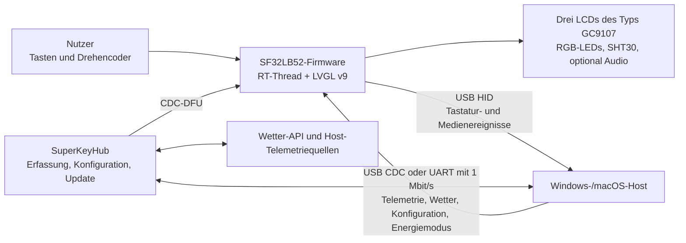

# SuperKey Multifunktions-Makrotastatur { #superkey-multifunction-macro-keyboard }

## Was ist SuperKey? { #what-is-superkey }

[SiFliSparks/SuperKey](https://github.com/SiFliSparks/SuperKey) ist eine Referenzimplementierung einer multifunktionalen Makrotastatur mit Displays auf Basis von SF32LB52. Die Open-Source-Firmware läuft mit RT-Thread und LVGL v9, steuert drei LCDs des Typs GC9107 mit 128 × 128 Pixeln, drei RGB-LEDs, vier physische Tasten, einen Drehencoder und den Temperatur- und Feuchtesensor SHT30 an und verbindet sich als zusammengesetztes USB-HID/CDC-Gerät mit einem Computer.

SuperKey ist mehr als ein Tastenfeld für Tastenkürzel. Die funktionsfähige Referenz vereint folgende Produktpfade:

- USB-HID-Ausgabe für Tastatur und Mediensteuerung;
- Leistungsdaten des Computers, Wetterdaten, Konfiguration und Energiezustand über USB CDC oder UART mit 1 Mbit/s;
- Seiten auf drei Displays für Leistungsüberwachung, Wetter, Uhr, Dienstprogramme, Musik und benutzerdefinierte Tastenbelegungen;
- das Begleitprogramm [SuperKeyHub](https://github.com/SiFliSparks/SuperKeyHub), das Hostdaten erfasst, Funktionen konfiguriert und Firmwareupdates anstößt;
- reproduzierbare Hardware anhand des offenen Hardwaredesigns [sf32-keyboard](https://oshwhub.com/sifli/sf32-keyboard).


<div align="center"><em>Benutzeroberfläche von SuperKey auf drei Displays</em></div>

## Warum die SF32-Implementierung? { #why-the-sf32-implementation }

SuperKey benötigt Grafik, mehrere Displays, ein zusammengesetztes USB-Gerät, Tasten und Encoder, Sensoren, RGB-Effekte, ein Dateisystem und optional Audio. SF32LB52 führt diese Echtzeitaufgaben auf dem MCU aus. Dadurch kann das Gerät seine Oberfläche starten und grundlegende HID-Funktionen bereitstellen, auch wenn das Begleitprogramm nicht läuft. Das Hostprogramm übernimmt Rechner-Telemetrie und Internetdaten, die besser vom Desktopbetriebssystem verarbeitet werden.

Diese Aufgabenteilung eignet sich für Desktop-Controller, Tastaturen für wiederkehrende Arbeitsabläufe, Statusanzeigen und kompakte HMIs, bringt aber klar definierte Abhängigkeiten mit sich. Erweiterte Datenanzeigen benötigen das Begleitprogramm, Treiber und externe APIs. Firmware- und Hostversionen müssen kompatibel bleiben; USB-Verbindungsverlust, der Schlafmodus des Hosts und beschädigte Konfigurationen erfordern eigene Wiederherstellungstests.

## Ergebnis, Umfang und Eintrittskriterien { #outcome-scope-and-entry-criteria }

**Ergebnis:** Eine versionsgebundene SuperKey-Referenz reproduzieren, HID, CDC, Oberfläche auf drei Displays, Eingaben, Sensorik und Wiederherstellung nach dem Schlafmodus validieren und anschließend jeweils nur eine Verhaltenskategorie ändern. Build-, Kommunikations- und Regressionstests sind als Nachweise für die Produktbewertung aufzubewahren.

Diese Seite belegt weder die Serienreife der Open-Source-Platine noch die Kompatibilität mit jeder PC-Telemetriequelle, jedem Wetterdienst, jeder seriellen Bridge, jedem USB-Host oder jeder Betriebssystemversion. Börsenkurse sowie Wetter- und Leistungsdaten können von der SuperKeyHub-Version, APIs Dritter, Systemberechtigungen und der Hosthardware abhängen.

Halten Sie vor dem Start Folgendes bereit:

- SuperKey-Hardware gemäß offenem Design, einschließlich drei LCDs des Typs GC9107, Tasten, Encoder und USB-Datenverbindung;
- einen Rechner mit Windows 10/11 für den hauptsächlich dokumentierten Weg. Das SuperKeyHub-Repository nennt Windows- und macOS-Unterstützung; prüfen Sie Programmierung, CDC-Kommunikation und Wiederherstellung dennoch auf dem gewählten Hostbetriebssystem;
- eine zur Firmware passende SuperKeyHub-Version;
- eine SiFli-SDK-Umgebung mit rekursiv ausgechecktem SDK-Submodul und funktionierendem Programmier-/Wiederherstellungsanschluss;
- falls Wetterfunktionen geprüft werden: einen gültigen QWeather-API-Key, API-Host und eine Stadtkonfiguration;
- ein Testprotokoll für USB-Enumeration, serielle Logs, Tastenverhalten, Displayzustand und Wiederherstellung aus dem Schlafmodus.

<div align="center"><em>Tabelle: Projektbasis und Nachweise für SuperKey</em></div>

<div align="center" markdown>

| Bereich | Bekannte Basis | Vor einer Anpassung erforderliche Nachweise |
|:-----|:---------------|:------------------------------------|
| Hardware | Offenes Hardwaredesign `sf32-keyboard` und Boardziel `sf32lb52-superkey` | Revision von Platine und Bestückung, LCDs und Eingabegeräte, Stromversorgung sowie Nachweis der USB-Verbindung |
| Firmware | SuperKey-Repository, SiFli-SDK-Submodul, RT-Thread, LVGL v9 und CherryUSB | Firmware-Commit, SDK-Commit, Build-Protokoll, Image und Programmierprotokoll |
| Begleitprogramm | SuperKeyHub mit kompatiblem Firmwareprotokoll | Anwendungsversion, Betriebssystem, Anschluss, API-Konfiguration und Verbindungsprotokoll |
| Kernfunktionen | HID, CDC, drei Displays, Encoder, Tasten, Sensor und Energiemodi | Nachweise zu Kaltstart, Datenaktualisierung, Eingaben, Verbindungsabbruch und Wiederherstellung aus dem Schlafmodus |
| Anpassung | Jeweils nur eine Änderung an UI, Taste, LED oder Datenfeld | Geprüfte Änderung, Rollback-Image und vollständiges Regressionsergebnis |

</div>

## Hardware- und Software-Spezifikationen { #hardware-and-software-specifications }

### Hardware-Spezifikation { #hardware-specification }

<div align="center"><em>Tabelle: Hardware-Spezifikation von SuperKey</em></div>

<div align="center" markdown>

| Komponente | Erforderliche Spezifikation | Aufgabe | Status | Bezugsquelle | Kompatibilität und Hinweise zu Ersatzteilen |
|:-----------|:----------------------------|:--------|:-------|:-------------|:-------------------------------------------|
| Offene SuperKey-Hardwarebaugruppe | SF32LB52-Konfiguration mit drei 128 × 128 GC9107-LCDs, drei RGB-LEDs, vier Tasten, Drehencoder, SHT30 und USB wie im Projekt beschrieben | Makrotastatursteuerung, Displays, Eingabe, Sensorik und USB HID/CDC | Erforderlich | [Offenes `sf32-keyboard`-Design](https://oshwhub.com/sifli/sf32-keyboard); [SuperKey-Repository](https://github.com/SiFliSparks/SuperKey) | Die Designdateien beschreiben keine fertig bestückte, käuflich verfügbare Platine; PCB- und Bestückungsrevision dokumentieren |
| Host-PC und USB-Datenverbindung | Windows 10/11 ist der hauptsächlich dokumentierte Weg; USB-Datenverbindung | Führt SuperKeyHub aus, stellt den HID/CDC-Host bereit und ermöglicht Download/Wiederherstellung | Erforderlich | [SuperKey-Dokumentation](https://sparks.sifli.com/projects/superkey/) | Das SuperKeyHub-Repository nennt Windows-/macOS-Unterstützung; CDC, DFU, Programmierung und Wiederherstellung auf dem gewählten Hostbetriebssystem qualifizieren |
| QWeather-Konto/API-Konfiguration | API Key, API Host und Stadtkonfiguration | Optionale Wetteranzeige | Optional | [QWeather](https://www.qweather.com/) | Zugangsdaten nicht ins Repository übernehmen; Nutzungsbedingungen und Verfügbarkeit prüfen |

</div>

### Software-Spezifikation { #software-specification }

<div align="center"><em>Tabelle: Software-Spezifikation von SuperKey</em></div>

<div align="center" markdown>

| Paket oder Dienst | Erforderliche Version oder Revision | Aufgabe | Status | Bezugsquelle | Kompatibilität und Hinweise zu Updates |
|:------------------|:------------------------------------|:--------|:-------|:-------------|:--------------------------------------|
| SuperKey-Firmware | Release v1.4.2; verwendeten Repository-Commit dokumentieren | SF32-Firmware, LVGL-UI, USB, Sensor und Updateverhalten | Erforderlich | [Release v1.4.2](https://github.com/SiFliSparks/SuperKey/releases/tag/v1.4.2) | Firmware-Commit fixieren; Hostkompatibilität nicht allein aus Versionsnummern ableiten |
| SuperKeyHub | Mit Firmware v1.4.2 geprüfte Version oder Commit | Host-Telemetrie, Konfiguration und Updateoberfläche | Für Hostfunktionen erforderlich | [Repository](https://github.com/SiFliSparks/SuperKeyHub) | Das zitierte Upstream-Releasematerial belegt keine feste Firmware-/App-Kombination; Telemetrie, Konfiguration und DFU prüfen und die verwendete Kombination dokumentieren |
| SiFli-SDK-Submodul, RT-Thread, LVGL und CherryUSB | Revisionen des gewählten Firmware-Checkouts | Firmware-Build und USB-Stack | Für Quellbuild erforderlich | [SuperKey-Repository](https://github.com/SiFliSparks/SuperKey) | Rekursiv klonen und Submodulrevisionen sichern; Abhängigkeiten nicht unabhängig aktualisieren |

</div>

## Unterstützte Referenzkonfiguration auswählen { #choose-a-supported-baseline }

Die Upstream-Releaseliste führt Firmware [v1.4.2](https://github.com/SiFliSparks/SuperKey/releases/tag/v1.4.2) als festen Ausgangspunkt. Das zitierte Material legt keine konkrete kompatible SuperKeyHub-Version fest. Wählen und fixieren Sie einen Hub-Release oder Commit, prüfen Sie damit Telemetrie, Konfiguration und DFU mit v1.4.2 und dokumentieren Sie die getestete Kombination, statt Kompatibilität aus Versionsnummern abzuleiten.

<div align="center"><em>Tabelle: Auswahl der SuperKey-Basis</em></div>

<div align="center" markdown>

| Basiselement | Empfohlener Startpunkt | Wichtige Einschränkung |
|:-----------------|:------------------|:--------------------|
| Firmware | SuperKey v1.4.2 oder ein vom Team validierter Commit | Firmware- und Hostprotokollversion müssen übereinstimmen |
| Begleitprogramm | Mit Firmware v1.4.2 geprüfter SuperKeyHub-Release oder Commit | Das zitierte Releasematerial belegt keine feste Kombination; CDC-Daten, Konfiguration und DFU auf dem gewählten Hostbetriebssystem validieren |
| Build-Ziel | `sf32lb52-superkey` mit Boarddateien unter `app/boards` | Kein generisches Entwicklungsboard-Ziel für SF32LB52 |
| Kommunikation | Zuerst zusammengesetztes USB HID + CDC validieren; UART mit 1 Mbit/s bei Bedarf separat prüfen | Eine erfolgreiche USB-Erkennung belegt nicht, dass sowohl die HID- als auch die CDC-Schnittstelle funktionieren |
| Update | Vom Begleitprogramm ausgelöstes CDC-DFU plus beibehaltener kabelgebundener Programmier-/Wiederherstellungspfad | Noch keine Feldupdate-Lösung, solange Unterbrechung, Versionskonflikt und Wiederherstellung nicht nachgewiesen sind |

</div>

Die Upstream-CI verwendet folgendes Ziel. Installieren und exportieren Sie die SiFli-SDK-Umgebung, bevor Sie den Befehl lokal ausführen:

```bash
git clone --recursive https://github.com/SiFliSparks/SuperKey.git
cd SuperKey/SiFli-SDK
./install.sh
. ./export.sh
cd ../app/project
scons --board=sf32lb52-superkey --board_search_path="../boards" -j8
```

Verwenden Sie unter Windows die entsprechenden PowerShell-Installations- und Umgebungs-Skripte von SiFli-SDK. Die Parallelität kann variieren; Boardname, Board-Suchpfad und Submodulrevisionen müssen jedoch im Build-Protokoll stehen.

## Projektphasen und Entscheidungspunkte { #delivery-map }

<div align="center"><em>Tabelle: Projektphasen und Entscheidungspunkte von SuperKey</em></div>

<div align="center" markdown>

| Phase | Entscheidungsfrage | Erforderliches Ergebnis |
|:------|:---------------------|:----------------|
| 1. Unveränderte Basis | Funktionieren offene Hardware, Firmware und Begleitprogramm wie dokumentiert zusammen? | Versionsgebundene, nachweislich funktionierende Sitzung |
| 2. Kommunikation und Wiederherstellung | Lassen sich Fehler bei USB, serieller Verbindung, Schlafmodus, Verbindungsabbruch und Konfiguration diagnostizieren und beheben? | Fehler-Injektions- und Wiederherstellungsprotokoll |
| 3. Build aus den Quellen reproduzieren | Kann das Team dasselbe Image aus einem sauberen Checkout erneut bauen? | Build-Umgebung, Image, Programmierung und Wiederholungsergebnis |
| 4. Kontrollierte Anpassung | Lässt sich ein Produktverhalten ändern, ohne die Basis zu beschädigen? | Begrenzte Änderung, Rollback-Pfad und Regressionsnachweise |
| 5. Produktbewertung | Reicht die Referenz für eine eigene Platine, ein Gehäuse oder einen Pilotaufbau aus? | Zugeordnete Risiken und Entscheidung zum Fortfahren, Zurückstellen oder Abbrechen |

</div>

## Systemarchitektur und Abhängigkeiten { #system-architecture-and-dependencies }

<div align="center"><em>Abbildung: Daten- und Steuerpfade von SuperKey</em></div>



Ordnen Sie Fehler fünf Bereichen zu: Gerätehardware/Display, HID-Eingabe, CDC-/UART-Datenkanal, Begleitprogramm/Systemberechtigungen und externe Datendienste. Eine leere Wetteranzeige ist nicht automatisch ein Firmwarefehler; Ursache können API-Key, API-Host, Stadtkonfiguration oder Datenübertragung sein.

## Phase 1 — Die unveränderte Referenzbasis etablieren { #stage-1-establish-the-untouched-reference-baseline }

**Ziel:** Den vollständigen Referenzpfad nachweisen, bevor der Code geändert wird.

1. Prüfen Sie anhand der Upstream-Montageunterlagen die Ausrichtung der LCD-Kabel sowie Schalter, Encoder, Gehäuse und USB-Buchse; dokumentieren Sie Platinen- und Firmwarerevision.
2. Installieren Sie die passende SuperKeyHub-Version. Prüfen Sie zunächst die Geräte-Enumeration und anschließend HID und CDC getrennt.
3. Konfigurieren Sie Wetterzugangsdaten, Anschluss und seriellen Betrieb mit 1 Mbit/s. Dokumentieren Sie das Verhalten ohne Begleitprogramm; verbinden Sie es anschließend und aktivieren Sie die Datenübertragung.
4. Prüfen Sie die Navigation auf drei Displays, Tastenbelegung, Mediensteuerung, Encoder, Daten vom Sensor SHT30, LED-Effekte und einen vollständigen Telemetrie-Aktualisierungszyklus.
5. Führen Sie einen Kaltstart durch und wiederholen Sie den Test. Sichern Sie UI-Fotos, Protokolle des Begleitprogramms und Geräts sowie das Ergebnis der Versionsabfrage.

**Aufzubewahrende Nachweise:** Hardwarerevision, Firmware-Tag/Commit, SDK-Commit, Version des Begleitprogramms, Betriebssystem, Anschluss- und API-Konfiguration, USB-Enumeration, Protokolle, Displayzustände und Eingabeprotokoll.

**Abnahmekriterium für Kontrollpunkt 1:** Bei zwei Kaltstarts funktionieren HID-Eingabe, CDC-Datenaktualisierung und Interaktion mit allen drei Displays. Jeder Fehlerbereich lässt sich anhand von Protokollen oder beobachtbarem Zustand unterscheiden.

## Phase 2 — Fehler- und Wiederherstellungsgrenzen validieren { #stage-2-validate-fault-and-recovery-boundaries }

**Ziel:** Nachweisen, dass typische Desktop-Unterbrechungen das Gerät nicht zu einer Demonstration machen, die ein erneutes Flashen erfordert.

<div align="center"><em>Tabelle: Fehler- und Wiederherstellungstests für SuperKey</em></div>

<div align="center" markdown>

| Test | Vorgehen | Nachweis für bestanden |
|:-----|:-------|:--------------|
| Begleitprogramm nicht gestartet | SuperKeyHub schließen und Gerät neu starten | Lokale UI und HID funktionieren weiterhin; vom Begleitprogramm abhängige Werte sind erkennbar veraltet oder nicht verfügbar |
| CDC-Verbindung verloren | Während der Datenübertragung USB trennen/wiederverbinden oder Anschluss wechseln | Gerät hängt sich nicht auf; Versionsabfrage und Datenübertragung funktionieren nach der Wiederverbindung wieder |
| Host wechselt in den Schlafmodus | `power_mode sleep/normal` aktivieren und einen Schlaf-/Aufwachzyklus des Hosts ausführen | LCDs, LEDs, Hintergrundbeleuchtung und Sensoren stoppen und starten wie vorgesehen; spätere Daten werden erneut aktualisiert |
| Versionskonflikt | In einer kontrollierten Umgebung ein inkompatibles Paar aus Begleitprogramm und Firmware testen | Das Paar weist den Betrieb zurück oder zeigt einen diagnostizierbaren Fehler, statt ein inkompatibles Update anzuwenden |
| API-Fehler | Ungültige Wetterkonfiguration verwenden oder Netzwerkverbindung trennen | Wetterfehler beeinträchtigen weder HID noch CDC noch die lokale UI noch die Wiederherstellung |
| DFU unterbrochen | Update auf einem wiederherstellbaren Testgerät unterbrechen | Der vorhandene kabelgebundene Programmierpfad stellt das bekannte Image wieder her |

</div>

**Abnahmekriterium für Kontrollpunkt 2:** Für jeden relevanten Fehlerfall sind Erkennung und Wiederherstellung reproduzierbar; eine undokumentierte manuelle Zustandskorrektur ist nicht erforderlich.

## Phase 3 — Eine reproduzierbare Quellbasis erstellen { #stage-3-build-a-reproducible-source-baseline }

**Ziel:** Einem zweiten Entwickler ermöglichen, aus einem sauberen Checkout einen Build und die Programmierung des Firmware-Images durchzuführen und die Prüfungen aus Phase 2 zu wiederholen.

1. Klonen Sie rekursiv und dokumentieren Sie sowohl den SuperKey- als auch den SiFli-SDK-Commit.
2. Bauen Sie mit `sf32lb52-superkey` und dem Suchpfad `../boards` in einer sauberen Umgebung.
3. Sichern Sie Build-Protokoll, Speicher-/Partitionsausgabe, Flash-Skript, erzeugte Images und serielles Protokoll.
4. Wiederholen Sie den Build auf einem zweiten Rechner oder nach dem Löschen des Build-Verzeichnisses, flashen Sie das Image auf dieselbe Hardware und führen Sie die wichtigsten Regressionstests erneut aus.

**Abnahmekriterium für Kontrollpunkt 3:** Zum Erzeugen eines Images, das Phase 2 besteht, sind weder nicht versionierte Dateien noch veraltete Build-Artefakte noch manuelles Austauschen von Binärdateien erforderlich.

## Phase 4 — Jeweils eine Produktvariable anpassen { #stage-4-adapt-one-product-variable-at-a-time }

**Ziel:** Die Änderungsgrenzen prüfen und gleichzeitig die bestandene Referenz erhalten.

<div align="center"><em>Tabelle: Reihenfolge kontrollierter SuperKey-Anpassungen</em></div>

<div align="center" markdown>

| Änderungskategorie | Geeigneter erster Schritt | Erforderliche Regressionstests |
|:-------------|:------------------|:--------------------|
| Identität und UI | Symbol, Schrift, Seitenlayout oder eine Rotationseinstellung ändern | Aktualisierung aller drei Displays, Rotation, Schriften, Kaltstart und Speicherbedarf prüfen |
| Tastenablauf | Eine HID-Belegung oder Tastenkombination ändern | Drücken/Loslassen, mehrere Tasten, unerwarteter Verbindungsabbruch und gespeicherte Konfiguration |
| Datenfeld | Einen Telemetrie- oder Sensorwert ändern | Protokollkompatibilität, Bereichsprüfungen, Aktualisierungs-Timeout und Verhalten mit älterem Begleitprogramm |
| LED-Effekt | Eine Farbe oder Animation ändern | Helligkeitsgrenzen, Schlafmodus, Tastenfeedback und Langzeitbetrieb prüfen |
| Update | Versionsrichtlinie oder Update-UI ändern | Herkunft des Images, Versionsprüfung, Unterbrechung, Rollback und kabelgebundene Wiederherstellung |

</div>

**Abnahmekriterium für Kontrollpunkt 4:** Die Änderung ist geprüft, das ursprüngliche Image wiederherstellbar und die Tests für HID, CDC, Display, Eingabe, Schlafmodus und Wiederherstellung sind bestanden.

## Phase 5 — Produktreife-Überprüfung { #stage-5-product-readiness-review }

Vor der Entwicklung eigener Hardware oder eines Pilotaufbaus muss das Team folgende Fragen beantworten:

- Wird das Produkt weiterhin von SuperKeyHub, Administratorrechten und einem Wetterdienst Dritter abhängen, und wer verantwortet diese Abhängigkeiten?
- Wie werden Firmware-, Begleitprogramm- und Protokollversionen verwaltet, und wie werden inkompatible Kombinationen verhindert?
- Welche Kombinationen aus Ziel-PCs, USB-Hubs, Kabeln, Energiesparrichtlinien und Sicherheitssoftware wurden getestet?
- Wie hoch sind Speicherbedarf, Temperatur und Stromaufnahme, wenn drei Displays, USB-Daten, LEDs, Sensorik und optionales Audio gleichzeitig aktiv sind?
- Wie lassen sich Konfiguration, Tastenbelegungen und Updatezustand nach Stromausfall oder beschädigtem Speicher wiederherstellen?
- Sind offene Platine, Gehäuse, Schriften, Symbole, Musik und APIs Dritter für die vorgesehene Verteilung lizenziert?

**Abnahmekriterium für Kontrollpunkt 5:** Für jedes verbleibende Risiko sind Verantwortliche, Nachweise und Maßnahmen festgelegt; das Team hat über Fortfahren, Zurückstellen oder Abbrechen entschieden.

## Übergabe an das Produktdesign { #handoff-to-product-design }

Übernehmen Sie Auswahl von SF32 und Speicher, USB-HID/CDC-Deskriptoren, Anschlüsse für drei Displays und Hintergrundbeleuchtung, Schnittstellen für Eingaben und Sensoren, Stromversorgungs- und Schlafrichtlinie, Dateisystem- und Updatepartitionen, Protokoll des Begleitprogramms, Produktionstestpunkte und validierten Wiederherstellungspfad in die nächste Designphase. Fahren Sie mit [SF32LB52x](../sf32-products/chips/SF32LB52x.md), dem [SF32LB52x Hardware-Design-Leitfaden](../hardware/chip-guides/SF32LB52x_hardware_design_guide.md), [SiFli-SDK: Bauen, Flashen und Überwachen](../develop/platforms/sifli-sdk/build-flash-monitor.md) und [Design für die Produktion](../hardware/design-for-production.md) fort.

## Maßgebliche Quellen { #authoritative-sources }

- [SiFliSparks/SuperKey-Firmware-Repository](https://github.com/SiFliSparks/SuperKey)
- [Release v1.4.2 von SuperKey](https://github.com/SiFliSparks/SuperKey/releases/tag/v1.4.2)
- [SiFliSparks/SuperKeyHub-Begleitprogramm-Repository](https://github.com/SiFliSparks/SuperKeyHub)
- [SuperKey-Projektdokumentation](https://sparks.sifli.com/projects/superkey/)
- [Offene sf32-keyboard-Hardware](https://oshwhub.com/sifli/sf32-keyboard)
- [OpenSiFli/SiFli-SDK](https://github.com/OpenSiFli/SiFli-SDK)
