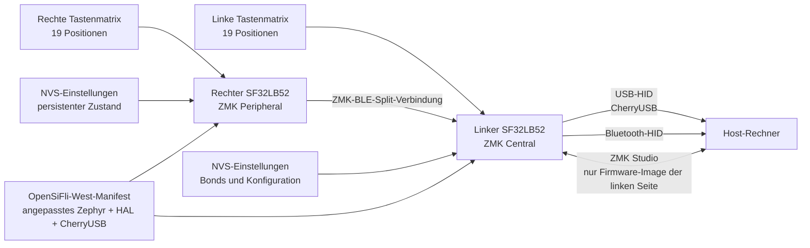

# ZMK-Tastatur-Firmware auf SF32 { #zmk-keyboard-firmware-on-sf32 }

## Was ist ZMK auf SF32? { #what-is-zmk-on-sf32 }

[ZMK Firmware](https://zmk.dev/) ist eine unter MIT-Lizenz stehende Tastatur-Firmware auf Basis von Zephyr. Das Upstream-Projekt ZMK stellt das Anwendungsmodell bereit, das viele kabelgebundene, drahtlose und geteilte Tastaturen nutzen: Matrixabtastung, Tastenbelegungen und Ebenen, Tastenverhalten, USB- und Bluetooth-HID, persistente Einstellungen sowie erweiterbare Board- und Shield-Definitionen.

[OpenSiFli/zmk](https://github.com/OpenSiFli/zmk) ist ein von OpenSiFli gepflegter Fork des Projekts. Der geprüfte Fork ergänzt:

- eine Board-Variante `sf32lb52_devkit_lcd/sf32lb525uc6/zmk`;
- die Integration des SF32LB52-SoC im ZMK-Anwendungsbaum;
- Konfigurationen für Einzel-Board, geteilte Tastatur, ZMK Studio und das Shield `urchin_sf32lb52`;
- ein auf SF32 ausgerichtetes CherryUSB-Backend;
- eine NVS-Einstellungspartition mit 256 KB und Unterstützung für Bluetooth-Einstellungen;
- eine Tastenbelegung für die geteilte Urchin-Tastatur mit drei Ebenen, Bluetooth-Profilsteuerung und Bindungen zum Entsperren von ZMK Studio.

Dies ist eine Entwicklungsportierung und kein mit einem Tag versehenes SF32-ZMK-Produkt-Release. Das README im Stammverzeichnis des Forks ist weiterhin das allgemeine Upstream-README von ZMK und enthält keinen SF32-spezifischen Schnellstart. Betrachten Sie Board, Shield, Manifest, Quellcode und Commit als ausführbare Referenz und verlangen Sie vor einer Anpassung eigene Nachweise zu sauberem Build, Download, Funktion und Wiederherstellung.

## Warum die SF32-Implementierung? { #why-the-sf32-implementation }

Die SF32-Portierung zeigt, wie das Tastaturmodell von ZMK auf SF32LB52 laufen kann, während die Konventionen von Zephyr für Devicetree, Kconfig, `west`, Tastenbelegung, Shield und geteilte Tastaturen erhalten bleiben. Die Referenz `urchin_sf32lb52` verteilt ein 38-Tasten-Layout auf zwei Hälften. Die linke Konfiguration ist die zentrale Seite (Central) der geteilten Tastatur, aktiviert CherryUSB und ZMK Studio und kann einem Host USB-HID anbieten; die rechte Konfiguration ist die periphere Seite (Peripheral). Beide Hälften aktivieren ZMK BLE.

Damit eignet sich der Fork zur Evaluierung einer drahtlosen geteilten Tastatur, eines USB-/Bluetooth-Desktop-Eingabegeräts, eines programmierbaren Makro-Pads oder eines eigenen Mensch-Maschine-Produkts auf SF32. Der Kompromiss liegt in der Reife der Abhängigkeiten: Das `west`-Manifest des Forks legt einen angepassten Zephyr-Branch (`v4.3+sf32-zmk_fixes`), eine feste SiFli-HAL-Revision und einen angepassten CherryUSB-Branch `zephyr-adapt` fest. Sie gehören zur Kompatibilitätsgrenze der Portierung und lassen sich ohne vollständige Migration und Regressionsdurchlauf nicht durch aktuelle Upstream-Revisionen ersetzen.

## Ergebnis, Umfang und Eintrittskriterien { #outcome-scope-and-entry-criteria }

**Ergebnis:** versionsgebundene linke und rechte Urchin-Images bauen und herunterladen, die vollständige Tastenmatrix, die Ebenen, USB-HID, die BLE-Pfade für Split und Host, die Persistenz der Einstellungen, die Grenze zu ZMK Studio und die Wiederherstellung validieren und dann eine kontrollierte Änderung an Tastenbelegung oder Hardware mit wiederholbaren Nachweisen durchführen.

Diese Seite behauptet weder volle Funktionsparität mit Upstream-ZMK noch Kompatibilität mit beliebigen ZMK-Shields noch serienreife Akkulaufzeit noch validierte Funkleistung noch eine unterstützte Migration auf eine andere Zephyr-/ZMK-Revision. Sie definiert auch keine Tastatur-Leiterplatte für die Serie: Die Urchin-Konfiguration des Repositorys ordnet eine Referenz-Tastenmatrix den Pins des SF32LB52-DevKit-LCD zu und muss für eigene Hardware gezielt übersetzt werden.

Halten Sie vor dem Start bereit:

- zwei SF32LB52-DevKit-LCD-Boards, die zur Variante `sf32lb525uc6/zmk` des Forks passen;
- einen geteilten 38-Tasten-Testaufbau, der genau gemäß den Overlays `urchin_sf32lb52_left` und `urchin_sf32lb52_right` verdrahtet ist, oder ein kleineres dokumentiertes Test-Shield für erste Prüfungen der Portierung;
- einen Host mit funktionierender Zephyr-/ZMK-`west`-Umgebung und ausreichend Speicherplatz für die festgelegten Module des Forks;
- bekannte Verbindungen für Download, serielle Konsole und Wiederherstellung für jede Hälfte, bevor das Split-Verhalten getestet wird;
- ein USB-Datenkabel für die linke/zentrale Hälfte und eine unabhängige Möglichkeit, die rechte/periphere Hälfte zu versorgen und wiederherzustellen;
- einen Bluetooth-Host, einen Host mit ZMK-Studio-Unterstützung, falls Studio im Umfang liegt, und eine Möglichkeit, den Strom jeder Hälfte zu messen;
- ein Protokoll für Fork-Commit, Manifest-Revisionen, Board-/Shield-Bezeichner, Build- und Download-Logs, Tastentestergebnisse, Bonds, Einstellungszustand und Strommessungen.

<div align="center"><em>Tabelle: Projektbasis und Nachweise für ZMK auf SF32</em></div>

<div align="center" markdown>

| Bereich | Geprüfte Basis | Vor der Anpassung erforderliche Nachweise |
|:-----|:------------------|:------------------------------------|
| Fork | OpenSiFli/zmk bei festem Commit | Fork-Commit, Beziehung zum Upstream, Manifest-Revisionen und Protokoll lokaler Diffs |
| Board | `sf32lb52_devkit_lcd/sf32lb525uc6/zmk` | Genaue Board-Revision, Download-/Wiederherstellungspfad und Konsolen-Log |
| Split-Referenz | `urchin_sf32lb52_left` als Central plus `urchin_sf32lb52_right` als Peripheral | Verdrahtung, Zuordnung von Image zu Hälfte, vollständiger Matrixtest und Ergebnis der Split-Verbindung |
| Host-Pfade | USB/CherryUSB und BLE-HID von der zentralen Hälfte | Nachweise zu Enumeration, Pairing/Bond, Wiederverbindung, Profil und Fehlerwiederherstellung |
| Konfiguration | Tastenbelegung mit drei Ebenen, NVS-Einstellungen und ZMK Studio auf der linken Seite | Ergebnis je Taste, Persistenztest, Studio-Autorisierung und Rollback-Protokoll |
| Anpassung | Jeweils eine Änderung an Belegung, Matrix, Transport, Versorgung oder Abhängigkeit | Geprüfte Änderung, ursprüngliche Images und vollständiges Regressionsergebnis |

</div>

## Hardware- und Software-Spezifikationen { #hardware-and-software-specifications }

### Hardware-Spezifikation { #hardware-specification }

<div align="center"><em>Tabelle: Hardware-Spezifikation für ZMK auf SF32</em></div>

<div align="center" markdown>

| Komponente | Erforderliche Spezifikation | Rolle | Status | Bezugsquelle | Hinweise zu Kompatibilität und Ersatz |
|:----------|:-----------------------|:-----|:-------|:----------------|:-------------------------------------|
| Zwei SF32LB52-DevKit-LCD-Boards | Board-Target `sf32lb52_devkit_lcd/sf32lb525uc6/zmk`; beide Board-Revisionen erfassen | Zentrale und periphere Hälfte für die dokumentierte Split-Basis | Für Split-Tests erforderlich | [μForge-Board-Referenz](../sf32-products/devkits/SF32LB52-DevKit-LCD.md); [OpenSiFli-Board-Variante beim geprüften Commit](https://github.com/OpenSiFli/zmk/tree/fd4d5843065f65ed5ed6198dc2e5d0520330bf8e/app/boards/sifli/sf32lb52_devkit_lcd) | Die Images für Central und Peripheral nutzen unterschiedliche Rollen/Konfigurationen; erhalten Sie für beide Boards eine unabhängige Wiederherstellung |
| Geteilter Urchin-Tastatur-Aufbau mit Verbindung | 38-Tasten-Matrix, verdrahtet gemäß den Overlays `urchin_sf32lb52_left` und `urchin_sf32lb52_right` | Prüft Tastenmatrix, Split-Transport und Rollenverhalten | Für die vollständige Split-Validierung erforderlich | [Urchin-Shield beim geprüften Commit](https://github.com/OpenSiFli/zmk/tree/fd4d5843065f65ed5ed6198dc2e5d0520330bf8e/app/boards/shields/urchin_sf32lb52) | Die Overlays sind die Verdrahtungsreferenz und keine Garantie für eine andere Leiterplatte oder ein beliebiges Shield |
| USB-/BLE-Host und Datenkabel | USB-Host für die zentrale Hälfte; Bluetooth-HID-Host; separat zugänglicher Versorgungs-/Download-Pfad für die periphere Hälfte | Host-Verbindung, Eingabevalidierung, Logs und Wiederherstellung | Erforderlich | [OpenSiFli-ZMK-Fork](https://github.com/OpenSiFli/zmk) | Erfassen Sie Host-Betriebssystem, BLE-Bond-Zustand, Kabel/Port und Wiederherstellungsverbindung für jede Hälfte |

</div>

### Software-Spezifikation { #software-specification }

<div align="center"><em>Tabelle: Software-Spezifikation für ZMK auf SF32</em></div>

<div align="center" markdown>

| Paket oder Dienst | Erforderliche Version oder Revision | Rolle | Status | Bezugsquelle | Hinweise zu Kompatibilität und Aktualisierung |
|:-------------------|:-----------------------------|:-----|:-------|:----------------|:-------------------------------|
| OpenSiFli/zmk | Geprüfter Commit [`fd4d5843065f`](https://github.com/OpenSiFli/zmk/tree/fd4d5843065f65ed5ed6198dc2e5d0520330bf8e) | SF32-Board-Portierung, ZMK-Anwendung und Urchin-Konfiguration | Erforderlich | [Repository beim geprüften Commit](https://github.com/OpenSiFli/zmk/tree/fd4d5843065f65ed5ed6198dc2e5d0520330bf8e) | Dies ist kein mit Tag versehenes SF32-ZMK-Release; ersetzen Sie es nicht durch Upstream-ZMK, ohne zu portieren und zu validieren |
| West-Manifest-Abhängigkeiten | Genaue Revisionen, die `app/west.yml` beim festgelegten Fork-Commit auflöst | Zephyr, `hal_sifli`, CherryUSB und weitere Module | Erforderlich | [Festgelegtes West-Manifest](https://github.com/OpenSiFli/zmk/blob/fd4d5843065f65ed5ed6198dc2e5d0520330bf8e/app/west.yml) | Führen Sie `west list` aus und bewahren Sie die Ausgabe auf; aktualisieren Sie Abhängigkeiten nicht unabhängig voneinander |
| Zephyr-`west`-Toolchain und Build-Werkzeuge | Mit dem festgelegten Manifest kompatible Versionen; installierte Versionen und Host-Betriebssystem erfassen | Konfigurieren, bauen und linke/rechte Images erzeugen | Erforderlich | [ZMK-Dokumentation](https://zmk.dev/docs); [Zephyr-Dokumentation](https://docs.zephyrproject.org/) | Bauen Sie beide Images aus einem sauberen Workspace neu und bewahren Sie getrennte Build-Verzeichnisse und Hashes auf |
| ZMK-Studio-Host | Kompatible Host-/Anwendungsversion, falls Studio in der gewählten Konfiguration aktiviert ist | Optionaler Pfad für Tastenbelegung/Konfiguration | Optional | [ZMK-Studio-Dokumentation](https://zmk.dev/docs/features/studio) | Die geprüfte Konfiguration stellt Studio auf der linken/zentralen Hälfte bereit; validieren Sie Autorisierung und Rollback vor dem Produkteinsatz |

</div>

## Unterstützte Referenzkonfiguration auswählen { #choose-a-supported-baseline }

Die geprüfte OpenSiFli-Basis ist der Commit `fd4d5843065f` vom 27.05.2026. Er enthält das Urchin-Shield und die zu diesem Commit verfügbare Aktualisierung der Board-Konfiguration, ist aber kein mit Tag versehenes SF32-ZMK-Release. Legen Sie diesen Commit für die erste Reproduktion fest oder erfassen und prüfen Sie ausdrücklich einen neueren Commit.

<div align="center"><em>Tabelle: Auswahl der Basis für ZMK auf SF32</em></div>

<div align="center" markdown>

| Element der Basis | Empfohlener Start | Kritische Einschränkung |
|:-----------------|:------------------|:--------------------|
| ZMK-Fork | OpenSiFli/zmk `fd4d5843065f` | Ersetzen Sie ihn nicht durch das Upstream zmkfirmware/zmk; dieses enthält die SF32-Portierung nicht |
| Board-Target | `sf32lb52_devkit_lcd/sf32lb525uc6/zmk` | Dies ist eine ZMK-spezifische Variante des SF32LB52-DevKit-LCD |
| Produktnahes Shield | `urchin_sf32lb52_left` und `urchin_sf32lb52_right` | Die Overlays definieren unterschiedliche GPIO-Zuordnungen und Rollen; die Images sind nicht austauschbar |
| Diagnose-Shields | `sf32lb52_test`, `sf32lb52_split_test_left/right` und `sf32lb52_zmkstudio_test` | Dies sind Referenzen für die Entwicklung der Portierung und keine Produktkompatibilitätsversprechen |
| Split-Rolle | Links = Central; rechts = Peripheral | USB und ZMK Studio sind in der linken Konfiguration aktiviert; nehmen Sie keine Symmetrie an |
| Abhängigkeits-Manifest | Angepasstes Zephyr `v4.3+sf32-zmk_fixes`, festgelegtes `hal_sifli` und angepasstes CherryUSB `zephyr-adapt` | Die Aktualisierung einer einzelnen Abhängigkeit verändert die Kompatibilitätsgrenze |
| Lizenz | ZMK-Fork und gekennzeichnete SF32-Ergänzungen verwenden MIT-Header/-Lizenz | Prüfen Sie alle Module, Hardware, Tastenbelegungs-Ressourcen und Produktinhalte separat |

</div>

Die folgenden Befehle kombinieren die Form des eigenen `west`-Workflows des Forks mit seinen genauen Bezeichnern für das SF32-Board und das Urchin-Shield. Bewahren Sie die beiden Build-Verzeichnisse getrennt auf, damit die Images nicht verwechselt werden:

```bash
git clone https://github.com/OpenSiFli/zmk.git
cd zmk
git checkout fd4d5843065f

west init -l app
west update --fetch-opt=--filter=tree:0
west zephyr-export

west build -s app -p always -d build-left \
  -b sf32lb52_devkit_lcd/sf32lb525uc6/zmk -- \
  -DSHIELD=urchin_sf32lb52_left

west build -s app -p always -d build-right \
  -b sf32lb52_devkit_lcd/sf32lb525uc6/zmk -- \
  -DSHIELD=urchin_sf32lb52_right
```

Erfassen Sie das finale `west list`, die erzeugte Kconfig- und Devicetree-Ausgabe, Artefakt-Hashes, die Zuordnung von Image zu Hälfte und das tatsächliche Download-Verfahren. Beginnen Sie erst mit dem Split-Test, wenn sich jedes Board unabhängig wiederherstellen lässt.

## Projektphasen und Entscheidungspunkte { #delivery-map }

<div align="center"><em>Tabelle: Projektphasen und Entscheidungspunkte für ZMK auf SF32</em></div>

<div align="center" markdown>

| Phase | Entscheidungsfrage | Erforderliches Ergebnis |
|:------|:---------------------|:----------------|
| 1. Unveränderte Portierungsbasis | Funktionieren der festgelegte Fork, das Board-Ziel, die Shields, die Verdrahtung und der Host zusammen? | Versionsgebundene linke/rechte Images und eine reproduzierbare Schreibprobe |
| 2. Eingabe, Transport und Wiederherstellung | Sind Fehler bei Matrix, USB, BLE, Split, Einstellungen und Studio diagnostizierbar und behebbar? | Tastenabdeckung sowie Protokoll zu Fehlerinjektion und Wiederherstellung |
| 3. Reproduzierbarer Build | Kann eine zweite Umgebung beide Images ohne verborgenen Zustand neu erzeugen? | Manifest, saubere Builds, Artefakt-Hashes, Downloads und Wiederholungsergebnis |
| 4. Kontrollierte Anpassung | Lässt sich ein Tastaturverhalten oder eine Hardware-Zuordnung ändern, ohne die Basis zu beschädigen? | Begrenzte Änderung, Rollback-Pfad und Regressionsnachweise |
| 5. Produktbewertung | Ist die Portierung reif genug für eine eigene Leiterplatte oder einen Akku-Prototyp? | Zugewiesene Risiken und eine Entscheidung: fortfahren/zurückstellen/stoppen |

</div>

## Systemarchitektur und Abhängigkeiten { #system-architecture-and-dependencies }

<div align="center"><em>Abbildung: Pfade der geteilten ZMK-Tastatur auf SF32LB52</em></div>



Behandeln Sie Fehler als getrennte Domänen: physische Matrix/Verdrahtung, die Split-Verbindung von rechts nach links, USB auf der linken Seite, Host-Bluetooth, gespeicherte Bonds/Einstellungen, ZMK Studio, Board-Download/-Wiederherstellung und der festgelegte Abhängigkeits-Stack. Eine Taste, die den Host nicht erreicht, kann vor dem Scan, beim Split-Transport, in der zentralen Tastenbelegung oder am gewählten HID-Endpunkt ausfallen; diagnostizieren Sie den Pfad in dieser Reihenfolge.

## Phase 1 — Die unveränderte Portierungsbasis herstellen { #stage-1-establish-the-untouched-port-baseline }

**Ziel:** Die genaue OpenSiFli-Referenz nachweisen, bevor Tastenbelegung, Overlay oder Abhängigkeit geändert werden.

1. Erfassen Sie beide Board-Revisionen und verdrahten Sie die beiden Aufbauten genau gemäß den linken und rechten Urchin-Overlays. Beschriften Sie Boards sowie USB-/Download-Kabel nach Rolle.
2. Bauen Sie beide Images beim festgelegten Commit, speichern Sie `west list` und prüfen Sie die erzeugte Konfiguration, um das erwartete Board, Shield, die Split-Rolle, BLE, CherryUSB, ZMK Studio und die NVS-Einstellungen zu bestätigen.
3. Laden Sie jedes Image über seinen unabhängig verifizierten Wiederherstellungspfad herunter. Erfassen Sie Kaltstart- und Konsolenverhalten, bevor Sie die Hälften oder den Host koppeln.
4. Stellen Sie die BLE-Split-Verbindung her und verifizieren Sie dann alle 38 Positionen gegen die Ebenen `default`, `lower` und `raise`. Prüfen Sie Bluetooth-Profilauswahl/-Löschen und die Studio-Entsperr-Bindungen bewusst, damit sie bei den Tipptests nicht versehentlich ausgelöst werden.
5. Validieren Sie USB-HID und ZMK Studio auf der linken Hälfte und dann Bluetooth-HID zum gewählten Host. Wiederholen Sie dies nach einem Kaltstart.

**Aufzubewahrende Nachweise:** Aufzeichnungen zu Board und Verdrahtung, Revisionen von Fork und Manifest, erzeugte Konfigurationen, Image-Hashes, Download- und Boot-Logs, vollständige Matrix der Tastenpositionen, Ebenenergebnisse, Endpunktauswahl sowie Host-/Studio-Versionen.

**Abnahmekriterium für Kontrollpunkt 1:** Zwei Kaltstarts reproduzieren die vollständige 38-Positionen-Belegung, alle drei Ebenen, die Split-Verbindung von rechts nach links und mindestens einen gewählten Host-Endpunkt; beide Hälften bleiben unabhängig wiederherstellbar.

## Phase 2 — Eingabe, Transport, Einstellungen und Wiederherstellung validieren { #stage-2-validate-input-transport-settings-and-recovery }

**Ziel:** Nachweisen, dass realistische Tastaturfehler sichtbar und behebbar sind, ohne aus einem unbekannten Zustand neu bauen zu müssen.

<div align="center"><em>Tabelle: Fehler- und Wiederherstellungstests für ZMK auf SF32</em></div>

<div align="center" markdown>

| Test | Methode | Nachweis des Bestehens |
|:-----|:-------|:--------------|
| Matrixabdeckung | Jede Position, Rollover-Kombinationen, jede Ebene und beide direkten Eingänge prüfen | Keine fehlenden, doppelten, hängenden oder vertauschten Tasten; Reihenfolge von Drücken/Loslassen ist erfasst |
| Split-Verlust | Die rechte Hälfte im Leerlauf und beim Tippen ausschalten oder außer Reichweite bringen | Tasten der linken Seite und Host-Verbindung bleiben definiert; die rechte Hälfte verbindet sich ohne Neuflashen und ohne veraltete Tasten neu |
| USB-Unterbrechung | Den USB-Datenpfad der linken Seite bei Eingabe und Studio-Nutzung trennen/wiederverbinden | HID und Studio erholen sich unabhängig; kein hängender Modifikator und keine beschädigten Einstellungen bleiben zurück |
| Host-BLE-Verlust | Host-Bluetooth deaktivieren, Profil wechseln und wiederverbinden | Endpunkt-/Profilzustand ist sichtbar; Wiederverbindung und bewusstes Löschen von Bonds folgen einem erfassten Pfad |
| Persistenz der Einstellungen | Eine umkehrbare Einstellung ändern, beide Hälften aus- und einschalten, dann die Basis wiederherstellen | Erwarteter NVS-Zustand bleibt erhalten; ein dokumentierter Reset-/Wiederherstellungspfad entfernt beschädigten oder unerwünschten Zustand |
| Grenze zu ZMK Studio | Eine autorisierte Änderung versuchen, die Sitzung bei wiederherstellbarem Aufbau mittendrin trennen und wiederherstellen | Nur das Central-Image stellt Studio bereit; ungültige/unvollständige Änderungen lassen die Tastatur nicht stranden |
| Aus-/Einschalten | Unabhängige und gleichzeitige Aus-/Einschaltzyklen der Hälften wiederholen, dabei Strom und Aufwachen protokollieren | Rollen, Split, Endpunkt und Tasten-Loslass-Zustand erholen sich vorhersagbar |

</div>

**Abnahmekriterium für Kontrollpunkt 2:** Für jeden zutreffenden Fehler liegt ein wiederholbares Ergebnis zu Erkennung und Wiederherstellung vor, kein Test hinterlässt einen hängenden HID-Zustand, und Einstellungen oder Bonds lassen sich ohne Ersetzen unversionierter Dateien auf die erfasste Basis zurücksetzen.

## Phase 3 — Eine reproduzierbare Quellbasis aufbauen { #stage-3-build-a-reproducible-source-baseline }

**Ziel:** Einem zweiten Ingenieur ermöglichen, beide Images neu zu erzeugen und Phase 2 aus sauberen Quellen zu wiederholen.

1. Beginnen Sie mit einem sauberen Fork-Checkout beim erfassten Commit und führen Sie `west init`, `west update` und `west zephyr-export` ohne lokale Modulersetzung aus.
2. Speichern Sie `west list`, Compiler-/Werkzeugversionen, die erzeugte `.config`, den erzeugten Devicetree, die Speicherausgabe, Build-Logs und beide Artefakte mit Hashes.
3. Laden Sie die beschrifteten linken und rechten Images auf die richtigen Hälften herunter und wiederholen Sie den vollständigen Testsatz aus Phase 2.
4. Vergleichen Sie Artefakte und Konfiguration mit der ursprünglichen Aufzeichnung; erklären Sie jeden nicht reproduzierbaren Unterschied, bevor Sie fortfahren.

**Abnahmekriterium für Kontrollpunkt 3:** Eine zweite Umgebung erzeugt korrekt beschriftete Images, die Phase 2 ohne unversionierte Overlays, veraltete Build-Ausgaben oder nicht fixierte Abhängigkeitsrevisionen bestehen.

## Phase 4 — Jeweils eine Tastatur-Grenze anpassen { #stage-4-adapt-one-keyboard-boundary-at-a-time }

**Ziel:** Eine Produktänderung vornehmen und dabei die bewährte Portierung und unabhängige Wiederherstellungspfade erhalten.

<div align="center"><em>Tabelle: Reihenfolge der kontrollierten Anpassung von ZMK auf SF32</em></div>

<div align="center" markdown>

| Änderungsklasse | Gute erste Änderung | Erforderliche Regression |
|:-------------|:------------------|:--------------------|
| Tastenbelegung | Eine Bindung, Ebene, Hold-Tap oder Combo | Alle Positionen/Ebenen, Reihenfolge von Drücken/Loslassen, Rollover, Split-Verlust und beide Host-Endpunkte |
| Matrix/PCB | Eine Zeile, Spalte, ein direkter Eingang oder eine Änderung der Diodenrichtung | Elektrische Prüfung, erzeugter Devicetree, vollständige Matrix, Kurzschlüsse/Ghosting, Aufwachen und Wiederherstellung |
| Studio | Ein bearbeitbarer Parameter oder die Freigabe eines Layouts | Autorisierung, gültige/ungültige Änderungen, Persistenz, Trennen, Wiederherstellen und Versionskompatibilität |
| Transport | Eine Änderung an einem USB-/BLE-Endpunkt oder an der Split-Richtlinie | Enumeration, Pairing, Bonds, Profilwechsel, Split-Wiederverbindung, Vermeidung hängender Tasten und Strom |
| Versorgung | Eine Einstellung für Schlafen, Aufwachen, Scan oder Funk | Strom je Hälfte aktiv/Leerlauf/Schlaf, Latenz, jede Weckquelle, Split-Wiederverbindung und Erhalt der Einstellungen |
| Abhängigkeitsmigration | Eine Aktualisierung von ZMK, Zephyr, HAL oder CherryUSB | Manifest-Diff, saubere Builds, Diff der erzeugten Konfiguration, alle Tests aus Phase 2, Strom und Rollback |

</div>

**Abnahmekriterium für Kontrollpunkt 4:** Die Änderung ist geprüft, ursprüngliche Images und Einstellungen lassen sich wiederherstellen, und alle zutreffenden Tests zu Matrix, Ebenen, Split, USB, BLE, Studio, Versorgung und Wiederherstellung bestehen.

## Phase 5 — Prüfung der Produktreife { #stage-5-product-readiness-review }

Beantworten Sie vor dem Entwurf einer eigenen Tastatur-Leiterplatte oder eines Akku-Prototyps:

- Wer verantwortet den OpenSiFli-ZMK-Fork, den angepassten Zephyr-Branch, die SiFli-HAL-Revision, die CherryUSB-Anpassung und künftige Sicherheits- oder Kompatibilitätsupdates?
- Welche Upstream-ZMK-Funktionen werden auf SF32 tatsächlich ausgeübt, und welche sind nur im geerbten Baum vorhanden?
- Wie werden Image-Identität links/rechts, Board-Revision, Tastenbelegung, Konfiguration, Bonds und Werksreset-Zustand in Fertigung und Service kontrolliert?
- Wie hoch sind die gemessenen Ströme jeder Hälfte im aktiven Betrieb, verbunden im Leerlauf, getrennt und im Schlaf, einschließlich Scan-Rate, Wiederverbindungsverhalten und Akkuschutz?
- Welche Hosts, Betriebssysteme, USB-Controller, Bluetooth-Stacks, Aufwachpfade, Rollover-Fälle und Störbedingungen wurden getestet?
- Lassen sich ein fehlgeschlagenes Abhängigkeitsupdate, eine Studio-Änderung, ein Schreibvorgang in die Einstellungen oder ein Update im Feld beheben, ohne das Produkt zu öffnen oder zu verschrotten?
- Sind die Lizenzen von ZMK/Zephyr, Leiterplatten- und Gehäusedateien, Tastenbelegungsinhalte, Logos, Schriften und mitgelieferte Konfigurationen für den Vertrieb geeignet?

**Abnahmekriterium für Kontrollpunkt 5:** Jedes Restrisiko hat einen Verantwortlichen, Nachweise und eine Disposition, und das Team hat ausdrücklich entschieden: fortfahren, zurückstellen oder stoppen.

## Übergabe an das Produktdesign { #handoff-to-product-design }

Übernehmen Sie das genaue SF32-Gerät und den Speicher, Split-Rollen und Transport, die Zuordnung von Zeilen/Spalten/direkten Eingängen, die Diodenrichtung, den USB-Anschluss, Annahmen zu Antenne und Gehäuse, die NVS-/Einstellungsrichtlinie, Download- und Wiederherstellungsschnittstellen, das Energiebudget je Hälfte, Testaufbauten, die Image-Kennzeichnung und das festgelegte Manifest. Fahren Sie fort mit [SF32LB52-DevKit-LCD](../sf32-products/devkits/SF32LB52-DevKit-LCD.md), der [Plattformgrenze von Zephyr](../develop/platforms/zephyr/overview.md), der [Bluetooth-Architektur](../learn/bluetooth/overview.md), dem [Hardware-Design-Leitfaden SF32LB52x](../hardware/chip-guides/SF32LB52x_hardware_design_guide.md) und [Design for Production](../hardware/design-for-production.md).

## Maßgebliche Quellen { #authoritative-sources }

- [OpenSiFli/zmk-SF32-Fork](https://github.com/OpenSiFli/zmk)
- [Geprüfter Commit von OpenSiFli/zmk](https://github.com/OpenSiFli/zmk/tree/fd4d5843065f65ed5ed6198dc2e5d0520330bf8e)
- [ZMK-Board-Variante für SF32LB52 beim geprüften Commit](https://github.com/OpenSiFli/zmk/tree/fd4d5843065f65ed5ed6198dc2e5d0520330bf8e/app/boards/sifli/sf32lb52_devkit_lcd)
- [Geteiltes Urchin-SF32LB52-Shield beim geprüften Commit](https://github.com/OpenSiFli/zmk/tree/fd4d5843065f65ed5ed6198dc2e5d0520330bf8e/app/boards/shields/urchin_sf32lb52)
- [West-Manifest des OpenSiFli-ZMK beim geprüften Commit](https://github.com/OpenSiFli/zmk/blob/fd4d5843065f65ed5ed6198dc2e5d0520330bf8e/app/west.yml)
- [Upstream zmkfirmware/zmk](https://github.com/zmkfirmware/zmk)
- [ZMK-Dokumentation](https://zmk.dev/docs/)
- [Zephyr-Projektdokumentation](https://docs.zephyrproject.org/)
