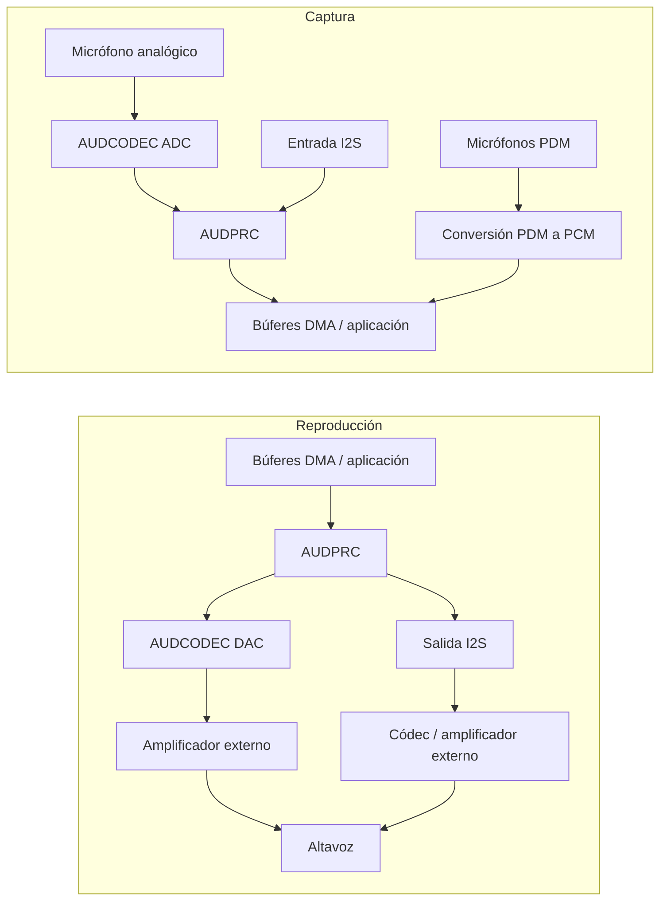

# Resumen del audio local { #audio-overview }

## Resumen { #overview }

Esta guía describe el **subsistema de audio local** de los dispositivos SF32: la cadena de códec, DMA y middleware que interviene en la entrada de micrófono, la salida a altavoz o línea y la reproducción o grabación en el dispositivo. Se centra en decisiones prácticas sobre interfaces, búferes, Audio Server, códecs y consumo energético.

El audio Bluetooth (A2DP y LE Audio) es un tema relacionado, pero distinto, que se trata en el [Resumen de Bluetooth](../bluetooth/overview.md#bluetooth-audio-and-le-audio). Allí se explica la transmisión inalámbrica; aquí, lo que ocurre una vez que las muestras llegan al chip: captura, mezcla, decodificación y activación de la ruta física de audio.

Consulte esta página al elegir los micrófonos, códecs y estrategias de búfer de un producto y al evaluar su consumo; no se limite a comprobar que una demostración se reproduce una vez. Está dirigida a quienes deben integrar un sistema de audio fiable dentro de las restricciones de Bluetooth, pantalla, almacenamiento y batería.

## Defina los requisitos de audio del producto { #define-the-products-audio-requirements }

Antes de elegir interfaces o tamaños de búfer, precise lo que el producto necesita:

- ¿Solo reproducción, solo grabación, o ambas simultáneamente (dúplex completo)?
- ¿Cuántos micrófonos se necesitan y de qué tipo: analógicos (AMIC) o digitales (DMIC)?
- ¿Qué formatos de reproducción local se necesitan: PCM sin procesar, MP3, Opus u otro códec?
- ¿Se necesita audio Bluetooth (Classic o LE Audio) en paralelo con el audio local?
- ¿Se requiere activación por voz o escucha continua? ¿Qué presupuesto energético está disponible?
- ¿Qué requisitos debe cumplir la etapa de salida para el altavoz o la salida de línea? ¿Se conectará la salida a un amplificador o códec externo?
- ¿Qué latencia puede tolerar el producto? Las llamadas de voz y la monitorización en tiempo real tienen requisitos mucho más estrictos que los tonos de notificación.

Las respuestas determinan la interfaz (I2S, PDM o ADC/DAC), la configuración del códec y qué partes de la ruta de audio deben permanecer activas.

## Ruta de señal de audio del SF32 { #the-sf32-audio-signal-path }

La captura y la reproducción siguen rutas distintas. El diagrama muestra rutas habituales; su disponibilidad y uso simultáneo dependen del modelo, el encapsulado, la placa y la configuración del SDK.

<div align="center"><em>Figura: Ruta típica de señal de audio local del SF32</em></div>



**AUDCODEC** realiza la conversión analógico-digital y digital-analógica. **AUDPRC** procesa la mezcla, la ganancia y la conversión de frecuencia de muestreo en las rutas compatibles. Los micrófonos PDM utilizan el bloque PDM para obtener PCM; no pasan por el ADC analógico. I2S ofrece una conexión digital con dispositivos externos. Una interfaz PDM admite hasta dos micrófonos compatibles mediante la selección de canal izquierdo/derecho; dos interfaces pueden admitir hasta cuatro, según los pines disponibles y el soporte del controlador.

**Audio Server** es software que gestiona flujos y sesiones, no un convertidor físico entre el micrófono y el altavoz. La aplicación suele utilizar sus API y los controladores correspondientes; las pruebas directas del controlador o HAL son útiles durante la puesta en marcha. Seleccione primero las rutas reales de captura y reproducción y compruebe relojes, formatos de muestra, solicitudes DMA y requisitos de accionamiento de la salida. No dé por hecho que el DAC integrado puede accionar el altavoz elegido sin un amplificador externo.

Estas rutas se describen en la [guía del controlador AUDPRC/AUDCODEC](https://docs.sifli.com/projects/sdk/latest/en/sf32lb52x/drivers/audprc_audcodec.html) y la [guía HAL de PDM](https://docs.sifli.com/projects/sdk/latest/en/sf32lb52x/hal/pdm.html).

## Micrófonos e interfaces digitales { #choosing-interfaces-amic-dmic-and-i2s }

AMIC y DMIC son tipos de micrófono; PDM e I2S son interfaces digitales. Un micrófono digital puede usar PDM o I2S. No confunda el número de micrófonos con el de canales o interfaces.

<div align="center"><em>Tabla: Micrófonos e interfaces digitales</em></div>

<div align="center" markdown>

| Micrófono / Bus | Uso típico | Notas |
|:----------|:------------|:------|
| **AMIC (entrada de micrófono analógico)** | Captura de audio de propósito general | Utiliza un ADC de audio; verifique polarización, ganancia, rango de entrada y control del ruido de la placa. |
| **DMIC (micrófono digital)** | Captura de voz y arreglos de varios micrófonos | Identifique el bus PDM o I2S real. La señal digital no elimina los requisitos de alimentación, reloj ni diseño de la placa. |
| **I2S** | Transmisión de PCM hacia o desde códecs y amplificadores externos | Se usa habitualmente con un códec o amplificador de audio externo, en lugar de la ruta AUDCODEC integrada en el chip. |
| **PDM** | Entrada de micrófono digital | Interfaz habitual de muchos micrófonos DMIC, junto con la conversión de PDM a PCM integrada en el chip. |

</div>

Los arreglos mixtos analógicos/digitales requieren rutas simultáneas compatibles y muestras sincronizadas. La formación de haces también necesita una distribución adecuada, calibración y un algoritmo; no basta con conectar varios micrófonos.

## Parta de un ejemplo de audio verificado { #start-from-a-verified-audio-example }

Antes de diseñar el comportamiento de la aplicación, elija y valide el ejemplo de SiFli-SDK que más se aproxime a su caso. [Ejemplos de audio del SDK](audio-sdk-examples.md) agrupa los ejemplos oficiales de PDM, captura analógica, grabación y reproducción, música local, tarjeta SD, FLAC, Opus y mezcla según la tarea de ingeniería que ilustran. También indica qué aspectos de la placa, la multiplexación de pines, el almacenamiento y la configuración deben comprobarse antes de adaptar un ejemplo al producto.

## Elija el dispositivo SF32 adecuado { #pick-the-right-sf32-device }

La capacidad de audio varía según la familia. Consulte la hoja de datos del modelo concreto; la tabla ofrece una orientación inicial:

<div align="center"><em>Tabla: Orientación para elegir el dispositivo SF32 adecuado</em></div>

<div align="center" markdown>

| Familia | ADC/DAC de audio integrados | Interfaces PDM (máximo de micrófonos) | Interfaces I2S | Aplicación sugerida |
|:---|:---|:---|:---|:---|
| **SF32LB52x** | 1 ADC + 1 DAC | 1 (2) | 1 | Accesorios de audio Bluetooth de costo optimizado e interfaces HMI compactas con control por voz. |
| **SF32LB55x** | Ninguno; para audio analógico, use un códec de audio externo. | SF32LB551/555: 1 (2); SF32LB557: 2 (4) | SF32LB551/555: 1; SF32LB557: 2 | Dispositivos portátiles BLE y productos con numerosos sensores en los que el audio es secundario. |
| **SF32LB56x** | 1 ADC + 1 DAC | 2 (4) | 1 | Productos con HMI y pantalla avanzadas que también necesitan capturar voz con varios micrófonos. |
| **SF32LB57x** | 2 ADC + 1 DAC | 2 (4) | 2 | Captura de voz con varios micrófonos y reproducción local. |
| **SF32LB58x** | 2 ADC + 2 DAC | 2 (4) | 3 | Productos insignia que combinan audio, gráficos, IA y conectividad compleja. |

</div>

Antes de elegir, confirme el modelo, los pines del encapsulado, su multiplexación y las rutas simultáneas. Una interfaz PDM puede admitir dos micrófonos compatibles; los canales ADC, los canales de micrófono y las interfaces digitales son recursos distintos. Las funciones I2S dependen de la instancia: en SF32LB58x, I2S1 solo admite recepción (RX), mientras que I2S2 e I2S3 admiten recepción y transmisión (RX/TX). Para recibir por I2S2, también hay que habilitar su lado TX como fuente de reloj. Consulte la [guía HAL de I2S de SiFli](https://docs.sifli.com/projects/sdk/latest/en/sf32lb52x/hal/i2s.html) para conocer los detalles de cada instancia y la página [Familia SF32](../../sf32-products/family/SF32_family.md) para otros factores de selección.

Fuentes: [DS5201](https://downloads.sifli.com/user%20manual/DS5201-SF32LB52x-Datasheet%20V2p5.pdf), [DS5501, Table 0-1](https://downloads.sifli.com/user%20manual/DS5501-SF32LB55x-Datasheet%20V1p7p2.pdf), [DS5601](https://downloads.sifli.com/user%20manual/DS5601-SF32LB56x-Datasheet%20V1p9p2.pdf), [DS5801](https://downloads.sifli.com/user%20manual/DS5801-SF32LB58x-Datasheet%20V1p8p3.pdf), [registros AUDCODEC de SF32LB57x (ADC_CH0/1, DAC_CH0)](https://github.com/OpenSiFli/SiFli-SDK/blob/v2.5.1/drivers/cmsis/sf32lb57x/audcodec.h), [instancias PDM/I2S de SF32LB57x](https://github.com/OpenSiFli/SiFli-SDK/blob/v2.5.1/drivers/cmsis/sf32lb57x/register.h), [notas de SiFli SDK v2.5.1 (configuración PDM de 4 micrófonos en 57x)](https://github.com/OpenSiFli/SiFli-SDK/releases/tag/v2.5.1), [ejemplo PDM de SiFli SDK (placa 57x, PDM1, canales estéreo)](https://docs.sifli.com/projects/sdk/latest/en/sf32lb52x/example/rt_device/pdm/README.html).

## Patrones de sesión de audio { #audio-session-templates }

La mayoría de los productos se ajusta a unos pocos patrones de sesión habituales. Elija el que más se aproxime y valídelo de forma explícita:

<div align="center"><em>Tabla: Patrones de sesión de audio</em></div>

<div align="center" markdown>

| Sesión | Cadena típica | Riesgo principal |
|:--------|:-----------------|:----------|
| Sonido de notificación | Recurso en Flash/PSRAM -> decodificación si es necesaria -> Audio Server -> DAC/amplificador | Chasquidos al iniciar o detener la reproducción. |
| Grabación de voz | AMIC -> ADC/AUDPRC, o micrófono PDM -> conversión PDM a PCM, o entrada I2S -> búferes DMA -> aplicación/almacenamiento/Bluetooth | Desbordamiento del búfer y deriva del reloj. |
| Altavoz Bluetooth | Audio Bluetooth -> decodificación/mezcla -> Audio Server -> DAC/amplificador | Coexistencia con la actividad de RF y competencia por el ancho de banda de memoria. |
| Llamada de voz | Captura de micrófono + reproducción simultáneas | Latencia en modo full-duplex, gestión de la ruta de eco y propiedad del búfer. |
| Activación por voz/escucha continua | Captura con una frecuencia de muestreo baja -> extracción de características -> activación de IA | Consumo en espera y activaciones falsas. |

</div>

Defina para cada sesión cómo se inicia, cómo funciona en régimen estable, cómo se recupera de un búfer vacío o desbordado y cómo se cierra. Los problemas de audio suelen aparecer durante las transiciones, no en el bucle de reproducción estable.

## Presupuesto de búfer y latencia { #buffer-and-latency-budget }

La duración de audio del búfer se calcula en **tramas de muestras**: cada trama contiene una muestra de cada canal.

```text
interleaved frames = buffer bytes / (channels * stored bytes per sample)
planar frames per channel = channel buffer bytes / stored bytes per sample
buffer duration (s) = frames / sample rate (Hz)
```

A 48 kHz, 480 tramas representan 10 ms. En estéreo intercalado, equivalen a 960 muestras individuales; 480 muestras individuales representan solo 5 ms. Para convertir bytes a tramas, utilice los bytes realmente almacenados por muestra, incluido el relleno. Si cada canal tiene su propio búfer, cuente las tramas de cada canal sin sumar ambas longitudes.

Esta es la duración del audio contenido en el búfer, no necesariamente la latencia de extremo a extremo. El doble búfer permite que DMA use una región mientras el software procesa otra. La latencia depende de los datos pendientes en las colas y de los callbacks que notifican la mitad o la finalización de la transferencia, no solo de tener dos búferes. Presupueste y mida conjuntamente los retrasos de captura, procesamiento, transporte, reproducción y planificación.

## Fundamentos de reproducción y grabación { #playback-and-recording-basics }

Ya sea que active un altavoz o capture un micrófono, se aplican los mismos fundamentos:

- **Dimensionamiento del búfer**: los bloques pequeños pueden reducir la latencia asociada al procesamiento por bloques, pero aumentan la sobrecarga de interrupciones/DMA; los bloques grandes ofrecen más margen de planificación y usan más memoria. La latencia aumenta cuando hay más audio esperando antes de procesarse o reproducirse, no por el mero hecho de reservar más capacidad de búfer.
- **Transferencia por DMA**: utilice DMA sincronizado por hardware para transferir las muestras del periférico. El software puede copiar o procesar bloques en memoria; evite sondeos de CPU o bucles por muestra que deban atender al periférico en tiempo real.
- **Planificación de tasa de muestreo y formato**: decida la tasa de muestreo (por ejemplo, 16 kHz para voz, 44,1/48 kHz para música) y la profundidad de bits de antemano; convertir formatos en tiempo de ejecución cuesta CPU y memoria.
- **Doble búfer**: mientras DMA transfiere una región, el software llena o procesa la otra. Termine antes de que vuelva a necesitarse esa región; dos búferes por sí solos no evitan agotamientos ni desbordamientos.

Para los búferes cacheables compartidos con DMA, defina quién puede acceder a cada región y siga las reglas de alineación y mantenimiento de líneas de caché del SDK. Limpie los datos de reproducción escritos por la CPU antes de que DMA los lea. Prepare el destino antes de que DMA escriba la captura e invalide la región completada antes de que la CPU la lea, según la política de caché del dispositivo. No modifique ni reutilice una región usada por DMA hasta que el callback de finalización lo permita; no mezcle datos ajenos en las líneas de caché afectadas.

## Códecs y compresión { #codec-and-compression-choices }

Distinga el **códec de audio por hardware** (conversión ADC/DAC) del **códec de compresión** (como MP3 u Opus). PCM sin comprimir no necesita un decodificador de compresión. Para una señal equivalente, la compresión con pérdida suele reducir el tamaño almacenado y el ancho de banda de lectura, pero deben medirse el tiempo de CPU, los búferes de trabajo y la energía del decodificador; no garantiza menos memoria durante la ejecución.

<div align="center"><em>Tabla: Códecs y formatos de compresión</em></div>

<div align="center" markdown>

| Formato | Uso típico | Notas |
|:-------|:-------------|:------|
| **PCM sin comprimir** | Sonidos cortos, monitorización de baja latencia y procesamiento de voz | Sin decodificación de compresión; el tamaño depende de duración, frecuencia de muestreo, canales y ancho almacenado de cada muestra. |
| **MP3** | Reproducción de música local | Amplia compatibilidad; el costo de decodificación es bien conocido y se usa comúnmente en ejemplos de reproductor de música con tarjeta SD. |
| **Opus** | Voz y audio comprimido de propósito general | Formato comprimido útil para voz y audio general. Admitir Opus no garantiza interoperabilidad A2DP, HFP o LE Audio; compruebe por separado el códec del perfil Bluetooth elegido y el soporte del SDK. |

</div>

El SDK ofrece ejemplos de música local, MP3 en tarjeta SD, Opus, grabación y ADC/DAC dobles. El ejemplo de dos canales requiere un dispositivo y una placa que los expongan; no significa que todos los SF32 tengan dos ADC/DAC. Parta de la configuración compatible y mida el costo de decodificación en el dispositivo real.

## Audio local y audio Bluetooth { #local-audio-vs-bluetooth-audio }

Distinga conceptualmente ambas rutas, aunque puedan funcionar al mismo tiempo:

- **Audio local** (esta guía): AUDCODEC/AUDPRC, micrófonos, altavoz/línea de salida, reproducción y grabación en el dispositivo.
- **Audio Bluetooth** ([Resumen de Bluetooth](../bluetooth/overview.md#bluetooth-audio-and-le-audio)): A2DP/AVRCP/HFP para Classic Bluetooth, o LE Audio unicast/broadcast cuando el dispositivo, la pila y el SDK admitan los roles necesarios. Una radio compatible con BLE no garantiza LE Audio.

En muchos productos se combinan ambas rutas: por ejemplo, se captura audio con un micrófono local y se transmite por Bluetooth, o se recibe audio Bluetooth y se mezcla con un sonido de notificación local mediante Audio Server. Si ambas funcionan a la vez, defina quién gestiona los búferes y cómo se mezclan las señales.

## Lista de comprobación del diseño de audio en la placa { #board-level-audio-checklist }

El firmware no puede compensar por completo un diseño analógico deficiente. Revise estos puntos al diseñar el esquema y la PCB:

<div align="center"><em>Tabla: Revisión del diseño de audio en la placa</em></div>

<div align="center" markdown>

| Área | Guía |
|:-----|:---------|
| Polarización y trazado del micrófono | Mantenga cortas las pistas de micrófono analógico y reduzca el acoplamiento de ruido; aléjelas de relojes, RF y nodos de conmutación de alta corriente. |
| Puesta a tierra | Evite rutas de retorno ruidosas a través de la referencia del micrófono o del altavoz. |
| Rieles de alimentación | Filtre las alimentaciones del códec y del micrófono según el diseño de referencia y la hoja de datos del micrófono. |
| Ruta de altavoz/amplificador | Verifique la carga, la ganancia, el comportamiento térmico, la supresión de chasquidos y el comportamiento del pin de apagado. |
| Relojes I2S/PDM | Confirme el margen de temporización, la longitud de pista y la calidad del reloj en las tasas de muestreo seleccionadas. |
| Acceso de prueba | Prevea una forma práctica de inyectar y capturar audio durante la puesta en marcha y las pruebas de producción. |

</div>

En productos que combinan RF y audio analógico, compruebe el ruido con Bluetooth activo, la pantalla en funcionamiento, el cargador conectado y la carcasa final montada.

## Consumo energético del audio { #power-considerations-for-audio }

Mida por separado la alimentación de los micrófonos, los convertidores, el procesamiento digital, los accesos a memoria y el amplificador; después mida la sesión completa. La contribución de cada parte depende del hardware, la carga de trabajo y el ciclo de actividad de escucha y reproducción.

- Entre sesiones, detenga las rutas que no se utilicen siguiendo la secuencia exigida por el componente y el controlador. Compruebe el silenciamiento y apagado del amplificador, los relojes, la alimentación y los estados GPIO para evitar chasquidos, alimentación inversa y fugas por las interfaces.
- Para la activación por voz con escucha continua, mantenga la captura necesaria y elija la estrategia de procesamiento de menor consumo que esté admitida. No apague la ruta de la que depende la detección y mantenga ligero su modelo. Consulte el [Resumen de IA](../ai/overview.md#audio-and-voice).
- Agrupe el procesamiento sin superar los límites de latencia ni los plazos de los búferes. DMA transfiere las muestras, pero los bloques completados aún deben procesarse a tiempo; reducir los despertares de CPU no debe causar desbordamientos ni agotamientos del búfer.
- Coordine los tiempos de audio con Bluetooth y la pantalla. Consulte el [Resumen del diseño de bajo consumo](../low-power/overview.md) y [Resumen de Bluetooth: coexistencia](../bluetooth/overview.md#coexistence-with-other-workloads).

## Matriz de validación de audio { #audio-validation-matrix }

Repita las mismas pruebas de audio después de modificar el códec, Bluetooth, la pantalla, la alimentación o los relojes:

<div align="center"><em>Tabla: Matriz de validación de audio</em></div>

<div align="center" markdown>

| Prueba | Qué verificar |
|:-----|:--------------|
| Captura/reproducción en silencio | Nivel de ruido, zumbido, chasquidos, componente de continua. |
| Barrido sinusoidal o tono de prueba | Frecuencia de muestreo correcta, distorsión y recorte de señal. |
| Reproducción prolongada | Agotamiento del búfer, fugas de memoria y estabilidad térmica y energética. |
| Grabación mientras se muestra la interfaz de usuario | Coexistencia de DMA y ancho de banda de memoria. |
| Audio Bluetooth y sonido local simultáneos | Mezcla, prioridad y latencia. |
| Suspensión y reactivación durante el uso de audio | Apagado y reinicio del códec, supresión de chasquidos y solicitudes al gestor de energía que limitan los estados permitidos (PM votes). |

</div>

Conserve un archivo WAV/PCM de referencia validado y una grabación validada de la placa de evaluación. Facilitan mucho más la detección de regresiones que la escucha subjetiva por sí sola.

## Diagnóstico de problemas de audio { #debugging-audio-issues }

<div align="center"><em>Tabla: Depuración de problemas de audio</em></div>

<div align="center" markdown>

| Síntoma | Área probable que se debe comprobar |
|:--------|:----------------------|
| Clics, chasquidos o interrupciones | Búfer agotado, cantidad o tamaño insuficientes de búferes o configuración incorrecta de DMA. |
| Ruido o zumbido persistente | Etapa analógica o diseño de la placa, conexión a tierra de AMIC o ruido en la alimentación. |
| Latencia excesiva para el caso de uso | Búferes demasiado grandes, conversión de formato innecesaria o demora de planificación antes de iniciar DMA. |
| El audio se entrecorta cuando Bluetooth o la pantalla están activos | Coexistencia y contención del ancho de banda de memoria; consulte [Coexistencia](../bluetooth/overview.md#coexistence-with-other-workloads). |
| El audio decodificado suena mal (tono o velocidad) | Desajuste de frecuencia de muestreo entre la fuente, el decodificador y la configuración de AUDCODEC. |
| Consumo elevado con la reproducción inactiva | La ruta del códec o DMA permanece activa entre sesiones, o se sondea innecesariamente en lugar de cerrar la sesión mediante eventos. |

</div>

## Errores comunes { #common-mistakes }

- Atender cada muestra del periférico mediante sondeo de CPU en lugar de DMA sincronizado por hardware.
- Usar una estrategia de búfer insuficiente o mal gestionada que incumpla los plazos de DMA; recurrir al doble búfer cuando el controlador lo admita y resulte adecuado.
- Elegir tipos y cantidades de micrófono sin comprobar las instancias PDM/I2S, los pines disponibles y las rutas simultáneas.
- Tratar el audio Bluetooth y el audio local como completamente independientes cuando se ejecutarán concurrentemente en el producto real.
- Ignorar la coherencia de caché y las reglas de propiedad de los búferes compartidos entre DMA y CPU.
- Mantener activas rutas no utilizadas entre sesiones, o desactivar una captura necesaria para la escucha continua.
- Comprometerse con un formato comprimido antes de confirmar que el costo de decodificación se ajusta al presupuesto de energía y CPU.

## Lista de comprobación de puesta en marcha { #bring-up-checklist }

- [ ] Confirme para el dispositivo y la placa concretos los tipos y canales de micrófono, las instancias PDM/I2S, los pines disponibles y las rutas simultáneas admitidas.
- [ ] Defina la frecuencia de muestreo, el ancho almacenado de cada muestra, la disposición de canales y los tamaños de búfer de captura y reproducción.
- [ ] Ponga en marcha la captura elegida mediante ADC/AUDPRC, PDM o I2S y la reproducción mediante DAC o I2S; pruebe cada dirección antes del funcionamiento dúplex completo.
- [ ] Una vez que funcionen las rutas básicas, integre las sesiones compatibles con Audio Server y sus controladores; conserve pruebas directas de HAL para el diagnóstico.
- [ ] Elija el formato de audio (PCM/MP3/Opus) y mida, cuando haya decodificación, su carga de CPU, memoria y energía.
- [ ] Valide la propiedad y alineación de los búferes DMA y las operaciones de limpieza e invalidación de caché.
- [ ] Pruebe el audio local y Bluetooth simultáneos si el producto utiliza ambos.
- [ ] Mida el consumo activo y en reposo; verifique las secuencias de apagado y reinicio, los estados de los pines y la captura que deba seguir activa para la escucha continua.

## Puntos clave { #key-takeaways }

- Seleccione la ruta física: el audio analógico usa AUDCODEC, la captura PDM usa el bloque PDM y el audio digital externo usa I2S. Gestione las sesiones compatibles con Audio Server y los controladores; no trate todas las rutas como una misma cadena de códec.
- Elija los tipos de micrófono y las rutas PDM/I2S según las capacidades del dispositivo concreto y la disposición de micrófonos, sin trasladar supuestos de otro chip.
- Use transferencias DMA sincronizadas por hardware y una capacidad de búfer suficiente. El doble búfer es una solución habitual cuando el controlador lo admite, pero aun así hay que cumplir los plazos de los callbacks y de reutilización del búfer.
- El audio local y el Bluetooth son subsistemas distintos que a menudo deben funcionar a la vez; planifique explícitamente la mezcla y la gestión de los búferes.
- Trate el consumo de audio como el de Bluetooth y la IA: reduzca el tiempo activo, evite despertares innecesarios de la CPU y mida sesiones reales, no solo la reproducción en régimen estable.
