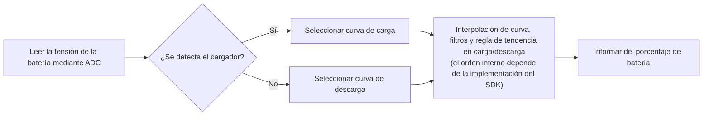

# Estimación del nivel de carga de la batería { #battery-capacity-calculation }

La calculadora de batería del SiFli-SDK estima el estado de carga, expresado en porcentaje, a partir de la tensión medida. No mide la carga acumulada como un contador de culombios; por tanto, la precisión depende de la curva de batería utilizada y de que la información sobre el estado del cargador sea correcta.

El middleware detecta el estado del cargador, selecciona la curva de carga o descarga correspondiente y estima el porcentaje mediante interpolación. También aplica un filtro primario de saltos y un filtro opcional de media ponderada para estabilizar el resultado. La guía publicada no especifica por completo el orden interno de los filtros; consulte la implementación de la revisión del SDK que use el proyecto antes de dar por supuesto un orden concreto.

## Qué hace la calculadora { #what-the-calculator-does }

<div align="center"><em>Tabla: Comportamiento de la calculadora de batería</em></div>
<div align="center" markdown>

| Función | Comportamiento |
| --- | --- |
| Curvas de carga y descarga | Selecciona la curva de tensión y nivel de carga correspondiente al modo actual: carga o descarga. |
| Interpolación lineal | Calcula un porcentaje entre los puntos de la curva seleccionada. |
| Filtro primario | Filtra los saltos de tensión mediante el umbral configurado y el número de muestras consecutivas que lo superan. |
| Filtro secundario | Si se habilita, calcula un promedio ponderado de los valores de tensión anterior y actual. |
| Detección del estado del cargador | Usa la configuración de detección del cargador de la placa para seleccionar la curva de carga o descarga. |

</div>

<div align="center"><em>Diagrama: Flujo de estimación del porcentaje de batería</em></div>



Este diagrama es conceptual; no garantiza una secuencia interna de llamadas. La guía publicada no define el orden exacto de la interpolación, los filtros y la regla de tendencia en carga/descarga. Compruebe la implementación de la revisión del SDK usada por el producto. La guía sí indica que el porcentaje no disminuye durante la carga ni aumenta durante la descarga.

## Configure primero la placa { #configure-the-board-first }

Antes de usar el middleware, configure la placa en menuconfig:

1. Habilite el soporte ADC para medir la tensión de la batería.
2. Habilite la función de cálculo de batería.
3. Habilite el soporte de carga.
4. Seleccione el circuito cargador usado por la placa. Use la opción de cargador simple solo si ninguno de los circuitos listados corresponde.
5. Configure el pin de detección de conexión del cargador de la placa.
6. Seleccione la polaridad del pin de detección según el hardware.

`BSP_CHARGER_INT_PIN_ACTIVE_HIGH` define la polaridad de detección del cargador. Si se define, un nivel alto indica que el cargador está conectado; si no se define, lo indica un nivel bajo. Una polaridad incorrecta selecciona la curva equivocada y puede hacer que el porcentaje parezca fijo o cambie en sentido inverso.

## Use las curvas de la celda instalada { #use-battery-curves-from-the-actual-cell }

El archivo `battery_table.c` incluido en el directorio de la placa es un ejemplo de referencia, no un modelo universal. Solicite al fabricante las curvas que relacionan la tensión con el nivel de carga de la celda instalada y configure las tablas de consulta adecuadas para el producto.

<div align="center"><em>Tabla: Requisitos de las curvas de batería</em></div>
<div align="center" markdown>

| Tabla | Definición necesaria |
| --- | --- |
| `charging_curve_table` | Tabla `const battery_lookup_point_t[]` para carga. Las tensiones deben ordenarse de mayor a menor. |
| `discharge_curve_table` | Tabla `const battery_lookup_point_t[]` para descarga. Las tensiones deben ordenarse de mayor a menor. |
| Contenido de la tabla | Los puntos deben representar porcentajes en orden descendente, de 100 a 0, y reflejar el comportamiento real de la batería. |
| Ubicación de la tabla | `battery_table.c` específico de la placa. |

</div>

Use curvas separadas porque la tensión de una celda con el mismo estado de carga cambia entre carga y descarga. No sustituya la curva por una curva arbitraria de una celda de litio de 4,2 V solo porque coincida la química nominal.

!!! warning "Compruebe la escala de tensión de su SDK y placa"
    La guía publicada de SiFli presenta una incoherencia de unidades: etiqueta `voltage_mv` y los umbrales de filtrado en mV, pero el ejemplo pasa `38000` como `3.8 V` y la curva de ejemplo usa `41808` para `4.18 V`. Estos valores son coherentes con una escala de 0,1 mV, pero la guía no documenta explícitamente esa escala; debe tratarse como una inferencia, no como una garantía de la API. Antes de usar la calculadora, compruebe la conversión ADC, la tabla de batería y las comparaciones de umbral en la revisión exacta del SDK y la configuración de la placa.

    La lectura ADC, la tabla de curvas seleccionada y los umbrales de filtrado deben usar escalas compatibles. La guía indica los literales `50` y `30` para los umbrales y los describe en mV; no los convierta basándose únicamente en los ejemplos de tensión. Compruebe cómo interpreta y compara cada campo la revisión del SDK de destino. No cambie solo la escala de la lectura ADC y deje la tabla o los umbrales en otra escala.

## Configure la calculadora { #configure-the-calculator }

`battery_calculator_config_t` proporciona las dos tablas de curvas y los parámetros de filtrado.

<div align="center"><em>Tabla: Configuración de la calculadora de batería</em></div>
<div align="center" markdown>

| Campo | Propósito | Literal del ejemplo publicado (unidad indicada en la documentación) |
| --- | --- | --- |
| `charging_table`, `charging_table_size` | Curva de carga y número de puntos | Específico de la placa |
| `discharging_table`, `discharging_table_size` | Curva de descarga y número de puntos | Específico de la placa |
| `charge_filter_threshold` | Umbral de salto de tensión durante la carga | `50` (la documentación indica mV; compruebe la escala del SDK usado) |
| `discharge_filter_threshold` | Umbral de salto de tensión durante la descarga | `30` (la documentación indica mV; compruebe la escala del SDK usado) |
| `filter_count` | Número de muestras consecutivas que deben superar el umbral de variación para que el filtro primario confirme el cambio | `3` |
| `secondary_filter_enabled` | Habilita el filtro secundario ponderado | `true` |
| `secondary_filter_weight_pre` | Peso de la tensión anterior | `90` |
| `secondary_filter_weight_cur` | Peso de la tensión actual | `10` |

</div>

Si se habilita el filtro secundario, `secondary_filter_weight_pre + secondary_filter_weight_cur` debe ser igual a `100`. Ajuste los umbrales, la cantidad de lecturas y las ponderaciones según la batería instalada, los transitorios de consumo y el comportamiento esperado del producto. Los valores de referencia del SDK no sustituyen la calibración.

## Inicializar y calcular { #initialize-and-calculate }

Inicialice la calculadora antes de solicitar un porcentaje. La guía publicada de SiFli declara el inicializador con retorno `void`; al compilar, consulte la cabecera de la revisión exacta del SDK del proyecto.

```c
void battery_calculator_init(battery_calculator_t *calc,
                             const battery_calculator_config_t *config);
```

La API devuelve un porcentaje de 0 a 100: es el estado de carga, no la capacidad de la batería en mAh. Antes de integrarla, consulte la cabecera y la implementación de la revisión exacta del SDK para comprobar si hay restricciones adicionales o un valor de estado de inicialización.

Proporcione la tensión en la escala que espera la revisión exacta del SDK. Aunque el nombre del parámetro de la API publicada es `voltage_mv`, compruebe la escala real como se explica anteriormente:

```c
uint8_t battery_calculator_get_percent(battery_calculator_t *calc,
                                       uint32_t voltage_mv);
```

<div align="center"><em>Tabla: Secuencia recomendada de integración</em></div>
<div align="center" markdown>

| Paso | Acción |
| --- | --- |
| 1 | Configure el ADC, el tipo de cargador, el pin de detección y la polaridad de la placa. |
| 2 | Defina curvas de carga y descarga validadas en `battery_table.c`. |
| 3 | Inicialice `battery_calculator_t` con `battery_calculator_config_t`. |
| 4 | Lea la tensión de la batería a través de la ruta ADC configurada. |
| 5 | Compruebe que la tensión, las tablas y los umbrales usan la misma escala antes de pasarla a `battery_calculator_get_percent()`. |
| 6 | Use el resultado filtrado para la interfaz de usuario, la política de batería baja y la telemetría del producto. |

</div>

## Verificar el comportamiento en el producto { #verify-behavior-on-product-hardware }

El porcentaje mostrado debe reflejar el estado real del producto, no limitarse a parecer razonable en el laboratorio. Durante la carga y la descarga, y al conectar o desconectar el cable, verifique conjuntamente si se detecta el cargador, la tensión medida, la curva seleccionada y el porcentaje mostrado.

<div align="center"><em>Tabla: Resolución de problemas del porcentaje de batería</em></div>
<div align="center" markdown>

| Síntoma | Primera comprobación |
| --- | --- |
| El porcentaje cambia demasiado bruscamente | Primero confirme que la lectura ADC, las tablas de curvas y los umbrales usan la misma escala. Después ajuste el umbral correspondiente o `filter_count`; si hace falta, habilite o refuerce el filtro secundario. |
| El porcentaje es inexacto | Obtenga una curva que corresponda a la batería real y vuelva a calibrar los puntos de consulta. |
| El porcentaje no cambia | Verifique el estado del cargador comunicado y la polaridad de `BSP_CHARGER_INT_PIN_ACTIVE_HIGH`. La guía publicada indica que durante la carga el porcentaje no puede disminuir y que durante la descarga no puede aumentar. |
| El porcentaje cambia en el sentido equivocado | Verifique el pin de detección del cargador, su polaridad eléctrica y la curva de carga/descarga seleccionada. |

</div>

Para consultar la referencia oficial del middleware y las capturas de configuración actuales, consulte la [estimación del nivel de carga de la batería en SiFli-SDK](https://docs.sifli.com/projects/sdk/latest/sf32lb58x/middleware/battery_calculator.html). Para estimar la autonomía del sistema, continúe con el [análisis del consumo energético de un reloj inteligente](smartwatch-power-profiling.md); para validar los resultados mediante mediciones, consulte [Medición y validación del consumo energético](measurement-and-validation.md).

La guía publicada es el punto de partida para consultar la función, pero no sustituye la revisión del SDK usada por el producto. En particular, compruebe en esa revisión la conversión ADC, la tabla de batería, la comparación de los umbrales y la cabecera de la API para resolver la incoherencia de escala.
