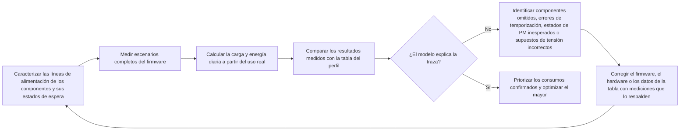

# Medición y validación del consumo energético { #power-measurement-and-validation }

Una estimación de autonomía solo es fiable cuando las hipótesis del modelo concuerdan con las mediciones del hardware. Consulte esta página junto con el [resumen del diseño de bajo consumo](overview.md) y el ejemplo de [análisis del consumo energético de un reloj inteligente](smartwatch-power-profiling.md). El proceso empieza midiendo cada componente por separado, valida escenarios completos del firmware, contrasta el modelo con el uso diario y, por último, concentra la optimización en el consumo más significativo que se haya medido.

## Mida la energía, no solo la corriente { #measure-energy-not-current-alone }

La corriente por sí sola no basta. Registre la tensión del dispositivo bajo prueba (DUT, `V_DUT`) junto con la traza de corriente para calcular la potencia instantánea y la energía, además de la carga eléctrica transferida:

```text
power_W(t) = voltage_V(t) x current_A(t)
energy_Wh = integral(power_W(t) dt) / 3600
energy_mWh = energy_Wh x 1000
charge_mAh = integral(current_mA(t) dt) / 3600
```

En estas fórmulas, `t` se expresa en segundos. Dividir por `3600` convierte los segundos en horas; use corriente en A para calcular la potencia y en mA para calcular la carga.

La integral de energía se expresa en Wh; multiplique el resultado por 1000 antes de sumarlo a un perfil expresado en mWh. Mantenga separadas la carga (mAh) y la energía (mWh): no son magnitudes intercambiables.

Si la tensión de alimentación es estable, registre el valor de `V_DUT` medido durante la captura y úselo junto con la traza de corriente. Si cambia durante la prueba, mídala con la misma base de tiempo que la corriente o registre suficientes muestras sincronizadas para calcular una potencia media fiable. Comparar solo los mAh puede ocultar diferencias reales de energía cuando varían entre capturas la tensión de alimentación, el punto de funcionamiento del regulador o el estado de la batería.

## Establezca las condiciones de referencia { #set-up-the-measurement-baseline }

Use el [Power Profiler Kit II (PPK2)](https://docs.nordicsemi.com/r/bundle/ug_ppk2/page/ug/ppk/ppk_user_guide_intro.html) de Nordic como instrumento de referencia para medir corriente. En el modo Source Meter puede alimentar el dispositivo bajo prueba (DUT); en el modo Ampere Meter mide la corriente con el PPK2 conectado en serie entre el DUT y una fuente externa. En Source Meter, trate la tensión de salida configurada como una condición de prueba controlada. En Ampere Meter, mida y registre la tensión de la fuente externa en los terminales del DUT. En ambos modos, anote la tensión que recibe realmente el DUT, no solo el valor nominal de la batería o de la fuente de laboratorio.

El PPK2 proporciona la forma de onda de corriente, la carga acumulada y datos exportables. Su puerto lógico incluye las entradas digitales D0–D7 y conexiones VCC/GND para el DUT. Conecte VCC y GND a la alimentación lógica y a la masa común del DUT, y conecte a D0–D7 las GPIO que utilizará como marcadores. Mantenga VCC dentro del rango de 1,65–5,5 V especificado por Nordic y compruebe que los niveles de las señales sean compatibles. Las entradas digitales se muestrean a 100 kHz, con un ancho de banda típico de 50 kHz; por tanto, las fases muy breves pueden no distinguirse de forma fiable. Consulte la [descripción de los conectores](https://docs.nordicsemi.com/r/bundle/ug_ppk2/page/ug/ppk/ppk_user_guide_connectors.html), las [especificaciones de alimentación](https://docs.nordicsemi.com/r/bundle/ug_ppk2/page/ug/ppk/ppk_power_supply_specs.html) y la [resolución de las entradas digitales](https://docs.nordicsemi.com/r/bundle/ug_ppk2/page/ug/ppk/digital_input_resolution.html) de Nordic. Use marcadores GPIO para delimitar rutas importantes, como el despertar del dispositivo, la actualización de la pantalla, la transferencia por radio, el muestreo de sensores y el regreso al estado de suspensión. La [guía oficial del PPK2](https://docs.nordicsemi.com/r/bundle/ug_ppk2/) explica los modos de funcionamiento admitidos y los requisitos de conexión.

Durante el uso, mantenga conectada la conexión USB de datos y alimentación del PPK2, tal como exige Nordic. Esto es independiente de la fuente USB adicional que se recomienda más adelante para cargas elevadas en modo Source Meter.

Antes de conectar el DUT, compruebe que el modo seleccionado del PPK2 admite su tensión y corriente máxima. Nordic especifica un intervalo de tensión del DUT de 0,8–5,0 V, una corriente continua máxima del DUT de 1 A en modo Ampere Meter y una corriente máxima de 600 mA en modo Source Meter. Si el DUT consume más de 400 mA en modo Source Meter, Nordic recomienda alimentar el PPK2 con una fuente USB adicional capaz de suministrar al menos 1 A. Consulte la [especificación de corriente máxima del DUT](https://docs.nordicsemi.com/r/bundle/ug_ppk2/page/ug/ppk/ppk_max_dut_current.html) y las [recomendaciones de alimentación](https://docs.nordicsemi.com/r/bundle/ug_ppk2/page/ug/ppk/ppk_power_supply.html) de Nordic. Son límites del instrumento, no condiciones de funcionamiento recomendadas para el producto. Para pruebas fuera del rango admitido, utilice equipos de medición con capacidad adecuada.

<div align="center"><em>Tabla: Datos que se deben registrar en cada medición</em></div>

<div align="center" markdown>

| Dato | Motivo |
|:-------|:-----------------|
| ID de prueba, revisión de placa, componentes montados y revisión del firmware | Permite reproducir y comparar los resultados. |
| `V_DUT`: valor objetivo, mediciones al inicio y al final, y variación durante la captura | Permite calcular correctamente la potencia y la energía. |
| Traza de corriente, corriente media y corriente de pico, potencia media, carga (mAh), energía (mWh) y duración de la medición | Distingue los picos breves de corriente del consumo sostenido y registra la potencia y la energía de la captura. |
| Temperatura, estado de la batería o ajuste de la fuente de laboratorio, y entorno de radio | Evite atribuir a una mejora del firmware las diferencias causadas por las condiciones ambientales. |
| Periféricos habilitados, política de reloj, estado de gestión de energía (PM) y fuentes de activación | Explica por qué el dispositivo entró o no en el estado de bajo consumo previsto. |
| Marcadores de firmware y condiciones de disparo | Atribuye la energía a una ruta específica en lugar de a un tramo difícil de interpretar de la traza. |

</div>

## Caracterice los componentes antes de probar el sistema completo { #characterize-each-component-before-full-system-tests }

Antes de basarse en una traza de la placa completa, mida cada componente en una línea de alimentación aislable o con un montaje de prueba. No se trata de obtener otro valor de catálogo, sino de identificar qué modos de funcionamiento, cargas y ajustes del firmware determinan el consumo del componente en el producto real.

<div align="center"><em>Tabla: Plan de caracterización por componente</em></div>

<div align="center" markdown>

| Componente | Medir como mínimo | Registrar en el modelo |
|:----------|:-------------------|:--------------------|
| MCU | Procesamiento activo, estado Idle (inactividad), cada modo de suspensión previsto e intervalos de activación y de transición del reloj | Corriente y duración para cada estado del firmware; activaciones inesperadas y bloqueos que impiden la gestión de energía. |
| PSRAM externa | Espera o retención, lecturas, escrituras, tráfico en ráfaga y, cuando corresponda, refresco | Corriente de la línea de alimentación para cada patrón de acceso y tiempo que permanece en ese patrón. |
| Memoria flash externa | Apagado profundo o espera, lecturas, escrituras, borrados y latencia de activación | Energía por acceso u operación y corriente en reposo. |
| Cada sensor externo | Todos los modos habilitados, tasa de datos de salida, configuración de FIFO o interrupciones y ciclo de trabajo | Energía por muestra o intervalo; incluya el procesamiento de la MCU cuando mida el escenario completo. |
| Motor háptico y controlador | Arranque, amplitud, patrón, duración y comportamiento de frenado o inercia | Energía por patrón háptico, no solo la corriente máxima del motor. |
| Códec de audio y amplificador de potencia | Apagado, espera, reproducción o grabación, nivel de salida e impedancia real del altavoz o de la carga | Energía por sesión de audio y corriente de fuga de toda la ruta de audio cuando está apagada. |
| Pantalla, táctil, radio, PMIC y otras cargas | Sus estados activos, inactivos y de retención pertinentes | Suposiciones de corriente separadas o entradas explícitas de `Other`, con el alcance de la medición indicado. |

</div>

Para evaluar el consumo energético del producto completo, mida en la entrada de la batería. Las mediciones en cada línea de alimentación siguen siendo esenciales para aislar las causas, pero conviértalas al lado de la batería usando la eficiencia y la corriente en reposo medidas del regulador antes de incorporarlas al modelo de autonomía. No considere la suma de las corrientes de las distintas líneas como una medición en la entrada de la batería.

## Verifique los estados de bajo consumo gestionados por el controlador { #verify-driver-controlled-power-states }

Un componente solo alcanza el estado de bajo consumo especificado si su controlador aplica la configuración y la secuencia indicadas en la documentación. Incluso un controlador funcionalmente correcto puede consumir energía de más si deja activada una señal de habilitación, envía un comando de espera incorrecto, mantiene activo un reloj o bus, o conmuta las señales de alimentación, reinicio e interfaz en un orden indebido. Para cada estado previsto, reproduzca en el firmware las condiciones de la hoja de datos y compruebe que la corriente, la tensión, la carga y la energía medidas cumplen la especificación aplicable o el punto de funcionamiento validado para el producto.

<div align="center"><em>Tabla: Revisión del control de los estados de bajo consumo</em></div>

<div align="center" markdown>

| Área de control | Requisito del controlador | Evidencia de la medición |
|:-------------|:-------------------|:---------------------|
| Registros de modo y comandos de bajo consumo | Aplique los ajustes documentados de espera, apagado, retención, tasa de datos e interrupciones. Cuando el componente lo permita, lea el estado para verificarlo. | La corriente y la energía corresponden al modo seleccionado; la configuración aplicada queda registrada en el informe de prueba. |
| Responsabilidad sobre bloqueos y restricciones de PM | Defina si cada bloqueo o restricción de PM corresponde al controlador del componente o a un servicio de nivel superior. Mantenga activos estos bloqueos o restricciones solo mientras se necesite el recurso protegido y libérelos en todas las rutas de éxito, error y retorno anticipado cuando el componente pueda quedar inactivo de forma segura. | Las trazas confirman que los bloqueos cubren el intervalo necesario: no se liberan antes de tiempo ni quedan retenidos tras finalizar el trabajo o producirse un error, impidiendo la suspensión. |
| Secuencia de alimentación, habilitación, reinicio y reloj | Respete el orden y los tiempos requeridos durante el encendido, el funcionamiento y el apagado del componente. | Los marcadores GPIO y la traza confirman que no quedan intervalos de actividad imprevistos ni picos de corriente. |
| SPI, I2C, UART y otros buses de control | Detenga el tráfico innecesario y lleve las señales de selección, reloj, datos e interrupción al estado inactivo especificado. | El componente mantiene el estado de bajo consumo previsto entre transacciones. |
| Pull-up/pull-down de GPIO y alta impedancia | Configure cada pin de control de forma explícita: salida alta o baja, entrada con la resistencia de pull-up o pull-down adecuada, o alta impedancia solo si el circuito externo fija el nivel. | Mida la corriente con el dispositivo del otro extremo de la interfaz alimentado y sin alimentar; incluya también los estados de reinicio y los valores predeterminados. |
| Interfaces entre dominios de alimentación | No alimente un componente apagado a través de un pin de control o de datos, salvo que el diseño lo permita expresamente. | No debe haber alimentación inversa ni fugas cuando cualquiera de los lados de la interfaz esté apagado. |
| Gestión de errores y recuperación | Restaure el estado correcto después de un tiempo de espera, una transferencia fallida, una activación o un reinicio del firmware. | Las mediciones prolongadas no muestran corriente excesiva persistente ni creciente causada por una rutina de limpieza incompleta. |

</div>

Que los niveles lógicos sean válidos no significa que no haya corriente de fuga. Las resistencias internas de pull-up o pull-down, definiciones de pull-up/pull-down contradictorias, estados predeterminados tras un reinicio, rutas ESD y resistencias pull-up del bus pueden crear fugas o una ruta de alimentación inversa, aunque ambos dispositivos parezcan presentar niveles lógicos correctos. Mida la corriente de la interfaz con ambos lados alimentados, con uno de ellos sin alimentación y durante la transición entre ambos estados. Si el resultado no es el esperado, determine primero si se debe a la configuración o secuencia del controlador o a una fuga en la placa, antes de modificar la tabla del perfil de consumo.

## Valide los escenarios de firmware { #validate-firmware-scenarios }

Una vez caracterizado cada componente, mida los escenarios completos de firmware que experimentará el usuario. Cada escenario combina la actividad de varios componentes, los estados de PM, las activaciones y sus tiempos. En un reloj inteligente, empiece por los mismos escenarios del modelo de [análisis del consumo energético de un reloj inteligente](smartwatch-power-profiling.md): espera con la pantalla apagada, notificaciones, avisos de llamada entrante, encendido de pantalla al levantar la muñeca, mediciones automáticas de frecuencia cardíaca, mediciones manuales de SpO2, registro de ejercicio, alarmas, seguimiento del sueño y sincronización con la aplicación. Si el producto habilita NFC, llamadas Bluetooth o AOD, añádalos como escenarios independientes.

<div align="center"><em>Tabla: Datos para validar cada escenario</em></div>

<div align="center" markdown>

| Para cada escenario | Comprobar | Actualizar en el perfil |
|:------------------|:-------|:---------------------------|
| Marcadores de inicio y fin | La traza abarca todo el ciclo, desde la activación hasta el regreso a la suspensión. | Límites y duración del escenario. |
| Actividad de componentes y líneas de alimentación | Solo están activos los componentes previstos. | Suposiciones sobre los componentes y asignación de `Other`. |
| Estado de gestión de energía tras finalizar la tarea | El sistema alcanza el estado de suspensión previsto. | Corriente de inactividad o de espera y tiempo restante estimado. |
| Corriente, `V_DUT`, carga (mAh) y energía (mWh) por ocurrencia | La medición representa el consumo en la entrada de batería. | Carga (mAh) y energía (mWh) por evento. |
| Comportamiento del producto | La medición mantiene la latencia requerida, la confiabilidad de RF, la calidad de audio y la experiencia de uso. | Un punto de funcionamiento válido, no un ajuste de bajo consumo que impida cumplir los requisitos del producto. |

</div>

Use marcadores GPIO controlados por el firmware para dividir la forma de onda en fases. Por ejemplo, una medición de activación al levantar la muñeca puede separar el reconocimiento del gesto, la activación de la MCU, el encendido de la pantalla, el renderizado, el tiempo que permanece encendida, la atenuación o el apagado y el regreso a la suspensión. Así, una corriente media se desglosa en operaciones concretas que los equipos de firmware y hardware pueden optimizar.

## Contraste el modelo con el uso diario { #reconcile-the-daily-use-profile }

La validación final no consiste en reunir mediciones aisladas en las mejores condiciones. Ejecute o reconstruya un día representativo a partir de la energía medida para cada escenario y de su frecuencia real. Compare con la tabla del perfil tanto la carga eléctrica como la energía:

```text
daily_charge_mAh = sum(occurrences_per_day x charge_per_occurrence_mAh)
daily_energy_mWh = sum(occurrences_per_day x energy_per_occurrence_mWh)
```

<div align="center"><em>Diagrama: Ciclo de convergencia del perfil energético</em></div>



Si las mediciones no concuerdan con el modelo, no modifique la tabla solo para forzar el ajuste. Busque una causa comprobable: una carga omitida, un ciclo de trabajo incorrecto, una estimación errónea de las pérdidas del regulador, una activación inesperada, un componente que quedó encendido o un punto de medida distinto del definido por el modelo. Actualice la tabla únicamente con datos obtenidos después de corregir y volver a medir el hardware o el firmware. Antes de la liberación, establezca un criterio de concordancia específico para el producto; el error aceptable dependerá de la autonomía que se declare, del rango de funcionamiento y de la incertidumbre restante.

<div align="center"><em>Tabla: Cómo interpretar las diferencias entre el perfil y las mediciones</em></div>

<div align="center" markdown>

| Diferencia observada | Causa posible | Siguiente comprobación |
|:---------|:-------------|:-----------|
| La medición de un componente supera lo esperado | Modo incorrecto, fuga en la línea de alimentación, pérdidas del regulador o carga introducida por el accesorio de prueba | Aísle la línea y compruebe los pines de modo, la tensión y los componentes montados en la placa. |
| La energía del escenario supera la suma de la energía de sus componentes | Activaciones adicionales, pantalla o radio encendidas durante más tiempo, código de servicio o cargas simultáneas | Añada marcadores al firmware y compare los estados de los componentes durante todo el escenario. |
| El perfil diario supera la suma de los escenarios | Frecuencia de uso, tiempo de inactividad con conexión, función deshabilitada o tarea en segundo plano mal estimados | Revise el número de eventos, los temporizadores, la planificación de la radio y la duración restante en espera. |
| El modelo y las mediciones solo coinciden en una configuración | Diferencias de tensión, temperatura, entorno de RF, estado de la batería o compilación del firmware | Repita los mismos escenarios en todo el rango de funcionamiento previsto. |

</div>

## Optimice los mayores consumos confirmados { #optimize-the-largest-verified-contributors }

Use el perfil ya contrastado para priorizar el trabajo. Distinga dos preguntas: ¿qué componente consume más energía y qué escenario aporta más al consumo total del producto? La respuesta puede ser distinta. La pantalla podría ser el componente de mayor consumo, mientras que la frecuencia con que se enciende al levantar la muñeca podría hacer que ese escenario sea el dominante.

1. **Optimice primero el firmware si el comportamiento es la causa.** Elimine las activaciones innecesarias, reduzca el sondeo, agrupe tareas, acorte el tiempo que permanece encendida la pantalla, evite redibujos superfluos, libere pronto las restricciones de gestión de energía y reduzca el ciclo de trabajo de sensores o radio sin incumplir los requisitos del producto.
2. **Modifique el hardware cuando el límite provenga del componente.** Considere sensores, memorias, reguladores, códecs, amplificadores, pantallas o soluciones hápticas de menor consumo. Compare la energía medida en el modo de uso previsto, no un valor destacado de corriente de la hoja de datos correspondiente a otro estado.
3. **Vuelva a medir el componente y el escenario modificados.** Un reemplazo puede cambiar cuál es el principal consumidor, alterar los tiempos de activación o exigir otro punto de funcionamiento del regulador.
4. **Actualice el perfil y repita la comparación de un día completo.** El cambio solo se valida si mejoran tanto la traza del escenario como el presupuesto energético del producto.

## Evidencias antes de la liberación { #release-evidence }

Antes de anunciar la autonomía del producto, conserve las mediciones de componentes y escenarios, el perfil de uso diario, los registros de tensión, los marcadores de firmware y las hipótesis versionadas que relacionan esos datos. Repita las etapas afectadas cuando cambien la planificación del firmware, la gestión de la pantalla, los parámetros de radio, la frecuencia de muestreo de los sensores, los componentes de alimentación o las hipótesis de uso del producto.

!!! note "Contenido autogenerado"
    Esta página se ha redactado sin un documento fuente específico. Verifique las afirmaciones técnicas en la documentación oficial de SiFli antes de basarse en ellas.
