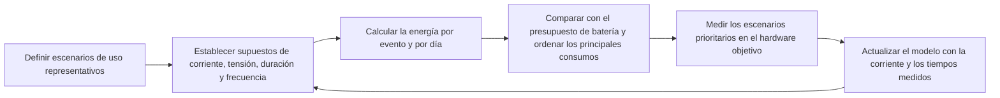

# Resumen del diseño de bajo consumo { #low-power-overview }

## Finalidad y alcance { #overview }

Esta guía explica cómo diseñar productos SF32 de bajo consumo: qué modos de funcionamiento existen, qué elementos consumen más batería y cómo organizar el firmware para que el sistema pase el mayor tiempo posible en estados de bajo consumo. El consumo depende del sistema en su conjunto: las decisiones sobre Bluetooth, gráficos, audio e IA repercuten directamente en la autonomía, por lo que aquí se analizan de forma conjunta.

La documentación del SDK de SiFli describe middleware de **PM (Power Management, gestión de energía)** basado en RT-Thread para determinados dispositivos, incluido SF32LB52x. Los modos disponibles y el comportamiento de activación pueden variar según el dispositivo y la configuración del SDK; consulte la documentación del objetivo concreto. En las familias cuyo SDK asigna las tareas del controlador Bluetooth a un procesador independiente (consulte [Procesador Bluetooth](../bluetooth/processor.md)), el procesador independiente puede atender los eventos de radio sin despertar la CPU de aplicación en cada ocasión. Que esta pueda permanecer suspendida depende de la asignación de tareas, las fuentes de activación configuradas y el tráfico entre procesadores; compruébelo en el dispositivo de destino.

Use esta guía para traducir un objetivo de autonomía en decisiones de hardware y firmware respaldadas por mediciones. Está dirigida a quienes deben equilibrar el reposo conectado, la pantalla, el audio, los sensores, la IA y la respuesta del producto. El ahorro de energía no se resuelve con una sola llamada a una API de suspensión.

## Defina primero el presupuesto de energía del producto { #define-the-products-power-budget-first }

Antes de implementar la gestión de energía, determine qué autonomía debe ofrecer el producto:

- Autonomía deseada (horas, días o semanas) y capacidad de la batería.
- Ciclo de actividad previsto: ¿cuánto tiempo pasa el dispositivo en uso activo, conectado pero inactivo y en suspensión completa?
- ¿Qué eventos deben reactivar el sistema y con qué rapidez?
- ¿Qué subsistemas deben permanecer siempre activos —por ejemplo, un enlace Bluetooth, una pantalla siempre encendida o un activador por voz— y cuáles pueden funcionar solo ante eventos?
- Comportamiento de carga y número de ciclos previstos, si son relevantes para la estrategia energética del producto.

Se recomienda que estos objetivos guíen desde el principio decisiones de arquitectura como la selección del chip y del tipo de pantalla, y determinen si funciones como la escucha continua para activar por voz o una pantalla siempre encendida caben en el presupuesto de energía.

## Modos de funcionamiento y gestión de PM { #power-modes-and-the-pm-framework }

Las siguientes son categorías conceptuales del estado del sistema, no una lista exacta de modos de hardware SF32 ni de valores de enumeración del SDK. Consulte la documentación del dispositivo y del SDK elegidos para confirmar los modos admitidos, las fuentes de activación y la retención de estado:

<em>Tabla: Modos de funcionamiento y gestión de PM</em>

| Modo | Estado habitual | Uso típico |
|:-----|:---------------|:----------|
| **Activo** | CPU en ejecución; los periféricos necesarios están activos | Interacción con la interfaz, transferencia Bluetooth, transmisión de audio y procesamiento de sensores. |
| **Inactivo** | La CPU espera un evento o una interrupción; el estado de los periféricos depende del dispositivo y la configuración | Entre actualizaciones de la interfaz o mientras espera la siguiente tarea programada o una interrupción habilitada. |
| **Suspensión / bajo consumo** | Una CPU o un subsistema entra en un estado de bajo consumo admitido; los relojes, dominios y periféricos pueden detenerse o seguir activos según ese estado | Reposo conectado o espera de un evento Bluetooth, una interrupción de sensor o un temporizador configurados. |
| **Deep Sleep (suspensión profunda) / Standby** | Estado más profundo y específico del dispositivo, con menos dominios activos; la retención y el comportamiento de activación varían | Periodos de inactividad prolongados cuando el modo elegido y los requisitos de activación lo permiten. |

La carga de trabajo hace que el sistema pase de un estado a otro. Una fuente de activación configurada despierta la CPU o el subsistema; la secuencia de reactivación y restauración de relojes depende del dispositivo. Al terminar, se recomienda que los controladores o las tareas responsables liberen las solicitudes de PM que impiden la suspensión, para que la política configurada pueda elegir un estado de bajo consumo admisible. El diagrama siguiente es ilustrativo: muestra transiciones relativas, no valores de corriente ni tiempos específicos de un dispositivo.

 <em>Diagrama: Ejemplo de transición entre modos durante una tarea breve</em>

La selección del modo de bajo consumo y el bloqueo de la suspensión son mecanismos distintos. La [referencia del middleware PM para SF32LB52x](https://docs.sifli.com/projects/sdk/latest/en/sf32lb52x/middleware/pm.html) y la [guía de bajo consumo para SF32LB55x](https://docs.sifli.com/projects/sdk/latest/sf32lb55x/app_note/low_power.html) de SiFli documentan que `rt_pm_request(PM_SLEEP_MODE_IDLE)` bloquea la entrada en LIGHT, DEEP y STANDBY hasta que se llama al `rt_pm_release(PM_SLEEP_MODE_IDLE)` correspondiente; la solicitud no selecciona un modo más profundo.

Para implementarlo, consulte la guía oficial de bajo consumo de la familia concreta: [SF32LB52x](https://docs.sifli.com/projects/sdk/latest/en/sf32lb52x/app_note/low_power.html), [SF32LB55x](https://docs.sifli.com/projects/sdk/latest/sf32lb55x/app_note/low_power.html), [SF32LB56x](https://docs.sifli.com/projects/sdk/latest/sf32lb56x/app_note/low_power.html) o [SF32LB58x](https://docs.sifli.com/projects/sdk/latest/sf32lb58x/app_note/low_power.html). Los modos disponibles, las condiciones de entrada, las fuentes de activación y el estado que se conserva dependen de la familia, la placa y la configuración del SDK. La [guía de bajo consumo de SF32LB52x](https://docs.sifli.com/projects/sdk/latest/en/sf32lb52x/app_note/low_power.html) incluye un ejemplo de configuración de los pines de activación Hibernate que menciona expresamente 58x/56x/52x/57x; la referencia común de [HAL PMU del SDK](https://docs.sifli.com/projects/sdk/latest/en/sf32lb52x/api/hal/pmu.html) indica que `HAL_PMU_EnablePinWakeup()` usa índices del 0 al 13 para SF32LB57x. Estas fuentes solo respaldan esa configuración de pines; no demuestran que la disponibilidad de los modos RT-Thread de 52x, los umbrales de la política PM ni el comportamiento de retención de 52x también se apliquen a 57x. Confirme esos puntos en la documentación del SDK y del dispositivo concretos. En general, una política configurada solo puede seleccionar un estado admisible más profundo si el intervalo de inactividad y las demás condiciones de entrada lo permiten. Una solicitud que no se libere puede mantener el sistema en un estado menos profundo del previsto.

## Qué consume energía en un producto SF32 { #what-drains-power-on-an-sf32-product }

Cada subsistema tiene un perfil de consumo distinto:

<em>Tabla: Principales fuentes de consumo de un producto SF32</em>

| Subsistema | Principal factor de consumo | Guía |
|:----------|:--------------------|:------|
| **CPU** | Tiempo de ejecución activo, no solo la velocidad de reloj | Esta guía |
| **Radio Bluetooth** | Intervalo de anuncio, intervalo de conexión, latencia del esclavo (Slave Latency), potencia de transmisión | [Resumen de Bluetooth](../bluetooth/overview.md#advertising-and-connection-parameters) |
| **Pantalla** | Frecuencia de actualización, actualización completa o parcial, retroiluminación | [Controlador de pantalla: refresco parcial y regiones modificadas](../graphics/display-controller.md#partial-refresh-and-dirty-regions) |
| **Códec de audio/DMA** | Duración de la sesión, frecuencia de muestreo y si el códec permanece encendido entre sesiones | [Descripción general del audio](../audio/overview.md#power-considerations-for-audio) |
| **Inferencia de IA** | Frecuencia de inferencia y tamaño de la ventana, no solo el tamaño del modelo | [Resumen de IA](../ai/overview.md#power-aware-inference-scheduling) |
| **Sistema de memoria** | Actividad de la caché/PSRAM y frecuencia con que se ejecuta código desde memoria externa lenta | [STAR-MC1](../architecture/star-mc1.md) |
| **Sensores** | Frecuencia de consulta frente a muestreo activado por interrupciones | Esta guía |

Ninguna optimización por sí sola resuelve todos estos problemas. En un producto real, ajuste el consumo de cada subsistema y mida después el efecto conjunto: todos influyen en la decisión común sobre la profundidad de suspensión alcanzable.

## Diseñe el firmware para aprovechar la suspensión { #sleep-aware-firmware-design }

Las mayores mejoras suelen venir de la arquitectura del firmware, no de trucos de bajo nivel:

- **Prefiera interrupciones y eventos a la consulta periódica (polling).** Un bucle de sondeo mantiene activa la CPU aunque no haya trabajo que realizar.
- **Agrupe el trabajo.** Si la latencia lo permite, acumule muestras de sensores, eventos Bluetooth o bloques de audio y procéselos juntos, en lugar de reactivar el sistema para cada uno.
- **Libere pronto las solicitudes de PM que impiden el reposo.** Si un controlador o una tarea mantiene una solicitud que bloquea la entrada en un estado de menor consumo, se recomienda liberar la solicitud correspondiente en cuanto deje de ser necesaria. Si queda activa, el sistema puede permanecer en un estado menos profundo de lo previsto.
- **Diseñe los flujos de la interfaz y del audio para responder a eventos**, no para ejecutarse por consultas periódicas, siempre que el framework lo permita.
- **Revise los temporizadores.** Un temporizador periódico programa trabajo futuro y puede reactivar el sistema o reducir el intervalo de inactividad disponible para la política de PM. Por ello, varios temporizadores aparentemente inofensivos pueden reducir el tiempo en estados de bajo consumo más profundos.

## Empiece con un ejemplo validado de bajo consumo { #start-from-a-verified-power-example }

Antes de estimar la autonomía del producto, elija un ejemplo del SDK que permita validar la parte más incierta del consumo. La página [Ejemplos de bajo consumo del SDK](low-power-sdk-examples.md) relaciona los proyectos oficiales de PM, GPIO, procesador, Bluetooth, pantalla, GUI, actualización de pantalla y activación al levantar la muñeca con los escenarios que permiten validar. También indica qué supuestos sobre la alimentación, la placa, la configuración, la fuente de activación, el circuito externo y la carga de trabajo deben volver a comprobarse antes de usar un ejemplo como evidencia para el producto.

## Optimice el consumo de Bluetooth { #bluetooth-power-tuning }

Los parámetros de conexión y de anuncio son las principales herramientas para reducir el consumo de Bluetooth (consulte la tabla completa en el [resumen de Bluetooth](../bluetooth/overview.md#advertising-and-connection-parameters)):

- En enlaces que suelen estar inactivos, aumente el intervalo de conexión y la latencia del esclavo (Slave Latency).
- Reduzca la potencia de transmisión al nivel mínimo que aún proporcione el alcance necesario.
- Cuando el producto espere reconexiones y ya no necesite facilitar su descubrimiento inicial, reduzca la frecuencia de los anuncios.
- Cuando el SDK elegido ejecute los eventos del controlador Bluetooth en un procesador independiente, la CPU de aplicación puede dormir entre eventos de conexión si ninguna tarea, fuente de activación o mensaje entre procesadores requiere que despierte. Reactivarla con cada callback de Bluetooth puede reducir esa ventaja; compruebe la asignación de núcleos y tareas del dispositivo de destino.

Para medir por escenarios el consumo real con solo Bluetooth clásico, solo BLE y ambos funcionando en modo dual, consulte [Medición y análisis del consumo energético de Bluetooth](../bluetooth/bluetooth-low-power-profiling.md).

## Consumo de la pantalla y la retroiluminación { #display-and-backlight-power }

En los dispositivos vestibles y de mano, la pantalla y la retroiluminación suelen constituir la mayor fuente individual de consumo energético:

- Cuando el panel y la interfaz lo permitan, actualice solo las regiones modificadas en lugar de redibujar toda la pantalla (consulte [Controlador de pantalla: refresco parcial y regiones modificadas](../graphics/display-controller.md#partial-refresh-and-dirty-regions)).
- Durante la inactividad, reduzca el brillo de la pantalla o apague la retroiluminación cuando corresponda. Detenga también las animaciones cuando la pantalla esté atenuada o cubierta.
- Para productos con pantalla siempre encendida, compare paneles como EPD, JDI/memory-in-pixel, AMOLED y TFT según la energía medida en ese modo y la experiencia de uso requerida. Elija el panel y la estrategia de funcionamiento que se ajusten al presupuesto, en lugar de mantener continuamente el modo activo habitual.
- Incluya la pantalla siempre encendida como una partida independiente del presupuesto de energía: cambia de forma sustancial qué significa que el producto esté inactivo.

## Reduzca el consumo de IA y sensores { #ai-and-sensor-power-tuning }

Planifique cuándo ejecutar la inferencia y tomar muestras de sensores; no los mantenga activos de forma continua:

- Ejecute la inferencia solo cuando haya datos nuevos y útiles, no en intervalos fijos independientemente de la actividad de entrada.
- Cuando el dispositivo y el SDK lo permitan, traslade la detección ligera que debe estar siempre activa al procesador de bajo consumo. Así evitará reactivar la CPU principal para cada muestra.
- Mida la **energía por inferencia o por muestra**, no solo la latencia. Una operación más rápida solo reduce el consumo si permite que el sistema vuelva antes a la suspensión.

Consulte el [resumen de IA](../ai/overview.md#power-aware-inference-scheduling) para profundizar en el equilibrio entre precisión, latencia y consumo.

## Memoria y relojes { #memory-and-clock-considerations }

La memoria desde la que se ejecuta el código influye tanto en el rendimiento como en el consumo. En los dispositivos SF32 que implementan y tienen habilitadas las cachés correspondientes, las cachés de instrucciones y datos pueden reducir las esperas al acceder a Flash o PSRAM. Al acortar el tiempo de actividad, el sistema puede pasar más tiempo en suspensión. Consulte [STAR-MC1](../architecture/star-mc1.md#memory-system-optimization) para obtener más información sobre las cachés y la jerarquía de memoria.

Más allá de la propia CPU:

- La PSRAM y la Flash externas tienen consumos propios en los modos activo y Standby. Consulte en sus hojas de datos el consumo durante el acceso y los requisitos de retención, sobre todo si los búferes grandes deben conservar su contenido durante la suspensión.
- La fuente de reloj —cristal u oscilador interno— y los dominios de PLL y reloj que deban permanecer activos afectan tanto a la latencia de reactivación como al consumo en suspensión.
- Reducir la frecuencia de la CPU puede ayudar durante las fases menos exigentes. Compruebe, sin embargo, que el mayor tiempo de actividad no anule el ahorro. Mida la energía consumida, no solo la corriente instantánea.

## Hardware y diseño de RF { #hardware-and-rf-power-considerations }

La estrategia del firmware está limitada por las posibilidades del hardware:

- La eficiencia del PMIC/LDO a las corrientes que realmente demanda el producto importa más que las cifras destacadas para puntos de carga que no se aplican.
- El diseño de RF y la sintonización de la antena determinan la potencia de transmisión necesaria para alcanzar el alcance requerido de forma fiable. Un diseño deficiente puede obligar al firmware a aumentar esa potencia y reducir así la autonomía. Consulte [Procesador Bluetooth: consideraciones de RF y reloj](../bluetooth/processor.md#rf-and-clock-considerations).
- La precisión del cristal afecta a los márgenes de temporización de RF y a cuán conservadores deben ser los tiempos de espera de supervisión y los márgenes de activación que configura el firmware.
- Prevea puntos de acceso para las pruebas y la calibración durante la producción. La optimización del consumo y de RF suele continuar después de la primera revisión del hardware.

## Caso práctico: activar la pantalla al levantar la muñeca { #case-study-raise-to-wake }

Encender la pantalla al levantar la muñeca es un caso de uso habitual en dispositivos vestibles, pero su implementación depende del sensor, la placa y el SDK. El [ejemplo de SiFli para activar la pantalla al levantar la muñeca en SF32LB52x](https://docs.sifli.com/projects/sdk/latest/en/sf32lb52x/example/pm/raise_wrist/README.html) está dirigido a la placa `sf32lb52-lchspi-ulp` y utiliza un LSM6DSL (acelerómetro/giroscopio); toma muestras de aceleración cada 200 ms para reconocer los gestos de levantar y bajar la muñeca. El dispositivo entra en suspensión tras 10 segundos de inactividad y se reactiva para encender la pantalla cuando detecta que se levanta la muñeca. Es una implementación específica de una placa y no demuestra que otros dispositivos usen una interrupción del sensor o tengan el mismo comportamiento de PM. Si el sensor objetivo admite interrupciones de movimiento o umbral, el firmware puede configurarlas como fuente de activación para evitar consultas continuas desde la CPU de aplicación. De lo contrario, incluya el muestreo del sensor y las activaciones de CPU en el presupuesto de energía. Verifique el sensor, la placa, las fuentes de activación y la configuración de PM del objetivo concreto.

## Plantilla de presupuesto de energía { #power-budget-worksheet }

Cuantifique el objetivo del producto antes de optimizar el firmware. Una tabla sencilla suele ser suficiente:

<em>Tabla: Plantilla de presupuesto de energía</em>

| Estado | Pregunta orientativa | Consumo que se debe presupuestar |
|:------|:-----------------|:------------|
| Envío/almacenamiento | ¿Cuánto tiempo puede permanecer almacenado el producto antes del primer uso? | Corriente en Deep Sleep, retención del RTC y corrientes de fuga de componentes externos. |
| Conectado e inactivo | ¿Cuántas horas al día permanece emparejado pero sin usarse? | Intervalo BLE, latencia del esclavo, interrupciones de sensores y consumo con la pantalla apagada. |
| Vista rápida de la pantalla | ¿Con qué frecuencia se activa la pantalla y durante cuánto tiempo? | Retroiluminación, actualización parcial, ráfaga de actividad de CPU/interfaz y controlador táctil. |
| Sesión de audio | ¿Durante cuánto tiempo se reproduce, graba o realiza una llamada? | Códec, DMA, audio Bluetooth y ancho de banda de memoria. |
| Ráfaga de IA | ¿Con qué frecuencia se ejecuta la inferencia? | Captura de sensores, preprocesamiento, tiempo de acelerador/CPU y posprocesamiento. |
| OTA/mantenimiento | ¿Con qué frecuencia se esperan actualizaciones? | Intervalo de conexión corto, borrado y escritura de Flash, almacenamiento para restauración. |

Para un conjunto de estados de funcionamiento mutuamente excluyentes, estime `average current = state current x duty cycle` y sume sus contribuciones. Si hay cargas simultáneas, inclúyalas en el total del escenario correspondiente para no contar dos veces estados solapados. Así podrá detectar problemas de diseño con antelación: un objetivo de 20 µA en suspensión no compensará el tiempo excesivo con la retroiluminación brillante o con un bucle de inferencia activo a intervalos fijos.

## Perfil de consumo: modelar, medir y actualizar { #power-profiling-model-measure-update }

El perfil de consumo convierte el presupuesto en un proceso de ingeniería repetible. Defina escenarios representativos, registre la tensión y la corriente en el límite de alimentación pertinente e incluya la duración y frecuencia de cada carga. Calcule la energía a lo largo del tiempo y convierta las mediciones de cada raíl al consumo del lado de la batería, teniendo en cuenta las pérdidas de conversión; no sume directamente corrientes de raíles con tensiones distintas. Así podrá estimar la corriente media de batería, la carga diaria consumida y la autonomía, además de priorizar los escenarios que deben medirse y optimizarse.

<em>Diagrama: Ciclo de perfilado del consumo</em>

Un perfil es una estimación, no una medición. El [Online Power Profiler for Bluetooth LE](https://devzone.nordicsemi.com/power/w/opp/2/online-power-profiler-for-bluetooth-le) de Nordic aplica el mismo principio: utiliza modelos derivados de mediciones, pero sus resultados son valores previstos, no mediciones de un producto concreto. La corriente real varía según el silicio, el diseño de la placa, la tensión de la batería, la temperatura, las condiciones de RF, la temporización del firmware y el escenario de uso.

Para cada escenario, capture las suposiciones que influyen significativamente en la energía:

- ¿Qué subsistemas están encendidos y en qué modo de bajo consumo entra realmente la MCU?
- ¿Qué corriente se mide en la entrada de batería o en cada raíl regulado?
- ¿Cuánto dura cada actividad y con qué frecuencia se produce en un día típico?
- ¿Qué picos de corriente son previsibles y cuáles indican actividad inesperada o una transición a suspensión que no se produjo?

Use la estimación para identificar los principales consumos y valide esos escenarios en el hardware antes de afirmar una autonomía. El artículo [Análisis del consumo energético de un reloj inteligente](smartwatch-power-profiling.md) aplica este método a un modelo de uso diario; [Medición y validación del consumo](measurement-and-validation.md) describe un procedimiento de medición repetible.

## Responsabilidad de PM y revisión de las fuentes de activación { #pm-ownership-and-wake-source-review }

Un diseño de bajo consumo fiable debe asignar claramente quién gestiona cada fuente de activación y cada solicitud que inhiba la suspensión. Revise estos aspectos durante la revisión del diseño:

<em>Tabla: Revisión de solicitudes de PM y fuentes de activación</em>

| Elemento | Pregunta de revisión | Posible fallo |
|:-----|:----------------|:-------------|
| Responsable de solicitudes/bloqueos de PM | ¿Qué controlador o tarea puede impedir la entrada en un estado más profundo? | Una solicitud no liberada puede mantener el sistema en un estado menos profundo. |
| Condición para liberar la solicitud | ¿Qué evento o ruta de error garantiza que se libere la solicitud correspondiente? | Una solicitud que permanece activa puede impedir una suspensión más profunda y aumentar el consumo. |
| Fuente de activación | ¿Qué interrupción, temporizador, evento BLE o sensor admitido y configurado en el dispositivo puede reactivar la CPU? | Las reactivaciones periódicas inesperadas dominan la corriente en reposo. |
| Dependencia de reloj | ¿Qué dominio de reloj debe seguir activo? | Un periférico impide silenciosamente una suspensión más profunda. |
| Retención necesaria | ¿Qué datos o estado deben conservarse durante la suspensión? | Conservar de más desperdicia corriente; conservar de menos altera el comportamiento de activación. |

Durante la depuración, registre la política PM configurada, las solicitudes activas que inhiben modos más profundos y el último modo de bajo consumo indicado por el SDK o sus registros. Si el sistema alcanza un estado menos profundo de lo esperado, estos datos suelen ser más reveladores que una lectura aislada de corriente.

## Cómo medir el consumo en la práctica { #measuring-power-in-practice }

No lo estime a ojo: mídalo. Para validar el consumo, necesitará como mínimo:

- Una sonda de corriente o un analizador de potencia conectado entre la batería o fuente de alimentación y la placa.
- Escenarios de prueba representativos del uso real: conexión inactiva, interacción con la interfaz, reproducción de audio, ráfagas de inferencia de IA y carga combinada en el peor caso.
- Registro o marcas de los estados del firmware (activo, inactivo y suspendido) junto con la traza de corriente, para asociar los picos a rutas de código concretas.

La documentación del SDK de SiFli incluye ejemplos de caracterización de consumo para algunos dispositivos y placas, con escenarios como pantallas AMOLED y JDI, GPIO, BLE/Bluetooth clásico y carga de CPU tipo CoreMark. Consulte la documentación del SDK y de la placa objetivo para confirmar su disponibilidad y configuración. Los ejemplos aplicables sirven como referencia para medir y comprobar el orden de magnitud, pero no garantizan el consumo del producto.

## Matriz de validación del consumo { #power-validation-matrix }

Use escenarios de prueba repetibles para comparar los resultados entre versiones del firmware. Como mínimo, mida lo siguiente:

<em>Tabla: Matriz de validación del consumo</em>

| Escenario de prueba | Qué activar | Criterio de aceptación |
|:-----------|:---------------|:---------------|
| Arranque hasta reposo | Arranque normal, sin emparejamiento y con la pantalla apagada | No hay actividad periódica aparte de los temporizadores necesarios. |
| Conectado e inactivo | Enlace BLE con bonding y parámetros de conexión previstos para producción | Compruebe que la CPU o el núcleo previsto para dormir alcanza su estado de bajo consumo objetivo entre eventos del enlace; confirme la asignación de tareas Bluetooth y el comportamiento de activación del dispositivo. |
| Interacción con la interfaz | Reactivación de la pantalla, actualización típica y espera hasta que se atenúe | La retroiluminación y las animaciones se detienen al cumplirse el tiempo de espera. |
| Audio activo | Ruta de reproducción o grabación activa | No hay interrupciones por falta de datos; el códec se apaga al terminar la sesión. |
| IA activa | Datos reales del sensor y ejecución de una inferencia | La energía por inferencia se ajusta al presupuesto. |
| Peor caso | Bluetooth, pantalla y audio/IA activos simultáneamente, según corresponda | No hay desconexiones ni fallos de funcionamiento, y no se superan los límites térmicos o de consumo eléctrico. |

Registre la versión del firmware, la revisión de la placa, la tensión de la batería o fuente, la temperatura, la configuración de antena y carcasa, y el script de prueba. Sin estos datos, las mediciones son difíciles de comparar y fáciles de interpretar mal.

## Investigue un consumo excesivo { #debugging-high-power-consumption }

<em>Tabla: Diagnóstico de un consumo excesivo</em>

| Síntoma | Posible causa que se debe revisar |
|:--------|:----------------------|
| El dispositivo nunca entra en Deep Sleep | Un controlador o una tarea no libera una solicitud de PM. Compruebe si faltan llamadas para liberarla. |
| Consumo alto con una conexión Bluetooth aparentemente inactiva | No se configuró la latencia del esclavo o la aplicación se reactiva en cada evento de conexión. |
| Los picos de consumo coinciden con la actividad de la pantalla | Se redibuja la pantalla completa en vez de actualizar solo las zonas modificadas, o la retroiluminación queda al máximo. |
| El consumo aumenta tras actualizar el firmware | Se añadió un temporizador, un bucle de sondeo o un periférico siempre activo sin revisar su impacto energético. |
| Buen resultado en el banco, pero consumo alto en el producto | Una antena mal ajustada obliga a aumentar la potencia de transmisión, o la temperatura y la carcasa alteran el resultado respecto al banco. |
| El audio o la IA agotan la batería en exceso | La ruta del códec o de inferencia permanece activa entre sesiones. Véanse la [descripción general del audio](../audio/overview.md#power-considerations-for-audio) y el [resumen de IA](../ai/overview.md#power-aware-inference-scheduling). |

## Errores comunes { #common-mistakes }

- Dejar la optimización del consumo para el final, en vez de tratarla como un requisito de diseño desde el principio.
- Consultar sensores, estado de Bluetooth o temporizadores periódicamente en vez de usar interrupciones y eventos.
- Mantener activa una solicitud de PM después de terminar el trabajo que la requería.
- Redibujar toda la pantalla para cambios pequeños de la interfaz.
- Compensar un diseño de RF deficiente aumentando la potencia de transmisión en el firmware.
- Medir solo la corriente instantánea en vez de la energía consumida en un escenario de uso realista.
- Validar el consumo en el banco, pero no en el producto montado en su carcasa definitiva y con la antena y batería reales.

## Lista de comprobación para la puesta en marcha { #bring-up-checklist }

- [ ] Defina la autonomía objetivo, el ciclo de actividad y las fuentes de activación necesarias.
- [ ] Determine qué subsistemas deben permanecer siempre activos y cuáles pueden funcionar solo ante eventos.
- [ ] Compruebe que cada controlador y tarea libera su solicitud de PM en cuanto termina el trabajo.
- [ ] Ajuste los parámetros de anuncio y conexión Bluetooth al uso real del producto.
- [ ] Compruebe que la pantalla usa actualización parcial cuando es compatible y que la retroiluminación responde al comportamiento previsto.
- [ ] Revise los temporizadores periódicos y elimine o combine los innecesarios.
- [ ] Prepare la medición de corriente y valide por separado los estados activo, inactivo y de suspensión.
- [ ] Pruebe la carga combinada del peor caso (Bluetooth, pantalla y, si corresponde, audio e IA) y confirme que respeta el presupuesto de energía.
- [ ] Vuelva a validar el consumo tras cada cambio importante del firmware, no solo al final del proyecto.

## Conclusiones clave { #key-takeaways }

- El consumo es una propiedad del sistema: las decisiones sobre Bluetooth, pantalla, audio, IA y memoria determinan en conjunto cuánto y con qué frecuencia puede suspenderse el dispositivo.
- La política PM configurada selecciona entre los estados de bajo consumo admisibles; una solicitud no liberada que inhiba modos más profundos puede dejar el sistema en un estado menos profundo del previsto.
- El diseño basado en eventos e interrupciones suele consumir menos que la consulta periódica cuando la energía es importante.
- En un dispositivo conectado, los parámetros de conexión Bluetooth y la estrategia de actualización de la pantalla suelen ser las dos principales palancas de ahorro.
- Mida el consumo real con cargas combinadas y representativas, sobre el hardware definitivo y dentro de su carcasa final. Las mediciones de banco y las de subsistemas aislados pueden infravalorar el consumo del producto completo.
