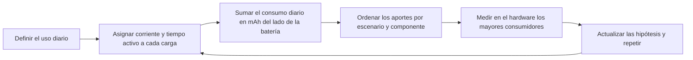
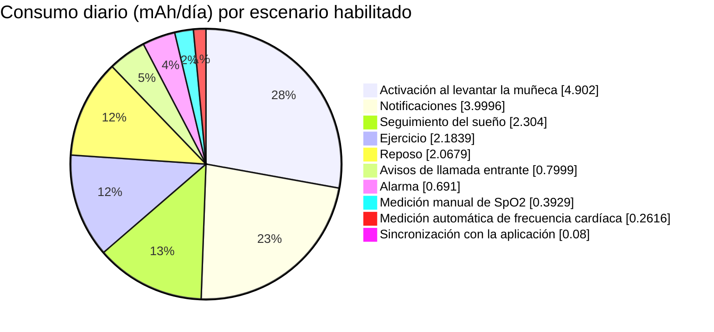
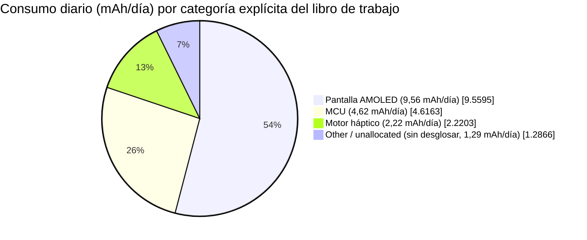
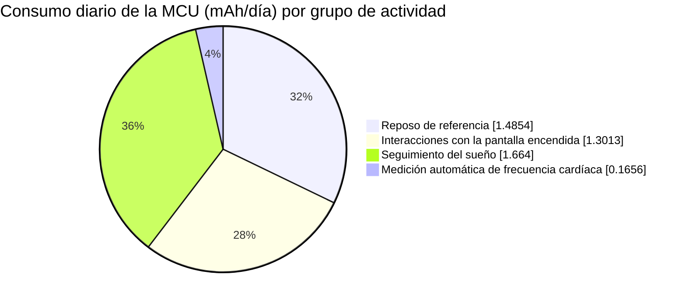

# Análisis del consumo energético de un reloj inteligente { #power-profiling-a-smartwatch }

El análisis del consumo energético permite estimar la autonomía a partir del uso diario previsto y, sobre todo, ordenar los consumidores según su impacto para priorizar las optimizaciones. Este artículo toma como ejemplo el [libro de trabajo en inglés con los datos del perfil de consumo de un reloj inteligente](assets/smartwatch-power-profile-data.xlsx). Explica cómo convertir los hábitos de uso en mAh por día, identificar los principales consumidores y transformar el modelo de la hoja de cálculo en un plan de medición.

!!! warning "Es un modelo, no una especificación del dispositivo"
    Los valores de corriente y las hipótesis de uso de este ejemplo pertenecen al modelo suministrado. No son datos de caracterización de un dispositivo SF32, una pantalla, una batería o un diseño de reloj concretos. Antes de usar el resultado para anunciar la autonomía de un producto, sustituya las hipótesis por mediciones realizadas en su propio hardware.
    El libro de trabajo no incluye registros de medición, así que no permite saber si alguno de sus valores se obtuvo midiendo. Los 13,15 días son una estimación del modelo, no una autonomía medida.

Para conocer las pautas de arquitectura y firmware, consulte el [Resumen del diseño de bajo consumo](overview.md). El artículo [Medición y validación del consumo energético](measurement-and-validation.md) describe cómo verificar el modelo con mediciones.

## Sistema del reloj y límites del modelo { #smartwatch-system-overview }

Empiece por delimitar el sistema que representa el modelo. El libro de trabajo describe un reloj inteligente alimentado por batería que incluye una MCU, una pantalla AMOLED, un motor háptico y una categoría de carga no desglosada llamada `Other`. No especifica el tamaño ni la resolución del panel, el nivel de brillo, la arquitectura de radio ni los sensores concretos. Trate los valores de corriente de la pantalla como entradas del modelo, no como mediciones ni como especificaciones de un panel determinado. `Other` es una categoría del modelo, no un componente físico.

<div align="center"><em>Tabla: sistema del reloj y parámetros del modelo</em></div>

<div align="center" markdown>

| Parámetro | Valor del libro de trabajo | Por qué importa |
|:-----|----------------------:|:---------------|
| Corriente habitual de la pantalla AMOLED | 15 mA | Se usa para notificaciones, avisos de llamada entrante y activaciones al levantar la muñeca. |
| Corriente de la pantalla AMOLED siempre encendida (AOD) | 2 mA | Está definida en el modelo, pero el escenario AOD está desactivado en este caso de referencia. |
| Capacidad nominal de la batería | 250 mAh | Capacidad inicial, antes de aplicar la reducción prevista por el modelo. |
| Reducción por degradación de la batería | 7 % | Reduce la capacidad disponible a 232,5 mAh. |
| Tensión nominal de la batería | 3,87 V | Se usa en el cálculo auxiliar de normalización de tensión del libro de trabajo. |

</div>

## Consumo por escenario { #power-consumption-by-scenario }

Un escenario representa una actividad completa del usuario o del sistema, no un componente aislado. Por ejemplo, una notificación puede despertar la MCU, encender la pantalla AMOLED, activar el motor háptico y mantener otras cargas en segundo plano. En la matriz, cada fila `Display` corresponde a la pantalla AMOLED. Las filas de cada escenario se mantienen juntas y conservan los valores diarios calculados para facilitar la trazabilidad. Las hipótesis de frecuencia y duración que determinan esos valores se detallan más adelante en el perfil de uso diario.

<div align="center"><em>Tabla: modelo completo de consumo por componente</em></div>

<div align="center" markdown>

| Escenario | Componente | Tensión | Corriente | Factor de tensión* | Consumo diario | Proporción del consumo diario |
|:---------|:----------|--------:|--------:|----------------:|-------------:|----------------------:|
| Reposo de referencia | MCU | 3,3 V | 0,102 mA | 85,27 % | 1,4854 mAh | 8,40 % |
| Reposo de referencia | Pantalla | 3,3 V | 0 mA | 85,27 % | 0 mAh | 0,00 % |
| Reposo de referencia | Motor háptico | 3,3 V | 0 mA | 85,27 % | 0 mAh | 0,00 % |
| Reposo de referencia | Other | 3,87 V | 0,04 mA | 100,00 % | 0,5825 mAh | 3,29 % |
| Notificación de mensaje | MCU | 3,3 V | 2,507 mA | 85,27 % | 0,3482 mAh | 1,97 % |
| Notificación de mensaje | Pantalla | 3,3 V | 15 mA | 85,27 % | 2,0833 mAh | 11,78 % |
| Notificación de mensaje | Motor háptico | 3,3 V | 11,25 mA | 85,27 % | 1,5625 mAh | 8,84 % |
| Notificación de mensaje | Other | 3,87 V | 0,04 mA | 100,00 % | 0,0056 mAh | 0,03 % |
| Alerta de llamada entrante | MCU | 3,3 V | 2,507 mA | 85,27 % | 0,0696 mAh | 0,39 % |
| Alerta de llamada entrante | Pantalla | 3,3 V | 15 mA | 85,27 % | 0,4167 mAh | 2,36 % |
| Alerta de llamada entrante | Motor háptico | 3,3 V | 11,25 mA | 85,27 % | 0,3125 mAh | 1,77 % |
| Alerta de llamada entrante | Other | 3,87 V | 0,04 mA | 100,00 % | 0,0011 mAh | 0,01 % |
| Activación al levantar la muñeca | MCU | 3,3 V | 2,607 mA | 85,27 % | 0,7242 mAh | 4,10 % |
| Activación al levantar la muñeca | Pantalla | 3,3 V | 15 mA | 85,27 % | 4,1667 mAh | 23,56 % |
| Activación al levantar la muñeca | Motor háptico | 3,3 V | 0 mA | 85,27 % | 0 mAh | 0,00 % |
| Activación al levantar la muñeca | Other | 3,87 V | 0,04 mA | 100,00 % | 0,0111 mAh | 0,06 % |
| Medición automática de frecuencia cardíaca | MCU | 3,3 V | 0,207 mA | 85,27 % | 0,1656 mAh | 0,94 % |
| Medición automática de frecuencia cardíaca | Pantalla | 3,3 V | 0 mA | 85,27 % | 0 mAh | 0,00 % |
| Medición automática de frecuencia cardíaca | Motor háptico | 3,3 V | 0,08 mA | 85,27 % | 0,0640 mAh | 0,36 % |
| Medición automática de frecuencia cardíaca | Other | 3,87 V | 0,04 mA | 100,00 % | 0,0320 mAh | 0,18 % |
| Medición manual de SpO2 | MCU | 3,3 V | 2,6 mA | 85,27 % | 0,0578 mAh | 0,33 % |
| Medición manual de SpO2 | Pantalla | 3,3 V | 15 mA | 85,27 % | 0,3333 mAh | 1,89 % |
| Medición manual de SpO2 | Motor háptico | 3,3 V | 0 mA | 85,27 % | 0 mAh | 0,00 % |
| Medición manual de SpO2 | Other | 3,87 V | 0,08 mA | 100,00 % | 0,0018 mAh | 0,01 % |
| Registro de ejercicio | MCU | 3,3 V | 0,207 mA | 85,27 % | 0,0296 mAh | 0,17 % |
| Registro de ejercicio | Pantalla | 3,3 V | 15 mA | 85,27 % | 2,1429 mAh | 12,12 % |
| Registro de ejercicio | Motor háptico | 3,3 V | 0 mA | 85,27 % | 0 mAh | 0,00 % |
| Registro de ejercicio | Other | 3,87 V | 0,08 mA | 100,00 % | 0,0114 mAh | 0,06 % |
| Vibración de alarma | MCU | 3,3 V | 2,6 mA | 85,27 % | 0,0650 mAh | 0,37 % |
| Vibración de alarma | Pantalla | 3,3 V | 15 mA | 85,27 % | 0,3750 mAh | 2,12 % |
| Vibración de alarma | Motor háptico | 3,3 V | 10 mA | 85,27 % | 0,2500 mAh | 1,41 % |
| Vibración de alarma | Other | 3,87 V | 0,04 mA | 100,00 % | 0,0010 mAh | 0,01 % |
| Seguimiento del sueño | MCU | 3,3 V | 0,208 mA | 85,27 % | 1,6640 mAh | 9,41 % |
| Seguimiento del sueño | Pantalla | 3,3 V | 0 mA | 85,27 % | 0 mAh | 0,00 % |
| Seguimiento del sueño | Motor háptico | 3,3 V | 0 mA | 85,27 % | 0 mAh | 0,00 % |
| Seguimiento del sueño | Other | 3,87 V | 0,08 mA | 100,00 % | 0,6400 mAh | 3,62 % |
| Sincronización de datos con la aplicación | MCU | 3,3 V | 2,5 mA | 85,27 % | 0,0069 mAh | 0,04 % |
| Sincronización de datos con la aplicación | Pantalla | 3,3 V | 15 mA | 85,27 % | 0,0417 mAh | 0,24 % |
| Sincronización de datos con la aplicación | Motor háptico | 3,3 V | 11,25 mA | 85,27 % | 0,0313 mAh | 0,18 % |
| Sincronización de datos con la aplicación | Other | 3,87 V | 0,04 mA | 100,00 % | 0,0001 mAh | 0,0006 % |
| Transacción con tarjeta NFC | MCU | 3,3 V | 2,5 mA | 85,27 % | 0 mAh | 0,00 % |
| Transacción con tarjeta NFC | Pantalla | 3,3 V | 15 mA | 85,27 % | 0 mAh | 0,00 % |
| Transacción con tarjeta NFC | Motor háptico | 3,3 V | 11,25 mA | 85,27 % | 0 mAh | 0,00 % |
| Transacción con tarjeta NFC | Other | 3,87 V | 0,04 mA | 100,00 % | 0 mAh | 0,00 % |
| Llamada Bluetooth | MCU | 3,3 V | 10 mA | 85,27 % | 0 mAh | 0,00 % |
| Llamada Bluetooth | Pantalla | 3,3 V | 15 mA | 85,27 % | 0 mAh | 0,00 % |
| Llamada Bluetooth | Motor háptico | 3,3 V | 11,25 mA | 85,27 % | 0 mAh | 0,00 % |
| Llamada Bluetooth | Other | 3,87 V | 0,04 mA | 100,00 % | 0 mAh | 0,00 % |
| AOD, actualización de MCU una vez por minuto | MCU | 3,3 V | 2,5 mA | 85,27 % | 0 mAh | 0,00 % |
| AOD, actualización de MCU una vez por minuto | Pantalla | 3,3 V | 0 mA | 85,27 % | 0 mAh | 0,00 % |
| AOD, actualización de MCU una vez por minuto | Motor háptico | 3,3 V | 0 mA | 85,27 % | 0 mAh | 0,00 % |
| AOD, actualización de MCU una vez por minuto | Other | 3,87 V | 0,08 mA | 100,00 % | 0 mAh | 0,00 % |
| AOD, pantalla siempre encendida | MCU | 3,3 V | 0 mA | 85,27 % | 0 mAh | 0,00 % |
| AOD, pantalla siempre encendida | Pantalla | 3,3 V | 2 mA | 85,27 % | 0 mAh | 0,00 % |
| AOD, pantalla siempre encendida | Motor háptico | 3,3 V | 0 mA | 85,27 % | 0 mAh | 0,00 % |
| AOD, pantalla siempre encendida | Other | 3,87 V | 0,08 mA | 100,00 % | 0 mAh | 0,00 % |

</div>

\*El libro de trabajo denomina esta columna «Power-Conversion Efficiency (%)», pero la fórmula solo calcula una relación de tensiones; no representa el rendimiento medido del regulador. El apartado «Revisar la hipótesis de conversión del libro de trabajo» explica cómo afecta esta aproximación a la estimación de autonomía. Los valores de consumo diario y los porcentajes están redondeados; consulte el archivo descargable para ver las fórmulas y cifras exactas. Use las tablas ordenadas para establecer prioridades y vuelva a esta matriz cuando necesite revisar las hipótesis de corriente o tensión de cada contribución.

<div align="center"><em>Diagrama: ciclo de análisis y validación del consumo</em></div>



### Calcular el consumo diario de un escenario { #convert-a-scenario-into-daily-charge }

Si la corriente de una carga ya está expresada en el lado de la batería, su consumo diario se calcula directamente:

```text
daily_charge_mAh = current_mA x active_time_seconds_per_day / 3600
```

Si la carga se alimenta mediante un regulador, calcule primero la corriente del lado de la batería y luego aplique el factor de tiempo:

```text
battery_current_mA = (load_voltage_V x load_current_mA) /
                     (battery_voltage_V x regulator_efficiency)
```

Use el rendimiento medido del regulador para la corriente de carga prevista. El rendimiento máximo destacado de un regulador rara vez es útil para un reloj que pasa buena parte del día con una carga ligera.

### Revisar la hipótesis de conversión del libro de trabajo { #check-the-workbooks-conversion-assumption }

La columna «Power-Conversion Efficiency (%)» del libro de trabajo se calcula como `load voltage / battery voltage`. La fórmula posterior divide por ese valor y por la tensión de la batería, por lo que los términos de tensión se cancelan. El consumo diario resultante equivale simplemente a la corriente de la carga multiplicada por el tiempo: se considera que la corriente de la batería es igual a la de la carga, en lugar de modelar una conversión de potencia ideal. Esto se aproxima a un regulador lineal sin corriente de reposo; no es un modelo general para un regulador conmutado.

Por ejemplo, una carga de 1 mA a 3,3 V alimentada desde una batería de 3,87 V mediante un convertidor ideal demandaría unos 0,853 mA de la batería, mientras que el libro de trabajo cuenta 1 mA. El resultado de un convertidor real depende de su rendimiento y de su corriente de reposo. Por tanto, esta hipótesis de conversión por sí sola no permite determinar si la estimación de autonomía es optimista o conservadora. El orden de los escenarios sigue siendo útil para revisar las hipótesis de corriente y duración, pero no constituye un presupuesto definitivo. Para un producto, sustituya el valor auxiliar por el rendimiento medido de cada línea de alimentación y rango de carga. Incluya la corriente de reposo sin contabilizarla dos veces si ya está incluida en la medición, además de las pérdidas del circuito de protección de la batería y de la ruta de carga.

## Calcular el consumo diario a partir del uso del producto { #calculate-daily-consumption-from-product-usage }

El impacto de un escenario depende del uso que se haga del producto. El libro de trabajo tiene habilitados los siguientes escenarios para representar un día de uso: reposo de referencia, notificaciones, avisos de llamada entrante, activación al levantar la muñeca, mediciones de frecuencia cardíaca y SpO2, registro de ejercicio, alarmas, seguimiento del sueño y sincronización de datos con la aplicación. Las transacciones NFC, las llamadas Bluetooth y ambos escenarios AOD están configurados en cero, por lo que no se incluyen en la estimación de 13,15 días.

<div align="center"><em>Tabla: perfil de uso diario y aportes al consumo</em></div>

<div align="center" markdown>

| Escenario | Veces al día | Duración de cada uso | Duración total diaria | Parte del consumo diario | Estado |
|:---------|--------------------:|------------------------:|-----------------------:|----------------------:|:----------------|
| Reposo de referencia | 1 | Segundos restantes del día (`=G7`) | 52.425,7 s | 11,69 % | Habilitado |
| Notificación de mensaje | 100 | 5 s | 500 s | 22,62 % | Habilitado |
| Alerta de llamada entrante | 10 | 10 s | 100 s | 4,52 % | Habilitado |
| Activación al levantar la muñeca | 200 | 5 s | 1.000 s | 27,72 % | Habilitado |
| Medición automática de frecuencia cardíaca | 48 | 60 s | 2.880 s | 1,48 % | Habilitado |
| Medición manual de SpO2 | 2 | 40 s | 80 s | 2,22 % | Habilitado |
| Registro de ejercicio | 1 | `3600 / 7` s | 514,3 s | 12,35 % | Habilitado; una hora por semana, prorrateada por día |
| Vibración de alarma | 3 | 30 s | 90 s | 3,91 % | Habilitado |
| Seguimiento del sueño | 1 | `8 x 3600` s | 28.800 s | 13,03 % | Habilitado |
| Sincronización de datos con la aplicación | 20 | 0,5 s | 10 s | 0,45 % | Habilitado |
| Transacción con tarjeta NFC | 0 | 5 s | 0 s | 0,00 % | Deshabilitado |
| Llamada Bluetooth | 0 | `2 x 60` s | 0 s | 0,00 % | Deshabilitado |
| AOD, actualización de MCU una vez por minuto | 0 | 0,05 s | 0 s | 0,00 % | Deshabilitado |
| AOD, pantalla siempre encendida | 0 | `(24 - 8) x 3600` s | 0 s | 0,00 % | Deshabilitado |

</div>

Las celdas de escenario vacías en la matriz original son intencionales. Después de cada escenario aparecen las filas de carga de la pantalla, el motor háptico y `Other`; estas heredan la frecuencia y duración diarias indicadas en la fila del escenario. Por eso cada escenario solo se nombra una vez.

<div align="center"><em>Tabla: resultado calculado para un día de uso</em></div>

<div align="center" markdown>

| Resultado | Cálculo | Valor |
|:-------|:------------|------:|
| Capacidad de batería utilizable | `250 mAh x (1 - 7%)` | 232,5 mAh |
| Consumo diario modelado | Suma de todas las cargas de escenario habilitadas | 17,68 mAh/día |
| Corriente promedio de batería | `17.68 mAh/day / 24 h` | 0,74 mA |
| Duración de batería estimada | `232.5 mAh / 17.68 mAh/day` | 13,15 días |

</div>

El orden de los escenarios aporta más información práctica que la estimación final de autonomía. Empiece por comprobar las hipótesis de optimización relacionadas con los mayores consumidores.

<div align="center"><em>Tabla: contribución de los escenarios habilitados en el modelo del reloj</em></div>

<div align="center" markdown>

| Escenario | Consumo diario | Parte del consumo diario | Uso diario supuesto |
|:---------|------------:|----------------------:|:-----------------------|
| Activación al levantar la muñeca | 4,90 mAh | 27,72 % | 200 activaciones de 5 s cada una. |
| Notificación de mensaje | 4,00 mAh | 22,62 % | 100 notificaciones de 5 s cada una. |
| Seguimiento del sueño | 2,30 mAh | 13,03 % | 8 h. |
| Registro de ejercicio | 2,18 mAh | 12,35 % | 1 h por semana, prorrateada por día. |
| Reposo de referencia | 2,07 mAh | 11,69 % | Tiempo restante del día tras las actividades activas. |
| Alerta de llamada entrante | 0,80 mAh | 4,52 % | 10 avisos de 10 s cada uno. |
| Vibración de alarma | 0,69 mAh | 3,91 % | 3 alarmas de 30 s cada una. |
| Medición manual de SpO2 | 0,39 mAh | 2,22 % | 2 mediciones de 40 s cada una. |
| Medición automática de frecuencia cardíaca | 0,26 mAh | 1,48 % | 48 mediciones de 60 s cada una. |
| Sincronización de datos con la aplicación | 0,08 mAh | 0,45 % | 20 transferencias de 0,5 s cada una. |

</div>

<div align="center"><em>Gráfico: contribución de los escenarios habilitados en el modelo del reloj</em></div>



Los dos escenarios de interacción con pantalla encendida que más contribuyen al consumo representan aproximadamente la mitad del consumo diario modelado. Es un resultado que puede comprobarse, no una afirmación genérica sobre el consumo de las pantallas. Antes de optimizar cargas menores, verifique cuántas veces se activa realmente la pantalla al levantar la muñeca, cuánto permanece encendida, qué brillo y frecuencia de actualización utiliza y cómo se gestionan las notificaciones.

<div align="center"><em>Tabla: consumo diario por categoría de componente</em></div>

<div align="center" markdown>

| Componente | Consumo diario | Parte del consumo diario | Pregunta para la medición |
|:-------------------|------------:|----------------------:|:-------------------|
| Pantalla AMOLED | 9,56 mAh | 54,06 % | ¿El brillo, el tiempo de encendido y la frecuencia de actualización reflejan el uso real? |
| MCU | 4,62 mAh | 26,11 % | ¿El firmware vuelve al modo de bajo consumo previsto entre períodos de actividad? |
| Motor háptico | 2,22 mAh | 12,56 % | ¿Son necesarios la intensidad, el patrón y la duración de cada vibración? |
| Other, sin desglosar | 1,29 mAh | 7,28 % | ¿Se han medido por separado los sensores, el PMIC, la radio y las corrientes de fuga? |

</div>

<div align="center"><em>Gráfico: reparto de los consumos diarios identificados en el modelo</em></div>



El gráfico mantiene deliberadamente la última porción como `Other / unallocated` (sin desglosar). El libro de trabajo no aporta valores independientes, referidos a la batería, para Bluetooth, el acelerómetro ni el giroscopio. Que el escenario de llamada Bluetooth esté desactivado no significa que el Bluetooth no consuma energía: la sincronización con la aplicación también podría usar la radio, pero el modelo no separa ese consumo. La categoría `Other` podría incluir los sensores, pero los datos disponibles no permiten distinguir el consumo del acelerómetro del del giroscopio.

Para crear un gráfico con cinco categorías —MCU, pantalla, motor háptico, Bluetooth y una categoría conjunta para el acelerómetro y el giroscopio—, añada filas separadas para los estados inactivo y de transferencia de Bluetooth, y para los modos de funcionamiento y ciclos de trabajo de ambos sensores. Mida cada fila en la entrada de la batería o aplique el rendimiento medido del regulador antes de sumarla al total de mAh del lado de la batería. Después sustituya la porción `Other / unallocated`; no agregue por separado consumos de sensores o Bluetooth que podrían solaparse con ella.

### Separar el consumo base de la MCU, el trabajo por escenario y las cargas de los sensores { #separate-standby-mcu-active-mcu-and-sensors }

El libro de trabajo incluye una categoría `MCU`, pero no separa el renderizado gráfico como una ruta de ejecución propia. Por tanto, el análisis más sólido distingue entre la partida de la MCU en reposo de referencia y las partidas de la MCU asignadas a los distintos escenarios; el consumo de los sensores no aparece como una categoría independiente.

<div align="center"><em>Tabla: desglose de la categoría MCU del libro de trabajo</em></div>

<div align="center" markdown>

| Actividad de la MCU | Consumo diario | Parte del consumo diario total | Parte del consumo de la MCU | Interpretación |
|:-------------------|------------:|----------------------------:|--------------------:|:---------------|
| Reposo de referencia | 1,49 mAh | 8,40 % | 32,18 % | 0,102 mA durante las 14,56 h restantes del modelo. Es una hipótesis del consumo de la MCU a nivel de sistema, no una medición verificada de la corriente de fuga del silicio sin encapsular (die). |
| Interacciones con la pantalla encendida | 1,30 mAh | 7,36 % | 28,19 % | Incluye los escenarios de mensajes, llamadas entrantes, activación al levantar la muñeca, SpO2, ejercicio, alarmas y sincronización con la aplicación. Abarca la gestión de eventos y el posible trabajo gráfico. |
| Seguimiento del sueño | 1,66 mAh | 9,41 % | 36,04 % | 0,208 mA durante 8 h; es el mayor aporte individual de la MCU en el modelo. |
| Medición automática de frecuencia cardíaca | 0,17 mAh | 0,94 % | 3,59 % | Medición programada y procesamiento asociado en la MCU. |
| **Total de la MCU** | **4,62 mAh** | **26,11 %** | **100 %** | Suma de todas las entradas explícitas de la MCU en el libro de trabajo. |

</div>

<div align="center"><em>Gráfico: desglose del consumo diario de la MCU por grupo de actividad</em></div>



Dos comparaciones evitan una conclusión engañosa:

- **Partida de reposo de referencia de la MCU frente a las partidas de escenarios con pantalla encendida:** el reposo de referencia representa 1,49 mAh al día, ligeramente más que los 1,30 mAh al día asignados a la MCU en el conjunto de escenarios de interacción con la pantalla encendida. En este modelo, reducir la corriente de referencia supuesta es tan importante como reducir el trabajo total de la MCU asociado a esos escenarios. El libro de trabajo no mide por separado las ráfagas de procesamiento gráfico.
- **Partida de reposo de referencia de la MCU frente al resto de sus partidas explícitas:** las demás entradas de la MCU suman 3,13 mAh al día, 2,11 veces el valor de reposo de referencia. El seguimiento del sueño es la mayor partida individual fuera del reposo de referencia, con 1,66 mAh al día; se trata de una asignación de la MCU a un escenario, no de una medición exclusiva de la corriente de la CPU en actividad.

El libro de trabajo no tiene una categoría específica para los sensores. Su consumo podría estar incluido en `Other`, junto con el del PMIC, la radio, las corrientes de fuga y otras cargas de fondo. Esta categoría suma 1,29 mAh al día (7,28 %). Incluso si se atribuyera todo `Other` a los sensores, la partida explícita de la MCU seguiría siendo mayor: 4,62 mAh al día frente a 1,29 mAh, unas 3,59 veces más. Esta es una comparación entre categorías del modelo, no una medición directa del silicio de la MCU frente a los sensores. Para conocer el consumo real de estos, el modelo debe separar sus líneas de alimentación del resto de las cargas agrupadas en `Other`.

<div align="center"><em>Tabla: próximas mediciones para separar las cargas restantes</em></div>

<div align="center" markdown>

| Pregunta | Qué incluye actualmente el modelo | Medición necesaria |
|:---------|:--------------------------|:-------------------|
| ¿Cuál es la corriente de fuga de la MCU? | El valor de reposo del `MCU` incluye algo más que la fuga del propio die. | Mida la alimentación de la MCU en el estado de bajo consumo previsto y, por separado, las fugas a nivel de placa. |
| ¿Cuánto consume el renderizado gráfico? | El tiempo de la MCU con la pantalla encendida también incluye el despertar, la gestión de eventos y el trabajo del controlador de pantalla. | Marque en el firmware el intervalo de renderizado e integre la corriente durante ese período. |
| ¿Qué consumo corresponde a los sensores? | No tienen una categoría propia y podrían estar incluidos en `Other`. | Mida cada línea de alimentación de los sensores o añada una fila por modo y ciclo de trabajo. |
| ¿Qué incluye el resto de `Other`? | Agrupa el PMIC, la radio, las fugas y los sensores. | Desactive o aísle una línea de alimentación o subsistema cada vez y contraste la suma con el consumo total medido en la batería. |

</div>

## Convertir el orden de consumo en acciones de diseño { #turn-the-ranking-into-design-work }

Empiece por el mayor consumidor del modelo y valide el orden con mediciones. Para este caso, conviene seguir esta secuencia:

1. **Gestión de la pantalla:** mida el ciclo completo de activación al levantar la muñeca. Reduzca los falsos disparos del gesto, el tiempo de pantalla encendida, el brillo, los redibujados completos y las animaciones innecesarias antes de perseguir ahorros de unos pocos microamperios en la MCU.
2. **Gestión de notificaciones:** agrupe las notificaciones no urgentes cuando la experiencia de usuario lo permita. Compruebe si cada evento necesita activar tanto la pantalla como la respuesta háptica.
3. **Reposo conectado:** confirme que la MCU vuelve al modo de bajo consumo previsto después de cada evento. Revise los temporizadores periódicos, los bucles de sondeo, las funciones callback de Bluetooth y las solicitudes al gestor de energía.
4. **Patrones hápticos:** ajuste la amplitud y la duración mediante pruebas de percepción. Un patrón más corto o suave puede ahorrar energía sin restar claridad a las alertas.
5. **Sensado de larga duración:** analice el seguimiento del sueño y el registro de ejercicio como escenarios completos, incluidos el ciclo de trabajo de los sensores, el procesamiento, el tráfico de memoria y el uso de la radio.

No optimice una cifra aislada de la hoja de cálculo. Un cambio que parezca eficiente puede aumentar la frecuencia de activación, empeorar la experiencia de usuario o prolongar tanto el tiempo activo que anule el ahorro previsto.

## Validar el modelo en el hardware { #validate-the-model-on-hardware }

El modelo resulta útil cuando se contrasta periódicamente con mediciones reales. Para cada consumidor principal, registre la tensión de la batería o de alimentación, la temperatura, las revisiones de la placa y del firmware, las radios activadas, el modo de pantalla y el rango de medida.

<div align="center"><em>Tabla: plan mínimo de validación del perfil del reloj</em></div>

<div align="center" markdown>

| Escenario | Qué medir | Qué actualizar en el modelo |
|:---------------|:----------------|:---------------------------------|
| Reposo con la pantalla apagada | Corriente media y despertares inesperados durante una captura prolongada | Consumo de fondo de la MCU, los sensores, el PMIC y otras cargas. |
| Activación al levantar la muñeca | Detección del gesto, latencia de activación, corriente de la pantalla y tiempo encendida | Frecuencia real del evento, duración de pantalla y consumo de la interfaz. |
| Notificación | Actividad de la MCU, la pantalla, el motor háptico y Bluetooth durante una alerta | Consumo por notificación y frecuencia diaria correcta. |
| Seguimiento del sueño | Captura de una noche completa o de un intervalo representativo y repetible | Ciclo de trabajo de los sensores y consumo del procesamiento periódico. |
| Registro de ejercicio | Actividad de sensores, pantalla, almacenamiento y radio durante la sesión prevista | Consumo por sesión y frecuencia semanal realista. |
| AOD, NFC y llamadas Bluetooth | Mediciones independientes antes de incluir estas funciones en la previsión | Escenarios propios, no un pequeño ajuste al consumo en reposo. |

</div>

## Mantener un perfil realista { #keep-the-profile-honest }

- Considere los escenarios desactivados como no contabilizados, no como gratuitos. El libro de trabajo asigna actualmente consumo cero a NFC, las llamadas Bluetooth y AOD.
- Mantenga separados los escenarios de las funciones que ve el usuario y los del trabajo en segundo plano. Así podrá evaluar mejor los compromisos del producto.
- Siempre que sea posible, mida en la entrada de la batería. Las mediciones por línea de alimentación también son útiles, pero para estimar la autonomía debe sumar las pérdidas del regulador y su corriente de reposo.
- Cambie una sola hipótesis cada vez y compare el consumo en mAh por día, no solo la corriente instantánea.
- Recalcule el perfil cuando cambien la gestión de la pantalla, los ajustes de Bluetooth, la frecuencia de muestreo de los sensores, la política de gestión de energía o alguna función importante del firmware.

## Conclusiones principales { #key-takeaways }

- La autonomía se estima dividiendo la capacidad útil de la batería por el consumo diario. Con 232,5 mAh disponibles y 17,68 mAh/día de consumo en los escenarios activos, este modelo calcula 13,15 días.
- En el caso de referencia, la pantalla es el mayor consumidor. La activación al levantar la muñeca y las notificaciones representan juntas aproximadamente la mitad del consumo diario.
- El orden de los escenarios indica qué conviene medir y optimizar primero; resulta más útil que una sola cifra de corriente media.
- Antes de presentar la previsión del libro de trabajo como autonomía de un producto, incorpore el rendimiento real de los convertidores y su corriente de reposo.
- Repita el ciclo: modele un uso realista, mida los escenarios de mayor consumo, actualice las hipótesis y vuelva a optimizar.
