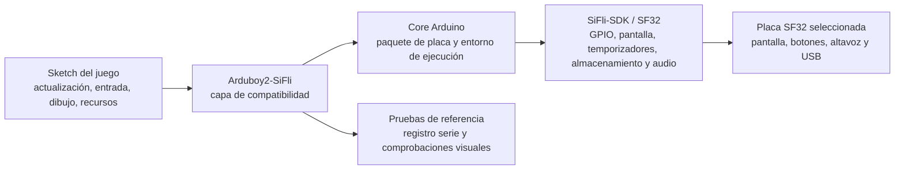

# Adaptación de Arduboy2 para SF32LB52 { #arduboy2-on-sifli }

## ¿Qué es Arduboy2-SiFli? { #what-is-arduboy2-sifli }

[OpenSiFli/Arduboy2-SiFli](https://github.com/OpenSiFli/Arduboy2-SiFli) es un port de OpenSiFli de la [biblioteca Arduboy2](https://github.com/MLXXXp/Arduboy2) para el entorno de desarrollo SiFli. Arduboy2 ofrece un modelo de aplicación para dispositivos de juego pequeños: bucle de fotogramas, búfer de pantalla, botones, sprites, texto y control de sonido opcional. Por ello, el port de SiFli sirve como experimento de compatibilidad: permite comprobar cuánto de un juego estilo Arduboy puede conservarse al trasladar a SF32 la placa, pantalla, entrada, audio y proceso de compilación.

El repositorio es una referencia de software, no una consola terminada ni un diseño de hardware para producción. Utilice el README, el árbol de fuentes, los ejemplos, el historial de incidencias y los archivos de licencia como autoridad sobre la placa objetivo exacta, la API admitida, las instrucciones de compilación y las condiciones de redistribución. Esta página organiza las decisiones de ingeniería en torno a esa referencia, pero no sustituye sus instrucciones ejecutables.

## ¿Qué aporta este port para SF32? { #why-the-sifli-implementation }

Una aplicación estilo Arduboy permite poner a prueba de forma compacta varias decisiones de un producto embebido: un bucle de renderizado predecible, recursos monocromos o de baja resolución, entrada por botones, temporización de audio y un presupuesto de memoria muy acotado. Portar ese modelo a SF32 puede servir como referencia inicial para juegos portátiles, demostradores de interfaz, dispositivos educativos y otros productos con interacción local y determinista.

El valor no reside en que todos los sketches de Arduboy funcionen sin cambios, sino en los límites que pone de manifiesto el port:

- El juego puede conservar la lógica de alto nivel de actualización, entrada, dibujo y recursos si se mantiene dentro de la API Arduboy2 admitida.
- El port debe adaptar las hipótesis implícitas del hardware original sobre pantalla, botones, audio, temporización y almacenamiento.
- Cualquier sketch que controle directamente registros AVR, pines específicos de Arduboy, transacciones de pantalla, temporizadores o disposición de EEPROM requiere una adaptación deliberada y evidencias de regresión independientes.

Estas son expectativas de ingeniería, no afirmaciones de compatibilidad medidas. Confírmelas en el repositorio actual de OpenSiFli y registre el resultado exacto para la placa y el commit seleccionados.

## Resultado, alcance y criterios de entrada { #outcome-scope-and-entry-criteria }

Esta página define una ruta por etapas desde la referencia de OpenSiFli hasta un juego o demostración interactiva reproducible en SF32. **No** afirma que el port admita todas las funciones de Arduboy2, todos los juegos de Arduboy o todas las placas SF32, ni que ofrezca temporización de pantalla y audio con calidad de producción. Tampoco concede derechos de licencia sobre juegos, fuentes, gráficos u otros recursos copiados de repositorios de terceros.

**Resultado:** una compilación de Arduboy2-SiFli bajo control de versiones que ejecute un ejemplo del repositorio o un sketch de prueba pequeño, demuestre la ruta elegida de pantalla/entrada/audio y reúna evidencia para decidir si se justifica adaptar un juego o producto mayor.

**Público destinatario:** ingenieros de firmware, hardware y producto capaces de usar las herramientas de Arduino, revisar código C/C++, grabar una placa SF32, leer la salida serie y realizar mediciones básicas de pantalla, entrada y consumo.

Antes de empezar, tenga a mano lo siguiente:

- Una placa SF32LB52 que use la variante ArduinoCore-Zephyr `sf32lb52_devkit_lcd_sf32lb525uc6`, además de los periféricos externos descritos abajo. El README indica que las rutas de pantalla, botones, EEPROM externa y audio se han probado en hardware SF32LB52; también describe cómo conectar un LED RGB externo, pero no indica que se haya probado. Tampoco fija una revisión física de la placa ni identifica el modelo exacto del módulo OLED.
- Una instalación de Arduino conocida como funcional y el paquete de placas OpenSiFli correspondiente. El nombre de la variante define una base de software y un mapa de pines, pero no demuestra que todas las unidades SF32LB52-DevKit-LCD coincidan con el cableado externo del proyecto; compruebe el esquema de la placa concreta antes de conectar periféricos.
- El commit exacto de Arduboy2-SiFli, la versión del core o paquete Arduino, el sistema operativo del host y la herramienta de carga.
- Una conexión USB de datos y medios para capturar el registro serie y observar la pantalla, los botones y la salida de audio.
- Permiso para utilizar y redistribuir todos los juegos, imágenes, fuentes y recursos de audio incluidos en cualquier adaptación posterior.

<em>Tabla: Condiciones del proyecto</em>

| Área | Referencia del proyecto | Evidencia previa a la adaptación |
|:-----|:-----------------|:---------------------------|
| Fuentes | Commit registrado de OpenSiFli/Arduboy2-SiFli y revisiones de dependencias. | Checkout limpio y registro de compilación reproducible. |
| Placa | SF32LB52 y variante ArduinoCore-Zephyr `sf32lb52_devkit_lcd_sf32lb525uc6`, con los periféricos externos indicados abajo. | Registre la revisión física de la placa, el cableado, la alimentación y una carga satisfactoria; el repositorio no fija la revisión de la placa ni el modelo OLED. |
| Cadena de herramientas | Arduino IDE o CLI, paquete de placas OpenSiFli y método de carga documentado. | Versiones de paquetes, placa seleccionada, salida del compilador y registros de carga y serie. |
| Comportamiento de referencia | Un ejemplo upstream o sketch mínimo que pruebe el port. | Actualización de pantalla, respuesta de entrada y funciones de audio admitidas observadas y repetibles. |
| Cambio de producto | Una adaptación acotada de juego o interfaz. | La prueba de referencia sigue superándose tras el cambio y se conservan los registros de recursos y licencias. |

## Especificaciones de hardware y software { #hardware-and-software-specifications }

### Especificación de hardware { #hardware-specification }

<em>Tabla: Especificación de hardware de Arduboy2-SiFli</em>

| Componente | Especificación necesaria | Función | Estado | Dónde obtenerlo | Compatibilidad y notas sobre sustituciones |
|:-----------|:-------------------------|:--------|:-------|:----------------|:-------------------------------------------|
| Placa de desarrollo SF32LB52 | Variante ArduinoCore-Zephyr `sf32lb52_devkit_lcd_sf32lb525uc6`; el repositorio no fija una revisión física de la placa | Ejecuta el port y proporciona los pines MCU asignados | Obligatorio | [Código fuente de Arduboy2-SiFli](https://github.com/OpenSiFli/Arduboy2-SiFli); [variante ArduinoCore-zephyr](https://github.com/OpenSiFli/ArduinoCore-zephyr) | Identifica la variante de placa de software y su mapa de pines, no un montaje físico validado; compare la revisión real y el esquema antes de cablear |
| OLED monocromática | 128 × 64 píxeles, conectada mediante SPI1; el repositorio no identifica el módulo ni el controlador exactos | Muestra el búfer de imagen del juego | Obligatorio | [Código fuente de Arduboy2-SiFli](https://github.com/OpenSiFli/Arduboy2-SiFli) | Es un periférico externo; antes de usarlo, compruebe el controlador, la tensión, el conector, la orientación y la temporización con el módulo y la placa |
| Seis botones de juego | Entradas compatibles con Arduboy, activas a nivel bajo y con pull-up; consulte el mapa de pines del repositorio | Lee los controles direccionales y A/B | Obligatorio | [Código fuente de Arduboy2-SiFli](https://github.com/OpenSiFli/Arduboy2-SiFli) | Son externos; contraste los IO Arduino asignados con la placa real y registre el cableado y el antirrebote |
| EEPROM externa | AT24C02 o AT24C32 por I2C1, con dirección `0x50` | Permite las funciones de la biblioteca que usan EEPROM | Opcional; necesaria solo para las funciones que usan EEPROM | [Código fuente de Arduboy2-SiFli](https://github.com/OpenSiFli/Arduboy2-SiFli) | Confirme el dispositivo, la tensión, las resistencias pull-up y el cableado del bus; el repositorio no especifica una configuración EEPROM ya montada |
| Salida de audio e indicador RGB | Los backends de audio admitidos usan las salidas de altavoz asignadas; un LED RGB externo de cátodo común se controla con PWM por software | Audio y señalización en color opcionales | Opcional; selecciónelo según el sketch que se pruebe | [Código fuente de Arduboy2-SiFli](https://github.com/OpenSiFli/Arduboy2-SiFli) | La fuente no define una lista completa de componentes para altavoz/LED; compruebe el circuito externo, los pines, la corriente y el comportamiento de audio |
| Host y conexión USB de datos | Host compatible con la cadena de herramientas Arduino seleccionada; cable con datos y acceso al registro serie | Compilar, cargar y observar la referencia | Obligatorio | [ArduinoCore-zephyr](https://github.com/OpenSiFli/ArduinoCore-zephyr) | Registre el sistema operativo, cable/puerto, versiones de paquetes y método de recuperación; un cable solo de carga no sirve |

### Especificación de software { #software-specification }

<em>Tabla: Especificación de software de Arduboy2-SiFli</em>

| Paquete o servicio | Versión o revisión necesaria | Función | Estado | Dónde obtenerlo | Compatibilidad y notas de actualización |
|:-------------------|:----------------------------|:--------|:-------|:----------------|:----------------------------------------|
| OpenSiFli/Arduboy2-SiFli | Fije y registre un commit; este artículo no congela una revisión | Capa de compatibilidad SF32 y ejemplos | Obligatorio | [Repositorio](https://github.com/OpenSiFli/Arduboy2-SiFli) | Vuelva a comprobar el destino de placa, las dependencias y la API admitida en el commit elegido |
| OpenSiFli/ArduinoCore-zephyr y paquete de placa | Hay que determinar y registrar el commit/versión compatible a partir del port | Entorno Arduino, definición de placa, compilador e integración de carga | Obligatorio | [Repositorio](https://github.com/OpenSiFli/ArduinoCore-zephyr) | No sustituya el núcleo ni el paquete de placa por otro más reciente sin compilar desde cero y repetir las pruebas de periféricos |
| Sketch de prueba y recursos del juego | Un ejemplo del repositorio o un sketch con licencia independiente; registre las revisiones y licencias de los recursos | Compruebe la API y la ruta del producto seleccionadas | Elegir uno | [Ejemplos de Arduboy2-SiFli](https://github.com/OpenSiFli/Arduboy2-SiFli) | Este artículo no concede derechos para redistribuir juegos, fuentes, imágenes o sonidos de terceros |

## Elegir una configuración de referencia admitida { #choose-a-supported-baseline }
Empiece por la combinación de placa y software indicada en el repositorio OpenSiFli, en lugar de escoger una placa del catálogo por semejanza. El paquete de placas, cableado de pantalla, asignación de entradas, método de carga e hipótesis de la biblioteca forman parte de la referencia.

El repositorio Arduboy2-SiFli no ofrece el mapa de pines de la placa en un archivo independiente: la tabla concreta está publicada en el README, en [SiFli I/O mapping](https://github.com/OpenSiFli/Arduboy2-SiFli#sifli-io-mapping). Las definiciones lógicas de pines de la biblioteca están en [`pins_sifli.h`](https://github.com/OpenSiFli/Arduboy2-SiFli/blob/master/src/platforms/sifli/pins_sifli.h), y el enrutamiento específico de la placa se define en el [overlay de Devicetree](https://github.com/OpenSiFli/ArduinoCore-zephyr/blob/main/variants/sf32lb52_devkit_lcd_sf32lb525uc6/sf32lb52_devkit_lcd_sf32lb525uc6.overlay) de ArduinoCore-Zephyr. Estas fuentes describen una base de software, no un montaje físico validado; antes de cablear, compruebe la revisión real de la placa y su esquema.

<em>Tabla: Selección de la configuración de referencia</em>

| Elemento | Selección basada en | No suponga que |
|:-----------------|:---------------|:--------------|
| Placa objetivo | La variante ArduinoCore-Zephyr `sf32lb52_devkit_lcd_sf32lb525uc6` indicada por el README de Arduboy2-SiFli y, después, el esquema de la placa física. | La variante de software demuestra la compatibilidad de todas las revisiones físicas y conjuntos de periféricos. |
| Core Arduino | El paquete OpenSiFli y la revisión documentados para el objetivo. | El paquete más reciente es intercambiable con la revisión usada por el repositorio. |
| Pantalla y entrada | Las definiciones de pines/configuración del repositorio y el esquema de la placa física. | La geometría de pantalla, polaridad de botones o nombres de pines de Arduboy coinciden con la placa SF32. |
| Audio | La ruta de salida admitida por el repositorio y los ajustes específicos de la placa. | Una API de tonos demuestra que la temporización, el volumen y el consumo del altavoz están listos para producción. |
| Carga y recuperación | El proceso de Arduino o `sftool` documentado para la placa seleccionada. | Una carga correcta desde un host demuestra una ruta de actualización recuperable en campo. |

El repositorio identifica una variante de placa de software y un mapa de pines de los periféricos, e indica que las rutas de pantalla, botones, EEPROM externa y audio se han probado en hardware SF32LB52. También documenta una ruta para un LED RGB externo, pero no afirma que se haya probado. No identifica la revisión física de la placa, el modelo/controlador exacto del OLED ni un conjunto completo de accesorios. Antes de cablear o declarar reproducible la base de hardware, contraste el mapa de pines de la variante con el esquema de la placa concreta y registre los componentes y revisiones utilizados. No complete las lagunas restantes con mapas de pines o direcciones copiados de otro proyecto SF32.

## Etapas del proyecto { #delivery-map }

Utilice estas etapas como puntos de decisión, no como una lista de funciones.

<em>Tabla: Etapas del proyecto</em>

| Etapa | Decisión que permite tomar | Resultado requerido |
|:------|:---------------------|:----------------|
| 1. Referencia sin modificar | ¿El port documentado compila, se carga y funciona en la configuración seleccionada? | Sketch funcional, registro de commit/paquete, registro de carga y comportamiento observado. |
| 2. Validación de periféricos | ¿La pantalla, entrada, audio, reinicio y temporización se comportan de forma predecible en la placa real? | Registro de pruebas de periféricos con fallos y recuperación. |
| 3. Referencia de fuentes reproducible | ¿Otro ingeniero puede reconstruir la misma imagen desde un checkout limpio? | Artefacto de compilación limpia, registro del entorno y resultado repetido. |
| 4. Adaptación controlada del juego | ¿Se puede introducir un cambio acotado de juego o interfaz sin romper el port? | Cambio revisado, registro de recursos/licencias y resultado de regresión. |
| 5. Revisión de preparación para producto | ¿La referencia justifica invertir en hardware personalizado o en un desarrollo de software mayor? | Registro de riesgos con responsables, evidencia, mitigaciones y decisión de continuar, aplazar o detener. |

## Arquitectura del sistema y dependencias { #system-architecture-and-dependencies }

<em>Figura: Ruta de aplicación Arduboy2-SiFli</em>

Este es un modelo para tomar decisiones, no una afirmación de que el repositorio utilice exactamente estos nombres internos de módulos. Confirme los límites reales del código antes de modificar el port. Los aspectos clave del producto son:

- **Fotogramas y temporización:** el bucle del juego debe actualizar y renderizar con una cadencia repetible, y cualquier comportamiento de audio o entrada sensible a la temporización debe medirse en la placa objetivo.
- **Pantalla:** la capa de compatibilidad debe adaptar el búfer y la geometría del juego al controlador de pantalla, formato de píxel, orientación y método de actualización seleccionados.
- **Entrada:** los nombres y la polaridad de los botones, el antirrebote, las pulsaciones simultáneas y el comportamiento de activación/reinicio deben comprobarse frente al cableado de la placa.
- **Audio:** la generación de tonos, la asignación de temporizadores, la conexión del altavoz, el volumen y el silencio deben tratarse como específicos de la placa hasta verificarlos.
- **Recursos y almacenamiento:** las fuentes, los sprites, los datos de sonido, la distribución de Flash y el uso de RAM deben medirse tras enlazar el juego seleccionado.
- **Recuperación:** conserve un método de carga y recuperación conocido antes de experimentar con temporización, memoria o bajo consumo.

Los principales dominios de fallo son la compatibilidad de aplicación/API, configuración de pantalla, cableado de entrada, comportamiento de audio/temporizadores, memoria y ubicación de recursos, y carga/recuperación. Un fallo en uno de estos dominios no debe notificarse simplemente como «el port no funciona».

## Etapa 1 — Establecer la referencia sin modificar { #stage-1-establish-the-untouched-reference }

**Objetivo:** comprobar que la configuración de referencia documentada en el repositorio funciona antes de cambiar la biblioteca o el juego.

1. Lea las instrucciones del repositorio, registre la rama o versión predeterminada y revise los ejemplos, la configuración de placa, las dependencias y las licencias.
2. Instale la versión exacta del core/paquete Arduino y las herramientas requeridas por el repositorio. Registre el sistema operativo anfitrión y las versiones de las herramientas.
3. Compile y cargue el ejemplo documentado más pequeño o el sketch de prueba.
4. Capture la salida serie y registre lo que aparece en pantalla, qué botones responden y si el ejemplo utiliza audio.

**Evidencia que debe conservar:** commit del repositorio, versiones de dependencias/paquetes, revisión de placa, referencia de cableado o esquema, salida de compilación, registro de carga y serie, y una nota funcional breve.

**Criterio de salida de la etapa 1:** la referencia sin modificar compila y se carga en la placa seleccionada, y su comportamiento documentado se repite tras un reinicio o ciclo de alimentación.

## Etapa 2 — Validar periféricos y límites de temporización { #stage-2-validate-peripheral-and-timing-boundaries }

**Objetivo:** distinguir una compilación correcta de una referencia funcional para un dispositivo de juego.

1. Pruebe el borrado de pantalla, la actualización de fotograma completo, el renderizado de sprites o mapas de bits, el texto y las hipótesis de geometría/orientación del ejemplo.
2. Pruebe todas las entradas del proyecto: soltar botones, pulsaciones simultáneas y rápidas, y el comportamiento de reinicio o activación cuando corresponda.
3. Si se incluye audio, verifique el inicio y la parada de tonos, la interacción con temporizadores, el silencio y el efecto de la actividad de pantalla y entrada sobre el audio.
4. Interrumpa el flujo normal mediante reinicio, desconexión/reconexión y una secuencia de entrada no válida o incompleta. Registre si la placa vuelve a un estado utilizable para cargar y ejecutar.

**Evidencia que debe conservar:** resultados visuales o capturas de pantalla, matriz de entradas, observaciones de temporización y audio, registro de reinicio/recuperación y cualquier medición de corriente o latencia que afecte a la decisión de producto.

**Criterio de salida de la etapa 2:** se conoce suficientemente la ruta de periféricos para distinguir errores de aplicación de problemas de configuración, temporización o alimentación de la placa.

## Etapa 3 — Crear una referencia de fuentes reproducible { #stage-3-build-a-reproducible-source-baseline }

**Objetivo:** hacer reproducible el port sin depender de una única máquina de desarrollo ni de un binario proporcionado.

1. Parta de un checkout limpio e inicialice todas las dependencias requeridas por el repositorio.
2. Registre el paquete de placas, la versión de Arduino IDE/CLI, el compilador y las herramientas, los archivos de configuración y los recursos generados.
3. Compile desde un directorio limpio, guarde la imagen generada y, si existe, la información map/tamaño; registre también el comando o salida de carga.
4. Repita el proceso en otra máquina o después de eliminar el directorio de compilación.

**Evidencia que debe conservar:** revisión de fuentes y dependencias, manifiesto del host/herramientas, registro de compilación, binario u otro artefacto, informe de tamaño y registros de carga y serie.

**Criterio de salida de la etapa 3:** un checkout limpio reproduce una imagen que supera las pruebas de periféricos de la etapa 2 sin archivos locales ni cambios manuales no documentados.

## Etapa 4 — Adaptar un juego de forma controlada { #stage-4-adapt-one-game-deliberately }

**Objetivo:** demostrar los límites de compatibilidad con un cambio de producto controlado.

Empiece por un sketch o juego pequeño cuyos requisitos de pantalla, entrada, audio y recursos estén claros. Conserve la imagen de referencia sin modificar y cambie una sola clase de comportamiento cada vez:

<em>Tabla: Orden de adaptación controlada</em>

| Tipo de cambio | Empezar con | Regresión requerida |
|:-------------|:-----------|:--------------------|
| Identidad e interfaz | Pantalla de título, fuente, sprite, paleta o distribución de pantalla. | Comprobaciones de compilación, carga, actualización de fotogramas, entradas e integridad de recursos. |
| Lógica del juego | Una regla, nivel o transición de estado acotada. | Secuencia de entrada repetible, reinicio, persistencia de puntuación/estado si se usa y temporización de fotogramas. |
| Audio | Un tono o efecto breve mediante la ruta admitida. | Inicio/parada, silencio, interacción con temporizadores y comportamiento con carga de pantalla/entrada. |
| Almacenamiento | Un pequeño cambio de guardado o carga de recursos. | Informe de tamaño, comportamiento ante pérdida de alimentación, gestión de corrupción y recuperación limpia. |
| Adaptación a la placa | Un cambio deliberado de asignación de pantalla, botones o altavoz. | Evidencia de esquema/pines, regresión completa de periféricos y posibilidad de volver a la imagen de referencia. |

No copie accesos a registros AVR, hipótesis de pines del Arduboy original ni direcciones de almacenamiento en el proyecto SF32 sin una decisión de diseño respaldada por fuentes. Mantenga las licencias de juegos y recursos de terceros junto al código adaptado y retire todo aquello cuyas condiciones de redistribución no estén claras.

**Evidencia que debe conservar:** diff revisado, procedencia de recursos, imágenes antes/después, registros de compilación/carga, resultados de regresión e imagen de reversión.

**Criterio de salida de la etapa 4:** el juego adaptado supera las pruebas de periféricos de referencia y quedan documentados los límites de memoria, temporización, recuperación y licencias.

## Etapa 5 — Revisión de preparación para producto { #stage-5-product-readiness-review }

No pase de una demostración del port a hardware personalizado o pruebas de campo hasta que el equipo pueda responder:

- ¿Qué placa SF32, pantalla, botones, altavoz y fuente de alimentación exactos están admitidos y cuáles siguen siendo hipótesis?
- ¿Qué frecuencia de fotogramas, latencia de entrada, comportamiento de audio, tiempo de inicio y perfil de corriente se midieron en la configuración de producto prevista?
- ¿Cuánta Flash y RAM consumen el juego, recursos, fuentes y entorno de ejecución, incluidos los casos de contenido más exigentes?
- ¿Qué ocurre tras un reinicio, caída de tensión, pérdida de alimentación durante el guardado, recursos dañados, carga fallida o actualización incompleta?
- ¿Qué partes del port mantienen el equipo del producto, OpenSiFli, SiFli o la comunidad original de Arduboy2?
- ¿Son compatibles las licencias de todos los juegos, fuentes, imágenes, sonidos y bibliotecas con el modelo de distribución previsto?

**Criterio de salida de la etapa 5:** los riesgos pendientes tienen responsables y evidencia, y cada uno cuenta con mitigación, aplazamiento explícito o decisión de detenerse.

## Traspaso a la fase de diseño del producto { #handoff-to-product-design }

Traslade a la sección [Hardware](../hardware/index.md) el dispositivo SF32 seleccionado, la arquitectura de pantalla/entrada, el plan de audio/temporizadores, la distribución de Flash y recursos, las mediciones de consumo, el método de recuperación y las hipótesis de pruebas de producción. Utilice el [Selector de productos SF32](../sf32-products/product-selector.md) si los requisitos de pantalla, memoria, encapsulado, alimentación o conectividad del juego modifican la lista de dispositivos candidatos. Para establecer la base de software, consulte [Primeros pasos con Arduino](../getting-started/arduino/getting-started-arduino.md) y luego la [Descripción de la plataforma Arduino](../develop/platforms/arduino/overview.md).

La referencia ha cumplido su función de desarrollo de producto cuando otro ingeniero puede reconstruir el port, reproducir los resultados de periféricos, explicar cada adaptación específica de placa y revisar la evidencia antes de aprobar una placa personalizada o ampliar la biblioteca de juegos.

## Fuentes de referencia { #authoritative-sources }
- [OpenSiFli/Arduboy2-SiFli](https://github.com/OpenSiFli/Arduboy2-SiFli)
- [MLXXXp/Arduboy2](https://github.com/MLXXXp/Arduboy2)
- [OpenSiFli/ArduinoCore-zephyr](https://github.com/OpenSiFli/ArduinoCore-zephyr)
- [Primeros pasos con Arduino en SF32](../getting-started/arduino/getting-started-arduino.md)
- [Descripción de la plataforma Arduino](../develop/platforms/arduino/overview.md)
- [Selector de productos SF32](../sf32-products/product-selector.md)
