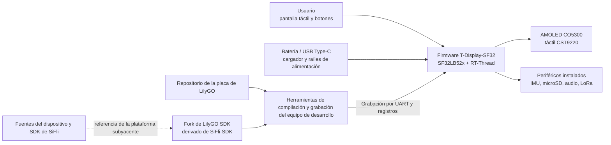

# LilyGO T-Display-SF32 { #lilygo-t-display-sf32 }

!!! warning "Proyecto de terceros; no es un proyecto de SiFli"
    T-Display-SF32 está publicado y mantenido por Xinyuan-LilyGO/LilyGO, no por SiFli ni OpenSiFli. Para tomar decisiones sobre el hardware, el firmware y el soporte específicos de la placa, consulte los repositorios de LilyGO. Las fuentes de SiFli siguen siendo la referencia para el dispositivo SF32 y SiFli-SDK, pero eso no significa que SiFli haya validado o admita esta placa de LilyGO.

## ¿Qué es T-Display-SF32? { #what-is-t-display-sf32 }

[Xinyuan-LilyGO/T-Display-SF32](https://github.com/Xinyuan-LilyGO/T-Display-SF32) es una plataforma de desarrollo basada en un microcontrolador SF32LB52x, una pantalla AMOLED CO5300 de 2,16 pulgadas y un controlador táctil CST9220. El repositorio documenta 16 MB de flash, 8 MB de PSRAM, una IMU BHI260AP, un transceptor LoRa SX1262, una interfaz microSD, audio, USB Type-C, función de carga, asignaciones de pines de la placa, aplicaciones de ejemplo, archivos de hardware, un directorio de firmware de fábrica y un informe de consumo energético específico de la placa.

Esta combinación resulta útil para evaluar un dispositivo vestible centrado en la pantalla, un controlador portátil, un terminal portátil de sensores o una HMI conectada. Sin embargo, es una referencia de plataforma, no un producto terminado: el repositorio ofrece distintas opciones de hardware, pero el equipo de producto debe seleccionar las que necesita, reproducir una configuración de referencia conocida y medir el comportamiento de los caminos elegidos en la revisión exacta de la placa. También debe validar la alimentación, la RF, la seguridad, el mantenimiento del software y la recuperación.

La matriz de funciones del repositorio distingue la placa T-SF32-Display independiente de la expansión opcional T-SF32-Keyboard. Wi-Fi (ESP32-C6), GPS (L76K), el teclado matricial y sus LED (TCA8418, AW21009 y XL9555), BME280, el emisor infrarrojo y el motor de vibración (AW86224) requieren esa expansión; no deben incluirse en la configuración base de la placa independiente.

## ¿Por qué esta implementación de SF32? { #why-the-sf32-implementation }

T-Display-SF32 combina las capacidades gráficas, Bluetooth, audio y bajo consumo del SF32LB52x con dispositivos externos para visualización, entrada táctil, detección de movimiento, almacenamiento y LoRa en una misma placa. LilyGO también proporciona la configuración de la placa, controladores específicos, ejemplos y un [fork del SDK de LilyGO](https://github.com/Xinyuan-LilyGO/SlFli-SDK-Lilygo) que, según se indica, parte de SiFli-SDK 2.4.0. Esto puede reducir el tiempo inicial de puesta en marcha de la placa frente a comenzar con un destino genérico del SDK sin modificar.

La contrapartida es la responsabilidad de mantenimiento. El soporte de la placa, los cambios en los controladores, las revisiones de hardware, el firmware incluido y la relación entre el fork de LilyGO y el SiFli-SDK principal se gestionan fuera de SiFli. Por ello, un proyecto reproducible debe fijar los commits de ambos repositorios, conservar una imagen de fábrica/recuperación que funcione y probar cualquier migración a una versión más reciente del SiFli-SDK principal como un cambio de ingeniería explícito.

## Resultado, alcance y criterios de entrada { #outcome-scope-and-entry-criteria }

**Resultado:** establecer una configuración de referencia de T-Display-SF32 con versiones fijadas; validar la pantalla y el táctil, los periféricos seleccionados, el comportamiento de alimentación y la recuperación; reproducir una compilación desde el código fuente; y realizar un cambio acotado en la aplicación con evidencias de regresión adecuadas para una revisión de producto.

Esta página no demuestra que todas las variantes de la placa incluyan todos los periféricos, que el firmware del proveedor esté listo para producción, que el informe de consumo se aplique a otra revisión o carga de trabajo, ni que el funcionamiento de LoRa sea legal en todas las regiones. Tampoco implica que SiFli admita el hardware o los controladores específicos de LilyGO.

Antes de empezar, tenga preparado lo siguiente:

- La placa T-Display-SF32 exacta y su revisión de hardware, junto con su esquema o mapa de pines.
- Una fuente de laboratorio con limitación de corriente o una batería protegida cuyo voltaje y estado puedan supervisarse.
- Un cable USB de datos que funcione, la conexión Type-C documentada para grabar y una imagen de recuperación guardada.
- Los commits fijados del repositorio T-Display-SF32 y del fork del SDK de LilyGO.
- El entorno Windows/PowerShell que documenta el fork del SDK de LilyGO para la primera compilación reproducible; otros entornos de desarrollo deben validarse por separado.
- Accesorios de prueba solo para las interfaces incluidas en el alcance, como una tarjeta microSD, auriculares o una carga de audio y un equipo LoRa de la banda permitida.
- Un registro de las versiones del firmware, los registros de compilación y consola serie, fotografías, medidas de corriente y resultados de fallos y recuperación.

<div align="center"><em>Tabla: Condiciones del proyecto T-Display-SF32</em></div>

<div align="center" markdown>

| Área | Configuración inicial de referencia | Evidencias necesarias antes de adaptar |
|:-----|:------------------------------------|:---------------------------------------|
| Responsabilidad | Placa, repositorio y fork del SDK de LilyGO | Responsables de los repositorios, commits, revisión de la placa y límites del soporte |
| Hardware | SF32LB52x, AMOLED/táctil de 2,16 pulgadas, memoria externa y periféricos instalados | Revisión del esquema/mapa de pines, registro de montaje e inventario de dispositivos instalados |
| Firmware | Imagen de fábrica incluida o ejemplo sin modificar del repositorio | Identidad de la imagen, registro de grabación, registro de arranque y registro funcional |
| Alimentación | Ruta USB/cargador/batería documentada por LilyGO | Límites de alimentación, resultado del arranque, comportamiento de apagado y corriente medida para la carga elegida |
| Adaptación | Cambiar de uno en uno un ejemplo, la interfaz, un sensor, el almacenamiento, el audio o la radio | Cambio revisado, imagen de reversión y resultados completos de regresión |

</div>

## Especificaciones de hardware y software { #hardware-and-software-specifications }

### Especificación de hardware { #hardware-specification }

<div align="center"><em>Tabla: Especificación de hardware de T-Display-SF32</em></div>

<div align="center" markdown>

| Componente | Especificación necesaria | Función | Estado | Dónde obtenerlo | Compatibilidad y notas sobre sustituciones |
|:-----------|:-------------------------|:--------|:-------|:----------------|:-------------------------------------------|
| Placa T-Display-SF32 | SF32LB52x; la configuración documentada incluye AMOLED CO5300 de 2,16 pulgadas, táctil CST9220, 16 MB Flash, 8 MB PSRAM, IMU BHI260AP, LoRa SX1262, microSD, micrófono y amplificador de altavoz integrados con conector de audio de 3,5 mm, y tres botones de usuario | Referencia integrada de cómputo, pantalla, sensores, radio, almacenamiento y audio | Obligatorio | [Repositorio LilyGO](https://github.com/Xinyuan-LilyGO/T-Display-SF32); [archivos de hardware](https://github.com/Xinyuan-LilyGO/T-Display-SF32/tree/master/hardware) | Registre la revisión exacta de la placa y los componentes instalados; no presuponga que todas las variantes tienen la misma población |
| Expansión T-SF32-Keyboard | Expansión opcional con Wi-Fi ESP32-C6, GPS L76K, subsistema de teclado TCA8418/AW21009/XL9555, BME280, emisor infrarrojo y motor de vibración AW86224 | Añade las funciones inalámbricas, de posicionamiento, teclado, sensores ambientales, infrarrojos y háptica indicadas | Opcional; necesaria solo para esas funciones | [Repositorio LilyGO](https://github.com/Xinyuan-LilyGO/T-Display-SF32); [archivos de hardware](https://github.com/Xinyuan-LilyGO/T-Display-SF32/tree/master/hardware) | Estos componentes no están en la T-SF32-Display independiente; Wi-Fi y GPS comparten UART2, por lo que hay que validar la configuración conjunta de la expansión |
| Conexión USB Type-C de datos y alimentación controlada | Cable con datos; fuente con límite de corriente o batería protegida cuya tensión pueda supervisarse | Carga de firmware y validación segura de alimentación | Obligatorio | [Repositorio LilyGO](https://github.com/Xinyuan-LilyGO/T-Display-SF32) | Las líneas D+/D- de Type-C llegan al puente USB-UART CH343P; este puerto sirve para programar por UART y obtener registros, no para el USB nativo de dispositivo/anfitrión del SF32. Siga también la condición de arranque específica de la placa (más de 3,5 V) |
| Accesorios de prueba según la interfaz | Tarjeta microSD, carga de audio/auriculares o dispositivo LoRa en una banda permitida, solo para las interfaces evaluadas | Prueba las interfaces opcionales de la placa | Opcional; elegir según la prueba | [Ejemplos](https://github.com/Xinyuan-LilyGO/T-Display-SF32/tree/master/examples) | Antes de conectar, confirme con los archivos de hardware el conector, la tensión, la región y la revisión |

</div>

### Especificación de software { #software-specification }

<div align="center"><em>Tabla: Especificación de software de T-Display-SF32</em></div>

<div align="center" markdown>

| Paquete o servicio | Versión o revisión necesaria | Función | Estado | Dónde obtenerlo | Compatibilidad y notas de actualización |
|:-------------------|:----------------------------|:--------|:-------|:----------------|:----------------------------------------|
| Firmware/código fuente de T-Display-SF32 | Fije y registre un commit; upstream no define una etiqueta universal como referencia | Ejemplos, configuración y firmware de la placa | Obligatorio | [Repositorio](https://github.com/Xinyuan-LilyGO/T-Display-SF32) | Conserve la imagen de fábrica y registre conjuntamente la revisión de placa y el commit |
| Fork LilyGO de SiFli-SDK | Fije un commit del fork, descrito como basado en SiFli-SDK 2.4.0 | Soporte de placa, controladores y entorno de compilación/carga | Obligatorio | [Fork de LilyGO](https://github.com/Xinyuan-LilyGO/SlFli-SDK-Lilygo) | La referencia a 2.4.0 no fija un commit concreto; no lo sustituya silenciosamente por el SDK upstream |
| SCons y herramientas de carga del host | Versiones proporcionadas por el fork seleccionado; registre el sistema operativo y las versiones resueltas | Compila y carga el destino `t-display-sf32_hcpu` | Obligatorio | [Fork de LilyGO](https://github.com/Xinyuan-LilyGO/SlFli-SDK-Lilygo) | La ruta inicial documentada usa Windows/PowerShell; valide otros hosts por separado |
| Firmware de fábrica V1.2 | Imagen correspondiente a la revisión de placa/repositorio | Referencia intacta y recuperación | Opcional, pero consérvela antes de modificar | [Directorio de firmware de fábrica](https://github.com/Xinyuan-LilyGO/T-Display-SF32/tree/master/firmware/T-SF32-Factory-V1.2) | El nombre del directorio no demuestra compatibilidad entre imagen y placa; verifíquela antes de grabar |

</div>

## Elegir una configuración de referencia admitida { #choose-a-supported-baseline }
El repositorio de referencia utiliza actualmente la rama `master` y no presenta una versión etiquetada como configuración de software universal. Registre el commit exacto en lugar de indicar solo «la última versión». El repositorio contiene el directorio `firmware/T-SF32-Factory-V1.2`, pero su nombre no sustituye al registro de la revisión de la placa, el commit correspondiente y el procedimiento de grabación.

<div align="center"><em>Tabla: Selección de la configuración de referencia de T-Display-SF32</em></div>

<div align="center" markdown>

| Elemento de referencia | Punto de partida recomendado | Limitación importante |
|:-----------------------|:-----------------------------|:----------------------|
| Placa | Una unidad T-Display-SF32 fotografiada y con revisión identificada | No suponga que otra revisión o variante relacionada con teclado usa el mismo mapa de pines o incluye los mismos periféricos |
| Comportamiento de fábrica | Directorio Factory V1.2 incluido o compilación sin modificar de `menu_app`, según corresponda a la unidad | Compruebe su procedencia y compatibilidad antes de grabarla; conserve la imagen original |
| Código fuente | Commit fijado de T-Display-SF32 | El repositorio evoluciona de forma independiente de SiFli-SDK |
| SDK | Commit fijado del fork del SDK de LilyGO, descrito como derivado de SiFli-SDK 2.4.0 | No lo sustituya silenciosamente por otra versión del SDK; los controladores y la configuración de la placa pueden ser diferentes |
| Destino de compilación | `t-display-sf32_hcpu` | Es un destino de placa de LilyGO, no un destino genérico para SF32LB52x |
| Alimentación | Siga la condición de arranque por encima de 3,5 V indicada por LilyGO e implemente en el firmware personalizado la detección de voltaje y el apagado por batería baja | Trátela como un requisito de la placa del proveedor que debe verificarse, no como sustituto de la hoja de datos del chip, los límites de la batería ni del comportamiento medido ante una subtensión (brownout) |

</div>

El README de T-Display-SF32 documenta este flujo de compilación y grabación del firmware en Windows, una vez configurado el entorno requerido:

```powershell
cd T-Display-SF32\examples\rt_os\rt_driver\project
scons --board=t-display-sf32_hcpu -j8
build_t-display-sf32_hcpu\uart_download.bat
```

Guarde los commits exactos del repositorio y del SDK, el resultado de exportar el entorno, el registro completo de compilación, las imágenes generadas y los registros de grabación y arranque. El número de trabajos en paralelo puede cambiar; el destino y las revisiones del código fuente deben mantenerse fijos.

## Etapas del proyecto { #delivery-map }

<div align="center"><em>Tabla: Etapas del proyecto T-Display-SF32</em></div>

<div align="center" markdown>

| Etapa | Decisión que permite tomar | Resultado requerido |
|:------|:---------------------------|:--------------------|
| 1. Configuración de referencia del proveedor | ¿Funciona la combinación intacta de placa y firmware tal como se ha identificado? | Sesión conocida como funcional, con versiones fijadas y fotografías |
| 2. Validación de periféricos y recuperación | ¿Se pueden observar y recuperar las interfaces, los estados de alimentación y los fallos seleccionados? | Registro de inyección de fallos, mediciones y recuperación |
| 3. Reproducción desde el código fuente | ¿Puede el equipo volver a compilar y grabar el mismo comportamiento a partir de fuentes limpias? | Entorno, imagen, registro de grabación y resultado repetido |
| 4. Adaptación controlada | ¿Se puede cambiar una función del producto sin romper la configuración de referencia? | Cambio acotado, ruta de reversión y evidencias de regresión |
| 5. Revisión de producto | ¿Es adecuada la plataforma de terceros para continuar el trabajo de prototipo o de hardware propio? | Riesgos asignados y decisión de continuar, aplazar o detenerse |

</div>

## Arquitectura del sistema y dependencias { #system-architecture-and-dependencies }

<div align="center"><em>Figura: Límites de producto y desarrollo de T-Display-SF32</em></div>



Analice los fallos por ámbitos: alimentación y carga de la placa, arranque y grabación, pantalla y táctil, cada periférico seleccionado, soporte de LilyGO para la placa y SDK subyacente. Por ejemplo, un fallo en el ejemplo de pantalla puede deberse a la alimentación, a la revisión de la placa, a la configuración del panel o del táctil, a la aplicación o a una discrepancia entre el SDK y el controlador. Decir simplemente «ha fallado el SDK» no es un diagnóstico suficiente.

## Etapa 1 — Establecer la configuración intacta del proveedor { #stage-1-establish-the-untouched-vendor-baseline }

**Objetivo:** comprobar el comportamiento real de la placa recibida y de la configuración del proveedor antes de modificar el código fuente.

1. Fotografíe ambas caras de la placa y registre las marcas, los periféricos instalados, los componentes de pantalla y táctil, la memoria, los interruptores, los conectores y el commit del repositorio.
2. Compruebe la fuente de alimentación y su polaridad. LilyGO advierte que el arranque requiere más de 3,5 V; utilice una fuente supervisada y no use una celda muy descargada como método de prueba.
3. Grabe solo una configuración de referencia que se sepa compatible con la placa o ejecute primero el firmware existente si su procedencia es conocida. Conserve la imagen original siempre que las herramientas lo permitan.
4. Utilice el menú del propio dispositivo o los ejemplos sin modificar para probar la pantalla, el táctil y cada periférico seleccionado para el producto. Registre las funciones que no estén disponibles o no estén montadas, en lugar de considerarlas fallos.
5. Realice dos arranques en frío y conserve los registros de arranque, fotografías de la interfaz, resultados de entrada táctil y de otros controles, y una traza de corriente para una carga inactiva/activa definida con claridad.

**Evidencias que se deben conservar:** revisión y fotografías de la placa, identificación del repositorio y la imagen, datos de la fuente y la batería, registros de grabación y arranque, inventario de dispositivos instalados, resultados funcionales y condiciones de la prueba de corriente.

**Criterio de salida de la etapa 1:** se reproduce en dos arranques en frío la configuración identificada de pantalla y táctil, hay resultados registrados para todos los periféricos instalados incluidos en el alcance y se puede restaurar la imagen original o una imagen conocida como funcional.

## Etapa 2 — Validar los límites de periféricos, alimentación y recuperación { #stage-2-validate-peripheral-power-and-recovery-boundaries }

**Objetivo:** determinar si los fallos pueden detectarse y recuperarse sin usar la batería de forma insegura ni depender de una reprogramación sin documentar.

<div align="center"><em>Tabla: Pruebas de fallos y recuperación de T-Display-SF32</em></div>

<div align="center" markdown>

| Prueba | Método | Evidencia de aprobación |
|:-------|:-------|:------------------------|
| Margen de arranque | Barra una fuente de laboratorio con limitación de corriente alrededor del rango de funcionamiento previsto sin superar los límites documentados | Se miden los umbrales y el comportamiento de arranque/apagado; no se ocultan reinicios repetidos ni estados indefinidos |
| Política de batería baja | Use una fuente controlada para probar los umbrales de aviso y apagado | El firmware personalizado avisa y se apaga antes del límite de descarga segura de la batería seleccionada |
| Carga con la placa apagada | Tras apagarla con el firmware de fábrica, conecte la alimentación USB y utilice el procedimiento de activación con el botón documentado | El estado de carga y la activación solo con el botón coinciden con la nota del proveedor; no se trata erróneamente la mera conexión USB como ruta de arranque |
| Interrupción de pantalla/táctil | Reinicie o apague y encienda durante la actividad de la interfaz y repita las pruebas táctiles en bordes y esquinas | La pantalla y el táctil vuelven a un estado conocido sin corrupción persistente ni entradas falsas |
| Almacenamiento extraíble | Retire, dañe o sustituya la tarjeta de prueba solo en momentos controlados | Se pueden diagnosticar los estados de tarjeta ausente/error; la aplicación no corrompe datos ajenos ni se bloquea |
| Ruta LoRa | Utilice un equipo LoRa homólogo en una banda permitida y en un entorno de RF controlado | Se registran la frecuencia y la configuración; se observan los tiempos de espera y la reconexión; no se afirma un alcance sin medirlo |
| Recuperación del firmware | Interrumpa una grabación de prueba solo en una unidad recuperable y luego utilice la ruta Type-C/UART documentada | Se restaura la imagen conocida como funcional y se registran las herramientas y los pasos utilizados |

</div>

**Criterio de salida de la etapa 2:** cada prueba aplicable tiene un resultado repetible y una ruta de recuperación; cualquier firmware personalizado implementa protección por batería baja; y ningún fallo pendiente puede dañar la batería o dejar la placa inutilizable sin una ruta de recuperación documentada.

## Etapa 3 — Crear una configuración de referencia reproducible desde el código fuente { #stage-3-build-a-reproducible-source-baseline }

**Objetivo:** permitir que otro ingeniero compile y grabe la misma configuración de referencia a partir de fuentes limpias y con versiones fijadas.

1. Obtenga los commits fijados del repositorio de la placa y del fork del SDK de LilyGO; registre la base del SiFli-SDK principal declarada por el fork.
2. Configure el entorno PowerShell documentado y compile `t-display-sf32_hcpu` desde un directorio limpio.
3. Guarde las evidencias del entorno, las dependencias, la configuración, la memoria/partición, la imagen, la grabación y los registros de consola serie.
4. Repita el proceso en otro equipo o tras borrar todos los resultados de compilación y ejecute de nuevo todas las pruebas de regresión de la etapa 2.

**Criterio de salida de la etapa 3:** no se necesita una imagen obsoleta, un archivo de placa sin seguimiento ni una sustitución del SDK no documentada para obtener un firmware que supere la etapa 2.

## Etapa 4 — Adaptar una ruta del producto cada vez { #stage-4-adapt-one-product-path-at-a-time }

**Objetivo:** realizar un cambio útil preservando la configuración de referencia del proveedor y la de recuperación.

<div align="center"><em>Tabla: Orden de adaptación controlada de T-Display-SF32</em></div>

<div align="center" markdown>

| Tipo de cambio | Primer cambio recomendado | Regresión requerida |
|:---------------|:-------------------------|:--------------------|
| Interfaz | Cambiar una página, un icono, una fuente o una acción táctil | Arranque en frío, actualización de pantalla completa, límites táctiles, uso de memoria y recuperación |
| Sensor | Leer un valor o evento de la IMU | Identidad del dispositivo, rango, frecuencia de muestreo, gestión de errores, corriente en reposo y activación |
| Almacenamiento/audio | Implementar una operación de archivo o una ruta de reproducción | Ausencia de medios, datos malformados, límites de volumen/salida, interrupción de alimentación y recuperación del sistema de archivos |
| LoRa | Realizar un intercambio acotado de paquetes en una banda permitida | Registro de configuración, tiempo de espera, reintentos, corriente, coexistencia y revisión normativa |
| Alimentación | Cambiar una función de reposo/activación o el control de un raíl | Todas las fuentes de activación, estado de pantalla y periféricos, apagado por batería baja, carga y ciclos repetidos |
| Migración del SDK | Evaluar una versión candidata del fork del SDK de LilyGO o del SiFli-SDK upstream | Diferencias en la configuración de la placa, compilación limpia, regresión de todos los periféricos, mediciones de corriente y reversión |

</div>

**Criterio de salida de la etapa 4:** el cambio se ha revisado, la imagen original sigue siendo recuperable y se superan todas las pruebas aplicables de pantalla, táctil, periféricos, alimentación, flash y recuperación.

## Etapa 5 — Revisión de preparación del producto { #stage-5-product-readiness-review }

Antes de comprometerse con una prueba de campo o una PCB propia, responda a estas preguntas:

- ¿Quién se responsabiliza de los archivos de la placa, el fork del SDK de LilyGO, las correcciones de controladores, las actualizaciones de seguridad y la migración a futuras versiones de SiFli-SDK?
- ¿Qué revisiones de la placa y periféricos instalados forman parte de la configuración del producto y cómo se identificarán y probarán las unidades recibidas?
- ¿Cuáles son las corrientes medidas activa, inactiva, en reposo, de arranque y de apagado para el brillo previsto de la pantalla, el ciclo de trabajo de radio y la configuración de almacenamiento y sensores?
- ¿Cómo se verifican la protección de la batería, la carga, el comportamiento térmico, la carcasa, el acceso a conectores y la recuperación con la placa apagada?
- ¿Qué región LoRa, antena, plan de frecuencias, parámetros de transmisión y obligaciones normativas son aplicables?
- ¿Las licencias de los archivos de hardware, el firmware, el fork del SDK, los ejemplos, los recursos y los componentes de terceros son compatibles con la distribución prevista?
- ¿El equipo acepta depender de un prototipo de terceros o ha validado un fork controlado y un plan de soporte?

**Criterio de salida de la etapa 5:** todos los riesgos restantes tienen un responsable, evidencias y una resolución, y el equipo ha decidido expresamente continuar, aplazar o detenerse.

## Traspaso a la fase de diseño del producto { #handoff-to-product-design }

Traslade el número de pieza SF32 exacto y los dispositivos de memoria, los tiempos de pantalla y táctil, los periféricos montados y sus buses, la estructura de alimentación, la política del cargador y la batería, la estrategia de antena/RF, la conexión de arranque y grabación, el plan de particiones, los puntos de acceso para pruebas de producción, quién mantiene el fork de software y la ruta de recuperación demostrada. Continúe con la [ruta de integración de SF32LB52x](../sf32-products/chips/SF32LB52x.md#integration-path), la [guía de diseño de hardware de SF32LB52x](../hardware/chip-guides/SF32LB52x_hardware_design_guide.md), [Compilar, grabar y monitorizar con SiFli-SDK](../develop/platforms/sifli-sdk/build-flash-monitor.md) y [Diseño para producción](../hardware/design-for-production.md).

## Fuentes de referencia { #authoritative-sources }
- [Repositorio Xinyuan-LilyGO/T-Display-SF32](https://github.com/Xinyuan-LilyGO/T-Display-SF32)
- [README en chino de T-Display-SF32](https://github.com/Xinyuan-LilyGO/T-Display-SF32/blob/master/readme_cn.md)
- [Ejemplos de T-Display-SF32](https://github.com/Xinyuan-LilyGO/T-Display-SF32/tree/master/examples)
- [Archivos de hardware de T-Display-SF32](https://github.com/Xinyuan-LilyGO/T-Display-SF32/tree/master/hardware)
- [Material de pruebas de consumo de T-Display-SF32](https://github.com/Xinyuan-LilyGO/T-Display-SF32/tree/master/lowpowertest)
- [Repositorio Xinyuan-LilyGO/SlFli-SDK-Lilygo](https://github.com/Xinyuan-LilyGO/SlFli-SDK-Lilygo)
- [OpenSiFli/SiFli-SDK](https://github.com/OpenSiFli/SiFli-SDK)
