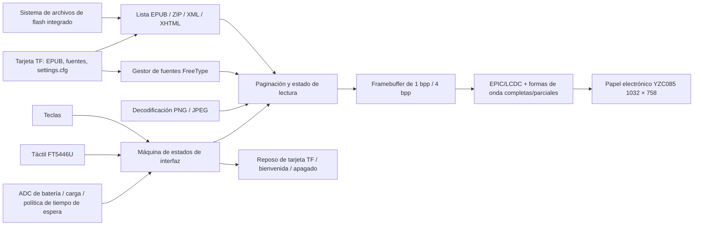

# Lector de EPUB SF32 con pantalla de tinta electrónica { #sf32-e-paper-epub-reader }

## ¿Qué es EPD Reader? { #what-is-epd-reader }

[OpenSiFli EPD Reader](https://github.com/OpenSiFli/EPD_Reader) adapta [atomic14/diy-esp32-epub-reader](https://github.com/atomic14/diy-esp32-epub-reader) al hardware SiFli `SF32-OED-EPD`. Utiliza SF32LB52x como núcleo de procesamiento, lee archivos EPUB del sistema de archivos integrado o de una tarjeta TF, organiza el contenido mediante el análisis de ZIP/XML/XHTML, fuentes FreeType y decodificadores de imagen, y controla un panel de papel electrónico mediante formas de onda de actualización completa y parcial.

La aplicación actual ofrece pantallas de biblioteca, índice, lectura, ajustes de lectura, ajustes de funciones, bienvenida/apagado de pantalla, batería baja, carga y apagado. Admite teclas y táctil, texto en chino e inglés, fuentes TTF/OTF dinámicas, tamaño y grosor de fuente, interlineado, márgenes y persistencia de los ajustes de lectura en la tarjeta TF. Para ahorrar recursos, la fuente china incluida no activa de forma predeterminada variantes independientes en negrita/cursiva; valide el resultado real de las opciones de grosor con la fuente elegida. Es una referencia completa para un terminal de lectura con actualizaciones poco frecuentes, no una prueba de conformidad general con EPUB ni un lector electrónico listo para producción.

## ¿Por qué usar SF32 en esta implementación? { #why-the-sf32-implementation }

Esta ruta combina el almacenamiento del SF32LB52, la aceleración de pantalla EPIC/LCDC, el táctil, las teclas, la supervisión de batería y la gestión de bajo consumo en una sola aplicación. Para un equipo de producto, su utilidad no se limita a mostrar una página: permite evaluar conjuntamente la memoria necesaria para la maquetación, las imágenes residuales (ghosting) en las actualizaciones completas/parciales, la adaptación de las formas de onda, la gestión de alimentación de la tarjeta TF, el acceso a fuentes, el flujo de interacción y el comportamiento de reposo en hardware compatible.

La guía de la placa de SiFli enlaza una página de venta de muestras, pero no confirma que la placa, el panel y el táctil ofrecidos coincidan con la base de software V1.1 del proyecto; tampoco identifica un conjunto exacto de referencia ni una fuente independiente para el panel. Además, no se publican la cobertura de EPUB, el rango de temperatura del panel, su vida útil en producción ni el consumo por modo. Por ello, esta página exige fijar la revisión del hardware, la combinación de panel y táctil y el commit del software como referencia de ingeniería. Otros módulos de papel electrónico no son sustitutos directos.

**Comprobación de la base documental:** La [guía de SiFli para SF32LB52-OED-6'-EPD](https://github.com/OpenSiFli/SiFli-Wiki/blob/main/source/zh_CN/board/sf32lb52x/SF32LB52-OED-6%27-EPD.md) describe un panel OPM060DA de 6 pulgadas con resolución de 758 × 1024. Su diagrama de bloques también muestra las rutas de la placa: interfaz EPD 8080 de 8 bits, táctil por I²C, tarjeta TF por SPI1, micrófono analógico/PA de audio, USB-UART y alimentación mediante batería/cargador. En cambio, la configuración V1.1 fijada para EPD Reader selecciona el YZC085 V1.05 de 1032 × 758, y la foto de la placa en la Wiki lleva la marca V1.2. Estas fuentes no demuestran que OPM060DA y YZC085 sean intercambiables ni que la placa V1.1 se suministre con el panel de la Wiki. Confirme las marcas reales de la placa y del panel y, después, utilice el destino del proyecto, la forma de onda y los ajustes VCOM correspondientes.

**Requisito de alimentación:** la guía de la placa de SiFli exige que la batería permanezca conectada durante el funcionamiento; VBUS por USB-C sirve para cargar y no puede alimentar la placa por sí solo. La guía especifica una batería de 1000–1500 mAh y recomienda una Li-Po de una celda y 1500 mAh con conector MX1.25. Como la placa de la foto de la guía está marcada V1.2 y la base del proyecto apunta a V1.1, compruebe el conector de alimentación, la polaridad y los límites de carga de la placa exacta antes de elegir la batería.

## Resultado, alcance y criterios de entrada { #outcome-scope-and-entry-criteria }

**Resultado:** en una placa `SF32-OED-EPD_V1.1` fijada, con el panel YZC085 V1.05 a la resolución configurada de 1032 × 758, reproducir la compilación y grabación, el flujo de biblioteca, índice y lectura, la entrada por teclas y táctil, la persistencia de los ajustes, las actualizaciones completas y parciales y el comportamiento con batería baja, en reposo y durante el apagado; después, conservar las evidencias necesarias para una decisión de producto.

**Fuera del alcance:** esta página no demuestra compatibilidad completa con EPUB/CSS/fuentes, compatibilidad con DRM, compatibilidad de formas de onda con paneles arbitrarios, calidad comercial de lectura, distribución inalámbrica de contenido, certificación ni fiabilidad de producción. El código fijado incluye opciones de configuración y una interfaz de estado para Bluetooth/PAN, pero el README de upstream no define un flujo para transferir contenido por esa conexión. La base reproducible se limita a archivos locales; la transferencia por red no está verificada y queda fuera del alcance.

**Criterios de entrada:** el equipo puede compilar y grabar aplicaciones de SiFli-SDK e identificar la revisión de la placa, el modelo del panel, la orientación del cable flexible, la polaridad de la batería y el sistema de archivos de la tarjeta TF. Si no están claros el origen de la placa/panel o su documentación de hardware, suspenda cualquier compromiso de compra hasta que SiFli o el proveedor del hardware los confirme.

<div align="center"><em>Tabla: Condiciones del proyecto</em></div>

<div align="center" markdown>

| Área | Requisito de referencia | Evidencias que se conservan antes de continuar |
|:-----|:------------------------|:----------------------------------------------|
| Límite de versiones | Fijar la placa, el panel, el controlador táctil, el commit de la aplicación y el commit del submódulo SDK | Fotografías, marcas, configuración, commits, hashes de imágenes y orientación del cable |
| Límite de lectura | Probar por separado las muestras integradas, los libros de la tarjeta TF, el índice, las imágenes, el chino/inglés y los ajustes | Inventario de contenido, resultados por página, registros y clasificación de fallos |
| Límite de pantalla | Las formas de onda, VCOM, resolución, bus y temperatura deben corresponder al panel | Registros de actualización completa/parcial, ghosting, tiempo de actualización, temperatura y corriente |
| Límite del producto | Licencias, derechos del contenido, alimentación, fiabilidad, radio y normativa requieren revisión independiente | Registro de riesgos, responsables y decisión de continuar/detenerse |

</div>

## Especificaciones de hardware y software { #hardware-and-software-specifications }

### Especificación de hardware { #hardware-specification }

<div align="center"><em>Tabla: Especificación de hardware</em></div>

<div align="center" markdown>

| Componente | Especificación requerida | Función | Estado | Dónde obtenerlo | Notas de compatibilidad y sustitución |
|:-----------|:-------------------------|:--------|:-------|:----------------|:-------------------------------------|
| Placa SF32-OED-EPD V1.1 | SF32LB52x; destino de software `sf32-oed-epd_v11`; el mapa del proyecto reserva 16 MiB para QSPI NOR y 8 MiB para PSRAM | Procesamiento, almacenamiento, pantalla, entrada, batería y gestión de alimentación | Obligatorio | La [guía de la placa de SiFli](https://github.com/OpenSiFli/SiFli-Wiki/blob/main/source/zh_CN/board/sf32lb52x/SF32LB52-OED-6%27-EPD.md) enlaza una página de venta de muestras; confirme con el vendedor la revisión, el panel y el hardware táctil. Identifica el destino de software mediante la [configuración fijada de la placa V1.1](https://github.com/OpenSiFli/EPD_Reader/tree/7d72223c513d0a77eb251a3acb0f18cadb8d4d89/epdiy-epub/sf32-oed-epd_v11) | V1.2 y V1.2-SPI tienen destinos independientes; el aspecto del conector no basta para considerarlas sustitutas |
| Módulo de papel electrónico YZC085 V1.05 | 1032 × 758; interfaz EPD/DBI de 8 bits; configuración predeterminada de V1.1. La configuración fijada del proyecto y la guía de placa citada no confirman la diagonal física ni los DPI del panel; compruébelos en las marcas del panel y en la documentación del proveedor. | Muestra las páginas EPUB y la interfaz | Obligatorio | No se publica un canal de compra; haga coincidir la [opción Kconfig fijada](https://github.com/OpenSiFli/EPD_Reader/blob/7d72223c513d0a77eb251a3acb0f18cadb8d4d89/epdiy-epub/project/Kconfig.proj) con el modelo físico | R7D005 (1448 × 1072) y OPM037A3 (240 × 416, SPI) son configuraciones independientes, no sustitutos sin configurar; valide formas de onda, VCOM, temporización y resolución para cada panel |
| Interfaz táctil FT5446U | Predeterminado de V1.1: `TSC_USING_FT5446U_V01` | Selección táctil, paso de página y superposición por deslizamiento hacia arriba | Obligatorio si se usa el táctil | Obténgala con el conjunto de placa/panel V1.1 correspondiente; no se publica un canal independiente | V1.2 usa GT967 de forma predeterminada y la configuración SPI de 3,7 pulgadas selecciona FT6336U; los controladores no son intercambiables |
| Tarjeta TF | Reconocida por el controlador de almacenamiento SPI de la placa y el sistema de archivos FAT | Almacenamiento de EPUB, fuentes externas y persistencia de `/settings.cfg` | Obligatoria para la base funcional completa; opcional solo para las muestras integradas | Tarjeta TF estándar; el proyecto original no especifica marca ni capacidad | El firmware da prioridad a la tarjeta TF; registre capacidad, formato y archivos, y pruebe la recuperación ante extracción/corrupción |
| Cable USB de datos y host de compilación | Cable apto para datos; host capaz de ejecutar herramientas SiFli-SDK | Descarga USB-UART, depuración/registros y carga de la batería; no alimenta la placa por sí solo | Obligatorio | Cable de datos estándar; herramientas del [commit fijado del SDK](https://github.com/OpenSiFli/SiFli-SDK/commit/8a1eb8a34be02c1df8529c9e8f0e69172bf9ef36) | VBUS por USB-C no hace funcionar la placa sin una batería conectada; un cable solo de carga no permite grabar firmware |
| Conjunto de batería/alimentación | La guía de la placa de SiFli especifica 1000–1500 mAh y recomienda una batería Li-Po de una celda y 1500 mAh con conector MX1.25; verifique la entrada y polaridad de la placa V1.1 exacta | Alimentación necesaria para operar la placa; validación con batería baja, carga, reposo y uso portátil | Obligatorio para operar la placa | No se publica un número de pieza exacto; consulte la [guía de la placa de SiFli](https://github.com/OpenSiFli/SiFli-Wiki/blob/main/source/zh_CN/board/sf32lb52x/SF32LB52-OED-6%27-EPD.md) y confirme con el proveedor el conector, la polaridad y los límites | SiFli especifica 1 A como corriente máxima del cargador lineal y 1000 mA como ajuste predeterminado de corriente constante; verifique que se aplica a la placa V1.1 antes del diseño de producto |

</div>

### Especificación de software { #software-specification }

<div align="center"><em>Tabla: Especificación de software</em></div>

<div align="center" markdown>

| Paquete o servicio | Versión o revisión requerida | Función | Estado | Dónde obtenerlo | Notas de compatibilidad y actualización |
|:-------------------|:-----------------------------|:--------|:-------|:----------------|:--------------------------------------|
| OpenSiFli EPD Reader | Commit revisado para el artículo [`7d72223`](https://github.com/OpenSiFli/EPD_Reader/commit/7d72223c513d0a77eb251a3acb0f18cadb8d4d89); los submódulos se deben obtener recursivamente | Proyecto raíz, aplicación, definiciones de placa, formas de onda y versión fijada del SDK | Obligatorio | [OpenSiFli/EPD_Reader](https://github.com/OpenSiFli/EPD_Reader) | Utilice `git clone --recursive` o inicialice los submódulos; la rama `main`, que cambia con el tiempo, sirve solo para explorar |
| Aplicación `epdiy-epub` | Fijada mediante `7d72223` | Detección/análisis de EPUB, máquina de estados de página, fuentes, renderizado, entrada y política de alimentación | Obligatorio | [Directorio fijado de la aplicación](https://github.com/OpenSiFli/EPD_Reader/tree/7d72223c513d0a77eb251a3acb0f18cadb8d4d89/epdiy-epub) | Adaptada del proyecto atomic14; la aplicación principal usa licencia MIT, pero las bibliotecas de terceros conservan sus propias licencias |
| Submódulo SiFli-SDK | [`8a1eb8a`](https://github.com/OpenSiFli/SiFli-SDK/commit/8a1eb8a34be02c1df8529c9e8f0e69172bf9ef36) | RT-Thread, BSP, sistemas de archivos, Bluetooth, red, gestión de energía, compilación y grabación | Obligatorio | [Submódulo del repositorio](https://github.com/OpenSiFli/EPD_Reader/tree/7d72223c513d0a77eb251a3acb0f18cadb8d4d89/SiFli-SDK) | Esta es la versión fijada del proyecto original para reproducir el entorno; cualquier actualización requiere pruebas de regresión de pantalla, almacenamiento, entrada y alimentación |
| Dependencias EPUB/renderizado | Fijadas por la aplicación: EPDIY, tinyxml2, miniz 2.2.0, PNGdec, TJpgDec, FreeType y la fuente incluida | Archivo, XML/XHTML, PNG/JPEG, fuentes y renderizado EPD | Obligatorio | Directorios fijados [`lib/`](https://github.com/OpenSiFli/EPD_Reader/tree/7d72223c513d0a77eb251a3acb0f18cadb8d4d89/epdiy-epub/lib) y [`font/`](https://github.com/OpenSiFli/EPD_Reader/tree/7d72223c513d0a77eb251a3acb0f18cadb8d4d89/epdiy-epub/font) | Revise cada licencia y los avisos NOTICE de las fuentes; la licencia MIT del proyecto principal no cubre automáticamente todo el código y las fuentes de terceros |
| SCons, compilador y herramientas de grabación UART | Entorno compatible con el commit fijado del SDK | menuconfig, compilación, imágenes de sistema de archivos/formas de onda y grabación | Obligatorio | Incluidos en el [SiFli-SDK fijado](https://github.com/OpenSiFli/SiFli-SDK/commit/8a1eb8a34be02c1df8529c9e8f0e69172bf9ef36) | Conserve el entorno, los comandos, las imágenes generadas y los registros de grabación |
| Recursos EPUB y fuentes | EPUB sin DRM aprobado por el equipo; fuentes externas `.ttf`/`.otf` opcionales, hasta 64 | Contenido de lectura y selección de fuentes | EPUB obligatorio; fuentes externas opcionales | Contenido propio o con licencia; el directorio [`disk/`](https://github.com/OpenSiFli/EPD_Reader/tree/7d72223c513d0a77eb251a3acb0f18cadb8d4d89/epdiy-epub/disk) del repositorio contiene muestras de prueba | El equipo es responsable de los derechos del contenido y las fuentes; pruebe las estructuras, idiomas e imágenes EPUB que se usarán en el producto |

</div>

## Elegir una configuración de referencia admitida { #choose-a-supported-baseline }
Para la primera reproducción utilice `SF32-OED-EPD V1.1 + YZC085 V1.05 + FT5446U`. El proyecto documenta una ruta explícita de compilación y grabación para `sf32-oed-epd_v11`, y Kconfig establece esta combinación como configuración predeterminada de V1.1. Fije el commit raíz en `7d72223` y el submódulo SDK en `8a1eb8a`; en la primera pasada no cambie a la vez la placa, el panel, el controlador táctil y la forma de onda.

```bash
git clone --recursive https://github.com/OpenSiFli/EPD_Reader.git
cd EPD_Reader/epdiy-epub/project
scons --board=sf32-oed-epd_v11 --board_search_path=.. -j8
```

El script de grabación para Windows es `build_sf32-oed-epd_v11_hcpu\uart_download.bat`. Ejecútelo e introduzca el puerto COM cuando se le solicite. Inspeccione las opciones con:

```bash
scons --board=sf32-oed-epd_v11 --board_search_path=.. --menuconfig
```

## Etapas del proyecto { #delivery-map }

<div align="center"><em>Tabla: Etapas y decisiones del proyecto</em></div>

<div align="center" markdown>

| Etapa | Decisión que permite tomar | Evidencia mínima |
|:------|:---------------------------|:-----------------|
| Fijar el hardware y el código fuente | ¿Coincide el conjunto físico con la configuración V1.1 documentada por el proyecto? | Fotos de marcas/panel, orientación de conexiones, commits, submódulos y configuración |
| Establecer la referencia de lectura | ¿Puede la imagen fijada completar el flujo EPUB local? | Registros de compilación/grabación, inventario de muestras, páginas y registro de entrada |
| Validar contenido y recuperación | ¿Se pueden usar de forma reproducible libros reales, fuentes, tarjeta TF y ajustes? | Matriz de compatibilidad, recuperación ante medios o fuentes ausentes/dañados y resultados de persistencia |
| Evaluar la calidad de pantalla y la alimentación | ¿Las formas de onda, las imágenes residuales, la actualización y el comportamiento de la batería respaldan la orientación del producto? | Temperatura, actualización completa/parcial, VCOM, tiempo de actualización y mediciones de corriente |
| Adaptar y revisar | ¿Se puede realizar un cambio acotado con seguridad y conviene continuar el desarrollo del producto? | Cambio, regresión, registro de riesgos y decisión de continuar/detenerse |

</div>

## Arquitectura del sistema y dependencias { #system-architecture-and-dependencies }

<div align="center"><em>Figura: Rutas de contenido EPUB, renderizado, entrada y papel electrónico</em></div>



Los principales ámbitos de fallo son el archivo de contenido y el análisis XHTML, los archivos de fuentes y la memoria, la detección/alimentación de la tarjeta TF, la asignación táctil/de teclas, el modelo/formas de onda/VCOM del panel, las imágenes residuales en actualizaciones completas/parciales, el ADC de batería/estado de carga y el apagado/reactivación. Mantenga cualquier función inalámbrica futura fuera de la referencia de archivos locales, pantalla y alimentación hasta que la documentación del proyecto confirme que es compatible y documente cómo se transferirá el contenido.

## Etapa 1 — Fijar la referencia física y del código fuente { #stage-1-pin-the-physical-and-source-baseline }

**Objetivo:** demostrar que la placa, el panel, el controlador táctil y el código corresponden a una combinación admitida.

1. Registre las marcas de la placa V1.1, el dispositivo SF32, el modelo del panel, el controlador táctil, la orientación del cable flexible y la fuente de alimentación.
2. Fije el commit raíz y el submódulo SDK, y conserve el estado completo de los submódulos.
3. Compile y grabe desde un entorno limpio; calcule el hash de cada imagen generada y del script de grabación.

**Evidencias que se deben conservar:** fotografías físicas, identificadores de componentes, estado de Git, configuración, registros de compilación/grabación, hashes de imágenes y registro de inicio.

**Criterio de salida de la etapa 1:** el conjunto coincide con la configuración predeterminada `sf32-oed-epd_v11`, y las entradas fijadas generan y arrancan de forma reproducible la misma imagen.

## Etapa 2 — Validar el flujo de lectura intacto { #stage-2-validate-the-untouched-reading-flow }

**Objetivo:** demostrar la experiencia básica antes de modificarla.

1. Detecte archivos EPUB por separado en el almacenamiento integrado y en la tarjeta TF; el firmware da prioridad a la tarjeta TF.
2. Complete Inicio → Biblioteca → Índice → Lectura y verifique cuatro elementos de biblioteca por página, seis elementos del índice por página y el comportamiento táctil/de teclas «seleccionar y después confirmar».
3. Valide el paso de página a izquierda/derecha, la superposición por deslizamiento hacia arriba, los saltos `-5/-1/+1/+5`, el regreso al índice/biblioteca y el acceso a los ajustes de lectura.
4. Compruebe texto chino e inglés, PNG/JPEG y navegación por capítulos; registre las estructuras de contenido no admitidas o malformadas.

**Evidencias que se deben conservar:** origen/hash de los EPUB de prueba, fotografías de páginas, cronología de interacción, registros, memoria disponible y fallos clasificados.

**Criterio de salida de la etapa 2:** el flujo principal se repite con el conjunto de muestras objetivo y todos los fallos se clasifican como contenido, fuente, almacenamiento, memoria, entrada o pantalla, no como «intermitentes».

## Etapa 3 — Validar ajustes, almacenamiento y recuperación { #stage-3-qualify-settings-storage-and-recovery }

**Objetivo:** garantizar que el contenido y los ajustes reales no dejen al usuario sin posibilidad de recuperación tras eventos de almacenamiento.

1. Coloque archivos `.ttf`/`.otf` en `/fonts` de la tarjeta TF; valide la detección de hasta 64 fuentes externas, su selección y el fallback cuando desaparece una fuente.
2. Pruebe tamaños de fuente de 24–48 px, grosor, interlineado de 1,0×–2,0×, márgenes de 5–20 px y persistencia tras reinicio mediante `/settings.cfg`.
3. En momentos seguros sin escrituras, pruebe la ausencia, extracción y reinserción de la tarjeta, ajustes dañados y fuentes no disponibles; no la extraiga en caliente de una forma que corrompa deliberadamente el sistema de archivos.
4. Verifique el límite actual: Continuar leyendo conserva el índice del último libro abierto y el capítulo durante la ejecución actual; no lo describa como sincronización completa del progreso entre reinicios.

**Evidencias que se deben conservar:** especificación/formato de la tarjeta, inventario de recursos, archivo de ajustes, resultados de reinicio, registros de errores y acciones de recuperación.

**Criterio de salida de la etapa 3:** el contenido y los ajustes objetivo se cargan repetidamente; la ausencia de tarjeta, una configuración no válida o una fuente ausente cuentan con alternativas comprensibles que no impiden volver a Inicio.

## Etapa 4 — Evaluar la calidad de la pantalla de papel electrónico y el consumo { #stage-4-qualify-e-paper-quality-and-power }

**Objetivo:** decidir si el controlador del panel y la política de bajo consumo se ajustan a la experiencia de lectura prevista.

1. Valide los periodos de actualización completa 5, 10, 20 y en cada ocasión (`0`), y registre las imágenes residuales (ghosting), los destellos, el tiempo de actualización y la consistencia de las páginas.
2. Valide las formas de onda, VCOM y temporización del panel objetivo en el rango de temperatura esperado; no copie valores de la configuración de otro panel.
3. Valide los tiempos de espera seleccionables por el usuario de 5/10/30 minutos, 1 hora y nunca, además de la política predeterminada independiente que pasa a la pantalla de apagado tras cinco horas sin interacción en el bucle principal.
4. Valide el porcentaje de batería de la barra de estado y el icono de carga (rayo), incluida su eliminación al 98 %; mida la corriente al paginar, con actualización parcial y completa, en reposo, al activar/dormir la tarjeta TF, con batería baja, durante la carga y al apagar.

**Evidencias que se deben conservar:** versión del panel/forma de onda, temperatura, imágenes de página, estadísticas de actualización, trazas de corriente, condiciones de batería y resultados de activación/apagado.

**Criterio de salida de la etapa 4:** se definen y alcanzan los umbrales de calidad de pantalla, latencia de actualización, temperatura, alimentación y recuperación; cada resultado insuficiente tiene una resolución explícita.

## Etapa 5 — Realizar una adaptación controlada y revisar la preparación { #stage-5-make-a-controlled-adaptation-and-review-readiness }

**Objetivo:** demostrar que el equipo puede adaptar un solo límite sin romper la configuración de referencia.

Algunos cambios adecuados son añadir una fuente con licencia, ajustar una página, implementar una corrección acotada de compatibilidad EPUB o incorporar un controlador independiente para un panel nuevo. El trabajo con un panel nuevo debe cubrir Kconfig, resolución/DPI, táctil, bus, forma de onda, intervalos de temperatura, LUT, temporización y VCOM, conservando el destino de placa original para la regresión.

La revisión del producto debe responder como mínimo a estas preguntas:

- ¿Qué porcentaje de compatibilidad y límite de memoria se aplican al corpus de EPUB/XHTML/CSS/imágenes/idiomas objetivo?
- ¿Quién controla y especifica el suministro del panel, la forma de onda, VCOM, el rango de temperatura y la vida útil?
- ¿Cómo permiten la distribución las licencias del contenido, las fuentes, la aplicación principal y cada biblioteca de terceros?
- ¿Cómo se recupera el dispositivo ante daños en la tarjeta TF o los ajustes, batería baja, apagado anómalo, firmware dañado o actualización interrumpida?
- Si se incluye Bluetooth/PAN, ¿cómo se definen su finalidad, emparejamiento, seguridad, privacidad y cumplimiento normativo de radio?
- ¿Cómo cubrirán las pruebas de producción los defectos/ghosting de pantalla, táctil, teclas, almacenamiento, ADC de batería, carga y corriente en reposo?

**Evidencias que se deben conservar:** revisión del cambio, diff, matriz de regresión, registro de riesgos, responsables y decisión de producto.

**Criterio de salida de la etapa 5:** el cambio controlado supera todas las regresiones aplicables y los riesgos pendientes de contenido, pantalla, alimentación, seguridad, licencias, suministro y normativa tienen responsables, mitigaciones y una decisión de continuar, aplazar o detenerse.

## Traspaso a la fase de diseño del producto { #handoff-to-product-design }

El paquete de traspaso debe incluir las revisiones de placa/panel/táctil, código y SDK fijados, memoria/particiones, sistemas de archivos, recursos de fuentes/contenido, forma de onda/VCOM/temporización, política de actualización completa/parcial, mapa de entradas, curva de batería, mediciones de alimentación, recuperación de fallos, inventario de licencias y plan de pruebas de producción. Utilice la [ruta de integración de SF32LB52x](../sf32-products/chips/SF32LB52x.md#integration-path) para seleccionar el chip, módulo, placa, guía de diseño de hardware y lista de comprobación; después, rediseñe el hardware personalizado a partir de los límites funcionales validados.

## Fuentes de referencia { #authoritative-sources }
- [OpenSiFli/EPD_Reader](https://github.com/OpenSiFli/EPD_Reader)
- [Commit `7d72223` revisado para el proyecto](https://github.com/OpenSiFli/EPD_Reader/commit/7d72223c513d0a77eb251a3acb0f18cadb8d4d89)
- [README oficial en chino de EPD Reader](https://github.com/OpenSiFli/EPD_Reader/blob/7d72223c513d0a77eb251a3acb0f18cadb8d4d89/epdiy-epub/README.md)
- [Commit fijado `8a1eb8a` del submódulo SiFli-SDK](https://github.com/OpenSiFli/SiFli-SDK/commit/8a1eb8a34be02c1df8529c9e8f0e69172bf9ef36)
- [Kconfig de placa/panel de EPD Reader](https://github.com/OpenSiFli/EPD_Reader/blob/7d72223c513d0a77eb251a3acb0f18cadb8d4d89/epdiy-epub/project/Kconfig.proj)
- [Configuración de placa V1.1 de EPD Reader](https://github.com/OpenSiFli/EPD_Reader/tree/7d72223c513d0a77eb251a3acb0f18cadb8d4d89/epdiy-epub/sf32-oed-epd_v11)
- [Licencia MIT de la aplicación principal de EPD Reader](https://github.com/OpenSiFli/EPD_Reader/blob/7d72223c513d0a77eb251a3acb0f18cadb8d4d89/epdiy-epub/LICENSE)
- [atomic14/diy-esp32-epub-reader](https://github.com/atomic14/diy-esp32-epub-reader)
- [Guía de compilación y grabación de SiFli para SF32LB52x](https://docs.sifli.com/projects/sdk/latest/sf32lb52x/quickstart/build.html)
- [Guía de hardware en chino de SiFli para SF32LB52-OED-6'-EPD](https://github.com/OpenSiFli/SiFli-Wiki/blob/main/source/zh_CN/board/sf32lb52x/SF32LB52-OED-6%27-EPD.md)
