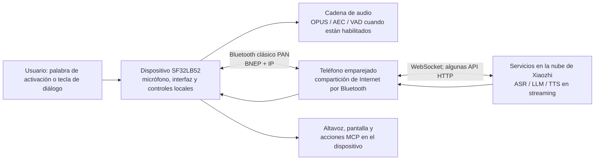

# Asistente de voz SF32 Xiaozhi { #sf32-xiaozhi-voice-assistant }

## ¿Qué es Xiaozhi? { #what-is-xiaozhi }

[Xiaozhi](https://github.com/78/xiaozhi-esp32) es un chatbot de voz de código abierto basado en MCP que se hizo ampliamente conocido gracias a su implementación en ESP32 en 2025. Combina un dispositivo de interacción por voz con servicios de modelos grandes en la nube y extensiones MCP locales o en la nube, por lo que constituye un punto de partida práctico para crear hardware de IA conversacional, no solo una aplicación de chat de texto.

## ¿Por qué esta implementación en SF32? { #why-the-sf32-implementation }

[78/xiaozhi-sf32](https://github.com/78/xiaozhi-sf32) es la implementación para SF32, pero utiliza deliberadamente un esquema de conectividad distinto. Mientras que el proyecto ESP32 original admite Wi-Fi y otras opciones de conexión directa a la red, la versión SF32 usa [Bluetooth PAN](../learn/bluetooth/pan.md) clásico para acceder a Internet a través de un teléfono emparejado. Así, la conexión de largo alcance se delega al teléfono, lo que, en un diseño que depende del teléfono, puede reducir considerablemente el consumo energético asociado a la conectividad de red en el dispositivo. El ahorro real depende del teléfono, las condiciones de radio, la proporción de tiempo dedicada a las conversaciones y la política de alimentación. Por ello, este enfoque resulta especialmente adecuado para productos personales portátiles con batería, como colgantes, insignias, asistentes compactos y dispositivos vestibles pequeños.

Es una referencia de producto especialmente útil porque integra aspectos que suelen tratarse por separado: hardware de pantalla y audio, conexión de red proporcionada por el teléfono, servicio de voz en la nube, flujo de activación para el usuario, controles del dispositivo y capacidad de actualización en campo.

## Resultado, alcance y criterios de entrada { #outcome-scope-and-entry-criteria }

Esta página presenta una ruta completa de ingeniería para adaptar esa referencia a un producto. **No** afirma que Xiaozhi sea un LLM que funcione localmente sin conexión, que todas las funciones del proyecto de origen estén validadas para producción ni que una placa de desarrollo admitida equivalga a un producto terminado y certificado. El dispositivo obtiene acceso a Internet mediante Bluetooth PAN desde un teléfono emparejado y utiliza los servicios en la nube de Xiaozhi para las conversaciones. Antes de comprometerse con el producto, confirme las condiciones del servicio, la titularidad de la cuenta, la privacidad, la seguridad, el coste, la disponibilidad y la idoneidad regional.

**Resultado:** obtener un asistente de voz y pantalla reproducible que pueda configurarse mediante un teléfono, mantener una conversación respaldada por la nube, controlar una función segura del dispositivo, recuperarse de una pérdida de conexión PAN y generar las evidencias necesarias para decidir si se debe diseñar hardware propio.

**Público objetivo:** ingenieros de firmware, hardware y producto capaces de compilar y grabar una configuración base de SF32 y preparados para trabajar con C/C++, esquemáticos de placas, configuración Bluetooth e integración de servicios en la nube.

<div align="center"><em>Tabla: Condiciones del proyecto</em></div>

<div align="center" markdown>

| Área | Configuración de referencia del proyecto | Evidencia necesaria antes de la siguiente etapa |
|:-----|:------------------------------------------|:----------------------------------------------|
| Hardware | Un destino SF32LB52 para Xiaozhi documentado, con sus rutas de audio/pantalla, conexión USB para grabar el firmware y fuente de alimentación | Arranque en frío, teclas, pantalla, micrófono, altavoz e indicación de carga/batería cuando corresponda |
| Conectividad | Un teléfono que se empareje como `sifli-pan` y comparta Internet mediante Bluetooth PAN | La interfaz de la placa confirma PAN y se reproducen la pérdida y la reconexión |
| Servicio | Una cuenta de Xiaozhi, activación del dispositivo y un agente configurado en la consola de Xiaozhi | La solicitud de diálogo llega al servicio y la respuesta vuelve a la placa |
| Firmware | Commit del repositorio de origen, revisión del submódulo SDK, destino de placa y método de compilación/grabación registrados | Compilación limpia reproducible, grabación, registro de consola serie y artefacto de firmware |
| Adaptación del producto | Un cambio deliberadamente acotado, como la marca de la interfaz, el nombre del dispositivo, la curva de batería o una salida segura controlada mediante MCP | El flujo de voz original sigue funcionando tras el cambio |

</div>

## Especificaciones de hardware y software { #hardware-and-software-specifications }

El manifiesto siguiente define una referencia concreta para compilar desde el código fuente: **SF32LB52-DevKit-Nano-R16N16 V1.0.0** con la pantalla externa y el circuito de audio documentados por SiFli. No es una lista universal de materiales para todas las placas compatibles con Xiaozhi. Si elige DevKit-ULP, DevKit-LCD o Xiaotangyuan, sustituya todo este manifiesto de hardware por el conjunto documentado de esa placa y conserve los números de pieza exactos del proveedor y la revisión de la placa.

### Especificación de hardware { #hardware-specification }

<div align="center"><em>Tabla: Especificación del hardware de referencia Xiaozhi Nano</em></div>

<div align="center" markdown>

| Componente | Especificación requerida | Función | Estado | Dónde obtenerlo | Notas de compatibilidad y sustitución |
|:-----------|:-------------------------|:--------|:-------|:----------------|:-------------------------------------|
| SF32LB52-DevKit-Nano-R16N16 V1.0.0 | SF32LB52JUD6, 16 MB de OPI PSRAM y 16 MB de flash SPI NOR | Cómputo SF32, Bluetooth PAN, grabación/depuración USB, interfaz y audio | Obligatorio | [Página de producto de SiFli](https://www.sifli.com/zh-hans/SF32LB52_DevKit_Nano); [tienda oficial de SiFli](https://sifli.taobao.com/) | No la sustituya por la variante Nano N4 sin volver a comprobar el destino del firmware y el presupuesto de memoria. Registre la revisión de la PCB y el enlace de compra al proveedor |
| AMOLED de 1,85 pulgadas y 390 × 450, más adaptador FPC de 16 a 22 pines | Conjunto de pantalla QSPI y pinout FPC usados por el cableado oficial de Xiaozhi Nano | Interfaz de usuario | Obligatorio | [Página oficial del hardware de Xiaozhi Nano](https://docs.sifli.com/projects/xiaozhi/get-started/SF32LB52-DevKit-Nano/) | La página oficial no publica un enlace de pedido. Fije el controlador del panel, la orientación del FPC, el número de pieza del proveedor y el enlace de compra antes de considerar reproducible la referencia |
| Módulo de micrófono MEMS analógico | Salida analógica compatible con `MIC_BIAS`, `MIC_ADC` y GND | Captura de voz | Obligatorio | [Enlace al componente publicado en la guía oficial](https://item.taobao.com/item.htm?id=595237371680) | Un sustituto requiere validar polarización, nivel de salida, ruido y acústica |
| Módulo amplificador PAM8302 | Entrada diferencial desde `DACP`/`DACN`; apagado controlado por `PA30` | Accionamiento del altavoz | Obligatorio | [Enlace al componente publicado en la guía oficial](https://item.taobao.com/item.htm?id=535743493142) | Trate otro amplificador como una adaptación de hardware y vuelva a comprobar la polaridad de habilitación, la ganancia, la corriente en reposo y el ruido |
| Altavoz con caja | 8 Ω, 2–3 W | Reproducción de voz | Obligatorio | [Enlace al componente publicado en la guía oficial](https://item.taobao.com/item.htm?id=895176389650) | Vuelva a validar la salida acústica, la temperatura del amplificador y la corriente al cambiar la caja o la impedancia |
| Cables puente y placa de pruebas de 400 puntos | Juego de cables y placa adecuados al prototipo Nano documentado | Interconexión del prototipo | Obligatorios para el prototipo documentado | [Cables puente](https://item.taobao.com/item.htm?id=39961676503); [placa de pruebas de 400 puntos](https://item.taobao.com/item.htm?id=39828824454) | Sustitúyalos por una PCB revisada solo después de validar el cableado de referencia y transferir exactamente el mapa de pines |
| Cable USB Type-C de datos y ordenador de desarrollo | Cable Type-C apto para datos; host Windows, Linux o macOS | Alimentación, grabación, compilación y registros de consola serie | Obligatorio | [Requisitos de preparación de SiFli-SDK](https://docs.sifli.com/projects/sdk/latest/en/sf32lb52x/quickstart/get-started.html) | Un cable solo de carga no permite grabar ni capturar registros. Registre el sistema operativo y la arquitectura del ordenador |
| Teléfono Android o iOS con uso compartido de Internet por Bluetooth | Debe emparejarse con `sifli-pan` y proporcionar acceso a Internet mediante Bluetooth PAN clásico | Enlace de red | Obligatorio | [Incorporación oficial de Xiaozhi mediante PAN](https://docs.sifli.com/projects/xiaozhi/get-started/) | Registre el modelo del teléfono y la versión del sistema operativo. Valide pérdida, nuevo emparejamiento y uso compartido con cada combinación de teléfono y sistema operativo admitida |

</div>

Las URL de componentes de terceros anteriores son enlaces a tiendas publicados por la guía oficial de SiFli Nano; no garantizan que los números de pieza del fabricante se mantengan sin cambios. Conserve capturas o registros de pedido de las piezas evaluadas y sustituya cada dependencia de una tienda en línea por una referencia de proveedor validada y su hoja de datos antes de diseñar el producto.

### Especificación de software { #software-specification }

<div align="center"><em>Tabla: Especificación del software de referencia Xiaozhi</em></div>

<div align="center" markdown>

| Paquete o servicio | Versión o revisión requerida | Función | Estado | Dónde obtenerlo | Notas de compatibilidad y actualización |
|:-------------------|:-----------------------------|:--------|:-------|:----------------|:--------------------------------------|
| Firmware precompilado Xiaozhi SF32 | v1.4.0 | Imagen de referencia intacta para la configuración inicial y la recuperación | Obligatorio en las Etapas 1–2 | [Versión v1.4.0](https://github.com/78/xiaozhi-sf32/releases/tag/v1.4.0) | Para la configuración Nano R16N16 seleccione `sf32lb52-nano_52j.zip`. No mezcle archivos de placas distintas |
| Código fuente `78/xiaozhi-sf32` | Commit [`1d3ef641ace47fae68227e9173647fd5db01f6f5`](https://github.com/78/xiaozhi-sf32/commit/1d3ef641ace47fae68227e9173647fd5db01f6f5) | Código de la aplicación y configuración de la placa | Obligatorio en las Etapas 3–4 | [Repositorio](https://github.com/78/xiaozhi-sf32) | Esta es la instantánea de código fuente revisada para este artículo. Registre cualquier commit posterior como una nueva referencia y repita todos los puntos de control |
| Submódulo SiFli-SDK | Commit [`0d2de1480f735e05017c41436e655a1688063881`](https://github.com/OpenSiFli/SiFli-SDK/tree/0d2de1480f735e05017c41436e655a1688063881) | Controladores SF32, RTOS, middleware, scripts de herramientas y entorno de compilación SCons | Obligatorio en las Etapas 3–4 | [OpenSiFli/SiFli-SDK](https://github.com/OpenSiFli/SiFli-SDK) mediante el submódulo `sdk` del repositorio | Utilice la revisión del submódulo registrada por el commit de la aplicación seleccionado; no actualice el SDK de forma independiente dentro de una referencia conservada |
| Interfaz gráfica sftool | v1.2.1; conserve el SHA-256 del paquete para el sistema operativo elegido en la página de versiones | Grabación de imágenes precompiladas y recuperación local | Obligatoria para la ruta gráfica documentada de v1.4.0 | [Versión v1.2.1 y paquetes para cada plataforma](https://github.com/OpenSiFli/sftool-gui/releases/tag/v1.2.1) | Registre el sistema operativo del equipo, el nombre del paquete y su suma de comprobación. Valide las versiones posteriores antes de sustituirla |
| Herramientas del equipo de desarrollo | Scripts de instalación/exportación del SiFli-SDK fijado; esos scripts crean el entorno SCons | Configuración y compilación desde el código fuente | Obligatorio en las Etapas 3–4 | [Guía oficial de compilación de Xiaozhi desde el código fuente](https://docs.sifli.com/projects/xiaozhi/source-build/) | Registre sistema operativo, arquitectura, resultado del script y entorno exportado. Una herramienta instalada globalmente no debe reemplazar silenciosamente el entorno del SDK fijado |
| Consola y servicio en la nube de Xiaozhi | Servicio alojado en `xiaozhi.me`; registre la fecha de validación, quién es responsable de la cuenta, la configuración del agente y el endpoint | Activación, ASR/LLM/TTS en streaming y MCP en la nube | Obligatorio para los diálogos | [Consola de Xiaozhi](https://xiaozhi.me) | El servicio alojado no tiene una versión que el usuario pueda fijar. Trate su comportamiento, condiciones, disponibilidad y acceso regional como dependencias controladas externamente |

</div>

## Elegir una configuración de referencia admitida { #choose-a-supported-baseline }
La guía de inicio rápido de SiFli para Xiaozhi enumera cuatro destinos de firmware precompilado: SF32LB52-DevKit-ULP (Huangshan), SF32LB52-DevKit-LCD, SF32LB52-DevKit-Nano y la placa enchufable Xiaotangyuan. La documentación de compilación desde código fuente enumera actualmente DevKit-ULP, DevKit-LCD y DevKit-Nano. Si la personalización del código es un requisito del proyecto, elija una placa incluida en la lista de compilación desde código fuente; no suponga que disponer de una imagen precompilada implica que también haya un destino de compilación documentado.

<div align="center"><em>Tabla: Selección de placa</em></div>

<div align="center" markdown>

| Placa | Cuándo elegirla | Precaución para el producto |
|:------|:----------------|:----------------------------|
| [SF32LB52-DevKit-ULP](https://docs.sifli.com/projects/xiaozhi/get-started/SF32LB52-DevKit-ULP/) | Quiere el ejemplo documentado de compilación ULP desde el código fuente y una ruta de evaluación orientada a batería | Recalibre la curva de batería si utiliza una batería distinta de la referencia documentada |
| [SF32LB52-DevKit-LCD](https://docs.sifli.com/projects/xiaozhi/get-started/SF32LB52-DevKit-LCD/) | Quiere una referencia explícita de integración de pantalla y altavoz | AMOLED de 390 × 450, orientación FPC, conexión `SPK` e instrucciones para `KEY1` y `KEY2` son específicos de esta placa |
| [SF32LB52-DevKit-Nano](https://docs.sifli.com/projects/xiaozhi/get-started/SF32LB52-DevKit-Nano/) | Quiere una configuración de referencia documentada y más pequeña de SF32LB52 | Antes de reutilizar el cableado de otra placa, confirme la configuración exacta de pantalla, audio, alimentación y entradas de usuario |
| [Placa enchufable Xiaotangyuan](https://docs.sifli.com/projects/xiaozhi/get-started/SF32LB52-XTY-AI-THT/) | Está siguiendo la ruta de inicio rápido correspondiente a la imagen precompilada | Confirme el estado actual de la compilación desde código fuente y la personalización antes de usarla como referencia de producto |

</div>

## Etapas del proyecto { #delivery-map }

Utilice las etapas como puntos de decisión, no como una lista de funciones. Cada una deja un artefacto que permita revisar y repetir la decisión siguiente.

<div align="center"><em>Tabla: Etapas del proyecto</em></div>

<div align="center" markdown>

| Etapa | Decisión que permite tomar | Resultado requerido |
|:------|:---------------------------|:--------------------|
| 1. Configuración de referencia | ¿Funcionan juntos, sin modificar, la placa, el teléfono, la cuenta y el servicio documentados? | Una sesión de diálogo registrada y conocida como funcional |
| 2. Validación de recuperación | ¿Es fiable esa referencia ante los fallos que encontrará un usuario? | Registro aprobado de pruebas de fallos y recuperación |
| 3. Referencia desde el código fuente | ¿Puede el equipo reproducir el firmware en lugar de depender de una imagen suministrada? | Artefacto de compilación con versiones fijadas y registros |
| 4. Adaptación controlada | ¿Se puede implementar un cambio de producto sin perder el comportamiento de referencia? | Cambio revisado y evidencias de regresión |
| 5. Decisión de producto | ¿Se entienden suficientemente los riesgos del hardware, el servicio, la seguridad y la recuperación para invertir más? | Registro aprobado de preparación del producto y traspaso a hardware |

</div>

## Arquitectura del sistema y dependencias { #system-architecture-and-dependencies }

<div align="center"><em>Figura: Flujo de producto Xiaozhi en SF32</em></div>



La guía oficial de arquitectura describe Bluetooth PAN sobre Bluetooth clásico como ruta de red, con conectividad IP ligera en el dispositivo. Identifica WebSocket como canal principal de aplicación en tiempo real y HTTP para algunas interacciones con API. La descripción general de SiFli incluye entre las funciones implementadas la activación por palabra clave (KWS), el diálogo continuo, AEC/VAD, las expresiones dinámicas, las fuentes vectoriales y MCP local. Otros materiales oficiales también describen la interfaz de pantalla, la gestión de batería y alimentación, las extensiones MCP en la nube y la OTA por PAN; verifique la compatibilidad concreta con la placa y el firmware elegidos.

Este flujo crea cuatro ámbitos de fallo que se deben diagnosticar por separado: hardware y audio locales, emparejamiento Bluetooth y PAN, acceso a Internet y al servicio en la nube, y configuración de la aplicación y del servicio. Que el emparejamiento BLE tenga éxito no demuestra que la placa tenga acceso a Internet ni que el servicio de voz esté activado.

## Etapa 1 — Establecer la configuración de referencia intacta { #stage-1-establish-the-untouched-reference-baseline }

1. Complete la configuración oficial de hardware específica de la placa. Para DevKit-LCD incluye el conjunto AMOLED/FPC indicado, un altavoz conectado a `SPK`, `KEY1` para activar/iniciar un diálogo y `KEY2` para apagar mediante pulsación larga.
2. Grabe el firmware precompilado admitido siguiendo el procedimiento oficial de Xiaozhi. La guía de inicio rápido recomienda la herramienta gráfica de grabación; en el momento de esa guía indica que el firmware v1.4.0 y posterior no admite la grabación desde terminal.
3. **Antes de emparejar**, active en el teléfono la compartición de Internet por Bluetooth. Empareje el dispositivo `sifli-pan` y compruebe, mediante la interfaz de la placa y el estado de compartición del teléfono, que está activo PAN y no solo el emparejamiento Bluetooth. Para iOS, la guía oficial indica que puede ser necesario reiniciar el teléfono si no aparece `sifli-pan`.
4. Siga el flujo de activación oficial en la consola de Xiaozhi en [xiaozhi.me](https://xiaozhi.me): cree/configure un agente y añada el código del dispositivo que muestra la placa.
5. Inicie un diálogo con la tecla de diálogo de la placa o con la ruta de activación configurada. Registre en el proyecto la versión del firmware, la placa, el modelo/sistema operativo del teléfono y el identificador de cuenta/agente del servicio.

**Criterio de salida del punto de control 1:** tras un arranque en frío, el dispositivo establece PAN, se identifica como activado, acepta una solicitud de diálogo, reproduce la respuesta y presenta el estado de interfaz esperado.

## Etapa 2 — Demostrar la recuperación y el comportamiento crítico para el producto { #stage-2-prove-recovery-and-product-critical-behavior }

Ejecute estas pruebas antes de modificar el código fuente. Transforman la demostración en una referencia fiable:

<div align="center"><em>Tabla: Evidencias de validación de referencia</em></div>

<div align="center" markdown>

| Prueba | Método | Evidencia de aprobación |
|:-------|:-------|:------------------------|
| PAN no disponible | Empareje sin activar la compartición de Internet por Bluetooth | La interfaz o el registro indica claramente que falta PAN; al habilitar la compartición y reconectar se recupera el servicio |
| Pérdida de PAN | Desactive la compartición, desconecte Bluetooth o salga del alcance durante el reposo y durante un diálogo | El dispositivo detecta el fallo, vuelve a un estado recuperable y reconecta mediante la ruta documentada de activación/reconexión |
| Reposo y activación | Deje que el dispositivo entre en reposo y después utilice el control de activación designado | La activación, reconexión y siguiente conversación se repiten sin volver a grabar el firmware |
| Audio e interfaz | Mantenga varios diálogos a un volumen realista | La captura es inteligible, la reproducción es limpia, la interfaz responde y no se produce ningún reinicio |
| Indicación de batería | Cargue y descargue la batería pasando por niveles representativos | El estado indicado es razonable; se señala que una batería distinta de la referencia requiere calibrar la curva |
| Límite del servicio | Pruebe una cuenta/agente al que le falte deliberadamente una configuración necesaria | El fallo se puede distinguir de los problemas de PAN y hardware |

</div>

La guía oficial advierte que la curva `battery_table.c` predeterminada para cada placa puede ser inexacta con otra batería. Para la batería del producto, obtenga los datos de carga/descarga del proveedor o mídalos; actualice `charging_curve_table` y `discharge_curve_table`, vuelva a compilar y repita las pruebas de batería.

**Criterio de salida del punto de control 2:** se registra el resultado de cada prueba, los fallos se distinguen por su ámbito y todas las rutas de recuperación documentadas funcionan sin volver a grabar el firmware ni corregir manualmente el estado.

## Etapa 3 — Crear una referencia reproducible desde el código fuente { #stage-3-build-a-reproducible-source-baseline }

El repositorio incluye SiFli-SDK como submódulo. Clónelo de forma recursiva y registre tanto el commit de Xiaozhi como el del submódulo SDK:

```bash
git clone --recursive https://github.com/78/xiaozhi-sf32.git
cd xiaozhi-sf32
git checkout 1d3ef641ace47fae68227e9173647fd5db01f6f5
git submodule update --init --recursive
cd sdk
# Windows: .\install.ps1, then .\export.ps1
# macOS/Linux: ./install.sh, then . ./export.sh
```

Para el ejemplo oficial de compilación mediante scripts de DevKit-ULP, compile desde `app/project` con la ruta externa documentada de la placa:

```bash
scons --board=sf32lb52-lchspi-ulp --board_search_path="../boards" -j8
```

Consulte la página oficial de compilación específica de cada placa para usar el destino y el script de descarga exactos; no reutilice el nombre de placa ULP ni la ruta de artefactos generados con otra placa. Un registro de compilación reproducible debe incluir el sistema operativo del equipo, el resultado de instalar las herramientas, el entorno exportado, el argumento de placa, la revisión del repositorio/SDK, el registro de compilación, la imagen descargada y el registro de consola serie.

**Criterio de salida del punto de control 3:** un checkout limpio en un segundo equipo —o después de borrar el directorio de compilación— genera una imagen que supera todas las comprobaciones de la Etapa 2.

## Etapa 4 — Adaptar de forma deliberada { #stage-4-adapt-deliberately }

Realice un cambio cada vez y conserve la imagen de referencia aprobada. La documentación oficial de personalización cubre el nombre Bluetooth, gráficos estáticos y animados, fuentes, DFU por PAN y MCP.

<div align="center"><em>Tabla: Orden de adaptación segura</em></div>

<div align="center" markdown>

| Tipo de cambio | Empezar con | Regresión requerida |
|:---------------|:------------|:--------------------|
| Identidad del producto | Nombre Bluetooth, imagen estática, fuente o animación | Grabación, activación, PAN, interfaz y un diálogo |
| Batería/hardware del producto | Curva de batería, parámetros de pantalla, ruta de audio o comportamiento de teclas | Alimentación, activación, audio/interfaz y pruebas repetidas de diálogo |
| Control local del dispositivo | Una herramienta MCP de alcance limitado, parámetros acotados y callback seguro | Autorización de comandos, entrada no válida, desconexión durante la acción, estado físico seguro y registro auditable |
| Extensión en la nube | Un servicio MCP externo | Autenticación del endpoint, almacenamiento de secretos, comportamiento ante falta de disponibilidad/reinicio, mínimo privilegio y consentimiento visible del usuario |
| Actualización en campo | DFU_PAN y servidor OTA | Detección de versión, CRC/particiones correctos, actualización interrumpida, reversión/recuperación y procedencia de la imagen |

</div>

Para MCP en el dispositivo, la guía oficial utiliza `McpServer::AddCommonTools()` en `app/src/mcp/mcp_server.cc`. Trate una acción solicitada por el LLM como una petición no confiable: valide el rango y el estado en el callback, establezca estados seguros por defecto y no exponga nunca controles irreversibles, peligrosos o sensibles para la seguridad sin autorización específica del producto.

La documentación oficial de OTA por PAN describe tres tipos de imágenes que se pueden desplegar por separado: código, recursos gráficos y fuentes. Indica que se debe consultar la tabla de particiones para conocer la dirección y el tamaño de cada imagen. La OTA de producción necesita una política de versiones, control de acceso al servidor, validación de integridad, una prueba de interrupción y una ruta de recuperación por cable o local antes de habilitarla para los usuarios.

**Criterio de salida del punto de control 4:** quedan registrados el cambio elegido, su ruta de reversión o recuperación y todos los resultados de regresión aplicables; el flujo de voz original y los límites de seguridad de las acciones del dispositivo siguen superando las pruebas.

## Etapa 5 — Revisión de preparación del producto { #stage-5-product-readiness-review }

No pase a hardware propio hasta que el equipo pueda responder a todo lo siguiente:

- ¿Qué versiones de teléfono y sistema operativo admiten exactamente la configuración inicial mediante PAN y cuál es la alternativa cuando no la admiten?
- ¿Qué endpoints de nube y MCP se utilizan, y con qué cuenta y agente? ¿Quién los administra y quién se encarga de rotar las credenciales?
- ¿Qué datos de audio, dispositivo y usuario salen del dispositivo? ¿Cómo se obtiene el consentimiento y cuáles son los requisitos de retención y región?
- ¿Cuáles son las corrientes medidas durante un diálogo activo, en reposo conectado, suspensión, carga y activación, con la batería y la carcasa previstas?
- ¿Cómo se recupera el dispositivo de una actualización fallida, la pérdida del teléfono, una interrupción de la nube, un recurso dañado o una configuración incorrecta?
- ¿Qué partes del código de origen, el servicio, el comportamiento del modelo y la infraestructura OTA controla el equipo de producto y cuáles dependen de proveedores externos?

**Criterio de salida del punto de control 5:** las respuestas, los responsables y los riesgos residuales están registrados y aceptados por el equipo de producto. Cada asunto sin resolver tiene una mitigación, una postergación explícita o una decisión de detenerse.

## Traspaso a la fase de diseño del producto { #handoff-to-product-design }

Traslade la pieza SF32 seleccionada, la arquitectura de alimentación, el diseño de pantalla/audio, la estrategia RF, el plan de almacenamiento/particiones, las pruebas de producción y las hipótesis de recuperación a [Diseño para producción](../hardware/design-for-production.md). Utilice la [ruta de integración de SF32LB52](../sf32-products/chips/SF32LB52x.md#integration-path) para seleccionar el chip, módulo, placa, guía y lista de comprobación correspondientes.

**Definición de finalización del proyecto:** esta referencia habrá cumplido su propósito cuando un nuevo miembro del equipo pueda reproducir la configuración elegida, rastrear cada fallo observado hasta su responsable o ruta de recuperación, volver a compilar la imagen personalizada y revisar las evidencias necesarias para decidir sobre hardware propio. A partir de entonces es una referencia de desarrollo de producto, no una demostración sin examinar que deba llevarse directamente a producción.

## Fuentes de referencia { #authoritative-sources }
- [Repositorio 78/xiaozhi-esp32](https://github.com/78/xiaozhi-esp32)
- [Repositorio 78/xiaozhi-sf32](https://github.com/78/xiaozhi-sf32)
- [Wiki de SiFli: descripción general de AI Xiaozhi (en chino)](https://github.com/OpenSiFli/SiFli-Wiki/blob/main/source/zh_CN/application/xiaozhi.md)
- [Inicio rápido de Xiaozhi de SiFli](https://docs.sifli.com/projects/xiaozhi/get-started/)
- [Compilación de Xiaozhi desde el código fuente de SiFli](https://docs.sifli.com/projects/xiaozhi/source-build/)
- [Arquitectura de Xiaozhi de SiFli](https://docs.sifli.com/projects/xiaozhi/architecture/)
- [Personalización de Xiaozhi de SiFli](https://docs.sifli.com/projects/xiaozhi/custom/)
- [Guía DFU_PAN de Xiaozhi de SiFli](https://docs.sifli.com/projects/xiaozhi/custom/dfu_pan.html)
- [Guía MCP de Xiaozhi de SiFli](https://docs.sifli.com/projects/xiaozhi/custom/mcp.html)
