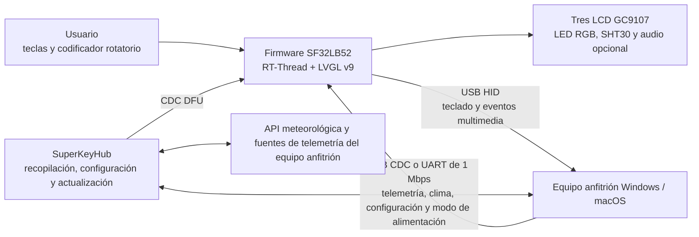

# Teclado macro multifunción SuperKey { #superkey-multifunction-macro-keyboard }

## ¿Qué es SuperKey? { #what-is-superkey }

[SiFliSparks/SuperKey](https://github.com/SiFliSparks/SuperKey) es una implementación de referencia basada en SF32LB52 para un teclado macro multifunción con pantallas. Su firmware de código abierto funciona con RT-Thread y LVGL v9, controla tres LCD GC9107 de 128 × 128, tres LED RGB, cuatro teclas físicas, un codificador rotatorio y un sensor de temperatura y humedad SHT30, y se conecta al ordenador como dispositivo USB compuesto HID/CDC.

SuperKey va más allá de un teclado de accesos directos. La implementación de referencia reúne estas funciones:

- salida USB HID de teclado y controles multimedia;
- recepción de datos de rendimiento del PC, meteorología, configuración y estado de alimentación por USB CDC o UART de 1 Mbps;
- páginas en tres pantallas para monitorizar el rendimiento, consultar el tiempo, ver la hora, usar utilidades, acceder a la música y definir asignaciones de teclas;
- aplicación complementaria [SuperKeyHub](https://github.com/SiFliSparks/SuperKeyHub) para recopilar datos del host, configurar funciones y actualizar el firmware;
- hardware reproducible mediante el diseño abierto [sf32-keyboard](https://oshwhub.com/sifli/sf32-keyboard).


<div align="center"><em>Interfaz de usuario de SuperKey con tres pantallas</em></div>

## ¿Por qué la implementación con SF32? { #why-the-sf32-implementation }

SuperKey necesita gráficos, varias pantallas, un dispositivo USB compuesto, teclas y codificador, sensores, efectos RGB, un sistema de archivos y audio opcional. SF32LB52 mantiene estas tareas en tiempo real en el MCU, por lo que el dispositivo puede iniciar su interfaz y ofrecer funciones HID básicas aunque la aplicación complementaria no esté ejecutándose. La aplicación del host se ocupa de la telemetría del ordenador y los datos de Internet, que es más adecuado gestionar desde un sistema operativo de escritorio.

Esta división encaja con controladores de escritorio, teclados para flujos de trabajo, paneles de estado e interfaces HMI compactas, pero crea dependencias explícitas. Las pantallas de datos avanzadas requieren la aplicación complementaria, controladores y API externas; las versiones del firmware y del host deben ser compatibles; y la pérdida de USB, la suspensión del host y una configuración dañada requieren pruebas de recuperación independientes.

## Resultado, alcance y criterios de entrada { #outcome-scope-and-entry-criteria }

**Resultado:** reproducir una configuración de SuperKey con versiones fijadas y validar HID, CDC, la interfaz de tres pantallas, la entrada, los sensores y la recuperación tras la suspensión; después, modificar una sola categoría de comportamiento y conservar evidencias de compilación, comunicación y regresión para la revisión del producto.

Esta página no demuestra que la PCB abierta esté lista para producción ni que sea compatible con todas las fuentes de telemetría de PC, servicios meteorológicos, puentes serie, hosts USB o versiones de sistemas operativos. Las cotizaciones bursátiles, los datos meteorológicos y los de rendimiento pueden depender de la versión de SuperKeyHub, de API de terceros, de los permisos del sistema y del hardware del host.

Antes de empezar, tenga preparado:

- hardware SuperKey montado según el diseño abierto, con tres LCD GC9107, teclas, codificador y conexión USB de datos;
- un ordenador con Windows 10/11 para la ruta principal documentada; el repositorio de SuperKeyHub indica compatibilidad con Windows y macOS, pero valide la programación de la placa, CDC y la recuperación en el sistema operativo elegido;
- una versión de SuperKeyHub compatible con el firmware;
- un entorno SiFli-SDK, el submódulo del SDK clonado de forma recursiva y una conexión funcional de programación/recuperación;
- una API Key, API Host y configuración de ciudad válidos de QWeather, si se va a probar la meteorología;
- un registro de pruebas de enumeración USB, registros serie, respuesta de teclas, estado de pantalla y recuperación tras suspensión.

<div align="center"><em>Tabla: condiciones del proyecto SuperKey</em></div>

<div align="center" markdown>

| Área | Base conocida | Evidencia necesaria antes de adaptar |
|:-----|:--------------|:-------------------------------------|
| Hardware | Hardware abierto `sf32-keyboard` y destino de placa `sf32lb52-superkey` | Revisión de PCB/montaje, LCD y dispositivos de entrada, alimentación y conexión USB |
| Firmware | Repositorio SuperKey, submódulo SiFli-SDK, RT-Thread, LVGL v9 y CherryUSB | Commit del firmware y SDK, registro de compilación, imagen y registro de programación |
| Aplicación complementaria | SuperKeyHub con protocolo de firmware compatible | Versión de la aplicación, sistema operativo, puerto, configuración de API y registro de conexión |
| Funciones básicas | HID, CDC, tres pantallas, codificador, teclas, sensor y modos de alimentación | Registro de arranque en frío, actualización de datos, entrada, desconexión y recuperación tras suspensión |
| Adaptación | Cambiar una sola función de interfaz, tecla, LED o campo de datos cada vez | Cambio revisado, imagen para volver atrás y resultado completo de regresión |

</div>

## Especificaciones de hardware y software { #hardware-and-software-specifications }

### Especificación de hardware { #hardware-specification }

<div align="center"><em>Tabla: Especificación de hardware de SuperKey</em></div>

<div align="center" markdown>

| Componente | Especificación necesaria | Función | Estado | Dónde obtenerlo | Compatibilidad y notas sobre sustituciones |
|:-----------|:-------------------------|:--------|:-------|:----------------|:-------------------------------------------|
| Conjunto de hardware abierto SuperKey | Configuración SF32LB52 con tres LCD GC9107 de 128 × 128, tres LED RGB, cuatro teclas, encoder rotatorio, SHT30 y USB, según el proyecto | Control del teclado macro, pantallas, entrada, sensores y USB HID/CDC | Obligatorio | [Diseño abierto `sf32-keyboard`](https://oshwhub.com/sifli/sf32-keyboard); [repositorio SuperKey](https://github.com/SiFliSparks/SuperKey) | Los archivos de diseño no son una especificación de placa montada disponible para compra; deben registrarse las revisiones de pines y de montaje |
| PC host y conexión USB de datos | Windows 10/11 es la ruta principal documentada; conexión USB de datos | Ejecuta SuperKeyHub, proporciona el host HID/CDC y permite descarga/recuperación | Obligatorio | [Documentación SuperKey](https://sparks.sifli.com/projects/superkey/) | El repositorio de SuperKeyHub indica compatibilidad con Windows/macOS; valide CDC, DFU, programación y recuperación en el sistema elegido |
| Cuenta y configuración de API de QWeather | API Key, API Host y configuración de ciudad | Función opcional de información meteorológica | Opcional | [QWeather](https://www.qweather.com/) | No suba credenciales al repositorio; valide los términos y la disponibilidad del servicio |

</div>

### Especificación de software { #software-specification }

<div align="center"><em>Tabla: Especificación de software de SuperKey</em></div>

<div align="center" markdown>

| Paquete o servicio | Versión o revisión necesaria | Función | Estado | Dónde obtenerlo | Compatibilidad y notas de actualización |
|:-------------------|:----------------------------|:--------|:-------|:----------------|:----------------------------------------|
| Firmware SuperKey | Versión v1.4.2; registre el commit exacto usado | Firmware SF32, interfaz LVGL, USB, sensor y actualización | Obligatorio | [Versión v1.4.2](https://github.com/SiFliSparks/SuperKey/releases/tag/v1.4.2) | Fije el commit del firmware; no deduzca la compatibilidad con el host solo a partir de los números de versión |
| SuperKeyHub | Versión o commit verificado con el firmware v1.4.2 | Telemetría del host, configuración e interfaz de actualización | Obligatorio para funciones de host | [Repositorio](https://github.com/SiFliSparks/SuperKeyHub) | El material de lanzamiento citado no establece una combinación fija de firmware y aplicación; pruebe la telemetría, la configuración y DFU, y registre la combinación |
| Submódulo SiFli-SDK, RT-Thread, LVGL y CherryUSB | Revisiones registradas por el checkout del firmware seleccionado | Compilación y pila USB | Obligatorio para compilar el código fuente | [Repositorio SuperKey](https://github.com/SiFliSparks/SuperKey) | Clone con submódulos recursivos y conserve sus revisiones; no actualice dependencias por separado |

</div>

## Elegir una configuración de referencia admitida { #choose-a-supported-baseline }
La página de versiones del proyecto incluye el firmware [v1.4.2](https://github.com/SiFliSparks/SuperKey/releases/tag/v1.4.2), que sirve como punto de partida fijo. El material citado no establece una versión compatible concreta de SuperKeyHub; elija y fije una versión o un commit de Hub, pruebe con v1.4.2 la telemetría, la configuración y DFU, y registre la combinación probada en lugar de suponer compatibilidad por los números de versión.

<div align="center"><em>Tabla: selección de la base de SuperKey</em></div>

<div align="center" markdown>

| Elemento de referencia | Inicio recomendado | Limitación importante |
|:-----------------------|:-------------------|:----------------------|
| Firmware | SuperKey v1.4.2 o un commit validado por el equipo | Las versiones del firmware y del protocolo del host deben coincidir |
| Aplicación complementaria | Versión o commit de SuperKeyHub verificado con el firmware v1.4.2 | El material citado no establece una combinación fija; valide los datos CDC, la configuración y DFU en el sistema operativo elegido |
| Objetivo de compilación | `sf32lb52-superkey`, con archivos de placa en `app/boards` | No es un objetivo genérico para placas de desarrollo SF32LB52 |
| Comunicación | Valide primero el USB compuesto HID + CDC; valide aparte la UART de 1 Mbps si se utiliza | «USB enumerado» no demuestra que funcionen las dos interfaces HID y CDC |
| Actualización | DFU por CDC iniciado desde la aplicación y una ruta cableada de programación/recuperación que se conserva | No es una solución de actualización en campo hasta validar interrupciones, incompatibilidades y recuperación |

</div>

La integración continua del proyecto utiliza el siguiente objetivo. Instale y exporte el entorno SiFli-SDK antes de ejecutarlo localmente:

```bash
git clone --recursive https://github.com/SiFliSparks/SuperKey.git
cd SuperKey/SiFli-SDK
./install.sh
. ./export.sh
cd ../app/project
scons --board=sf32lb52-superkey --board_search_path="../boards" -j8
```

En Windows, utilice los scripts correspondientes de instalación y configuración del entorno SiFli-SDK para PowerShell. El paralelismo puede variar, pero el nombre de la placa, la ruta de búsqueda de placas y las revisiones de los submódulos deben quedar registrados en la compilación.

## Etapas del proyecto { #delivery-map }

<div align="center"><em>Tabla: etapas del proyecto SuperKey</em></div>

<div align="center" markdown>

| Etapa | Decisión que permite tomar | Resultado requerido |
|:------|:---------------------------|:-------------------|
| 1. Base sin modificar | ¿Funcionan juntos el hardware abierto, el firmware y la aplicación complementaria tal como se ha registrado? | Sesión funcional conocida con versiones fijadas |
| 2. Comunicación y recuperación | ¿Se pueden diagnosticar y recuperar los fallos de USB, serie, suspensión, desconexión y configuración? | Registro de inyección de fallos y recuperación |
| 3. Reproducir la compilación desde el código fuente | ¿Puede el equipo reconstruir la misma imagen desde un clon limpio? | Entorno de compilación, imagen, programación y resultado repetible |
| 4. Adaptación controlada | ¿Se puede cambiar una función del producto sin romper la base? | Cambio acotado, ruta de vuelta atrás y evidencia de regresión |
| 5. Revisión de producto | ¿Es una referencia suficientemente sólida para una PCB, carcasa o lote piloto propios? | Riesgos con responsables y decisión de continuar, aplazar o detener |

</div>

## Arquitectura del sistema y dependencias { #system-architecture-and-dependencies }

<div align="center"><em>Figura: rutas de datos y control del producto SuperKey</em></div>



Clasifique los fallos en cinco dominios: hardware/pantalla del dispositivo, entrada HID, canal de datos CDC/UART, aplicación complementaria/permisos del sistema y servicios de datos externos. Si el panel meteorológico aparece vacío, no significa automáticamente que haya fallado el firmware; puede deberse a la API Key, API Host, configuración de ciudad o envío de datos.

## Etapa 1 — Establecer la base de referencia sin modificar { #stage-1-establish-the-untouched-reference-baseline }

**Objetivo:** demostrar la ruta de referencia completa antes de cambiar el código.

1. Siga las instrucciones de montaje del proyecto original para comprobar la orientación del cable LCD, los interruptores, el codificador, la carcasa y el conector USB; registre las revisiones de la PCB y del firmware.
2. Instale la versión compatible de SuperKeyHub. Compruebe que el dispositivo se enumera y pruebe HID y CDC por separado.
3. Configure las credenciales meteorológicas, el puerto y la comunicación serie a 1 Mbps. Registre el comportamiento sin la aplicación complementaria; después, conéctela y active el envío de datos.
4. Verifique la navegación en las tres pantallas, la asignación de teclas, el control multimedia, el codificador, los datos del SHT30, los efectos LED y un ciclo completo de actualización de telemetría.
5. Realice un arranque en frío y repita las pruebas. Guarde fotos de la interfaz, registros de la aplicación y del dispositivo, y el resultado de la consulta de versión.

**Evidencia que se debe conservar:** revisión del hardware, etiqueta/commit del firmware, commit del SDK, versión de la aplicación complementaria, sistema operativo, configuración del puerto y la API, enumeración USB, registros, pantallas y registro de entrada.

**Criterio de salida de la etapa 1:** dos arranques en frío completan la entrada HID, la actualización de datos CDC y la interacción con las tres pantallas; los registros o estados observables permiten distinguir cada dominio de fallo.

## Etapa 2 — Validar los límites de fallo y recuperación { #stage-2-validate-fault-and-recovery-boundaries }

**Objetivo:** demostrar que las interrupciones habituales en un ordenador de escritorio no convierten el dispositivo en una demostración que requiera volver a grabar el firmware.

<div align="center"><em>Tabla: pruebas de fallos y recuperación de SuperKey</em></div>

<div align="center" markdown>

| Prueba | Método | Evidencia de aprobación |
|:-------|:-------|:------------------------|
| Aplicación complementaria ausente | Cierre SuperKeyHub y reinicie el dispositivo | La interfaz local y HID siguen funcionando; los valores que dependen de la aplicación aparecen claramente como obsoletos o no disponibles |
| Pérdida de CDC | Desconecte y vuelva a conectar USB o cambie de puerto mientras se envían datos | El dispositivo no se bloquea; la consulta de versión y el envío de datos se recuperan al reconectar |
| Suspensión del host | Active `power_mode sleep/normal` y ejecute un ciclo de suspensión/reactivación del host | LCD, LED, retroiluminación y sensores se detienen/reanudan según lo previsto, y los datos vuelven a actualizarse |
| Versiones incompatibles | En una configuración controlada, pruebe una combinación incompatible de aplicación y firmware | Se rechaza la combinación o se muestra un error diagnosticable, sin aplicar una actualización incompatible |
| Fallo de API | Use una configuración meteorológica no válida o desconecte la red | El fallo meteorológico no afecta HID, CDC, la interfaz local ni la recuperación |
| Interrupción de DFU | Interrumpa una actualización en una unidad de prueba recuperable | La ruta cableada de programación conservada restaura la imagen conocida |

</div>

**Criterio de salida de la etapa 2:** cada fallo aplicable tiene un resultado repetible de detección y recuperación, sin necesidad de reparar manualmente estados no documentados.

## Etapa 3 — Crear una base de código reproducible { #stage-3-build-a-reproducible-source-baseline }

**Objetivo:** permitir que otro ingeniero compile, programe el firmware y repita la etapa 2 desde un clon limpio.

1. Clone el repositorio de forma recursiva y registre los commits de SuperKey y SiFli-SDK.
2. Compile desde cero con el destino `sf32lb52-superkey` y la ruta de búsqueda `../boards`.
3. Guarde el registro de compilación, la salida de memoria/particiones, el script de programación, las imágenes generadas y el registro serie.
4. Repita la compilación en un segundo ordenador o después de borrar el directorio de compilación; programe el firmware en el mismo hardware y vuelva a ejecutar las regresiones principales.

**Criterio de salida de la etapa 3:** no se necesitan archivos sin seguimiento, resultados antiguos ni sustituciones manuales de binarios para generar una imagen que supere la etapa 2.

## Etapa 4 — Adaptar una variable del producto cada vez { #stage-4-adapt-one-product-variable-at-a-time }

**Objetivo:** validar el alcance del cambio sin comprometer la referencia aprobada.

<div align="center"><em>Tabla: orden de adaptación controlada de SuperKey</em></div>

<div align="center" markdown>

| Tipo de cambio | Primer cambio adecuado | Regresión necesaria |
|:---------------|:----------------------|:-------------------|
| Identidad e interfaz | Icono, fuente, diseño de página o un ajuste de rotación | Actualización de las tres pantallas, rotación, fuentes, arranque en frío y memoria |
| Flujo de teclas | Una asignación HID o combinación de teclas | Pulsación/liberación, varias teclas, desconexión inesperada y persistencia de configuración |
| Campo de datos | Un valor de telemetría o sensor | Compatibilidad del protocolo, comprobación de rangos, tiempo límite de actualización y comportamiento con versiones antiguas de la aplicación |
| Efecto LED | Un color o animación | Límites de brillo, suspensión, respuesta a teclas y funcionamiento prolongado |
| Actualización | Política de versiones o interfaz de actualización | Procedencia de la imagen, validación de versión, interrupción, reversión y recuperación por cable |

</div>

**Criterio de salida de la etapa 4:** se ha revisado el cambio, se puede recuperar la imagen original y pasan las pruebas HID, CDC, pantalla, entrada, suspensión y recuperación.

## Etapa 5 — Revisión de preparación para producto { #stage-5-product-readiness-review }

Antes de crear hardware propio o un lote piloto, el equipo debe responder:

- ¿El producto seguirá dependiendo de SuperKeyHub, privilegios de administrador y un servicio meteorológico de terceros? ¿Quién es responsable de esas dependencias?
- ¿Cómo se gestionan las versiones de firmware, aplicación complementaria y protocolo, y cómo se bloquean las combinaciones incompatibles?
- ¿Qué combinaciones de PC, hubs USB, cables, políticas de suspensión y software de seguridad se han probado?
- ¿Cuánta memoria, temperatura y corriente se registran al usar a la vez las tres pantallas, los datos USB, los LED, los sensores y el audio opcional?
- ¿Cómo se recuperan la configuración, las asignaciones de teclas y el estado de actualización tras perder alimentación o dañarse el almacenamiento?
- ¿Las licencias de la PCB abierta, la carcasa, las fuentes, los iconos, la música y las API de terceros permiten la distribución prevista?

**Criterio de salida de la etapa 5:** cada riesgo restante tiene un responsable, evidencia y resolución; el equipo ha decidido continuar, aplazar o detener.

## Traspaso a la fase de diseño del producto { #handoff-to-product-design }

Traslade la selección de SF32 y memoria, los descriptores USB HID/CDC, las conexiones de las tres pantallas y la retroiluminación, las interfaces de entrada y sensores, la política de alimentación y suspensión, el sistema de archivos y las particiones de actualización, el protocolo de la aplicación complementaria, los puntos de prueba de producción y la ruta de recuperación validada. Continúe con [SF32LB52x](../sf32-products/chips/SF32LB52x.md), la [guía de diseño de hardware SF32LB52x](../hardware/chip-guides/SF32LB52x_hardware_design_guide.md), [Compilar, grabar y monitorizar con SiFli-SDK](../develop/platforms/sifli-sdk/build-flash-monitor.md) y [Diseño para producción](../hardware/design-for-production.md).

## Fuentes de referencia { #authoritative-sources }
- [Repositorio de firmware SiFliSparks/SuperKey](https://github.com/SiFliSparks/SuperKey)
- [Versión SuperKey v1.4.2](https://github.com/SiFliSparks/SuperKey/releases/tag/v1.4.2)
- [Repositorio de la aplicación complementaria SiFliSparks/SuperKeyHub](https://github.com/SiFliSparks/SuperKeyHub)
- [Documentación del proyecto SuperKey](https://sparks.sifli.com/projects/superkey/)
- [Hardware abierto sf32-keyboard](https://oshwhub.com/sifli/sf32-keyboard)
- [OpenSiFli/SiFli-SDK](https://github.com/OpenSiFli/SiFli-SDK)
