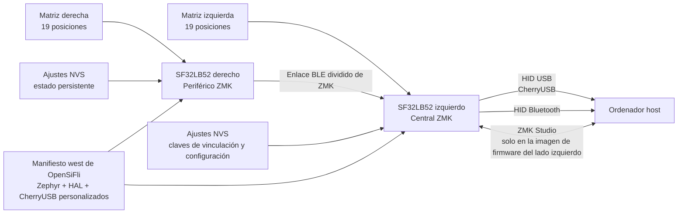

# Firmware de teclado ZMK en SF32 { #zmk-keyboard-firmware-on-sf32 }

## ¿Qué es ZMK en SF32? { #what-is-zmk-on-sf32 }

[ZMK Firmware](https://zmk.dev/) es un firmware de teclado con licencia MIT basado en Zephyr. El proyecto principal de ZMK proporciona el modelo de aplicación utilizado por muchos teclados cableados, inalámbricos y divididos en dos mitades: escaneo de matrices, mapas de teclas y capas, comportamientos de tecla, HID por USB y Bluetooth, ajustes persistentes y definiciones ampliables de placas y extensiones para Zephyr (shields).

[OpenSiFli/zmk](https://github.com/OpenSiFli/zmk) es un repositorio derivado (fork) de ZMK mantenido por OpenSiFli. La versión revisada añade:

- una variante de placa `sf32lb52_devkit_lcd/sf32lb525uc6/zmk`;
- integración del SoC SF32LB52 dentro del árbol de la aplicación ZMK;
- configuraciones para placa única, teclado dividido, ZMK Studio y el shield `urchin_sf32lb52`;
- un backend CherryUSB adaptado a SF32;
- una partición de ajustes NVS de 256 KB y soporte para los ajustes de Bluetooth;
- un mapa de teclas para el teclado dividido Urchin con tres capas, controles de perfiles Bluetooth y combinaciones para desbloquear ZMK Studio.

Se trata de una adaptación en desarrollo, no de una versión de producto de ZMK para SF32 identificada mediante una etiqueta de lanzamiento. El README de nivel superior del repositorio derivado sigue siendo el README genérico del proyecto principal de ZMK y no ofrece una guía de inicio rápido específica para SF32. Utilice la placa, el shield, el manifiesto, el código fuente y el commit como referencia ejecutable, y exija evidencias propias de compilación limpia, grabación, funcionamiento y recuperación antes de adaptar el sistema.

## ¿Por qué esta implementación en SF32? { #why-the-sf32-implementation }

La adaptación para SF32 muestra cómo ejecutar el modelo de teclado de ZMK en SF32LB52 y conservar las convenciones de Zephyr para el árbol de dispositivos (devicetree), Kconfig, `west`, mapas de teclas, shields y teclados divididos. La configuración `urchin_sf32lb52` reparte 38 teclas entre las dos mitades. La configuración izquierda cumple la función central: activa CherryUSB y ZMK Studio y puede ofrecer HID por USB al equipo anfitrión. La configuración derecha cumple la función periférica. ZMK BLE está activado en ambas mitades.

El repositorio derivado resulta útil para evaluar un teclado inalámbrico dividido en dos mitades, un dispositivo de entrada USB/Bluetooth para escritorio, un teclado macro programable o un producto HMI personalizado basado en SF32. La contrapartida es la madurez de las dependencias: el manifiesto `west` fija una rama personalizada de Zephyr (`v4.3+sf32-zmk_fixes`), una revisión concreta de SiFli HAL y la rama personalizada `zephyr-adapt` de CherryUSB. Estas dependencias forman parte de los límites de compatibilidad de la adaptación; no pueden sustituirse por las revisiones «latest» del proyecto principal sin una migración completa y una ronda de regresión.

## Resultado, alcance y criterios de entrada { #outcome-scope-and-entry-criteria }

**Resultado:** compilar y grabar imágenes con versiones fijadas de las mitades izquierda y derecha de Urchin; validar toda la matriz de teclas, las capas, HID USB, el enlace BLE entre mitades y la conexión con el host, la persistencia de los ajustes, los límites de ZMK Studio y la recuperación; y después realizar un cambio controlado en el mapa de teclas o el hardware con evidencias repetibles.

Esta página no afirma que exista paridad completa de funciones con el proyecto principal de ZMK, compatibilidad con cualquier shield de ZMK, autonomía de batería apta para producción, rendimiento de radio verificado ni una migración admitida a otra revisión de Zephyr/ZMK. Tampoco define una PCB de teclado lista para producción: la configuración Urchin del repositorio asigna una matriz de referencia a los pines de SF32LB52-DevKit-LCD; esa asignación debe adaptarse deliberadamente a cada diseño de hardware personalizado.

Antes de empezar, tenga preparado lo siguiente:

- Dos placas SF32LB52-DevKit-LCD compatibles con la variante `sf32lb525uc6/zmk` del repositorio derivado.
- Un montaje de prueba para teclado dividido de 38 teclas, cableado exactamente según los overlays `urchin_sf32lb52_left` y `urchin_sf32lb52_right`, o un shield de prueba más pequeño y documentado para las primeras comprobaciones de la adaptación.
- Un host con un entorno `west` de Zephyr/ZMK funcional y espacio suficiente para los módulos fijados en el repositorio derivado.
- Conexiones de grabación, consola serie y recuperación verificadas para cada mitad antes de probar la comunicación entre ellas.
- Un cable USB de datos para la mitad izquierda/central y un método independiente para alimentar y recuperar la mitad derecha/periférica.
- Un host Bluetooth, un host compatible con ZMK Studio si se incluye Studio en el alcance y una forma de medir la corriente de cada mitad.
- Un registro del commit del repositorio derivado, las revisiones del manifiesto, los identificadores de placa y shield, los registros de compilación y grabación, los resultados de las pruebas de teclas, las claves de vinculación Bluetooth, el estado de los ajustes y las medidas de corriente.

<div align="center"><em>Tabla: Condiciones del proyecto ZMK en SF32</em></div>

<div align="center" markdown>

| Área | Configuración de referencia revisada | Evidencias necesarias antes de adaptar |
|:-----|:--------------------------------------|:---------------------------------------|
| Repositorio derivado | OpenSiFli/zmk en un commit fijado | Commit del repositorio, relación con el proyecto principal, revisiones del manifiesto y registro de diferencias locales |
| Placa | `sf32lb52_devkit_lcd/sf32lb525uc6/zmk` | Revisión exacta de la placa, método de grabación/recuperación y registro de consola |
| Configuración de referencia en dos mitades | Central `urchin_sf32lb52_left` y periférico `urchin_sf32lb52_right` | Cableado, correspondencia entre imagen y mitad, prueba completa de la matriz y resultado del enlace entre mitades |
| Conexión con el host | USB/CherryUSB y BLE HID desde la mitad central | Evidencias de enumeración, emparejamiento y vinculación persistente, reconexión, perfil y recuperación de fallos |
| Configuración | Mapa de teclas de tres capas, ajustes NVS y ZMK Studio en la izquierda | Resultado tecla por tecla, prueba de persistencia, autorización de Studio y registro de reversión |
| Adaptación | Un cambio cada vez en el mapa, la matriz, el transporte, la alimentación o las dependencias | Cambio revisado, imágenes originales y resultados completos de regresión |

</div>

## Especificaciones de hardware y software { #hardware-and-software-specifications }

### Especificación de hardware { #hardware-specification }

<div align="center"><em>Tabla: Especificación de hardware de ZMK en SF32</em></div>

<div align="center" markdown>

| Componente | Especificación necesaria | Función | Estado | Dónde obtenerlo | Compatibilidad y notas sobre sustituciones |
|:-----------|:-------------------------|:--------|:-------|:----------------|:-------------------------------------------|
| Dos placas SF32LB52-DevKit-LCD | Destino `sf32lb52_devkit_lcd/sf32lb525uc6/zmk`; registre la revisión de cada placa | Mitades central y periférica de la configuración documentada del teclado dividido | Obligatorio para probar el teclado en dos mitades | [Referencia de placa en μForge](../sf32-products/devkits/SF32LB52-DevKit-LCD.md); [variante de placa OpenSiFli en el commit revisado](https://github.com/OpenSiFli/zmk/tree/fd4d5843065f65ed5ed6198dc2e5d0520330bf8e/app/boards/sifli/sf32lb52_devkit_lcd) | Las imágenes central y periférica tienen funciones y configuraciones distintas; conserve una vía de recuperación independiente para cada placa |
| Montaje de prueba del teclado Urchin dividido e interconexiones | Matriz de 38 teclas conectada según los overlays `urchin_sf32lb52_left` y `urchin_sf32lb52_right` | Compruebe la matriz, la comunicación entre mitades y las funciones de cada lado | Obligatorio para validar por completo el teclado dividido | [Shield Urchin del commit revisado](https://github.com/OpenSiFli/zmk/tree/fd4d5843065f65ed5ed6198dc2e5d0520330bf8e/app/boards/shields/urchin_sf32lb52) | Los overlays son una referencia de cableado, no garantizan compatibilidad con otra PCB o con cualquier shield |
| Host USB/BLE y cables de datos | Host USB para la mitad central; host Bluetooth HID; alimentación y acceso independiente de descarga/recuperación para la mitad periférica | Conexión al host, pruebas de entrada, registros y recuperación | Obligatorio | [Repositorio derivado de ZMK de OpenSiFli](https://github.com/OpenSiFli/zmk) | Registre el SO del host, estado de vínculo BLE, cable/puerto y conexión de recuperación de cada mitad |

</div>

### Especificación de software { #software-specification }

<div align="center"><em>Tabla: Especificación de software de ZMK en SF32</em></div>

<div align="center" markdown>

| Paquete o servicio | Versión o revisión necesaria | Función | Estado | Dónde obtenerlo | Compatibilidad y notas de actualización |
|:-------------------|:----------------------------|:--------|:-------|:----------------|:----------------------------------------|
| OpenSiFli/zmk | Commit revisado [`fd4d5843065f`](https://github.com/OpenSiFli/zmk/tree/fd4d5843065f65ed5ed6198dc2e5d0520330bf8e) | Adaptación para SF32, aplicación ZMK y configuración Urchin | Obligatorio | [Repositorio en el commit revisado](https://github.com/OpenSiFli/zmk/tree/fd4d5843065f65ed5ed6198dc2e5d0520330bf8e) | No es una versión etiquetada de ZMK para SF32; no sustituya esta adaptación por el proyecto principal de ZMK sin migrarla y validarla |
| Dependencias del manifiesto west | Revisiones exactas resueltas por `app/west.yml` en el commit fijado | Zephyr, `hal_sifli`, CherryUSB y otros módulos | Obligatorio | [Manifiesto west fijado](https://github.com/OpenSiFli/zmk/blob/fd4d5843065f65ed5ed6198dc2e5d0520330bf8e/app/west.yml) | Ejecute y conserve `west list`; no actualice dependencias por separado |
| Herramientas `west`/Zephyr y cadena de compilación | Versiones compatibles con el manifiesto fijado; registre las versiones instaladas y el SO del host | Configura, compila y genera las imágenes izquierda/derecha | Obligatorio | [Documentación ZMK](https://zmk.dev/docs); [documentación Zephyr](https://docs.zephyrproject.org/) | Vuelva a compilar ambas imágenes en un espacio de trabajo limpio y conserve sus directorios y hashes separados |
| Host ZMK Studio | Versión de host/aplicación compatible, si Studio está activado en la configuración seleccionada | Ruta opcional de configuración y keymap | Opcional | [Documentación de ZMK Studio](https://zmk.dev/docs/features/studio) | La configuración revisada activa Studio en la mitad izquierda/central; valide la autorización y la reversión antes de uso en producto |

</div>

## Elegir una configuración de referencia admitida { #choose-a-supported-baseline }
La configuración de referencia revisada de OpenSiFli corresponde al commit `fd4d5843065f` del 27-05-2026. Incluye la actualización del shield Urchin y de la configuración de la placa disponible en ese commit, pero no es una versión etiquetada de ZMK para SF32. Fije este commit para la reproducción inicial o registre y revise expresamente cualquier commit posterior.

<div align="center"><em>Tabla: Selección de la configuración de referencia de ZMK en SF32</em></div>

<div align="center" markdown>

| Elemento de referencia | Punto de partida recomendado | Limitación importante |
|:-----------------------|:-----------------------------|:----------------------|
| Bifurcación de ZMK | OpenSiFli/zmk `fd4d5843065f` | No la sustituya por zmkfirmware/zmk; el proyecto principal no incluye esta adaptación para SF32 |
| Destino de placa | `sf32lb52_devkit_lcd/sf32lb525uc6/zmk` | Es una variante específica de ZMK para SF32LB52-DevKit-LCD |
| Shield similar al producto | `urchin_sf32lb52_left` y `urchin_sf32lb52_right` | Los overlays definen mapas GPIO y funciones diferentes; las imágenes no son intercambiables |
| Shields de diagnóstico | `sf32lb52_test`, `sf32lb52_split_test_left/right` y `sf32lb52_zmkstudio_test` | Son referencias para desarrollar la adaptación, no promesas de compatibilidad con un producto |
| Función de cada mitad | Izquierda = central; derecha = periférico | USB y ZMK Studio están activados en la configuración izquierda; no suponga que ambas mitades son simétricas |
| Manifiesto de dependencias | Zephyr personalizado `v4.3+sf32-zmk_fixes`, `hal_sifli` fijado y CherryUSB personalizado `zephyr-adapt` | Actualizar cualquier dependencia modifica los límites de compatibilidad |
| Licencia | El repositorio derivado de ZMK y las adiciones identificadas para SF32 usan encabezados/licencia MIT | Revise por separado los módulos, el hardware, los recursos del mapa de teclas y el contenido del producto |

</div>

Los siguientes comandos siguen el flujo de trabajo `west` del repositorio derivado y usan los identificadores exactos de la placa SF32 y los shields Urchin. Mantenga separados los dos directorios de compilación para no confundir las imágenes:

```bash
git clone https://github.com/OpenSiFli/zmk.git
cd zmk
git checkout fd4d5843065f

west init -l app
west update --fetch-opt=--filter=tree:0
west zephyr-export

west build -s app -p always -d build-left \
  -b sf32lb52_devkit_lcd/sf32lb525uc6/zmk -- \
  -DSHIELD=urchin_sf32lb52_left

west build -s app -p always -d build-right \
  -b sf32lb52_devkit_lcd/sf32lb525uc6/zmk -- \
  -DSHIELD=urchin_sf32lb52_right
```

Registre el `west list` final, la configuración Kconfig y el devicetree generados, los hashes de los artefactos, las etiquetas de imagen/mitad y el procedimiento real de grabación. No empiece a probar el teclado dividido hasta que pueda recuperar cada placa de forma independiente.

## Etapas del proyecto { #delivery-map }

<div align="center"><em>Tabla: Etapas del proyecto ZMK en SF32</em></div>

<div align="center" markdown>

| Etapa | Decisión que permite tomar | Resultado requerido |
|:------|:---------------------------|:--------------------|
| 1. Configuración de referencia sin modificar | ¿Funcionan juntos el repositorio derivado fijado, el destino de placa, los shields, el cableado y el host? | Imágenes izquierda/derecha con versiones fijadas y una sesión de escritura que funcione correctamente |
| 2. Entrada, transporte y recuperación | ¿Se pueden diagnosticar y recuperar fallos de matriz, USB, BLE, enlace entre mitades, ajustes y Studio? | Cobertura de teclas y registro de inyección de fallos y recuperación |
| 3. Reproducción desde el código fuente | ¿Puede otro entorno regenerar ambas imágenes sin depender de estados ocultos? | Manifiesto, compilaciones limpias, hashes de artefactos, grabaciones y resultado repetido |
| 4. Adaptación controlada | ¿Se puede cambiar un comportamiento del teclado o un mapa de hardware sin romper la configuración de referencia? | Cambio acotado, ruta de reversión y evidencias de regresión |
| 5. Revisión de producto | ¿Está la adaptación lo bastante madura para una PCB personalizada o un prototipo con batería? | Riesgos asignados y decisión de continuar, aplazar o detenerse |

</div>

## Arquitectura del sistema y dependencias { #system-architecture-and-dependencies }

<div align="center"><em>Figura: Rutas del teclado dividido ZMK en SF32LB52</em></div>



Separe los fallos por ámbito: matriz y cableado físico, enlace de derecha a izquierda entre mitades, USB de la mitad izquierda, Bluetooth del host, claves de vinculación y ajustes almacenados, ZMK Studio, grabación y recuperación de la placa y conjunto de dependencias fijadas. Si una tecla no llega al host, el fallo puede producirse antes del escaneo, durante la comunicación entre mitades, en el mapa de teclas central o en el destino HID elegido. Diagnostique la ruta en ese orden.

## Etapa 1 — Reproducir la configuración de referencia sin modificarla { #stage-1-establish-the-untouched-port-baseline }

**Objetivo:** verificar exactamente la referencia de OpenSiFli antes de cambiar el mapa de teclas, un overlay o alguna dependencia.

1. Registre las revisiones de ambas placas y conecte los dos montajes de prueba exactamente según las configuraciones overlay Urchin izquierda y derecha. Identifique las placas y los cables USB/de grabación según su función.
2. Compile ambas imágenes en el commit fijado y guarde `west list`. Inspeccione la configuración generada para confirmar la placa, el shield, las funciones central y periférica, BLE, CherryUSB, ZMK Studio y los ajustes NVS esperados.
3. Grabe cada imagen mediante la ruta de recuperación verificada de forma independiente para cada placa. Registre el arranque en frío y la consola antes de emparejar las mitades o el host.
4. Establezca el enlace BLE entre las dos mitades y compruebe las 38 posiciones con las capas `default`, `lower` y `raise`. Pruebe expresamente la selección y eliminación del perfil Bluetooth y las combinaciones de desbloqueo de Studio para evitar que se activen accidentalmente durante las pruebas de escritura.
5. Valide HID USB y ZMK Studio en la mitad izquierda y, a continuación, HID Bluetooth en el host elegido. Repita las pruebas después de un arranque en frío.

**Evidencias que se deben conservar:** registro de placas y cableado, revisiones del repositorio derivado y del manifiesto, configuraciones generadas, hashes de las imágenes, registros de grabación y arranque, matriz completa de posiciones, resultados por capa, destino HID seleccionado y versiones del host/Studio.

**Criterio de salida de la etapa 1:** dos arranques en frío reproducen las 38 posiciones, las tres capas, el enlace de derecha a izquierda entre mitades y al menos un destino HID del host; ambas mitades se pueden recuperar de manera independiente.

## Etapa 2 — Validar entrada, transporte, ajustes y recuperación { #stage-2-validate-input-transport-settings-and-recovery }

**Objetivo:** demostrar que los fallos de teclado habituales son visibles y recuperables sin reconstruir el firmware a partir de un estado desconocido.

<div align="center"><em>Tabla: Pruebas de fallos y recuperación de ZMK en SF32</em></div>

<div align="center" markdown>

| Prueba | Método | Evidencia de aprobación |
|:-------|:-------|:------------------------|
| Cobertura de matriz | Pruebe todas las posiciones, combinaciones de rollover, cada capa y las dos entradas directas | No hay teclas perdidas, duplicadas, atascadas ni intercambiadas de lado; se registra el orden de pulsación/liberación |
| Pérdida del enlace entre mitades | Apague la mitad derecha o aléjela del alcance durante el reposo y mientras se escribe | Las teclas de la izquierda y la conexión con el host siguen un comportamiento definido; la mitad derecha se reconecta sin volver a grabarla ni dejar teclas atascadas |
| Interrupción de USB | Desconecte y vuelva a conectar la ruta de datos USB izquierda mientras se escribe o se usa Studio | HID y Studio se recuperan de forma independiente; no queda ningún modificador atascado ni se corrompen los ajustes |
| Pérdida de BLE con el host | Desactive Bluetooth en el host, cambie de perfil y vuelva a conectar | El estado del destino HID y del perfil es visible; la reconexión y el borrado deliberado de las claves de vinculación siguen un procedimiento registrado |
| Persistencia de ajustes | Cambie un ajuste reversible, apague y encienda ambas mitades y luego restaure la referencia | Se conserva el estado NVS esperado; una ruta documentada de restablecimiento/recuperación elimina los estados dañados o no deseados |
| Límites de ZMK Studio | Intente un cambio autorizado, desconecte a mitad de sesión en una configuración recuperable y restaure el estado | Solo la imagen central expone Studio; los cambios no válidos o incompletos no dejan el teclado inutilizable |
| Ciclo de alimentación | Repita ciclos de alimentación de cada mitad por separado y de ambas a la vez, registrando la corriente y la reactivación | Las funciones, el enlace entre mitades, el destino HID y el estado de liberación de teclas se recuperan de forma predecible |

</div>

**Criterio de salida de la etapa 2:** cada fallo aplicable tiene un resultado repetible de detección y recuperación; ninguna prueba deja un estado HID atascado; y los ajustes o las claves de vinculación pueden volver a la referencia registrada sin sustituir archivos sin seguimiento.

## Etapa 3 — Crear una configuración de referencia reproducible desde el código fuente { #stage-3-build-a-reproducible-source-baseline }

**Objetivo:** permitir que otro ingeniero regenere ambas imágenes y repita la etapa 2 desde fuentes limpias.

1. Empiece con una copia de trabajo limpia del repositorio derivado en el commit registrado y ejecute `west init`, `west update` y `west zephyr-export` sin sustituir módulos localmente.
2. Guarde `west list`, las versiones del compilador y las herramientas, el `.config` generado, el devicetree generado, la salida de memoria, los registros de compilación y ambos artefactos con sus hashes.
3. Grabe las imágenes etiquetadas de izquierda y derecha en las mitades correctas y repita todas las pruebas de la etapa 2.
4. Compare los artefactos y la configuración con el registro original; explique cualquier diferencia no reproducible antes de continuar.

**Criterio de salida de la etapa 3:** un segundo entorno genera imágenes correctamente identificadas que superan la etapa 2 sin overlays sin seguimiento, resultados de compilación obsoletos ni revisiones de dependencias sin fijar.

## Etapa 4 — Adaptar un límite del teclado cada vez { #stage-4-adapt-one-keyboard-boundary-at-a-time }

**Objetivo:** realizar un cambio de producto conservando la adaptación cuya funcionalidad ya se ha comprobado y las rutas de recuperación independientes.

<div align="center"><em>Tabla: Orden de adaptación controlada de ZMK en SF32</em></div>

<div align="center" markdown>

| Tipo de cambio | Primer cambio recomendado | Regresión requerida |
|:---------------|:-------------------------|:--------------------|
| Mapa de teclas | Una asociación de tecla, una capa, un comportamiento hold-tap o una combinación | Todas las posiciones y capas, orden de pulsación/liberación, rollover, pérdida del enlace entre mitades y ambos destinos HID del host |
| Matriz/PCB | Cambiar una fila, columna, entrada directa o dirección de diodo | Revisión eléctrica, devicetree generado, matriz completa, cortocircuitos y teclas fantasma (ghosting), reactivación y recuperación |
| Studio | Un parámetro editable o una opción visible del diseño | Autorización, cambios válidos/no válidos, persistencia, desconexión, restauración y compatibilidad de versiones |
| Transporte | Un destino USB/BLE o un cambio en la política de comunicación entre mitades | Enumeración, emparejamiento, claves de vinculación, cambio de perfil, reconexión entre mitades, prevención de teclas atascadas y corriente |
| Gestión de energía | Un ajuste de reposo, reactivación, escaneo o radio | Corriente activa, inactiva y en reposo de cada mitad, latencia, todas las fuentes de reactivación, reconexión entre mitades y persistencia de ajustes |
| Migración de dependencias | Actualizar ZMK, Zephyr, HAL o CherryUSB | Diferencia del manifiesto, compilaciones limpias, diferencias de configuración generada, todas las pruebas de etapa 2, corriente y reversión |

</div>

**Criterio de salida de la etapa 4:** el cambio se ha revisado, se pueden restaurar las imágenes y ajustes originales y se superan todas las pruebas aplicables de matriz, capas, comunicación entre mitades, USB, BLE, Studio, alimentación y recuperación.

## Etapa 5 — Revisión de preparación del producto { #stage-5-product-readiness-review }

Antes de diseñar una PCB de teclado personalizada o un prototipo con batería, responda a estas preguntas:

- ¿Quién mantiene el repositorio derivado de ZMK de OpenSiFli, la rama personalizada de Zephyr, la revisión de SiFli HAL, la adaptación de CherryUSB y las futuras actualizaciones de seguridad o compatibilidad?
- ¿Qué funciones del proyecto principal de ZMK se han probado realmente en SF32 y cuáles solo están presentes en el árbol heredado?
- ¿Cómo se controlarán durante fabricación y mantenimiento la identidad de las imágenes izquierda/derecha, la revisión de la placa, el mapa de teclas, la configuración, las claves de vinculación y el estado de restablecimiento de fábrica?
- ¿Cuáles son las corrientes medidas activa, en reposo con conexión, desconectada y en suspensión de cada mitad, incluidos el intervalo de escaneo, la reconexión y la protección de la batería?
- ¿Qué hosts, sistemas operativos, controladores USB, pilas Bluetooth, rutas de activación, casos de rollover y condiciones de interferencia se han probado?
- ¿Se puede recuperar el producto sin abrirlo ni desecharlo si falla una actualización de dependencias, un cambio de Studio, una escritura de ajustes o una actualización en campo?
- ¿Son aptos para la distribución prevista las licencias de ZMK/Zephyr, los archivos de PCB y carcasa, el contenido del mapa de teclas, los logotipos, las fuentes y cualquier configuración incluida?

**Criterio de salida de la etapa 5:** todos los riesgos restantes tienen un responsable, evidencias y una decisión, y el equipo ha decidido expresamente continuar, aplazar o detenerse.

## Traspaso a la fase de diseño del producto { #handoff-to-product-design }

Traslade el número de pieza SF32 y la memoria exactos, las funciones de ambas mitades y el transporte, el mapa de filas/columnas/entradas directas, la dirección de los diodos, la conexión USB, las hipótesis de antena y carcasa, la política NVS/ajustes, las interfaces de grabación y recuperación, el presupuesto de consumo de cada mitad, los útiles de prueba, la identificación de las imágenes y el manifiesto fijado. Continúe con [SF32LB52-DevKit-LCD](../sf32-products/devkits/SF32LB52-DevKit-LCD.md), los [límites de la plataforma Zephyr](../develop/platforms/zephyr/overview.md), [Arquitectura Bluetooth](../learn/bluetooth/overview.md), la [guía de diseño de hardware de SF32LB52x](../hardware/chip-guides/SF32LB52x_hardware_design_guide.md) y [Diseño para producción](../hardware/design-for-production.md).

## Fuentes de referencia { #authoritative-sources }
- [Repositorio derivado SF32 de OpenSiFli/zmk](https://github.com/OpenSiFli/zmk)
- [Commit revisado de OpenSiFli/zmk](https://github.com/OpenSiFli/zmk/tree/fd4d5843065f65ed5ed6198dc2e5d0520330bf8e)
- [Variante de placa ZMK para SF32LB52 en el commit revisado](https://github.com/OpenSiFli/zmk/tree/fd4d5843065f65ed5ed6198dc2e5d0520330bf8e/app/boards/sifli/sf32lb52_devkit_lcd)
- [Shield dividido Urchin SF32LB52 en el commit revisado](https://github.com/OpenSiFli/zmk/tree/fd4d5843065f65ed5ed6198dc2e5d0520330bf8e/app/boards/shields/urchin_sf32lb52)
- [Manifiesto west de OpenSiFli ZMK en el commit revisado](https://github.com/OpenSiFli/zmk/blob/fd4d5843065f65ed5ed6198dc2e5d0520330bf8e/app/west.yml)
- [Proyecto principal zmkfirmware/zmk](https://github.com/zmkfirmware/zmk)
- [Documentación de ZMK](https://zmk.dev/docs/)
- [Documentación del proyecto Zephyr](https://docs.zephyrproject.org/)
