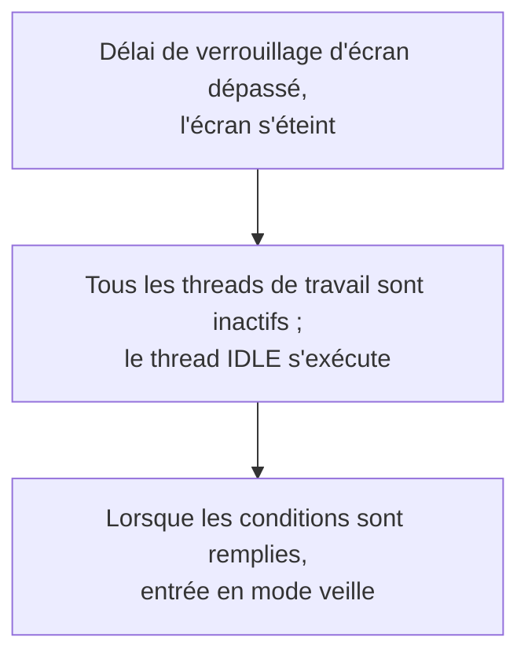
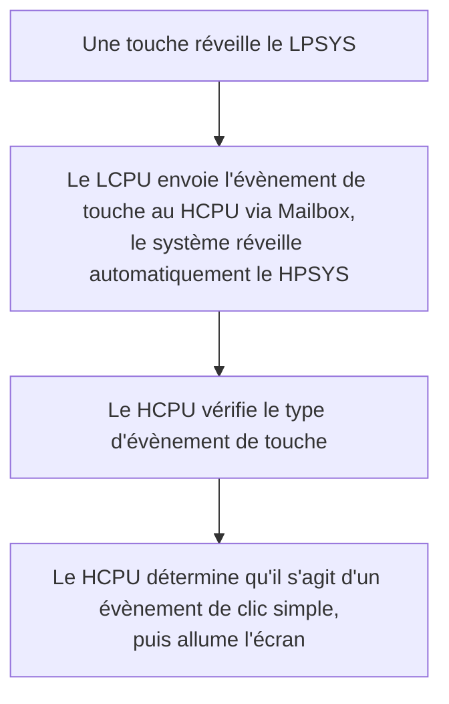

# Configurer les modes basse consommation et mesurer le courant { #configure-and-measure-low-power }

Les guides basse consommation du SiFli-SDK couvrent plusieurs architectures SF32. Les SF32LB52x, SF32LB55x et SF32LB56x utilisent deux cœurs : le HCPU du HPSYS, jusqu'à 240 MHz, traite les tâches exigeantes ; le LCPU du LPSYS, jusqu'à 48 MHz, prend en charge le Bluetooth et les capteurs. Les SF32LB57x et SF32LB58x ajoutent un ACPU à l'architecture HCPU/LCPU ; sur le SF32LB58x, le LCPU basse consommation fonctionne jusqu'à 96 MHz. Le nombre de cœurs, les limites d'horloge et le comportement basse consommation varient selon la famille : référez-vous au guide SDK correspondant au composant visé.

## Configurer l'infrastructure de gestion de l'énergie { #configure-the-power-management-framework }

Depuis le répertoire du projet, exécutez :

```bash
sdk.py menuconfig
```

Les paramètres menuconfig ci-dessous proviennent du guide source du SF32LB52x. Les noms de modes et les options disponibles peuvent varier selon la famille et la version du SDK ; vérifiez la documentation de la famille cible avant de les appliquer.

<div align="center" markdown>

<em>Tableau : Exemple de configuration menuconfig basse consommation pour SF32LB52x</em>

| Chemin menuconfig | Symbole | Objectif |
|---|---|---|
| `Sifli middleware → Enable Low power support` | `BSP_USING_PM` | Active le module de gestion d'énergie SiFli. |
| `RTOS → RT-Thread Components → Device Drivers → Using Power Management device drivers → Select PM Mode → Enable Deep Mode` | `PM_DEEP_ENABLE` | Active la prise en charge de Deep Sleep (veille profonde). |
| `Sifli middleware → Enable Low power support → Enable PM Debug` | `BSP_PM_DEBUG` | Affiche les transitions de gestion d'énergie ; désactivez cette option pour les mesures de courant finales. |
</div>

Le fichier `rtconfig.h` généré contient normalement `RT_USING_PM`, `BSP_USING_PM`, et le symbole du mode sélectionné. Partez de `example/pm/classical` comme référence fonctionnelle. Pour désactiver la fonctionnalité, inversez les mêmes sélections dans menuconfig.

Les figures ci-dessous proviennent du guide SiFli consacré au SF32LB52x et montrent les deux emplacements de menu clés. Pour le projet réel, référez-vous au menu SDK de la famille cible.

{ loading="lazy" }
<div align="center"><em>Figure : Exemple SF32LB52x présenté dans le guide SiFli — activer `BSP_USING_PM` sous Sifli middleware → Enable Low power support.</em></div>

{ loading="lazy" }
<div align="center"><em>Figure : Exemple SF32LB52x présenté dans le guide SiFli — activer `PM_DEEP_ENABLE` sous RTOS → RT-Thread Components → Device Drivers.</em></div>

## Sélectionner une source de réveil { #select-a-wake-source }

Utilisez les fichiers `pinmux.c`/`drv_io.c` de la carte et les API de l'exemple SDK correspondant.

<div align="center" markdown>

<em>Tableau : Comportement de réveil depuis Deep Sleep, Standby et Hibernate, par famille</em>

| Famille | Réveil depuis Deep Sleep ou Standby | Réveil depuis Hibernate |
|---|---|---|
| SF32LB52x | Dans Deep Sleep, toutes les broches peuvent déclencher le réveil via `WSR_GPIO1` ; aucune sélection supplémentaire n'est nécessaire. Le HCPU et le LCPU peuvent entrer en veille indépendamment. | Configurez la broche et le niveau de réveil PMU avant d'appeler `HAL_PMU_EnterHibernate()`. |
| SF32LB55x | Utilisez la correspondance AON propre à la famille 55x. | En Hibernate, seules les broches de réveil LCPU `PIN0`–`PIN5` peuvent réveiller le système. Utilisez `HAL_PMU_EnablePinWakeup()` avec un numéro de broche valide pour les 55x. Ces broches sont flottantes en Hibernate ; prévoyez une résistance de tirage externe lorsque la carte l’exige. |
| SF32LB56x | Utilisez la correspondance de broches HPAON/LPAON propre à la famille. | La PMU prend en charge deux sources de réveil, `PIN0` et `PIN1`, assignables à une broche de réveil HCPU ou LCPU. Voir l’exemple de configuration PMU ci-dessous. |
| SF32LB57x | Utilisez la correspondance de broches HPAON/LPAON propre à la famille. | La PMU prend en charge deux sources de réveil, `PIN0` et `PIN1` ; l’index des broches de réveil Hibernate va de 0 à 13. Associez chaque source à la broche de réveil HCPU/LCPU visée. |
| SF32LB58x | Utilisez la correspondance de broches HPAON/LPAON propre à la famille. | La PMU prend en charge deux sources de réveil, `PIN0` et `PIN1`, assignables à une broche de réveil HCPU ou LCPU. Voir l’exemple de configuration PMU ci-dessous. |
</div>

Pour Hibernate sur SF32LB52x, SF32LB56x, SF32LB57x et SF32LB58x, l’exemple ci-dessous associe un GPIO à la source de réveil PMU `PIN0`. Il ne s’applique pas au SF32LB55x, qui utilise la procédure distincte indiquée dans le tableau. Sur SF32LB57x, l’index des broches de réveil PMU va de 0 à 13. Vérifiez l’affectation choisie dans le manuel utilisateur du composant visé et dans le schéma de la carte.

```c
HAL_PMU_SelectWakeupPin(0,
    HAL_HPAON_QueryWakeupPin(hwp_gpio1, BSP_KEY1_PIN));
HAL_PMU_EnablePinWakeup(0, AON_PIN_MODE_HIGH);
rt_kprintf("CR:0x%x, WER:0x%x\n", hwp_pmuc->CR, hwp_pmuc->WER);
```

Un réveil depuis Hibernate équivaut à un démarrage à froid et positionne `PM_HIBERNATE_BOOT` ; contrairement au réveil depuis Standby, l’exécution ne reprend pas au point d’interruption. Si une même IO doit réveiller le système depuis Standby et depuis Hibernate, configurez les deux chemins. Sur les 55x, les broches de réveil en Hibernate sont des entrées flottantes ; prévoyez une résistance de tirage externe lorsque la carte l’exige.

## Comprendre les états de veille { #understand-the-sleep-states }

<div align="center" markdown>

<em>Tableau : Modes de veille et plages indicatives du guide pour le temps de réveil</em>

| Mode SDK | État CPU/périphérique | SRAM et sources de réveil | Plage indicative du temps de réveil selon le guide |
|---|---|---|---|
| `PM_SLEEP_MODE_IDLE` | Le CPU attend en WFI/WFE ; les horloges et périphériques continuent de fonctionner. | La SRAM reste accessible ; toute interruption peut réveiller le CPU. | <1 µs |
| `PM_SLEEP_MODE_LIGHT` | Les horloges rapides s'arrêtent ; le sous-système bascule sur 32 kHz. | LPTIM, RTC, MAC BLE du LCPU, Mailbox ou broche de réveil. | 30–100 µs |
| `PM_SLEEP_MODE_DEEP` | Comme Light Sleep, mais l'alimentation bascule sur `RET_LDO`. | La rétention SRAM et les sources de réveil dépendent de la famille ; voir le tableau ci-dessous. | 100 µs–1 ms |
| `PM_SLEEP_MODE_STANDBY` | Le CPU et ses périphériques sont réinitialisés ou mis hors tension ; l'état des broches est conservé. | La capacité de SRAM conservée et les sources de réveil dépendent de la famille ; le logiciel détecte un démarrage depuis Standby à partir de l'état AON. | 1–2 ms |
| Hibernate | Tous les sous-systèmes sont mis hors tension ; le quartz 32 kHz reste actif. | RTC ou broche de réveil PMU ; la RAM n'est pas conservée. `HAL_PMU_EnterHibernate()`. | >2 ms |
| Arrêt | Tous les sous-systèmes sont mis hors tension ; le RC10K reste actif. | RTC ou broche de réveil PMU ; la RAM n'est pas conservée et les IO sont en haute impédance. `HAL_PMU_EnterShutdown()`. | >2 ms |
</div>

<div align="center" markdown>

<em>Tableau : Valeurs de référence de rétention SRAM et de temps de réveil par famille</em>

| Famille | `PM_SLEEP_MODE_DEEP` | `PM_SLEEP_MODE_STANDBY` |
|---|---|---|
| SF32LB52x | Les SRAM HPSYS et LPSYS sont inaccessibles, mais conservées ; réveil en environ 250 µs. | La SRAM LPSYS est inaccessible, mais entièrement conservée ; la SRAM HPSYS est inaccessible et sa capacité conservée est limitée à 384 KB ; réveil en environ 1 ms. |
| SF32LB55x | Les SRAM HPSYS et LPSYS sont inaccessibles, mais conservées ; réveil en environ 250 µs. | La SRAM LPSYS est inaccessible, mais entièrement conservée ; la SRAM HPSYS est inaccessible et sa capacité conservée est limitée à 64 KB ; réveil en environ 1,5 ms. |
| SF32LB56x | Les SRAM HPSYS et LPSYS sont inaccessibles, mais conservées ; réveil en environ 250 µs. | La SRAM LPSYS est inaccessible, mais entièrement conservée ; la SRAM HPSYS est inaccessible et sa capacité conservée est limitée à 64 KB ; réveil en environ 1,5 ms. |
| SF32LB58x | Les SRAM HPSYS et LPSYS sont inaccessibles, mais conservées ; réveil en environ 250 µs. | La SRAM LPSYS est inaccessible, mais entièrement conservée ; la SRAM HPSYS est inaccessible et sa capacité conservée est limitée à 64 KB ; réveil en environ 1,5 ms. |

</div>

Le guide SDK actuel sur la basse consommation cité ne fournit pas de données comparables de rétention SRAM et de temps de réveil pour le SF32LB57x. Ne transposez pas au SF32LB57x les capacités de rétention ni les durées d’une autre famille ; vérifiez-les dans la version du SDK et la documentation du composant cible.

Dans le tableau précédent, `PM_SLEEP_MODE_LIGHT`, `PM_SLEEP_MODE_DEEP` et `PM_SLEEP_MODE_STANDBY` correspondent respectivement aux modes Light Sleep, Deep Sleep et Standby.

Les valeurs par famille sont des références des guides SDK, et non des délais garantis sur la carte. Le guide du SF32LB52x indique qu'en présence de PSRAM, le HCPU y sauvegarde les données de la RAM qui sera mise hors tension, puis les restaure après le réveil ; sans PSRAM, la RAM Retention de 64 KB sert de destination de sauvegarde. Cette zone de sauvegarde est distincte de la capacité SRAM conservée indiquée par famille (par exemple, le mode Standby du SF32LB52x indique 384 KB de SRAM HPSYS conservés). Ne supposez pas que cette politique de sauvegarde ou cette capacité s'applique aux autres familles, sauf si leur guide SDK le confirme. Le courant réel dépend aussi des périphériques activés, des niveaux IO, de la mémoire externe et de la carte.

## Contrôler les horloges à l'état éveillé { #control-clocks-while-awake }

Si le thread IDLE ne peut pas entrer dans un état de veille, la réduction automatique de fréquence WFI peut abaisser le courant. Elle n'est sûre que lorsque l'EPIC, l'EZIP, le LCDC, l'USB et le SD sont inactifs. Si l'application n'utilise pas le mécanisme du SDK qui suit l'activité de LVGL et des périphériques, signalez le début et la fin de chaque activité avec `rt_pm_hw_device_start()` et `rt_pm_hw_device_stop()`. Configurez le diviseur avec `HAL_RCC_HCPU_SetDeepWFIDiv()` ; les traitements audio limitent normalement l'horloge réduite à 48 MHz, tandis que les autres peuvent utiliser 4 MHz. Réglez `HPSYS_RCC_DBGR_FORCE_HP` selon les consignes du guide SDK.

Pour le travail actif, utilisez `rt_pm_run_enter()` :

<div align="center" markdown>

<em>Tableau : Sélections d'horloge HCPU en mode d'exécution</em>

| Mode | Horloge HCPU |
|---|---:|
| `PM_RUN_MODE_HIGH_SPEED` | 240 MHz |
| `PM_RUN_MODE_NORMAL_SPEED` | 144 MHz |
| `PM_RUN_MODE_MEDIUM_SPEED` | 48 MHz |
| `PM_RUN_MODE_LOW_SPEED` | 24 MHz |
</div>

`pm_scenario_start()`/`pm_scenario_stop()` fournissent la politique UI et Audio du SDK : si l'un ou l'autre scénario est actif, la vitesse élevée est sélectionnée ; si aucun n'est actif, la vitesse moyenne est sélectionnée. Mesurez l'énergie, pas seulement le courant instantané, car une horloge plus basse peut allonger le temps d'exécution.

## Comprendre l'ordre de mise en veille des sous-systèmes { #understand-inter-subsystem-sleep-sequencing }

Après l'extinction de l'écran, le HPSYS peut entrer en veille. Sur les 55x/56x/58x, le LPSYS suit normalement le HPSYS ; la famille 52x est l'exception documentée et permet une veille indépendante du HCPU/LCPU. Les sources disponibles ne confirment pas que l'ACPU du 57x suit le même ordre ; vérifiez la politique de ses sous-systèmes dans la version SDK correspondante. Après le réveil, `gui_resume` démarre un nouveau cycle de décision d'extinction d'écran. Maintenez un cœur éveillé tant qu'un périphérique partagé ou une transaction IPC en a besoin.

Activez temporairement `BSP_PM_DEBUG` et recherchez dans les journaux :

<div align="center" markdown>

<em>Tableau : Marqueurs de journal de transition basse consommation</em>

| Journal | Signification |
|---|---|
| `gui_suspend` / `gui_resume` | Transition d'extinction/allumage de l'écran. |
| `[pm]S: mode,gtime` | Entrée en veille ; `gtime` est exprimé en ticks à 32 768 Hz. |
| `[pm]W: gtime` | Réveil depuis la veille. |
| `[pm]WSR:0x...` | Raison du réveil ; décodez les bits à l'aide du manuel utilisateur de la famille. |
</div>

Si la veille attendue ne se produit pas, vérifiez `list_thread`, `pm_dump` et `list_timer`. Le thread IDLE doit pouvoir s'exécuter et aucune demande `rt_pm_request(PM_SLEEP_MODE_IDLE)` ne doit rester active. La prochaine échéance d'un temporisateur du système d'exploitation doit dépasser le seuil fixé par la politique de gestion de l'énergie (généralement 100 ms pour le HCPU et 10 ms pour le LCPU). Les conditions de réveil doivent être inactives et les files IPC vides. Un délai périodique inférieur au seuil peut empêcher indéfiniment la veille.

Le guide SiFli schématise également le chemin « extinction de l'écran → IDLE → veille lorsque les conditions sont remplies » et le chemin « une touche réveille le LPSYS, puis le LCPU envoie l'évènement au HCPU via Mailbox et le système réveille automatiquement le HPSYS ». Ces schémas sont utiles pour vérifier l'ordre des journaux ; les libellés et le déroulement sont des exemples SF32LB52x et ne doivent pas servir à déduire les assignations de bits WSR d'une autre famille.

{ loading="lazy" }
<div align="center"><em>Figure : Commutateur de débogage basse consommation SF32LB52x (`BSP_PM_DEBUG`).</em></div>

<div align="center"><em>Figure : Flux d'exemple SF32LB52x — de l'extinction de l'écran à la veille.</em></div>



<div align="center"><em>Figure : Flux d'exemple SF32LB52x — réveil du LPSYS vers le HPSYS.</em></div>



## Réduire les fuites au niveau carte { #reduce-board-level-leakage }

Mesurez d'abord le système minimal : déconnectez l'écran, le capteur, le chargeur et les autres charges amovibles, puis rajoutez-les une à une. Les sources de fuite courantes sont :

- un dispositif externe qui reste alimenté ;
- une sortie maintenue à l'état haut vers un dispositif mis hors tension ;
- une entrée flottante ou une configuration de tirage haut/bas inadaptée ;
- une PSRAM, une Flash NOR/NAND, une eMMC ou une interface SDIO qui n'a pas été mise dans son état basse consommation ;
- une configuration `PA01` de l'USB des 55x qui entre en conflit avec sa résistance de tirage bas interne.

Implémentez les transitions spécifiques à la carte dans `BSP_IO_Power_Down()` et `BSP_Power_Up()`, et utilisez `BSP_TP_PowerDown/Up` et `BSP_LCD_PowerDown/Up` lorsque l'alimentation de l'écran ou du tactile doit changer immédiatement à l'extinction/allumage de l'écran. Si le code s'exécute en XIP depuis la Flash NOR, placez la routine de mise en veille/réveil de la Flash en RAM de rétention (`HAL_RAM_RET_CODE_SECT`).

## Mesurer et consigner un résultat reproductible { #measure-and-record-a-reproducible-result }

Pour chaque mesure, consignez la famille et la révision du SDK, la révision de carte, la tension d'alimentation, le point de mesure et la bande passante de l'instrument, la configuration du firmware, les composants mémoire installés, les périphériques actifs, la source de réveil, le mode de veille et le journal de transition. Indiquez l'état et les conditions de test avec le courant mesuré ; ne comparez pas des valeurs isolées mesurées sur des cartes ou dans des modes différents.

Sources officielles par famille : [SF32LB52x](https://docs.sifli.com/projects/sdk/latest/sf32lb52x/app_note/low_power.html), [SF32LB55x](https://docs.sifli.com/projects/sdk/latest/sf32lb55x/app_note/low_power.html), [SF32LB56x](https://docs.sifli.com/projects/sdk/latest/sf32lb56x/app_note/low_power.html) et [SF32LB58x](https://docs.sifli.com/projects/sdk/latest/sf32lb58x/app_note/low_power.html). La [référence API PMU du SDK](https://docs.sifli.com/projects/sdk/latest/en/sf32lb52x/api/hal/pmu.html) documente la plage d’index des broches de réveil Hibernate du SF32LB57x.
