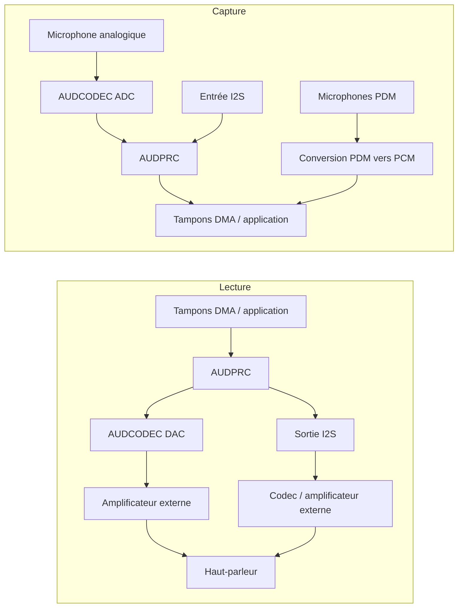

# Vue d’ensemble de l’audio { #audio-overview }

## Vue d'ensemble { #overview }

Ce guide présente le **sous-système audio local** des dispositifs SF32 : la chaîne codec, DMA et middleware utilisée pour l'entrée microphone, la sortie haut-parleur ou ligne, ainsi que la lecture et l'enregistrement sur l'appareil. Il porte sur les choix pratiques d'interfaces, de tampons, de codecs, de middleware Audio Server et de consommation énergétique.

L'audio Bluetooth (A2DP et LE Audio) est un sujet connexe, mais distinct, présenté dans la [Vue d'ensemble Bluetooth](../bluetooth/overview.md#bluetooth-audio-and-le-audio). Cette page traite de la transmission sans fil ; celle-ci décrit ce qui se passe une fois les échantillons arrivés sur la puce : capture, mixage, décodage et activation du chemin audio physique.

Consultez cette page pour choisir les microphones, codecs et stratégies de mise en tampon d'un produit, et pour évaluer sa consommation énergétique. Elle ne vise pas seulement à faire fonctionner une démonstration ponctuelle : elle s'adresse aux ingénieurs qui doivent concevoir un chemin audio fiable malgré les contraintes de Bluetooth, d'affichage, de stockage et de batterie.

## Définir les exigences audio du produit { #define-the-products-audio-requirements }

Avant de choisir les interfaces ou les tailles de tampon, précisez ce dont le produit a besoin :

- Lecture seule, enregistrement seul, ou les deux simultanément (duplex intégral) ?
- Combien de microphones faut-il, et de quel type : analogiques (AMIC) ou numériques (DMIC) ?
- Quels formats de lecture locale sont nécessaires : PCM brut, MP3, Opus ou un autre codec ?
- L'audio Bluetooth (Classic ou LE Audio) doit-il fonctionner en parallèle de l'audio local ?
- Faut-il une activation vocale ou une écoute permanente ? Quel budget énergétique est disponible ?
- Quelles sont les exigences de pilotage du haut-parleur ou de la sortie ligne ? La sortie doit-elle être routée vers un amplificateur ou un codec externe ?
- Quelle latence le produit peut-il tolérer ? Les appels vocaux et l'écoute en temps réel imposent des exigences bien plus strictes que les sons de notification.

Ces réponses déterminent l'interface (I2S, PDM ou ADC/DAC), la configuration du codec et les éléments du chemin audio qui doivent rester actifs.

## Le chemin de signal audio SF32 { #the-sf32-audio-signal-path }

La capture et la lecture suivent des chemins différents. Le schéma présente des chemins courants ; leur disponibilité et leur utilisation simultanée dépendent du modèle, du boîtier, de la carte et de la configuration du SDK.

<div align="center"><em>Figure : Chemin type du signal audio local SF32</em></div>



**AUDCODEC** assure les conversions analogique-numérique et numérique-analogique. **AUDPRC** réalise le mixage, le gain et la conversion de fréquence d'échantillonnage sur les chemins pris en charge. Les microphones PDM utilisent le bloc PDM pour produire du PCM ; ils ne passent pas par l'ADC analogique. I2S relie les périphériques audio numériques externes. Une interface PDM peut recevoir jusqu'à deux microphones compatibles grâce à la sélection gauche/droite ; deux interfaces peuvent en recevoir jusqu'à quatre, sous réserve des broches disponibles et du pilote.

**Audio Server** est un logiciel qui gère les flux et les sessions, pas un convertisseur physique entre microphone et haut-parleur. L'application utilise généralement ses API et les pilotes correspondants ; les tests directs du pilote ou du HAL sont utiles à la mise en service. Choisissez d'abord les chemins réels de capture et de lecture, puis vérifiez horloges, formats des échantillons, requêtes DMA et exigences de pilotage de la sortie. Ne supposez pas que le DAC intégré peut piloter le haut-parleur choisi sans amplificateur externe.

Ces chemins sont décrits dans le [guide du pilote AUDPRC/AUDCODEC](https://docs.sifli.com/projects/sdk/latest/en/sf32lb52x/drivers/audprc_audcodec.html) et le [guide HAL PDM](https://docs.sifli.com/projects/sdk/latest/en/sf32lb52x/hal/pdm.html).

## Microphones et interfaces numériques { #choosing-interfaces-amic-dmic-and-i2s }

AMIC et DMIC désignent des types de microphones ; PDM et I2S sont des interfaces numériques. Un microphone numérique peut utiliser PDM ou I2S. Nombre de microphones, nombre de canaux et nombre d'interfaces sont des ressources différentes.

<div align="center"><em>Tableau : Microphones et interfaces numériques</em></div>

<div align="center" markdown>

| Microphone / Bus | Usage typique | Remarques |
|:----------|:------------|:------|
| **AMIC (entrée microphone analogique)** | Capture audio à usage général | Utilise un ADC audio ; vérifier polarisation, gain, plage d'entrée et maîtrise du bruit sur la carte. |
| **DMIC (microphone numérique)** | Capture vocale et réseaux de microphones | Choisir le bus réel, PDM ou I2S. La transmission numérique ne dispense pas de vérifier alimentation, horloge et routage. |
| **I2S** | Transmission PCM vers ou depuis des codecs et amplificateurs externes | Souvent utilisé avec un codec ou un amplificateur audio externe, plutôt qu'avec le chemin AUDCODEC intégré à la puce. |
| **PDM** | Entrée microphone numérique | Interface native de nombreux composants DMIC, associée à la conversion PDM vers PCM intégrée à la puce. |

</div>

Les réseaux analogiques/numériques mixtes exigent des chemins simultanés pris en charge et un échantillonnage synchronisé. La formation de faisceaux demande aussi une implantation adaptée, un étalonnage et un algorithme ; connecter plusieurs microphones ne suffit pas.

## Commencer par un exemple audio vérifié { #start-from-a-verified-audio-example }

Choisissez et validez l'exemple SiFli-SDK le plus proche de votre cas avant de concevoir le comportement de l'application. Les [exemples audio du SDK](audio-sdk-examples.md) regroupent les exemples officiels de PDM, de capture analogique, d'enregistrement et de lecture, de musique locale, de carte SD, de FLAC, d'Opus et de mixage en fonction de la tâche d'ingénierie correspondante. La page indique également les contraintes liées à la carte, au multiplexage des broches, au stockage et à la configuration à vérifier avant d'adapter un exemple au produit.

## Choisir le bon dispositif SF32 { #pick-the-right-sf32-device }

Les capacités audio varient selon la famille. Vérifiez la fiche technique de la référence visée ; ce tableau fournit un premier repère :

<div align="center"><em>Tableau : Choisir le bon dispositif SF32</em></div>

<div align="center" markdown>

| Famille | ADC/DAC audio intégrés | Interfaces PDM (maximum de microphones) | Interfaces I2S | Usage envisagé |
|:---|:---|:---|:---|:---|
| **SF32LB52x** | 1 ADC + 1 DAC | 1 (2) | 1 | Accessoires audio Bluetooth à coût optimisé, HMI compactes à commande vocale. |
| **SF32LB55x** | Aucun ; un codec audio externe est requis pour l'audio analogique. | SF32LB551/555: 1 (2); SF32LB557: 2 (4) | SF32LB551/555: 1; SF32LB557: 2 | Appareils portables BLE et produits riches en capteurs où l'audio est secondaire. |
| **SF32LB56x** | 1 ADC + 1 DAC | 2 (4) | 1 | Produits HMI/écran plus riches nécessitant aussi une capture vocale multi-microphone. |
| **SF32LB57x** | 2 ADC + 1 DAC | 2 (4) | 2 | Capture vocale multi-microphone et lecture locale. |
| **SF32LB58x** | 2 ADC + 2 DAC | 2 (4) | 3 | Produits phares combinant audio, graphismes, IA et connectivité complexe. |

</div>

Avant de choisir, vérifiez le modèle exact, les broches du boîtier, leur multiplexage et les chemins utilisables simultanément. Une interface PDM peut accueillir deux microphones compatibles ; les canaux ADC, les canaux de microphone et les interfaces numériques sont des ressources distinctes. Les fonctions I2S dépendent de l'instance : sur le SF32LB58x, I2S1 ne prend en charge que la réception (RX), tandis qu'I2S2 et I2S3 prennent en charge la réception et l'émission (RX/TX). En réception sur I2S2, son côté TX doit également être activé pour fournir l'horloge. Le [guide HAL I2S de SiFli](https://docs.sifli.com/projects/sdk/latest/en/sf32lb52x/hal/i2s.html) détaille chaque instance ; les autres critères de choix figurent dans la [Famille SF32](../../sf32-products/family/SF32_family.md).

Sources : [DS5201](https://downloads.sifli.com/user%20manual/DS5201-SF32LB52x-Datasheet%20V2p5.pdf), [DS5501, tableau 0-1](https://downloads.sifli.com/user%20manual/DS5501-SF32LB55x-Datasheet%20V1p7p2.pdf), [DS5601](https://downloads.sifli.com/user%20manual/DS5601-SF32LB56x-Datasheet%20V1p9p2.pdf), [DS5801](https://downloads.sifli.com/user%20manual/DS5801-SF32LB58x-Datasheet%20V1p8p3.pdf), [registres AUDCODEC du SF32LB57x (ADC_CH0/1, DAC_CH0)](https://github.com/OpenSiFli/SiFli-SDK/blob/v2.5.1/drivers/cmsis/sf32lb57x/audcodec.h), [instances PDM/I2S du SF32LB57x](https://github.com/OpenSiFli/SiFli-SDK/blob/v2.5.1/drivers/cmsis/sf32lb57x/register.h), [notes de version de SiFli SDK v2.5.1 (configuration PDM à quatre microphones pour le 57x)](https://github.com/OpenSiFli/SiFli-SDK/releases/tag/v2.5.1), [exemple PDM du SDK SiFli (carte 57x, PDM1, canaux stéréo)](https://docs.sifli.com/projects/sdk/latest/en/sf32lb52x/example/rt_device/pdm/README.html).

## Modèles de session audio { #audio-session-templates }

La plupart des produits relèvent de quelques types de sessions récurrents. Choisissez celui qui se rapproche le plus du produit et validez-le explicitement :

<div align="center"><em>Tableau : Modèles de session audio</em></div>

<div align="center" markdown>

| Session | Pipeline typique | Risque principal |
|:--------|:-----------------|:----------|
| Son de notification | Ressource Flash/PSRAM -> décodeur si nécessaire -> Audio Server -> DAC/ampli | Pop/clic au démarrage et à l'arrêt. |
| Enregistrement vocal | AMIC -> ADC/AUDPRC, ou microphone PDM -> conversion PDM vers PCM, ou entrée I2S -> tampons DMA -> application/stockage/Bluetooth | Débordement de tampon et dérive d'horloge. |
| Haut-parleur Bluetooth | Audio Bluetooth -> décodage/mixage -> Audio Server -> DAC/ampli | Coexistence avec les signaux RF et partage de la bande passante mémoire. |
| Appel vocal | Capture microphone et lecture simultanées | Latence en duplex intégral, traitement du chemin d'écho et gestion des tampons. |
| Activation vocale/écoute continue | Capture à faible débit -> extraction de caractéristiques -> déclenchement par l'IA | Consommation au repos et activations intempestives. |

</div>

Pour chaque session, définissez le démarrage, le fonctionnement normal, la récupération en cas de tampon vide ou débordé, puis l'arrêt. Les problèmes audio apparaissent souvent lors des transitions, et non pendant la lecture en régime stable.

## Dimensionnement des tampons et budget de latence { #buffer-and-latency-budget }

La durée audio du tampon se calcule en **trames d'échantillons** : chaque trame contient un échantillon de chaque canal.

```text
interleaved frames = buffer bytes / (channels * stored bytes per sample)
planar frames per channel = channel buffer bytes / stored bytes per sample
buffer duration (s) = frames / sample rate (Hz)
```

À 48 kHz, 480 trames représentent 10 ms. En stéréo entrelacée, cela correspond à 960 échantillons individuels ; 480 échantillons individuels ne représentent que 5 ms. Pour convertir des octets en trames, utilisez le nombre d'octets réellement stockés par échantillon, bourrage compris. Si les canaux sont stockés séparément, comptez les trames de chaque canal sans additionner les longueurs des deux tampons.

Il s'agit de la durée audio du tampon, pas nécessairement de la latence de bout en bout. La double mise en tampon permet au DMA d'utiliser une zone pendant que le logiciel traite l'autre. La latence dépend des données en attente dans les files et de l'utilisation des rappels de demi-transfert ou de transfert complet, pas simplement de la présence de deux tampons. Répartissez et mesurez ensemble les délais de capture, traitement, transport, lecture et ordonnancement.

## Bases de la lecture et de l'enregistrement { #playback-and-recording-basics }

Que ce soit pour piloter un haut-parleur ou capturer un microphone, les mêmes fondamentaux s'appliquent :

- **Dimensionnement des tampons** — les petits blocs peuvent réduire la latence liée au traitement par blocs, mais augmentent la surcharge des interruptions et du DMA ; les grands blocs offrent davantage de marge d'ordonnancement et consomment plus de mémoire. La latence augmente lorsque davantage de données audio attendent avant leur traitement ou leur lecture, et non du seul fait de réserver plus de capacité de tampon.
- **Transfert par DMA** — utilisez un DMA cadencé par le matériel pour transférer les échantillons du périphérique. Le logiciel peut encore copier ou traiter des blocs en mémoire ; évitez la scrutation CPU et les boucles par échantillon qui doivent servir le périphérique en temps réel.
- **Fréquence d'échantillonnage et format** — définissez tôt la fréquence d'échantillonnage (par exemple, 16 kHz pour la voix, 44,1/48 kHz pour la musique) et la profondeur en bits ; convertir les formats à l'exécution consomme du temps CPU et de la mémoire.
- **Double mise en tampon** — pendant que le DMA transfère une région, le logiciel remplit ou traite l'autre. Terminez avant que cette région soit de nouveau nécessaire ; deux tampons ne suffisent pas à éviter les débordements ou les épuisements.

Pour les tampons en mémoire cacheable partagés avec le DMA, établissez la propriété et respectez l'alignement des lignes de cache ainsi que les règles de maintenance du SDK. Nettoyez les données de lecture écrites par le CPU avant leur lecture par DMA. Préparez les destinations de capture avant l'écriture DMA, puis invalidez la zone terminée avant sa lecture par le CPU, selon la politique de cache du dispositif. Ne modifiez ni ne réutilisez une zone occupée par DMA avant l'autorisation du rappel de fin ; ne placez pas de données étrangères dans les lignes de cache concernées.

## Choix de codec et de compression { #codec-and-compression-choices }

Distinguez le **codec audio matériel** (conversion ADC/DAC) du **codec de compression** (MP3 ou Opus, par exemple). Le PCM non compressé ne nécessite pas de décodeur de compression. Pour un signal équivalent, la compression avec pertes réduit généralement la taille stockée et la bande passante de lecture. Il faut néanmoins mesurer le temps CPU, les tampons de travail et l'énergie du décodeur ; un fichier plus petit ne garantit pas une occupation mémoire moindre à l'exécution.

<div align="center"><em>Tableau : Choix de codec et de compression</em></div>

<div align="center" markdown>

| Format | Usage typique | Remarques |
|:-------|:-------------|:------|
| **PCM non compressé** | Sons courts, écoute à faible latence et traitement vocal | Pas de décodage de compression ; taille selon durée, fréquence d'échantillonnage, nombre de canaux et largeur stockée des échantillons. |
| **MP3** | Lecture de musique locale | Large compatibilité ; le décodage est bien connu et ce format est courant dans les exemples de lecteur de musique sur carte SD. |
| **Opus** | Voix et audio compressé à usage général | Format compressé utile pour la voix et l'audio général. La prise en charge d'Opus ne garantit pas l'interopérabilité A2DP, HFP ou LE Audio ; vérifier séparément le codec du profil Bluetooth choisi et le support du SDK. |

</div>

Le SDK propose des exemples de musique locale, MP3 sur carte SD, Opus, enregistrement et chemins ADC/DAC doubles. L'exemple à deux canaux nécessite un dispositif et une carte qui les exposent ; toutes les puces SF32 ne possèdent pas deux ADC/DAC. Partez de la configuration prise en charge et mesurez le coût du décodage sur la cible.

## Audio local et audio Bluetooth { #local-audio-vs-bluetooth-audio }

Distinguez les deux chemins, même s'ils peuvent fonctionner simultanément :

- **Audio local** (ce guide) — AUDCODEC/AUDPRC, microphones, haut-parleur/sortie ligne, lecture et enregistrement sur l'appareil.
- **Audio Bluetooth** ([Vue d'ensemble Bluetooth](../bluetooth/overview.md#bluetooth-audio-and-le-audio)) — A2DP/AVRCP/HFP pour Classic Bluetooth, ou LE Audio unicast/broadcast si le dispositif, la pile et le SDK prennent en charge les rôles nécessaires. Une radio compatible BLE ne garantit pas, à elle seule, LE Audio.

De nombreux produits combinent les deux : ils peuvent, par exemple, capter le son avec un microphone local et le transmettre par Bluetooth, ou recevoir de l'audio Bluetooth et le mixer avec une notification locale via Audio Server. Si les deux chemins sont actifs simultanément, précisez qui gère les tampons et comment le mixage est effectué.

## Vérifications audio sur la carte { #board-level-audio-checklist }

Le firmware ne peut pas entièrement masquer une conception analogique médiocre. Passez en revue ces éléments lors du travail de schéma et de PCB :

<div align="center"><em>Tableau : Liste de contrôle audio au niveau carte</em></div>

<div align="center" markdown>

| Zone | Recommandation |
|:-----|:---------|
| Polarisation et routage du microphone | Gardez les pistes des microphones analogiques courtes et peu sensibles au bruit ; éloignez-les des horloges, des signaux RF et des nœuds de commutation à fort courant. |
| Masse | Évitez de faire passer les courants de retour bruyants par les références de masse du microphone ou du haut-parleur. |
| Rails d'alimentation | Filtrez les alimentations du codec et du microphone selon la conception de référence et la fiche technique du microphone. |
| Chemin haut-parleur/amplificateur | Vérifiez la charge, le gain, le comportement thermique, la suppression des claquements et le comportement de la broche d'arrêt. |
| Horloges I2S/PDM | Vérifiez la marge temporelle, la longueur des pistes et la qualité des horloges aux fréquences d'échantillonnage choisies. |
| Accès de test | Prévoyez un moyen pratique d'injecter et de capturer de l'audio pendant la mise en service et les essais de production. |

</div>

Pour les produits qui associent RF et audio analogique, vérifiez le bruit avec le Bluetooth actif, l'écran en fonctionnement, le chargeur connecté et le boîtier final assemblé.

## Considérations de consommation pour l'audio { #power-considerations-for-audio }

Mesurez séparément l'alimentation des microphones, les convertisseurs, le traitement numérique, les accès mémoire et l'amplificateur, puis la session complète. La part de chaque poste dépend du matériel, de la charge de travail et du rapport cyclique d'écoute et de lecture.

- Entre les sessions, arrêtez les chemins inutilisés dans l'ordre imposé par le composant et le pilote. Vérifiez la mise en sourdine et l'arrêt de l'amplificateur, les horloges, les alimentations et les états GPIO pour éviter les claquements, la rétroalimentation et les courants de fuite aux interfaces.
- Pour une activation vocale avec écoute continue, maintenez le chemin de capture nécessaire et choisissez le traitement pris en charge le plus économe. N'arrêtez pas le chemin dont dépend la détection et gardez son modèle léger. Consultez la [vue d'ensemble de l'IA](../ai/overview.md#audio-and-voice).
- Regroupez les traitements dans les limites de latence et les délais des tampons. DMA transfère les échantillons, mais les blocs terminés doivent encore être traités à temps ; réduire les réveils CPU ne doit pas provoquer de débordement ou d'épuisement des tampons.
- Coordonnez l'audio avec Bluetooth et l'affichage. Consultez la [vue d'ensemble de la conception basse consommation](../low-power/overview.md) et [Coexistence](../bluetooth/overview.md#coexistence-with-other-workloads).

## Matrice de validation audio { #audio-validation-matrix }

Répétez les mêmes tests audio après toute modification du codec, de Bluetooth, de l'écran, de l'alimentation ou des horloges :

<div align="center"><em>Tableau : Matrice de validation audio</em></div>

<div align="center" markdown>

| Test | Ce qu'il faut vérifier |
|:-----|:--------------|
| Capture/lecture en silence | Plancher de bruit, ronflement, pop/clic, composante continue (offset DC). |
| Balayage de sinusoïde ou tonalité | Exactitude de la fréquence d'échantillonnage, distorsion, écrêtage. |
| Lecture prolongée | Tampons épuisés, fuites mémoire, stabilité thermique et énergétique. |
| Enregistrement pendant affichage UI | Coexistence DMA et bande passante mémoire. |
| Audio Bluetooth et son local simultanés | Mixage, priorité et latence. |
| Mise en veille et réveil pendant l'audio | Arrêt et redémarrage du codec, suppression des claquements et requêtes PM qui limitent les états d'alimentation autorisés (PM votes). |

</div>

Conservez un fichier WAV/PCM de référence validé et un enregistrement validé depuis la carte d'évaluation. Ils facilitent bien davantage la détection des régressions que la seule écoute subjective.

## Déboguer les problèmes audio { #debugging-audio-issues }

<div align="center"><em>Tableau : Déboguer les problèmes audio</em></div>

<div align="center" markdown>

| Symptôme | Zone probable à vérifier |
|:--------|:----------------------|
| Clics, claquements ou coupures | Tampon vide, nombre ou taille de tampons insuffisant, ou mauvaise configuration DMA. |
| Bruit ou ronflement persistant | Étage analogique ou routage de la carte, mise à la masse AMIC, ou bruit sur l'alimentation. |
| Latence trop élevée pour le cas d'usage | Tampons trop grands, conversion de format inutile, ou délai de planification avant le démarrage de DMA. |
| Le son se coupe lorsque Bluetooth ou l'écran est actif | Coexistence et contention de la bande passante mémoire ; voir [Coexistence](../bluetooth/overview.md#coexistence-with-other-workloads). |
| L'audio décodé a une hauteur ou une vitesse incorrecte | Fréquences d'échantillonnage incompatibles entre la source, le décodeur et la configuration d'AUDCODEC. |
| Consommation élevée lorsque la lecture est inactive | Le chemin codec/DMA reste actif entre les sessions, ou le système effectue des scrutations inutiles au lieu de terminer la session sur événement. |

</div>

## Erreurs courantes { #common-mistakes }

- Servir chaque échantillon du périphérique par scrutation CPU plutôt que par DMA cadencé par le matériel.
- Utiliser des tampons trop petits ou mal gérés, au point de manquer les échéances DMA ; recourir au double tampon lorsque le pilote le permet et que le cas s’y prête.
- Choisir les types et nombres de microphones sans vérifier les instances PDM/I2S, les broches accessibles et les chemins simultanés.
- Traiter l'audio Bluetooth et l'audio local comme totalement indépendants alors qu'ils s'exécuteront simultanément dans le produit réel.
- Ignorer la cohérence du cache et les règles de propriété des tampons partagés entre DMA et CPU.
- Laisser les chemins inutilisés actifs entre les sessions, ou arrêter une capture nécessaire à l'écoute continue.
- S'engager sur un format compressé avant de confirmer que le coût de décodage tient dans le budget de consommation et de CPU.

## Liste de contrôle de mise en service { #bring-up-checklist }

- [ ] Vérifier pour le dispositif et la carte retenus les types et canaux de microphones, les instances PDM/I2S, les broches accessibles et les chemins simultanés pris en charge.
- [ ] Définir la fréquence d'échantillonnage, la largeur stockée des échantillons, l'organisation des canaux et les tailles des tampons de capture et de lecture.
- [ ] Mettre en service la capture choisie via ADC/AUDPRC, PDM ou I2S et la lecture via DAC ou I2S ; tester chaque sens avant le duplex intégral.
- [ ] Une fois les chemins matériels opérationnels, intégrer les sessions prises en charge avec Audio Server et les pilotes correspondants ; conserver les tests HAL directs pour le diagnostic.
- [ ] Choisir le format audio (PCM/MP3/Opus) et mesurer, si nécessaire, le coût du décodage en CPU, mémoire et énergie.
- [ ] Vérifier la propriété et l'alignement des tampons DMA, ainsi que le nettoyage et l'invalidation du cache.
- [ ] Tester l'audio local et Bluetooth simultanément si le produit utilise les deux.
- [ ] Mesurer la consommation en activité et au repos ; vérifier les séquences d'arrêt et de redémarrage, les états des broches et le chemin de capture nécessaire à l'écoute continue.

## À retenir { #key-takeaways }

- Choisissez le chemin physique : AUDCODEC pour l'audio analogique, le bloc PDM pour la capture PDM et I2S pour l'audio numérique externe. Gérez les sessions prises en charge avec Audio Server et les pilotes, sans assimiler tous les chemins à une même chaîne de codec.
- Choisissez les types de microphones et les chemins PDM/I2S selon les capacités du dispositif exact et la disposition des microphones, sans transposer les hypothèses d'une autre puce.
- Utilisez des transferts DMA cadencés par le matériel et une capacité de tampon suffisante. Le double tampon est une solution courante lorsqu'elle est prise en charge, mais il faut toujours respecter les échéances des callbacks et de réutilisation des tampons.
- L'audio local et l'audio Bluetooth sont des sous-systèmes distincts qui doivent souvent fonctionner ensemble ; planifiez explicitement le mixage et la gestion des tampons.
- Gérez la consommation audio comme celle de Bluetooth et de l'IA : réduisez le temps d'activité, évitez les réveils CPU inutiles et mesurez des sessions réelles, pas seulement la lecture en régime stable.
