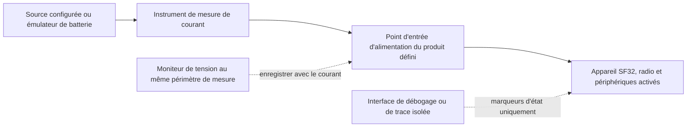
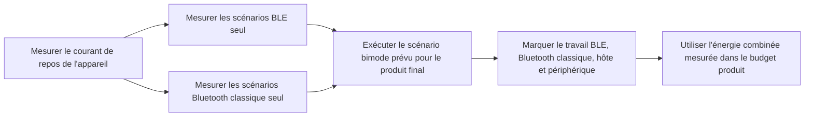

# Mesurer et analyser la consommation Bluetooth { #bluetooth-low-power-profiling }

Cet article explique comment mesurer la **consommation réelle d'un appareil en fonctionnement Bluetooth** : Bluetooth Low Energy (BLE), Bluetooth classique (BR/EDR) et leur fonctionnement combiné dans un produit bimode. Pour chaque scénario, définissez le périmètre électrique de la mesure, relevez le courant et la tension et recueillez assez d'informations sur le firmware pour expliquer les principales parties de la trace.

Les sections sur le Bluetooth classique et le fonctionnement bimode ne s'appliquent qu'aux appareils et configurations firmware compatibles BR/EDR. Pour un produit BLE uniquement, la méthode reste la même, mais le plan de mesure se limite au BLE.

L'[Online Power Profiler for Bluetooth LE](https://devzone.nordicsemi.com/power/w/opp/2/online-power-profiler-for-bluetooth-le) de Nordic constitue une référence conceptuelle utile pour le BLE. Nordic le présente comme un modèle établi à partir de mesures, qui fournit des valeurs attendues sans mesurer un appareil particulier. Les résultats de précision publiés concernent uniquement le matériel de référence de Nordic et ne sont pas transposables au SF32. L'outil ne modélise ni le Bluetooth classique ni un produit bimode. Un modèle aide à choisir les essais ; la consommation réelle du produit doit être mesurée sur l'appareil cible.

## Définir ce que vous mesurez { #define-what-you-are-measuring }

La « consommation Bluetooth » peut désigner des choses très différentes. Une mesure limitée à la radio peut aider à optimiser un paramètre de connexion, mais elle ne reflète pas la consommation du produit complet, qui inclut aussi le contrôleur, le processeur applicatif, les capteurs, l'écran, la mémoire et l'alimentation.

<div align="center"><em>Tableau : Périmètres de mesure de la consommation Bluetooth</em></div>

<div align="center" markdown>

| Périmètre de mesure | Éléments inclus | Utilisation | Limitation |
|:---------|:-----------------|:---------------|:-----------|
| Sous-système Bluetooth ou rail sélectionné | Radio/contrôleur et le chemin d'alimentation sélectionné | Isoler une régression de la radio ou du contrôleur | Ne représente pas la consommation énergétique sur batterie de l'appareil complet |
| Rail d'alimentation du MCU | MCU, contrôleur et périphériques intégrés alimentés par ce rail | Comparer les états du firmware sur une carte contrôlée | Exclut les composants externes sur d'autres rails et les pertes du régulateur |
| Batterie ou entrée d'alimentation principale du produit | Régulateurs, MCU, mémoire externe, capteurs, écran et autres charges alimentées | Estimer l'autonomie et valider le produit | Nécessite un contrôle rigoureux de tout le matériel et des alimentations connectés |

</div>

Pour étayer une estimation de l'autonomie du produit, mesurez autant que possible à l'entrée de la batterie ou à l'entrée d'alimentation principale. Enregistrez la tension avec le courant afin d'exprimer le résultat en puissance et en énergie, plutôt qu'en une valeur de courant sans les conditions d'alimentation correspondantes.

## Mettre en place un test reproductible { #set-up-a-repeatable-test }

L'instrument et l'appareil doivent utiliser le même périmètre de mesure, clairement documenté. Le Power Profiler Kit II (PPK II) de Nordic est un instrument source-mesure de référence utile, à condition que ses plages de tension et de courant conviennent au montage. Un instrument source-mesure ou un analyseur de courant équivalent convient également. La rigueur du protocole compte davantage que la marque de l'instrument.

En [mode Source Meter](https://docs.nordicsemi.com/r/bundle/ug_ppk2/page/ug/ppk/measure_current_source_meter.html), le PPK II alimente l'appareil ; en [mode Ampere Meter](https://docs.nordicsemi.com/r/bundle/ug_ppk2/page/ug/ppk/measure_current_ampere_meter.html), une source externe l'alimente à travers l'instrument. Choisissez le mode correspondant au circuit d'alimentation prévu. Une tension réglée n'est pas une trace de tension enregistrée sur l'appareil : surveillez aussi la tension au point de mesure, notamment si des chutes de tension ou des variations de la batterie influencent l'énergie.

Vérifiez les limites d'utilisation du PPK II avant de connecter le DUT. En mode Source Meter, la sortie est réglable de 0,8 à 5,0 V et le courant maximal du DUT est de 600 mA. Le mode Ampere Meter nécessite une alimentation externe de 0,8 à 5,0 V et permet une mesure continue jusqu'à 1 A. Si le DUT peut dépasser 400 mA en mode Source Meter, Nordic recommande d'alimenter aussi le PPK II avec une source USB supplémentaire d'au moins 1 A. Il s'agit de limites de l'instrument, et non de valeurs de fonctionnement recommandées pour l'appareil. Consultez les spécifications Nordic sur le [courant maximal du DUT](https://docs.nordicsemi.com/r/bundle/ug_ppk2/page/ug/ppk/ppk_max_dut_current.html) et les [conditions d'alimentation](https://docs.nordicsemi.com/r/bundle/ug_ppk2/page/ug/ppk/ppk_power_supply.html).

<div align="center"><em>Figure : Montage de mesure de puissance Bluetooth au niveau de l'appareil</em></div>



Avant chaque essai :

1. Débranchez l'alimentation USB, un débogueur ou toute autre alimentation susceptible de contourner l'instrument ou d'ajouter une charge. Ne conservez que les interfaces requises par le scénario.
2. Appliquez la tension d'alimentation documentée au périmètre de mesure choisi. Enregistrez chaque rail alimenté, cavalier, module et appareil externe.
3. Utilisez la version compilée du firmware du produit et sa configuration PM prévue. Désactivez la journalisation de diagnostic volumineuse pour les mesures finales, sauf si elle fait partie de la configuration du produit livré.
4. Préparez le même téléphone, accessoire, application de test, distance, orientation d'antenne et environnement RF pour chaque comparaison.
5. Capturez une fenêtre suffisamment longue pour inclure de nombreux événements Bluetooth répétés, pas seulement un pic isolé facile à obtenir.

## Comprendre les phases de consommation d'un événement d'annonce BLE { #read-a-ble-advertising-event-as-a-set-of-power-components }

Un événement d'annonce BLE typique ne se résume pas à une impulsion radio. Il commence par une brève phase de mise sous tension et de préparation, suivie du démarrage et de la stabilisation de l'oscillateur à quartz haute fréquence. Une fois l'alimentation et les horloges stabilisées, l'appareil reste en veille jusqu'à l'heure prévue de démarrage radio. Dans l'exemple d'annonce scannable ou connectable présenté ici, la radio démarre, émet sur l'un des canaux principaux d'annonce et ouvre une fenêtre de réception sur ce même canal. Après les deux premières fenêtres de réception, l'appareil repasse en veille avant d'émettre sur le canal suivant ; après la dernière fenêtre, il effectue le post-traitement. Un événement non connectable et non scannable n'écoute pas les requêtes. Les étapes réelles dépendent du type d'annonce configuré et de la carte des canaux utilisée.

La séquence complète représentée est la suivante : prétraitement → démarrage du quartz → veille → démarrage radio → émission radio (TX) → commutation TX/RX → réception radio (RX) → veille → émission radio (TX) → commutation TX/RX → réception radio (RX) → veille → émission radio (TX) → commutation TX/RX → réception radio (RX) → post-traitement. Le démarrage radio n'a lieu qu'une fois ; les émissions sur les canaux 38 et 39 commencent après la veille qui suit la fenêtre RX du canal précédent. La séquence reprend les étapes de l'[illustration Nordic d'un événement d'annonce BLE typique](https://devzone.nordicsemi.com/power/w/opp/2/online-power-profiler-for-bluetooth-le). Il s'agit de phases génériques d'un événement BLE, et non d'états radio propres à Nordic ; ce redessin n'ajoute aucun autre état. Les niveaux de courant et les proportions temporelles sont indicatifs, pas des mesures SF32. Mesurez-les sur l'appareil cible.

<div align="center"><em>Figure : Étapes d'un événement d'annonce BLE</em></div>


Cette illustration représente un événement d'annonce legacy scannable ou connectable utilisant les trois canaux primaires 37, 38 et 39 ; les échanges après réception d'une requête ne sont pas représentés. Les étiquettes de canal sont indicatives : la spécification Bluetooth Core autorise l'utilisation des indices de canal primaire activés dans n'importe quel ordre, tandis que la carte de canaux configurée détermine ceux qui sont utilisés. Au plus une PDU d'annonce est émise sur chaque indice utilisé, généralement une par indice. Les trois émissions sont des copies des données d'annonce sur différents canaux, pas des nouvelles tentatives conditionnées par un acquittement. Pour les événements scannables ou connectables, la couche liaison écoute les requêtes autorisées sur le même canal primaire ; les événements non scannables et non connectables n'écoutent pas les requêtes. L'annonce étendue, une autre carte de canaux ou la réception effective d'une requête peuvent produire des traces différentes ; vérifiez le comportement configuré sur l'appareil cible. Consultez la [spécification de la couche Link Layer de Bluetooth Core 6.2](https://www.bluetooth.com/wp-content/uploads/Files/Specification/HTML/Core-62/out/en/low-energy-controller/link-layer-specification.html) et le [guide d'introduction de Bluetooth SIG](https://www.bluetooth.com/bluetooth-le-primer/).

<div align="center"><em>Tableau : Étapes de consommation d'un événement d'annonce BLE</em></div>

<div align="center" markdown>

| Étape | Principales activités et sources de consommation | Ce qu'il faut mesurer et vérifier |
|:------|:----------------------------|:---------------|
| Prétraitement (Pre-processing) | Brève mise sous tension, éventuellement avec un courant relativement élevé ; préparation CPU/contrôleur, traitement de la charge utile, DMA, accès mémoire et configuration des périphériques | `I_pre` et `t_pre` ; identifier le travail de réveil et de mise sous tension nécessaire, puis éliminer ou regrouper tout travail évitable |
| Montée en régime de l'oscillateur HF (Crystal ramp-up) | Démarrage et stabilisation de l'horloge haute fréquence | `I_xtal` et `t_xtal` ; vérifier que la stratégie d'horloge et la séquence de réveil ne durent pas plus que nécessaire |
| Veille (Standby) | État basse consommation choisi une fois l'alimentation et les horloges prêtes, avec la logique de rétention, la temporisation basse fréquence et les sources de réveil activées | Mesurer `I_standby`, l'attente initiale avant le démarrage radio et les périodes de veille entre canaux après RX ; ne pas assimiler ce courant interne au courant de repos entre événements complets |
| Démarrage radio (Start radio) | Préparation de la radio et du contrôleur, ainsi que chemin d'alimentation RF requis avant la première transmission | `I_start` et `t_start` ; identifier toute préparation inutile ou tout travail de démarrage répété |
| TX radio (Radio TX) | Chemin d'émission radio, travail du contrôleur et transmission du paquet d'annonce sur les canaux 37, 38 et 39 | Mesurer `I_tx` et `t_tx` pour chaque paquet ; la puissance TX, la longueur des paquets et les canaux activés déterminent l'énergie des paquets et de l'événement |
| Commutation radio (Radio switch) | Le passage de l'émission à la réception et la transition d'état du contrôleur | `I_switch` et `t_switch` ; comptabiliser chaque transition plutôt que de la traiter comme une durée sans coût énergétique |
| RX radio, si activé (Radio RX) | Chemin de réception et travail du contrôleur en attente d'une requête de scan ou de connexion | `I_rx` et `t_rx` ; inclure uniquement lorsque le type et la configuration d'annonce ouvrent des fenêtres de réception |
| Post-traitement (Post-processing) | Callbacks de protocole, travail CPU, accès mémoire/périphérique et toute réponse applicative avant la mise en veille | `I_post` et `t_post` ; vérifier que les horloges, les contraintes PM et les composants externes sont libérés rapidement |

</div>

Sur un appareil SF32, utilisez ces noms d'étape pour guider le placement des marqueurs dans la trace ; ne les considérez ni comme des états radio propres à Nordic, ni comme des valeurs prédéfinies de durée ou de courant. La présence d'une phase de réception dépend du mode d'annonce configuré et doit être vérifiée sur la trace de l'appareil cible.

Pour un événement complet, l'énergie correspond à l'aire sous la trace, pondérée par la tension :

```text
E_event = sum(V_stage x I_stage x t_stage)
```

À tension d'alimentation constante, une configuration périodique d'annonce peut être approximée comme suit :

```text
Q_event = sum(I_stage x t_stage)
I_average = (Q_event + I_idle x (T_cycle - t_event)) / T_cycle
```

`Q_event` inclut la charge de toutes les étapes de l'événement complet, y compris ses périodes internes de veille ; `t_event` est sa durée totale. `I_idle` est le courant mesuré entre deux événements complets, et non le courant `I_standby` interne à l'événement. `T_cycle` est l'intervalle mesuré entre deux débuts d'événement, avec le délai d'annonce et les effets de l'ordonnancement. Si les intervalles varient, intégrez une trace longue et représentative plutôt que de considérer l'intervalle configuré comme une période exacte.

À tension constante, doubler le courant mesuré ou la durée d'une étape double son énergie. Les brèves phases de TX, RX et démarrage peuvent dominer l'énergie de l'événement ; avec de longs intervalles, le repos entre événements peut dominer le courant moyen. Identifiez les étapes par des marqueurs GPIO ou des événements firmware à faible surcoût, puis mesurez à l'entrée d'alimentation du produit complet avant de choisir quoi optimiser.

Le Bluetooth classique a une temporisation de protocole différente, mais la même rigueur de mesure s'applique. La spécification Bluetooth Core définit Inquiry Scan et Page Scan comme deux procédures de scan distinctes, et Sniff comme un mode ACL connecté qui réduit les créneaux d'écoute du Peripheral aux occasions Sniff planifiées ; le trafic du pair peut prolonger l'activité au-delà d'un intervalle d'ancrage. Il s'agit de comportements de temporisation, pas d'estimations de courant. Mesurez sur l'appareil cible la politique Scan configurée, les paramètres Sniff et l'activité réelle du pair et de l'application. Consultez la [spécification BR/EDR Baseband](https://www.bluetooth.com/wp-content/uploads/Files/Specification/HTML/Core-62/out/en/br-edr-controller/baseband-specification.html) et [HCI Scan Enable](https://www.bluetooth.com/wp-content/uploads/Files/Specification/HTML/Core-62/out/en/host-controller-interface/host-controller-interface-functional-specification.html).

## Construire un plan de mesure spécifique au mode { #build-a-mode-specific-measurement-plan }

Ne traitez pas « Bluetooth activé » comme un seul état de fonctionnement. Le BLE et le Bluetooth classique utilisent des procédures de connexion et de basse consommation différentes. Un produit bimode peut partager entre les deux modes du temps radio, les ressources du contrôleur, les horloges, la mémoire et le travail applicatif. Commencez par les scénarios reproductibles les plus simples, puis mesurez le comportement combiné exact du produit livré.

<div align="center"><em>Tableau : Couverture des scénarios Bluetooth</em></div>

<div align="center" markdown>

| Capacité radio | Scénario | Ce qu'il faut définir avant de mesurer | Résultat à conserver |
|:-----------------|:---------|:--------------------------------|:-----------------|
| BLE | Annonce, connexion au repos, transfert applicatif et reconnexion | Rôle, intervalle, puissance TX, charge utile, appareil distant, conditions de début/fin | Courant moyen, énergie d'événement et énergie par action terminée |
| Bluetooth classique (BR/EDR) | État de scan | Si l'inquiry scan, le page scan ou les deux sont activés ; politique de découvrabilité/connectabilité | Courant moyen et énergie sur une fenêtre de scan représentative |
| Bluetooth classique (BR/EDR) | Mode Sniff connecté | Paramètres Sniff, appareil distant, état de la liaison et activité applicative en arrière-plan | Courant moyen et énergie sur de nombreux intervalles Sniff |
| Bluetooth classique (BR/EDR) | Activité d'un profil en fonctionnement | Profil et rôle, par exemple données SPP/PAN ou audio A2DP/HFP ; durée du transfert ou de la session audio | Énergie par transfert ou session terminée, plus puissance moyenne soutenue |
| Bimode | BLE et Bluetooth classique en fonctionnement combiné | Quelles liaisons sont utilisées ensemble, leurs paramètres, la charge de travail au premier plan et le comportement lors des transitions/reconnexions | Puissance moyenne combinée mesurée et énergie par scénario produit complet |

</div>

Le [test de consommation BLE/BT](https://docs.sifli.com/projects/sdk/latest/en/sf32lb52x/example/pm/bt/README.html) de SiFli constitue une base utile : il couvre l'annonce et les modes de connexion BLE ainsi que les modes Scan et Sniff du Bluetooth classique. Le résultat obtenu sur une carte ne constitue toutefois pas une spécification produit. Utilisez la carte prise en charge, la broche de réveil, la console et la configuration PM indiquées pour rendre la mesure reproductible, puis reproduisez sur le matériel cible le rôle prévu pour le produit, l'appareil distant, le trafic et la stratégie de gestion de l'énergie.

## Mesurer le BLE comme mode radio autonome { #profile-ble-as-a-standalone-radio-mode }

Commencez par mesurer le BLE seul. Vous obtenez ainsi une référence sans que le trafic des profils Bluetooth classique ou l'ordonnancement entre modes ne complique la lecture de la trace.

<div align="center"><em>Tableau : Ensemble de scénarios BLE autonomes</em></div>

<div align="center" markdown>

| Scénario | Configuration | À calculer | Cause typique d'un résultat trompeur |
|:---------|:------|:------------------|:-------------------------------------|
| Annonce | Appareil non connecté émettant avec un type d'annonce et une sélection de canaux documentés | Courant moyen et énergie par intervalle d'annonce | Comportement de scan du téléphone, trafic de débogage ou annonces qui conservent une fréquence élevée au lieu de ralentir comme prévu |
| Connecté au repos | Appareil connecté sans transfert applicatif ; noter si l'appairage, la conservation des clés et le chiffrement sont activés | Courant moyen sur de nombreux intervalles de connexion | Le CPU applicatif se réveille à chaque événement de connexion ; des temporisateurs ou des notifications restent actifs |
| Interaction utilisateur | Une commande GATT représentative, un envoi de capteur ou une action déclenchée par l'UI | Énergie par action terminée et énergie ajoutée par rapport au repos | Ne mesurer que la radio en ignorant le travail de l'hôte, de l'écran ou du capteur |
| Transfert en rafale ou OTA | Une charge utile définie avec une condition de fin définie | Énergie par octet ou par transfert terminé, plus durée totale | Utiliser un débit de pointe comme s'il représentait tout le transfert |
| Déconnexion et reconnexion | L'appareil distant BLE sort de portée, revient et se reconnecte | Énergie et temps pour récupérer | Tentatives de reconnexion non bornées ou politique d'annonce agressive maintenue indéfiniment |

</div>

Enregistrez le rôle BLE, l'appareil distant, les paramètres de connexion ou d'annonce, la puissance TX, la charge utile, le déclencheur de début, la condition de fin et la fréquence d'usage réelle. Une trace sans ces informations ne peut pas être comparée à celle d'une autre version du firmware.

## Mesurer le Bluetooth classique comme mode radio autonome { #profile-classic-bluetooth-as-a-standalone-radio-mode }

Sur un produit bimode, mesurez le Bluetooth classique séparément avant d'introduire le BLE. Vous rendez ainsi visibles la référence Scan et Sniff et tout traitement système propre au profil, sans que des événements BLE ne s'y intercalent.

<div align="center"><em>Tableau : Ensemble de scénarios Bluetooth classique autonomes</em></div>

<div align="center" markdown>

| Scénario | Configuration | À calculer | Cause typique d'un résultat trompeur |
|:---------|:------|:------------------|:-------------------------------------|
| Scan | La politique d'inquiry scan, page scan ou combinée retenue pour le produit final est active | Courant moyen et énergie sur une fenêtre de scan représentative | Laisser une politique de scan plus agressive activée que celle prévue pour le produit final |
| Mode Sniff connecté | Une liaison Bluetooth classique connectée entre dans sa configuration Sniff prévue | Courant moyen sur de nombreux intervalles Sniff | Mesurer une liaison qui reste active à cause du trafic de l'appareil distant ou du travail applicatif, sans le remarquer |
| Activité d'un profil en fonctionnement | Un transfert de données SPP/PAN défini, un flux A2DP, un appel HFP ou une autre activité de profil utilisée dans le produit final | Énergie par transfert ou session terminée, plus puissance moyenne soutenue | Mesurer la radio en omettant le codec, l'amplificateur, l'écran, la mémoire ou le travail hôte requis par le profil |
| Déconnexion et reconnexion | L'appareil distant Bluetooth classique sort de portée, revient et se reconnecte | Énergie et temps pour récupérer | Tentatives de reconnexion non bornées ou politique de découverte qui reste active indéfiniment |

</div>

Enregistrez le rôle Bluetooth classique, l'appareil distant, la politique Scan ou Sniff, la puissance TX, le profil, la charge utile ou la durée de session, le déclencheur de début, la condition de fin et la fréquence d'usage réelle. Pour les profils audio, le périmètre de mesure doit inclure le chemin audio réellement utilisé par le produit.

## Mesurer le fonctionnement bimode comme un scénario à part entière { #measure-dual-mode-behavior-as-its-own-scenario }

N'estimez pas la consommation électrique d'un produit bimode en additionnant simplement une mesure BLE et une mesure Bluetooth classique. Les deux modes peuvent partager du temps radio, du traitement contrôleur, des horloges, de la mémoire et des réveils applicatifs. Leur consommation combinée peut donc différer sensiblement de la somme arithmétique de deux moyennes mesurées séparément.

<div align="center"><em>Figure : Séquence de mesure du Bluetooth bimode</em></div>



Ce n'est qu'après avoir caractérisé séparément le BLE et le Bluetooth classique que vous devez mesurer le comportement d'un produit bimode. Pour un produit qui maintient une liaison BLE disponible tout en diffusant de l'audio Bluetooth classique, par exemple, mesurez les éléments suivants sur le même matériel et avec le même appareil distant :

1. La politique de connexion BLE au repos, seule.
2. Le flux ou profil de données Bluetooth classique, seul.
3. L'état stable combiné réel, incluant le trafic BLE prévu.
4. Les transitions d'entrée et de sortie de l'état combiné, plus la récupération d'erreur et le comportement de reconnexion.

Les marqueurs de trace doivent identifier les événements BLE, le travail de profil Bluetooth classique, les callbacks applicatifs, le traitement audio ou de données, et les changements d'état PM. Cela sépare la planification radio du travail système qu'elle déclenche, et expose des interactions inattendues telles qu'un callback BLE empêchant le CPU applicatif de retourner en veille pendant une session Bluetooth classique.

## Corréler la trace avec le comportement du firmware { #correlate-the-trace-with-firmware-behavior }

Pour comprendre la consommation réelle de l'appareil, il faut relier chaque variation de la trace à l'activité correspondante. Marquez ou consignez le début et la fin des tâches du produit afin de pouvoir déterminer pourquoi le courant change :

- Avant et après un transfert initié par l'application ou une rafale de notifications.
- Lorsque l'écran, le capteur, la Flash, le chemin audio ou un autre composant externe est activé ou désactivé.
- Lorsque le firmware demande un état PM et lorsque l'appareil y entre réellement.
- Lorsqu'un chemin de reconnexion, de nouvelle tentative ou de récupération d'erreur démarre.

Utilisez un marqueur GPIO visible dans la trace, un marqueur d'événement à faible surcharge ou un script de test reproductible. Un journal série peut aider à la mise en service, mais aussi modifier la consommation. Lors des mesures finales, contrôlez la journalisation comme une variable d'essai ; ne la considérez pas comme un moyen d'observation sans effet.

<div align="center"><em>Tableau : Lecture d'une trace de puissance Bluetooth</em></div>

<div align="center" markdown>

| Observation de trace | Signification probable | À vérifier dans le firmware ou le matériel |
|:------------------|:---------------|:-------------------------------|
| Impulsions courtes et régulièrement espacées au-dessus d'une base faible | Événements planifiés d'annonce/connexion BLE ou activité Scan/Sniff Bluetooth classique | Mode, intervalle ou politique de scan/Sniff, rôle radio et état basse consommation réel entre les événements |
| Une rafale plus importante immédiatement après chaque événement radio | Callback hôte, traitement de protocole, ou travail applicatif | Quel callback s'exécute, si les données sont utiles, et si le travail peut être regroupé |
| Activité soutenue ou densément répétée pendant une session Bluetooth classique | Trafic de profil Bluetooth classique actif, souvent accompagné de traitement hôte, audio ou de données | Profil, chemin codec/données, trafic de l'appareil distant, horloges audio, composants externes et durée de session définie |
| Rafales BLE et Bluetooth classique entremêlées | Une planification bimode ou du travail hôte associé | Quelle liaison a causé chaque région, si le travail est partagé, et si l'un des modes retarde la veille ou augmente l'activité de nouvelles tentatives |
| Un courant élevé persiste après l'événement attendu | Une contrainte PM, un périphérique ou une interface externe reste actif | Demandes de mode PM, temporisateurs, horloges, états des broches, alimentation de l'écran et des capteurs, et chemins d'erreur |
| Rafales longues et sporadiques | Nouvelles tentatives, scan, reconnexions, trafic de l'appareil distant ou activité utilisateur | Conditions RF, comportement de l'appareil distant, politique de backoff/nouvelles tentatives et script de test |
| Le niveau de base change après la connexion d'un module ou d'un câble | Le périmètre électrique mesuré a changé | Chemins de rétro-alimentation, adaptateurs UART, résistances de rappel externes, rails de module et routage d'alimentation |

</div>

## Calculer l'énergie et la consommation quotidienne réelles { #calculate-actual-energy-and-daily-consumption }

Pour une trace variable, calculez l'énergie à partir du courant et de la tension au fil du temps :

```text
E_scenario = integral(V(t) x I(t) dt)
P_average = E_scenario / T_scenario
```

Si la tension reste constante dans le périmètre de mesure, le courant moyen peut aussi servir aux comparaisons. Conservez néanmoins l'enregistrement de la tension, surtout si vous passez d'un rail régulé à l'entrée batterie.

Pour un scénario produit répété :

```text
E_day = sum(E_scenario x events_per_day) + E_mode_idle + E_other_states
```

Découpez la journée en périodes sans chevauchement. `E_mode_idle` et `E_other_states` ne doivent couvrir que le temps qui n'est pas déjà inclus dans l'énergie totale des scénarios. Traitez le fonctionnement simultané du BLE et du Bluetooth classique comme un scénario combiné mesuré, et non comme la somme des modes isolés. Si le modèle compte déjà la consommation de base sur 24 heures, ajoutez uniquement le supplément d'énergie de chaque action au-dessus de cette base, pas son énergie totale. Avec des volts, des ampères et des secondes, le résultat est en joules ; divisez par 3600 pour le convertir en Wh.

L'énergie d'un scénario doit inclure tout le travail nécessaire de l'appareil. Par exemple, une notification du téléphone peut nécessiter un événement de connexion, un traitement par l'hôte, un accès à un capteur ou à la Flash, une mise à jour de l'écran et un retour en veille. Ne mesurer que l'impulsion RF sous-estime l'énergie consommée par l'appareil ; mesurer le produit entier sans marqueurs de trace empêche d'identifier les postes à optimiser.

## Comparer le modèle aux mesures de l'appareil { #reconcile-the-model-with-the-device }

Utilisez le modèle initial pour classer les sources probables de consommation, puis mettez-le à jour à partir des mesures réelles. Un écart entre l'estimation et la trace est utile : il peut révéler un événement manquant, une durée erronée, un réveil inattendu ou une charge externe non prise en compte.

<div align="center"><em>Figure : Boucle de validation de la consommation Bluetooth mesurée</em></div>


<div align="center"><em>Tableau : Questions pour comparer le modèle aux mesures</em></div>

<div align="center" markdown>

| Écart entre le modèle et la mesure | Points à vérifier |
|:--------------------------------|:-------------------|
| Le courant moyen est plus élevé que prévu | L'appareil entre-t-il dans l'état PM demandé ? Des temporisateurs, la journalisation ou des horloges périphériques le maintiennent-ils éveillé ? |
| L'énergie de l'événement est plus élevée que prévu | L'hôte, l'écran, le capteur, la mémoire ou le mécanisme de nouvelle tentative a-t-il entraîné du travail supplémentaire ? La qualité RF impose-t-elle de nouvelles tentatives ou une puissance TX plus élevée ? |
| Le repos du BLE ou du Bluetooth classique est le principal poste de consommation | Les paramètres de connexion BLE, la politique Scan/Sniff Bluetooth classique, la cadence des notifications et les réveils applicatifs sont-ils adaptés à l'état du produit ? |
| Le résultat bimode diffère de la somme des tests en mode unique | Quelles périodes radio, quels traitements du contrôleur, quelles horloges partagées, quels callbacks applicatifs, quels chemins audio/données ou quelles contraintes PM se chevauchent ou empêchent la veille ? |
| L'énergie de reconnexion domine | Le produit utilise-t-il un comportement de nouvelles tentatives/backoff borné et une politique de découverte réaliste ? |
| La carte et le produit final ne concordent pas | Quels rails externes, pertes de régulateur, modules, effets d'antenne/boîtier et résistances de rappel des interfaces diffèrent ? |

</div>

## Partir d'une base SiFli reproductible { #start-from-a-repeatable-sifli-baseline }

Utilisez les exemples SiFli-SDK pour reproduire un état Bluetooth avant de mesurer le firmware du produit. La carte prise en charge, le chemin d'alimentation, la configuration des cavaliers, les réglages SDK et la procédure de test fournissent des points de référence ; ils ne constituent pas des spécifications du produit.

<div align="center"><em>Tableau : Références SiFli-SDK pour commencer les mesures Bluetooth</em></div>

<div align="center" markdown>

| Cible de mesure | Point de départ officiel | Puis mesurer sur le produit |
|:-------------------|:------------------------|:----------------------------|
| Consommation d'annonce et de connexion BLE | [Test de consommation d'annonce et de connexion BLE](https://docs.sifli.com/projects/sdk/latest/en/sf32lb52x/example/pm/ble/README.html) | Politique d'annonce du produit, paramètres de connexion, callbacks, comportement de l'appareil distant et antenne |
| Scan et Sniff Bluetooth classique | [Test de consommation BLE/BT](https://docs.sifli.com/projects/sdk/latest/en/sf32lb52x/example/pm/bt/README.html) | Politique de scan du produit livré, réglages Sniff, comportement de l'appareil distant et état réel de la liaison au repos |
| Charge de travail de profil Bluetooth classique | [Exemples du SDK Bluetooth](bluetooth-sdk-examples.md) | Transfert SPP/PAN réel ou session A2DP/HFP, incluant le travail hôte, audio, mémoire et composant externe requis |
| Comportement bimode du produit | [Test de consommation BLE/BT](https://docs.sifli.com/projects/sdk/latest/en/sf32lb52x/example/pm/bt/README.html) plus l'exemple de profil produit le plus proche | Le comportement concurrent ou alterné exact du BLE et du Bluetooth classique, incluant les transitions, le traitement partagé et la politique PM du produit |
| Service GATT connecté | [Périphérique BLE](https://docs.sifli.com/projects/sdk/latest/sf32lb58x/example/ble/peripheral/README.html) | Caractéristiques réelles, cadence des notifications, sécurité et interaction avec le téléphone |
| Transfert de données BLE | [Débit BLE](https://docs.sifli.com/projects/sdk/latest/sf32lb58x/example/ble/throughput/README.html) | Énergie par charge utile entièrement transférée et durée totale du transfert de bout en bout |
| Autres flux de travail Bluetooth | [Exemples du SDK Bluetooth](bluetooth-sdk-examples.md) | Le rôle/profil Bluetooth classique, BLE ou LE Audio le plus proche avant l'intégration produit |

</div>

## Liste de contrôle pour la revue de mise en production { #release-review-checklist }

- [ ] Le périmètre de mesure et la tension d'alimentation sont documentés.
- [ ] Le courant et la tension ont été enregistrés pour chaque scénario important pour la mise en production.
- [ ] L'USB, le débogueur, les adaptateurs UART et les alimentations de modules externes ont été contrôlés ou explicitement inclus.
- [ ] Les traces sont corrélées aux événements du firmware, aux demandes d'état PM et aux états réellement atteints.
- [ ] Le comportement d'annonce et de connexion au repos BLE ainsi que Scan/Sniff Bluetooth classique a été mesuré le cas échéant.
- [ ] Chaque profil de données ou audio Bluetooth classique prévu pour le produit final dispose d'une charge de travail définie et mesurée.
- [ ] Les scénarios bimodes ont été mesurés comme des états produit combinés plutôt qu'estimés en additionnant les résultats en mode unique.
- [ ] Le comportement représentatif de transfert, déconnexion et reconnexion a été mesuré le cas échéant.
- [ ] L'énergie de chaque scénario a été convertie en consommation quotidienne selon une fréquence d'usage réaliste, puis comparée au budget énergétique de la batterie.
- [ ] Le poste le plus énergivore a un responsable et fait l'objet d'une décision d'optimisation ou d'acceptation.

## Ressources associées { #related-resources }

- [Vue d'ensemble Bluetooth](overview.md) pour le BLE, le Bluetooth classique, les profils, la sécurité et la coexistence système.
- [Exemples du SDK Bluetooth](bluetooth-sdk-examples.md) pour la sélection de projets Bluetooth classique, BLE et LE Audio.
- [Vue d'ensemble de la conception basse consommation](../low-power/overview.md) pour la conception PM et le budget énergétique complet du produit.
- [Mesurer et valider la consommation énergétique](../low-power/measurement-and-validation.md) pour le flux de validation du composant au produit.
- [Analyse de la consommation d'une montre connectée](../low-power/smartwatch-power-profiling.md) pour un exemple de modèle énergétique quotidien.
