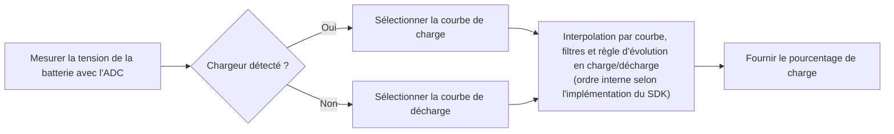

# Estimation du niveau de charge de la batterie { #battery-capacity-calculation }

Le calculateur de batterie du SiFli-SDK estime le niveau de charge, en pourcentage, à partir de la tension mesurée. Il déduit ce niveau de la tension et ne mesure pas la charge électrique comme le ferait un compteur coulombique. La précision dépend donc de la courbe de la batterie et de la fiabilité des informations sur l'état du chargeur.

Le middleware détecte l'état du chargeur, sélectionne la courbe de charge ou de décharge correspondante, puis estime le pourcentage par interpolation. Un filtre principal des variations brusques et un filtre facultatif par moyenne pondérée stabilisent également le résultat. Le guide publié ne précise pas entièrement l'ordre interne des filtres ; consultez l'implémentation de la révision du SDK utilisée par votre projet avant de supposer un ordre précis.

## Ce que fait le calculateur { #what-the-calculator-does }

<div align="center"><em>Tableau : Comportement du calculateur de batterie</em></div>
<div align="center" markdown>

| Fonction | Comportement |
| --- | --- |
| Courbes de charge et de décharge | Sélectionne la courbe tension/niveau de charge correspondant au mode actuel : charge ou décharge. |
| Interpolation linéaire | Calcule le pourcentage entre deux points de la courbe sélectionnée. |
| Filtre principal | Filtre les variations brusques de tension selon le seuil configuré et le nombre d'échantillons consécutifs qui le dépassent. |
| Filtre secondaire | Calcule facultativement une moyenne pondérée des valeurs de tension précédente et actuelle. |
| Détection de l'état du chargeur | Utilise la configuration de détection du chargeur de la carte pour sélectionner la courbe de charge ou de décharge. |

</div>

<div align="center"><em>Diagramme : Estimation du niveau de charge de la batterie</em></div>



Ce diagramme est conceptuel ; il ne garantit pas l'ordre interne des appels. Le guide publié ne précise pas l'ordre exact de l'interpolation, des filtres et de la règle d'évolution en charge/décharge. Vérifiez l'implémentation de la révision du SDK utilisée par le produit. Le guide indique que le pourcentage ne diminue pas pendant la charge et n'augmente pas pendant la décharge.

## Configurer d'abord la carte { #configure-the-board-first }

Avant d'utiliser le middleware, configurez la carte dans menuconfig :

1. Activez la prise en charge de l'ADC pour mesurer la tension de la batterie.
2. Activez la fonction de calcul du niveau de charge.
3. Activez la prise en charge de la charge.
4. Sélectionnez le circuit intégré de charge utilisé sur la carte. Choisissez l'option de chargeur simple uniquement si aucun des circuits proposés ne convient.
5. Configurez la broche de la carte qui détecte le branchement du chargeur.
6. Réglez la polarité de cette broche en fonction du matériel.

`BSP_CHARGER_INT_PIN_ACTIVE_HIGH` définit la polarité de la détection du chargeur. Si cette macro est définie, un niveau haut indique que le chargeur est branché ; sinon, c'est un niveau bas qui l'indique. Une polarité incorrecte entraîne la sélection de la mauvaise courbe et peut bloquer l'affichage du pourcentage ou le faire évoluer dans le mauvais sens.

## Utiliser les courbes de la cellule réellement installée { #use-battery-curves-from-the-actual-cell }

Le fichier `battery_table.c` fourni par défaut dans le répertoire de la carte est un exemple, pas un modèle universel. Demandez au fabricant les courbes reliant la tension au niveau de charge de la cellule utilisée, puis configurez les tables de correspondance adaptées au produit.

<div align="center"><em>Tableau : Exigences des courbes de batterie</em></div>
<div align="center" markdown>

| Table | Définition requise |
| --- | --- |
| `charging_curve_table` | Tableau `const battery_lookup_point_t[]` utilisé en charge. Les tensions doivent être triées de la plus élevée à la plus faible. |
| `discharge_curve_table` | Tableau `const battery_lookup_point_t[]` utilisé en décharge. Les tensions doivent être triées de la plus élevée à la plus faible. |
| Contenu des tables | Les points doivent couvrir les pourcentages de 100 à 0 et représenter le comportement réel de la batterie. |
| Emplacement des tables | Fichier `battery_table.c` propre à la carte. |

</div>

Utilisez des courbes distinctes : à niveau de charge identique, la tension de la cellule n'est pas la même en charge et en décharge. Ne remplacez pas la courbe de la cellule utilisée par une courbe générique de batterie lithium à 4,2 V au seul motif que leur chimie nominale est identique.

!!! warning "Vérifier l'échelle de tension du SDK et de la carte utilisés"
    La documentation SiFli publiée présente une incohérence d'unités : `voltage_mv` et les seuils de filtrage sont indiqués en mV, mais l'exemple transmet `38000` pour `3,8 V` et la courbe d'exemple utilise `41808` pour `4,18 V`. Ces valeurs sont cohérentes avec une échelle de 0,1 mV, mais la documentation ne précise pas explicitement cette échelle. Il s'agit donc d'une déduction à partir des nombres, et non d'une garantie de l'API. Avant d'utiliser le calculateur, vérifiez le chemin de conversion ADC, la table de batterie et les comparaisons de seuil dans la révision exacte du SDK et la configuration de la carte.

    La lecture ADC, la table de courbe sélectionnée et les seuils de filtrage doivent utiliser des échelles compatibles. Le guide donne les valeurs littérales `50` et `30` pour les seuils et les indique en mV ; ne les convertissez pas en vous fondant uniquement sur les exemples de tension. Vérifiez comment la révision du SDK utilisée interprète et compare chaque champ. Ne modifiez pas uniquement l'échelle de la lecture ADC en laissant la table ou les seuils dans une autre échelle.

## Configurer le calculateur { #configure-the-calculator }

`battery_calculator_config_t` regroupe les deux tables de courbe et les paramètres de filtrage.

<div align="center"><em>Tableau : Configuration du calculateur de batterie</em></div>
<div align="center" markdown>

| Champ | Rôle | Littéral de l'exemple publié (unité indiquée dans la documentation) |
| --- | --- | --- |
| `charging_table`, `charging_table_size` | Courbe de charge et nombre de points | Propre à la carte |
| `discharging_table`, `discharging_table_size` | Courbe de décharge et nombre de points | Propre à la carte |
| `charge_filter_threshold` | Seuil de variation de tension en charge | `50` (indiqué en mV dans la documentation ; vérifier l'échelle du SDK cible) |
| `discharge_filter_threshold` | Seuil de variation de tension en décharge | `30` (indiqué en mV dans la documentation ; vérifier l'échelle du SDK cible) |
| `filter_count` | Nombre d'échantillons consécutifs dépassant le seuil de variation, requis pour que le filtre principal confirme le changement | `3` |
| `secondary_filter_enabled` | Active le filtre secondaire pondéré | `true` |
| `secondary_filter_weight_pre` | Pondération de la tension précédente | `90` |
| `secondary_filter_weight_cur` | Pondération de la tension actuelle | `10` |

</div>

Lorsque le filtre secondaire est activé, `secondary_filter_weight_pre + secondary_filter_weight_cur` doit être égal à `100`. Ajustez les seuils, le nombre de mesures et les pondérations en fonction de la batterie utilisée, des transitoires de consommation et du comportement attendu du produit. Les valeurs de référence du SDK ne constituent pas des résultats d'étalonnage.

## Initialiser et calculer { #initialize-and-calculate }

Initialisez le calculateur avant de demander le niveau de charge. Le guide SiFli publié déclare que la fonction d'initialisation renvoie `void` ; lors de la compilation, référez-vous à l'en-tête de la révision exacte du SDK utilisée par votre projet.

```c
void battery_calculator_init(battery_calculator_t *calc,
                             const battery_calculator_config_t *config);
```

L'API renvoie un pourcentage de 0 à 100 : il s'agit de l'état de charge, et non de la capacité de la batterie en mAh. Avant l'intégration, consultez l'en-tête et l'implémentation de la révision exacte du SDK pour vérifier les éventuelles contraintes supplémentaires sur les paramètres ou le statut renvoyé à l'initialisation.

Passez la tension à l'échelle attendue par la révision exacte du SDK utilisée. Le nom du paramètre de l'API publiée est `voltage_mv`, mais vérifiez l'échelle réelle comme expliqué plus haut :

```c
uint8_t battery_calculator_get_percent(battery_calculator_t *calc,
                                       uint32_t voltage_mv);
```

<div align="center"><em>Tableau : Séquence d'intégration recommandée</em></div>
<div align="center" markdown>

| Étape | Action |
| --- | --- |
| 1 | Configurez l'ADC de la carte, le type de chargeur, la broche de détection et sa polarité. |
| 2 | Définissez dans `battery_table.c` des courbes de charge et de décharge validées. |
| 3 | Initialiser `battery_calculator_t` avec `battery_calculator_config_t`. |
| 4 | Mesurez la tension de la batterie par le chemin ADC configuré. |
| 5 | Vérifiez que tension, tables et seuils emploient la même échelle avant de passer la tension à `battery_calculator_get_percent()`. |
| 6 | Utilisez le résultat filtré dans l'interface utilisateur, la gestion du niveau de batterie faible et la télémétrie du produit. |

</div>

## Vérifier le comportement sur le matériel du produit { #verify-behavior-on-product-hardware }

Le pourcentage affiché doit refléter l'état réel du produit, et pas seulement sembler plausible en laboratoire. Pendant la charge et la décharge, ainsi qu'au branchement et au débranchement du câble, vérifiez conjointement si le chargeur est détecté, la tension mesurée, la courbe sélectionnée et le pourcentage affiché.

<div align="center"><em>Tableau : Dépannage du pourcentage de batterie</em></div>
<div align="center" markdown>

| Symptôme | Premier point à vérifier |
| --- | --- |
| Le pourcentage varie trop brusquement | Vérifiez d'abord que la lecture ADC, les tables de courbe et les seuils utilisent la même échelle. Ajustez ensuite le seuil concerné ou `filter_count` et, si nécessaire, activez ou renforcez le filtre secondaire. |
| Le pourcentage est inexact | Obtenez une courbe correspondant à la batterie utilisée et réétalonnez les points de la table. |
| Le pourcentage reste inchangé | Vérifiez l'état du chargeur signalé et la polarité de `BSP_CHARGER_INT_PIN_ACTIVE_HIGH`. Le guide publié indique que la charge empêche le pourcentage de diminuer et que la décharge l'empêche d'augmenter. |
| Le pourcentage évolue dans le mauvais sens | Vérifiez la broche de détection du chargeur, sa polarité électrique et la courbe de charge ou de décharge sélectionnée. |

</div>

Pour consulter la référence officielle du middleware et les captures d'écran de configuration, voir [Calcul du niveau de charge de la batterie dans le SiFli-SDK](https://docs.sifli.com/projects/sdk/latest/sf32lb58x/middleware/battery_calculator.html). Pour estimer l'autonomie à l'échelle du système, poursuivez avec [Analyse de la consommation d'une montre connectée](smartwatch-power-profiling.md) ; pour valider les résultats par la mesure, consultez [Mesurer et valider la consommation énergétique](measurement-and-validation.md).

Le guide publié est un point de départ pour consulter cette fonction, mais ne remplace pas la vérification de la révision du SDK utilisée par le produit. Pour résoudre l'incohérence d'échelle, vérifiez notamment le chemin ADC, la table de batterie, les comparaisons de seuil et l'en-tête de l'API dans cette révision.
