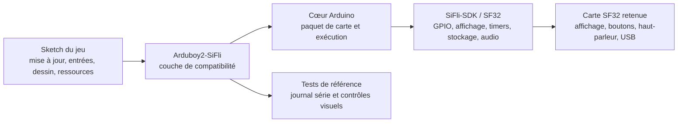

# Portage d'Arduboy2 pour SF32LB52 { #arduboy2-on-sifli }

## Qu'est-ce qu'Arduboy2-SiFli ? { #what-is-arduboy2-sifli }

[OpenSiFli/Arduboy2-SiFli](https://github.com/OpenSiFli/Arduboy2-SiFli) est un portage par OpenSiFli de la [bibliothèque Arduboy2](https://github.com/MLXXXp/Arduboy2) vers l'environnement de développement SiFli. Arduboy2 fournit un modèle orienté application pour un petit appareil de jeu : une boucle d'images, un tampon d'affichage, des boutons, des sprites, du texte et une commande de son optionnelle. Le portage SiFli est donc utile comme expérience de compatibilité : il montre quelle part d'un jeu de style Arduboy peut être conservée lorsque la carte, l'écran, les entrées, l'audio et la chaîne de compilation sous-jacents passent à SF32.

Le dépôt est une référence logicielle, et non une console de jeu terminée ni une conception matérielle de production. Considérez son README, son arborescence source, ses exemples, l'historique de ses tickets et ses fichiers de licence comme faisant autorité pour la cible de carte exacte, la surface d'API prise en charge, les instructions de compilation et les conditions de redistribution. Cette page organise les décisions d'ingénierie autour de cette référence ; elle ne remplace pas les instructions exécutables du dépôt.

## Pourquoi ce portage SF32 ? { #why-the-sifli-implementation }

Une application de style Arduboy est un moyen compact d'exercer plusieurs décisions de produit embarqué à la fois : une boucle de rendu prévisible, de petites ressources monochromes ou à basse résolution, une entrée par boutons, un timing audio et un budget mémoire étroitement borné. Porter ce modèle sur SF32 peut fournir une référence précoce utile pour des jeux portables, des démonstrateurs d'interface, des appareils éducatifs et d'autres produits dont l'interaction est locale et déterministe.

L'intérêt n'est pas que chaque sketch Arduboy fonctionne sans modification. L'intérêt est la frontière que le portage met en évidence :

- Le jeu peut conserver sa logique de haut niveau de mise à jour, d'entrée, de dessin et de ressources tant qu'il reste dans l'API Arduboy2 prise en charge.
- Le portage doit traduire les hypothèses sur l'affichage, les boutons, l'audio, le timing et le stockage qui étaient implicites dans le matériel d'origine.
- Tout sketch qui pilote directement des registres AVR, des broches propres à Arduboy, des transactions d'affichage, des timers ou la disposition de l'EEPROM exige une adaptation délibérée et des preuves de non-régression distinctes.

Ce sont des attentes d'ingénierie, et non des déclarations de compatibilité mesurées. Confirmez-les par rapport au dépôt OpenSiFli actuel et consignez le résultat exact pour la carte et le commit retenus.

## Résultat, portée et critères d'entrée { #outcome-scope-and-entry-criteria }

Cette page définit un parcours par étapes depuis la référence OpenSiFli jusqu'à un jeu ou une démo interactive SF32 reproductible. Elle n'affirme **pas** que le portage prend en charge toutes les fonctions d'Arduboy2, tous les jeux Arduboy, toutes les cartes SF32, ni un timing d'affichage et d'audio de qualité production. Elle n'établit pas non plus de droits de licence sur les jeux, polices, graphismes ou autres ressources copiés depuis des dépôts tiers.

**Résultat :** une compilation Arduboy2-SiFli sous gestion de versions qui exécute un exemple du dépôt ou un petit sketch de test, démontre le chemin retenu pour l'affichage/les entrées/l'audio, et consigne les preuves nécessaires pour décider si un jeu plus important ou une adaptation produit se justifie.

**Lecteur visé :** ingénieurs firmware, matériel et produit capables d'utiliser l'outillage Arduino, d'inspecter du code C/C++, de flasher une carte SF32, de lire une sortie série et d'effectuer des mesures de base d'affichage, d'entrée et de consommation.

Avant de commencer, ayez à disposition :

- Une carte de développement SF32LB52 utilisant la variante ArduinoCore-Zephyr `sf32lb52_devkit_lcd_sf32lb525uc6`, ainsi que les périphériques externes décrits ci-dessous. Le README indique que les chemins d'affichage, de boutons, d'EEPROM externe et d'audio ont été exercés sur du matériel SF32LB52 ; il documente un chemin de LED RVB mais n'indique aucun résultat de test pour celui-ci. Le README ne fixe pas de révision de carte physique et n'identifie pas le module OLED exact.
- Une installation Arduino fonctionnelle et le paquet de carte OpenSiFli correspondant. Le nom de la variante est une base logicielle et de correspondance des broches, et non la preuve que chaque assemblage SF32LB52-DevKit-LCD correspond au câblage externe du projet ; vérifiez le schéma de la carte physique avant de brancher des périphériques.
- Le commit exact d'Arduboy2-SiFli, la version du cœur/paquet Arduino, le système d'exploitation hôte et l'outil de téléversement.
- Une connexion USB de données et un moyen de capturer le journal série et d'observer l'affichage, les boutons et la sortie audio.
- L'autorisation d'utiliser et de redistribuer chaque jeu, image, police et ressource sonore inclus dans une adaptation en aval.

<em>Tableau : Contrat du projet</em>

| Domaine | Base du projet | Preuves avant adaptation |
|:-----|:-----------------|:---------------------------|
| Source | Un commit OpenSiFli/Arduboy2-SiFli consigné et les révisions de ses dépendances. | Extraction propre et trace de compilation reproductible. |
| Carte | SF32LB52 et variante ArduinoCore-Zephyr `sf32lb52_devkit_lcd_sf32lb525uc6`, avec les périphériques externes listés ci-dessous. | Consignez la révision de la carte physique, le câblage, la source d'alimentation et le téléversement réussi ; le dépôt ne fixe ni révision de carte ni modèle d'OLED. |
| Chaîne d'outils | Arduino IDE ou CLI, paquet de carte OpenSiFli et chemin de téléversement documenté. | Versions des paquets, sélection de la carte, sortie du compilateur, journal de téléversement et journal série. |
| Comportement de référence | Un exemple amont ou un sketch minimal qui exerce le portage. | Le rafraîchissement de l'écran, la réponse aux entrées et tout comportement audio pris en charge sont observés et répétables. |
| Modification produit | Une adaptation bornée d'un jeu ou d'une interface. | Le test de référence réussit toujours après la modification, avec conservation des traces de ressources et de licences. |

## Spécifications matérielles et logicielles { #hardware-and-software-specifications }

### Spécification matérielle { #hardware-specification }

<em>Tableau : Spécification matérielle d'Arduboy2-SiFli</em>

| Composant | Spécification requise | Rôle | Statut | Où l'obtenir | Notes de compatibilité et de substitution |
|:----------|:-----------------------|:-----|:-------|:----------------|:-------------------------------------|
| Carte de développement SF32LB52 | Variante ArduinoCore-Zephyr `sf32lb52_devkit_lcd_sf32lb525uc6` ; le dépôt ne fixe pas de révision de carte physique | Exécute le portage et fournit les broches de MCU associées | Obligatoire | [Source d'Arduboy2-SiFli](https://github.com/OpenSiFli/Arduboy2-SiFli) ; [Variante d'ArduinoCore-zephyr](https://github.com/OpenSiFli/ArduinoCore-zephyr) | Ceci identifie la variante logicielle de carte et la correspondance des broches, et non un assemblage physique validé ; comparez la révision réelle de la carte et son schéma avant le câblage |
| OLED monochrome | 128 × 64 pixels, connecté via SPI1 ; le dépôt n'identifie ni le module exact ni le contrôleur | Affiche le tampon d'image du jeu | Obligatoire | [Source d'Arduboy2-SiFli](https://github.com/OpenSiFli/Arduboy2-SiFli) | L'OLED est un périphérique externe ; vérifiez le contrôleur, la tension, le connecteur, l'orientation et le timing par rapport au module et à la carte avant utilisation |
| Six boutons de jeu | Entrées compatibles Arduboy ; actives à l'état bas avec résistances de rappel haut, selon la correspondance des broches du dépôt | Lit les commandes directionnelles et A/B | Obligatoire | [Source d'Arduboy2-SiFli](https://github.com/OpenSiFli/Arduboy2-SiFli) | Les boutons sont externes ; vérifiez les E/S Arduino associées sur la carte physique et consignez le câblage et le comportement d'anti-rebond |
| EEPROM externe | AT24C02 ou AT24C32 via I2C1 à l'adresse `0x50` | Prend en charge les fonctions de bibliothèque reposant sur l'EEPROM | Optionnel ; requis seulement pour les fonctions qui utilisent l'EEPROM | [Source d'Arduboy2-SiFli](https://github.com/OpenSiFli/Arduboy2-SiFli) | Confirmez le composant retenu, la tension, les résistances de rappel et le câblage du bus ; le dépôt ne précise pas d'assemblage d'EEPROM monté |
| Sortie audio et indicateur RVB | Les backends audio pris en charge par le dépôt utilisent les sorties haut-parleur associées ; une LED RVB externe à cathode commune est pilotée par PWM logiciel | Son et indication de couleur optionnels | Optionnel ; à choisir selon le sketch testé | [Source d'Arduboy2-SiFli](https://github.com/OpenSiFli/Arduboy2-SiFli) | La source ne définit pas de nomenclature complète pour le haut-parleur et la LED ; vérifiez le circuit externe, la correspondance des broches, le courant et le comportement audio |
| Hôte et connexion USB de données | Hôte pris en charge par la chaîne d'outils Arduino retenue ; câble capable de transmettre des données et accès au journal série | Compiler, téléverser et observer la référence | Obligatoire | [ArduinoCore-zephyr](https://github.com/OpenSiFli/ArduinoCore-zephyr) | Consignez le système d'exploitation hôte, le câble/port, les versions des paquets et la méthode de récupération ; un câble de charge seule ne suffit pas |

### Spécification logicielle { #software-specification }

<em>Tableau : Spécification logicielle d'Arduboy2-SiFli</em>

| Paquet ou service | Version ou révision requise | Rôle | Statut | Où l'obtenir | Notes de compatibilité et de mise à jour |
|:-------------------|:-----------------------------|:-----|:-------|:----------------|:-------------------------------|
| OpenSiFli/Arduboy2-SiFli | Figer et consigner un commit ; cet article ne fige aucune révision | Couche de compatibilité SF32 et exemples | Obligatoire | [Dépôt](https://github.com/OpenSiFli/Arduboy2-SiFli) | Revérifiez la cible de carte, les dépendances et l'API prise en charge au commit retenu |
| OpenSiFli/ArduinoCore-zephyr et paquet de carte | Le commit/la version de paquet compatible exact doit être déterminé à partir du portage et consigné | Environnement d'exécution Arduino, définition de la carte, compilateur et intégration du téléversement | Obligatoire | [Dépôt](https://github.com/OpenSiFli/ArduinoCore-zephyr) | Ne remplacez pas le cœur par un cœur plus récent ni par un autre paquet de carte sans compilation propre et non-régression des périphériques |
| Sketch de test et ressources de jeu | Un exemple du dépôt ou un sketch de test sous licence distincte ; consignez les révisions et licences des ressources | Exerce l'API retenue et le chemin produit | À choisir | [Exemples d'Arduboy2-SiFli](https://github.com/OpenSiFli/Arduboy2-SiFli) | L'article n'accorde aucun droit de redistribution sur les jeux, polices, images ou sons tiers |

## Choisir une configuration de référence prise en charge { #choose-a-supported-baseline }

Commencez par la combinaison de carte et de logiciel nommée dans le dépôt OpenSiFli plutôt que de choisir une carte du catalogue produit par similarité. Le paquet de carte, le câblage de l'écran, la correspondance des entrées, la méthode de téléversement et les hypothèses de la bibliothèque font partie de la base.

Le dépôt Arduboy2-SiFli ne fournit pas la correspondance des broches de la carte dans un fichier distinct : son README publie le [tableau de correspondance des E/S SiFli](https://github.com/OpenSiFli/Arduboy2-SiFli#sifli-io-mapping). Les définitions de broches logiques de la bibliothèque se trouvent dans [`pins_sifli.h`](https://github.com/OpenSiFli/Arduboy2-SiFli/blob/master/src/platforms/sifli/pins_sifli.h), tandis que le routage propre à la carte figure dans la [surcouche Devicetree](https://github.com/OpenSiFli/ArduinoCore-zephyr/blob/main/variants/sf32lb52_devkit_lcd_sf32lb525uc6/sf32lb52_devkit_lcd_sf32lb525uc6.overlay) d'ArduinoCore-Zephyr. Ces sources définissent une base logicielle, et non un assemblage physique validé ; vérifiez la révision réelle de la carte et son schéma avant le câblage.

<em>Tableau : Sélection de la base</em>

| Élément de la base | À sélectionner à partir de | À ne pas supposer |
|:-----------------|:---------------|:--------------|
| Carte cible | La variante ArduinoCore-Zephyr `sf32lb52_devkit_lcd_sf32lb525uc6` identifiée par le README d'Arduboy2-SiFli, puis le schéma de la carte physique. | Que la variante logicielle prouve que chaque révision de carte physique ou assemblage de périphériques est compatible. |
| Cœur Arduino | Le paquet OpenSiFli et la révision documentés pour la cible. | Que le dernier paquet soit interchangeable avec la révision utilisée par le dépôt. |
| Affichage et entrées | Les définitions de broches/de configuration du dépôt et le schéma de la carte physique. | Que la géométrie d'affichage, la polarité des boutons ou les noms de broches de l'Arduboy d'origine correspondent à la carte SF32. |
| Audio | Le chemin de sortie pris en charge par le dépôt et toute configuration propre à la carte. | Qu'une API de tonalité prouve que le timing du haut-parleur, le volume et le comportement énergétique sont prêts pour un produit. |
| Téléversement et récupération | Le flux Arduino ou `sftool` documenté pour la carte retenue. | Qu'un téléversement réussi sur un hôte prouve un chemin de mise à jour récupérable sur le terrain. |

Le dépôt identifie une variante logicielle de carte et une correspondance des broches des périphériques, et indique que les chemins d'affichage, de boutons, d'EEPROM externe et d'audio ont été exercés sur du matériel SF32LB52. Il documente un chemin de LED RVB externe mais n'indique pas qu'il ait été testé. Le dépôt n'identifie ni la révision de la carte physique, ni le module/contrôleur OLED exact, ni un assemblage complet d'accessoires. Avant de câbler ou d'affirmer une base matérielle reproductible, rapprochez la correspondance des broches de la variante du schéma de la carte réelle et consignez les composants et révisions utilisés. Ne comblez aucune lacune restante avec des correspondances de broches ou des adresses copiées d'un autre projet SF32.

## Étapes du projet { #delivery-map }

Utilisez les étapes comme des points de décision, et non comme une liste de fonctions à cocher.

<em>Tableau : Étapes du projet</em>

| Étape | Décision qu'elle appuie | Livrable requis |
|:------|:---------------------|:----------------|
| 1. Référence intacte | Le portage documenté se compile-t-il, se téléverse-t-il et s'exécute-t-il sur la base retenue ? | Un sketch validé, la trace du commit/des paquets, le journal de téléversement et le comportement observé. |
| 2. Validation des périphériques | L'affichage, les entrées, l'audio, la réinitialisation et le timing se comportent-ils de façon prévisible sur la carte réelle ? | Un relevé de test des périphériques avec les défaillances et le comportement de récupération. |
| 3. Base source reproductible | Un autre ingénieur peut-il reconstruire la même image à partir d'une extraction propre ? | Un artefact de compilation propre, une trace de l'environnement et un résultat répété. |
| 4. Adaptation contrôlée d'un jeu | Une modification bornée de jeu ou d'interface peut-elle être introduite sans casser le portage ? | Une modification relue, une trace de ressources/licences et un résultat de non-régression. |
| 5. Revue de maturité produit | La référence est-elle assez solide pour justifier du matériel sur mesure ou un investissement logiciel plus important ? | Un registre des risques avec responsables, preuves, mesures d'atténuation et une décision de poursuivre/différer/arrêter. |

## Architecture système et dépendances { #system-architecture-and-dependencies }

<em>Figure : Chemin applicatif d'Arduboy2-SiFli</em>

Ceci est un modèle de décision, et non l'affirmation que le dépôt emploie exactement ces noms de modules internes. Confirmez les frontières réelles du code source avant de modifier le portage. Les chemins produit importants sont :

- **Image et timing :** la boucle de jeu doit se mettre à jour et rendre à une cadence répétable, et tout comportement audio ou d'entrée sensible au timing doit être mesuré sur la carte cible.
- **Affichage :** la couche de compatibilité doit faire correspondre le tampon et la géométrie du jeu au contrôleur d'affichage, au format de pixel, à l'orientation et au chemin de rafraîchissement retenus.
- **Entrées :** les noms des boutons, la polarité, l'anti-rebond, les appuis simultanés et le comportement de réveil/réinitialisation doivent être vérifiés par rapport au câblage de la carte.
- **Audio :** la génération de tonalité, la propriété des timers, la connexion du haut-parleur, le volume et le comportement de mise en sourdine doivent être traités comme propres à la carte tant qu'ils ne sont pas vérifiés.
- **Ressources et stockage :** les polices, sprites, données sonores, disposition de la flash et utilisation de la RAM doivent être mesurés après l'édition de liens du jeu retenu.
- **Récupération :** conservez un chemin de téléversement et de récupération connu avant d'expérimenter des changements de timing, de mémoire ou de basse consommation.

Les principaux domaines de défaillance sont la compatibilité application/API, la configuration de l'affichage, le câblage des entrées, le comportement audio/timers, la mémoire et le placement des ressources, ainsi que le téléversement/la récupération. Une défaillance dans un domaine ne doit pas être simplement signalée comme « le portage ne fonctionne pas ».

## Étape 1 — Établir la référence intacte { #stage-1-establish-the-untouched-reference }

**Objectif :** prouver que la base documentée du dépôt est réelle avant de modifier la bibliothèque ou un jeu.

1. Lisez les instructions du dépôt, consignez la branche par défaut ou la version, et inspectez ses exemples, sa configuration de carte, ses dépendances et ses fichiers de licence.
2. Installez le cœur/paquet Arduino et les outils exacts exigés par le dépôt. Consignez le système d'exploitation hôte et les versions des outils.
3. Compilez et téléversez le plus petit exemple ou sketch de test documenté.
4. Capturez la sortie série et consignez ce qui apparaît à l'écran, quels boutons répondent et si l'exemple utilise l'audio.

**Preuves à conserver :** commit du dépôt, versions des dépendances/paquets, révision de la carte, référence du câblage ou du schéma, sortie de compilation, journal de téléversement, journal série et court relevé fonctionnel.

**Critère de sortie du point de contrôle 1 :** la référence intacte se compile et se téléverse sur la carte retenue, et son comportement documenté est répétable après une réinitialisation ou un cycle d'alimentation.

## Étape 2 — Valider les frontières des périphériques et du timing { #stage-2-validate-peripheral-and-timing-boundaries }

**Objectif :** distinguer une compilation réussie d'une base d'appareil de jeu utilisable.

1. Exercez l'effacement de l'écran, la mise à jour d'image complète, le rendu de sprites ou de bitmaps, le chemin du texte et toutes les hypothèses de géométrie/d'orientation utilisées par l'exemple.
2. Exercez chaque entrée utilisée par le projet, y compris le relâchement, les appuis simultanés, les appuis rapides et, le cas échéant, le comportement de réinitialisation ou de réveil.
3. Si l'audio est inclus, vérifiez le démarrage/l'arrêt de la tonalité, l'interaction avec les timers, la mise en sourdine et l'effet de l'activité d'affichage et d'entrée sur le chemin sonore.
4. Interrompez le flux normal par une réinitialisation, un débranchement/rebranchement et une séquence d'entrée invalide ou incomplète. Consignez si la carte revient à un état utilisable de téléversement et d'exécution.

**Preuves à conserver :** résultats d'affichage visuels ou capturés, matrice des entrées, observations de timing, observations audio, journal de réinitialisation/récupération, et tout courant ou toute latence mesurés qui influencent la décision produit.

**Critère de sortie du point de contrôle 2 :** le chemin de périphériques retenu est assez bien compris pour distinguer les bogues applicatifs des problèmes de configuration de la carte, de timing ou d'alimentation.

## Étape 3 — Construire une base source reproductible { #stage-3-build-a-reproducible-source-baseline }

**Objectif :** rendre le portage reproductible plutôt que dépendant d'une machine de développement ou d'un binaire fourni.

1. Partez d'une extraction propre et initialisez chaque dépendance requise par le dépôt.
2. Consignez le paquet de carte, la version d'Arduino IDE/CLI, les versions du compilateur et des outils, les fichiers de configuration et toutes les ressources générées.
3. Compilez depuis un répertoire propre, enregistrez l'image obtenue ainsi que les informations de carte mémoire et de taille lorsqu'elles sont disponibles, et consignez la commande de téléversement ou la sortie de l'outil.
4. Répétez sur une seconde machine ou après suppression du répertoire de compilation.

**Preuves à conserver :** révision des sources, révisions des dépendances, manifeste de l'hôte et des outils, journal de compilation, binaire ou autre artefact, rapport de taille, journal de téléversement et journal série.

**Critère de sortie du point de contrôle 3 :** une extraction propre reproduit une image qui réussit les contrôles des périphériques de l'étape 2 sans fichiers locaux non documentés ni modifications manuelles.

## Étape 4 — Adapter un jeu de façon délibérée { #stage-4-adapt-one-game-deliberately }

**Objectif :** prouver la frontière de compatibilité par une modification produit contrôlée.

Commencez par un petit sketch ou jeu dont les besoins en affichage, entrées, audio et ressources sont visibles. Gardez l'image de référence intacte disponible et ne modifiez qu'une classe de comportement à la fois :

<em>Tableau : Ordre d'adaptation contrôlée</em>

| Classe de modification | Commencer par | Non-régression requise |
|:-------------|:-----------|:--------------------|
| Identité et interface | Écran-titre, police, sprite, palette ou disposition de l'écran. | Contrôles de compilation, de téléversement, de mise à jour d'image, d'entrées et d'intégrité des ressources. |
| Logique de jeu | Une règle bornée, un niveau ou une transition d'état. | Séquence d'entrées répétable, réinitialisation, persistance du score/de l'état le cas échéant, et timing des images. |
| Audio | Une tonalité ou un court effet via le chemin pris en charge. | Démarrage/arrêt, mise en sourdine, interaction avec les timers et comportement sous charge d'affichage/d'entrée. |
| Stockage | Une petite modification de sauvegarde ou de chargement de ressources. | Rapport de taille, comportement en cas de coupure d'alimentation, gestion de la corruption et récupération propre. |
| Adaptation de la carte | Un changement délibéré de correspondance d'écran, de bouton ou de haut-parleur. | Justification par le schéma et le brochage, non-régression complète des périphériques et retour à l'image de référence. |

Ne copiez pas d'accès aux registres AVR, d'hypothèses de broches d'origine d'Arduboy ni d'adresses de stockage dans le projet SF32 sans décision de conception appuyée sur des sources. Conservez les licences des jeux et ressources tiers à côté du code source adapté, et retirez tout élément dont les conditions de redistribution ne sont pas claires.

**Preuves à conserver :** différentiel relu, provenance des ressources, image avant/après, journaux de compilation et de téléversement, résultats de non-régression et image de retour arrière.

**Critère de sortie du point de contrôle 4 :** le jeu adapté réussit les contrôles de référence des périphériques, et ses limites de mémoire, de timing, de récupération et de licence sont consignées.

## Étape 5 — Revue de maturité produit { #stage-5-product-readiness-review }

Ne passez pas d'une démonstration de portage à du matériel sur mesure ou à un essai sur le terrain tant que l'équipe ne peut pas répondre aux questions suivantes :

- Quelles cartes SF32, écrans, boutons, haut-parleurs et sources d'alimentation exacts sont pris en charge, et lesquels restent des hypothèses ?
- Quels débit d'images, latence d'entrée, comportement audio, temps de démarrage et profil de courant ont été mesurés sur la base produit visée ?
- Quelle quantité de flash et de RAM consomment le jeu, les ressources, les polices et l'environnement d'exécution, y compris pour un contenu dans le pire cas ?
- Que se passe-t-il après une réinitialisation, une chute de tension, une coupure d'alimentation pendant la sauvegarde, des ressources corrompues, un téléversement échoué ou une mise à jour incomplète ?
- Quelles parties du portage sont maintenues par l'équipe produit, OpenSiFli, SiFli ou la communauté Arduboy2 d'origine ?
- Chaque licence de jeu, de police, d'image, de son et de bibliothèque est-elle compatible avec le modèle de distribution prévu ?

**Critère de sortie du point de contrôle 5 :** les risques restants ont des responsables nommés et des preuves ; chaque élément fait l'objet d'une atténuation, d'un report explicite ou d'une décision d'arrêt.

## Transfert vers la conception produit { #handoff-to-product-design }

Reportez le composant SF32 retenu, l'architecture d'affichage et d'entrées, le plan audio/timers, la disposition de la flash et des ressources, les mesures de puissance, la méthode de récupération et les hypothèses de test en production dans la section [Matériel](../hardware/index.md). Utilisez le [sélecteur de produits SF32](../sf32-products/product-selector.md) lorsque les exigences d'affichage, de mémoire, de boîtier, de consommation ou de connectivité du jeu modifient la présélection de composants. Pour la base logicielle, commencez par [Prise en main d'Arduino](../getting-started/arduino/getting-started-arduino.md), puis poursuivez avec la [vue d'ensemble de la plateforme Arduino](../develop/platforms/arduino/overview.md).

La référence a rempli son rôle pour le développement du produit lorsqu'un autre ingénieur peut reconstruire le portage, reproduire les résultats des périphériques, expliquer chaque adaptation propre à la carte et relire les preuves avant l'approbation d'une carte sur mesure ou d'une bibliothèque de jeux étendue.

## Sources de référence { #authoritative-sources }

- [OpenSiFli/Arduboy2-SiFli](https://github.com/OpenSiFli/Arduboy2-SiFli)
- [MLXXXp/Arduboy2](https://github.com/MLXXXp/Arduboy2)
- [OpenSiFli/ArduinoCore-zephyr](https://github.com/OpenSiFli/ArduinoCore-zephyr)
- [Prise en main d'Arduino sur SF32](../getting-started/arduino/getting-started-arduino.md)
- [Vue d'ensemble de la plateforme Arduino](../develop/platforms/arduino/overview.md)
- [Sélecteur de produits SF32](../sf32-products/product-selector.md)
