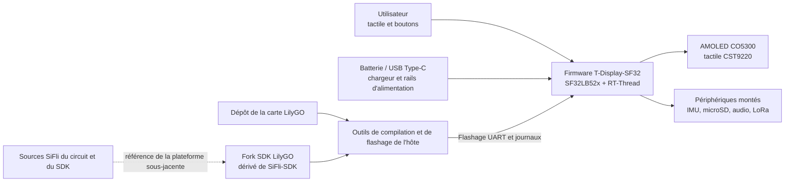

# LilyGO T-Display-SF32 { #lilygo-t-display-sf32 }

!!! warning "Projet tiers, non développé par SiFli"
    T-Display-SF32 est publié et maintenu par Xinyuan-LilyGO/LilyGO, et non par SiFli ou OpenSiFli. Pour les décisions propres à la carte (matériel, firmware et support), référez-vous aux dépôts de LilyGO. Les sources de SiFli restent la référence pour le composant SF32 et SiFli-SDK, mais cela ne signifie pas que SiFli a validé ou prend en charge cette carte LilyGO.

## Qu'est-ce que T-Display-SF32 ? { #what-is-t-display-sf32 }

[Xinyuan-LilyGO/T-Display-SF32](https://github.com/Xinyuan-LilyGO/T-Display-SF32) est une plateforme de développement bâtie autour d'un microcontrôleur SF32LB52x, d'un écran AMOLED CO5300 de 2,16 pouces et d'un contrôleur tactile CST9220. Le dépôt documente 16 Mo de Flash, 8 Mo de PSRAM, une IMU BHI260AP, un émetteur-récepteur LoRa SX1262, une interface microSD, l'audio, l'USB Type-C, la prise en charge de la recharge, le brochage de la carte, des exemples, les fichiers matériels, un répertoire de firmware d'usine et un rapport de consommation propre à la carte.

Cette combinaison permet d'évaluer un appareil portable centré sur l'affichage, un contrôleur portatif, un terminal de capteurs portable ou une IHM connectée. Il s'agit d'une référence de plateforme, pas d'un produit fini : le dépôt expose de nombreuses voies matérielles, mais l'équipe produit doit sélectionner celles qui sont pertinentes, reproduire une configuration de référence connue et effectuer les mesures sur la révision exacte de la carte. Elle doit aussi qualifier l'alimentation, la radiofréquence, la sécurité, la maintenance logicielle et la récupération.

La matrice des fonctions du dépôt distingue la carte T-SF32-Display autonome de l'extension optionnelle T-SF32-Keyboard. Le Wi-Fi (ESP32-C6), le GPS (L76K), le clavier matriciel et ses LED (TCA8418, AW21009, XL9555), le BME280, l'émetteur infrarouge et le moteur vibratoire (AW86224) nécessitent cette extension ; ne les incluez pas dans la configuration de base de la carte autonome.

## Pourquoi l'implémentation SF32 ? { #why-the-sf32-implementation }

T-Display-SF32 associe les capacités graphiques, Bluetooth, audio et basse consommation du SF32LB52x à des composants externes pour l'affichage, le tactile, la détection de mouvement, le stockage et LoRa. LilyGO fournit aussi la configuration de la carte, des pilotes dédiés, des exemples et un [fork distinct du SDK LilyGO](https://github.com/Xinyuan-LilyGO/SlFli-SDK-Lilygo), présenté comme dérivé de SiFli-SDK 2.4.0. Celui-ci peut accélérer la première mise en service de la carte par rapport à une cible générique du SDK sans modifications.

Le compromis tient à la propriété : la prise en charge de la carte, les modifications des pilotes, les révisions matérielles, le firmware fourni et la relation entre le fork LilyGO et le SiFli-SDK maintenu en amont sont gérés en dehors de SiFli. Pour garantir la reproductibilité, fixez le commit de chaque dépôt, conservez une image d'usine ou de récupération dont le fonctionnement est vérifié, et traitez toute migration vers une version plus récente du SiFli-SDK amont comme une modification technique explicite à tester.

## Résultat, portée et critères d'entrée { #outcome-scope-and-entry-criteria }

**Résultat :** établir une référence T-Display-SF32 aux versions fixées ; valider l'écran/le tactile, les périphériques sélectionnés, le comportement d'alimentation et la récupération ; reproduire une compilation depuis les sources ; puis apporter une modification limitée à l'application, avec des preuves de régression exploitables lors de la revue produit.

Cette page ne prouve pas que tous les périphériques sont montés sur chaque variante de carte, que le firmware du fournisseur est prêt pour la production, que le rapport de consommation s'applique à une autre révision ou charge de travail, ni que l'utilisation de LoRa est autorisée dans toutes les régions. Elle ne transfère pas non plus à SiFli le support du matériel ou des pilotes propres à LilyGO.

Avant de commencer, préparez :

- la carte T-Display-SF32 exacte, sa révision matérielle et son schéma ou brochage ;
- une alimentation de laboratoire limitée en courant ou une batterie protégée, avec surveillance possible de la tension et de l'état ;
- un câble USB de données vérifié, la connexion Type-C documentée pour le flashage et une image de récupération conservée ;
- les commits figés du dépôt T-Display-SF32 et du fork du SDK LilyGO ;
- l'environnement Windows/PowerShell décrit par le fork du SDK LilyGO pour la première compilation reproductible ; valider séparément les autres environnements hôte ;
- uniquement les accessoires correspondant aux interfaces visées, par exemple une carte microSD, un casque ou une charge audio, et un équipement LoRa distant opérant dans une bande autorisée ;
- un relevé des versions de firmware, journaux de compilation et de sortie série, photos, mesures de courant et résultats des essais de panne et de récupération.

<div align="center"><em>Tableau : contrat du projet T-Display-SF32</em></div>

<div align="center" markdown>

| Domaine | Référence de départ | Preuves à réunir avant adaptation |
|:-----|:------------------|:------------------------------------|
| Responsabilités | Carte, dépôt et fork du SDK LilyGO | Responsables des dépôts, commits, révision de carte et limites de prise en charge |
| Matériel | SF32LB52x, AMOLED/tactile de 2,16 pouces, mémoire externe et périphériques effectivement montés | Revue du schéma/brochage, dossier d'assemblage et inventaire des composants présents |
| Firmware | Image d'usine fournie ou exemple du dépôt non modifié | Identité de l'image, journal de flashage, journal de démarrage et résultats fonctionnels |
| Alimentation | Chemin USB/chargeur/batterie documenté par LilyGO | Limites d'alimentation, résultat de démarrage, comportement à l'arrêt et courant mesuré pour la charge de travail cible |
| Adaptation | Une seule modification d'exemple, d'interface, de capteur, de stockage, d'audio ou de radio à la fois | Modification revue, image de retour arrière et résultats complets des tests de régression |

</div>

## Spécifications matérielles et logicielles { #hardware-and-software-specifications }

### Spécification matérielle { #hardware-specification }

<div align="center"><em>Tableau : spécification matérielle de T-Display-SF32</em></div>

<div align="center" markdown>

| Composant | Spécification requise | Rôle | Statut | Où l'obtenir | Compatibilité et remarques sur les substitutions |
|:-----------|:----------------------|:-----|:-------|:-------------|:--------------------------------------------------|
| Carte T-Display-SF32 | SF32LB52x ; la configuration documentée comprend un AMOLED CO5300 de 2,16 pouces, le tactile CST9220, 16 Mo Flash, 8 Mo PSRAM, l'IMU BHI260AP, le LoRa SX1262, le microSD, un microphone et un amplificateur de haut-parleur intégrés avec prise audio de 3,5 mm, ainsi que trois boutons utilisateur | Référence intégrée pour le calcul, l'affichage, les capteurs, la radio, le stockage et l'audio | Obligatoire | [Dépôt LilyGO](https://github.com/Xinyuan-LilyGO/T-Display-SF32) ; [fichiers matériels](https://github.com/Xinyuan-LilyGO/T-Display-SF32/tree/master/hardware) | Consigner la révision exacte de la carte et les composants réellement montés ; ne pas supposer que toutes les variantes ont la même configuration |
| Extension T-SF32-Keyboard | Extension optionnelle avec Wi-Fi ESP32-C6, GPS L76K, sous-système clavier TCA8418/AW21009/XL9555, BME280, émetteur infrarouge et moteur vibratoire AW86224 | Ajoute les fonctions radio, de positionnement, de clavier, de détection environnementale, d'infrarouge et haptiques indiquées | Optionnel ; obligatoire uniquement pour ces fonctions | [Dépôt LilyGO](https://github.com/Xinyuan-LilyGO/T-Display-SF32) ; [fichiers matériels](https://github.com/Xinyuan-LilyGO/T-Display-SF32/tree/master/hardware) | Ces composants ne sont pas montés sur la carte T-SF32-Display autonome. Le Wi-Fi et le GPS partagent UART2 ; vérifier leur configuration conjointe sur l'extension |
| Connexion USB Type-C de données et alimentation contrôlée | Câble de données ; alimentation limitée en courant ou batterie protégée dont la tension peut être surveillée | Flashage, journaux et validation sûre de l'alimentation | Obligatoire | [Dépôt LilyGO](https://github.com/Xinyuan-LilyGO/T-Display-SF32) | Les lignes D+/D- du Type-C sont reliées au pont USB-UART CH343P. Ce port sert au flashage UART et aux journaux, pas à l'USB natif périphérique/hôte du SF32. Respecter aussi la condition de démarrage propre à la carte, supérieure à 3,5 V |
| Accessoires de test selon l'interface | Carte microSD, charge audio/casque ou équipement LoRa distant conforme à la bande autorisée, uniquement pour les interfaces évaluées | Tester les interfaces optionnelles de la carte | Optionnel ; à choisir selon le test | [Exemples](https://github.com/Xinyuan-LilyGO/T-Display-SF32/tree/master/examples) | Avant connexion, confirmer le connecteur, la tension, la région et la révision avec les fichiers matériels |

</div>

### Spécification logicielle { #software-specification }

<div align="center"><em>Tableau : spécification logicielle de T-Display-SF32</em></div>

<div align="center" markdown>

| Paquet ou service | Version ou révision requise | Rôle | Statut | Où l'obtenir | Compatibilité et remarques de mise à jour |
|:------------------|:---------------------------|:-----|:-------|:-------------|:-----------------------------------------|
| Firmware/code source T-Display-SF32 | Figer et consigner un commit ; l'amont ne définit pas de tag universel | Exemples, configuration et firmware de la carte | Obligatoire | [Dépôt](https://github.com/Xinyuan-LilyGO/T-Display-SF32) | Conserver le firmware d'usine et consigner ensemble la révision de la carte et le commit |
| Fork LilyGO de SiFli-SDK | Figer un commit du fork, présenté comme basé sur SiFli-SDK 2.4.0 | Support de la carte, pilotes, compilation et téléchargement | Obligatoire | [Fork LilyGO](https://github.com/Xinyuan-LilyGO/SlFli-SDK-Lilygo) | La mention d'une base 2.4.0 ne désigne pas une révision exacte du fork ; ne pas le remplacer silencieusement par le SDK amont |
| SCons et outils de téléchargement sur l'hôte | Versions fournies par le fork choisi ; consigner l'OS et les versions effectivement utilisées | Compiler et flasher la cible `t-display-sf32_hcpu` | Obligatoire | [Fork LilyGO](https://github.com/Xinyuan-LilyGO/SlFli-SDK-Lilygo) | La procédure initiale documentée utilise Windows/PowerShell ; qualifier les autres hôtes séparément |
| Firmware d'usine V1.2 | Image correspondant à la révision de carte et du dépôt | Référence intacte et récupération | Optionnel, mais à conserver avant toute modification | [Répertoire du firmware d'usine](https://github.com/Xinyuan-LilyGO/T-Display-SF32/tree/master/firmware/T-SF32-Factory-V1.2) | Le nom du répertoire ne prouve pas la compatibilité image/carte ; la vérifier avant le flashage |

</div>

## Choisir une configuration de référence prise en charge { #choose-a-supported-baseline }

Le dépôt maintenu en amont utilise actuellement la branche `master` et ne désigne aucun tag comme référence logicielle universelle. Notez le commit exact au lieu d'indiquer « latest ». Le dépôt contient un répertoire `firmware/T-SF32-Factory-V1.2`, mais son nom ne remplace pas l'enregistrement de la révision de carte correspondante, du commit du dépôt et de la procédure de flashage.

<div align="center"><em>Tableau : choix de la référence T-Display-SF32</em></div>

<div align="center" markdown>

| Élément de référence | Point de départ recommandé | Limite importante |
|:-----------------|:------------------|:--------------------|
| Carte | Une unité T-Display-SF32 photographiée et identifiée par sa révision | Ne pas supposer que le brochage ou les périphériques montés correspondent à une autre révision ou variante liée au clavier |
| État d'usine | Répertoire Factory V1.2 fourni ou compilation `menu_app` intacte, selon l'unité | Vérifier la provenance et la compatibilité avant le flashage ; conserver l'image d'origine |
| Sources | Commit fixe du dépôt T-Display-SF32 | Le dépôt évolue indépendamment de SiFli-SDK |
| SDK | Commit figé du fork du SDK LilyGO, présenté comme dérivé de SiFli-SDK 2.4.0 | Ne pas le remplacer silencieusement par une autre révision du SDK ; les pilotes et la configuration de la carte peuvent différer |
| Cible de compilation | `t-display-sf32_hcpu` | Cible de carte LilyGO, et non cible générique SF32LB52x |
| Mise sous tension | Respecter la condition de démarrage de LilyGO, supérieure à 3,5 V, et implémenter dans le firmware personnalisé la détection de tension et l'arrêt sur batterie faible | À traiter comme une exigence fournisseur à vérifier, et non comme un substitut à la fiche technique du circuit intégré, aux limites de la batterie ou au comportement mesuré en sous-tension (brownout) |

</div>

Après configuration de l'environnement requis, le README de T-Display-SF32 documente ce parcours de compilation et de flashage sous Windows :

```powershell
cd T-Display-SF32\examples\rt_os\rt_driver\project
scons --board=t-display-sf32_hcpu -j8
build_t-display-sf32_hcpu\uart_download.bat
```

Conservez les commits réels des dépôts et du SDK, le résultat d'export de l'environnement, le journal complet de compilation, les images générées ainsi que les journaux de flashage et de démarrage. Le nombre de tâches parallèles peut varier, mais pas la cible ni les révisions des sources.

## Étapes du projet { #delivery-map }

<div align="center"><em>Tableau : étapes du projet T-Display-SF32</em></div>

<div align="center" markdown>

| Étape | Décision qu'elle étaye | Résultat attendu |
|:------|:---------------------|:----------------|
| 1. Référence fournisseur | La carte et le firmware non modifiés fonctionnent-ils comme identifiés ? | Session de référence validée, photographiée et associée à des versions fixes |
| 2. Validation des périphériques et de la récupération | Les interfaces, états d'alimentation et pannes sélectionnés sont-ils observables et récupérables ? | Rapport d'injection de pannes, de mesures et de récupération |
| 3. Reproduction des sources | L'équipe peut-elle reconstruire et flasher le même comportement depuis des sources propres ? | Environnement, image, journal de flash et résultat reproductible |
| 4. Adaptation contrôlée | Peut-on modifier une fonction produit sans casser la référence ? | Modification limitée, voie de retour arrière et preuves de régression |
| 5. Revue produit | La plateforme tierce convient-elle à la poursuite du prototypage ou à un matériel personnalisé ? | Risques attribués et décision de poursuivre, différer ou arrêter |

</div>

## Architecture système et dépendances { #system-architecture-and-dependencies }

<div align="center"><em>Figure : périmètres produit et développement de T-Display-SF32</em></div>



Distinguez les domaines de panne : alimentation/charge de la carte, démarrage et flashage, écran/tactile, chaque périphérique sélectionné, prise en charge de la carte par LilyGO et SDK sous-jacent. Un exemple d'affichage qui échoue peut être lié à l'alimentation, à la révision de carte, à la configuration de la dalle/du tactile, à l'application ou à une incompatibilité entre SDK et pilote ; « le SDK est en panne » ne constitue pas un diagnostic suffisant.

## Étape 1 — Établir la référence fournisseur intacte { #stage-1-establish-the-untouched-vendor-baseline }

**Objectif :** établir le comportement réel de la carte reçue et de la référence fournisseur avant toute modification des sources.

1. Photographiez les deux faces de la carte et notez ses références, les périphériques montés, l'écran et le tactile, la mémoire, les commutateurs, les connecteurs et le commit du dépôt.
2. Vérifiez la source d'alimentation et la polarité. LilyGO indique que le démarrage nécessite plus de 3,5 V ; utilisez une alimentation surveillée et ne testez pas avec une cellule profondément déchargée.
3. Ne flashez qu'une référence connue comme compatible avec la carte ou, si sa provenance est connue, commencez par exécuter le firmware présent. Conservez l'image d'origine lorsque les outils le permettent.
4. Testez le menu affiché sur l'appareil ou les exemples intacts pour l'écran/le tactile et chaque périphérique prévu pour le produit. Signalez les fonctions indisponibles ou non montées sans les considérer comme des pannes.
5. Effectuez deux démarrages à froid et conservez les journaux de démarrage, photos de l'interface, résultats tactiles/des entrées et une trace de courant pour un scénario veille/activité clairement défini.

**Preuves à conserver :** révision de la carte et photos, identité du dépôt/de l'image, détails de l'alimentation et de la batterie, journaux de flash et de démarrage, inventaire des composants montés, résultats fonctionnels et conditions des mesures de courant.

**Critère de sortie du point de contrôle 1 :** deux démarrages à froid reproduisent la référence d'affichage/tactile identifiée ; le résultat de chaque périphérique monté dans le périmètre est consigné, et l'image d'origine ou une image de référence peut être restaurée.

## Étape 2 — Valider les limites des périphériques, de l'alimentation et de la récupération { #stage-2-validate-peripheral-power-and-recovery-boundaries }

**Objectif :** déterminer si les pannes peuvent être détectées et récupérées sans utilisation dangereuse de la batterie ni nouveau flashage non documenté.

<div align="center"><em>Tableau : tests de panne et de récupération de T-Display-SF32</em></div>

<div align="center" markdown>

| Test | Méthode | Preuve de réussite |
|:-----|:-------|:--------------|
| Marge de démarrage | Faire varier une alimentation de laboratoire limitée en courant autour de la plage visée sans dépasser les limites documentées | Les seuils et comportements de démarrage/arrêt sont mesurés ; les réinitialisations répétées ou états indéfinis ne sont pas masqués |
| Politique batterie faible | Utiliser une alimentation contrôlée pour tester les seuils d'avertissement et d'arrêt | Le firmware personnalisé avertit et arrête l'appareil avant la limite de décharge sûre de la batterie sélectionnée |
| Charge à l'arrêt | Après l'arrêt par le firmware d'usine, brancher l'USB et utiliser le réveil par bouton documenté | État de charge et réveil par bouton seul conformes à la note fournisseur ; l'insertion USB seule n'est pas considérée à tort comme un démarrage |
| Interruption écran/tactile | Réinitialiser ou couper/remettre sous tension pendant l'activité de l'interface et refaire les tests tactiles sur les bords et les coins | L'écran et le tactile reviennent à un état connu sans corruption persistante ni fausse entrée |
| Stockage amovible | Retirer, corrompre ou remplacer la carte de test uniquement à des moments contrôlés | Les états carte absente/en erreur sont diagnostiquables ; l'application ne corrompt pas d'autres données et ne se bloque pas |
| Parcours LoRa | Utiliser un équipement distant dans une bande autorisée et un montage RF contrôlé | La fréquence et la configuration sont consignées ; le délai d'expiration et la reconnexion sont observables ; aucune portée n'est affirmée sans mesure |
| Récupération après flashage | Interrompre un flashage de test uniquement sur une unité récupérable, puis utiliser le parcours Type-C/UART documenté | L'image de référence conservée est restaurée avec les outils et étapes consignés |

</div>

**Critère de sortie du point de contrôle 2 :** chaque test applicable possède un résultat répétable et un parcours de récupération ; tout firmware personnalisé protège contre la batterie faible, et aucune panne non résolue ne peut endommager la batterie ou bloquer la carte sans procédure de récupération documentée.

## Étape 3 — Établir une base de code reproductible { #stage-3-build-a-reproducible-source-baseline }

**Objectif :** permettre à un second ingénieur de reconstruire et flasher la même référence à partir de sources propres et figées.

1. Récupérez les commits figés du dépôt de la carte et du fork du SDK LilyGO ; notez la version de base du SiFli-SDK amont déclarée par le fork.
2. Configurez l'environnement PowerShell documenté et compilez `t-display-sf32_hcpu` depuis un répertoire propre.
3. Conservez les preuves relatives à l'environnement, aux dépendances, à la configuration, à la mémoire/aux partitions, à l'image, au flashage et aux journaux série.
4. Recommencez sur une autre machine ou après suppression de tous les résultats de compilation, puis exécutez la régression complète de l'étape 2.

**Critère de sortie du point de contrôle 3 :** aucun ancien fichier image, fichier de carte non suivi ni remplacement SDK non documenté n'est nécessaire pour produire un firmware qui réussit l'étape 2.

## Étape 4 — Adapter un chemin produit à la fois { #stage-4-adapt-one-product-path-at-a-time }

**Objectif :** apporter une modification utile tout en préservant les références fournisseur et de récupération qui fonctionnent.

<div align="center"><em>Tableau : ordre des adaptations contrôlées de T-Display-SF32</em></div>

<div align="center" markdown>

| Catégorie de changement | Première modification conseillée | Régression requise |
|:-------------|:------------------|:--------------------|
| Interface | Une page, une icône, une police ou une action tactile | Démarrage à froid, rafraîchissement plein écran, limites tactiles, mémoire utilisée et récupération |
| Capteur | Une valeur ou un événement de l'IMU | Identité du composant, plage, fréquence d'échantillonnage, gestion d'erreur, courant au repos et réveil |
| Stockage/audio | Une opération sur fichier ou un parcours de lecture audio | Média absent, données mal formées, limites de volume/sortie, coupure d'alimentation et récupération du système de fichiers |
| LoRa | Un échange de paquets limité dans une bande autorisée | Configuration consignée, timeout, tentatives, courant, coexistence et revue réglementaire |
| Alimentation | Une modification de veille/réveil ou de commande des rails | Toutes les sources de réveil, état écran/périphériques, arrêt sur batterie faible, charge et cycles répétés |
| Migration SDK | Une version candidate du fork LilyGO ou du SiFli-SDK amont | Comparaison de la configuration de la carte, compilation propre, régression de chaque périphérique, mesures de courant et retour arrière |

</div>

**Critère de sortie du point de contrôle 4 :** le changement est relu, l'image d'origine reste restaurable et tous les tests applicables d'affichage, de tactile, de périphériques, d'alimentation, de flash et de récupération réussissent.

## Étape 5 — Revue de préparation produit { #stage-5-product-readiness-review }

Avant de lancer un essai terrain ou de concevoir un circuit imprimé personnalisé, répondez aux questions suivantes :

- Qui est responsable des fichiers de carte, du fork SDK LilyGO, des correctifs de pilotes, des mises à jour de sécurité et de la migration vers les futures versions de SiFli-SDK ?
- Quelles révisions de carte et quels périphériques montés définissent la référence produit, et comment les unités reçues seront-elles identifiées et testées ?
- Quels sont les courants mesurés en activité, au repos, en veille, au démarrage et à l'arrêt pour la luminosité d'affichage, le rapport cyclique radio, le stockage et la configuration de capteurs prévus ?
- Comment vérifier la protection et la charge de la batterie, le comportement thermique, le boîtier, l'accès aux connecteurs et la récupération lorsque l'appareil est éteint ?
- Quelle région LoRa, antenne, plan de fréquence, paramètres d'émission et obligations réglementaires s'appliquent ?
- Les fichiers matériels, le firmware, le fork SDK, les exemples, les ressources et composants tiers ont-ils des licences compatibles avec la distribution envisagée ?
- L'équipe accepte-t-elle de dépendre d'un prototype tiers, ou a-t-elle qualifié un fork maîtrisé et un plan de support ?

**Critère de sortie du point de contrôle 5 :** chaque risque résiduel a un responsable, des preuves et une décision de traitement ; l'équipe a explicitement décidé de poursuivre, différer ou arrêter.

## Passage à la conception du produit { #handoff-to-product-design }

Transmettez à l'étape suivante la référence SF32 exacte et les mémoires, les temporisations de l'écran et du tactile, les périphériques montés et leurs bus, l'arbre d'alimentation, le chargeur et la politique batterie, la stratégie antenne/RF, les connexions de démarrage et de flashage, le plan de partitions, les accès aux tests de production, la responsabilité du fork logiciel et le parcours de récupération validé. Poursuivez avec le [parcours d'intégration SF32LB52x](../sf32-products/chips/SF32LB52x.md#integration-path), le [guide de conception matérielle SF32LB52x](../hardware/chip-guides/SF32LB52x_hardware_design_guide.md), [SiFli-SDK : compiler, flasher et surveiller la sortie série](../develop/platforms/sifli-sdk/build-flash-monitor.md) et [Conception pour la production](../hardware/design-for-production.md).

## Sources de référence { #authoritative-sources }

- [Dépôt Xinyuan-LilyGO/T-Display-SF32](https://github.com/Xinyuan-LilyGO/T-Display-SF32)
- [README en chinois de T-Display-SF32](https://github.com/Xinyuan-LilyGO/T-Display-SF32/blob/master/readme_cn.md)
- [Exemples T-Display-SF32](https://github.com/Xinyuan-LilyGO/T-Display-SF32/tree/master/examples)
- [Fichiers matériels de T-Display-SF32](https://github.com/Xinyuan-LilyGO/T-Display-SF32/tree/master/hardware)
- [Mesures de consommation de T-Display-SF32](https://github.com/Xinyuan-LilyGO/T-Display-SF32/tree/master/lowpowertest)
- [Dépôt Xinyuan-LilyGO/SlFli-SDK-Lilygo](https://github.com/Xinyuan-LilyGO/SlFli-SDK-Lilygo)
- [OpenSiFli/SiFli-SDK](https://github.com/OpenSiFli/SiFli-SDK)
