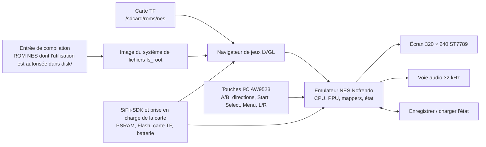

# Console de jeu portable Pocket Pi SF32 { #pocket-pi-sf32-handheld-game-console }

!!! note "Commit de référence figé"
    Sauf indication contraire, les comportements décrits à partir du code correspondent au commit PocketPi [`7d9fac2`](https://github.com/SiFliSparks/PocketPi/commit/7d9fac2cb577d6c9b66a99521aebf3c9de0ae163). La branche amont `main` peut évoluer ; pour reproduire ces détails, récupérez le commit figé.

## Qu'est-ce que Pocket Pi ? { #what-is-pocket-pi }

[SiFliSparks/PocketPi](https://github.com/SiFliSparks/PocketPi) est une référence de console de jeu portable et d'émulateur pour SF32LB52. La révision figée intègre l'émulateur NES Nofrendo, un navigateur de jeux LVGL, une chaîne d'affichage 320 × 240 ST7789 sur bus 8080, l'audio, la sauvegarde et le chargement d'état, un système de fichiers embarqué et un répertoire de ROM sur carte TF. Sa base de compilation publique utilise la cible Huangshan Pi / `sf32lb52-lchspi-ulp`.

Ce projet permet d'évaluer la coexistence des graphismes locaux, des entrées, de l'audio, du stockage externe, de l'allocation PSRAM et de la charge de l'émulateur sur un système SF32LB52. Le dépôt ne fournit pas de ROM commerciales : les utilisateurs doivent apporter des fichiers `.nes` ou `.NES` qu'ils sont autorisés à utiliser. Le code public ne constitue pas non plus une conception complète de console portable prête pour la production et ne remplace pas l'évaluation de la sécurité de la batterie, de l'audio, de la CEM, du comportement thermique, des licences ou de la distribution des contenus.


<div align="center"><em>Pocket Pi exécute un jeu NES sur SF32LB52</em></div>

## Pourquoi l'implémentation SF32 ? { #why-the-sf32-implementation }

L'émulation NES réunit plusieurs contraintes embarquées dans un même scénario concret : émulation CPU, graphisme PPU, échantillonnage audio, entrées à faible latence, lecture de fichiers, tampon d'image et sauvegardes doivent fonctionner de concert. Un système basé sur SF32LB52 fournit les ressources d'affichage, audio, stockage externe et PSRAM nécessaires à ce scénario ; Huangshan Pi offre aussi une plateforme d'évaluation alimentée par batterie.

Cela ne signifie pas que tous les jeux NES sont entièrement compatibles. La prise en charge des mappers ROM, la fréquence d'image, l'audio, le comportement des sauvegardes, le pic de mémoire et la latence des entrées peuvent varier d'un jeu à l'autre. Chaque ROM ou mapper ajouté nécessite une vérification spécifique de compatibilité et de droits d'auteur.

## Résultat, portée et critères d'entrée { #outcome-scope-and-entry-criteria }

**Résultat attendu :** produire une image reproductible à partir du commit PocketPi figé dans la spécification logicielle, démarrer au moins une ROM de test dont l'utilisation est autorisée, valider l'écran, les entrées, l'audio, la pause, la sauvegarde et le chargement d'état, la sortie et la récupération, puis réaliser une adaptation de portée limitée.

Cette page ne garantit pas la prise en charge de tous les mappers NES, du minutage PAL/NTSC, de la chaîne audio utilisée par chaque jeu, des formats de sauvegarde ou des ROM tierces. Elle n'accorde aucun droit de copie ou de distribution des contenus de jeu. Dans la révision figée, le dépôt ne contient pas de fichier de licence à sa racine ; avant d'intégrer le code à un produit ou de distribuer des binaires, il faut établir les licences de PocketPi, de Nofrendo et de chaque composant tiers intégré.

Avant de commencer, préparez :

- [SF32LB52-DevKit-ULP / Huangshan Pi](../sf32-products/devkits/SF32LB52-DevKit-ULP.md), ou un matériel conforme à la définition de carte `sf32lb52-lchspi-ulp` du dépôt ;
- l'écran 320 × 240, l'expandeur d'entrées I²C AW9523, les boutons, l'audio et la prise en charge optionnelle de la carte TF attendus par le code source figé. Le nom de la carte ne prouve pas à lui seul que tous les périphériques sont montés ;
- SiFli-SDK, SCons, un outil de flashage par UART et des outils de journalisation ;
- une ROM `.nes` de test créée par vos soins, appartenant au domaine public ou correctement licenciée ;
- la ROM dans `disk/` du dépôt pour le système de fichiers intégré ou dans le répertoire ROM de la carte TF configuré par le firmware. La révision figée recherche les ROM à l'exécution dans `/sdcard/roms/nes` ; vérifiez dans cette révision que le chemin correspond au point de montage de la carte ;
- un moyen d'observer le comportement des images, l'audio, les entrées, la mémoire et le courant.

<div align="center"><em>Tableau : base figée de Pocket Pi et preuves avant adaptation</em></div>

<div align="center" markdown>

| Domaine | Base du code source figée | Éléments requis avant adaptation |
|:-----|:------------------------|:------------------------------------|
| Carte | `sf32lb52-lchspi-ulp` | Révisions de la carte, de l'expandeur, de l'écran, de l'audio, du stockage et de l'alimentation |
| Contenu | Dans la révision figée, l'explorateur de jeux ne détecte que les fichiers `.nes` et `.NES` ; un fichier `.jpg` de même nom peut servir de jaquette | Provenance et licence de la ROM, empreinte du fichier, mapper et provenance de l'illustration |
| Stockage | Convertit `disk/` en `fs_root` ; recherche aussi `/sdcard/roms/nes` à l'exécution | Image du système de fichiers, format de la carte TF, répertoire et compte rendu de récupération après erreur |
| Entrées | Dans la révision figée, le code lit A/B, les directions, Start, Select, Menu, L/R et les touches associées via un expandeur I²C AW9523 | Schéma/affectation des broches, matrice complète des touches et résultats des appuis simultanés |
| Émulateur | Cœur NES Nofrendo, écran, audio à 32 kHz, sauvegarde et chargement d'état | Compatibilité du jeu, cadence d'affichage et audio, état, mémoire et preuves après reset |

</div>

## Spécifications matérielles et logicielles { #hardware-and-software-specifications }

### Spécification matérielle { #hardware-specification }

<div align="center"><em>Tableau : spécification matérielle de Pocket Pi</em></div>

<div align="center" markdown>

| Composant | Spécification requise | Rôle | Statut | Où l'obtenir | Compatibilité et remarques sur les substitutions |
|:-----------|:----------------------|:-----|:-------|:-------------|:--------------------------------------------------|
| Base Huangshan Pi / SF32LB52-DevKit-ULP | Cible `sf32lb52-lchspi-ulp` ; le code PocketPi de la révision figée attend un écran 320 × 240 ST7789, un expandeur d'entrée I²C AW9523, l'audio et une interface pour carte TF | Exécuter l'émulateur et ses fonctions d'affichage, d'entrée, audio et de stockage | Obligatoire | [Référence de la carte μForge](../sf32-products/devkits/SF32LB52-DevKit-ULP.md) ; [page LCKFB](https://lckfb.com/project/detail/lckfb-hspi-sf32lb52-ulp?param=baseInfo) ; [sources du projet](https://github.com/SiFliSparks/PocketPi) | Confirmer l'assemblage et les périphériques exacts ; le nom de la cible ne prouve pas l'équivalence d'une autre carte |
| Carte TF | Carte et système de fichiers lisibles par le firmware ; le répertoire de recherche utilisé à l'exécution dans la révision figée est `/sdcard/roms/nes` | Stockage externe optionnel des ROM | Optionnel | [Sources PocketPi](https://github.com/SiFliSparks/PocketPi) | Vérifier le point de montage, le format, le retrait à chaud et la récupération pour la révision figée |
| Hôte de compilation et câble USB de données | Hôte pouvant exécuter la chaîne d'outils SiFli-SDK choisie ; câble de données adapté à la procédure documentée de téléchargement/débogage de la carte | Compiler, flasher et recueillir les journaux série | Obligatoire | [Démarrage rapide de SiFli-SDK](https://docs.sifli.com/projects/sdk/latest/sf32lb52x/quickstart/index.html) | Consigner le système et l'architecture de l'hôte, le câble/l'adaptateur, le port et la procédure de récupération ; un câble de charge seule ne convient pas |

</div>

!!! warning "Huangshan Pi n'est pas une configuration périphérique directement compatible confirmée"
    Le [guide SiFli de Huangshan Pi](https://wiki.sifli.com/en/board/sf32lb52x/SF32LB52-%E9%BB%84%E5%B1%B1%E6%B4%BE.html) décrit un écran AMOLED de 1,85 pouce, 390 × 450, à interface Quad-SPI, ainsi que les boutons de fonction et d'alimentation de la carte. Le code PocketPi de la révision figée attend plutôt une chaîne d'affichage 320 × 240 ST7789 sur bus 8080 et des entrées AW9523 sur I²C. Le guide officiel de la carte ne confirme pas que l'assemblage décrit comprend ces périphériques compatibles. Vérifiez l'écran, l'adaptateur et le matériel d'entrée réellement utilisés, ou portez les fonctions logicielles correspondantes et répétez les essais de non-régression de l'affichage et des entrées avant de considérer cette cible comme utilisable sans adaptation.

### Spécification logicielle { #software-specification }

<div align="center"><em>Tableau : spécification logicielle de Pocket Pi</em></div>

<div align="center" markdown>

| Paquet ou service | Version ou révision requise | Rôle | Statut | Où l'obtenir | Compatibilité et remarques de mise à jour |
|:------------------|:---------------------------|:-----|:-------|:-------------|:-----------------------------------------|
| SiFliSparks/PocketPi | Commit vérifié [`7d9fac2`](https://github.com/SiFliSparks/PocketPi/commit/7d9fac2cb577d6c9b66a99521aebf3c9de0ae163) | Application, intégration de Nofrendo, image du système de fichiers et cible de carte | Obligatoire | [Dépôt](https://github.com/SiFliSparks/PocketPi) | Gérer séparément les licences et sommes de contrôle du code source et des ROM |
| OpenSiFli/SiFli-SDK | Cet article ne fixe pas de commit ; choisir et consigner une révision compatible | RTOS, support de carte, pilotes, compilation SCons et outils de téléchargement | Obligatoire | [Dépôt](https://github.com/OpenSiFli/SiFli-SDK) | Ne pas supposer que `main` est compatible ; consigner ensemble les commits de l'application et du SDK |
| Environnement SCons et outils de téléchargement UART | Versions compatibles avec la révision choisie de SiFli-SDK | Compiler et flasher `sf32lb52-lchspi-ulp` | Obligatoire | [Démarrage rapide SiFli-SDK](https://docs.sifli.com/projects/sdk/latest/sf32lb52x/quickstart/index.html) | Consigner l'OS, la configuration du SDK, le journal de compilation et le script de téléchargement généré |
| ROM de test | Fichier `.nes`/`.NES` choisi par l'utilisateur et dont l'utilisation est autorisée ; consigner le mapper et le SHA-256 | Vérifier la détection, le décodage, l'émulation et l'audio | Contenu de test obligatoire | PocketPi ne publie pas de ROM à télécharger ; fournissez un fichier dont les droits sont établis et consultez les [sources du projet](https://github.com/SiFliSparks/PocketPi) | Tester la compatibilité pour chaque jeu et mapper ; suivre les droits et le hash séparément du code du projet |
| Jaquette | Fichier `.jpg` optionnel portant le même nom de base que la ROM ; consigner l'origine, les droits et le SHA-256 | Tester le décodage de la jaquette et l'image de repli du navigateur | Optionnel | Fournie par l'utilisateur ; PocketPi ne publie pas de jaquettes. Consulter les [sources du projet](https://github.com/SiFliSparks/PocketPi) | Ne placer dans `disk/` que des images redistribuables ; consigner leur provenance et leur hash |

</div>

## Choisir une configuration de référence prise en charge { #choose-a-supported-baseline }

Utilisez la révision PocketPi figée dans la spécification logicielle, plutôt que de compiler le commit qui se trouve actuellement en tête de `main` :

```bash
git clone https://github.com/SiFliSparks/PocketPi.git
cd PocketPi
git checkout 7d9fac2cb577d6c9b66a99521aebf3c9de0ae163
cd project
scons --board=sf32lb52-lchspi-ulp -j8
```

Le script de compilation transforme `../disk` en image de système de fichiers et l'intègre au firmware sous le nom `fs_root`. Sous Windows, le fichier généré `build_sf32lb52-lchspi-ulp_hcpu\uart_download.bat` fournit la procédure de flashage. Sur les autres systèmes, utilisez l'outil de flashage SiFli-SDK correspondant et consignez les paramètres équivalents.

<div align="center"><em>Tableau : choix de la base Pocket Pi</em></div>

<div align="center" markdown>

| Élément | Base de référence | Limite importante |
|:--------|:----------------|:--------------------|
| ROM | Commencez par un petit fichier ROM `.nes` ou `.NES`, dont l'utilisation est autorisée et le mapper connu | Dans la révision figée, le scanner n'accepte que `.nes` et `.NES` ; la présence dans la liste ne prouve pas la compatibilité avec l'émulateur |
| Jaquette | Fichier `.jpg` optionnel, de même nom et dans le même répertoire | En cas d'échec du décodage, l'image par défaut doit s'afficher sans bloquer la liste des jeux |
| Écran | Dans la révision figée, l'interface est en 320 × 240 et le code source sélectionne une rotation de 270° | Tout autre écran LCD ou toute autre orientation impose une campagne complète de non-régression écran/entrées |
| Entrées | Respectez le mappage AW9523 de `input.c` et `input.h` dans la révision figée | La section du README décrivant le GPIO direct, neuf touches et les combinaisons avec Select est obsolète |
| Sauvegarde d'état | Utilisez les actions Save State / Load State du menu pause | L'intégrité après coupure, le format des emplacements et la compatibilité entre versions restent à démontrer |

</div>

!!! warning "La description des entrées du README ne correspond pas au code figé"
    Le README décrit `key_pin_def[]`, un balayage GPIO à 200 Hz et des combinaisons avec la touche Select. Le code de la révision figée lit les touches au moyen d'un expandeur I²C AW9523 à l'adresse `0x5B` ; Menu ouvre un écran pause avec Save State, Load State et Exit Game, tandis que L/R règlent le décalage audio. La reproduction et la conception matérielle doivent suivre le code figé et le schéma, et non l'ancien tableau GPIO.

## Étapes du projet { #delivery-map }

<div align="center"><em>Tableau : étapes du projet Pocket Pi</em></div>

<div align="center" markdown>

| Étape | Décision éclairée | Résultat requis |
|:------|:---------------------|:----------------|
| 1. Base intacte | Le matériel cible peut-il répertorier et exécuter une ROM dont l'utilisation est autorisée ? | Versions, compilation, ROM, démarrage, écran et audio consignés |
| 2. Interaction et récupération | Les entrées, la pause, les sauvegardes, le chargement, la sortie et le reset sont-ils fiables ? | Rapport fonctionnel et de récupération des pannes au niveau du jeu |
| 3. Reproduction des sources | Un autre ingénieur peut-il reconstruire le même système de fichiers et la même image ? | Compilation aux versions verrouillées, empreintes des artefacts et résultat reproductible |
| 4. Adaptation contrôlée | Peut-on modifier une ROM, l'interface ou le matériel sans casser la base ? | Modification, licence du contenu, performances et résultats de non-régression |
| 5. Revue produit | La référence justifie-t-elle un matériel portable spécifique et une stratégie de contenu ? | Décision relative à la compatibilité, aux licences, à l'alimentation et aux risques |

</div>

## Architecture système et dépendances { #system-architecture-and-dependencies }

<div align="center"><em>Figure : chemin d'exécution de Pocket Pi</em></div>



Les principaux domaines de panne sont le système de fichiers/ROM, le mapper/émulateur, la PSRAM/mémoire, l'écran et le minutage des images, les entrées AW9523, l'audio, les sauvegardes et l'alimentation/reset. Face à un écran noir, déterminez d'abord si la ROM n'a pas été détectée, si la jaquette n'a pas été décodée, si le mapper n'est pas pris en charge, si l'allocation du framebuffer a échoué ou si la voie LCD est en panne ; ne signalez pas simplement une « panne de l'émulateur ».

## Étape 1 — Établir la référence de jeu intacte { #stage-1-establish-the-untouched-game-baseline }

**Objectif :** utiliser une ROM de test dont l'utilisation est autorisée pour vérifier tout le chemin, de l'entrée de compilation au jeu en cours d'exécution.

1. Verrouillez les commits de PocketPi et de SiFli-SDK, ainsi que les révisions de la carte et des périphériques.
2. Placez une ROM `.nes` autorisée dans `disk/` ; si vous ajoutez une jaquette, utilisez un fichier `.jpg` de même nom. Conservez l'empreinte, la provenance et le mapper de la ROM.
3. Effectuez une compilation propre et vérifiez que `fs_root` est généré et inclus dans les artefacts destinés au flashage.
4. Flashez le firmware, puis démarrez à froid. Vérifiez que le jeu apparaît dans la liste, que sa jaquette ou l'image par défaut s'affiche et que le jeu se lance.
5. Consignez le temps de démarrage, la stabilité vidéo, la réponse des touches, l'audio et les journaux série ; réinitialisez ensuite et recommencez.

**Éléments à conserver :** commits du dépôt et du SDK, carte et périphériques, empreinte/licence de la ROM, journal de compilation, image du système de fichiers, journaux de flashage et série, photos de la liste et du jeu en cours d'exécution.

**Critère de sortie du point de contrôle 1 :** deux démarrages à froid affichent et exécutent la même ROM ; l'écran, les directions/A/B/Start/Select de base et l'audio se comportent de manière reproductible.

## Étape 2 — Valider l'entrée, l'état et la récupération après erreur { #stage-2-validate-input-state-and-fault-recovery }

**Objectif :** transformer « le jeu démarre » en une base de console portable vérifiable.

<div align="center"><em>Tableau : validation fonctionnelle de Pocket Pi</em></div>

<div align="center" markdown>

| Test | Méthode | Critère de réussite |
|:-----|:-------|:--------------|
| Ensemble de touches | Tester séparément A, B, les directions, Start, Select, Menu, L et R, ainsi que les combinaisons nécessaires | Aucune touche bloquée, inversée ou répétée sans raison ; mappage conforme au code source figé |
| Écran pause | Appuyer sur Menu en cours de jeu et tester retour, Save State, Load State et Exit Game | Le focus, la pause/reprise et la sortie sont reproductibles |
| Sauvegarde/chargement d'état | Sauvegarder dans une scène identifiable, modifier l'état du jeu, puis charger l'état sauvegardé | L'état attendu est restauré ; le fichier et l'emplacement de sauvegarde sont traçables |
| Systèmes de fichiers | Tester un `disk/` vide, une extension invalide, une ROM endommagée, un JPG absent/endommagé et une carte TF indisponible | L'interface ne plante pas ; les journaux série permettent le diagnostic ; l'image par défaut et le système de fichiers racine restent utilisables |
| Reset et alimentation | Réinitialiser ou couper l'alimentation pendant le jeu, la pause, avant/après une sauvegarde et dans les listes | Le système de fichiers reste intact ; l'appareil revient à une liste récupérable ou signale explicitement une panne |
| Endurance | Exécuter un jeu représentatif pendant une durée prolongée | Pas de croissance continue de mémoire, de dégradation audio/vidéo, de perte d'entrée ni de hausse anormale de température |

</div>

**Critère de sortie du point de contrôle 2 :** entrées, écran, audio, pause, sauvegarde, chargement, sortie et reset sont documentés pour la ROM sélectionnée ; chaque panne est rattachée à un domaine défini.

## Étape 3 — Établir une base reproductible pour le code source et le contenu { #stage-3-build-a-reproducible-source-and-content-baseline }

**Objectif :** permettre à un autre ingénieur de reconstruire le même firmware et la même image de contenu.

1. Consignez les révisions de PocketPi, de SiFli-SDK et de tout cœur tiers.
2. Créez un manifeste `disk/` indiquant les noms de fichiers, empreintes, provenances et licences de chaque ROM et jaquette. Ne versionnez pas les ROM que vous n'êtes pas autorisé à redistribuer.
3. Compilez depuis un répertoire de sortie vide et conservez `fs_root`, le firmware, les sorties mémoire/partition, le script de flashage et les empreintes.
4. Recompilez sur un second ordinateur ou dans un répertoire propre et répétez les principaux tests de l'étape 2.

**Critère de sortie du point de contrôle 3 :** les manifestes des sources et contenus permettent de reproduire une image aux empreintes identiques ou aux différences expliquées, sans fichier local non documenté.

## Étape 4 — Adapter une variable à la fois { #stage-4-adapt-one-variable-at-a-time }

**Objectif :** mesurer les limites de l'émulateur, du contenu et du matériel.

<div align="center"><em>Tableau : ordre des adaptations contrôlées de Pocket Pi</em></div>

<div align="center" markdown>

| Type de modification | Première modification conseillée | Tests de non-régression requis |
|:-------------|:------------------|:--------------------|
| Contenu | Ajouter une ROM dont l'utilisation est autorisée et, en option, sa jaquette | Détection, mapper, démarrage, image/audio, entrées, sauvegarde et licence |
| Interface de la liste | Modifier police, jaquette, tri ou message de liste vide | Mémoire, défilement, image par défaut, noms de fichiers longs et JPG endommagé |
| Entrées | Modifier un mappage AW9523 ou la disposition physique | Toutes les touches, entrées simultanées, menu, panne I²C et démarrage |
| Écran | Modifier l'orientation, le LCD ou la stratégie de framebuffer | Géométrie 320 × 240, minutage d'image, déchirure, mémoire et récupération à la sortie |
| Audio | Modifier le volume, le réglage Audio Shift ou le matériel de sortie | Voie 32 kHz, distorsion, sous-alimentation du tampon audio, concurrence écran/stockage et sourdine |
| Stockage | Modifier le répertoire de la carte TF ou la politique des fichiers d'état | Limites du branchement à chaud, corruption, coupure, support plein et solution de repli |

</div>

**Critère de sortie du point de contrôle 4 :** la modification et les droits sur le contenu sont vérifiés, l'image d'origine peut être restaurée et tous les tests de l'étape 2 pour la ROM sélectionnée réussissent.

## Étape 5 — Revue de préparation produit { #stage-5-product-readiness-review }

Avant de concevoir un matériel portable spécifique ou de distribuer du contenu, répondez aux questions suivantes :

- Quels mappers sont requis par les jeux visés, et la fréquence d'image, l'audio, la mémoire et les sauvegardes de chaque ROM ont-ils été qualifiés ?
- Les licences et droits de distribution de PocketPi, Nofrendo, SiFli-SDK, des polices, jaquettes, sons et ROM sont-ils clairs ?
- Les circuits AW9523, LCD et audio, la carte TF, la batterie et le chargeur disposent-ils de schémas complets, d'une nomenclature et de tests de production ?
- Quels sont le courant en jeu, dans la liste, en pause, en veille et à l'arrêt, l'autonomie, la température et le comportement de batterie faible ?
- Comment les sauvegardes sont-elles protégées et migrées après une coupure, une mise à jour de version, un support plein ou une corruption ?
- Comment l'appareil récupère-t-il après un système de fichiers endommagé, une mise à jour échouée, un écran noir ou une ROM impossible à démarrer ?

**Critère de sortie du point de contrôle 5 :** la matrice de compatibilité, les licences logicielles et de contenu, la responsabilité matérielle, l'alimentation et les risques de récupération ont des responsables désignés et font l'objet d'une décision de poursuivre, différer ou arrêter.

## Passage à la conception du produit { #handoff-to-product-design }

Transférez vers la suite de la conception le choix du composant ou du module SF32, les pics d'utilisation de PSRAM et de Flash, l'architecture d'affichage et du framebuffer, la matrice d'entrées AW9523, l'amplificateur et le haut-parleur, la carte TF et le système de fichiers intégré, le format des états sauvegardés, la batterie et son circuit de recharge, le port de flashage et de récupération, la matrice de compatibilité ROM/mapper et le manifeste complet des licences. Consultez [SF32LB52x](../sf32-products/chips/SF32LB52x.md), [SF32LB52-DevKit-ULP](../sf32-products/devkits/SF32LB52-DevKit-ULP.md), [SiFli-SDK : compiler, flasher et surveiller la sortie série](../develop/platforms/sifli-sdk/build-flash-monitor.md) et [Conception pour la production](../hardware/design-for-production.md).

## Sources de référence { #authoritative-sources }

- [SiFliSparks/PocketPi](https://github.com/SiFliSparks/PocketPi)
- [Commit de référence verrouillé `7d9fac2`](https://github.com/SiFliSparks/PocketPi/commit/7d9fac2cb577d6c9b66a99521aebf3c9de0ae163)
- [Carte LCKFB Huangshan Pi SF32LB52-ULP](https://lckfb.com/project/detail/lckfb-hspi-sf32lb52-ulp?param=baseInfo)
- [OpenSiFli/SiFli-SDK](https://github.com/OpenSiFli/SiFli-SDK)
- [Wiki SiFli : guide de la carte de développement Huangshan Pi](https://wiki.sifli.com/en/board/sf32lb52x/SF32LB52-%E9%BB%84%E5%B1%B1%E6%B4%BE.html)
- [Guide de démarrage SiFli-SDK](https://docs.sifli.com/projects/sdk/latest/en/sf32lb52x/quickstart/get-started.html)
- [pebri86/esplay-retro-emulation](https://github.com/pebri86/esplay-retro-emulation)
- [Documentation LVGL](https://docs.lvgl.io/latest/en/html/index.html)
