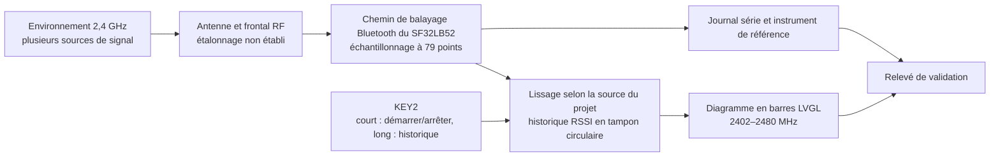

# Radiation Monitor, détecteur portable de force du signal { #radiation-monitor-portable-signal-strength-detector }

## Qu'est-ce que Radiation Monitor ? { #what-is-radiation-monitor }

[SiFliSparks/RadiationMonitor](https://github.com/SiFliSparks/RadiationMonitor) est un afficheur portable de la force du signal dans la bande Bluetooth, construit sur SF32LB52 et SiFli-SDK. Son firmware parcourt 79 points de fréquence de 2402 à 2480 MHz et affiche les valeurs de force reçue sous forme de diagramme en barres LVGL. KEY2 démarre ou arrête le balayage et permet de parcourir l'historique enregistré.

Le projet est utile pour étudier son chemin de balayage de la bande Bluetooth, le traitement de données en temps réel, la visualisation des fréquences et l'interaction à un seul bouton. Ce n'est pas un analyseur de spectre étalonné et il n'identifie pas la source du signal reçu. Les émissions voisines à 2,4 GHz et les conditions de mesure peuvent influencer le diagramme. Sans étalonnage ni comparaison contrôlée, ses valeurs ne conviennent ni aux mesures réglementaires, ni à la certification, ni aux mesures RF de précision.

<em>Interface à diagramme en barres à 79 points de Radiation Monitor</em>

## Pourquoi l'implémentation SF32 ? { #why-the-sf32-implementation }

Le SF32LB52 associe le Bluetooth 5.3 bimode, un MCU bicœur et des capacités d'affichage ; le projet utilise SiFli-SDK et LVGL pour garder sur l'appareil l'échantillonnage des fréquences, le lissage, la mise en mémoire tampon de l'historique et la mise à jour de l'écran. Cette référence constitue ainsi une expérience précoce utile pour un panneau de visualisation RF, un indicateur d'interférences de terrain ou une interface de diagnostic de production.

Le dépôt ne précise ni procédure d'étalonnage, ni budget d'incertitude, ni conditions de mesure traçables. Les résultats doivent donc être revalidés pour le silicium exact, la révision du SDK et du firmware, la carte, l'antenne, le boîtier, le bruit de la carte et le timing. Transposer la méthode à une autre carte SF32LB52 ou à un circuit imprimé de produit exige une nouvelle validation ; une compilation réussie n'établit pas l'équivalence des mesures.

## Résultat, portée et critères d'entrée { #outcome-scope-and-entry-criteria }

**Résultat :** reproduire le diagramme à 79 points sur du matériel SF32LB52 à version figée, vérifier un démarrage/arrêt répétable, établir l'algorithme et la profondeur de lissage réels par rapport à la source figée, tester l'historique documenté de 10 enregistrements et la récupération, puis recueillir assez de preuves pour décider si l'étalonnage ou du matériel sur mesure mérite un investissement.

Cette page n'interprète pas la hauteur d'une barre de RSSI comme un rapport cyclique, un débit, une puissance d'émetteur, l'identité d'un protocole ou une puissance spectrale réglementaire. Elle n'affirme pas non plus que le dépôt fournit une conception de production complète, une méthode d'étalonnage ou une licence logicielle explicite.

Avant de commencer, ayez :

- une carte d'affichage SF32LB52. Le README du projet cite SF32LB52x et un répertoire de sortie `build_sf32lb52-lchspi-ulp_hcpu` ; la liste des cartes prises en charge de SiFli cite `sf32lb52-lchspi-ulp` pour la Huangshan Pi. Consignez la révision réelle de la carte et vérifiez la configuration de compilation du projet ;
- SiFli-SDK, SCons, un chemin de téléchargement et la capture du journal série ;
- une source 2,4 GHz contrôlable ou au moins deux scènes répétables, par exemple un émetteur d'annonces BLE choisi, éteint puis allumé ;
- un analyseur de spectre étalonné ou un instrument de mesure de puissance, ainsi que des conditions fixes d'antenne/de distance/de blindage si la précision numérique fait partie du périmètre ;
- un relevé de test de l'état de l'écran, de la sortie série, de l'orientation de la carte, de la distance, de l'alimentation et de l'environnement.

<em>Tableau : Contrat du projet Radiation Monitor</em>

| Domaine | Base source figée | Preuves requises avant adaptation |
|:-----|:------------------------|:------------------------------------|
| Balayage en fréquence | 79 points de 2402 à 2480 MHz | Commit du firmware, révision du SDK et de la carte, et journal complet du balayage |
| Traitement | La description du module dans le README amont dit de moyenner les dix balayages précédents ; sa vue d'ensemble indique 30 balayages. Il ne précise pas si la moyenne porte sur la puissance linéaire ou sur les dBm | Révision de source figée, échelle/profondeur de moyenne, résultats bruts/lissés et comparaison avec une source stable |
| Historique | Historique circulaire de dix enregistrements | Relevé d'arrêt, de pagination, de rebouclage et de redémarrage |
| Interface | Diagramme en barres LVGL avec axe Y nominal de -110 à -20 dBm | Capture d'écran et vérification de la correspondance entre étiquette et tableau |
| Limite de mesure | Aucun étalonnage traçable ni aucune incertitude n'est fourni | Relevé d'instrument de référence, de montage et d'erreur, ou mention explicite « tendance relative seulement » |

## Spécifications matérielles et logicielles { #hardware-and-software-specifications }

### Spécification matérielle { #hardware-specification }

<em>Tableau : Spécification matérielle de Radiation Monitor</em>

| Composant | Spécification requise | Rôle | Statut | Où l'obtenir | Notes de compatibilité et de substitution |
|:----------|:-----------------------|:-----|:-------|:----------------|:-------------------------------------|
| SF32LB52-LCHSPI-ULP / Huangshan Pi | Partez de la cible de carte SCons `sf32lb52-lchspi-ulp` de SiFli ; consignez la révision exacte de la carte, l'antenne et l'assemblage de l'écran | Exécute le balayage Bluetooth, le diagramme, les commandes et l'interface d'historique | Requis ; l'assemblage exact doit être confirmé | [Référence μForge associée du DevKit-ULP](../sf32-products/devkits/SF32LB52-DevKit-ULP.md) ; [liste des cartes prises en charge par SiFli](https://docs.sifli.com/projects/sdk/latest/en/sf32lb52x/supported_boards/index.html) ; [page de la carte LCKFB](https://lckfb.com/project/detail/lckfb-hspi-sf32lb52-ulp?param=baseInfo) ; [source du projet](https://github.com/SiFliSparks/RadiationMonitor) | Le répertoire de sortie du README `build_sf32lb52-lchspi-ulp_hcpu` n'identifie ni le circuit imprimé exact, ni la révision de l'antenne ou de l'écran |
| Hôte, câble USB de données et source d'alimentation contrôlée | Hôte avec les outils SiFli-SDK retenus, câble capable de transmettre des données, journalisation série et alimentation surveillée | Compiler, télécharger, observer et répéter les mesures | Requis | [Démarrage rapide de SiFli-SDK](https://docs.sifli.com/projects/sdk/latest/sf32lb52x/quickstart/index.html) | Consignez le port, la tension, les versions de l'hôte et des outils, et la méthode de récupération |

### Spécification logicielle { #software-specification }

<em>Tableau : Spécification logicielle de Radiation Monitor</em>

| Paquet ou service | Version ou révision requise | Rôle | Statut | Où l'obtenir | Notes de compatibilité et de mise à jour |
|:-------------------|:-----------------------------|:-----|:-------|:----------------|:-------------------------------|
| SiFliSparks/RadiationMonitor | Commit figé [`670cf20`](https://github.com/SiFliSparks/RadiationMonitor/commit/670cf20b931e82b7ff1cd14fa6727e460c4f677a) | Logique de balayage RF, diagramme à 79 points, lissage et historique | Requis | [Dépôt](https://github.com/SiFliSparks/RadiationMonitor) | Les descriptions du lissage dans le README se contredisent ; vérifiez l'implémentation exacte à ce commit avant de fixer une base de mesure |
| OpenSiFli/SiFli-SDK | Le commit exact n'est pas figé par l'article du projet ; choisissez et consignez une révision compatible | RTOS, chemin de balayage Bluetooth, pilotes d'affichage et environnement de compilation/téléchargement | Requis | [Dépôt](https://github.com/OpenSiFli/SiFli-SDK) | Une compilation réussie n'établit ni des mesures RF étalonnées ni l'équivalence sur une autre carte |
| SCons et outils hôte du SDK | Versions de l'environnement SiFli-SDK retenu | Compiler et télécharger la cible SF32LB52 | Requis | [Démarrage rapide de SiFli-SDK](https://docs.sifli.com/projects/sdk/latest/sf32lb52x/quickstart/index.html) | Consignez la cible de compilation exacte, le système d'exploitation hôte, les versions des outils et l'image générée |

## Choisir une base prise en charge { #choose-a-supported-baseline }

Utilisez le commit de projet figé [`670cf20`](https://github.com/SiFliSparks/RadiationMonitor/commit/670cf20b931e82b7ff1cd14fa6727e460c4f677a), et non la branche mobile `main`. Le README du projet cite `build_sf32lb52-lchspi-ulp_hcpu` comme répertoire de sortie ; la liste des cartes prises en charge de SiFli cite `sf32lb52-lchspi-ulp` pour la Huangshan Pi / LCHSPI-ULP. Cela établit le nom de carte du SDK, et non la commande exacte du projet ni l'assemblage de carte testé. Le README ne précise ni révision de carte ni commande SCons complète ; confirmez donc la configuration de compilation du projet lors de la première reproduction, au lieu de supposer que toute carte SF32LB52x est prise en charge.

<em>Tableau : Sélection de la base de Radiation Monitor</em>

| Élément | Choix de base | À ne pas supposer |
|:--------|:----------------|:--------------|
| Carte | Partez de l'argument de carte SCons `sf32lb52-lchspi-ulp` de SiFli ; consignez le circuit imprimé réel et vérifiez la configuration du projet | Que le répertoire de sortie du README `build_sf32lb52-lchspi-ulp_hcpu` prouve que tous les chemins d'antenne et d'affichage des cartes SF32LB52x sont équivalents |
| SDK | Consignez le commit de SiFli-SDK qui se compile avec succès | Ne supposez pas que le SDK le plus récent préserve le comportement de balayage Bluetooth du projet |
| Lissage | Résolvez l'écart du README entre 30 balayages et les 10 balayages précédents par rapport à la source figée ; vérifiez si la moyenne porte sur la puissance linéaire ou les dBm, et établissez la profondeur | La description du module indique dix balayages, la vue d'ensemble 30, et aucune ne précise l'échelle de la moyenne |
| Timing | Le README indique un intervalle de mise à jour des données de 30 ms ; mesurez la durée complète du balayage des 79 points | Que 30 ms soit une période garantie de mise à jour complète des 79 points |
| Licences | Confirmez les licences du dépôt et du code intégré avant toute réutilisation ou distribution | Qu'un code source visible publiquement confère automatiquement des droits de distribution du produit |

!!! warning "La documentation amont se contredit sur la profondeur de lissage"
    La vue d'ensemble des fonctions du README indique une moyenne sur 30 balayages, tandis que sa description du module mentionne les dix balayages précédents et désigne `src/BT/bt_repeat.c` comme module de balayage. Elle ne précise pas si les valeurs sont moyennées en puissance linéaire ou en dBm, et ses deux nombres n'établissent pas quel comportement le code figé implémente. Inspectez cette révision exacte de la source et vérifiez l'échelle de la moyenne, la profondeur du tampon et le comportement sur l'appareil avant de considérer l'un ou l'autre nombre comme base de mesure. Le README indique aussi un intervalle de mise à jour des données de 30 ms, qui n'est pas nécessairement égal au temps nécessaire pour balayer les 79 points.

## Plan de livraison { #delivery-map }

<em>Tableau : Plan de livraison de Radiation Monitor</em>

| Étape | Décision qu'elle appuie | Livrable requis |
|:------|:---------------------|:----------------|
| 1. Base intacte | La carte cible peut-elle balayer et afficher les 79 points de façon fiable ? | Relevé de version, de carte, de journal, d'écran et de source contrôlée |
| 2. Données et récupération | Le lissage, l'arrêt, l'historique et le comportement à la réinitialisation sont-ils fiables ? | Tests fonctionnels et de récupération déterministes |
| 3. Reproduction de la source | Un second ingénieur peut-il reconstruire la même image ? | Compilation propre, image, téléchargement et résultat répété |
| 4. Adaptation de la mesure | Une modification d'affichage ou d'étalonnage peut-elle être ajoutée sans masquer le comportement de référence ? | Modification, données de comparaison, erreur et relevé de non-régression |
| 5. Revue produit | Doit-il rester un indicateur de tendance ou devenir un programme de développement d'instrument ? | Objectif de précision, licences, matériel et décision sur les risques |

## Architecture système et dépendances { #system-architecture-and-dependencies }

<em>Figure : Chemin de données de Radiation Monitor</em>

Les principaux domaines de défaillance sont l'entrée RF/l'antenne, le comportement du balayage et l'étalonnage, le traitement des données, le tampon d'historique, la machine d'états des boutons, la correspondance LVGL et l'alimentation. Une barre haute signifie seulement que l'implémentation a observé une valeur de réception relativement forte ; sans comparaison contrôlée, elle n'identifie ni un émetteur, ni une modulation, ni un état de conformité.

## Étape 1 — Établir la base de balayage intacte { #stage-1-establish-the-untouched-scan-baseline }

**Objectif :** prouver que le matériel et la source retenus produisent un affichage à 79 points répétable.

1. Figez les commits du dépôt et de SiFli-SDK, la révision de la carte, l'antenne et la connexion de l'écran ; compilez et téléchargez proprement.
2. Avec une scène RF stable, démarrez l'appareil et consignez son diagramme initial, la sortie série et l'état de KEY2.
3. Appuyez brièvement sur KEY2 pour démarrer le balayage. Confirmez la couverture et les repères de l'axe X à 2402, 2441 et 2480 MHz.
4. Utilisez un émetteur d'annonces BLE contrôlé ou une autre source répétable, et consignez source éteinte, source allumée, distance et changements d'orientation de la carte.
5. Réinitialisez et répétez, en vérifiant que le tableau de 79 points et le diagramme ne sont pas décalés et ne conservent pas de données périmées.

**Preuves à conserver :** révisions de la source/du SDK/de la carte, journaux de compilation/téléchargement, description de l'environnement, réglages de la source, distance/orientation, journal série, captures d'écran et résultat de la réinitialisation.

**Critère de sortie du point 1 :** deux démarrages indépendants balayent et affichent 79 points ; les changements de scène contrôlée sont répétables en direction ; les indices d'affichage et les étiquettes de fréquence ont été vérifiés.

## Étape 2 — Valider le traitement, l'historique et la récupération { #stage-2-validate-processing-history-and-recovery }

**Objectif :** prouver que l'interface représente un chemin de données explicable et non une animation accidentelle.

<em>Tableau : Validation fonctionnelle de Radiation Monitor</em>

| Test | Méthode | Preuve de réussite |
|:-----|:-------|:--------------|
| Algorithme et profondeur de lissage | Relever les valeurs brutes et `rssi_res` pour une fréquence ; comparer avec la source figée et résoudre l'écart du README | L'échelle et la profondeur de la moyenne correspondent à la révision exacte de la source et sont confirmées sur l'appareil |
| Démarrage/arrêt | Appuyer brièvement sur KEY2 pendant le balayage, puis reprendre | L'arrêt conserve l'historique ; la reprise continue sans blocage |
| Historique | À l'arrêt, appuyer longuement sur KEY2 plusieurs fois | Jusqu'à dix enregistrements se parcourent en arrière et reviennent correctement au début |
| Historique vide | Arrêter ou appuyer longuement avant qu'un historique valide ne s'accumule | Aucun accès hors limites ni plantage ; l'interface reste dans un état « aucune donnée » reconnaissable |
| Réinitialisation | Réinitialiser pendant le balayage, à l'arrêt et pendant la consultation de l'historique | L'appareil revient à un état initial connu sans valeurs périmées inexpliquées |
| Variation des interférences | Changer la source, la distance ou le blindage | La réponse est répétable, avec latence et comportement de maintien des crêtes consignés |

**Critère de sortie du point 2 :** le lissage, la profondeur de l'historique, l'état des boutons et le comportement à la réinitialisation correspondent à la source ; les états anormaux sont observables et non silencieux.

## Étape 3 — Construire une base source reproductible { #stage-3-build-a-reproducible-source-baseline }

**Objectif :** reproduire l'image de l'étape 2 dans un environnement propre.

1. Consignez le commit du projet, le commit du SDK, le système d'exploitation hôte, les versions de SCons/du compilateur et l'argument de carte réel.
2. Supprimez la sortie de compilation, reconfigurez et recompilez ; enregistrez les images, la sortie mémoire/partitions et les journaux complets.
3. Flashez avec le script de téléchargement généré et consignez le port, la vitesse en bauds et le résultat.
4. Répétez sur un second ordinateur ou dans un répertoire propre, puis rejouez les contrôles essentiels de l'étape 2.

**Critère de sortie du point 3 :** le projet produit une image équivalente en comportement, sans fichiers de carte non suivis, fichiers générés ni produits périmés.

## Étape 4 — Effectuer une adaptation contrôlée de la mesure ou de l'interface { #stage-4-make-one-controlled-measurement-or-ui-adaptation }

**Objectif :** tester une orientation produit sans perdre la base d'origine.

Les modifications envisageables comprennent la journalisation des valeurs brutes, des étiquettes explicites tous les 1 MHz, le maintien des crêtes, un autre sélecteur d'historique, un décalage d'étalonnage ou l'export vers l'hôte de tendances relatives. Ne changez qu'une classe à la fois et conservez l'image d'origine.

En cas d'ajout d'un étalonnage, définissez la source de référence, la fréquence, le niveau d'entrée, l'antenne/le câble, la distance, l'orientation, la température et l'incertitude. Un seul décalage global suffit rarement à compenser la réponse en fréquence, la dispersion entre cartes et les effets du boîtier.

**Critère de sortie du point 4 :** la modification réussit les non-régressions d'origine sur les 79 points, le démarrage/arrêt, l'historique, la réinitialisation et la source contrôlée ; chaque affirmation de précision nomme son instrument de référence et ses conditions.

## Étape 5 — Revue de maturité produit { #stage-5-product-readiness-review }

L'équipe doit répondre aux questions suivantes :

- Le produit n'a-t-il besoin que de tendances relatives d'interférences, ou d'une puissance absolue traçable avec incertitude ?
- L'implémentation du balayage Bluetooth du projet est-elle documentée comme prise en charge sur le silicium cible et le SDK, et quelles limites de concurrence s'appliquent ?
- Dans quelle mesure l'antenne, le boîtier, le bruit de l'écran, le fonctionnement du DC/DC, le niveau de batterie et la température déplacent-ils le résultat ?
- Le produit peut-il maintenir la communication Bluetooth requise pendant le balayage, ou ces fonctions doivent-elles être mutuellement exclusives ?
- La latence mesurée d'un balayage à 79 points avec un lissage vérifié dans la source répond-elle à l'exigence d'interface ?
- Comment résoudre la distribution et les droits commerciaux alors que RadiationMonitor et le code intégré n'ont pas de licence explicite de niveau supérieur ?

**Critère de sortie du point 5 :** l'objectif de mesure, le plan d'étalonnage, la stratégie de concurrence radio, les licences, le matériel et la responsabilité logicielle ont des responsables nommés et une décision de poursuivre/différer/arrêter.

## Transfert vers la conception produit { #handoff-to-product-design }

Reportez le composant SF32 cible, la carte/l'antenne, l'implémentation du balayage Bluetooth et toutes les contraintes de mode/d'API confirmées à partir de la source figée, la définition des fréquences et des données, les relevés bruts et lissés, le budget de rafraîchissement de l'interface, le montage d'étalonnage, les tests de bruit d'alimentation, le chemin de récupération et la limite du test de production. Poursuivez avec le [SF32LB52x](../sf32-products/chips/SF32LB52x.md), le [SF32LB52-DevKit-ULP](../sf32-products/devkits/SF32LB52-DevKit-ULP.md), le [guide de conception matérielle du SF32LB52x](../hardware/chip-guides/SF32LB52x_hardware_design_guide.md) et les [tests de performances RF de SiFli-SDK](../develop/platforms/sifli-sdk/application-notes/rf-performance-tests.md).

## Sources faisant autorité { #authoritative-sources }

- [SiFliSparks/RadiationMonitor](https://github.com/SiFliSparks/RadiationMonitor)
- [README amont sur `main`](https://github.com/SiFliSparks/RadiationMonitor/blob/main/README.md)
- [Commit de référence figé `670cf20`](https://github.com/SiFliSparks/RadiationMonitor/commit/670cf20b931e82b7ff1cd14fa6727e460c4f677a)
- [Catalogue de projets SiFli Sparks](https://sparks.sifli.com/#projects)
- [OpenSiFli/SiFli-SDK](https://github.com/OpenSiFli/SiFli-SDK)
- [Cartes prises en charge par SiFli-SDK](https://docs.sifli.com/projects/sdk/latest/en/sf32lb52x/supported_boards/index.html)
- [Guide de test RF de SiFli-SDK](https://docs.sifli.com/projects/sdk/latest/en/sf32lb52x/app_note/rf_test_guide.html)
- [Présentation matérielle du SF32LB52x](https://wiki.sifli.com/en/hardware/SF32LB52/SF32LB52-Overview-B3.html)
- [Démarrage rapide de SiFli-SDK pour SF32LB52x](https://docs.sifli.com/projects/sdk/latest/sf32lb52x/quickstart/index.html)
