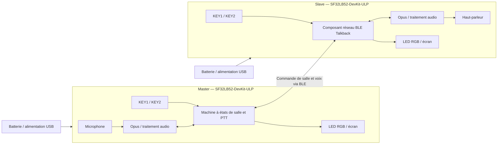

# Interphone BLE SF32 (Talkback) { #sf32-ble-talkback-intercom }

## Qu'est-ce que Talkback ? { #what-is-talkback }
[OpenSiFli Talkback](https://github.com/OpenSiFli/sifli-sdk-demo/tree/main/talkback) est un exemple BLE de push-to-talk (PTT) multiappareil pour le kit de développement `SF32LB52-DevKit-ULP`, également appelé Huangshan Pi. En mode Master, un appareil crée une salle ; en mode Slave, il en recherche une et la rejoint. Une fois connecté, l'utilisateur maintient la touche de parole pour transmettre et la relâche pour arrêter. La référence officielle prend en charge jusqu'à huit appareils et permet à trois d'entre eux au maximum de parler simultanément.

Le projet utilise Opus pour le codage vocal et associe une LED RGB, des touches et un écran dans une interface locale minimale. Il permet également au Slave de se reconnecter avec une seule touche, affiche la tension et le niveau de batterie, passe en veille après 60 secondes sans entrée et gère l'allumage et l'extinction par appui long. Il constitue ainsi une référence plus complète pour un interphone portable qu'un simple exemple audio point à point.

## Pourquoi l'implémentation SF32 ? { #why-the-sf32-implementation }
Ce parcours réunit BLE, audio, écran, touches, surveillance de la batterie et fonctions basse consommation de SF32LB52 dans une base opérationnelle. Une équipe peut évaluer le réseau et les performances audio sur du matériel de développement pris en charge avant d'investir dans une conception RF, audio et d'alimentation spécifique.

« Jusqu'à huit appareils et trois locuteurs simultanés » décrit une limite de l'implémentation amont, et non une capacité produit validée pour toutes les distances, interférences, pertes de paquets et configurations de simultanéité. La documentation amont ne précise pas non plus l'authentification des salles, la politique de chiffrement de la liaison, une garantie de confidentialité vocale, le statut réglementaire radio ni l'ensemble des conditions de licence du composant binaire `talk_back`. Chacun de ces points nécessite une revue produit distincte.

**Note sur la source de la carte :** La page chinoise de SiFli consacrée à la carte ULP est explicitement signalée comme pas encore disponible ; elle indique seulement les usages pour capteurs basse consommation et objets connectés portés, les options de capteurs à 3 ou 6 axes et des points de test réservés aux mesures basse consommation. Elle ne constitue pas une spécification complète de la carte. Vérifiez les périphériques à partir de la révision réelle et du schéma ; le comportement Talkback décrit ci-dessous provient du code applicatif figé.

## Résultat, portée et critères d'entrée { #outcome-scope-and-entry-criteria }
**Résultat attendu :** utiliser au moins deux cartes dont la révision est identifiée pour reproduire la création d'une salle, la rejoindre, communiquer en PTT, quitter et se reconnecter, entrer en veille et se réveiller, ainsi que vérifier l'état de la batterie ; réunir ensuite assez de preuves pour décider si un matériel spécifique se justifie.

**Hors périmètre :** cette page ne démontre ni une couverture longue portée, ni une qualité vocale en liaison dégradée, ni un chiffrement de bout en bout, une certification, une consommation en production, la constance des antennes, une conformité réglementaire ou une compatibilité avec tous les appareils BLE.

**Prérequis :** l'équipe sait installer un environnement de compilation SiFli-SDK, flasher le firmware via UART, examiner les journaux et raccorder sans risque un haut-parleur et une batterie. Une base vocale complète nécessite au moins deux cartes de même révision.

<div align="center"><em>Tableau : contrat du projet</em></div>

<div align="center" markdown>

| Domaine | Exigence de base | Preuves à conserver avant de poursuivre |
|:-----|:---------------------|:------------------------------------|
| Périmètre de reproduction | Commencer sans modifier la cible amont, les dépendances ni les interactions par défaut | Révision de carte, commit de l'application, révision du SDK, résolution des dépendances et empreinte du firmware |
| Périmètre fonctionnel | Vérifier création/jonction, PTT, sortie, reconnexion du Slave, veille/réveil et rapport de batterie | Déroulement des opérations, journaux UART, états des LED et résultats de récupération après panne |
| Périmètre produit | Évaluer séparément l'acoustique, la RF, la sécurité, la confidentialité, les licences, l'alimentation et la réglementation | Risque, responsable, plan de traitement et décision de poursuivre ou d'arrêter |

</div>

## Spécifications matérielles et logicielles { #hardware-and-software-specifications }

### Spécification matérielle { #hardware-specification }

<div align="center"><em>Tableau : spécification matérielle</em></div>

<div align="center" markdown>

| Composant | Spécification requise | Rôle | Statut | Approvisionnement | Compatibilité et remplacement |
|:----------|:-----------------------|:-----|:-------|:----------------|:-------------------------------------|
| SF32LB52-DevKit-ULP / LCKFB-HSPI-SF32LB52-ULP | Cible `sf32lb52-lchspi-ulp` ; au moins 2 cartes et au plus 8 | Exécute Talkback et fournit BLE, microphone, écran, touches, LED RGB, alimentation et voies audio | Obligatoire | [Référence de carte μForge](../sf32-products/devkits/SF32LB52-DevKit-ULP.md) ; [page de la carte LCKFB](https://lckfb.com/project/detail/lckfb-hspi-sf32lb52-ulp?param=baseInfo) ; [boutique SiFli de kits/échantillons](https://sifli.taobao.com/) | Consigner chaque révision matérielle ; une carte SF32LB52 non validée n'est pas un remplacement équivalent |
| Haut-parleur | Un haut-parleur externe de 3 W/4 Ω ou 2 W/8 Ω par carte, raccordé via le connecteur GH-1.25 mm | Restitue la voix reçue | Obligatoire | Souvent inclus dans le kit de la carte ; vérifier le contenu auprès de la [référence de carte](../sf32-products/devkits/SF32LB52-DevKit-ULP.md) avant achat | Ne raccordez pas de charge dépassant les limites de l'amplificateur Class-D et du connecteur intégrés |
| Câbles USB de données et hôte | Un câble USB-C de données par carte ; un hôte capable d'exécuter les outils SiFli-SDK | Alimentation, flashage via UART et journalisation | Obligatoire | Câble USB-C de données standard ; outils disponibles via [SiFli-SDK](https://github.com/OpenSiFli/SiFli-SDK) | Un câble de charge seul ne permet pas de flasher le firmware ; consigner les ports et l'environnement hôte |
| Batterie lithium monocellule | Compatible avec le connecteur, la polarité et le circuit de charge de la carte | Mobilité, validation de la veille/du réveil et du niveau de batterie | Obligatoire pour la validation produit ; optionnelle pour un essai fonctionnel sur banc | Le dépôt Talkback ne publie pas de canal d'approvisionnement distinct ; vérifier l'interface dans la [référence de carte](../sf32-products/devkits/SF32LB52-DevKit-ULP.md) avant approvisionnement | Vérifier polarité, plage de tension, capacité et protection avant branchement ; l'apparence du connecteur ne garantit pas la compatibilité |
| Microphone, touches, LED RGB et écran intégrés | Composants d'origine de la carte de développement | Capte la voix et affiche rôle, appairage, émission, réception et veille | Intégrés | Fournis avec la carte ; pas de source distincte | Le remplacement de l'audio ou de l'IHM exige des tests de non-régression du gain, du timing, des codes de touche et de la correspondance des états |

</div>

### Spécification logicielle { #software-specification }

<div align="center"><em>Tableau : spécification logicielle</em></div>

<div align="center" markdown>

| Paquet ou service | Version ou révision requise | Rôle | Statut | Source | Compatibilité et mises à jour |
|:-------------------|:-----------------------------|:-----|:-------|:----------------|:-------------------------------|
| OpenSiFli `sifli-sdk-demo/talkback` | Commit [`6fa55ac`](https://github.com/OpenSiFli/sifli-sdk-demo/commit/6fa55ac65b51fca5eac6660a7e481a30e07388ee) évalué pour cet article | Application, configuration de carte et point d'entrée de la compilation | Obligatoire | [Répertoire source Talkback](https://github.com/OpenSiFli/sifli-sdk-demo/tree/main/talkback) | La branche amont `main` évolue ; verrouillez un commit avant de recueillir des preuves. Le chemin actuel est `talkback/project` ; celui indiqué dans le README, `example/ble/talkback/project`, est obsolète |
| SiFli-SDK | `conanfile.py` déclare la compatibilité `^2.4` ; aucun commit exact du SDK n'est verrouillé en amont | Base RT-Thread, BLE, audio, alimentation, compilation et flashage | Obligatoire | [OpenSiFli/SiFli-SDK](https://github.com/OpenSiFli/SiFli-SDK) | Sélectionnez et consignez un commit concret conforme à `^2.4` ; une branche `main` mouvante ne constitue pas une révision de référence |
| `talk_back/1.2@sifli` | `1.2` | Composant réseau/audio BLE Talkback | Obligatoire | Résolu par le [manifeste Conan](https://github.com/OpenSiFli/sifli-sdk-demo/blob/6fa55ac65b51fca5eac6660a7e481a30e07388ee/talkback/project/conanfile.py) du projet | La page amont ne publie ni source autonome, ni empreinte du paquet, ni serveur de paquets, ni licence complète ; archivez le paquet et le relevé de résolution et clôturez ce risque avant tout usage produit |
| Configuration Opus et WebRTC AECM/AGC | Déterminée conjointement par l'application, le SDK et la dépendance Conan verrouillés | Codage vocal, traitement de l'écho et contrôle du gain | Obligatoire | [Configuration du projet](https://github.com/OpenSiFli/sifli-sdk-demo/blob/6fa55ac65b51fca5eac6660a7e481a30e07388ee/talkback/project/proj.conf) et dépendances du SDK verrouillées | Ne consignez pas uniquement les macros de fonctionnalités ; conservez les versions résolues des bibliothèques et les informations de licence |
| SCons, compilateur et outils de flashage UART | Versions compatibles avec le SiFli-SDK sélectionné | Configurent, compilent et flashent les images | Obligatoire | Fournis dans l'environnement du [SiFli-SDK sélectionné](https://github.com/OpenSiFli/SiFli-SDK) | Consigner le système hôte, la version de la chaîne d'outils, la commande de compilation et l'empreinte du script généré |

</div>

## Choisir une configuration de référence prise en charge { #choose-a-supported-baseline }
Commencez avec deux cartes `SF32LB52-DevKit-ULP` de même révision. Verrouillez le dépôt de démonstration sur `6fa55ac`, sélectionnez et consignez un commit SiFli-SDK concret conforme à `^2.4`, et conservez la résolution Conan de `talk_back/1.2@sifli`. Ne modifiez ni les paramètres audio, ni la logique des rôles, ni le timing basse consommation lors de la première reproduction.

Depuis la racine du dépôt, accédez au chemin qui existe réellement :

```bash
cd talkback/project
scons --board=sf32lb52-lchspi-ulp -j8
```

Sous Windows, le nom du script de flashage généré est `build_sf32lb52-lchspi-ulp_hcpu\uart_download.bat`. Exécutez-le et indiquez le port COM approprié lorsqu'il vous le demande. Utilisez la même image de référence sur tous les appareils et consignez l'identifiant de chaque carte ainsi que l'empreinte de l'image.

### Commandes par défaut et indication d'état { #default-controls-and-state-indication }
<div align="center"><em>Tableau : comportement par défaut des touches et des LED</em></div>

<div align="center" markdown>

| État | KEY1 | KEY2 | LED |
|:------|:-----|:-----|:----|
| Veille active | Un Slave ayant déjà rejoint une salle peut se reconnecter par appui bref ; sinon, l'appui bref réinitialise le délai de veille | Appui bref : bascule Master/Slave ; appui long : démarre l'appairage | Master bleu fixe ; Slave rouge fixe |
| Appairage | — | Le Master crée une salle ; le Slave la recherche | Master bleu clignotant ; Slave rouge clignotant |
| Attente du démarrage | — | Appui long sur KEY2 du Master pour confirmer le démarrage | Master bleu clignotant ; Slave rouge clignotant |
| Dans la salle | Relâcher KEY2, puis appuyer brièvement pour quitter | Maintenir pour parler ; relâcher pour arrêter | Vert fixe pendant l'émission ; orange fixe pendant la réception |
| Veille | Toute touche réveille l'appareil | Toute touche réveille l'appareil | Éteinte |

</div>

## Étapes du projet { #delivery-map }
<div align="center"><em>Tableau : étapes et décisions associées</em></div>

<div align="center" markdown>

| Étape | Décision éclairée | Preuves minimales |
|:------|:-------------------|:-----------------|
| Établir la base intacte | L'ensemble verrouillé se compile-t-il, se flashe-t-il et démarre-t-il de manière fiable ? | Manifeste des versions, journal de compilation propre, empreinte de l'image et compte rendu du démarrage |
| Valider les communications à deux appareils | La création et la jonction d'une salle, ainsi que le PTT par défaut, fonctionnent-elles ? | Rôles, états des LED, actions sur les touches et compte rendu de parole bidirectionnelle entre deux appareils |
| Valider le réseau et la récupération | La sortie, les délais d'expiration, la reconnexion et les limites de simultanéité sont-ils acceptables ? | Matrice d'injection de pannes, durée de récupération, journaux et états d'échec |
| Évaluer l'audio et l'alimentation | L'acoustique et le comportement de la batterie conviennent-ils au format prévu ? | Mesures de qualité audio, latence, portée, courant, veille et réveil |
| Revoir la préparation produit | Les preuves suffisent-elles pour financer du matériel spécifique ? | Registre des risques, responsables et décision de poursuivre, différer ou arrêter |

</div>

## Architecture système et dépendances { #system-architecture-and-dependencies }
<div align="center"><em>Figure : rôles des appareils Talkback et chemins audio/de commande</em></div>



Les principaux domaines de panne sont la recherche BLE et la création de salle, la synchronisation de son état, l'ordonnancement des locuteurs simultanés, la chaîne Opus/acoustique, les événements des touches, la batterie faible et la veille, la récupération par la touche d'alimentation, ainsi que les détails non publiés des composants et de leurs licences. Commencez par diagnostiquer le rôle et l'état, puis distinguez les défaillances radio, audio et d'alimentation locale.

## Étape 1 — Établir la référence source intacte { #stage-1-establish-the-untouched-source-baseline }
**Objectif :** vérifier que les sources, le SDK et les dépendances résolues, tous verrouillés, produisent une image reproductible.

1. Verrouillez le commit de l'application et un commit SDK concret ; conservez la sortie de résolution des dépendances.
2. Compilez `sf32lb52-lchspi-ulp` dans un répertoire propre et flashez le firmware sur deux cartes.
3. Vérifiez que chaque appareil démarre en Slave avec une LED rouge fixe, puis contrôlez les touches, l'écran, la batterie et le haut-parleur.

**Éléments à conserver :** manifeste complet des versions, journaux de compilation et de flashage, empreintes des firmwares, révisions des deux cartes et comptes rendus de démarrage.

**Critère de sortie de l'étape 1 :** les mêmes entrées génèrent de façon reproductible la même image de référence, flashée sur les deux appareils ; leur état au démarrage correspond au comportement amont.

## Étape 2 — Valider la configuration de la salle et le PTT bidirectionnel { #stage-2-validate-room-setup-and-bidirectional-ptt }
**Objectif :** vérifier qu'un utilisateur peut créer et utiliser une salle minimale sans intervention du débogueur.

1. En veille active, appuyez brièvement sur KEY2 pour passer un appareil en Master (LED bleue fixe) ; laissez l'autre en Slave (LED rouge fixe).
2. Maintenez KEY2 sur les deux appareils : le Master crée une salle et le Slave la recherche. L'appairage expire au bout de 30 secondes.
3. En attente, maintenez KEY2 sur le Master pour démarrer. En mode conversation, maintenez KEY2 pour parler et relâchez-la pour arrêter.
4. Vérifiez que la LED est verte fixe pendant l'émission et orange fixe pendant la réception, et que la voix reste intelligible dans les deux sens.

**Éléments à conserver :** rôles, chronologie des opérations, états des LED, journaux UART, échantillons audio bidirectionnels et résultats des nouvelles tentatives.

**Critère de sortie de l'étape 2 :** au moins deux appareils effectuent plusieurs sessions PTT bidirectionnelles ; les indicateurs correspondent au sens réel de l'audio et l'expiration de 30 secondes ramène à un état explicable.

## Étape 3 — Valider les limites de sortie, de reconnexion et de capacité { #stage-3-validate-leave-reconnect-and-capacity-boundaries }
**Objectif :** vérifier que les chemins de récupération et limites de capacité amont ne laissent pas l'utilisateur dans un état bloqué.

1. En mode conversation, relâchez KEY2 avant d'appuyer brièvement sur KEY1 pour quitter ; un appareil ne peut pas quitter la salle pendant qu'il transmet.
2. Un Slave ayant déjà rejoint une salle avec succès peut se reconnecter par appui bref sur KEY1 en veille active. Le Master ne dispose pas d'un mécanisme équivalent.
3. Testez le fonctionnement hors de portée, l'expiration de l'appairage, la perte du Master et le redémarrage après coupure d'alimentation.
4. Si le mode multiparti est requis, augmentez le nombre de participants jusqu'à la cible et vérifiez les limites annoncées de huit appareils et trois locuteurs simultanés.

**Éléments à conserver :** état initial, déclencheur, action et durée de récupération, journaux et appartenance finale à la salle pour chaque panne.

**Critère de sortie de l'étape 3 :** chaque panne visée a un chemin de récupération explicite, reproductible et compréhensible par l'utilisateur ; la capacité et la simultanéité requises sont mesurées dans l'environnement RF cible, et non déduites de la limite annoncée.

## Étape 4 — Évaluer l'audio, les performances RF et la consommation énergétique { #stage-4-qualify-acoustics-rf-and-low-power }

**Objectif :** déterminer si le comportement de la carte de développement convient au boîtier, à la portée et à l'autonomie visés.

1. Consignez l'intelligibilité, l'écrêtage, l'écho et les coupures au début/à la fin du PTT en environnement calme, en double parole côté local, avec bruit de fond et à plusieurs niveaux de volume du haut-parleur.
2. Consignez la connexion, les pertes et la récupération à la distance cible, derrière des obstacles et en présence d'interférences 2,4 GHz.
3. Vérifiez la veille après 60 secondes sans entrée, le retour au rôle Slave, le réveil par n'importe quelle touche, l'arrêt et la mise sous tension par appui long, ainsi que l'indication LED sous 20 % de batterie.
4. Mesurez le courant en veille active, en émission, en réception, en veille et au réveil ; ne confondez pas les mesures sur carte de développement avec l'autonomie du produit final.

**Éléments à conserver :** environnement, orientation de la carte et de l'antenne, fichiers audio, distance et interférences, courbes de courant, état de la batterie et résultats de récupération.

**Critère de sortie de l'étape 4 :** l'équipe produit a défini et atteint les seuils acoustiques, RF, d'alimentation et de réveil pour son environnement cible ; chaque écart a un responsable et un plan de traitement.

## Étape 5 — Revue de préparation produit { #stage-5-product-readiness-review }
Avant de concevoir du matériel spécifique, répondez au minimum aux questions suivantes :

- Comment une salle identifie-t-elle les appareils de confiance, et quels mécanismes d'authentification, de chiffrement et de protection contre le rejeu protègent la voix et les données de commande ?
- Qui est responsable des licences, de la mise à disposition du code source et de la réponse aux vulnérabilités de `talk_back/1.2@sifli`, d'Opus, des composants WebRTC et des fichiers source du dépôt ?
- Quelle couverture, latence, perte de paquets et capacité de récupération ont été mesurées avec l'antenne et le boîtier visés, en présence d'obstacles corporels et de communications simultanées ?
- Comment le microphone, l'amplificateur, la cavité du haut-parleur et les limites de volume satisferont-ils les exigences acoustiques et de sécurité ?
- Comment l'appareil récupère-t-il après une batterie faible, une coupure anormale, un firmware corrompu ou l'échec d'une mise à jour sur le terrain ?
- Quelles activités de conformité Bluetooth, CEM, radio et batterie s'appliquent ?

**Critère de sortie de l'étape 5 :** le registre des risques inclut des preuves, des responsables, des mesures d'atténuation et une décision explicite de poursuivre, différer ou arrêter. Les sujets de sécurité, de licence et de réglementation ne peuvent pas rester des tâches « à traiter plus tard » sans responsable.

## Passage à la conception du produit { #handoff-to-product-design }
Le dossier de transfert doit inclure les sources, le SDK et les dépendances verrouillés, les rôles et la machine à états, la matrice de capacité et de récupération, les mesures audio/RF/alimentation, les hypothèses d'antenne et d'acoustique, les limites liées à la batterie et à sa charge, le modèle de sécurité et de confidentialité, les documents de licence, les besoins en tests de production et le plan de récupération. Utilisez le [parcours d'intégration SF32LB52x](../sf32-products/chips/SF32LB52x.md#integration-path) pour sélectionner le circuit, le module, la carte, le guide de conception matérielle et la liste de contrôle. Intégrez au schéma et au routage spécifiques les comportements validés, puis revérifiez-les au lieu de reprendre sans vérification les conclusions obtenues sur la carte de développement.

## Sources de référence { #authoritative-sources }
- [Répertoire Talkback d'OpenSiFli](https://github.com/OpenSiFli/sifli-sdk-demo/tree/main/talkback)
- [Commit de l'application examiné `6fa55ac`](https://github.com/OpenSiFli/sifli-sdk-demo/commit/6fa55ac65b51fca5eac6660a7e481a30e07388ee)
- [README officiel de Talkback](https://github.com/OpenSiFli/sifli-sdk-demo/blob/6fa55ac65b51fca5eac6660a7e481a30e07388ee/talkback/README.md)
- [Manifeste Conan de Talkback](https://github.com/OpenSiFli/sifli-sdk-demo/blob/6fa55ac65b51fca5eac6660a7e481a30e07388ee/talkback/project/conanfile.py)
- [Configuration du projet Talkback](https://github.com/OpenSiFli/sifli-sdk-demo/blob/6fa55ac65b51fca5eac6660a7e481a30e07388ee/talkback/project/proj.conf)
- [OpenSiFli/SiFli-SDK](https://github.com/OpenSiFli/SiFli-SDK)
- [Source officielle du Wiki SiFli pour le SF32LB52-DevKit-ULP](https://github.com/OpenSiFli/SiFli-Wiki/blob/main/source/en/board/sf32lb52x/SF32LB52-DevKit-ULP.md)
- [Source chinoise du Wiki SiFli pour le SF32LB52-DevKit-ULP](https://github.com/OpenSiFli/SiFli-Wiki/blob/main/source/zh_CN/board/sf32lb52x/SF32LB52-DevKit-ULP.md)
