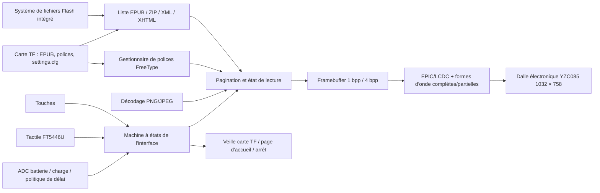

# Lecteur EPUB SF32 à écran e-paper { #sf32-e-paper-epub-reader }

## Qu'est-ce qu'EPD Reader ? { #what-is-epd-reader }

[OpenSiFli EPD Reader](https://github.com/OpenSiFli/EPD_Reader) adapte [atomic14/diy-esp32-epub-reader](https://github.com/atomic14/diy-esp32-epub-reader) au matériel SiFli `SF32-OED-EPD`. Le traitement repose sur le SF32LB52x. L'application lit les fichiers EPUB depuis le système de fichiers intégré ou une carte TF, analyse ZIP/XML/XHTML, met en page avec les polices FreeType et des décodeurs d'image, puis pilote une dalle à papier électronique avec des formes d'onde de rafraîchissement complet ou partiel.

L'application actuelle propose des vues pour la bibliothèque, la table des matières, la lecture, les réglages de lecture et de fonctions, l'accueil/l'écran éteint, la batterie faible, la charge et l'arrêt. Elle prend en charge les touches et le tactile, le chinois et l'anglais, les polices TTF/OTF dynamiques, la taille et la graisse, l'interligne, les marges et la persistance des réglages sur la carte TF. Pour réduire l'utilisation des ressources, la police chinoise fournie n'active pas par défaut de variantes grasses ou italiques distinctes. Vérifiez donc le rendu réel des options de graisse avec la police cible. Le projet constitue une référence complète de terminal de lecture à rafraîchissement peu fréquent, mais ne prouve ni la conformité générale à EPUB ni qu'il s'agit d'une liseuse prête pour la production.

## Pourquoi l'implémentation SF32 ? { #why-the-sf32-implementation }

Ce parcours réunit dans une application le stockage du SF32LB52, l'accélération d'affichage EPIC/LCDC, le tactile, les touches, la surveillance de la batterie et la gestion basse consommation. Pour une équipe produit, l'intérêt ne se limite pas à afficher une page : sur le matériel pris en charge, il permet d'évaluer conjointement la mémoire nécessaire à la mise en page, les images rémanentes après rafraîchissement complet ou partiel, l'adaptation des formes d'onde, la gestion de l'alimentation de la carte TF, l'accès aux polices, le parcours d'interaction et le comportement en veille.

Le guide SiFli de la carte renvoie vers une page de vente d'échantillons, mais ne confirme pas que la carte, la dalle et le matériel tactile proposés correspondent à la base logicielle V1.1 du projet. Il n'identifie pas non plus un ensemble de référence précis ni une source distincte pour la dalle. Le projet amont ne publie pas non plus de taux de compatibilité EPUB, de plage de température de fonctionnement de la dalle, de durée de vie en production ni de consommation pour chaque mode. Cette page considère donc la révision matérielle, l'association dalle/tactile et le commit logiciel comme des éléments à figer dans la base technique. Les autres modules à papier électronique ne sont pas directement interchangeables.

**Vérification de la configuration source :** Le [guide SiFli du SF32LB52-OED-6'-EPD](https://github.com/OpenSiFli/SiFli-Wiki/blob/main/source/zh_CN/board/sf32lb52x/SF32LB52-OED-6%27-EPD.md) décrit une dalle OPM060DA de 6 pouces, en 758 × 1024. Son schéma fonctionnel montre également les interfaces de la carte : EPD parallèle 8 bits en 8080, tactile I²C, carte TF en SPI1, microphone analogique/PA audio, USB-UART et alimentation par batterie/chargeur. La configuration V1.1 figée d'EPD Reader sélectionne plutôt une YZC085 V1.05 en 1032 × 758, tandis que la photo de la carte dans le Wiki porte la mention V1.2. Ces sources ne démontrent ni l'interchangeabilité d'OPM060DA et de YZC085 ni la fourniture de la dalle du Wiki avec V1.1. Vérifiez les marquages de la carte et de la dalle réelles, puis utilisez la cible du projet, la forme d'onde et les réglages VCOM correspondant à cet ensemble.

**Exigence d'alimentation :** le guide de la carte SiFli exige que la batterie reste connectée pendant le fonctionnement ; le VBUS USB-C sert à la charge et ne peut pas alimenter la carte seul. Le guide indique une batterie de 1 000 à 1 500 mAh et recommande une batterie Li-Po monocellulaire de 1 500 mAh avec connecteur MX1.25. La carte photographiée dans le guide porte la mention V1.2, alors que la base du projet cible V1.1 : vérifiez donc le connecteur d'alimentation, la polarité et les limites de charge de la carte exacte avant de choisir la batterie.

## Résultat, portée et critères d'entrée { #outcome-scope-and-entry-criteria }

**Résultat :** sur une carte `SF32-OED-EPD_V1.1` figée, utilisant une dalle YZC085 V1.05 à la résolution configurée de 1032 × 758, reproduire la compilation et le flashage, le parcours bibliothèque/sommaire/lecture, les entrées par touches et tactile, la persistance des réglages, les rafraîchissements complet/partiel, la batterie faible, la veille et l'arrêt, puis conserver les preuves nécessaires à une décision produit.

**Hors portée :** cette page ne démontre ni la compatibilité complète avec EPUB/CSS/polices, ni la prise en charge des DRM, ni la compatibilité des formes d'onde avec n'importe quelle dalle, ni une qualité de lecture commerciale, ni la distribution sans fil de contenu, ni la certification, ni la fiabilité en production. Le code figé expose des paramètres Bluetooth/PAN et une interface d'état, mais le README amont ne décrit aucun parcours de distribution de contenu par cette connexion. La base reproductible se limite aux fichiers locaux ; le transfert réseau n'est pas vérifié et reste hors périmètre.

**Critères d'entrée :** l'équipe sait compiler et flasher des applications avec SiFli-SDK et peut identifier la révision de la carte, le modèle de dalle, l'orientation du câble flexible, la polarité de la batterie et le système de fichiers de la carte TF. Si l'origine de la carte/dalle ou sa documentation matérielle n'est pas claire, ne vous engagez pas à l'achat avant confirmation par SiFli ou le fournisseur du matériel.

<div align="center"><em>Tableau : contrat du projet</em></div>

<div align="center" markdown>

| Domaine | Exigence de référence | Preuves à conserver avant de poursuivre |
|:-----|:---------------------|:------------------------------------|
| Périmètre des versions | Fixer la carte, la dalle, le contrôleur tactile, le commit de l'application et celui du sous-module SDK | Photos, références, configuration, commits, empreintes des images et orientation des câbles |
| Périmètre de lecture | Tester séparément les exemples intégrés, les livres sur carte TF, les tables des matières, les images, le chinois/l'anglais et les réglages | Manifeste du contenu, résultats des pages, journaux et classification des erreurs |
| Périmètre d'affichage | Les formes d'onde, VCOM, résolution, bus et plage de température doivent correspondre à la dalle | Rafraîchissements complet/partiel, images rémanentes, durée de rafraîchissement, température et mesures de courant |
| Périmètre produit | Les licences, droits sur les contenus, alimentation, fiabilité, radio et réglementation nécessitent des revues séparées | Registre des risques, responsables et décision de poursuivre ou d'arrêter |

</div>

## Spécifications matérielles et logicielles { #hardware-and-software-specifications }

### Spécification matérielle { #hardware-specification }

<div align="center"><em>Tableau : spécification matérielle</em></div>

<div align="center" markdown>

| Composant | Spécification requise | Rôle | Statut | Approvisionnement | Compatibilité et remplacement |
|:----------|:-----------------------|:-----|:-------|:----------------|:-------------------------------------|
| Carte SF32-OED-EPD V1.1 | SF32LB52x ; cible logicielle `sf32-oed-epd_v11` ; la cartographie mémoire du projet prévoit 16 MiB de QSPI NOR et 8 MiB de PSRAM | Traitement, stockage, affichage, entrées, batterie et gestion de l'alimentation | Obligatoire | Le [guide SiFli de la carte](https://github.com/OpenSiFli/SiFli-Wiki/blob/main/source/zh_CN/board/sf32lb52x/SF32LB52-OED-6%27-EPD.md) renvoie vers une page de vente d'échantillons ; confirmez la révision, la dalle fournie et le matériel tactile auprès du vendeur. La [configuration V1.1 figée](https://github.com/OpenSiFli/EPD_Reader/tree/7d72223c513d0a77eb251a3acb0f18cadb8d4d89/epdiy-epub/sf32-oed-epd_v11) identifie la cible logicielle | V1.2 et V1.2-SPI ont des cibles distinctes ; l'apparence du connecteur ne suffit pas à les considérer comme des remplacements |
| Module à papier électronique YZC085 V1.05 | 1032 × 758 ; interface EPD/DBI 8 bits ; configuration par défaut de V1.1. La configuration du projet figée et le guide de carte cité ne précisent ni la diagonale physique ni le DPI de la dalle ; vérifiez ces caractéristiques sur son marquage et dans la documentation du fabricant. | Affichage des pages EPUB et de l'interface | Obligatoire | Canal d'approvisionnement non publié ; faire correspondre le modèle physique à l'option Kconfig [figée](https://github.com/OpenSiFli/EPD_Reader/blob/7d72223c513d0a77eb251a3acb0f18cadb8d4d89/epdiy-epub/project/Kconfig.proj) | R7D005 (1448 × 1072) et OPM037A3 (240 × 416, SPI) sont des configurations distinctes, pas des remplacements non configurés ; valider les formes d'onde, le VCOM, la temporisation et la résolution pour chaque dalle |
| Interface tactile FT5446U | Configuration par défaut de V1.1 : `TSC_USING_FT5446U_V01` | Sélection tactile, changement de page et volet affiché par balayage vers le haut | Obligatoire si le tactile est utilisé | À obtenir avec l'assemblage carte/dalle V1.1 correspondant ; aucun canal indépendant publié | V1.2 utilise GT967 par défaut, tandis que la configuration SPI de 3,7 pouces sélectionne FT6336U ; les pilotes ne sont pas interchangeables |
| Carte TF | Reconnue par le pilote de stockage SPI de la carte et le système de fichiers FAT | Stockage des EPUB, polices externes et persistance de `/settings.cfg` | Obligatoire pour l'ensemble complet des fonctions ; optionnelle pour les seuls exemples intégrés | Carte TF standard ; le projet ne précise ni marque ni capacité | Le firmware privilégie la carte TF ; noter sa capacité, son format et les fichiers, puis tester le retrait et la récupération après corruption |
| Câble USB de données et hôte de développement | Câble permettant le transfert de données ; hôte compatible avec les outils SiFli-SDK | Flashage USB-UART, débogage/journaux et charge de la batterie ; ne peut pas alimenter la carte seul | Obligatoire | Câble de données standard ; outils du [commit SDK figé](https://github.com/OpenSiFli/SiFli-SDK/commit/8a1eb8a34be02c1df8529c9e8f0e69172bf9ef36) | Le VBUS USB-C ne fait pas fonctionner la carte sans batterie connectée ; un câble réservé à la charge ne permet pas de flasher le firmware |
| Ensemble batterie/alimentation | Le guide SiFli indique 1 000 à 1 500 mAh et recommande une batterie Li-Po monocellulaire de 1 500 mAh avec connecteur MX1.25 ; vérifiez l'entrée et la polarité de la carte V1.1 exacte | Alimentation requise pour faire fonctionner la carte ; validation du faible niveau de batterie, de la charge, de la veille et de l'usage portable | Obligatoire pour faire fonctionner la carte | La référence exacte de batterie n'est pas publiée ; consultez le [guide SiFli de la carte](https://github.com/OpenSiFli/SiFli-Wiki/blob/main/source/zh_CN/board/sf32lb52x/SF32LB52-OED-6%27-EPD.md) et confirmez connecteur, polarité et limites auprès du fournisseur | SiFli indique un courant maximal de chargeur linéaire de 1 A et un réglage par défaut de courant constant de 1 000 mA ; vérifiez l'applicabilité à la carte V1.1 avant la conception produit |

</div>

### Spécification logicielle { #software-specification }

<div align="center"><em>Tableau : spécification logicielle</em></div>

<div align="center" markdown>

| Paquet ou service | Version ou révision requise | Rôle | Statut | Approvisionnement | Compatibilité et mises à jour |
|:-------------------|:-----------------------------|:-----|:-------|:----------------|:-------------------------------|
| OpenSiFli EPD Reader | Commit de revue de l'article [`7d72223`](https://github.com/OpenSiFli/EPD_Reader/commit/7d72223c513d0a77eb251a3acb0f18cadb8d4d89) ; récupérer les sous-modules récursivement | Projet principal, application, définitions de carte, formes d'onde et version du SDK | Obligatoire | [OpenSiFli/EPD_Reader](https://github.com/OpenSiFli/EPD_Reader) | Utiliser `git clone --recursive` ou initialiser les sous-modules ; le `main` évolutif sert uniquement à la découverte |
| Application `epdiy-epub` | Version fixée par `7d72223` | Recherche et analyse EPUB, machine à états des pages, polices, rendu, entrées et gestion de l'alimentation | Obligatoire | [Répertoire de l'application figé](https://github.com/OpenSiFli/EPD_Reader/tree/7d72223c513d0a77eb251a3acb0f18cadb8d4d89/epdiy-epub) | Adaptée du projet atomic14 ; l'application principale est sous licence MIT, les bibliothèques tierces conservent leurs licences respectives |
| Sous-module SiFli-SDK | [`8a1eb8a`](https://github.com/OpenSiFli/SiFli-SDK/commit/8a1eb8a34be02c1df8529c9e8f0e69172bf9ef36) | RT-Thread, BSP, systèmes de fichiers, Bluetooth, réseau, gestion d'énergie, compilation et flashage | Obligatoire | [Sous-module du dépôt](https://github.com/OpenSiFli/EPD_Reader/tree/7d72223c513d0a77eb251a3acb0f18cadb8d4d89/SiFli-SDK) | Révision du SDK fixée par le projet pour permettre une compilation reproductible ; toute mise à jour impose une régression de l'affichage, du stockage, des entrées et de l'alimentation |
| Dépendances EPUB/rendu | Épinglées par l'application : EPDIY, tinyxml2, miniz 2.2.0, PNGdec, TJpgDec, FreeType et police intégrée | Archives, XML/XHTML, PNG/JPEG, polices et rendu EPD | Obligatoire | Répertoires figés [`lib/`](https://github.com/OpenSiFli/EPD_Reader/tree/7d72223c513d0a77eb251a3acb0f18cadb8d4d89/epdiy-epub/lib) et [`font/`](https://github.com/OpenSiFli/EPD_Reader/tree/7d72223c513d0a77eb251a3acb0f18cadb8d4d89/epdiy-epub/font) | Examiner chaque licence et le fichier NOTICE des polices ; la licence MIT du projet principal ne couvre pas automatiquement les composants et polices tiers |
| SCons, compilateur et outils de flashage UART | Environnement correspondant au commit SDK figé | menuconfig, compilation, images du système de fichiers/formes d'onde et flashage | Obligatoire | Fournis par le [SiFli-SDK figé](https://github.com/OpenSiFli/SiFli-SDK/commit/8a1eb8a34be02c1df8529c9e8f0e69172bf9ef36) | Conserver l'environnement, les commandes, les images générées et les journaux de flashage |
| EPUB et fichiers de polices | EPUB sans DRM approuvé par l'équipe ; `.ttf`/`.otf` optionnels, jusqu'à 64 polices externes | Contenu à lire et sélection des polices | EPUB obligatoire ; polices externes optionnelles | Contenus détenus/licenciés par l'équipe ; le dépôt contient des exemples de test dans [`disk/`](https://github.com/OpenSiFli/EPD_Reader/tree/7d72223c513d0a77eb251a3acb0f18cadb8d4d89/epdiy-epub/disk) | L'équipe est responsable des droits sur les contenus et polices ; tester les structures EPUB, langues et images visées par le produit |

</div>

## Choisir une configuration de référence prise en charge { #choose-a-supported-baseline }

Pour la première reproduction, utilisez `SF32-OED-EPD V1.1 + YZC085 V1.05 + FT5446U`. Le dépôt décrit un parcours dédié de compilation et de flashage pour `sf32-oed-epd_v11`, et Kconfig en fait la combinaison par défaut de V1.1. Épinglez le commit principal `7d72223` et le sous-module SDK `8a1eb8a` ; ne modifiez pas simultanément carte, dalle, contrôleur tactile et forme d'onde lors du premier essai.

```bash
git clone --recursive https://github.com/OpenSiFli/EPD_Reader.git
cd EPD_Reader/epdiy-epub/project
scons --board=sf32-oed-epd_v11 --board_search_path=.. -j8
```

Le script Windows de flashage est `build_sf32-oed-epd_v11_hcpu\uart_download.bat`. Exécutez-le et saisissez le port COM lorsqu'il le demande. Pour consulter les options :

```bash
scons --board=sf32-oed-epd_v11 --board_search_path=.. --menuconfig
```

## Étapes du projet { #delivery-map }

<div align="center"><em>Tableau : étapes du projet et décisions</em></div>

<div align="center" markdown>

| Étape | Décision éclairée | Preuves minimales |
|:------|:-------------------|:-----------------|
| Fixer le matériel et les sources | L'assemblage physique correspond-il à la configuration de référence V1.1 documentée par le projet ? | Photos des références et de la dalle, orientation des connexions, commits, sous-modules et configuration |
| Établir la référence de lecture | L'image de la version fixée exécute-t-elle tout le parcours EPUB local ? | Journaux de compilation/flashage, manifeste des échantillons, pages et résultats des entrées |
| Valider les contenus et la récupération | Livres réels, polices, carte TF et réglages fonctionnent-ils de manière reproductible ? | Matrice de compatibilité, récupération après absence/corruption du stockage ou d'une police, et résultats de persistance |
| Évaluer la qualité d'affichage et la consommation | Formes d'onde, images rémanentes, rafraîchissement et comportement de la batterie conviennent-ils à l'orientation produit ? | Température, rafraîchissement complet/partiel, VCOM, durée de rafraîchissement et mesures de courant |
| Adapter et décider | Une modification limitée peut-elle être effectuée sans risque, et faut-il poursuivre le projet ? | Modification, régression, registre des risques et décision de poursuivre ou d'arrêter |

</div>

## Architecture système et dépendances { #system-architecture-and-dependencies }

<div align="center"><em>Figure : contenu EPUB, rendu, entrées et parcours vers la dalle électronique</em></div>



Les principaux domaines de panne sont l'analyse de l'archive et du XHTML, les fichiers de polices et la mémoire, la détection et l'alimentation de la carte TF, le mappage tactile/des touches, le modèle de dalle/la forme d'onde/le VCOM, les images rémanentes après rafraîchissement complet/partiel, l'ADC et l'état de charge de la batterie, ainsi que l'arrêt et le réveil. Tant que la documentation du projet n'a pas confirmé la prise en charge des fonctions sans fil ni décrit leur mode de transfert de contenu, gardez-les hors de la base de validation des fichiers locaux, de l'affichage et de l'alimentation.

## Étape 1 — Fixer la référence physique et source { #stage-1-pin-the-physical-and-source-baseline }

**Objectif :** vérifier que la carte, la dalle, le contrôleur tactile et le code source décrivent une même combinaison prise en charge.

1. Relever les références de la carte V1.1, le composant SF32, le modèle de dalle, le contrôleur tactile, l'orientation de la nappe flexible et la source d'alimentation.
2. Épingler le commit principal et le sous-module SDK, puis conserver l'état complet des sous-modules.
3. Compiler et flasher depuis un environnement propre ; calculer l'empreinte de chaque image et script de flashage générés.

**Preuves à conserver :** photos de l'assemblage, références des composants, état Git, configuration, journaux de compilation/flashage, empreintes des images et journal de démarrage.

**Critère de sortie du point de contrôle 1 :** l'assemblage correspond à la configuration par défaut `sf32-oed-epd_v11` ; les entrées figées permettent de générer et de démarrer la même image de façon reproductible.

## Étape 2 — Valider le flux de lecture intact { #stage-2-validate-the-untouched-reading-flow }

**Objectif :** valider le parcours utilisateur principal avant toute modification.

1. Rechercher séparément les fichiers EPUB dans le stockage intégré et sur la carte TF ; le firmware donne la priorité à cette dernière.
2. Suivre Accueil → Bibliothèque → Table des matières → Lecture, en vérifiant quatre livres par page, six entrées de sommaire par page et le fonctionnement « sélectionner, puis confirmer » avec les touches/le tactile.
3. Vérifier le changement de page gauche/droite, le volet ouvert par balayage vers le haut, les sauts `-5/-1/+1/+5`, le retour au sommaire/à la bibliothèque et l'accès aux réglages de lecture.
4. Tester le chinois, l'anglais, les images PNG/JPEG et la navigation entre chapitres ; consigner les structures de contenu non prises en charge ou mal formées.

**Preuves à conserver :** source et empreintes des EPUB de test, photos des pages, chronologie des interactions, journaux, marge mémoire et classification des erreurs.

**Critère de sortie du point de contrôle 2 :** le parcours principal est répétable sur l'ensemble d'échantillons cible et chaque panne est classée comme liée au contenu, aux polices, au stockage, à la mémoire, aux entrées ou à l'affichage, plutôt que simplement attribuée à un problème « intermittent ».

## Étape 3 — Valider les paramètres, le stockage et la récupération { #stage-3-qualify-settings-storage-and-recovery }

**Objectif :** garantir que les contenus et réglages réels ne peuvent pas laisser l'utilisateur dans un état irrécupérable après des événements de stockage.

1. Placer les fichiers `.ttf`/`.otf` dans `/fonts` sur la carte TF ; vérifier la détection et la sélection de jusqu'à 64 polices externes, ainsi que le recours à une solution de remplacement lorsqu'une police devient indisponible.
2. Tester les tailles de police de 24 à 48 px, la graisse, l'interligne de 1,0× à 2,0×, les marges de 5 à 20 px et la persistance après redémarrage via `/settings.cfg`.
3. À des moments sûrs sans écriture en cours, tester l'absence de carte, son retrait et sa réinsertion, des réglages corrompus et des polices indisponibles. Ne pas retirer la carte à chaud d'une manière qui corromprait intentionnellement le système de fichiers.
4. Vérifier la limite actuelle : pendant l'exécution, « Continuer la lecture » conserve l'index du dernier livre ouvert et son chapitre ; ne pas présenter cette fonction comme une synchronisation complète de la progression après redémarrage.

**Preuves à conserver :** spécification et format de la carte, manifeste des ressources, fichier de réglages, résultats des redémarrages, journaux d'erreur et actions de récupération.

**Critère de sortie du point de contrôle 3 :** les contenus et réglages cibles se chargent de façon répétée ; l'absence de carte, une configuration invalide ou une police manquante déclenchent des solutions de repli compréhensibles qui permettent toujours de revenir à l'accueil.

## Étape 4 — Évaluer la qualité d'affichage e-paper et la consommation électrique { #stage-4-qualify-e-paper-quality-and-power }

**Objectif :** déterminer si le pilote de dalle et la politique basse consommation conviennent à l'expérience de lecture visée.

1. Valider les périodes de rafraîchissement complet de 5, 10 et 20, ainsi que le rafraîchissement complet à chaque fois (`0`) ; noter les images rémanentes, le clignotement, la durée et la cohérence des pages.
2. Valider forme d'onde, VCOM et timing de la dalle cible sur la plage de température prévue. Ne pas reprendre les valeurs d'une autre configuration de dalle.
3. Valider les délais sélectionnables de 5/10/30 minutes, 1 heure et « jamais », ainsi que la politique par défaut indépendante qui affiche la page d'arrêt après cinq heures sans interaction dans la boucle principale.
4. Vérifier le pourcentage de batterie et l'icône d'éclair de charge dans la barre d'état, y compris la disparition de l'icône à 98 %. Mesurer le courant pendant la pagination, les rafraîchissements partiel et complet, le repos, le réveil/la veille de la carte TF, la batterie faible, la charge et l'arrêt.

**Preuves à conserver :** versions de la dalle et des formes d'onde, température, images des pages, statistiques de rafraîchissement, traces de courant, état de la batterie et résultats du réveil/de l'arrêt.

**Critère de sortie du point de contrôle 4 :** des seuils sont définis et respectés pour la qualité d'affichage, le délai de rafraîchissement, la température, l'alimentation et la récupération ; chaque écart fait l'objet d'une décision explicite.

## Étape 5 — Effectuer une adaptation contrôlée et vérifier la préparation { #stage-5-make-a-controlled-adaptation-and-review-readiness }

**Objectif :** démontrer que l'équipe peut adapter un élément précis sans dégrader la référence.

Les changements appropriés incluent l'ajout d'une police sous licence, l'ajustement d'une page, une correction limitée de compatibilité EPUB ou un pilote distinct pour une nouvelle dalle. L'intégration d'une nouvelle dalle doit couvrir Kconfig, résolution/DPI, tactile, bus, forme d'onde, plages de température, LUT, timing et VCOM, tout en conservant la cible d'origine pour les tests de régression.

La revue produit doit répondre au minimum aux questions suivantes :

- Quel taux de compatibilité et quelle limite mémoire s'appliquent au corpus EPUB/XHTML/CSS/images/langues visé ?
- Qui contrôle et spécifie l'approvisionnement de la dalle, sa forme d'onde, VCOM, sa plage de température et sa durée de vie ?
- Les licences des contenus, polices, application principale et bibliothèques tierces autorisent-elles la distribution prévue ?
- Comment l'appareil récupère-t-il après corruption de la carte TF ou des réglages, batterie faible, arrêt anormal, firmware corrompu ou mise à jour interrompue ?
- Si Bluetooth/PAN est retenu, comment sont définis son objectif, l'appairage, la sécurité, la confidentialité et la conformité radio ?
- Comment les tests de production couvriront-ils les défauts d'affichage/images rémanentes, le tactile, les touches, le stockage, l'ADC batterie, la charge et le courant de veille ?

**Preuves à conserver :** revue de la modification, diff, matrice de régression, registre des risques, responsables et décision produit.

**Critère de sortie du point de contrôle 5 :** la modification contrôlée réussit tous les tests de régression applicables. Les risques résiduels liés au contenu, à l'affichage, à l'alimentation, à la sécurité, aux licences, à l'approvisionnement et à la réglementation ont des responsables et des mesures d'atténuation ; la décision de poursuivre, différer ou arrêter est consignée.

## Passage à la conception du produit { #handoff-to-product-design }

Le dossier de transfert doit inclure les révisions de la carte, de la dalle et du tactile, les versions figées du code et du SDK, la mémoire et les partitions, les systèmes de fichiers, les ressources de polices et de contenu, la forme d'onde/VCOM/la temporisation, la politique de rafraîchissement complet/partiel, le mappage des entrées, la courbe de batterie, les mesures d'alimentation, la récupération après panne, le manifeste des licences et le plan de test en production. Utilisez le [parcours d'intégration SF32LB52x](../sf32-products/chips/SF32LB52x.md#integration-path) pour choisir le circuit, le module, la carte, le guide de conception matérielle et la liste de contrôle, puis reconcevez le matériel personnalisé à partir du périmètre fonctionnel validé.

## Sources de référence { #authoritative-sources }

- [OpenSiFli/EPD_Reader](https://github.com/OpenSiFli/EPD_Reader)
- [Commit de revue du projet `7d72223`](https://github.com/OpenSiFli/EPD_Reader/commit/7d72223c513d0a77eb251a3acb0f18cadb8d4d89)
- [README officiel en chinois d'EPD Reader](https://github.com/OpenSiFli/EPD_Reader/blob/7d72223c513d0a77eb251a3acb0f18cadb8d4d89/epdiy-epub/README.md)
- [Commit figé du sous-module SiFli-SDK `8a1eb8a`](https://github.com/OpenSiFli/SiFli-SDK/commit/8a1eb8a34be02c1df8529c9e8f0e69172bf9ef36)
- [Kconfig de la carte et de la dalle EPD Reader](https://github.com/OpenSiFli/EPD_Reader/blob/7d72223c513d0a77eb251a3acb0f18cadb8d4d89/epdiy-epub/project/Kconfig.proj)
- [Configuration de la carte EPD Reader V1.1](https://github.com/OpenSiFli/EPD_Reader/tree/7d72223c513d0a77eb251a3acb0f18cadb8d4d89/epdiy-epub/sf32-oed-epd_v11)
- [Licence MIT de l'application principale EPD Reader](https://github.com/OpenSiFli/EPD_Reader/blob/7d72223c513d0a77eb251a3acb0f18cadb8d4d89/epdiy-epub/LICENSE)
- [atomic14/diy-esp32-epub-reader](https://github.com/atomic14/diy-esp32-epub-reader)
- [Guide SiFli de compilation et de flashage pour SF32LB52x](https://docs.sifli.com/projects/sdk/latest/sf32lb52x/quickstart/build.html)
- [Guide matériel SiFli en chinois pour SF32LB52-OED-6'-EPD](https://github.com/OpenSiFli/SiFli-Wiki/blob/main/source/zh_CN/board/sf32lb52x/SF32LB52-OED-6%27-EPD.md)
