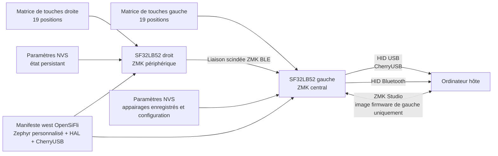

# Firmware de clavier ZMK sur SF32 { #zmk-keyboard-firmware-on-sf32 }

## Qu'est-ce que ZMK sur SF32 ? { #what-is-zmk-on-sf32 }

[ZMK Firmware](https://zmk.dev/) est un firmware de clavier sous licence MIT, construit sur Zephyr. ZMK amont fournit le modèle applicatif utilisé par de nombreux claviers filaires, sans fil et scindés : balayage de matrice, dispositions de touches et couches, comportements des touches, HID USB et Bluetooth, paramètres persistants et définitions extensibles de cartes et de shields.

[OpenSiFli/zmk](https://github.com/OpenSiFli/zmk) est le fork aval de ce projet maintenu par OpenSiFli. Le fork examiné ajoute :

- une variante de carte `sf32lb52_devkit_lcd/sf32lb525uc6/zmk` ;
- l'intégration du SoC SF32LB52 dans l'arborescence de l'application ZMK ;
- des configurations carte unique, clavier scindé, ZMK Studio et shield `urchin_sf32lb52` ;
- un backend CherryUSB orienté SF32 ;
- une partition de paramètres NVS de 256 Ko et la prise en charge des paramètres Bluetooth ;
- une disposition de clavier scindé Urchin à trois couches, avec commandes de profils Bluetooth et liaisons de déverrouillage de ZMK Studio.

Il s'agit d'un portage de développement, et non d'une version produit SF32 de ZMK publiée avec un tag de version. Le README de premier niveau du fork reste le README générique de ZMK amont et ne fournit pas de démarrage rapide propre à SF32. Considérez la carte, le shield, le manifeste, la source et le commit comme la référence exécutable, et exigez vos propres preuves de compilation propre, de flashage, de fonctionnement et de récupération avant de l'adapter.

## Pourquoi l'implémentation SF32 ? { #why-the-sf32-implementation }

Le portage SF32 montre comment le modèle de clavier de ZMK peut fonctionner sur SF32LB52 tout en conservant les conventions de Zephyr pour le devicetree, Kconfig, `west`, la disposition des touches, les shields et les claviers scindés. La référence `urchin_sf32lb52` répartit une disposition de 38 touches sur deux moitiés. Sa configuration gauche est la partie centrale du clavier scindé, active CherryUSB et ZMK Studio, et peut présenter du HID USB à un hôte ; la configuration droite est la partie périphérique. Les deux moitiés activent ZMK BLE.

Le fork est donc utile pour évaluer un clavier scindé sans fil, un périphérique de saisie de bureau USB/Bluetooth, un macro-pad programmable ou un produit d'interface homme-machine sur mesure sur SF32. Le compromis tient à la maturité des dépendances : le manifeste `west` du fork fige une branche Zephyr personnalisée (`v4.3+sf32-zmk_fixes`), une révision fixe du HAL SiFli et une branche CherryUSB personnalisée `zephyr-adapt`. Elles font partie de la frontière de compatibilité du portage et ne peuvent pas être remplacées par les révisions amont « les plus récentes » sans migration complète et passage de non-régression.

## Résultat, portée et critères d'entrée { #outcome-scope-and-entry-criteria }

**Résultat :** compiler et flasher des images Urchin gauche et droite à version figée, valider la matrice de touches complète, les couches, le HID USB, les chemins BLE du clavier scindé et de l'hôte, la persistance des paramètres, la frontière de ZMK Studio et la récupération ; puis effectuer une modification contrôlée de la disposition ou du matériel avec des preuves répétables.

Cette page n'affirme ni la parité complète des fonctions avec ZMK amont, ni la compatibilité avec des shields ZMK arbitraires, ni une autonomie prête pour la production, ni des performances radio validées, ni une migration prise en charge vers une autre révision de Zephyr/ZMK. Elle ne définit pas non plus un circuit imprimé de clavier de production : la configuration Urchin du dépôt fait correspondre une matrice de touches de référence aux broches du SF32LB52-DevKit-LCD et doit être traduite délibérément pour tout matériel sur mesure.

Avant de commencer, ayez :

- deux cartes SF32LB52-DevKit-LCD correspondant à la variante `sf32lb525uc6/zmk` du fork ;
- un banc de test de clavier scindé à 38 touches câblé exactement selon les surcouches `urchin_sf32lb52_left` et `urchin_sf32lb52_right`, ou un shield de test documenté plus petit pour les premiers contrôles du portage ;
- un hôte doté d'un environnement `west` Zephyr/ZMK fonctionnel et de suffisamment d'espace de stockage pour les modules figés du fork ;
- des connexions connues de flashage, de console série et de récupération pour chaque moitié avant de tester le comportement du clavier scindé ;
- un câble USB de données pour la moitié gauche/centrale et un moyen indépendant d'alimenter et de récupérer la moitié droite/périphérique ;
- un hôte Bluetooth, un hôte compatible ZMK Studio si Studio fait partie du périmètre, et un moyen de mesurer le courant de chaque moitié ;
- un relevé du commit du fork, des révisions du manifeste, des identifiants de carte/shield, des journaux de compilation et de flashage, des résultats des tests de touches, des appairages enregistrés, de l'état des paramètres et des mesures de courant.

<div align="center"><em>Tableau : Contrat du projet ZMK sur SF32</em></div>

<div align="center" markdown>

| Domaine | Base examinée | Preuves requises avant adaptation |
|:-----|:------------------|:------------------------------------|
| Fork | OpenSiFli/zmk à un commit fixe | Commit du fork, relation avec l'amont, révisions du manifeste et relevé des différences locales |
| Carte | `sf32lb52_devkit_lcd/sf32lb525uc6/zmk` | Révision exacte de la carte, chemin de flashage/récupération et journal de console |
| Référence clavier scindé | `urchin_sf32lb52_left` en central plus `urchin_sf32lb52_right` en périphérique | Câblage, correspondance image/moitié, test complet de la matrice et résultat de la liaison scindée |
| Chemins hôte | USB/CherryUSB et HID BLE depuis la moitié centrale | Preuves d'énumération, d'appairage/bond, de reconnexion, de profil et de récupération après panne |
| Configuration | Disposition à trois couches, paramètres NVS et ZMK Studio côté gauche | Résultat touche par touche, test de persistance, autorisation de Studio et relevé de retour arrière |
| Adaptation | Une modification à la fois de disposition, matrice, transport, alimentation ou dépendance | Modification relue, images d'origine et résultat de non-régression complet |

</div>

## Spécifications matérielles et logicielles { #hardware-and-software-specifications }

### Spécification matérielle { #hardware-specification }

<div align="center"><em>Tableau : Spécification matérielle de ZMK sur SF32</em></div>

<div align="center" markdown>

| Composant | Spécification requise | Rôle | Statut | Où l'obtenir | Notes de compatibilité et de substitution |
|:----------|:-----------------------|:-----|:-------|:----------------|:-------------------------------------|
| Deux cartes SF32LB52-DevKit-LCD | Cible de carte `sf32lb52_devkit_lcd/sf32lb525uc6/zmk` ; consignez les deux révisions de carte | Moitiés centrale et périphérique de la base de clavier scindé documentée | Obligatoire pour les tests du clavier scindé | [Référence de carte μForge](../sf32-products/devkits/SF32LB52-DevKit-LCD.md) ; [variante de carte OpenSiFli au commit examiné](https://github.com/OpenSiFli/zmk/tree/fd4d5843065f65ed5ed6198dc2e5d0520330bf8e/app/boards/sifli/sf32lb52_devkit_lcd) | Les images centrale et périphérique utilisent des rôles/configurations différents ; conservez une récupération indépendante pour les deux cartes |
| Banc de clavier scindé Urchin et interconnexion | Matrice de 38 touches câblée selon les surcouches `urchin_sf32lb52_left` et `urchin_sf32lb52_right` | Exerce la matrice de touches, le transport du clavier scindé et le comportement des rôles | Obligatoire pour la validation complète du clavier scindé | [Shield Urchin au commit examiné](https://github.com/OpenSiFli/zmk/tree/fd4d5843065f65ed5ed6198dc2e5d0520330bf8e/app/boards/shields/urchin_sf32lb52) | Les surcouches sont la référence de câblage, et non une garantie pour un autre circuit imprimé ou un shield quelconque |
| Hôte USB/BLE et câbles de données | Hôte USB pour la moitié centrale ; hôte HID Bluetooth ; chemin d'alimentation/flashage accessible séparément pour la moitié périphérique | Connexion à l'hôte, validation des entrées, journaux et récupération | Obligatoire | [Fork ZMK d'OpenSiFli](https://github.com/OpenSiFli/zmk) | Consignez le système d'exploitation hôte, l'état des appairages BLE enregistrés, le câble/port et la connexion de récupération de chaque moitié |

</div>

### Spécification logicielle { #software-specification }

<div align="center"><em>Tableau : Spécification logicielle de ZMK sur SF32</em></div>

<div align="center" markdown>

| Paquet ou service | Version ou révision requise | Rôle | Statut | Où l'obtenir | Notes de compatibilité et de mise à jour |
|:-------------------|:-----------------------------|:-----|:-------|:----------------|:-------------------------------|
| OpenSiFli/zmk | Commit examiné [`fd4d5843065f`](https://github.com/OpenSiFli/zmk/tree/fd4d5843065f65ed5ed6198dc2e5d0520330bf8e) | Portage de carte SF32, application ZMK et configuration Urchin | Obligatoire | [Dépôt au commit examiné](https://github.com/OpenSiFli/zmk/tree/fd4d5843065f65ed5ed6198dc2e5d0520330bf8e) | Ce n'est pas une version SF32 ZMK étiquetée ; ne le remplacez pas par ZMK amont sans portage ni validation |
| Dépendances du manifeste West | Révisions exactes résolues par `app/west.yml` au commit de fork figé | Zephyr, `hal_sifli`, CherryUSB et autres modules | Obligatoire | [Manifeste west figé](https://github.com/OpenSiFli/zmk/blob/fd4d5843065f65ed5ed6198dc2e5d0520330bf8e/app/west.yml) | Exécutez et conservez `west list` ; ne mettez pas les dépendances à jour indépendamment |
| Chaîne d'outils Zephyr `west` et outils de compilation | Versions compatibles avec le manifeste figé ; consignez les versions installées et le système d'exploitation hôte | Configurer, compiler et produire les images gauche/droite | Obligatoire | [Documentation ZMK](https://zmk.dev/docs) ; [documentation Zephyr](https://docs.zephyrproject.org/) | Reconstruisez les deux images depuis un espace de travail propre et conservez leurs répertoires de compilation et leurs empreintes distincts |
| Hôte ZMK Studio | Version d'hôte/d'application compatible, si Studio est activé dans la configuration retenue | Chemin optionnel de disposition/configuration | Optionnel | [Documentation ZMK Studio](https://zmk.dev/docs/features/studio) | La configuration examinée expose Studio sur la moitié gauche/centrale ; validez l'autorisation et le retour arrière avant tout usage produit |

</div>

## Choisir une configuration de référence prise en charge { #choose-a-supported-baseline }

La base OpenSiFli examinée est le commit `fd4d5843065f` du 27/05/2026. Elle inclut le shield Urchin et la mise à jour de la configuration de carte disponibles à ce commit, mais n'est pas une version SF32 ZMK étiquetée. Figez ce commit pour la reproduction initiale, ou consignez et examinez explicitement un commit plus récent.

<div align="center"><em>Tableau : Sélection de la base de ZMK sur SF32</em></div>

<div align="center" markdown>

| Élément de la base | Point de départ recommandé | Limitation critique |
|:-----------------|:------------------|:--------------------|
| Fork ZMK | OpenSiFli/zmk `fd4d5843065f` | Ne le remplacez pas par zmkfirmware/zmk amont ; il ne contient pas ce portage SF32 |
| Cible de carte | `sf32lb52_devkit_lcd/sf32lb525uc6/zmk` | Il s'agit d'une variante propre à ZMK du SF32LB52-DevKit-LCD |
| Shield proche du produit | `urchin_sf32lb52_left` et `urchin_sf32lb52_right` | Les surcouches définissent des correspondances de GPIO et des rôles différents ; les images ne sont pas interchangeables |
| Shields de diagnostic | `sf32lb52_test`, `sf32lb52_split_test_left/right` et `sf32lb52_zmkstudio_test` | Ce sont des références de développement du portage, pas des promesses de compatibilité produit |
| Rôle dans le clavier scindé | Gauche = central ; droite = périphérique | L'USB et ZMK Studio sont activés dans la configuration gauche ; ne supposez aucune symétrie |
| Manifeste de dépendances | Zephyr personnalisé `v4.3+sf32-zmk_fixes`, `hal_sifli` figé et CherryUSB personnalisé `zephyr-adapt` | La mise à jour de n'importe quelle dépendance modifie la frontière de compatibilité |
| Licence | Le fork ZMK et les ajouts SF32 identifiés utilisent des en-têtes/une licence MIT | Examinez séparément tous les modules, le matériel, les ressources de disposition et le contenu produit |

</div>

Les commandes suivantes combinent la forme du flux de travail `west` propre au fork avec ses identifiants exacts de carte SF32 et de shield Urchin. Conservez séparés les deux répertoires de compilation afin que les images ne puissent pas être confondues :

```bash
git clone https://github.com/OpenSiFli/zmk.git
cd zmk
git checkout fd4d5843065f

west init -l app
west update --fetch-opt=--filter=tree:0
west zephyr-export

west build -s app -p always -d build-left \
  -b sf32lb52_devkit_lcd/sf32lb525uc6/zmk -- \
  -DSHIELD=urchin_sf32lb52_left

west build -s app -p always -d build-right \
  -b sf32lb52_devkit_lcd/sf32lb525uc6/zmk -- \
  -DSHIELD=urchin_sf32lb52_right
```

Consignez le `west list` final, les Kconfig et devicetree générés, les empreintes des artefacts, l'étiquetage image/moitié et la procédure de flashage réelle. Ne commencez pas les tests du clavier scindé tant que chaque carte ne peut pas être récupérée indépendamment.

## Étapes du projet { #delivery-map }

<div align="center"><em>Tableau : Étapes du projet de ZMK sur SF32</em></div>

<div align="center" markdown>

| Étape | Décision qu'elle appuie | Livrable requis |
|:------|:---------------------|:----------------|
| 1. Base de portage intacte | Le fork figé, la cible de carte, les shields, le câblage et l'hôte fonctionnent-ils ensemble ? | Images gauche/droite à version figée et une session de frappe validée |
| 2. Entrées, transport et récupération | Les défaillances de matrice, USB, BLE, clavier scindé, paramètres et Studio sont-elles diagnostiquables et récupérables ? | Couverture des touches plus relevé d'injection de pannes et de récupération |
| 3. Reproduction de la source | Un second environnement peut-il régénérer les deux images sans état caché ? | Manifeste, compilations propres, empreintes des artefacts, flashages et résultat répété |
| 4. Adaptation contrôlée | Un comportement du clavier ou une correspondance matérielle peut-il changer sans casser la base ? | Modification bornée, chemin de retour arrière et preuves de non-régression |
| 5. Revue produit | Le portage est-il assez mûr pour un circuit imprimé sur mesure ou un prototype sur batterie ? | Risques attribués et décision de poursuivre/différer/arrêter |

</div>

## Architecture système et dépendances { #system-architecture-and-dependencies }

<div align="center"><em>Figure : Chemins du clavier scindé ZMK sur SF32LB52</em></div>



Traitez les défaillances comme des domaines distincts : matrice physique/câblage, liaison scindée de droite à gauche, USB côté gauche, Bluetooth de l'hôte, appairages et paramètres enregistrés, ZMK Studio, flashage/récupération de la carte et pile de dépendances figée. Une touche qui n'atteint pas l'hôte peut échouer avant le balayage, pendant le transport du clavier scindé, dans la disposition centrale ou au niveau du point de terminaison HID retenu ; diagnostiquez le chemin dans cet ordre.

## Étape 1 — Établir la base de portage intacte { #stage-1-establish-the-untouched-port-baseline }

**Objectif :** prouver la référence OpenSiFli exacte avant de modifier une disposition, une surcouche ou une dépendance.

1. Consignez les deux révisions de carte et câblez les deux bancs exactement selon les surcouches Urchin gauche et droite. Étiquetez les cartes et les câbles USB/de flashage selon leur rôle.
2. Compilez les deux images au commit figé, enregistrez `west list` et inspectez la configuration générée pour confirmer la carte, le shield, le rôle dans le clavier scindé, le BLE, CherryUSB, ZMK Studio et les paramètres NVS attendus.
3. Flashez chaque image par son chemin de récupération vérifié indépendamment. Capturez le démarrage à froid et le comportement de la console avant d'appairer les moitiés ou l'hôte.
4. Établissez la connexion BLE du clavier scindé, puis vérifiez les 38 positions par rapport aux couches `default`, `lower` et `raise`. Contrôlez volontairement la sélection/l'effacement des profils Bluetooth et les liaisons de déverrouillage de Studio afin qu'elles ne soient pas déclenchées par accident pendant les tests de frappe.
5. Validez le HID USB et ZMK Studio sur la moitié gauche, puis le HID Bluetooth vers l'hôte retenu. Répétez après un démarrage à froid.

**Preuves à conserver :** relevés de carte et de câblage, révisions du fork et du manifeste, configurations générées, empreintes des images, journaux de flashage et de démarrage, matrice complète des positions de touches, résultats par couche, sélection du point de terminaison et versions de l'hôte/de Studio.

**Critère de sortie du point de contrôle 1 :** deux démarrages à froid reproduisent la disposition complète de 38 positions, les trois couches, la liaison scindée de droite à gauche et au moins un point de terminaison d'hôte retenu ; les deux moitiés restent récupérables indépendamment.

## Étape 2 — Valider les entrées, le transport, les paramètres et la récupération { #stage-2-validate-input-transport-settings-and-recovery }

**Objectif :** prouver que des pannes réalistes de clavier sont visibles et récupérables sans reconstruire à partir d'un état inconnu.

<div align="center"><em>Tableau : Tests de pannes et de récupération de ZMK sur SF32</em></div>

<div align="center" markdown>

| Test | Méthode | Preuve de réussite |
|:-----|:-------|:--------------|
| Couverture de la matrice | Exercer chaque position, les combinaisons de rollover, chaque couche et les deux entrées directes | Aucune touche manquante, dupliquée, bloquée ou aux rôles inversés ; l'ordre appui/relâchement est consigné |
| Perte de la liaison scindée | Éteindre la moitié droite ou l'éloigner de la portée au repos et pendant la frappe | Les touches côté gauche et la liaison hôte restent définies ; la moitié droite se reconnecte sans nouveau flashage ni touches périmées |
| Interruption USB | Débrancher/rebrancher le chemin de données USB gauche pendant la saisie et l'usage de Studio | Le HID et Studio se rétablissent indépendamment ; aucun modificateur bloqué ni paramètre corrompu ne subsiste |
| Perte du BLE de l'hôte | Désactiver le Bluetooth de l'hôte, changer de profil et se reconnecter | L'état du point de terminaison/profil est visible ; la reconnexion et l'effacement volontaire des appairages enregistrés suivent un chemin consigné |
| Persistance des paramètres | Modifier un paramètre réversible, éteindre et rallumer les deux moitiés, puis rétablir la base | L'état NVS attendu persiste ; un chemin documenté de réinitialisation/récupération supprime l'état endommagé ou indésirable |
| Frontière de ZMK Studio | Tenter une modification autorisée, déconnecter en cours de session sur une configuration récupérable, puis rétablir | Seule l'image centrale expose Studio ; les modifications invalides/incomplètes n'immobilisent pas le clavier |
| Cycle d'alimentation | Répéter des cycles d'alimentation indépendants et simultanés des moitiés en consignant le courant et le réveil | Les rôles, la liaison scindée, le point de terminaison et l'état de relâchement des touches se rétablissent de façon prévisible |

</div>

**Critère de sortie du point de contrôle 2 :** chaque panne applicable a un résultat de détection et de récupération répétable, aucun test ne laisse un état HID bloqué, et les paramètres ou appairages enregistrés peuvent être ramenés à la base consignée sans remplacer de fichiers non suivis.

## Étape 3 — Construire une base source reproductible { #stage-3-build-a-reproducible-source-baseline }

**Objectif :** permettre à un second ingénieur de régénérer les deux images et de répéter l'étape 2 à partir de sources propres.

1. Partez d'une extraction propre du fork au commit consigné et exécutez `west init`, `west update` et `west zephyr-export` sans substitution locale de module.
2. Enregistrez `west list`, les versions du compilateur et des outils, le `.config` généré, le devicetree généré, la sortie mémoire, les journaux de compilation et les deux artefacts avec leurs empreintes.
3. Flashez les images gauche et droite étiquetées sur les bonnes moitiés et répétez l'ensemble complet des tests de l'étape 2.
4. Comparez les artefacts et la configuration avec le relevé d'origine ; expliquez toute différence non reproductible avant de poursuivre.

**Critère de sortie du point de contrôle 3 :** un second environnement produit des images correctement étiquetées qui réussissent l'étape 2 sans surcouches non suivies, sortie de compilation périmée ni révisions de dépendances flottantes.

## Étape 4 — Adapter une frontière du clavier à la fois { #stage-4-adapt-one-keyboard-boundary-at-a-time }

**Objectif :** effectuer une modification produit tout en préservant le portage validé et les chemins de récupération indépendants.

<div align="center"><em>Tableau : Ordre d'adaptation contrôlée de ZMK sur SF32</em></div>

<div align="center" markdown>

| Classe de modification | Bonne première modification | Non-régression requise |
|:-------------|:------------------|:--------------------|
| Disposition | Une liaison, une couche, un hold-tap ou un combo | Toutes les positions/couches, ordre appui-relâchement, rollover, perte de la liaison scindée et les deux points de terminaison hôte |
| Matrice/circuit imprimé | Une ligne, une colonne, une entrée directe ou un changement de sens de diode | Revue électrique, devicetree généré, matrice complète, courts-circuits/ghosting, réveil et récupération |
| Studio | Un paramètre modifiable ou l'exposition d'une disposition | Autorisation, modifications valides/invalides, persistance, déconnexion, rétablissement et compatibilité de version |
| Transport | Un changement de point de terminaison USB/BLE ou de politique du clavier scindé | Énumération, appairage, appairages enregistrés, changement de profil, reconnexion de la liaison scindée, prévention des touches bloquées et courant |
| Alimentation | Un réglage de veille, de réveil, de balayage ou de radio | Courant par moitié actif/inactif/veille, latence, chaque source de réveil, reconnexion de la liaison scindée et conservation des paramètres |
| Migration de dépendance | Une mise à jour de ZMK, Zephyr, HAL ou CherryUSB | Différentiel du manifeste, compilations propres, différentiel de configuration générée, tous les tests de l'étape 2, courant et retour arrière |

</div>

**Critère de sortie du point de contrôle 4 :** la modification est relue, les images et paramètres d'origine peuvent être rétablis, et tous les tests applicables de matrice, de couches, de liaison scindée, d'USB, de BLE, de Studio, d'alimentation et de récupération réussissent.

## Étape 5 — Revue de maturité produit { #stage-5-product-readiness-review }

Avant de concevoir un circuit imprimé de clavier sur mesure ou un prototype sur batterie, répondez aux questions suivantes :

- Qui est responsable du fork ZMK d'OpenSiFli, de la branche Zephyr personnalisée, de la révision du HAL SiFli, de l'adaptation de CherryUSB et des futures mises à jour de sécurité ou de compatibilité ?
- Quelles fonctions de ZMK amont sont réellement exercées sur SF32, et lesquelles ne sont présentes que dans l'arborescence héritée ?
- Comment l'identité des images gauche/droite, la révision de la carte, la disposition, la configuration, les appairages enregistrés et l'état de réinitialisation d'usine seront-ils maîtrisés en fabrication et en service ?
- Quels sont les courants mesurés de chaque moitié en fonctionnement actif, connecté au repos, déconnecté et en veille, y compris le fréquence de balayage, le comportement de reconnexion et la protection de la batterie ?
- Quels hôtes, systèmes d'exploitation, contrôleurs USB, piles Bluetooth, chemins de réveil, cas de rollover et conditions d'interférence ont été testés ?
- Une mise à jour de dépendance échouée, une modification de Studio, une écriture de paramètres ou une mise à jour sur le terrain peut-elle être récupérée sans ouvrir ni mettre au rebut le produit ?
- Les licences de ZMK/Zephyr, les fichiers de circuit imprimé et de boîtier, le contenu des dispositions, les logos, les polices et toute configuration fournie conviennent-ils à la distribution ?

**Critère de sortie du point de contrôle 5 :** chaque risque résiduel a un responsable, des preuves et une disposition, et l'équipe a explicitement décidé de poursuivre, différer ou arrêter.

## Passage à la conception du produit { #handoff-to-product-design }

Reportez la référence SF32 exacte et la mémoire, les rôles et le transport du clavier scindé, la correspondance des lignes/colonnes/entrées directes, le sens des diodes, la connexion USB, les hypothèses d'antenne et de boîtier, la politique NVS/paramètres, les interfaces de flashage et de récupération, le budget énergétique par moitié, les bancs de test, l'identification des images et le manifeste figé. Poursuivez avec le [SF32LB52-DevKit-LCD](../sf32-products/devkits/SF32LB52-DevKit-LCD.md), la [frontière de la plateforme Zephyr](../develop/platforms/zephyr/overview.md), l'[architecture Bluetooth](../learn/bluetooth/overview.md), le [guide de conception matérielle du SF32LB52x](../hardware/chip-guides/SF32LB52x_hardware_design_guide.md) et [Conception pour la production](../hardware/design-for-production.md).

## Sources de référence { #authoritative-sources }

- [Fork SF32 OpenSiFli/zmk](https://github.com/OpenSiFli/zmk)
- [Commit examiné d'OpenSiFli/zmk](https://github.com/OpenSiFli/zmk/tree/fd4d5843065f65ed5ed6198dc2e5d0520330bf8e)
- [Variante de carte ZMK SF32LB52 au commit examiné](https://github.com/OpenSiFli/zmk/tree/fd4d5843065f65ed5ed6198dc2e5d0520330bf8e/app/boards/sifli/sf32lb52_devkit_lcd)
- [Shield scindé Urchin SF32LB52 au commit examiné](https://github.com/OpenSiFli/zmk/tree/fd4d5843065f65ed5ed6198dc2e5d0520330bf8e/app/boards/shields/urchin_sf32lb52)
- [Manifeste west d'OpenSiFli ZMK au commit examiné](https://github.com/OpenSiFli/zmk/blob/fd4d5843065f65ed5ed6198dc2e5d0520330bf8e/app/west.yml)
- [zmkfirmware/zmk amont](https://github.com/zmkfirmware/zmk)
- [Documentation ZMK](https://zmk.dev/docs/)
- [Documentation du projet Zephyr](https://docs.zephyrproject.org/)
