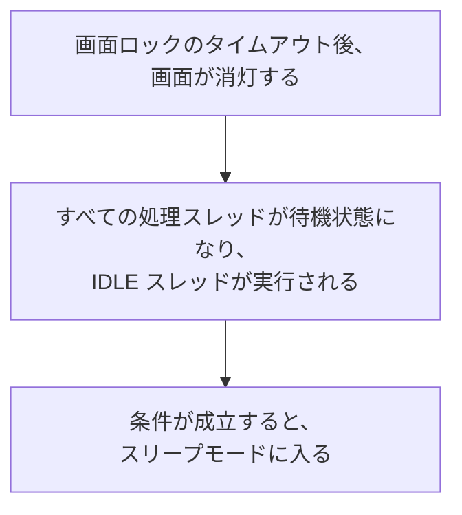
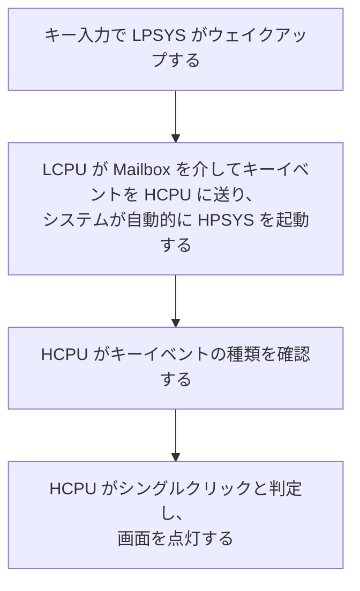

# 低消費電力の設定と測定 { #configure-and-measure-low-power }

SiFli-SDK の低消費電力ガイドは、複数の SF32 アーキテクチャを扱っています。SF32LB52x、SF32LB55x、SF32LB56x はデュアルコア構成で、HPSYS の HCPU（最大 240 MHz）が高性能処理を担い、LPSYS の LCPU（最大 48 MHz）が Bluetooth やセンサーのタスクを担います。SF32LB57x と SF32LB58x は HCPU/LCPU の構成に ACPU を追加しています。SF32LB58x の低消費電力側 LCPU は最大 96 MHz で動作します。コア数、クロック上限、低消費電力時の動作はファミリーによって異なるため、対象デバイスに対応する SDK ガイドを参照してください。

## 電源管理フレームワークを設定する { #configure-the-power-management-framework }

プロジェクトのディレクトリで次を実行します。

```bash
sdk.py menuconfig
```

次の menuconfig 設定は SF32LB52x のガイドに記載された例です。低消費電力モードの名称や設定項目はファミリーや SDK のバージョンによって異なる場合があるため、他の製品で使う際は対象ファミリーのガイドを確認してください。

<div align="center" markdown>

<em>表: SF32LB52x ガイドに記載された低消費電力 menuconfig の設定例</em>

| Menuconfig パス | シンボル | 目的 |
|---|---|---|
| `Sifli middleware → Enable Low power support` | `BSP_USING_PM` | SiFli の電源管理モジュールを有効にします。 |
| `RTOS → RT-Thread Components → Device Drivers → Using Power Management device drivers → Select PM Mode → Enable Deep Mode` | `PM_DEEP_ENABLE` | ディープスリープ（Deep Sleep）を有効にします。 |
| `Sifli middleware → Enable Low power support → Enable PM Debug` | `BSP_PM_DEBUG` | 電源状態の遷移を出力します。最終的な消費電流測定では無効にしてください。 |
</div>

生成される `rtconfig.h` には通常、`RT_USING_PM`、`BSP_USING_PM`、選択したモードのシンボルが含まれます。動作する構成例として `example/pm/classical` を参照してください。この機能を無効にするには、有効にした項目を menuconfig で元に戻します。

以下の図は SiFli の SF32LB52x 向けガイドに掲載されたもので、該当する menuconfig の場所を示しています。実際のプロジェクトでは、対象ファミリーの SDK メニューを正としてください。

{ loading="lazy" }
<div align="center"><em>図: SiFli ガイドに掲載された SF32LB52x の例 — Sifli middleware → Enable Low power support で `BSP_USING_PM` を有効にする。</em></div>

{ loading="lazy" }
<div align="center"><em>図: SiFli ガイドに掲載された SF32LB52x の例 — RTOS → RT-Thread Components → Device Drivers で `PM_DEEP_ENABLE` を有効にする。</em></div>

## ウェイクアップソースを選択する { #select-a-wake-source }

対象 SDK のサンプルにあるボードの `pinmux.c`/`drv_io.c` と API を使用します。

<div align="center" markdown>

<em>表: ファミリー別のDeep Sleep／Standby および Hibernate からのウェイクアップ動作</em>

| ファミリー | Deep Sleep／Standby からのウェイクアップ動作 | Hibernate からのウェイクアップ動作 |
|---|---|---|
| SF32LB52x | ディープスリープ中は、すべてのピンから `WSR_GPIO1` を介してウェイクアップできます。追加のウェイクアップピン選択は不要です。HCPU と LCPU は個別にスリープできます。 | `HAL_PMU_EnterHibernate()` を呼び出す前に、PMU のウェイクアップピンとレベルを設定します。 |
| SF32LB55x | 55x 固有の AON ウェイクアップピンマップを使用します。 | Hibernate からのウェイクアップに使えるのは LCPU のウェイクアップピン `PIN0`～`PIN5` のみです。有効な 55x ピン番号を指定して `HAL_PMU_EnablePinWakeup()` を使用します。これらのピンは Hibernate 中にフローティング入力となるため、基板で必要な場合は外付けプル抵抗を設けてください。 |
| SF32LB56x | ファミリー固有の HPAON/LPAON ウェイクアップピンマップを使用します。 | PMU は二つのウェイクアップソース `PIN0` と `PIN1` をサポートし、HCPU または LCPU のウェイクアップピンに割り当てられます。下の PMU 設定例を参照してください。 |
| SF32LB57x | ファミリー固有の HPAON/LPAON ウェイクアップピンマップを使用します。 | PMU は二つのウェイクアップソース `PIN0` と `PIN1` をサポートします。57x の Hibernate ウェイクアップピンインデックス範囲は 0～13 です。各ソースを対象の HCPU/LCPU ウェイクアップピンに割り当てます。 |
| SF32LB58x | ファミリー固有の HPAON/LPAON ウェイクアップピンマップを使用します。 | PMU は二つのウェイクアップソース `PIN0` と `PIN1` をサポートし、HCPU または LCPU のウェイクアップピンに割り当てられます。下の PMU 設定例を参照してください。 |
</div>

SF32LB52x、SF32LB56x、SF32LB57x、SF32LB58x では、下の例のように GPIO を PMU ウェイクアップソース `PIN0` に割り当てて Hibernate 復帰を設定します。この例は SF32LB55x には適用されません。55x では表に示した別の設定方法を使用してください。SF32LB57x の PMU ウェイクアップピンインデックス範囲は 0～13 です。選択した割り当てを対象デバイスのユーザーマニュアルと基板設計で確認してください。

```c
HAL_PMU_SelectWakeupPin(0,
    HAL_HPAON_QueryWakeupPin(hwp_gpio1, BSP_KEY1_PIN));
HAL_PMU_EnablePinWakeup(0, AON_PIN_MODE_HIGH);
rt_kprintf("CR:0x%x, WER:0x%x\n", hwp_pmuc->CR, hwp_pmuc->WER);
```

Hibernate からの復帰は `PM_HIBERNATE_BOOT` が設定されたコールドブートです。スタンバイからの復帰とは異なり、中断した命令列から実行を再開しません。同じ IO でStandby と Hibernate の両方からウェイクアップする場合は、それぞれの経路を設定してください。55x の Hibernate 用ウェイクアップピンはフローティング入力です。基板側で必要な場合は外付けプル抵抗を設けてください。

## スリープ状態を理解する { #understand-the-sleep-states }

<div align="center" markdown>

<em>表: スリープモードとガイドに記載された復帰時間の目安</em>

| SDK モード | CPU／周辺機器の状態 | SRAM とウェイクアップソース | ガイドに記載された復帰時間の範囲 |
|---|---|---|---|
| `PM_SLEEP_MODE_IDLE` | CPU は WFI/WFE で待機し、クロックと周辺機器は動作を続けます。 | SRAM に引き続きアクセスでき、任意の割り込みで復帰します。 | <1 µs |
| `PM_SLEEP_MODE_LIGHT` | 高速クロックを停止し、サブシステムを 32 kHz に切り替えます。 | LPTIM、RTC、LCPU BLE MAC、Mailbox、またはウェイクアップピン。 | 30–100 µs |
| `PM_SLEEP_MODE_DEEP` | ライトスリープ（Light Sleep）と同様ですが、電源を `RET_LDO` に切り替えます。 | SRAM の保持状態とウェイクアップソースはファミリーによって異なります。下の表を参照してください。 | 100 µs–1 ms |
| `PM_SLEEP_MODE_STANDBY` | CPU と周辺機器はリセット／電源オフ状態になり、ピン状態は維持されます。 | 保持される SRAM 容量とウェイクアップソースはファミリーによって異なります。ソフトウェアは AON 状態からスタンバイ起動を判別します。 | 1–2 ms |
| Hibernate | すべてのサブシステムの電源を切り、32 kHz 水晶振動子は動作を維持します。 | RTC または PMU ウェイクアップピン。RAM は保持されません。`HAL_PMU_EnterHibernate()`。 | >2 ms |
| シャットダウン | すべてのサブシステムの電源を切り、RC10K は動作を維持します。 | RTC または PMU ウェイクアップピン。RAM は保持されず、IO はハイインピーダンスになります。`HAL_PMU_EnterShutdown()`。 | >2 ms |
</div>

<div align="center" markdown>

<em>表: ファミリー別のSRAM保持状態と復帰時間の参考値</em>

| ファミリー | `PM_SLEEP_MODE_DEEP` | `PM_SLEEP_MODE_STANDBY` |
|---|---|---|
| SF32LB52x | HPSYS と LPSYS の SRAM はアクセス不可ですが、すべて保持されます。復帰時間は約 250 µs です。 | LPSYS の SRAM はアクセス不可ですが、すべて保持されます。HPSYS の SRAM はアクセスできず、保持されるのは 384 KB のみです。復帰時間は約 1 ms です。 |
| SF32LB55x | HPSYS と LPSYS の SRAM はアクセス不可ですが、すべて保持されます。復帰時間は約 250 µs です。 | LPSYS の SRAM はアクセス不可ですが、すべて保持されます。HPSYS の SRAM はアクセスできず、保持されるのは 64 KB のみです。復帰時間は約 1.5 ms です。 |
| SF32LB56x | HPSYS と LPSYS の SRAM はアクセス不可ですが、すべて保持されます。復帰時間は約 250 µs です。 | LPSYS の SRAM はアクセス不可ですが、すべて保持されます。HPSYS の SRAM はアクセスできず、保持されるのは 64 KB のみです。復帰時間は約 1.5 ms です。 |
| SF32LB58x | HPSYS と LPSYS の SRAM はアクセス不可ですが、すべて保持されます。復帰時間は約 250 µs です。 | LPSYS の SRAM はアクセス不可ですが、すべて保持されます。HPSYS の SRAM はアクセスできず、保持されるのは 64 KB のみです。復帰時間は約 1.5 ms です。 |

</div>

参照した現行の SDK 低消費電力ガイドには、SF32LB57x の SRAM 保持容量と復帰時間に相当するデータがありません。他のファミリーの保持容量や時間を SF32LB57x に当てはめず、対象 SDK リリースとデバイス資料で確認してください。

表中の `PM_SLEEP_MODE_LIGHT`、`PM_SLEEP_MODE_DEEP`、`PM_SLEEP_MODE_STANDBY` は、それぞれライトスリープ（Light Sleep）、ディープスリープ（Deep Sleep）、スタンバイ（Standby）に対応します。

上のファミリー別数値は SDK ガイドに記載された参考値であり、基板上での復帰時間を保証するものではありません。SF32LB52x のガイドでは、PSRAM がある場合、HCPU は電源遮断で失われる RAM データを PSRAM に退避し、ウェイクアップ後に復元すると説明されています。PSRAM がない場合のバックアップ先は 64 KB Retention RAM です。このバックアップ領域は、各ファミリーのモード表に示された SRAM 保持容量とは別の指標です（たとえば SF32LB52x の Standby では、HPSYS の SRAM 保持容量として 384 KB が記載されています）。このバックアップ方式や容量が他のファミリーにも当てはまるとは考えず、そのファミリーの SDK ガイドで確認してください。実際の消費電流は、有効な周辺機器、IO レベル、外部メモリー、基板構成によって変わります。

## 動作中のクロックを制御する { #control-clocks-while-awake }

アイドルスレッドがスリープ状態に入れない場合、WFI の自動周波数低減によって消費電流を抑えられます。ただし、EPIC、EZIP、LCDC、USB、SD がアイドル状態の場合に限り安全です。アプリケーションで SDK の LVGL／周辺機器の稼働状態管理を利用しない場合は、`rt_pm_hw_device_start()` と `rt_pm_hw_device_stop()` で周辺機器の動作開始と終了を通知してください。`HAL_RCC_HCPU_SetDeepWFIDiv()` で分周比を設定します。通常、オーディオ処理では低減後のクロックを 48 MHz に制限し、それ以外の処理では 4 MHz を使用できます。SDK ガイドの指示に従い、必要に応じて `HPSYS_RCC_DBGR_FORCE_HP` を設定してください。

処理を実行する場合は `rt_pm_run_enter()` を使用します。

<div align="center" markdown>

<em>表: 動作モード別の HCPU クロック設定</em>

| モード | HCPU クロック |
|---|---:|
| `PM_RUN_MODE_HIGH_SPEED` | 240 MHz |
| `PM_RUN_MODE_NORMAL_SPEED` | 144 MHz |
| `PM_RUN_MODE_MEDIUM_SPEED` | 48 MHz |
| `PM_RUN_MODE_LOW_SPEED` | 24 MHz |
</div>

`pm_scenario_start()`/`pm_scenario_stop()` は、UI と Audio に関する SDK のポリシーを適用します。いずれかのシナリオが有効なら高速モードを選び、どちらも有効でなければ中速モードを選びます。低いクロックでは処理時間が長くなる場合があるため、瞬間電流だけでなく消費エネルギーも測定してください。

## サブシステム間のスリープ順序を確認する { #understand-inter-subsystem-sleep-sequencing }

画面が消灯すると、HPSYS はスリープに入れます。55x/56x/58x では通常、その後に LPSYS もスリープします。52x は資料で確認できる例外で、HCPU と LCPU が個別にスリープできます。利用可能な資料では、57x の ACPU も同じ順序に従うとは確認できません。対象 SDK バージョンでサブシステムの制御方針を確認してください。ウェイクアップ後、`gui_resume` によって次の画面消灯判定サイクルが始まります。共有周辺機器や IPC の処理が残っている間は、該当するコアを動作状態に保ってください。

`BSP_PM_DEBUG` を一時的に有効にして、ログに次のマーカーが出るか確認します。

<div align="center" markdown>

<em>表: 低消費電力遷移ログのマーカー</em>

| ログ | 意味 |
|---|---|
| `gui_suspend` / `gui_resume` | 画面消灯／点灯の遷移。 |
| `[pm]S: mode,gtime` | スリープに入ったことを示します。`gtime` の単位は 32,768 Hz のクロックティックです。 |
| `[pm]W: gtime` | スリープから復帰したことを示します。 |
| `[pm]WSR:0x...` | ウェイクアップ理由。ビットの意味は対象ファミリーのユーザーマニュアルで確認します。 |
</div>

期待したスリープに入らない場合は、`list_thread`、`pm_dump`、`list_timer` を確認してください。IDLE スレッドが実行されていること、`rt_pm_request(PM_SLEEP_MODE_IDLE)` による要求が残っていないこと、最も近い OS タイマーの期限がポリシーしきい値（通常、HCPU は 100 ms、LCPU は 10 ms）より後であること、ウェイクアップ条件が発生していないこと、IPC キューが空であることを確認します。しきい値より短い周期で待機処理を繰り返すと、スリープに入れない状態が続くことがあります。

SiFli のガイドには、「画面消灯 → IDLE → 条件成立後にスリープ」と、「キー入力で LPSYS がウェイクアップし、LCPU が Mailbox を介してイベントを HCPU に送り、システムが自動的に HPSYS を起動する」フローも図示されています。これらはログの順序を確認する際に役立ちます。図中の説明とフローは SF32LB52x の例であり、他のファミリーの WSR ビット割り当てを推定する根拠にはなりません。

{ loading="lazy" }
<div align="center"><em>図: SF32LB52x の低消費電力デバッグ設定（`BSP_PM_DEBUG`）。</em></div>

<div align="center"><em>図: SF32LB52x の例 — 画面消灯からスリープまでのフロー。</em></div>



<div align="center"><em>図: SF32LB52x の例 — LPSYS から HPSYS へのウェイクアップフロー。</em></div>



## 基板レベルのリークを減らす { #reduce-board-level-leakage }

まず最小構成のシステムを測定します。ディスプレイ、センサー、充電器など、取り外し可能な負荷を切り離し、その後一つずつ接続していきます。よくあるリーク源は次のとおりです。

- 外部デバイスの電源が入り続けている。
- 電源が切れたデバイスに対して、出力が High のまま駆動されている。
- 入力がフローティングになっている、またはプルアップ／プルダウンが一致していない。
- PSRAM、NOR/NAND Flash、eMMC、SDIO が低消費電力状態に移行していない。
- 55x の USB `PA01` 設定が内部プルダウンと競合している。

基板固有の電源遷移は `BSP_IO_Power_Down()` と `BSP_Power_Up()` に実装します。画面消灯／点灯と同時にディスプレイやタッチの電源を切り替える場合は、`BSP_TP_PowerDown/Up` と `BSP_LCD_PowerDown/Up` を使用してください。NOR Flash から XIP 実行する場合は、Flash のスリープ／ウェイクアップ処理を保持 RAM（`HAL_RAM_RET_CODE_SECT`）に配置します。

## 再現可能な測定結果を記録する { #measure-and-record-a-reproducible-result }

測定ごとに、ファミリーと SDK のリビジョン、基板リビジョン、電源電圧、電流計の測定位置と帯域幅、ファームウェア設定、搭載メモリー構成、動作中の周辺機器、ウェイクアップソース、スリープモード、遷移ログを記録します。電流値だけでなく、測定時の状態と条件も必ず併記してください。別の基板や動作モードで測定した値を、そのまま比較しないでください。

ファミリー別の公式資料: [SF32LB52x](https://docs.sifli.com/projects/sdk/latest/sf32lb52x/app_note/low_power.html)、[SF32LB55x](https://docs.sifli.com/projects/sdk/latest/sf32lb55x/app_note/low_power.html)、[SF32LB56x](https://docs.sifli.com/projects/sdk/latest/sf32lb56x/app_note/low_power.html)、[SF32LB58x](https://docs.sifli.com/projects/sdk/latest/sf32lb58x/app_note/low_power.html)。SDK の [PMU API リファレンス](https://docs.sifli.com/projects/sdk/latest/en/sf32lb52x/api/hal/pmu.html) には、SF32LB57x の Hibernate ウェイクアップピンインデックス範囲が記載されています。
