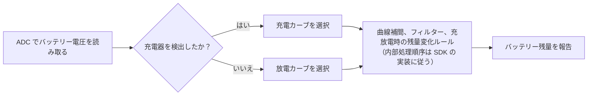

# バッテリー残量の推定 { #battery-capacity-calculation }

SiFli-SDKのバッテリー計算機能は、測定した電圧からバッテリーの充電状態をパーセントで推定します。これは電圧から残量を推定する方式であり、クーロンカウンターではありません。推定精度は、設定するバッテリーカーブと充電状態情報の精度に左右されます。

ミドルウェアは充電器の状態を検出し、該当する充電または放電カーブを選択して、補間により残量を推定します。また、電圧の急変を扱う主フィルターと、任意で有効にできる加重平均フィルターを使って結果を安定させます。公開ガイドでは内部のフィルター処理順序が詳しく説明されていないため、特定の順序を前提にせず、使用するSDKリビジョンの実装を確認してください。

## 計算機能の概要 { #what-the-calculator-does }

<div align="center"><em>表: バッテリー計算機能の動作</em></div>
<div align="center" markdown>

| 機能 | 動作 |
| --- | --- |
| 充電／放電カーブ | 現在の充電状態に応じた電圧－残量カーブを選択する。 |
| 線形補間 | 選択したカーブ上の隣接点の間で残量を計算する。 |
| 主フィルター | 設定した電圧変動しきい値と、しきい値を超える連続サンプル数に基づいて急変をフィルタリングする。 |
| 加重平均フィルター（任意） | 有効時は、過去の電圧値と現在の電圧値を加重平均する。 |
| 充電器の接続状態検出 | ボードの充電器検出設定に基づいて、充電または放電カーブを選択する。 |

</div>

<div align="center"><em>図: バッテリー残量の推定フロー</em></div>



この図は概念を示すもので、内部の呼び出し順序を保証するものではありません。公開ガイドでは、補間、フィルタリング、充放電時の残量変化ルールの正確な順序は定義されていません。製品で使用するSDKリビジョンの実装を確認してください。ガイドでは、充電中は残量を減少させず、放電中は増加させないと説明されています。

## まずボードを設定する { #configure-the-board-first }

ミドルウェアを使う前に、menuconfigでボードを設定してください。

1. バッテリー電圧測定用のADCサポートを有効にします。
2. バッテリー計算機能を有効にします。
3. 充電サポートを有効にします。
4. ボードで使用する充電ICを選択します。該当する充電ICがリストにない場合に限り、簡易充電器オプションを使います。
5. ボードの充電器接続検出ピンを設定します。
6. ハードウェアに合わせて検出ピンの極性を選択します。

`BSP_CHARGER_INT_PIN_ACTIVE_HIGH`は充電器検出の極性を定義します。このマクロを定義するとHighレベルで充電器接続を検出し、定義しない場合はLowレベルで検出します。極性を誤るとバッテリーカーブの選択を誤り、表示残量が変化しない、または逆方向に変化することがあります。

## 実セルのバッテリーカーブを使う { #use-battery-curves-from-the-actual-cell }

ボードディレクトリにある既定の`battery_table.c`は参考例であり、あらゆるバッテリーに使えるモデルではありません。実際に使うセルの電圧－残量カーブをメーカーから入手し、製品に合った参照テーブルを設定してください。

<div align="center"><em>表: バッテリーカーブの要件</em></div>
<div align="center" markdown>

| テーブル | 必要な定義 |
| --- | --- |
| `charging_curve_table` | 充電用の`const battery_lookup_point_t[]`テーブル。電圧値は高い順から低い順に並べる。 |
| `discharge_curve_table` | 放電用の`const battery_lookup_point_t[]`テーブル。電圧値は高い順から低い順に並べる。 |
| テーブル内容 | 残量は100から0の順に対応させ、実際のバッテリー特性を反映する。 |
| テーブルの配置場所 | ボード固有の`battery_table.c`。 |

</div>

充電時と放電時では、同じ充電状態でもセル電圧が異なるため、別々のカーブを使います。公称の化学系が同じだからといって、任意の4.2 Vリチウム電池カーブを実セルの代わりに流用しないでください。

!!! warning "使用するSDKとボードの電圧スケールを確認する"
    SiFliの公開ドキュメントには単位の不整合があります。`voltage_mv`とフィルターしきい値はmVとされていますが、例では`38000`を`3.8 V`として渡し、カーブ例でも`41808`を`4.18 V`としています。これらの数値は0.1 mVスケールと整合しますが、ドキュメントにはそのスケールが明記されていません。したがって、これは数値からの推定であり、APIの保証ではありません。使用前に、対象SDKリビジョンとボード設定におけるADC変換経路、バッテリーテーブル、しきい値の比較処理を確認してください。

    ADC値、選択したカーブテーブル、フィルターしきい値には互換性のあるスケールが必要です。ドキュメントに記載されたしきい値は`50`と`30`で、単位はmVとされています。電圧例だけを根拠にこれらの値を換算しないでください。対象SDKが各値をどのように解釈・比較するかを確認し、ADC値だけを変更してテーブルやしきい値を別スケールのままにしないでください。

## 計算機能の設定 { #configure-the-calculator }

`battery_calculator_config_t`で2つのカーブテーブルとフィルター設定を指定します。

<div align="center"><em>表: バッテリー計算機能の設定項目</em></div>
<div align="center" markdown>

| フィールド | 用途 | 公開例の値（ドキュメント上の単位表記） |
| --- | --- | --- |
| `charging_table`, `charging_table_size` | 充電カーブと点数 | ボード固有 |
| `discharging_table`, `discharging_table_size` | 放電カーブと点数 | ボード固有 |
| `charge_filter_threshold` | 充電中の電圧変化しきい値 | `50`（ドキュメントではmVと表記。対象SDKのスケールを確認） |
| `discharge_filter_threshold` | 放電中の電圧変化しきい値 | `30`（ドキュメントではmVと表記。対象SDKのスケールを確認） |
| `filter_count` | 主フィルターが電圧変動を確定するために必要な、しきい値を超える連続サンプル数 | `3` |
| `secondary_filter_enabled` | 加重平均フィルターを有効にする | `true` |
| `secondary_filter_weight_pre` | 前回電圧の重み | `90` |
| `secondary_filter_weight_cur` | 現在電圧の重み | `10` |

</div>

加重平均フィルターを有効にする場合、`secondary_filter_weight_pre + secondary_filter_weight_cur`は`100`でなければなりません。しきい値、回数、重みは、SDKの参考値を校正結果と見なさず、実際のバッテリー、負荷変動、製品の表示要件に合わせて調整してください。

## 初期化と残量計算 { #initialize-and-calculate }

残量を要求する前に計算機能を初期化します。公開SiFliガイドでは初期化関数の戻り値は`void`とされています。コンパイル時には、使用するSDKリビジョンのヘッダーを確認してください。

```c
void battery_calculator_init(battery_calculator_t *calc,
                             const battery_calculator_config_t *config);
```

残量APIの戻り値は0～100の充電状態であり、mAhで表すバッテリー容量ではありません。組み込む前に、使用するSDKリビジョンのヘッダーと実装を確認し、追加のパラメーター制約や初期化ステータスの戻り値があるか確認してください。

バッテリー電圧には、使用するSDKリビジョンが要求するスケールを指定します。公開APIの引数名は`voltage_mv`ですが、実際のスケールは前述のとおり確認してください。

```c
uint8_t battery_calculator_get_percent(battery_calculator_t *calc,
                                       uint32_t voltage_mv);
```

<div align="center"><em>表: 推奨する組み込み手順</em></div>
<div align="center" markdown>

| 手順 | 操作 |
| --- | --- |
| 1 | ボードのADC、充電器の種類、充電器検出ピン、極性を設定する。 |
| 2 | 検証済みの充電／放電カーブを`battery_table.c`に定義する。 |
| 3 | `battery_calculator_config_t`を使って`battery_calculator_t`を初期化する。 |
| 4 | 設定したADC経路からバッテリー電圧を読み取る。 |
| 5 | 電圧のスケールがカーブテーブルとしきい値に合うことを確認してから、`battery_calculator_get_percent()`に渡す。 |
| 6 | フィルター済みの値をUI、低残量時の制御、製品テレメトリーに使う。 |

</div>

## 製品ハードウェアで動作を検証する { #verify-behavior-on-product-hardware }

表示残量は、ラボでもっともらしい値を返すだけでなく、製品の実際の状態に追従する必要があります。充電中、放電中、ケーブル接続時、ケーブル取り外し時に、充電器検出状態、電圧測定値、選択されたカーブ、表示残量をまとめて検証してください。

<div align="center"><em>表: バッテリー残量表示のトラブルシューティング</em></div>
<div align="center" markdown>

| 症状 | 最初に確認すること |
| --- | --- |
| 残量が急に変化する | まずADC値、カーブテーブル、しきい値が同じスケールか確認する。そのうえで該当するしきい値または`filter_count`を調整し、必要に応じて加重平均フィルターを有効化または強化する。 |
| 残量が不正確 | 実際のバッテリーに合うカーブを入手し、参照点を再校正する。 |
| 残量が変化しない | 報告される充電器の接続状態と`BSP_CHARGER_INT_PIN_ACTIVE_HIGH`の極性を確認する。公開ガイドでは、充電中は残量が減少せず、放電中は増加しないと説明されています。 |
| 残量の変化方向が逆 | 充電器検出ピン、電気的極性、選択された充電／放電カーブを確認する。 |

</div>

公式のミドルウェア仕様と最新の設定画面は、[SiFli-SDKのバッテリー残量計算](https://docs.sifli.com/projects/sdk/latest/sf32lb58x/middleware/battery_calculator.html)を参照してください。システム全体のバッテリー駆動時間を見積もる場合は[スマートウォッチの消費電力分析](smartwatch-power-profiling.md)、実測による検証については[電力測定と検証](measurement-and-validation.md)を続けて読んでください。

公開ガイドは機能を調べる際の出発点ですが、製品で使用するSDKリビジョンの代わりにはなりません。特に電圧スケールの不整合を解消するには、そのリビジョンのADC経路、バッテリーテーブル、しきい値比較処理、APIヘッダーを確認してください。
