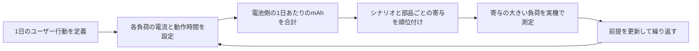
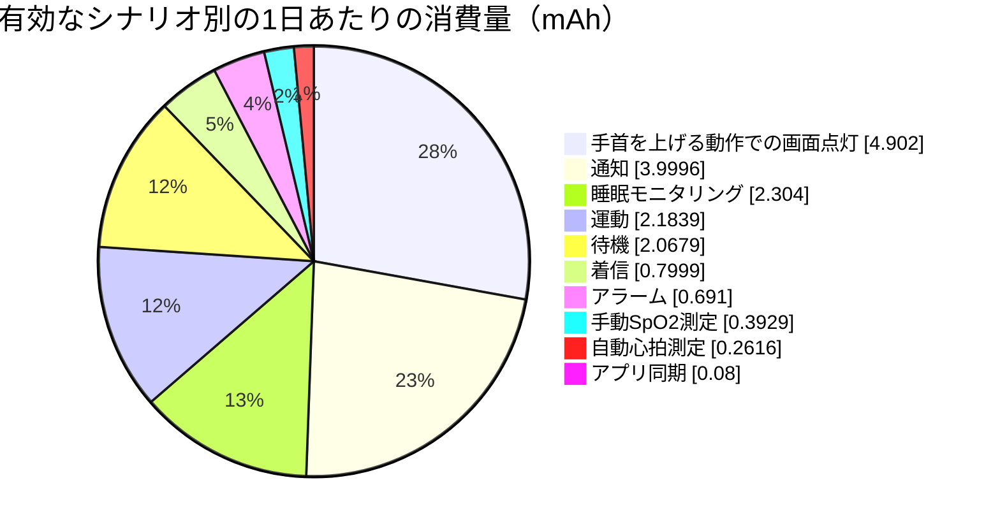
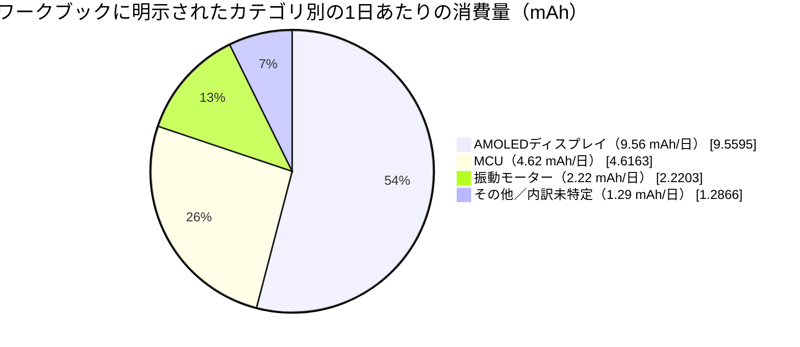
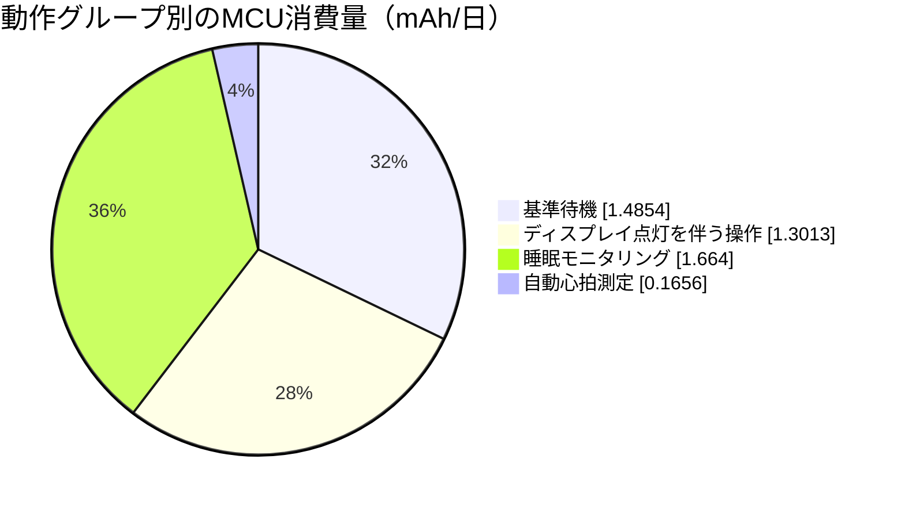

# スマートウォッチの消費電力分析 { #power-profiling-a-smartwatch }

消費電力分析では、想定される日々の使い方から電池駆動時間を見積もり、最適化すべき負荷に優先順位を付けます。この記事では、付属の[スマートウォッチの消費電力モデルをまとめたワークブック（英語版）](assets/smartwatch-power-profile-data.xlsx)を例に、各使用シナリオの1日あたりの消費量（mAh）を求める方法、電力予算を大きく占める負荷の見つけ方、表計算モデルを実測計画につなげる方法を説明します。

!!! warning "機器の仕様値ではなく、モデル値です"
    ここで使う電流値と利用条件は、付属ワークブックのモデルに基づくものです。特定のSF32デバイス、ディスプレイ、電池、またはスマートウォッチの実測データではありません。製品の電池駆動時間を公表する前に、実機で測定した値に置き換えてください。
    ワークブックには測定記録がないため、入力値のうちどれが実測値かは確認できません。13.15日という結果はモデルによる推定であり、実機で測定した駆動時間ではありません。

システム構成やファームウェアの指針は[低消費電力設計の概要](overview.md)、モデルを検証する測定手順は[電力測定と検証](measurement-and-validation.md)を参照してください。

## スマートウォッチのシステム概要 { #smartwatch-system-overview }

まず、モデルの対象範囲を定めます。このワークブックでは、MCU、AMOLEDディスプレイ、振動モーター、および内訳を特定していない`Other`負荷を備えた、電池駆動のスマートウォッチを想定しています。パネルのサイズや解像度、輝度設定、無線構成、個々のセンサーは特定されていません。以下のディスプレイ電流はワークブックへの入力値であり、測定記録による裏付けがないため、実測値ではなくモデルの仮定として扱ってください。特定パネルの仕様値でもありません。`Other`はモデル上の区分であり、単一の物理部品を表すものではありません。

<div align="center"><em>表：スマートウォッチのシステムとモデル入力値</em></div>

<div align="center" markdown>

| 項目 | ワークブックの値 | 用途 |
|:-----|-----------------:|:-----|
| 通常表示時のAMOLED電流 | 15 mA | 通知、着信アラート、手首を上げる動作での画面点灯に使用します。 |
| AMOLEDの常時表示（AOD）電流 | 2 mA | モデルには定義されていますが、基準ケースではAODシナリオを無効にしています。 |
| 電池の定格容量 | 250 mAh | モデルの補正を適用する前の容量です。 |
| 電池劣化の見込み | 7% | 使用可能容量を232.5 mAhに減らします。 |
| 公称電池電圧 | 3.87 V | ワークブックの電圧正規化用の補助計算に使います。 |

</div>

## シナリオ別の消費電力 { #power-consumption-by-scenario }

シナリオは、単一部品の動作ではなく、ユーザーまたはシステムが行う一連の処理を表します。たとえばメッセージ通知では、MCUが復帰し、AMOLEDが点灯し、振動モーターが作動し、バックグラウンド負荷も動作する場合があります。元の表で`Display`と記された行は、すべてAMOLEDディスプレイを指します。この一覧では各シナリオの部品別負荷をまとめ、計算済みの日次値も追跡できるようにしています。各値の算出に使った1日の発生回数と継続時間は、本記事後半の1日あたりの利用プロファイルに示します。

<div align="center"><em>表：部品別の電力モデル全体</em></div>

<div align="center" markdown>

| シナリオ | 部品 | 電圧 | 電流 | 電圧係数* | 1日あたりの消費量 | 1日あたりの消費量に占める割合 |
|:---------|:-----|-----:|-----:|----------:|------------------:|------------------------------:|
| 基準待機 | MCU | 3.3 V | 0.102 mA | 85.27% | 1.4854 mAh | 8.40% |
| 基準待機 | ディスプレイ | 3.3 V | 0 mA | 85.27% | 0 mAh | 0.00% |
| 基準待機 | 振動モーター | 3.3 V | 0 mA | 85.27% | 0 mAh | 0.00% |
| 基準待機 | その他（Other） | 3.87 V | 0.04 mA | 100.00% | 0.5825 mAh | 3.29% |
| メッセージ通知 | MCU | 3.3 V | 2.507 mA | 85.27% | 0.3482 mAh | 1.97% |
| メッセージ通知 | ディスプレイ | 3.3 V | 15 mA | 85.27% | 2.0833 mAh | 11.78% |
| メッセージ通知 | 振動モーター | 3.3 V | 11.25 mA | 85.27% | 1.5625 mAh | 8.84% |
| メッセージ通知 | その他（Other） | 3.87 V | 0.04 mA | 100.00% | 0.0056 mAh | 0.03% |
| 着信アラート | MCU | 3.3 V | 2.507 mA | 85.27% | 0.0696 mAh | 0.39% |
| 着信アラート | ディスプレイ | 3.3 V | 15 mA | 85.27% | 0.4167 mAh | 2.36% |
| 着信アラート | 振動モーター | 3.3 V | 11.25 mA | 85.27% | 0.3125 mAh | 1.77% |
| 着信アラート | その他（Other） | 3.87 V | 0.04 mA | 100.00% | 0.0011 mAh | 0.01% |
| 手首を上げる動作での画面点灯 | MCU | 3.3 V | 2.607 mA | 85.27% | 0.7242 mAh | 4.10% |
| 手首を上げる動作での画面点灯 | ディスプレイ | 3.3 V | 15 mA | 85.27% | 4.1667 mAh | 23.56% |
| 手首を上げる動作での画面点灯 | 振動モーター | 3.3 V | 0 mA | 85.27% | 0 mAh | 0.00% |
| 手首を上げる動作での画面点灯 | その他（Other） | 3.87 V | 0.04 mA | 100.00% | 0.0111 mAh | 0.06% |
| 自動心拍測定 | MCU | 3.3 V | 0.207 mA | 85.27% | 0.1656 mAh | 0.94% |
| 自動心拍測定 | ディスプレイ | 3.3 V | 0 mA | 85.27% | 0 mAh | 0.00% |
| 自動心拍測定 | 振動モーター | 3.3 V | 0.08 mA | 85.27% | 0.0640 mAh | 0.36% |
| 自動心拍測定 | その他（Other） | 3.87 V | 0.04 mA | 100.00% | 0.0320 mAh | 0.18% |
| 手動SpO2測定 | MCU | 3.3 V | 2.6 mA | 85.27% | 0.0578 mAh | 0.33% |
| 手動SpO2測定 | ディスプレイ | 3.3 V | 15 mA | 85.27% | 0.3333 mAh | 1.89% |
| 手動SpO2測定 | 振動モーター | 3.3 V | 0 mA | 85.27% | 0 mAh | 0.00% |
| 手動SpO2測定 | その他（Other） | 3.87 V | 0.08 mA | 100.00% | 0.0018 mAh | 0.01% |
| 運動記録 | MCU | 3.3 V | 0.207 mA | 85.27% | 0.0296 mAh | 0.17% |
| 運動記録 | ディスプレイ | 3.3 V | 15 mA | 85.27% | 2.1429 mAh | 12.12% |
| 運動記録 | 振動モーター | 3.3 V | 0 mA | 85.27% | 0 mAh | 0.00% |
| 運動記録 | その他（Other） | 3.87 V | 0.08 mA | 100.00% | 0.0114 mAh | 0.06% |
| アラーム振動 | MCU | 3.3 V | 2.6 mA | 85.27% | 0.0650 mAh | 0.37% |
| アラーム振動 | ディスプレイ | 3.3 V | 15 mA | 85.27% | 0.3750 mAh | 2.12% |
| アラーム振動 | 振動モーター | 3.3 V | 10 mA | 85.27% | 0.2500 mAh | 1.41% |
| アラーム振動 | その他（Other） | 3.87 V | 0.04 mA | 100.00% | 0.0010 mAh | 0.01% |
| 睡眠モニタリング | MCU | 3.3 V | 0.208 mA | 85.27% | 1.6640 mAh | 9.41% |
| 睡眠モニタリング | ディスプレイ | 3.3 V | 0 mA | 85.27% | 0 mAh | 0.00% |
| 睡眠モニタリング | 振動モーター | 3.3 V | 0 mA | 85.27% | 0 mAh | 0.00% |
| 睡眠モニタリング | その他（Other） | 3.87 V | 0.08 mA | 100.00% | 0.6400 mAh | 3.62% |
| アプリデータ同期 | MCU | 3.3 V | 2.5 mA | 85.27% | 0.0069 mAh | 0.04% |
| アプリデータ同期 | ディスプレイ | 3.3 V | 15 mA | 85.27% | 0.0417 mAh | 0.24% |
| アプリデータ同期 | 振動モーター | 3.3 V | 11.25 mA | 85.27% | 0.0313 mAh | 0.18% |
| アプリデータ同期 | その他（Other） | 3.87 V | 0.04 mA | 100.00% | 0.0001 mAh | 0.0006% |
| NFCカード利用 | MCU | 3.3 V | 2.5 mA | 85.27% | 0 mAh | 0.00% |
| NFCカード利用 | ディスプレイ | 3.3 V | 15 mA | 85.27% | 0 mAh | 0.00% |
| NFCカード利用 | 振動モーター | 3.3 V | 11.25 mA | 85.27% | 0 mAh | 0.00% |
| NFCカード利用 | その他（Other） | 3.87 V | 0.04 mA | 100.00% | 0 mAh | 0.00% |
| Bluetooth通話 | MCU | 3.3 V | 10 mA | 85.27% | 0 mAh | 0.00% |
| Bluetooth通話 | ディスプレイ | 3.3 V | 15 mA | 85.27% | 0 mAh | 0.00% |
| Bluetooth通話 | 振動モーター | 3.3 V | 11.25 mA | 85.27% | 0 mAh | 0.00% |
| Bluetooth通話 | その他（Other） | 3.87 V | 0.04 mA | 100.00% | 0 mAh | 0.00% |
| AOD、MCUが1分ごとに更新 | MCU | 3.3 V | 2.5 mA | 85.27% | 0 mAh | 0.00% |
| AOD、MCUが1分ごとに更新 | ディスプレイ | 3.3 V | 0 mA | 85.27% | 0 mAh | 0.00% |
| AOD、MCUが1分ごとに更新 | 振動モーター | 3.3 V | 0 mA | 85.27% | 0 mAh | 0.00% |
| AOD、MCUが1分ごとに更新 | その他（Other） | 3.87 V | 0.08 mA | 100.00% | 0 mAh | 0.00% |
| AOD、ディスプレイ常時表示 | MCU | 3.3 V | 0 mA | 85.27% | 0 mAh | 0.00% |
| AOD、ディスプレイ常時表示 | ディスプレイ | 3.3 V | 2 mA | 85.27% | 0 mAh | 0.00% |
| AOD、ディスプレイ常時表示 | 振動モーター | 3.3 V | 0 mA | 85.27% | 0 mAh | 0.00% |
| AOD、ディスプレイ常時表示 | その他（Other） | 3.87 V | 0.08 mA | 100.00% | 0 mAh | 0.00% |

</div>

\*ワークブックではこの列の見出しが`Power-Conversion Efficiency (%)`ですが、計算式は電圧比を示す補助値にすぎず、レギュレーターの実測効率ではありません。後述の「ワークブックの換算前提を確認する」で、電池駆動時間の見積もりへの影響を説明します。この表の日次消費量と割合はワークブックの値を丸めたものです。正確な式と値はダウンロード可能なファイルを参照してください。優先順位を決めるときは下のランキング表を使い、負荷の前提となる電流や電圧を確認するときはこの一覧に戻ってください。

<div align="center"><em>図：スマートウォッチの消費電力分析と測定の流れ</em></div>



### シナリオの消費量を1日あたりに換算する { #convert-a-scenario-into-daily-charge }

電流がすでに電池側の値であれば、1日あたりの消費量は次の式で求められます。

```text
daily_charge_mAh = current_mA x active_time_seconds_per_day / 3600
```

レギュレーター経由で給電される負荷は、時間を掛ける前に電池側の電流へ換算します。

```text
battery_current_mA = (load_voltage_V x load_current_mA) /
                     (battery_voltage_V x regulator_efficiency)
```

レギュレーター効率には、想定する負荷電流で測定した値を使ってください。レギュレーターの最大効率という謳い文句は、1日の大半を軽負荷で過ごすスマートウォッチではほとんど参考になりません。

### ワークブックの換算前提を確認する { #check-the-workbooks-conversion-assumption }

ワークブックの`Power-Conversion Efficiency (%)`列は`load voltage / battery voltage`で計算されています。後段の消費量の式では、この補助値と電池電圧で除算するため、電圧項が相殺されます。その結果、1日の消費量は負荷電流と時間の積になります。電池電流を負荷電流と同じとみなしており、理想的な電力変換の計算ではありません。静止電流を無視したリニアレギュレーターに近い扱いで、スイッチングレギュレーター全般に適用できるモデルではありません。

例えば、3.3 Vで1 mAを消費する負荷を3.87 Vの電池から理想的なコンバーターで駆動すると、電池電流は約0.853 mAですが、ワークブックでは1 mAとして計算されます。実際の値はコンバーターの効率と静止電流によって変わります。したがって、この換算の仮定だけでは、駆動時間の推定が楽観的か保守的かは判断できません。この順位は、電流と動作時間の前提を初期段階で確認する際には役立ちますが、最終的な電池消費量の予算には使えません。製品の予算では、各電源レールと負荷範囲の実測効率で補助値を置き換え、静止電流も含めてください。ただし、効率測定に含まれている場合は重複して加算しないでください。電池保護回路と充電経路の損失も考慮します。

## 製品の使い方から1日の消費量を算出する { #calculate-daily-consumption-from-product-usage }

同じシナリオでも、使われる頻度によって消費電力への影響は大きく変わります。ワークブックでは、代表的な1日の利用状況をモデル化するため、基準待機、通知、着信アラート、手首を上げる動作での画面点灯、心拍・SpO2測定、運動記録、アラーム、睡眠モニタリング、アプリ同期の各シナリオを有効にしています。NFC、Bluetooth通話、2種類のAODシナリオは発生回数がゼロに設定されているため、13.15日という結果には含まれていません。

<div align="center"><em>表：製品の1日あたりの利用プロファイルと寄与</em></div>

<div align="center" markdown>

| シナリオ | 1日あたりの回数 | 1回あたりの時間 | 1日あたりの合計時間 | 1日あたりの消費量に占める割合 | モデル上の状態 |
|:---------|----------------:|----------------:|--------------------:|--------------------------------:|:---------------|
| 基準待機 | 1 | 1日の残り時間（`=G7`） | 52,425.7 s | 11.69% | 有効 |
| メッセージ通知 | 100 | 5 s | 500 s | 22.62% | 有効 |
| 着信アラート | 10 | 10 s | 100 s | 4.52% | 有効 |
| 手首を上げる動作での画面点灯 | 200 | 5 s | 1,000 s | 27.72% | 有効 |
| 自動心拍測定 | 48 | 60 s | 2,880 s | 1.48% | 有効 |
| 手動SpO2測定 | 2 | 40 s | 80 s | 2.22% | 有効 |
| 運動記録 | 1 | `3600 / 7` s | 514.3 s | 12.35% | 有効。週1時間を1日平均に換算 |
| アラーム振動 | 3 | 30 s | 90 s | 3.91% | 有効 |
| 睡眠モニタリング | 1 | `8 x 3600` s | 28,800 s | 13.03% | 有効 |
| アプリデータ同期 | 20 | 0.5 s | 10 s | 0.45% | 有効 |
| NFCカード利用 | 0 | 5 s | 0 s | 0.00% | 無効 |
| Bluetooth通話 | 0 | `2 x 60` s | 0 s | 0.00% | 無効 |
| AOD、MCUが1分ごとに更新 | 0 | 0.05 s | 0 s | 0.00% | 無効 |
| AOD、ディスプレイ常時表示 | 0 | `(24 - 8) x 3600` s | 0 s | 0.00% | 無効 |

</div>

元のマトリクスでシナリオ名のセルが空白なのは意図的です。シナリオ名の行に続く行が、ディスプレイ、振動モーター、`Other`の負荷を表します。これらの行は直前のシナリオ行に記載された回数と時間を引き継ぐため、元データではシナリオ名を1度だけ記載しています。

<div align="center"><em>表：計算された1日あたりの利用結果</em></div>

<div align="center" markdown>

| 結果 | 計算 | 値 |
|:-----|:-----|---:|
| 使用可能な電池容量 | `250 mAh x (1 - 7%)` | 232.5 mAh |
| モデル上の1日あたりの消費量 | 有効な全シナリオ負荷の合計 | 17.68 mAh/日 |
| 平均電池電流 | `17.68 mAh/day / 24 h` | 0.74 mA |
| 推定電池駆動時間 | `232.5 mAh / 17.68 mAh/day` | 13.15日 |

</div>

最終的な電池駆動時間の数値より、シナリオごとの順位のほうが設計改善に直結します。寄与の大きい項目から、改善仮説を立てて実測してください。

<div align="center"><em>表：スマートウォッチモデルで有効なシナリオの寄与</em></div>

<div align="center" markdown>

| シナリオ | 1日あたりの消費量 | 1日あたりの消費量に占める割合 | 想定する1日の使い方 |
|:---------|------------------:|--------------------------------:|:-------------------|
| 手首を上げる動作での画面点灯 | 4.90 mAh | 27.72% | 5 sを200回。 |
| メッセージ通知 | 4.00 mAh | 22.62% | 5 sの通知を100件。 |
| 睡眠モニタリング | 2.30 mAh | 13.03% | 8 h。 |
| 運動記録 | 2.18 mAh | 12.35% | 週1時間を1日平均に換算。 |
| 基準待機 | 2.07 mAh | 11.69% | 有効な活動を除いた残り時間。 |
| 着信アラート | 0.80 mAh | 4.52% | 10 sの着信アラートを10回。 |
| アラーム振動 | 0.69 mAh | 3.91% | 30 sのアラームを3回。 |
| 手動SpO2測定 | 0.39 mAh | 2.22% | 40 sの測定を2回。 |
| 自動心拍測定 | 0.26 mAh | 1.48% | 60 sの測定を48回。 |
| アプリデータ同期 | 0.08 mAh | 0.45% | 0.5 sの転送を20回。 |

</div>

<div align="center"><em>図：スマートウォッチモデルで有効なシナリオの寄与</em></div>



画面点灯を伴うシナリオのうち、消費量の多い上位2つだけで、モデル上の1日あたりの消費量のおよそ半分を占めます。これは「ディスプレイは電力を使う」という一般論ではなく、検証可能な結果です。小さな負荷の改善に着手する前に、手首を上げる動作での画面点灯について、実際の発生回数、点灯時間、輝度、リフレッシュ動作、通知ポリシーを確認してください。

<div align="center"><em>表：部品カテゴリ別の1日あたりの消費量</em></div>

<div align="center" markdown>

| 部品カテゴリ | 1日あたりの消費量 | 1日あたりの消費量に占める割合 | プロファイリング時の確認事項 |
|:-------------|------------------:|--------------------------------:|:-----------------------------|
| AMOLEDディスプレイ | 9.56 mAh | 54.06% | 輝度、点灯時間、リフレッシュ頻度は実際の使い方に合っていますか？ |
| MCU | 4.62 mAh | 26.11% | 各処理の後、ファームウェアは想定したスリープ状態に戻っていますか？ |
| 振動モーター | 2.22 mAh | 12.56% | 振動の強さ、パターン、時間は各イベントで本当に必要ですか？ |
| その他／内訳未特定 | 1.29 mAh | 7.28% | センサー、PMIC、無線、漏れ電流の前提を個別に実測していますか？ |

</div>

<div align="center"><em>図：スマートウォッチモデルで明示されているカテゴリ別の消費量</em></div>



図では残りの項目を意図的に`Other / unallocated`（内訳未特定）としてまとめています。ワークブックにはBluetooth、加速度センサー、ジャイロスコープそれぞれの電池側消費量はありません。Bluetooth通話シナリオが無効だからといって、Bluetoothの消費電力がゼロだとは言えません。アプリ同期で無線を使う可能性もありますが、その電力量はワークブックで分離されていません。同様にセンサーの消費電力が`Other`に含まれている可能性はありますが、加速度センサーとジャイロスコープの値を個別に算出することはできません。

MCU、ディスプレイ、振動モーター、Bluetooth、加速度センサーとジャイロスコープをまとめたセンサー群の5区分にするには、Bluetoothの待機・データ転送状態、加速度センサーとジャイロスコープそれぞれの動作モード・デューティ比を個別の行として追加します。各負荷は電池入力で測定してください。電源レール側で測定した場合は、前述の式に実測したレギュレーター効率と各電圧を当てはめ、電池側のmAhに換算してから合算します。その後、センサーやBluetoothの電力量を重複加算しないよう、`Other / unallocated`（内訳未特定）の値を置き換えてください。

### MCUの基準消費量、シナリオ別の処理、センサー負荷を分けて考える { #separate-standby-mcu-active-mcu-and-sensors }

ワークブックには`MCU`の明示的な区分がありますが、グラフィックス描画を独立した処理経路として分離していません。そのため、基準待機時のMCU項目と各使用シナリオに割り当てられたMCU項目を分けて評価するのが妥当です。センサー消費量は独立したカテゴリとして示されていません。

<div align="center"><em>表：ワークブックのMCU区分の内訳</em></div>

<div align="center" markdown>

| MCUの動作グループ | 1日あたりの消費量 | 全体に占める割合 | MCU消費量に占める割合 | 説明 |
|:------------------|------------------:|------------------:|----------------------:|:-----|
| 基準待機 | 1.49 mAh | 8.40% | 32.18% | モデル上の残り14.56 hに対して0.102 mA。MCU区分全体の仮定値であり、ダイ単体の漏れ電流を実測した値ではありません。 |
| ディスプレイ点灯を伴う操作 | 1.30 mAh | 7.36% | 28.19% | メッセージ、着信、手首を上げる動作での画面点灯、SpO2、運動、アラーム、アプリ同期。イベント処理とグラフィックス処理の両方を含みます。 |
| 睡眠モニタリング | 1.66 mAh | 9.41% | 36.04% | 8 hで0.208 mA。モデル中で単独のMCU項目として最大です。 |
| 自動心拍測定 | 0.17 mAh | 0.94% | 3.59% | 定期測定と、それに伴うMCU処理です。 |
| **MCU合計** | **4.62 mAh** | **26.11%** | **100%** | ワークブックで明示されたMCU項目の合計です。 |

</div>

<div align="center"><em>図：ワークブックのMCU区分における1日あたりの消費量の内訳</em></div>



誤った解釈を避けるには、次の2つの比較が役立ちます。

- **MCUの基準待機項目とディスプレイ点灯シナリオの項目：**基準待機は1日あたり1.49 mAhで、ディスプレイ点灯を伴うすべての操作シナリオでMCUに割り当てられた合計1.30 mAhをわずかに上回ります。このモデルでは、仮定上の基準電流を下げることは、これらのシナリオに伴うMCU処理全体を減らすことと同程度に重要です。ワークブックはグラフィックス処理の消費量を個別に測定していません。
- **MCUの基準待機項目と、その他の明示されたMCU項目：**残りのMCU項目は合計3.13 mAh/日で、基準待機項目の2.11倍です。基準待機以外で最も大きい個別項目は睡眠モニタリングの1.66 mAh/日です。これはシナリオ単位でMCUに割り当てられた値であり、CPU単体の動作時電流を測定したものではありません。

ワークブックにはセンサー専用のカテゴリがありません。センサーの消費電力が含まれる可能性があるのは`Other`だけですが、ここにはPMIC、無線、漏れ電流、その他のバックグラウンド負荷も含まれる可能性があります。`Other`は1日あたり1.29 mAh（7.28%）です。仮にその全量をセンサー消費とみなしても、明示されたMCU区分は4.62 mAh/日で、`Other`の1.29 mAh/日を上回り、約3.59倍です。これはワークブックのカテゴリ同士の比較であり、MCUのシリコンとセンサーを直接測定して比べたものではありません。センサーだけの消費量を求めるには、モデル上でセンサーレールを`Other`から分離する必要があります。

<div align="center"><em>表：残りの負荷を切り分けるために次に測定する項目</em></div>

<div align="center" markdown>

| 確認事項 | 現在のワークブック上の区分 | 必要な測定 |
|:---------|:--------------------------|:-----------|
| MCUの漏れ電流はいくらか | 基準時の`MCU`電流にはダイ単体の漏れ電流以外も含まれます。 | 想定するスリープ状態でMCU電源を測定し、その後、基板全体の漏れ電流を別に測定します。 |
| グラフィックス描画の電力量はいくらか | ディスプレイ点灯中のMCU動作には、復帰、イベント処理、ディスプレイドライバーの処理も含まれます。 | ファームウェアで描画区間を記録し、その区間の電流を積算します。 |
| センサーの電力量はいくらか | センサーは独立したカテゴリではなく、`Other`に含まれている可能性があります。 | センサーレールごとに測定するか、センサーの動作モードとデューティ比ごとに行を追加します。 |
| `Other`には何が残っているか | PMIC、無線、漏れ電流、センサーなどが混在しています。 | 電源レールまたはサブシステムを1つずつ停止・分離して測定し、電池側の合計と照合します。 |

</div>

## 寄与の大きい項目から設計改善につなげる { #turn-the-ranking-into-design-work }

モデル上の寄与が大きい順に取り組み、測定結果で順位を確認します。このモデルでは、次の順序が妥当です。

1. **ディスプレイの動作方針：**手首を上げる動作で画面が点灯する際の一連の動作を測定します。MCUの消費電流を数µA単位で削ることに取り組む前に、誤検出、点灯時間、輝度、全画面の再描画、不要なアニメーションを減らします。
2. **通知の扱い：**製品の使い勝手を損なわない範囲で、緊急でない通知をまとめます。すべてのイベントで画面表示と振動の両方が必要か見直します。
3. **接続時の待機：**各イベント後にMCUが想定したスリープ状態へ移行していることを確認します。周期タイマー、ポーリング、Bluetoothコールバック、電源管理の動作要求を点検します。
4. **振動パターン：**使用感を評価しながら振幅と時間を調整します。振動を短く、または弱くしても、通知のわかりやすさを損なわずに消費電力を抑えられる場合があります。
5. **長時間のセンサー動作：**睡眠モニタリングと運動記録を、センサーのデューティ比、処理、メモリアクセス、無線動作まで含む一連のシナリオとして測定します。

表計算上の数値だけを最適化しないでください。復帰回数が増えたり、使い勝手が悪化したり、動作時間が延びたりすれば、期待した省電力効果が失われることがあります。

## 実機でモデルを検証する { #validate-the-model-on-hardware }

測定結果で継続的に補正して初めて、モデルは設計に役立ちます。寄与の大きい各シナリオについて、電池または電源の電圧、温度、基板リビジョン、ファームウェアリビジョン、有効にした無線機能、ディスプレイモード、測定レンジを記録してください。

<div align="center"><em>表：スマートウォッチの電力プロファイルに対する基本検証計画</em></div>

<div align="center" markdown>

| 測定するシナリオ | 測定項目 | モデルへ反映する内容 |
|:-----------------|:---------|:---------------------|
| ディスプレイ消灯時の待機 | 長時間測定での平均電流と予期しない復帰 | MCU、センサー、PMIC、その他の基準バックグラウンド電流。 |
| 手首を上げる動作での画面点灯 | ジェスチャー検出、ウェイクアップのレイテンシ、ディスプレイ電流、点灯時間 | 実際の発生回数、点灯時間、UIの処理コスト。 |
| 通知 | 1回の通知中のMCU、ディスプレイ、振動モーター、Bluetoothの動作 | 通知1回あたりの電力量と、実際の1日あたりの件数。 |
| 睡眠モニタリング | 一晩の連続測定、または再現可能な代表時間の測定 | センサーのデューティ比と周期処理の消費電力。 |
| 運動記録 | 想定する運動中のセンサー、ディスプレイ、ストレージ、無線の動作 | 1回あたりの電力量と、現実的な週間頻度。 |
| AOD、NFC、Bluetooth通話 | 予測に含める前に、それぞれ個別に測定 | 待機電流への小さな補正ではなく、それぞれ独立したシナリオとして扱います。 |

</div>

## プロファイルの前提を正しく保つ { #keep-the-profile-honest }

- 無効なシナリオは、消費電力がゼロなのではなく、予算に未計上だと扱います。現在のワークブックではNFC、Bluetooth通話、AODのシナリオがゼロになっています。
- ユーザーに見える機能とバックグラウンド動作は、別のシナリオにします。設計レビューで製品仕様とのトレードオフを把握しやすくなります。
- 可能であれば電池入力で測定してください。電源レールでの測定も有用ですが、電池駆動時間の値にするにはレギュレーター損失と静止電流を加える必要があります。
- 前提は一度に1つずつ変更し、瞬時電流だけではなく、1日あたりのmAhを比較します。
- ディスプレイの動作方針、Bluetooth設定、センサー周期、電源管理方針、主要なファームウェア機能を変更したら、プロファイルを再計算してください。

## 要点 { #key-takeaways }

- 電池駆動時間は、使用可能な電池容量を1日あたりの消費量で割って求めます。このモデルでは使用可能容量232.5 mAh、負荷17.68 mAh/日から13.15日と見積もっています。
- 付属モデルではディスプレイの動作が電力予算の大部分を占めます。手首を上げる動作での画面点灯とメッセージ通知だけで、1日あたりの消費量のおよそ半分になります。
- シナリオの順位を使うと、どこから測定・最適化すべきかがわかります。平均電流の単一値だけを見るより実務的です。
- ワークブックの予測を製品の電池駆動時間として扱う前に、実際の電力変換効率と静止電流を反映してください。
- 現実的な使い方をモデル化し、寄与の大きいシナリオを測定し、前提を更新してから最適化する。このサイクルを繰り返してください。
