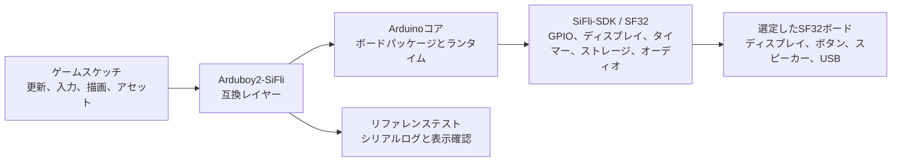

# SF32LB52向けArduboy2移植版 { #arduboy2-on-sifli }

## Arduboy2-SiFliとは { #what-is-arduboy2-sifli }

[OpenSiFli/Arduboy2-SiFli](https://github.com/OpenSiFli/Arduboy2-SiFli)は、SiFli開発環境向けに[Arduboy2ライブラリー](https://github.com/MLXXXp/Arduboy2)をOpenSiFliが移植したものです。Arduboy2は、小型ゲーム機向けのアプリケーションモデルとして、フレームループ、ディスプレイバッファー、ボタン、スプライト、テキスト、オプションのサウンド制御を提供します。そのためSiFli移植版は、基板、ディスプレイ、入力、オーディオ、ビルド環境をSF32へ移したときに、Arduboy形式のゲームをどこまで維持できるかを検証する互換性テストとして役立ちます。

このリポジトリーはソフトウェアのリファレンスであり、完成したゲーム機や量産向けハードウェア設計ではありません。対象ボード、対応API、ビルド手順、再配布条件については、README、ソースツリー、サンプル、Issue履歴、ライセンスファイルを正式な情報源として扱ってください。このページはリファレンスに基づく設計判断を整理したものであり、リポジトリー内の実行手順に代わるものではありません。

## このSF32移植版が役立つ理由 { #why-the-sifli-implementation }

Arduboy形式のアプリケーションは、予測可能な描画ループ、小型のモノクロ/低解像度アセット、ボタン入力、オーディオのタイミング、厳密に制限されたメモリー予算など、組み込み製品に関する複数の設計要素を一度に試す小規模な題材です。このモデルをSF32へ移植すると、携帯ゲーム機、UIデモ機、教育機器など、ローカルで決定論的な操作を行う製品の初期リファレンスとして役立ちます。

その価値は、すべてのArduboyスケッチが変更なしで動くことではありません。移植によって明らかになる境界にあります。

- 対応するArduboy2 APIの範囲内であれば、ゲームの高レベルな更新、入力、描画、アセット処理は維持できます。
- 移植版では、元のハードウェアに暗黙的に依存していたディスプレイ、ボタン、オーディオ、タイミング、ストレージの前提を置き換える必要があります。
- AVRレジスター、Arduboy固有のピン、ディスプレイ転送、タイマー、EEPROM配置を直接制御するスケッチは、意図的な移植と、個別の回帰テストによる裏付けが必要です。

以上はエンジニアリング上の見通しであり、互換性を実測した結果ではありません。現在のOpenSiFliリポジトリーで確認し、選択したボードとコミットでの結果を記録してください。

## 目標、対象範囲、開始条件 { #outcome-scope-and-entry-criteria }

このページでは、OpenSiFliのリファレンスから、再現可能なSF32ゲームまたはインタラクティブデモを作るまでの段階的な手順を示します。この移植版がすべてのArduboy2機能、すべてのArduboyゲーム、すべてのSF32ボードに対応することや、量産品質のディスプレイ/オーディオタイミングを実現することを**主張するものではありません**。また、サードパーティーのリポジトリーから複製したゲーム、フォント、画像、その他のアセットのライセンス権を定めるものでもありません。

**目標:** リポジトリーのサンプルまたは小規模なテストスケッチを実行できる、ソース管理されたArduboy2-SiFliのビルドを作成します。選定したディスプレイ/入力/オーディオ経路を実証し、より大きなゲームや製品への適用に進むべきか判断するための証拠を記録します。

**対象読者:** Arduinoツールを使用し、C/C++コードを確認し、SF32ボードへの書き込み、シリアル出力の読み取り、基本的なディスプレイ・入力・消費電力の測定を行えるファームウェア、ハードウェア、製品エンジニア。

開始前に、次のものを準備します。

- ArduinoCore-Zephyrのバリアント `sf32lb52_devkit_lcd_sf32lb525uc6` を使用するSF32LB52開発ボードと、以下に示す外付け周辺機器。READMEでは、ディスプレイ、ボタン、外付けEEPROM、オーディオの経路がSF32LB52ハードウェアで動作確認されたとしています。RGB LEDの経路も記載されていますが、テスト結果は示されていません。物理ボードのリビジョンやOLEDモジュールの正確な型番も固定されていません。
- 動作確認済みのArduino環境と、対応するOpenSiFliボードパッケージ。このバリアント名が示すのはソフトウェア上のボード設定とピンマップであり、すべてのSF32LB52-DevKit-LCD実機がプロジェクトの外部配線に適合することを保証するものではありません。周辺機器を接続する前に、実機の回路図を確認してください。
- Arduboy2-SiFliの正確なコミット、Arduinoコア/パッケージのバージョン、ホストOS、書き込みツール。
- USBデータ接続、およびシリアルログを取得してディスプレイ、ボタン、オーディオ出力を確認する手段。
- 派生版に含めるすべてのゲーム、画像、フォント、サウンドアセットを使用/再配布する権利。

<em>表: プロジェクトの前提条件</em>

| 項目 | プロジェクトの基準 | 適用前に確認する証拠 |
|:-----|:-----------------|:---------------------------|
| ソース | 記録されたOpenSiFli/Arduboy2-SiFliのコミットと依存関係のリビジョン。 | クリーンなチェックアウトと再現可能なビルド記録。 |
| ボード | SF32LB52とArduinoCore-Zephyrのバリアント `sf32lb52_devkit_lcd_sf32lb525uc6`、および以下に示す外付け周辺機器。 | 実機のボードリビジョン、配線、電源、書き込み成功を記録する。リポジトリーではボードリビジョンとOLED型番は固定されていない。 |
| ツールチェーン | Arduino IDEまたはCLI、OpenSiFliボードパッケージ、資料に記載された書き込み方法。 | パッケージのバージョン、ボード選択、コンパイラー出力、書き込みログ、シリアルログ。 |
| リファレンス動作 | 移植版を動作させる上流サンプルまたは最小スケッチ。 | ディスプレイ更新、入力応答、対応するオーディオ動作を確認し、再現できる。 |
| 製品変更 | 範囲を限定したゲームまたはUIの変更。 | 変更後もリファレンステストに合格し、アセットとライセンスの記録が保管されている。 |

## ハードウェアとソフトウェアの仕様 { #hardware-and-software-specifications }

### ハードウェア仕様 { #hardware-specification }

<em>表: Arduboy2-SiFli ハードウェア仕様</em>

| 構成要素 | 必要な仕様 | 役割 | 状態 | 入手先 | 互換性・代替に関する注意 |
|:---------|:-----------|:-----|:-----|:-------|:-------------------------|
| SF32LB52 開発ボード | ArduinoCore-Zephyr バリアント `sf32lb52_devkit_lcd_sf32lb525uc6`。物理ボードのリビジョンはリポジトリーで固定されていません | 移植版を実行し、マッピング済みのMCUピンを提供 | 必須 | [Arduboy2-SiFli ソース](https://github.com/OpenSiFli/Arduboy2-SiFli); [ArduinoCore-zephyr バリアント](https://github.com/OpenSiFli/ArduinoCore-zephyr) | ソフトウェア上のボードバリアントとピンマップを特定するものであり、物理構成の動作検証を示すものではありません。配線前に実機のリビジョンと回路図を照合してください |
| モノクロOLED | 128 × 64ピクセル、SPI1接続。正確なモジュールとコントローラーはリポジトリーに記載されていません | ゲームのフレームバッファーを表示 | 必須 | [Arduboy2-SiFli ソース](https://github.com/OpenSiFli/Arduboy2-SiFli) | 外付け周辺機器です。使用前に、モジュールとボードに照らしてコントローラー、電圧、コネクター、向き、タイミングを確認してください |
| ゲーム用ボタン6個 | Arduboy互換入力。アクティブLow、プルアップ使用。ピンマップはリポジトリーを参照 | 十字キーとA/Bボタンを読み取る | 必須 | [Arduboy2-SiFli ソース](https://github.com/OpenSiFli/Arduboy2-SiFli) | 外付けです。実機のArduino IOとマッピングを照合し、配線とチャタリング除去の動作を記録してください |
| 外付けEEPROM | AT24C02またはAT24C32、I2C1接続、アドレス `0x50` | EEPROMを使用するライブラリー機能をサポート | 任意。EEPROMを使う機能でのみ必須 | [Arduboy2-SiFli ソース](https://github.com/OpenSiFli/Arduboy2-SiFli) | 使用するデバイス、電圧、プルアップ、バス配線を確認してください。搭載済みのEEPROM構成はリポジトリーに指定されていません |
| オーディオ出力とRGBインジケーター | リポジトリー対応のオーディオバックエンドはマッピング済みのスピーカー出力を使用。外付けの共通カソードRGB LEDはソフトウェアPWMで駆動 | 任意の効果音とカラー表示 | 任意。テストするスケッチに応じて選択 | [Arduboy2-SiFli ソース](https://github.com/OpenSiFli/Arduboy2-SiFli) | ソースにはスピーカー/LEDの完全な部品表が定義されていません。外部回路、ピンマップ、電流、オーディオ動作を確認してください |
| ホストと USB データ接続 | 選択した Arduino ツールチェーンがサポートするホスト、データ対応ケーブル、シリアルログを取得できること | ビルド、書き込み、基準動作の観察 | 必須 | [ArduinoCore-zephyr](https://github.com/OpenSiFli/ArduinoCore-zephyr) | ホスト OS、ケーブル/ポート、パッケージのバージョン、復旧方法を記録してください。充電専用ケーブルは使用できません |

### ソフトウェア仕様 { #software-specification }

<em>表: Arduboy2-SiFli ソフトウェア仕様</em>

| パッケージまたはサービス | 必要なバージョンまたはリビジョン | 役割 | 状態 | 入手先 | 互換性・更新に関する注意 |
|:-------------------------|:---------------------------------|:-----|:-----|:-------|:-------------------------|
| OpenSiFli/Arduboy2-SiFli | 1つの commit を選んで固定し、記録してください。本記事では特定のリビジョンを固定していません | SF32 互換レイヤーとサンプル | 必須 | [リポジトリ](https://github.com/OpenSiFli/Arduboy2-SiFli) | 選択した commit でボードターゲット、依存関係、対応 API を再確認してください |
| OpenSiFli/ArduinoCore-zephyr とボードパッケージ | 移植版との互換性が確認された commit/パッケージのバージョンを特定し、記録してください | Arduino ランタイム、ボード定義、コンパイラー、書き込み連携 | 必須 | [リポジトリ](https://github.com/OpenSiFli/ArduinoCore-zephyr) | クリーンビルドと周辺機器の回帰確認なしに、新しいコアや別のボードパッケージへ置き換えないでください |
| テスト用スケッチとゲームアセット | リポジトリのサンプルを1つ選ぶか、別途ライセンスを得たテスト用スケッチを使用し、アセットのリビジョンとライセンスを記録してください | 選択した API と製品経路を検証 | いずれか1つを選択 | [Arduboy2-SiFli のサンプル](https://github.com/OpenSiFli/Arduboy2-SiFli) | 本記事は、第三者のゲーム、フォント、画像、音声を再配布する権利を許諾するものではありません |

## サポート対象の基準構成を選ぶ { #choose-a-supported-baseline }
製品カタログから似たボードを選ぶのではなく、OpenSiFliリポジトリーで指定されたボードとソフトウェアの組み合わせを基準にします。ボードパッケージ、ディスプレイ配線、入力割り当て、書き込み方法、ライブラリーの前提条件も基準構成の一部です。

Arduboy2-SiFliリポジトリーには、ボードのピンマップをまとめた独立ファイルはありません。具体的な対応表はREADMEの[SiFli I/O mapping table](https://github.com/OpenSiFli/Arduboy2-SiFli#sifli-io-mapping)に掲載されています。ライブラリー内部の論理ピン定義は[`pins_sifli.h`](https://github.com/OpenSiFli/Arduboy2-SiFli/blob/master/src/platforms/sifli/pins_sifli.h)、ボード固有の配線設定はArduinoCore-Zephyrの[Devicetree overlay](https://github.com/OpenSiFli/ArduinoCore-zephyr/blob/main/variants/sf32lb52_devkit_lcd_sf32lb525uc6/sf32lb52_devkit_lcd_sf32lb525uc6.overlay)で確認できます。これらはソフトウェア上の基準構成であり、実機の検証済み構成を示すものではありません。配線前に、実際のボードリビジョンと回路図を照合してください。

<em>表: 基準構成の選定</em>

| 基準要素 | 確認先 | 想定してはいけないこと |
|:-----------------|:---------------|:--------------|
| 対象ボード | Arduboy2-SiFliのREADMEに記載されたArduinoCore-Zephyrバリアント `sf32lb52_devkit_lcd_sf32lb525uc6` と、実機の回路図。 | ソフトウェアのバリアントだけで、すべての物理ボードリビジョンや周辺機器構成との互換性が確認できる。 |
| Arduinoコア | 対象向けに記載されたOpenSiFliパッケージとリビジョン。 | 最新パッケージがリポジトリーで使用されたリビジョンと互換である。 |
| ディスプレイと入力 | リポジトリーのピン/設定定義と実基板の回路図。 | Arduboyの元のディスプレイ形状、ボタン極性、ピン名がSF32ボードと一致する。 |
| オーディオ | リポジトリーで対応する出力経路とボード固有設定。 | トーンAPIが使えるだけで、スピーカーのタイミング、音量、電力動作が製品品質である。 |
| 書き込みと復旧 | 選定ボード向けに記載されたArduinoまたは`sftool`の手順。 | あるホストから書き込めたことで、現場で復旧可能な更新経路が確立する。 |

リポジトリーにはソフトウェア上のボードバリアントと周辺機器のピンマップがあり、ディスプレイ、ボタン、外付けEEPROM、オーディオの経路がSF32LB52ハードウェアで動作確認されたと記載されています。外付けRGB LEDの経路も説明されていますが、テスト結果は示されていません。物理ボードのリビジョン、OLEDモジュール/コントローラーの正確な型番、アクセサリー一式も特定されていません。配線や再現可能なハードウェア基準を宣言する前に、バリアントのピンマップを実機の回路図と照合し、使用した部品とリビジョンを記録してください。不足情報を別のSF32プロジェクトのピンマップやアドレスで補ってはいけません。

## プロジェクトの開発段階と判断ポイント { #delivery-map }

各段階は機能チェックリストではなく、次へ進むか判断するゲートとして使います。

<em>表: プロジェクトの開発段階と判断ポイント</em>

| 段階 | 判断する内容 | 必要な成果物 |
|:------|:---------------------|:----------------|
| 1. 未変更のリファレンス | 資料に記載された移植版が、選定した基準構成でビルド、書き込み、実行できるか。 | 動作確認済みスケッチ、コミット/パッケージ記録、書き込みログ、観測結果。 |
| 2. 周辺機器の検証 | 実基板上でディスプレイ、入力、オーディオ、リセット、タイミングが予測どおりに動作するか。 | 失敗と復旧動作を含む周辺機器テスト記録。 |
| 3. 再現可能なソースコード構成 | 別のエンジニアがクリーンなチェックアウトから同じイメージをビルドできるか。 | クリーンビルド成果物、環境記録、再実行結果。 |
| 4. ゲームの段階的な適用 | 移植版を壊さずに、範囲を限定したゲームまたはUIの変更を導入できるか。 | レビュー済み変更、アセット/ライセンス記録、回帰テスト結果。 |
| 5. 製品化準備のレビュー | 専用ハードウェアや大規模なソフトウェア投資を正当化できるだけのリファレンスか。 | 担当者、証拠、対策、進行/延期/中止の判断を記載したリスク台帳。 |

## システム構成と依存関係 { #system-architecture-and-dependencies }

<em>図: Arduboy2-SiFliのアプリケーション経路</em>

これは判断用のモデルであり、リポジトリー内部でまったく同じモジュール名が使われているという主張ではありません。移植版を変更する前に、実際のソース境界を確認してください。製品上重要な経路は次のとおりです。

- **フレームとタイミング:** ゲームループは再現可能な周期で更新/描画する必要があります。タイミングに敏感なオーディオや入力動作は、対象ボードで測定してください。
- **ディスプレイ:** 互換レイヤーで、ゲームのバッファーと座標系を、選定したディスプレイコントローラー、ピクセル形式、向き、更新経路に対応付ける必要があります。
- **入力:** ボタン名、極性、チャタリング対策、同時押し、ウェイクアップ/リセット動作を基板配線と照合してください。
- **オーディオ:** トーン生成、タイマーの所有関係、スピーカー接続、音量、ミュート動作は、検証が済むまでボード固有の要素として扱います。
- **アセットとストレージ:** 選定したゲームをリンクした後、フォント、スプライト、サウンドデータ、Flash配置、RAM使用量を測定します。
- **復旧:** タイミング、メモリー、低消費電力設定を試す前に、確実な書き込み/復旧手段を確保してください。

主な障害領域は、アプリケーション/API互換性、ディスプレイ設定、入力配線、オーディオ/タイマー動作、メモリー/アセット配置、書き込み/復旧です。いずれかの領域で問題が起きても、単に「移植版が動かない」と報告すべきではありません。

## 段階1 — 未変更のリファレンスを確立する { #stage-1-establish-the-untouched-reference }

**目標:** ライブラリーやゲームを変更する前に、リポジトリーに記載された基準構成が実際に動作することを確認します。

1. リポジトリーの手順を読み、デフォルトブランチまたはリリースを記録し、サンプル、ボード設定、依存関係、ライセンスファイルを確認します。
2. リポジトリーが要求する正確なArduinoコア/パッケージとツールをインストールし、ホストOSとツールのバージョンを記録します。
3. 資料に記載された最小のサンプルまたはテストスケッチをビルドして書き込みます。
4. シリアル出力を取得し、ディスプレイ表示、反応するボタン、サンプルでオーディオを使うかどうかを記録します。

**保管する証拠:** リポジトリーのコミット、依存関係/パッケージのバージョン、基板リビジョン、配線または回路図の参照先、ビルド出力、書き込みログ、シリアルログ、簡潔な機能確認記録。

**段階1の終了条件:** 選定したボードで未変更のリファレンスをビルド/書き込みでき、リセットまたは電源再投入後も記載どおりに動作すること。

## 段階2 — 周辺機器とタイミングの境界を検証する { #stage-2-validate-peripheral-and-timing-boundaries }

**目標:** ビルド成功と、ゲーム機として使える基準構成を区別します。

1. ディスプレイのクリア、全画面更新、スプライト/ビットマップ描画、テキスト表示、およびサンプルで使う座標系/向きの前提を検証します。
2. プロジェクトで使うすべての入力について、ボタン解放、同時押し、連打、該当する場合はリセット/ウェイクアップ動作を確認します。
3. オーディオを使う場合は、トーンの開始/停止、タイマーとの相互作用、ミュート動作、ディスプレイ/入力動作が音声経路に与える影響を確認します。
4. 通常動作中にリセット、ケーブルの抜き差し、不正または未完了の入力シーケンスを発生させます。ボードが再び書き込み/実行可能な状態に戻るか記録します。

**保管する証拠:** 画面の目視/キャプチャー結果、入力マトリクス、タイミング観測、オーディオ観測、リセット/復旧ログ、製品判断に影響する実測電流やレイテンシ。

**段階2の終了条件:** アプリケーションの不具合と、ボード設定、タイミング、電源の問題を切り分けられる程度に、選定した周辺機器経路を理解していること。

## 段階3 — 再現可能なソースコード構成を整える { #stage-3-build-a-reproducible-source-baseline }

**目標:** 特定の開発機や配布バイナリーに依存せず、移植版を再現可能にします。

1. クリーンなチェックアウトから始め、リポジトリーが必要とするすべての依存関係を初期化します。
2. ボードパッケージ、Arduino IDE/CLIのバージョン、コンパイラー/ツールのバージョン、設定ファイル、生成アセットを記録します。
3. クリーンなディレクトリーでビルドし、生成イメージと、可能であればmap/サイズ情報を保存します。書き込みコマンドまたはツール出力も記録します。
4. 別のマシンで、またはビルドディレクトリーを削除した後に、再度ビルドします。

**保管する証拠:** ソースリビジョン、依存関係のリビジョン、ホスト/ツール一覧、ビルドログ、バイナリー等の成果物、サイズレポート、書き込みログ、シリアルログ。

**段階3の終了条件:** 文書化されていないローカルファイルや手動編集なしに、クリーンなチェックアウトから段階2の周辺機器テストに合格するイメージを再生成できること。

## 段階4 — 1本のゲームを計画的に移植する { #stage-4-adapt-one-game-deliberately }

**目標:** 管理された製品変更を一つ加えて、互換性の境界を実証します。

ディスプレイ、入力、オーディオ、アセットの要件が明確な小さなスケッチまたはゲームから始めます。未変更のリファレンスイメージを保管し、一度に変更する動作の種類を一つに限定してください。

<em>表: 段階的な適用順序</em>

| 変更の種類 | 最初に行う変更 | 必須の回帰テスト |
|:-------------|:-----------|:--------------------|
| タイトル/識別情報とUI | タイトル画面、フォント、スプライト、パレット、画面レイアウト。 | ビルド、書き込み、フレーム更新、入力、アセット整合性の確認。 |
| ゲームロジック | 範囲を限定したルール、レベル、状態遷移を一つ。 | 再現可能な入力シーケンス、リセット、使用する場合はスコア/状態の保持、フレームタイミング。 |
| オーディオ | 対応経路を使ったトーンまたは短い効果音を一つ。 | 開始/停止、ミュート、タイマーとの相互作用、画面/入力負荷時の動作。 |
| ストレージ | 小規模な保存またはアセット読み込みの変更。 | サイズレポート、電源断時の動作、破損処理、正常な復旧。 |
| ボードへの適用 | 意図的なディスプレイ、ボタン、スピーカー割り当ての変更。 | 回路図/ピンの根拠、周辺機器全体の回帰テスト、リファレンスイメージへのロールバック。 |

根拠に基づく設計判断なしに、AVRレジスターアクセス、元のArduboyのピン前提、ストレージアドレスをSF32プロジェクトへ転用しないでください。サードパーティー製ゲーム/アセットのライセンスを派生ソースと一緒に保管し、再配布条件が不明なものは除外します。

**保管する証拠:** レビュー済み差分、アセットの出典、変更前後のイメージ、ビルド/書き込みログ、回帰テスト結果、ロールバック用イメージ。

**段階4の終了条件:** 適用したゲームがリファレンスの周辺機器テストに合格し、メモリー、タイミング、復旧、ライセンスの境界が記録されていること。

## 段階5 — 製品化準備のレビュー { #stage-5-product-readiness-review }

チームが次の質問に答えられるまでは、移植デモから専用ハードウェア設計や実地試験へ進まないでください。

- どのSF32ボード、ディスプレイ、ボタン、スピーカー、電源が実際に対応し、どれがまだ仮定なのか。
- 製品の基準構成で測定したフレームレート、入力レイテンシ、オーディオ動作、起動時間、電流プロファイルは何か。
- 最悪条件のコンテンツも含め、ゲーム、アセット、フォント、ランタイムがFlash/RAMをどれだけ消費するか。
- リセット、電圧低下、保存中の電源断、アセット破損、書き込み失敗、不完全な更新の後に何が起きるか。
- 移植版のどの部分を製品チーム、OpenSiFli、SiFli、元のArduboy2コミュニティーが保守するのか。
- ゲーム、フォント、画像、サウンド、ライブラリーの各ライセンスは、予定する配布形態に適合するか。

**段階5の終了条件:** 残るリスクの担当者と根拠が明確であり、各項目に対策、明示的な延期、または中止の判断があること。

## 製品設計への引き継ぎ { #handoff-to-product-design }

選定したSF32デバイス、ディスプレイ/入力構成、オーディオ/タイマー計画、Flashとアセットの配置、電力測定、復旧方法、量産テストの前提を[ハードウェア](../hardware/index.md)セクションへ引き継ぎます。ゲームのディスプレイ、メモリー、パッケージ、電源、接続要件によって候補デバイスが変わる場合は、[SF32製品セレクター](../sf32-products/product-selector.md)を使用してください。ソフトウェアの基準環境は、[Arduinoを始める](../getting-started/arduino/getting-started-arduino.md)から構築し、[Arduinoプラットフォーム概要](../develop/platforms/arduino/overview.md)へ進みます。

別のエンジニアが移植版を再ビルドし、周辺機器の結果を再現し、ボード固有の変更をすべて説明でき、専用基板やゲームライブラリーの拡張を承認する前に根拠をレビューできれば、このリファレンスは製品開発上の役割を果たしたと言えます。

## 主な情報源 { #authoritative-sources }
- [OpenSiFli/Arduboy2-SiFli](https://github.com/OpenSiFli/Arduboy2-SiFli)
- [MLXXXp/Arduboy2](https://github.com/MLXXXp/Arduboy2)
- [OpenSiFli/ArduinoCore-zephyr](https://github.com/OpenSiFli/ArduinoCore-zephyr)
- [SF32でArduinoを始める](../getting-started/arduino/getting-started-arduino.md)
- [Arduinoプラットフォーム概要](../develop/platforms/arduino/overview.md)
- [SF32製品セレクター](../sf32-products/product-selector.md)
