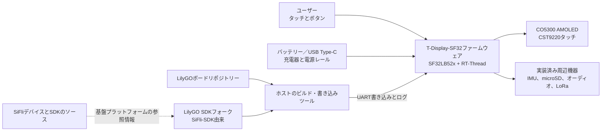

# LilyGO T-Display-SF32 { #lilygo-t-display-sf32 }

!!! warning "サードパーティー製プロジェクト（SiFliのプロジェクトではありません）"
    T-Display-SF32の公開・保守元はXinyuan-LilyGO/LilyGOであり、SiFliまたはOpenSiFliではありません。ボード固有のハードウェア、ファームウェア、サポートに関する判断にはLilyGOのリポジトリーを参照してください。SF32デバイスとSiFli-SDKそのものについてはSiFliの情報が一次資料となりますが、SiFliがこのLilyGO製ボードを検証・サポートしていることを意味するものではありません。

## T-Display-SF32とは { #what-is-t-display-sf32 }

[Xinyuan-LilyGO/T-Display-SF32](https://github.com/Xinyuan-LilyGO/T-Display-SF32)は、SF32LB52x MCU、2.16インチCO5300 AMOLEDディスプレイ、CST9220タッチコントローラーを搭載した開発プラットフォームです。リポジトリーには、16 MBフラッシュ、8 MB PSRAM、BHI260AP IMU、SX1262 LoRa、microSDインターフェース、オーディオ、USB Type-C、充電機能、ボードのピン割り当て、サンプルアプリケーション、ハードウェアファイル、工場出荷時ファームウェア、ボード固有の消費電力レポートが掲載されています。

この構成は、ディスプレイを中心としたウェアラブル機器、携帯型コントローラー、ポータブルセンサー端末、接続型HMIの評価に役立ちます。ただし、本ボードは完成品ではなく、あくまでプラットフォームの参考例です。多くのハードウェア機能が用意されていますが、製品チームは必要な機能を選定し、既知の基準状態を再現したうえで、実際に使用する基板リビジョンで計測し、電源、RF、安全性、ソフトウェア保守、復旧方法を評価・検証する必要があります。

リポジトリーの機能対応表では、単体のT-SF32-DisplayとオプションのT-SF32-Keyboard拡張ボードが区別されています。Wi-Fi（ESP32-C6）、GPS（L76K）、マトリクスキーボードとLED（TCA8418、AW21009、XL9555）、BME280、赤外線送信機、振動モーター（AW86224）は拡張ボードが必要です。単体ボードの基準構成にこれらを含めないでください。

## SF32を採用する理由 { #why-the-sf32-implementation }

T-Display-SF32は、SF32LB52xのグラフィックス、Bluetooth、オーディオ、低消費電力機能と、外付けのディスプレイ、タッチ、モーションセンサー、ストレージ、LoRaデバイスを1枚のボードにまとめています。LilyGOはボード設定、専用デバイスドライバー、サンプルに加え、SiFli-SDK 2.4.0をベースとしていると説明する[LilyGO SDKフォーク](https://github.com/Xinyuan-LilyGO/SlFli-SDK-Lilygo)も提供しています。これにより、汎用SDKの未変更ターゲットから始める場合に比べて、初期のボード立ち上げを短縮できる可能性があります。

その代わりに問題となるのが管理主体です。ボードサポート、ドライバーの変更、ハードウェアリビジョン、同梱ファームウェア、LilyGOのSDKフォークと上流SiFli-SDKの関係は、SiFli以外で管理されています。したがって再現可能なプロジェクトにするには、両方のリポジトリーのコミットを固定し、動作する工場出荷時／復旧用イメージを保管し、新しい上流SDKへの移行は明示的な技術変更として試験する必要があります。

## 目標、対象範囲、開始条件 { #outcome-scope-and-entry-criteria }

**目標：** T-Display-SF32のバージョンを固定した基準状態を確立し、ディスプレイ／タッチ、使用する周辺機器、電源動作、復旧手段を検証します。次にソースからのビルドを再現し、製品レビューに必要な回帰試験の証跡を残しながら、範囲を限定したアプリケーション変更を1つ加えます。

このページは、すべてのボードバリエーションにすべての周辺機器が実装されていること、ベンダーファームウェアが量産品質であること、電力レポートが別リビジョンや別ワークロードにも当てはまること、またはLoRaの運用がすべての地域で適法であることを証明するものではありません。また、SiFliのサポートをLilyGO固有のハードウェアやドライバーに移すものでもありません。

開始前に、以下を準備してください。

- 正確なT-Display-SF32基板とハードウェアリビジョン、および対応する回路図またはピンマップ
- 電流制限付きベンチ電源、または電圧と状態を監視できる保護機能付きバッテリー
- 動作確認済みのUSBデータケーブル、資料に記載されたType-C書き込み接続、保管済みの復旧用イメージ
- T-Display-SF32リポジトリーとLilyGO SDKフォークの固定コミット
- 初回の再現可能なビルドに必要な、LilyGO SDKフォーク記載のWindows／PowerShell環境。他のホスト環境は別途検証が必要です
- 対象インターフェースに必要な試験用アクセサリー（microSDカード、ヘッドホンまたはオーディオ負荷、使用地域で適法なLoRa通信相手など）
- ファームウェアのバージョン、ビルドログ、シリアル出力、写真、電流測定値、故障・復旧結果の記録

<div align="center"><em>表: T-Display-SF32プロジェクトの前提条件</em></div>

<div align="center" markdown>

| 項目 | 開始時の基準 | 変更前に必要な証跡 |
|:-----|:-------------|:-------------------|
| 管理主体 | LilyGO製ボード、リポジトリー、SDKフォーク | リポジトリーの管理者、コミット、基板リビジョン、サポート範囲 |
| ハードウェア | SF32LB52x、2.16インチAMOLED／タッチ、外部メモリー、実装済み周辺機器 | 回路図／ピンマップの確認、実装記録、搭載デバイス一覧 |
| ファームウェア | 同梱の工場出荷時イメージ、または未変更のリポジトリーサンプル | イメージの識別情報、書き込みログ、起動ログ、機能確認記録 |
| 電源 | LilyGOが公開するUSB／充電器／バッテリー経路 | 電源制限、起動結果、シャットダウン動作、対象ワークロードの実測電流 |
| 変更 | サンプル、UI、センサー、ストレージ、オーディオ、無線の変更を一度に1つ | レビュー済み変更、ロールバック用イメージ、回帰試験一式の結果 |

</div>

## ハードウェアとソフトウェアの仕様 { #hardware-and-software-specifications }

### ハードウェア仕様 { #hardware-specification }

<div align="center"><em>表: T-Display-SF32ハードウェア仕様</em></div>

<div align="center" markdown>

| 構成要素 | 必要な仕様 | 役割 | 状態 | 入手先 | 互換性・代替に関する注意 |
|:---------|:-----------|:-----|:-----|:-------|:-------------------------|
| T-Display-SF32ボード | SF32LB52x。資料に記載された構成は2.16インチCO5300 AMOLED、CST9220タッチ、16 MB Flash、8 MB PSRAM、BHI260AP IMU、SX1262 LoRa、microSD、オンボードマイク、スピーカーアンプ、3.5 mmオーディオジャック、ユーザーボタン3個を含む | 演算、表示、センシング、無線、ストレージ、オーディオを統合した評価環境 | 必須 | [LilyGOリポジトリ](https://github.com/Xinyuan-LilyGO/T-Display-SF32); [ハードウェア資料](https://github.com/Xinyuan-LilyGO/T-Display-SF32/tree/master/hardware) | 正確なボードリビジョンと実装部品を記録してください。すべてのバリアントが同じ部品構成とは限りません |
| T-SF32-Keyboard拡張ボード | ESP32-C6 Wi-Fi、L76K GPS、TCA8418/AW21009/XL9555キーボードサブシステム、BME280、赤外線送信機、AW86224振動モーターを備えるオプション拡張 | 記載した無線、測位、キーボード、環境センシング、赤外線、触覚機能を追加 | オプション。該当機能を使う場合にのみ必要 | [LilyGOリポジトリ](https://github.com/Xinyuan-LilyGO/T-Display-SF32); [ハードウェア資料](https://github.com/Xinyuan-LilyGO/T-Display-SF32/tree/master/hardware) | これらの部品は単体のT-SF32-Displayには搭載されません。Wi-FiとGPSはUART2を共有するため、拡張ボード上の併用構成を検証してください |
| USB Type-Cデータ接続と管理された電源 | データ対応ケーブル。電流制限付き電源、または電圧を監視できる保護回路付きバッテリー | 書き込み、ログ取得、安全な電源検証 | 必須 | [LilyGOリポジトリ](https://github.com/Xinyuan-LilyGO/T-Display-SF32) | Type-CのD+/D- はCH343P USB-to-UARTブリッジに接続されています。このポートはUART経由の書き込みとログ取得用で、SF32のネイティブUSBデバイス/ホスト通信には使えません。ボード固有の3.5 V超の起動条件にも従ってください |
| インターフェース別のテスト用アクセサリー | 試験対象に応じてmicroSDカード、オーディオ負荷/ヘッドホン、または使用地域の周波数帯に適合するLoRa対向機 | オプションのボードインターフェースを検証 | 任意。試験ごとに選択 | [サンプル](https://github.com/Xinyuan-LilyGO/T-Display-SF32/tree/master/examples) | 接続前にハードウェア資料で正確なコネクター、電圧、地域、リビジョンを確認してください |

</div>

### ソフトウェア仕様 { #software-specification }

<div align="center"><em>表: T-Display-SF32ソフトウェア仕様</em></div>

<div align="center" markdown>

| パッケージまたはサービス | 必要なバージョンまたはリビジョン | 役割 | 状態 | 入手先 | 互換性・更新に関する注意 |
|:-------------------------|:---------------------------------|:-----|:-----|:-------|:-------------------------|
| T-Display-SF32ファームウェア/ソース | リポジトリのcommitを固定して記録してください。upstreamは共通のタグ付き基準版を指定していません | ボードサンプル、設定、ファームウェア | 必須 | [リポジトリ](https://github.com/Xinyuan-LilyGO/T-Display-SF32) | 出荷時イメージを保存し、ボードリビジョンとcommitを併せて記録してください |
| LilyGO SiFli-SDKフォーク | SiFli-SDK 2.4.0をベースにしたと記載されているフォークのcommitを固定 | ボードサポート、ドライバー、ビルド、書き込み環境 | 必須 | [LilyGO SDKフォーク](https://github.com/Xinyuan-LilyGO/SlFli-SDK-Lilygo) | 2.4.0ベースとの説明はフォークの正確なリビジョンを示しません。upstream SDKに無断で置き換えないでください |
| SConsとホスト側の書き込みツール | 選択したフォークが提供するバージョン。ホストOSと解決したバージョンを記録 | `t-display-sf32_hcpu`ターゲットのビルドと書き込み | 必須 | [LilyGO SDKフォーク](https://github.com/Xinyuan-LilyGO/SlFli-SDK-Lilygo) | 初回ビルド手順はWindows/PowerShellを前提としています。他のホストは個別に検証してください |
| 出荷時ファームウェアV1.2 | 対応するボード/リポジトリリビジョンのイメージ | 未変更動作の確認と復旧用基準 | 任意。ただし変更前に保存 | [出荷時ファームウェアのディレクトリ](https://github.com/Xinyuan-LilyGO/T-Display-SF32/tree/master/firmware/T-SF32-Factory-V1.2) | ディレクトリ名だけではイメージとボードの互換性を確認できません。書き込む前に検証してください |

</div>

## サポート対象の基準構成を選ぶ { #choose-a-supported-baseline }
上流リポジトリーでは現在`master`ブランチが使用されており、すべての環境に共通するソフトウェア基準としてタグ付きリリースは示されていません。「最新版」とだけ記録せず、使用するコミットを正確に記録してください。リポジトリーには`firmware/T-SF32-Factory-V1.2`ディレクトリーがありますが、そのディレクトリー名だけでは対応する基板リビジョン、リポジトリーのコミット、書き込み手順を特定できません。

<div align="center"><em>表: T-Display-SF32の基準状態の選定</em></div>

<div align="center" markdown>

| 基準要素 | 推奨する開始点 | 重要な制約 |
|:---------|:---------------|:-----------|
| 基板 | 写真を撮影し、リビジョンを特定したT-Display-SF32を1台 | 別リビジョンやキーボード関連のバリエーションでも同じピンマップや周辺機器が使われているとは限りません |
| 工場出荷時の動作 | 対象機に適合する同梱のFactory V1.2ディレクトリー、または未変更の`menu_app`ビルド | 書き込み前に出所と適合性を確認し、元のイメージを保管してください |
| ソース | 固定したT-Display-SF32コミット | リポジトリーはSiFli-SDKとは独立して更新されます |
| SDK | 固定したLilyGO SDKフォークのコミット（SiFli-SDK 2.4.0由来と記載） | 別のSDKリビジョンに無断で置き換えないでください。ボードドライバーと設定が異なる可能性があります |
| ビルドターゲット | `t-display-sf32_hcpu` | LilyGO製ボード向けターゲットであり、汎用SF32LB52xターゲットではありません |
| 電源投入条件 | LilyGOが示す3.5 V超の起動条件に従い、独自ファームウェアでは電圧検出と低バッテリー時のシャットダウンを実装 | チップのデータシート、バッテリーの制限、実測したブラウンアウト動作の代わりにせず、ベンダーのボード要件として検証してください |

</div>

T-Display-SF32のREADMEには、必要な環境を設定した後に実行するWindowsでのビルドおよび書き込み手順が記載されています。

```powershell
cd T-Display-SF32\examples\rt_os\rt_driver\project
scons --board=t-display-sf32_hcpu -j8
build_t-display-sf32_hcpu\uart_download.bat
```

実際に使用したリポジトリーとSDKのコミット、環境設定の結果、ビルドログ全体、生成イメージ、書き込みログ、起動ログを保存してください。並列ビルド数は変更して構いませんが、ターゲットとソースリビジョンは固定します。

## プロジェクトの開発段階と判断ポイント { #delivery-map }

<div align="center"><em>表: T-Display-SF32の開発段階と判断ポイント</em></div>

<div align="center" markdown>

| 段階 | 判断する内容 | 必要な成果物 |
|:-----|:-------------|:-------------|
| 1. ベンダー基準構成 | 未変更の基板／ファームウェアの組み合わせが、識別したとおりに動作するか | バージョンを固定し、写真を含む既知正常な試験記録 |
| 2. 周辺機器と復旧の検証 | 対象インターフェース、電源状態、故障を確認・復旧できるか | 故障注入、計測、復旧の記録 |
| 3. ソースビルドの再現 | クリーンなソースから同じ動作を再ビルド・書き込みできるか | 環境、イメージ、書き込みログ、再現結果 |
| 4. 管理された変更 | 基準状態を壊さずに1つの製品機能を変更できるか | 範囲を限定した変更、ロールバック手段、回帰試験の証跡 |
| 5. 製品レビュー | サードパーティー製プラットフォームを、試作継続または専用ハードウェア開発に使えるか | リスクの担当者と、続行／保留／中止の判断 |

</div>

## システム構成と依存関係 { #system-architecture-and-dependencies }

<div align="center"><em>図: T-Display-SF32の製品構成と開発上の境界</em></div>



問題は、基板の電源／充電、起動と書き込み、ディスプレイ／タッチ、対象周辺機器ごと、LilyGOのボードサポート、基盤となるSDKなど、原因領域を分けて扱ってください。たとえばディスプレイのサンプルが動かない原因には、電源、基板リビジョン、パネル／タッチ設定、アプリケーション、SDK／ドライバーの不整合などが考えられます。「SDKの問題」とだけ結論づけても原因の特定にはなりません。

## 段階1 — 未変更のベンダー基準構成を確立する { #stage-1-establish-the-untouched-vendor-baseline }

**目標：** ソースを変更する前に、受け取った基板とベンダー基準構成の実際の動作を確認します。

1. 基板の両面を撮影し、刻印、実装済み周辺機器、ディスプレイ／タッチ部品、メモリー、スイッチ、コネクター、リポジトリーのコミットを記録します。
2. 電源と極性を確認します。LilyGOは起動に3.5 V超が必要としています。電圧を監視できる電源を使用し、深く放電したセルを試験に使わないでください。
3. 基板に適合することが確認済みの基準イメージを書き込むか、出所が分かっている場合は既存ファームウェアをまず実行します。ツールが対応していれば元のイメージを保存します。
4. 本体上のメニューまたは未変更のサンプルを使い、ディスプレイ／タッチと製品で使う周辺機器を個別に動作確認します。未実装または利用できない機能は、障害ではなくその状態として記録します。
5. コールドスタートを2回実施し、起動ログ、UIの写真、タッチ／入力の結果、および条件を明確に定義したアイドル／アクティブ時の電流波形を保存します。

**保管する証跡：** 基板リビジョンと写真、リポジトリー／イメージの識別情報、電源とバッテリーの条件、書き込み・起動ログ、実装デバイス一覧、機能試験結果、電流測定の条件。

**ゲート1の終了条件：** 基準となるディスプレイ／タッチ動作をコールドスタート2回で再現でき、対象となる実装済み周辺機器すべての結果が記録され、元のイメージまたは既知正常なイメージを復元できること。

## 段階2 — 周辺機器、電源、復旧の境界を検証する { #stage-2-validate-peripheral-power-and-recovery-boundaries }

**目標：** バッテリーを危険にさらしたり、手順が不明な再書き込みに頼ったりせずに、故障を検出して復旧できることを確認します。

<div align="center"><em>表: T-Display-SF32の故障・復旧試験</em></div>

<div align="center" markdown>

| 試験 | 方法 | 合格の証跡 |
|:-----|:-----|:-----------|
| 起動マージン | 文書化された制限を超えない範囲で、電流制限付きベンチ電源の電圧を使用予定範囲の周辺で変化させる | 起動／シャットダウンのしきい値と動作を測定し、リセットの反復や未定義状態が隠れていない |
| 低バッテリー時の動作 | 管理された電源を使い、警告およびシャットダウンのしきい値を確認する | 独自ファームウェアが選定バッテリーの安全な放電下限に達する前に警告・停止する |
| 電源オフ中の充電 | 工場出荷時ファームウェアでシャットダウンした後にUSB電源を接続し、資料に記載されたボタンによる復帰手順を試す | 充電状態とボタンのみでの復帰がベンダーの注記に一致し、USB接続だけで起動する経路があると誤認していない |
| ディスプレイ／タッチの中断 | UI動作中にリセットまたは電源再投入し、画面端・隅のタッチを再試験する | 画面とタッチが既知の状態に戻り、表示の恒久的な乱れや誤入力がない |
| リムーバブルストレージ | 管理されたタイミングで試験用カードを取り外す、破損させる、または交換する | カード不在／エラーを診断でき、アプリケーションが無関係なデータを破損したり停止したりしない |
| LoRa経路 | 適法な周波数帯の通信相手と、管理されたRF環境で試験する | 周波数と設定を記録し、タイムアウトや再接続を確認できる。測定なしに通信距離を主張しない |
| 書き込み復旧 | 復旧可能な個体でのみ試験書き込みを中断し、資料に記載されたType-C／UART経路を使用する | 保管済みの既知正常なイメージを、使用ツールと手順を記録したうえで復元できる |

</div>

**ゲート2の終了条件：** 該当する各試験に再現可能な結果と復旧手段があり、独自ファームウェアでは低バッテリー保護が実装され、未解決の故障によってバッテリーを損傷したり、文書化された復旧手段なしに基板が使用不能になったりしないこと。

## 段階3 — 再現可能なソースの基準構成を整える { #stage-3-build-a-reproducible-source-baseline }

**目標：** 別のエンジニアが、バージョンを固定したクリーンなソースから同じ基準状態をビルドして書き込めるようにします。

1. ボードリポジトリーとLilyGO SDKフォークのコミットを固定し、フォークに記載された上流SDKのベースを記録します。
2. 文書化されたPowerShell環境を設定し、クリーンなディレクトリーから`t-display-sf32_hcpu`をビルドします。
3. 環境、依存関係、設定、メモリー／パーティション、イメージ、書き込み、シリアルログの証跡を保存します。
4. 別のマシン、またはすべてのビルド出力を削除した後に再ビルドし、段階2の回帰試験をすべて実施します。

**ゲート3の終了条件：** 段階2に合格するファームウェアを生成するために、古いイメージ、未追跡のボードファイル、文書化されていないSDKの置き換えが必要でないこと。

## 段階4 — 製品機能を1つずつ変更する { #stage-4-adapt-one-product-path-at-a-time }

**目標：** ベンダー基準構成と復旧用基準を維持しながら、価値のある変更を1つ加えます。

<div align="center"><em>表: T-Display-SF32の段階的な変更順序</em></div>

<div align="center" markdown>

| 変更の種類 | 最初に適した変更 | 必須の回帰試験 |
|:-----------|:-----------------|:---------------|
| UI | 画面、アイコン、フォント、タッチ操作を1つ変更 | コールドスタート、画面全体の更新、タッチ範囲、メモリー使用量、復旧 |
| センサー | IMUの値またはイベントを1つ取得 | デバイス識別、測定範囲、サンプルレート、エラー処理、アイドル電流、ウェイクアップ動作 |
| ストレージ／オーディオ | ファイル操作または再生経路を1つ実装 | メディア不在、不正データ、音量／出力制限、電源断、ファイルシステム復旧 |
| LoRa | 適法な周波数帯で範囲を限定したパケット交換を実施 | 設定の記録、タイムアウト、再試行、電流、共存、法規制の確認 |
| 電源 | スリープ／ウェイクアップまたは電源レール制御を1つ変更 | すべてのウェイク要因、ディスプレイ／周辺機器の状態、低バッテリー時の停止、充電、反復試験 |
| SDK移行 | LilyGOフォークまたは上流SDKの候補バージョンを1つ評価 | ボード設定の差分、クリーンビルド、全周辺機器の回帰、電流測定、ロールバック |

</div>

**ゲート4の終了条件：** 変更内容がレビューされ、元のイメージを復元でき、該当するディスプレイ、タッチ、周辺機器、電源、書き込み、復旧の試験すべてに合格していること。

## 段階5 — 製品化準備のレビュー { #stage-5-product-readiness-review }

フィールド試験または専用PCBへの移行を決める前に、次の点を確認してください。

- ボードファイル、LilyGO SDKフォーク、ドライバー修正、セキュリティ更新、今後のSiFli-SDKへの移行を誰が管理しますか。
- 製品の基準となる基板リビジョンと実装周辺機器はどれですか。受入時に個体をどう識別・試験しますか。
- 想定するディスプレイ輝度、無線デューティー比、ストレージ、センサー構成で、アクティブ、アイドル、スリープ、起動、停止の電流の実測値はいくらですか。
- バッテリー保護、充電、熱挙動、筐体、コネクターへのアクセス、電源オフからの復旧をどのように検証しますか。
- どのLoRa地域、アンテナ、周波数計画、送信条件、法規制が適用されますか。
- ハードウェアファイル、ファームウェア、SDKフォーク、サンプル、アセット、サードパーティーコンポーネントの各ライセンスは、予定する配布方法と両立しますか。
- チームはサードパーティー製試作機への依存を受け入れますか。それとも管理されたフォークとサポート計画を検証済みですか。

**ゲート5の終了条件：** 残るリスクすべてに担当者、証跡、対応方針が割り当てられ、チームが続行、保留、中止のいずれかを明示的に決定していること。

## 製品設計への引き継ぎ { #handoff-to-product-design }

使用するSF32の型番とメモリーデバイス、ディスプレイ／タッチのタイミング、搭載周辺機器とバス、電源系統、充電器とバッテリー方針、アンテナ／RF方針、ブート／書き込み接続、パーティション計画、量産試験用アクセス、ソフトウェアフォークの管理主体、実証済みの復旧手段を引き継いでください。続けて、[SF32LB52xの製品統合手順](../sf32-products/chips/SF32LB52x.md#integration-path)、[SF32LB52xハードウェア設計ガイド](../hardware/chip-guides/SF32LB52x_hardware_design_guide.md)、[SiFli-SDKのビルド、書き込み、モニター](../develop/platforms/sifli-sdk/build-flash-monitor.md)、[量産設計](../hardware/design-for-production.md)を参照してください。

## 主な情報源 { #authoritative-sources }
- [Xinyuan-LilyGO/T-Display-SF32リポジトリー](https://github.com/Xinyuan-LilyGO/T-Display-SF32)
- [T-Display-SF32中国語README](https://github.com/Xinyuan-LilyGO/T-Display-SF32/blob/master/readme_cn.md)
- [T-Display-SF32サンプル](https://github.com/Xinyuan-LilyGO/T-Display-SF32/tree/master/examples)
- [T-Display-SF32ハードウェアファイル](https://github.com/Xinyuan-LilyGO/T-Display-SF32/tree/master/hardware)
- [T-Display-SF32の消費電力試験資料](https://github.com/Xinyuan-LilyGO/T-Display-SF32/tree/master/lowpowertest)
- [Xinyuan-LilyGO/SlFli-SDK-Lilygoリポジトリー](https://github.com/Xinyuan-LilyGO/SlFli-SDK-Lilygo)
- [OpenSiFli/SiFli-SDK](https://github.com/OpenSiFli/SiFli-SDK)
