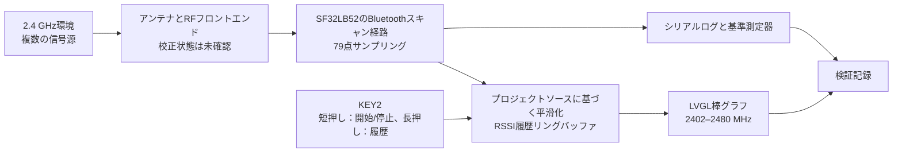

# Radiation Monitor携帯型電波強度検出器 { #radiation-monitor-portable-signal-strength-detector }

## Radiation Monitorとは { #what-is-radiation-monitor }

[SiFliSparks/RadiationMonitor](https://github.com/SiFliSparks/RadiationMonitor) は、SF32LB52とSiFli-SDKを使ってBluetooth帯の受信信号強度を可視化する携帯型デバイスです。ファームウェアは2402～2480 MHzの79周波数ポイントを順にスキャンし、受信強度をLVGLの棒グラフに表示します。KEY2でスキャンを開始／停止し、保存した履歴を閲覧できます。

Bluetooth帯域のスキャン、リアルタイム処理、周波数の可視化、ワンボタン操作を学ぶのに役立つプロジェクトです。ただし、校正済みのスペクトラムアナライザーではなく、受信信号の送信元も特定しません。周囲の2.4 GHz帯の送信や測定条件がグラフに影響する可能性があります。校正と条件を統制した比較を行わない限り、規制適合、認証、精密なRF測定には使用できません。

<em>Radiation Monitorの79点棒グラフ画面</em>

## SF32による実装の利点 { #why-the-sf32-implementation }

SF32LB52はデュアルモードBluetooth 5.3、デュアルコアMCU、ディスプレイ機能を備えています。本プロジェクトではSiFli-SDKとLVGLを使い、周波数サンプリング、平滑化、履歴管理、画面更新をデバイス内で処理します。RF可視化パネル、現場での干渉インジケーター、製品の診断UIを試作するための有用な出発点です。

リポジトリーには校正手順、不確かさの予算、トレーサブルな測定条件が示されていません。そのため、結果は使用するシリコン、SDK／ファームウェアのリビジョン、ボード、アンテナ、筐体、基板ノイズ、タイミングごとに検証する必要があります。別のSF32LB52ボードや製品基板へ移す場合も再検証が必要で、ビルドの成功だけでは測定結果の同等性を確認できません。

## 目標、対象範囲、開始条件 { #outcome-scope-and-entry-criteria }

**目標:** バージョンを固定したSF32LB52ハードウェアで79点グラフを再現し、開始／停止の再現性を確認します。固定したソースで実際の平滑化アルゴリズムと深度を確認し、文書に記載された10件の履歴と復旧動作を検証して、校正や専用ハードウェアへの投資判断に必要な証拠を集めます。

このページでは、RSSIの棒の高さをデューティ比、スループット、送信電力、通信方式、規制上のスペクトラム電力として解釈しません。また、リポジトリが完全な量産設計、校正手順、明示的なソフトウェアライセンスを提供しているとも主張しません。

開始前に、次のものを用意してください。

- SF32LB52ディスプレイボード。プロジェクトREADMEにはSF32LB52xと出力ディレクトリ`build_sf32lb52-lchspi-ulp_hcpu`が記載されています。SiFliの対応ボード一覧ではHuangshan PiのSConsボード名は`sf32lb52-lchspi-ulp`です。実際のボードリビジョンを記録し、プロジェクトのビルド設定を確認してください。
- SiFli-SDK、SCons、書き込み経路、シリアルログの取得手段。
- 制御可能な2.4 GHz信号源、またはBLEアドバタイザーのオン／オフなど、少なくとも2つの再現可能な測定環境。
- 数値精度を求める場合は、校正済みスペクトラムアナライザーまたは電力計と、固定したアンテナ／距離／遮蔽条件。
- 画面状態、シリアル出力、ボードの向き、距離、電源、測定環境の記録。

<em>表: Radiation Monitorプロジェクトの前提条件</em>

| 項目 | 固定したソースの基準構成 | 変更前に必要な証拠 |
|:-----|:------------------|:------------------|
| 周波数スキャン | 2402～2480 MHzの79ポイント | ファームウェアのコミット、SDK／ボードのリビジョン、スキャン全体のログ |
| 処理 | READMEのモジュール説明では直近10回のスキャンを平均するとされていますが、概要では30回とされています。線形電力値とdBmのどちらを平均するかはREADMEに記載されていません | 固定したソースのリビジョン、平均方法と深度、生値／平滑化後の値、安定信号源との比較 |
| 履歴 | 10件の循環履歴 | 停止、ページ切り替え、循環、再起動の記録 |
| UI | Y軸の公称範囲が-110～-20 dBmのLVGL棒グラフ | 画面キャプチャーとラベル／配列の対応確認 |
| 測定の境界 | トレーサブルな校正情報や不確かさの提示なし | 基準計測器、治具、誤差の記録、または相対傾向のみを示す旨の明示 |

## ハードウェアとソフトウェアの仕様 { #hardware-and-software-specifications }

### ハードウェア仕様 { #hardware-specification }

<em>表: Radiation Monitorのハードウェア仕様</em>

| 部品 | 必要な仕様 | 役割 | 区分 | 入手先 | 互換性・置き換え時の注意 |
|:-----|:-----------|:-----|:-----|:-------|:-------------------------|
| SF32LB52-LCHSPI-ULP / Huangshan Pi | SiFliのSConsボードターゲット`sf32lb52-lchspi-ulp`を基準にし、ボードリビジョン、アンテナ、ディスプレイを記録 | Bluetoothスキャン、グラフ、操作、履歴UIを実行 | 必須。正確な構成は要確認 | [関連する μForge DevKit-ULP資料](../sf32-products/devkits/SF32LB52-DevKit-ULP.md)；[SiFli対応ボード一覧](https://docs.sifli.com/projects/sdk/latest/en/sf32lb52x/supported_boards/index.html)；[LCKFBボードページ](https://lckfb.com/project/detail/lckfb-hspi-sf32lb52-ulp?param=baseInfo)；[プロジェクトソース](https://github.com/SiFliSparks/RadiationMonitor) | READMEの出力ディレクトリー`build_sf32lb52-lchspi-ulp_hcpu`だけでは、PCB、アンテナ、ディスプレイのリビジョンを特定できない |
| ホスト、USBデータケーブル、制御可能な電源 | 選択したSiFli-SDKツールを導入したホスト、データケーブル、シリアルログ、電圧を監視できる電源 | ビルド、書き込み、観察、測定の再現 | 必須 | [SiFli-SDKクイックスタート](https://docs.sifli.com/projects/sdk/latest/sf32lb52x/quickstart/index.html) | ポート、電圧、ホスト/ツールのバージョン、復旧方法を記録する |

### ソフトウェア仕様 { #software-specification }

<em>表: Radiation Monitorのソフトウェア仕様</em>

| パッケージまたはサービス | 必要なバージョンまたはリビジョン | 役割 | 区分 | 入手先 | 互換性・更新時の注意 |
|:-------------------------|:---------------------------------|:-----|:-----|:-------|:---------------------|
| SiFliSparks/RadiationMonitor | 固定コミット[`670cf20`](https://github.com/SiFliSparks/RadiationMonitor/commit/670cf20b931e82b7ff1cd14fa6727e460c4f677a) | RFスキャン、79点グラフ、平滑化、履歴処理 | 必須 | [リポジトリー](https://github.com/SiFliSparks/RadiationMonitor) | READMEの平滑化深度の説明は一致しません。測定基準を決める前に、このコミットの実装を確認してください |
| OpenSiFli/SiFli-SDK | 本記事ではコミットを固定していない。互換性のあるリビジョンを選択して記録する | RTOS、Bluetoothスキャン機能、ディスプレイドライバー、ビルド/書き込み環境 | 必須 | [リポジトリー](https://github.com/OpenSiFli/SiFli-SDK) | ビルド成功だけではRF測定の校正や別ボードとの測定等価性は証明されない |
| SConsとSDKホストツール | 選択したSiFli-SDK環境のバージョン | SF32LB52ターゲットをビルドして書き込む | 必須 | [SiFli-SDKクイックスタート](https://docs.sifli.com/projects/sdk/latest/sf32lb52x/quickstart/index.html) | 正確なターゲット、ホストOS、ツールバージョン、生成イメージを記録する |

## サポート対象の基準構成を選ぶ { #choose-a-supported-baseline }
変更される`main`ブランチではなく、プロジェクトの固定コミット [`670cf20`](https://github.com/SiFliSparks/RadiationMonitor/commit/670cf20b931e82b7ff1cd14fa6727e460c4f677a) を使用してください。プロジェクトREADMEは出力ディレクトリーを`build_sf32lb52-lchspi-ulp_hcpu`としています。SiFliの対応ボード一覧ではHuangshan Pi／LCHSPI-ULPのSConsボード名は`sf32lb52-lchspi-ulp`です。これはSDKのボード名を示すもので、プロジェクトの正確なコマンドや検証済みのボード構成までは示しません。READMEにボードリビジョンとSConsコマンド全体の記載がないため、初回の再現時にプロジェクトの設定を確認し、すべてのSF32LB52xボードが対応すると推定しないでください。

<em>表: Radiation Monitorの基準構成選択</em>

| 要素 | 基準として選ぶ内容 | 前提にしてはいけないこと |
|:-----|:------------------|:------------------------|
| ボード | SiFliのSConsボード引数`sf32lb52-lchspi-ulp`を出発点にし、実基板を記録してプロジェクト設定を確認 | READMEの出力ディレクトリー`build_sf32lb52-lchspi-ulp_hcpu`だけで、全SF32LB52xボードのアンテナとディスプレイ経路が同等とは判断できない |
| SDK | ビルドに成功したSiFli-SDKのコミットを記録 | 最新SDKでもプロジェクト本来のBluetoothスキャン動作が維持されるとは限らない |
| 平滑化 | READMEの「30回のスキャン」と「直近10回の平均」の不一致を固定ソースで確認し、線形電力値とdBmのどちらを平均するか、深度とともに確定 | モジュール説明は直近10回、概要は30回としており、どちらも平均の尺度を示していません |
| タイミング | READMEはデータ更新間隔を30 msとしています。79ポイント全体のスキャン時間は実測する | 30 msが79ポイント全体の更新周期だとは限らない |
| ライセンス | 再利用または配布の前に、リポジトリと組み込みコードのライセンスを確認 | ソースが公開されているだけで製品配布権が得られるわけではない |

!!! warning "上流ドキュメントで平滑化サンプル数が一致していません"
    READMEの機能概要では30回、モジュールの説明では直近10回の平均とされ、スキャンモジュールとして`src/BT/bt_repeat.c`が示されています。READMEには線形電力値とdBmのどちらを平均するかも記載されていません。この記述だけでは、固定コミットがどの動作を実装しているか判断できません。測定基準を決める前に、そのリビジョンの平均方法、バッファー深度、実機動作を確認してください。READMEにはデータ更新間隔が30 msと記載されていますが、79点すべてのスキャンに要する時間とは限りません。

## プロジェクトの開発段階と判断ポイント { #delivery-map }

<em>表: Radiation Monitorの開発段階と判断ポイント</em>

| 段階 | 判断する内容 | 必要な成果物 |
|:---------|:-------------|:-------------|
| 1. 未変更基準構成 | 対象ボードで79ポイントを安定してスキャン・表示できるか | バージョン、ボード、ログ、画面、制御信号源の記録 |
| 2. データと復旧 | 平滑化、停止、履歴、リセットの動作を信頼できるか | 再現可能な機能・復旧テスト |
| 3. ソースの再現 | 別のエンジニアが同じイメージを再ビルドできるか | クリーンビルド、イメージ、書き込み、再現結果 |
| 4. 測定機能の変更 | 基準動作を隠さずに、表示または校正の変更を1つ追加できるか | 変更内容、比較データ、誤差、回帰記録 |
| 5. 製品レビュー | 傾向表示器として維持するか、計測器の開発に進むか | 精度目標、ライセンス、ハードウェア、リスク判断 |

## システム構成と依存関係 { #system-architecture-and-dependencies }

<em>図: Radiation Monitorのデータ経路</em>

主な障害領域は、RF入力／アンテナ、スキャン動作と校正、データ処理、履歴バッファー、ボタンの状態遷移、LVGLのマッピング、電源です。棒が高くても、現行実装で比較的強い受信値が観測されたことしか示しません。条件を統制した比較を行わない限り、送信機、変調方式、規制適合状態は特定できません。

## 段階1 — 未変更のスキャン基準構成を確立する { #stage-1-establish-the-untouched-scan-baseline }

**目標:** 選択したハードウェアとソースで、再現性のある79ポイント表示が得られることを確認します。

1. リポジトリとSiFli-SDKのコミット、ボードリビジョン、アンテナ、ディスプレイ接続を固定し、クリーンビルドして書き込みます。
2. RF環境を安定させてデバイスを起動し、初期グラフ、シリアル出力、KEY2の状態を記録します。
3. KEY2を短押ししてスキャンを開始します。スキャン範囲と、2402、2441、2480 MHzのX軸表示を確認します。
4. 制御可能なBLEアドバタイザーなど再現可能な信号源を使用し、信号源のオフ／オン、距離、ボードの向きによる変化を記録します。
5. リセットして再試験し、79ポイントの配列やグラフにずれや古いデータが残らないことを確認します。

**保存する証拠:** ソース／SDK／ボードのリビジョン、ビルド／書き込みログ、環境の説明、信号源の設定、距離／向き、シリアルログ、画面キャプチャー、リセット結果。

**ゲート1の終了条件:** 独立した2回の起動で79ポイントをスキャン・表示でき、制御した環境の変化に対して同じ傾向が再現され、表示インデックスと周波数ラベルの対応が確認されていること。

## 段階2 — 処理、履歴、復旧を検証する { #stage-2-validate-processing-history-and-recovery }

**目標:** UIが偶然のアニメーションではなく、説明可能なデータ経路を示していることを確認します。

<em>表: Radiation Monitorの機能検証</em>

| テスト | 方法 | 合格を示す証拠 |
|:-------|:-----|:---------------|
| 平滑化アルゴリズムと深度 | 1つの周波数について生値と`rssi_res`を記録し、固定コミットと比較してREADMEの不一致を解決 | 平均の尺度と深度が対象リビジョンのコードに一致し、実機で確認できる |
| 開始／停止 | スキャン中にKEY2を短押しして停止し、再開 | 停止後も履歴が保持され、再開後もハングせずに継続する |
| 履歴 | 停止中にKEY2を長押しし、複数回操作 | 最大10件の記録を正しく逆方向に閲覧し、循環する |
| 履歴が空の場合 | 有効な履歴が蓄積する前に停止または長押し | 配列範囲外アクセスやクラッシュがなく、データなし状態が画面で分かる |
| リセット | スキャン中、停止中、履歴閲覧中にリセット | 不明な古い値を残さず、既知の初期状態に戻る |
| 干渉環境の変化 | 信号源、距離、遮蔽を変更 | 反応が再現可能で、レイテンシとピーク保持の動作が記録されている |

**ゲート2の終了条件:** 平滑化、履歴数、ボタン状態、リセット動作がソースと一致し、異常状態を無言で見過ごさず観測できること。

## 段階3 — 再現可能なソースの基準構成を整える { #stage-3-build-a-reproducible-source-baseline }

**目標:** クリーンな環境から段階2のイメージを再生成します。

1. プロジェクトのコミット、SDKのコミット、ホストOS、SCons／コンパイラーのバージョン、実際のボード引数を記録します。
2. ビルド出力を削除して再設定・再ビルドし、イメージ、メモリー／パーティション出力、全ログを保存します。
3. 生成された書き込みスクリプトで書き込み、ポート、ボーレート、結果を記録します。
4. 2台目のコンピューターまたはクリーンなディレクトリで再試験し、段階2の主要項目を確認します。

**ゲート3の終了条件:** 未追跡のボード設定、生成ファイル、古いビルド成果物に依存せず、動作上同等のイメージを生成できること。

## 段階4 — 管理された測定またはUIの変更を1つ行う { #stage-4-make-one-controlled-measurement-or-ui-adaptation }

**目標:** 元の基準構成を失わずに、製品化の方向性を1つ試します。

変更候補には、生値のログ出力、1 MHz単位の明示的なラベル、ピーク保持、履歴選択方法の変更、校正オフセット、相対傾向データのホストへのエクスポートなどがあります。一度に変更するのは1種類に限定し、元のイメージも保持します。

校正を追加する場合は、基準信号源、周波数、入力レベル、アンテナ／ケーブル、距離、向き、温度、不確かさを定義してください。1つの全体オフセットだけでは、周波数応答、基板差、筐体の影響を補正できないことがほとんどです。

**ゲート4の終了条件:** 変更後も79ポイント、開始／停止、履歴、リセット、制御信号源の回帰試験に合格し、精度に関する記述には基準計測器と条件が明記されていること。

## 段階5 — 製品化準備のレビュー { #stage-5-product-readiness-review }

チームは次の質問に答える必要があります。

- 製品に必要なのは相対的な干渉傾向か、トレーサブルな絶対電力と不確かさか。
- プロジェクトのBluetoothスキャン実装は、対象シリコンとSDKでサポートされると明記されているか。どのような同時動作の制約が適用されるか。
- アンテナ、筐体、ディスプレイノイズ、DC/DC動作、バッテリー残量、温度によって測定値はどの程度変わるか。
- スキャン中も必要なBluetooth通信を維持できるか。それとも両機能を排他的にする必要があるか。
- 79ポイントのスキャンとソースで確認した平滑化を合わせた実測レイテンシはUI要件を満たすか。
- RadiationMonitorと組み込みコードに明示的なトップレベルライセンスがない場合、配布権や商用利用の権利をどう確認するか。

**ゲート5の終了条件:** 測定目標、校正計画、無線同時動作方針、ライセンス、ハードウェア、ソフトウェアの各責任者が決まり、継続／保留／中止の判断が記録されていること。

## 製品設計への引き継ぎ { #handoff-to-product-design }

対象SF32デバイス、ボード／アンテナ、固定コミットで確認したBluetoothスキャン実装とモード/APIの制約、周波数とデータの定義、生値と平滑化値、UI更新予算、校正治具、電源ノイズ試験、復旧経路、量産テストの範囲を引き継いでください。続けて [SF32LB52x](../sf32-products/chips/SF32LB52x.md)、[SF32LB52-DevKit-ULP](../sf32-products/devkits/SF32LB52-DevKit-ULP.md)、[SF32LB52xハードウェア設計ガイド](../hardware/chip-guides/SF32LB52x_hardware_design_guide.md)、[SiFli-SDK RF性能テスト](../develop/platforms/sifli-sdk/application-notes/rf-performance-tests.md)を参照してください。

## 主な情報源 { #authoritative-sources }
- [SiFliSparks/RadiationMonitor](https://github.com/SiFliSparks/RadiationMonitor)
- [上流`main`のREADME](https://github.com/SiFliSparks/RadiationMonitor/blob/main/README.md)
- [固定した参照コミット`670cf20`](https://github.com/SiFliSparks/RadiationMonitor/commit/670cf20b931e82b7ff1cd14fa6727e460c4f677a)
- [SiFli Sparksプロジェクトカタログ](https://sparks.sifli.com/#projects)
- [OpenSiFli/SiFli-SDK](https://github.com/OpenSiFli/SiFli-SDK)
- [SiFli-SDK対応ボード一覧](https://docs.sifli.com/projects/sdk/latest/en/sf32lb52x/supported_boards/index.html)
- [SiFli-SDK RFテストガイド](https://docs.sifli.com/projects/sdk/latest/en/sf32lb52x/app_note/rf_test_guide.html)
- [SF32LB52xハードウェア概要](https://wiki.sifli.com/en/hardware/SF32LB52/SF32LB52-Overview-B3.html)
- [SF32LB52x SiFli-SDKクイックスタート](https://docs.sifli.com/projects/sdk/latest/sf32lb52x/quickstart/index.html)
