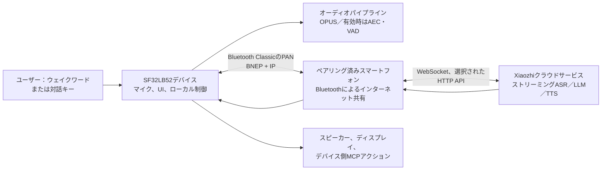

# SF32 Xiaozhi音声アシスタント { #sf32-xiaozhi-voice-assistant }

## Xiaozhiとは { #what-is-xiaozhi }

[Xiaozhi](https://github.com/78/xiaozhi-esp32)は、MCPベースのオープンソース音声チャットボットです。2025年にESP32実装を通じて広く知られるようになりました。音声対話デバイスとクラウドの大規模モデルサービス、デバイス側またはクラウド側のMCP拡張を組み合わせており、単なるテキストチャットアプリではなく、対話型AIハードウェアを開発するための実用的な出発点です。

## SF32実装を選ぶ理由 { #why-the-sf32-implementation }

[78/xiaozhi-sf32](https://github.com/78/xiaozhi-sf32)はSF32向け実装ですが、接続方式は意図的に異なります。元のESP32プロジェクトはWi-Fiなどの直接ネットワーク接続をサポートしますが、SF32版はBluetooth Classic上の[Bluetooth PAN](../learn/bluetooth/pan.md)を使い、ペアリング済みスマートフォンからインターネット接続を得ます。これにより広域ネットワーク接続の負荷をデバイスからスマートフォンへ移せるため、スマートフォンにテザリングする製品では、通信に伴うデバイス側の消費電力を大きく抑えられる可能性があります。実際の削減量は、スマートフォン、無線状態、対話のデューティー比、電源方針によって異なります。この構成は、ペンダント、バッジ、小型アシスタント、小型ウェアラブルなど、バッテリー駆動の個人向け携帯製品に特に適しています。

このプロジェクトが製品開発の参考として特に有用なのは、別々に扱われがちなディスプレイ／オーディオハードウェア、スマートフォン経由のネットワーク、クラウド音声サービス、ユーザー向けの利用開始手順、デバイス制御、製品出荷後の更新を一つにつないでいる点です。

## 目標、対象範囲、開始条件 { #outcome-scope-and-entry-criteria }

このページでは、この参考実装を製品開発の方向性へ適応させるための一連の手順を示します。Xiaozhiがデバイス上でオフライン動作するLLMであること、上流の全機能について量産に必要な検証が完了していること、対応開発ボードが量産向け完成品と同等であることを主張するものではありません。デバイスはペアリング済みスマートフォンからBluetooth PAN経由でインターネットに接続し、対話処理にはXiaozhiのクラウドサービスを使用します。製品化を決定する前に、サービスの利用条件、アカウント管理、プライバシー、セキュリティ、費用、可用性、地域適合性を確認してください。

**目標：** スマートフォン経由で設定でき、クラウドを介した対話を完了し、安全なデバイス機能を1つ制御し、PAN接続断から復旧する音声／ディスプレイアシスタントを再現可能な形で構築します。カスタムハードウェアを開発すべきか判断するための証跡も残します。

**対象読者：** SF32の基準環境をすでにビルド・書き込みでき、C／C++、ボード回路図、Bluetooth設定、クラウドサービス統合に取り組めるファームウェア、ハードウェア、製品エンジニア。

<div align="center"><em>表：プロジェクトの合意事項</em></div>

<div align="center" markdown>

| 項目 | プロジェクトの基準 | 次の段階に進む前の証跡 |
|:-----|:-------------------|:-----------------------|
| ハードウェア | 資料で構成が特定されたSF32LB52 Xiaozhiターゲット1台、オーディオ／ディスプレイ経路、USB書き込み経路、電源 | コールドブート、キー、ディスプレイ、マイク、スピーカー、該当する場合は充電／バッテリー表示 |
| 接続 | `sifli-pan`としてペアリングし、Bluetooth PANでインターネット共有するスマートフォン | ボードUIがPAN接続を示し、切断／再接続を再現できる |
| サービス | Xiaozhiアカウント、デバイスのアクティベーション、Xiaozhiコンソールで設定したエージェント | 対話リクエストがサービスに届き、応答がボードへ返る |
| ファームウェア | 記録済みの上流コミット、SDKサブモジュールリビジョン、ボードターゲット、ビルド／書き込み方法 | 再現可能なクリーンビルド、書き込み、シリアルログ、ファームウェア成果物 |
| 製品への適応 | UIのブランド表記、デバイス名、バッテリーカーブ、安全なMCP制御出力など、意図的に範囲を限定した変更を1つ | 変更後も元の音声対話ループが動作する |

</div>

## ハードウェアとソフトウェアの仕様 { #hardware-and-software-specifications }

以下のマニフェストは、SiFliが公開する外部ディスプレイ／オーディオ回路を備えた**SF32LB52-DevKit-Nano-R16N16 V1.0.0**を、具体的なソースビルド基準として定義します。すべてのXiaozhi対応ボードに共通するBOMではありません。DevKit-ULP、DevKit-LCD、またはXiaotangyuanを選ぶ場合は、ハードウェアマニフェスト全体をそのボードの資料にある構成へ置き換え、正確な仕入先部品とボードリビジョンを記録してください。

### ハードウェア仕様 { #hardware-specification }

<div align="center"><em>表：Xiaozhi Nanoの基準ハードウェア仕様</em></div>

<div align="center" markdown>

| コンポーネント | 必要な仕様 | 役割 | 必須／任意 | 入手先 | 互換性と代替に関する注意 |
|:--------------|:-----------|:-----|:----------|:-------|:-------------------------|
| SF32LB52-DevKit-Nano-R16N16 V1.0.0 | SF32LB52JUD6、16 MB OPI PSRAM、16 MB SPI NOR Flash | SF32演算、Bluetooth PAN、USB書き込み／デバッグ、UI、オーディオインターフェース | 必須 | [SiFli製品ページ](https://www.sifli.com/zh-hans/SF32LB52_DevKit_Nano)、[SiFli公式ストア](https://sifli.taobao.com/) | ファームウェアターゲットとメモリー予算を再確認せずにNano N4バリアントへ置き換えないでください。基板リビジョンと仕入先の注文リンクを記録してください |
| 1.85インチ390 × 450 AMOLEDと16ピン-22ピンFPCアダプター | 公式Nano Xiaozhi配線で使われるQSPIディスプレイアセンブリーとFPCピン配置 | ユーザーインターフェース | 必須 | [公式Nano Xiaozhiハードウェアページ](https://docs.sifli.com/projects/xiaozhi/get-started/SF32LB52-DevKit-Nano/) | 公式ページには注文先がありません。基準環境を再現可能とする前に、パネルコントローラー、FPCの向き、仕入先型番、購入先を固定してください |
| アナログMEMSマイクモジュール | `MIC_BIAS`、`MIC_ADC`、GNDに適合するアナログ出力 | 音声入力 | 必須 | [公式ガイド掲載の部品リンク](https://item.taobao.com/item.htm?id=595237371680) | 代替品ではバイアス、出力レベル、ノイズ、音響の検証が必要です |
| PAM8302アンプモジュール | `DACP`／`DACN`からの差動入力。`PA30`でシャットダウン制御 | スピーカー駆動 | 必須 | [公式ガイド掲載の部品リンク](https://item.taobao.com/item.htm?id=535743493142) | 別のアンプを使用する場合はハードウェア変更として扱い、イネーブル極性、ゲイン、アイドル電流、ノイズを再確認してください |
| エンクロージャー付きスピーカー | 8 Ω、2～3 W | 音声再生 | 必須 | [公式ガイド掲載の部品リンク](https://item.taobao.com/item.htm?id=895176389650) | エンクロージャーまたはインピーダンスを変更する場合は音響出力、アンプ温度、電流を再評価してください |
| ジャンパーワイヤーと400点ブレッドボード | 資料に記載されたNano試作に合う配線一式とブレッドボード | 試作時の配線 | 資料の試作構成には必須 | [ジャンパーワイヤー](https://item.taobao.com/item.htm?id=39961676503)、[400点ブレッドボード](https://item.taobao.com/item.htm?id=39828824454) | 基準配線の試験合格後、ピンマップを正確に移した設計済みPCBへ置き換えてください |
| USB Type-Cデータケーブルと開発用コンピューター | データ通信対応Type-Cケーブル。Windows、Linux、macOSホスト | 電源、書き込み、ビルド、シリアルログ | 必須 | [SiFli SDKの準備要件](https://docs.sifli.com/projects/sdk/latest/en/sf32lb52x/quickstart/get-started.html) | 充電専用ケーブルでは書き込みやログ取得ができません。ホストOSとアーキテクチャを記録してください |
| Bluetoothインターネット共有が可能なAndroidまたはiOSスマートフォン | `sifli-pan`とペアリングでき、Bluetooth ClassicのPANでインターネット接続を共有できること | ネットワーク接続の補助 | 必須 | [公式Xiaozhi PANセットアップ手順](https://docs.sifli.com/projects/xiaozhi/get-started/) | スマートフォンの機種とOSバージョンを記録してください。対応するスマートフォン／OSの各基準で切断、再ペアリング、共有動作を検証してください |

</div>

上記のサードパーティー部品URLは公式SiFli Nanoガイドに掲載されたマーケットプレイスのリンクであり、メーカーの恒久的な部品番号を保証するものではありません。評価した部品の注文記録または画面コピーを保管し、製品設計前にマーケットプレイス依存を適格性を確認した仕入先の型番とデータシートに置き換えてください。

### ソフトウェア仕様 { #software-specification }

<div align="center"><em>表：Xiaozhi基準ソフトウェア仕様</em></div>

<div align="center" markdown>

| パッケージ／サービス | 必要なバージョンまたはリビジョン | 役割 | 必須／任意 | 入手先 | 互換性と更新時の注意 |
|:--------------------|:----------------------------------|:-----|:----------|:-------|:---------------------|
| Xiaozhi SF32プリビルドファームウェア | v1.4.0 | 基準環境と復旧用の未変更イメージ | 段階1～2で必須 | [v1.4.0リリース](https://github.com/78/xiaozhi-sf32/releases/tag/v1.4.0) | Nano R16N16基準環境には`sf32lb52-nano_52j.zip`を選択してください。異なるボードのアーカイブを混在させないでください |
| `78/xiaozhi-sf32`ソース | コミット[`1d3ef641ace47fae68227e9173647fd5db01f6f5`](https://github.com/78/xiaozhi-sf32/commit/1d3ef641ace47fae68227e9173647fd5db01f6f5) | アプリケーションのソースとボード設定 | 段階3～4で必須 | [リポジトリー](https://github.com/78/xiaozhi-sf32) | この記事で確認したソーススナップショットです。後続のコミットを使う場合は新しい基準として記録し、すべてのゲートを再実施してください |
| SiFli-SDKサブモジュール | コミット[`0d2de1480f735e05017c41436e655a1688063881`](https://github.com/OpenSiFli/SiFli-SDK/tree/0d2de1480f735e05017c41436e655a1688063881) | SF32ドライバー、RTOS、ミドルウェア、ツールチェーンスクリプト、SConsビルド環境 | 段階3～4で必須 | リポジトリーの`sdk`サブモジュール経由の[OpenSiFli/SiFli-SDK](https://github.com/OpenSiFli/SiFli-SDK) | 選択したアプリケーションコミットに記録されたサブモジュールリビジョンを使い、維持中の基準環境内でSDKだけを独自に更新しないでください |
| sftool GUI | v1.2.1。リリースページから選択したOS用アセットのSHA-256を保管 | プリビルドイメージ書き込みとローカル復旧 | 資料に記載されたv1.4.0 GUI手順では必須 | [v1.2.1リリースと各OS用アセット](https://github.com/OpenSiFli/sftool-gui/releases/tag/v1.2.1) | ホストOS、アセット名、チェックサムを記録してください。後続リリースへ置き換える場合は先に評価・検証してください |
| ビルド用ホストツール | 固定したSiFli-SDKが提供するインストール／エクスポートスクリプトと、それらが構築するSCons環境 | ソースの設定とビルド | 段階3～4で必須 | [公式Xiaozhiソースビルドガイド](https://docs.sifli.com/projects/xiaozhi/source-build/) | ホストOS、アーキテクチャ、スクリプト実行結果、エクスポート済み環境を記録してください。グローバルに導入されたツールが固定SDK環境を無断で上書きしないこと |
| Xiaozhiクラウドコンソール／サービス | `xiaozhi.me`のホストサービス。検証日、アカウント所有者、エージェント設定、エンドポイントを記録 | アクティベーション、ストリーミングASR／LLM／TTS、クラウドMCP | 対話に必須 | [Xiaozhiコンソール](https://xiaozhi.me) | ホストサービスにはユーザーが固定できるリリースがありません。動作、利用条件、可用性、地域アクセスを外部依存として扱ってください |

</div>

## サポート対象の基準構成を選ぶ { #choose-a-supported-baseline }
SiFliのXiaozhiクイックスタート資料では、プリビルドファームウェアの対象としてSF32LB52-DevKit-ULP（Huangshan）、SF32LB52-DevKit-LCD、SF32LB52-DevKit-Nano、Xiaotangyuanプラグインボードの4種類が案内されています。ソースビルド資料に現時点で掲載されているのはDevKit-ULP、DevKit-LCD、DevKit-Nanoです。ソースのカスタマイズが要件なら、ソースビルド資料にあるボードを選択してください。プリビルドイメージがあるからといって、ソースビルド手順も公開されているとは限りません。

<div align="center"><em>表：ボードの選定</em></div>

<div align="center" markdown>

| ボード | 選択する条件 | 製品設計上の注意 |
|:-------|:-------------|:-----------------|
| [SF32LB52-DevKit-ULP](https://docs.sifli.com/projects/xiaozhi/get-started/SF32LB52-DevKit-ULP/) | 資料にあるULPのソースビルド例と、バッテリーを意識した評価経路を使いたい | 資料の基準以外のバッテリーでは、バッテリーカーブを再調整してください |
| [SF32LB52-DevKit-LCD](https://docs.sifli.com/projects/xiaozhi/get-started/SF32LB52-DevKit-LCD/) | ディスプレイとスピーカーの具体的な統合例が必要 | 390 × 450 AMOLED、FPCの向き、`SPK`接続、`KEY1`、`KEY2`の手順はボード固有です |
| [SF32LB52-DevKit-Nano](https://docs.sifli.com/projects/xiaozhi/get-started/SF32LB52-DevKit-Nano/) | 小型のSF32LB52基準環境を使いたい | 他のボードの配線を流用する前に、正確なディスプレイ、オーディオ、電源、ユーザー入力構成を確認してください |
| [Xiaotangyuanプラグインボード](https://docs.sifli.com/projects/xiaozhi/get-started/SF32LB52-XTY-AI-THT/) | 該当するプリビルドのクイックスタート経路に従う | 製品基準として使う前に、ソースビルドとカスタマイズの最新状況を確認してください |

</div>

## プロジェクトの開発段階と判断ポイント { #delivery-map }

各段階は機能チェックリストではなく、判断ポイントとして使ってください。次の判断をレビュー可能かつ再現可能にする成果物を、各段階で残します。

<div align="center"><em>表：プロジェクトの開発段階と判断ポイント</em></div>

<div align="center" markdown>

| 段階 | 判断する内容 | 必要な成果物 |
|:-----|:-------------|:-------------|
| 1. 基準環境 | 資料に記載されたボード、スマートフォン、アカウント、サービスを未変更で連携できるか | 記録済みの既知正常な対話セッション |
| 2. 復旧の検証 | ユーザーが遭遇する故障に対して、基準環境は信頼できるか | 合格した故障・復旧試験の記録 |
| 3. ソースコード構成 | 提供イメージに依存せず、チームがファームウェアを再現できるか | バージョンを固定したビルド成果物とログ |
| 4. 管理された変更 | 基準動作を失わずに製品向け変更を1つ加えられるか | レビュー済み変更と回帰試験の証跡 |
| 5. 製品判断 | ハードウェア、サービス、セキュリティ、復旧のリスクを十分理解して追加投資できるか | 承認済みの製品化準備記録とハードウェアへの引き継ぎ |

</div>

## システム構成と依存関係 { #system-architecture-and-dependencies }

<div align="center"><em>図：Xiaozhi SF32の製品フロー</em></div>



公式アーキテクチャガイドでは、ネットワーク経路としてBluetooth Classic上のBluetooth PANと、デバイス上の軽量IPネットワークを説明しています。アプリケーションのリアルタイム通信にはWebSocketを主に使用し、一部のAPI操作にはHTTPを使います。SiFliの概要ページでは、キーワードウェイクアップ（KWS）、連続対話、AEC/VAD、動的表情、ベクターフォント、ローカルMCPが実装済み機能として挙げられています。ほかの公式資料では、画面UI、バッテリー／電源動作、クラウド側MCP拡張、PAN OTAも説明されています。具体的な対応状況は、選択したボードとファームウェアで確認してください。

この構成には個別に診断すべき4つの故障領域があります。ローカルのハードウェア／オーディオ、BluetoothペアリングとPAN、インターネット／クラウドサービスへの到達性、アプリケーション／サービス設定です。BLEのペアリング成功だけでは、ボードがインターネットへ接続できたことや音声サービスがアクティベートされたことを確認できません。

## 段階1 — 未変更の基準環境を確立する { #stage-1-establish-the-untouched-reference-baseline }

1. ボード固有の公式ハードウェア設定を完了します。DevKit-LCDの場合、指定AMOLED／FPC構成、`SPK`へのスピーカー接続、ウェイク／対話用`KEY1`、長押し電源オフ用`KEY2`が含まれます。
2. 公式Xiaozhi手順に従って、対応するプリビルドファームウェアを書き込みます。クイックスタートガイドではUI書き込みツールが推奨されており、そのガイドの時点ではファームウェアv1.4.0以降をターミナルから書き込む方法はサポートされないと説明しています。
3. **ペアリング前に**スマートフォンのBluetoothインターネット共有を有効にします。`sifli-pan`デバイスとペアリングした後、ボードUIとスマートフォンの共有状態を確認し、単なるBluetoothペアリングではなくPANが有効であることを確認します。iOSでは、`sifli-pan`が表示されない場合にスマートフォンの再起動が必要になることがあると公式ガイドに記載されています。
4. [xiaozhi.me](https://xiaozhi.me)のXiaozhiコンソールで、公式アクティベーション手順に従います。エージェントを作成／設定し、ボードに表示されるデバイスコードを追加します。
5. ボードの対話キーまたは設定したウェイク方法で対話を1回実行します。ファームウェアバージョン、ボード、スマートフォンの機種／OS、サービスのアカウント／エージェントIDをプロジェクト記録に残します。

**段階1の終了条件：** コールドブート後にPANへ接続してアクティベーション済みと認識し、対話リクエストを受け付けて応答を再生し、想定どおりのUI状態を表示すること。

## 段階2 — 復旧と製品上重要な動作を確認する { #stage-2-prove-recovery-and-product-critical-behavior }

ソースを変更する前に、次の試験を実施してください。これによりデモを信頼できる基準環境にします。

<div align="center"><em>表：基準環境の検証証跡</em></div>

<div align="center" markdown>

| 試験 | 方法 | 合格の証跡 |
|:-----|:-----|:-----------|
| PAN未接続 | Bluetoothインターネット共有を有効にせずにペアリングする | UI／ログでPAN未接続が明確に分かり、共有を有効にして再接続するとサービスが復旧する |
| PAN切断 | アイドル中と対話中に共有を無効化、Bluetoothを切断、または通信範囲外へ移動する | デバイスが故障を検出して復旧可能な状態に戻り、文書化されたウェイク／再接続経路で接続し直せる |
| スリープとウェイク | スリープするまで放置し、指定のウェイク操作を行う | 再書き込みなしでウェイク、再接続、次の対話を再現できる |
| オーディオとUI | 現実的な音量で対話を繰り返す | 音声入力が明瞭で、再生に異常がなく、UIの応答性が保たれ、リセットが発生しない |
| バッテリー表示 | 代表的な残量まで充電／放電する | 表示残量が妥当で、基準外バッテリーにはカーブ再調整が必要だと分かる |
| サービス境界 | 想定する設定が欠けたアカウント／エージェントで試す | PANやハードウェア故障と区別できる |

</div>

公式ガイドでは、ボードごとのデフォルト`battery_table.c`カーブが別のバッテリーでは不正確な場合があると警告しています。製品用バッテリーでは、仕入先の充放電データを入手するか実測し、`charging_curve_table`と`discharge_curve_table`を更新して再ビルドし、バッテリー試験を繰り返してください。

**段階2の終了条件：** すべての試験結果が記録され、故障領域ごとに原因を区別でき、各文書化された復旧方法が再書き込みや手動状態修復なしに動作すること。

## 段階3 — 再現可能なソースコード構成を整える { #stage-3-build-a-reproducible-source-baseline }

リポジトリーにはSiFli-SDKがサブモジュールとして含まれています。再帰的にクローンし、XiaozhiコミットとSDKサブモジュールのコミットの両方を記録してください。

```bash
git clone --recursive https://github.com/78/xiaozhi-sf32.git
cd xiaozhi-sf32
git checkout 1d3ef641ace47fae68227e9173647fd5db01f6f5
git submodule update --init --recursive
cd sdk
# Windows: .\install.ps1, then .\export.ps1
# macOS/Linux: ./install.sh, then . ./export.sh
```

公式DevKit-ULPのスクリプトビルド例では、資料に記載された外部ボードパスを指定して`app/project`からビルドします。

```bash
scons --board=sf32lb52-lchspi-ulp --board_search_path="../boards" -j8
```

正確なターゲットと書き込みスクリプトは、ボード別の公式ビルドページを参照してください。ULPのボード名や生成物のパスを別ボードに流用してはいけません。再現可能なビルド記録には、ホストOS、ツール導入結果、エクスポート済み環境、ボード引数、上流／SDKリビジョン、ビルドログ、書き込みイメージ、シリアルログを含めます。

**段階3の終了条件：** 2台目のマシン、またはビルドディレクトリーを削除した後のクリーンチェックアウトから生成したイメージが、段階2の全試験に合格すること。

## 段階4 — 意図的に変更する { #stage-4-adapt-deliberately }

一度に1つだけ変更し、合格済みの基準イメージを保管してください。公式カスタマイズ資料では、Bluetooth名、静止画／アニメーション、フォント、PAN DFU、MCPを扱っています。

<div align="center"><em>表：安全な変更順序</em></div>

<div align="center" markdown>

| 変更の種類 | 最初に行う変更 | 必須の回帰試験 |
|:-----------|:---------------|:---------------|
| 製品識別情報 | Bluetooth名、静止画、フォント、アニメーション | 書き込み、アクティベーション、PAN、UI、対話 |
| バッテリー／製品ハードウェア | バッテリーカーブ、ディスプレイパラメーター、オーディオ経路、キー動作 | 電源、ウェイク、オーディオ／UI、対話の反復 |
| ローカルデバイス制御 | パラメーター範囲を限定し、安全なコールバックを備えたMCPツールを1つ | コマンド認可、不正入力、動作中切断、物理フェイルセーフ、監査可能なログ |
| クラウド拡張 | 外部MCPサービス | エンドポイント認証、シークレット保管、可用性／再起動動作、最小権限、ユーザー同意 |
| 現場更新 | DFU_PANとOTAサーバー | バージョン検出、CRC／パーティション整合性、中断更新、ロールバック／復旧、イメージの出所 |

</div>

デバイス側MCPでは、公式ガイドは`app/src/mcp/mcp_server.cc`にある`McpServer::AddCommonTools()`を使用しています。LLMから要求されたアクションは信頼できないリクエストとして扱ってください。コールバックで範囲と状態を検証し、出力のデフォルトを安全な状態にし、製品固有の認可なしに取り消し不能、危険、またはセキュリティ上重要な制御を公開しないでください。

PAN OTAの公式資料では、コード、画像アセット、フォントアセットの3種類を個別に配布でき、イメージのアドレスとサイズはパーティションテーブルを使うよう案内しています。量産OTAをユーザーに提供する前に、バージョン方針、サーバーアクセス制御、完全性検証、中断試験、有線またはローカルでの復旧経路を用意してください。

**段階4の終了条件：** 選定した変更、そのロールバック／復旧経路、該当する回帰試験のすべてが記録され、元の対話ループとデバイスアクションの安全境界が引き続き合格すること。

## 段階5 — 製品化準備のレビュー { #stage-5-product-readiness-review }

チームが次のすべてに回答できるまでは、カスタムハードウェアに進まないでください。

- 正確なPANセットアップ手順に対応するスマートフォン／OSのバージョンはどれですか。対応しない場合の代替手段は何ですか。
- 使用するクラウドエンドポイント、アカウント、エージェント、MCPエンドポイント、認証情報は何ですか。誰が所有し、ローテーションしますか。
- デバイス／音声／ユーザーデータのうち、何がデバイス外へ送信されますか。同意をどう得て、保持期間や地域要件にどう対応しますか。
- 想定するバッテリーと筐体で、対話中、接続アイドル、スリープ、充電、ウェイク時の電流の実測値はいくらですか。
- 更新失敗、スマートフォン紛失、クラウド停止、アセット破損、設定誤りから、デバイスをどう復旧しますか。
- 上流コード、サービス、モデル動作、OTA基盤のうち、製品チームが管理するものと外部プロバイダーが管理するものは何ですか。

**段階5の終了条件：** 回答、担当者、残存リスクが記録され、製品チームが受容していること。未解決の項目には緩和策、明示的な延期、または中止の判断が必要です。

## 製品設計への引き継ぎ { #handoff-to-product-design }

選定したSF32型番、電源構成、ディスプレイ／オーディオ設計、RF方針、ストレージ／パーティション計画、量産試験、復旧に関する前提を[量産設計](../hardware/design-for-production.md)へ引き継いでください。[SF32LB52製品統合手順](../sf32-products/chips/SF32LB52x.md#integration-path)で、適切なチップ、モジュール、ボード、ガイド、チェックリストを選定します。

**プロジェクトの完了条件：** 新しいチームメンバーが選定した基準環境を再現し、観測した各故障の担当者または復旧経路をたどり、カスタマイズしたイメージを再ビルドし、カスタムハードウェアの判断に必要な証跡をレビューできた時点で、この参考実装は役割を果たしたといえます。その時点で、これは量産へそのまま持ち込む未検証のデモではなく、製品開発の参考実装となります。

## 主な情報源 { #authoritative-sources }
- [78/xiaozhi-esp32リポジトリー](https://github.com/78/xiaozhi-esp32)
- [78/xiaozhi-sf32リポジトリー](https://github.com/78/xiaozhi-sf32)
- [SiFli Wiki: AI Xiaozhi概要（中国語）](https://github.com/OpenSiFli/SiFli-Wiki/blob/main/source/zh_CN/application/xiaozhi.md)
- [SiFli Xiaozhiクイックスタート](https://docs.sifli.com/projects/xiaozhi/get-started/)
- [SiFli Xiaozhiソースビルド](https://docs.sifli.com/projects/xiaozhi/source-build/)
- [SiFli Xiaozhiアーキテクチャ](https://docs.sifli.com/projects/xiaozhi/architecture/)
- [SiFli Xiaozhiカスタマイズ](https://docs.sifli.com/projects/xiaozhi/custom/)
- [SiFli Xiaozhi DFU_PANガイド](https://docs.sifli.com/projects/xiaozhi/custom/dfu_pan.html)
- [SiFli Xiaozhi MCPガイド](https://docs.sifli.com/projects/xiaozhi/custom/mcp.html)
