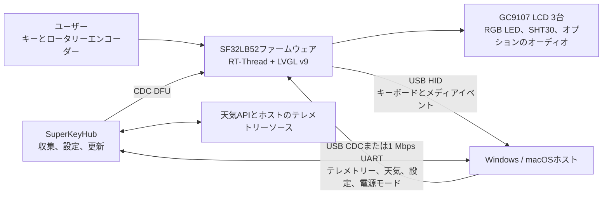

# SuperKey 多機能マクロキーボード { #superkey-multifunction-macro-keyboard }

## SuperKey とは { #what-is-superkey }

[SiFliSparks/SuperKey](https://github.com/SiFliSparks/SuperKey) は、ディスプレイを備えた多機能マクロキーボードの SF32LB52 ベースのリファレンス実装です。オープンソースのファームウェアは RT-Thread と LVGL v9 上で動作し、128 × 128 の GC9107 LCD 3 枚、RGB LED 3 個、物理キー 4 個、ロータリーエンコーダー、SHT30 温湿度センサーを制御します。また、複合 USB HID/CDC デバイスとしてコンピューターに接続します。

SuperKey は単なるショートカットキーパッドではありません。1 つの動作するリファレンスに次の機能を統合しています。

- USB HID によるキーボードおよびメディア制御の出力。
- USB CDC または 1 Mbps UART を介した、PC の性能、天気、設定、電源状態データの取得。
- 性能モニター、天気、時計、ユーティリティ、音楽、カスタムキー割り当てを表示する 3 画面 UI。
- ホストデータの収集、機能設定、ファームウェア更新を行うコンパニオンアプリ [SuperKeyHub](https://github.com/SiFliSparks/SuperKeyHub)。
- オープンな [sf32-keyboard 設計](https://oshwhub.com/sifli/sf32-keyboard)による再現可能なハードウェア。


<div align="center"><em>SuperKey の 3 画面ユーザーインターフェース</em></div>

## SF32 による実装の利点 { #why-the-sf32-implementation }

SuperKey はグラフィックス、複数ディスプレイ、複合 USB デバイス、キーとエンコーダー、センサー、RGB 効果、ファイルシステム、オプションのオーディオを必要とします。SF32LB52 では、これらのリアルタイム処理を MCU 上で実行できるため、コンパニオンアプリが起動していなくても、デバイスは UI を起動して基本的な HID 動作を提供できます。PC のテレメトリーやインターネット上のデータなど、デスクトップ OS 側で扱うのが適切な処理はホストアプリに任せます。

この分担は、デスクトップコントローラー、ワークフローキーボード、ステータスパネル、小型 HMI に適しています。一方で、明確な依存関係も生じます。高度なデータ表示にはコンパニオンアプリ、ドライバー、外部 API が必要です。ファームウェアとホストアプリのバージョン互換性を保つ必要があり、USB 接続の喪失、ホストのスリープ、設定の破損についても個別に復旧試験を行う必要があります。

## 目標、対象範囲、開始条件 { #outcome-scope-and-entry-criteria }

**目標:** バージョンを固定した SuperKey を再現し、HID、CDC、3 画面 UI、入力、センサー、スリープからの復旧を検証します。そのうえで、ビルド、通信、回帰試験の証拠を製品レビューに引き継げる状態を保ちながら、動作を 1 種類だけ変更します。

オープン PCB が量産可能であることや、すべての PC テレメトリー情報、天気サービス、シリアルブリッジ、USB ホスト、OS バージョンに互換性があることを、このページは立証するものではありません。株価、天気、性能データは、SuperKeyHub のバージョン、サードパーティ API、システム権限、ホストのハードウェアに依存する場合があります。

開始前に、次のものを用意してください。

- オープン設計を基に組み立てた SuperKey ハードウェア。GC9107 LCD 3 枚、キー、エンコーダー、USB データ接続を含みます。
- 主に文書化された手順を実施するための Windows 10/11 PC。SuperKeyHub のリポジトリーは Windows と macOS をサポート対象としていますが、選択した OS で書き込み、CDC 通信、復旧まで検証してください。
- ファームウェアと互換性のあるバージョンの SuperKeyHub。
- SiFli-SDK 環境、再帰的にチェックアウトした SDK サブモジュール、動作確認済みの書き込み／復旧接続。
- 天気機能を使う場合は、有効な QWeather API Key、API Host、都市設定。
- USB 認識、シリアルログ、キー動作、画面状態、スリープ復旧を記録するテスト記録。

<div align="center"><em>表：SuperKey プロジェクトの前提条件</em></div>

<div align="center" markdown>

| 項目 | 判明している基準 | 変更前に必要な証拠 |
|:-----|:----------------|:------------------|
| ハードウェア | オープンな `sf32-keyboard` ハードウェアと `sf32lb52-superkey` ボードターゲット | PCB／実装リビジョン、LCD と入力デバイス、電源、USB 接続の記録 |
| ファームウェア | SuperKey リポジトリ、SiFli-SDK サブモジュール、RT-Thread、LVGL v9、CherryUSB | ファームウェアと SDK のコミット、ビルドログ、イメージ、書き込みログ |
| コンパニオン | 互換性のあるファームウェアプロトコルを備える SuperKeyHub | アプリのバージョン、OS、ポート、API 設定、接続ログ |
| 基本動作 | HID、CDC、3 画面、エンコーダー、キー、センサー、電源モード | コールドスタート、データ更新、入力、切断、スリープ復旧の記録 |
| 変更 | UI、キー、LED、データフィールドのいずれか 1 種類を一度に変更 | レビュー済み変更、ロールバック用イメージ、回帰試験一式の結果 |

</div>

## ハードウェアとソフトウェアの仕様 { #hardware-and-software-specifications }

### ハードウェア仕様 { #hardware-specification }

<div align="center"><em>表：SuperKeyのハードウェア仕様</em></div>

<div align="center" markdown>

| 部品 | 必要な仕様 | 役割 | 区分 | 入手先 | 互換性・置き換え時の注意 |
|:-----|:-----------|:-----|:-----|:-------|:-------------------------|
| SuperKeyオープンハードウェア一式 | プロジェクトに記載されたSF32LB52構成。128 × 128 GC9107 LCD 3枚、RGB LED 3個、物理キー4個、ロータリーエンコーダー、SHT30、USBを含む | マクロキーボードの制御、表示、入力、センシング、USB HID/CDC | 必須 | [オープンな`sf32-keyboard`設計](https://oshwhub.com/sifli/sf32-keyboard)；[SuperKeyリポジトリー](https://github.com/SiFliSparks/SuperKey) | 設計ファイルは購入可能な実装済み基板の仕様ではない。PCBと実装リビジョンを記録する |
| ホストPCとUSBデータ接続 | 主な文書化済み手順はWindows 10/11。データ通信可能なUSB接続を用意 | SuperKeyHub、HID/CDCホスト、書き込み/復旧に使用 | 必須 | [SuperKeyドキュメント](https://sparks.sifli.com/projects/superkey/) | SuperKeyHubのリポジトリーはWindows/macOSをサポート対象としている。選択したOSでCDC、DFU、書き込み、復旧を検証する |
| QWeatherアカウント/API設定 | API Key、API Host、都市設定 | オプションの天気表示機能 | 任意 | [QWeather](https://www.qweather.com/) | 認証情報をソース管理に含めない。サービスの利用条件と可用性を確認する |

</div>

### ソフトウェア仕様 { #software-specification }

<div align="center"><em>表：SuperKeyのソフトウェア仕様</em></div>

<div align="center" markdown>

| パッケージまたはサービス | 必要なバージョンまたはリビジョン | 役割 | 区分 | 入手先 | 互換性・更新時の注意 |
|:-------------------------|:---------------------------------|:-----|:-----|:-------|:---------------------|
| SuperKeyファームウェア | v1.4.2。使用したリポジトリーコミットを記録する | SF32ファームウェア、LVGL UI、USB、センサー、更新機能 | 必須 | [v1.4.2リリース](https://github.com/SiFliSparks/SuperKey/releases/tag/v1.4.2) | ファームウェアのコミットを固定し、バージョン番号だけでホストとの互換性を判断しない |
| SuperKeyHub | ファームウェアv1.4.2との互換性を検証したリリースまたはコミット | ホストテレメトリー、設定、更新UI | ホスト機能を使う場合に必須 | [リポジトリー](https://github.com/SiFliSparks/SuperKeyHub) | 参照した上流のリリース情報では固定の組み合わせを確認できない。テレメトリー、設定、DFUを試験し、組み合わせを記録する |
| SiFli-SDKサブモジュール、RT-Thread、LVGL、CherryUSB | 選択したファームウェアのチェックアウトに記録されたリビジョン | ファームウェアビルドとUSBスタック | ソースビルドに必須 | [SuperKeyリポジトリー](https://github.com/SiFliSparks/SuperKey) | 再帰的にクローンし、サブモジュールリビジョンを保持する。依存関係を個別に更新しない |

</div>

## サポート対象の基準構成を選ぶ { #choose-a-supported-baseline }
上流のリリース一覧にはファームウェア [v1.4.2](https://github.com/SiFliSparks/SuperKey/releases/tag/v1.4.2) があり、固定した出発点として利用できます。参照資料からは対応する SuperKeyHub の版を特定できません。Hub のリリースまたはコミットを選び、v1.4.2 と組み合わせてテレメトリー、設定、DFU を検証し、バージョン番号だけで互換性を推定せず、テスト済みの組み合わせを記録してください。

<div align="center"><em>表：SuperKey のベースライン選択</em></div>

<div align="center" markdown>

| ベースライン要素 | 推奨する開始点 | 重要な制約 |
|:-----------------|:--------------|:-----------|
| ファームウェア | SuperKey v1.4.2、またはチームで検証したコミット | ファームウェアとホストプロトコルのバージョンを一致させる必要があります |
| コンパニオン | v1.4.2との互換性を検証したSuperKeyHubのリリースまたはコミット | 参照資料では固定の組み合わせを確認できないため、選択したOSでCDCデータ、設定、DFUを検証する |
| ビルドターゲット | `sf32lb52-superkey`。ボードファイルは `app/boards` にあります | 汎用 SF32LB52 開発ボード用のターゲットではありません |
| 通信 | まず複合 USB HID + CDC を検証し、使用する場合は 1 Mbps UART も別途検証 | 「USB として認識された」だけでは、HID と CDC の両インターフェースが機能する証拠にはなりません |
| 更新 | コンパニオンからの CDC DFU と、有線の書き込み／復旧経路を維持 | 中断、バージョン不一致、復旧を検証するまでは、フィールド更新手段とは見なせません |

</div>

SuperKey の上流 CI では次のターゲットを使用しています。ローカルで実行する前に SiFli-SDK 環境をインストールして有効にしてください。

```bash
git clone --recursive https://github.com/SiFliSparks/SuperKey.git
cd SuperKey/SiFli-SDK
./install.sh
. ./export.sh
cd ../app/project
scons --board=sf32lb52-superkey --board_search_path="../boards" -j8
```

Windows では SiFli-SDK 用の PowerShell インストールスクリプトと環境設定スクリプトを使用してください。並列ビルド数は変更できますが、ビルド記録にはボード名、ボード検索パス、サブモジュールのリビジョンを残してください。

## プロジェクトの開発段階と判断ポイント { #delivery-map }

<div align="center"><em>表：SuperKey の開発段階と判断ポイント</em></div>

<div align="center" markdown>

| 段階 | 判断する内容 | 必要な成果物 |
|:---------|:-------------|:-------------|
| 1. 未変更ベースライン | オープンハードウェア、ファームウェア、コンパニオンが記録どおりに連携するか | バージョンを固定した既知正常の動作記録 |
| 2. 通信と復旧 | USB、シリアル、スリープ、切断、設定の障害を診断・復旧できるか | 障害注入と復旧の記録 |
| 3. ソースからのビルド再現性 | クリーンなチェックアウトからチームが同じイメージを再ビルドできるか | ビルド環境、イメージ、書き込み、再現結果 |
| 4. 管理された変更 | 製品の動作を 1 つ変更してもベースラインを壊さないか | 範囲を限定した変更、ロールバック経路、回帰試験の証拠 |
| 5. 製品レビュー | カスタム PCB、筐体、パイロット生産の基盤として十分か | 担当者を割り当てたリスクと、続行／保留／中止の判断 |

</div>

## システム構成と依存関係 { #system-architecture-and-dependencies }

<div align="center"><em>図：SuperKey の製品データと制御経路</em></div>



障害は、デバイスのハードウェア／ディスプレイ、HID 入力、CDC／UART データチャネル、コンパニオン／システム権限、外部データサービスの 5 つの領域に分けて考えてください。天気パネルが空白でも、直ちにファームウェア障害とは限りません。API キー、API Host、都市設定、データ送信に原因がある可能性があります。

## 段階1 — 未変更のリファレンスベースラインを確立する { #stage-1-establish-the-untouched-reference-baseline }

**目標:** コードを変更する前に、リファレンス全体の経路が動作することを確認します。

1. 上流の組み立て資料に従い、LCD ケーブルの向き、スイッチ、エンコーダー、筐体、USB コネクターを確認し、PCB とファームウェアのリビジョンを記録します。
2. 互換性のある SuperKeyHub をインストールします。デバイスの認識を確認してから、HID と CDC を個別にテストします。
3. 天気情報の認証情報、ポート、1 Mbps のシリアル通信を設定します。コンパニオンなしの動作を記録してから接続し、データ送信を有効にします。
4. 3 画面の切り替え、キー割り当て、メディア制御、エンコーダー、SHT30 データ、LED 効果、テレメトリー更新 1 サイクルを確認します。
5. コールドスタートして再試験します。UI の写真、コンパニオンログ、デバイスログ、バージョン照会の結果を保存します。

**保存する証拠:** ハードウェアリビジョン、ファームウェアタグ／コミット、SDK コミット、コンパニオンのバージョン、OS、ポートと API の設定、USB 認識、ログ、画面、入力の記録。

**段階1の終了条件:** 2 回のコールドスタートで HID 入力、CDC データ更新、3 画面の操作が完了し、ログまたは観測可能な状態から各障害領域を区別できること。

## 段階2 — 障害と復旧の境界を検証する { #stage-2-validate-fault-and-recovery-boundaries }

**目標:** デスクトップ環境でよく起きる中断が、再書き込みを要するデモ機の状態につながらないことを確認します。

<div align="center"><em>表：SuperKey の障害・復旧試験</em></div>

<div align="center" markdown>

| テスト | 方法 | 合格を示す証拠 |
|:-------|:-----|:---------------|
| コンパニオンなし | SuperKeyHub を終了してデバイスを再起動 | ローカル UI と HID は動作し、コンパニオン依存の値は古い値または利用不可と分かる状態になる |
| CDC 切断 | データ送信中に USB を抜き差しするか、ポートを変更 | デバイスがハングせず、再接続後にバージョン照会とデータ送信が復旧する |
| ホストのスリープ | `power_mode sleep/normal` を有効にして、ホストのスリープ／復帰を 1 サイクル実行 | LCD、LED、バックライト、センサーが意図どおり停止／再開し、その後のデータ更新も復旧する |
| バージョン不一致 | 管理された環境で互換性のないコンパニオン／ファームウェアの組み合わせを試す | 互換性のない更新を適用せず、動作を拒否するか診断可能なエラーを表示する |
| API 障害 | 無効な天気設定を使うか、ネットワークを切断 | 天気機能の障害が HID、CDC、ローカル UI、復旧に影響しない |
| DFU 中断 | 復旧可能な試験機で更新を中断 | 維持している有線書き込み経路で既知のイメージを復元できる |

</div>

**段階2の終了条件:** 該当する各障害について、文書化されていない手動修復を必要とせず、再現可能な検出・復旧結果が得られていること。

## 段階3 — 再現可能なソースコード構成を整える { #stage-3-build-a-reproducible-source-baseline }

**目標:** 別のエンジニアがクリーンなチェックアウトから段階2 を再ビルド、書き込み、再試験できるようにします。

1. 再帰的にクローンし、SuperKey と SiFli-SDK の両方のコミットを記録します。
2. `sf32lb52-superkey` と `../boards` の検索パスを指定してクリーンビルドします。
3. ビルドログ、メモリー／パーティション出力、書き込みスクリプト、生成イメージ、シリアルログを保存します。
4. 2 台目の PC またはビルドディレクトリを削除した環境で再ビルドし、同じハードウェアに書き込んで主要な回帰試験を繰り返します。

**段階3の終了条件:** 未追跡ファイル、古い成果物、手動で差し替えたバイナリーに依存せず、段階2 に合格するイメージを生成できること。

## 段階4 — 製品の変数を 1 つずつ変更する { #stage-4-adapt-one-product-variable-at-a-time }

**目標:** 合格済みのリファレンスを維持しながら、変更の影響範囲を検証します。

<div align="center"><em>表：SuperKey の変更を段階的に進める順序</em></div>

<div align="center" markdown>

| 変更の種類 | 最初に試す変更 | 必要な回帰試験 |
|:-----------|:---------------|:---------------|
| 製品識別と UI | アイコン、フォント、ページレイアウト、回転設定 1 つ | 3 画面更新、回転、フォント、コールドスタート、メモリー使用量 |
| キー操作 | HID 割り当てまたはキーの組み合わせを 1 つ | 押下／解放、複数キー、予期しない切断、設定の保持 |
| データ項目 | テレメトリーまたはセンサー値を 1 つ | プロトコル互換性、範囲チェック、更新タイムアウト、旧バージョンのコンパニオンでの動作 |
| LED 効果 | 色またはアニメーションを 1 つ | 輝度の上限／下限、スリープ、キー操作フィードバック、長時間動作 |
| 更新 | バージョン方針または更新 UI | イメージの出所、バージョン検証、中断、ロールバック、有線復旧 |

</div>

**段階4の終了条件:** 変更がレビューされ、元のイメージへ復旧でき、HID、CDC、ディスプレイ、入力、スリープ、復旧の各試験に合格すること。

## 段階5 — 製品化準備のレビュー { #stage-5-product-readiness-review }

カスタムハードウェアやパイロット生産の前に、チームは次の質問に答える必要があります。

- 製品が SuperKeyHub、管理者権限、サードパーティの天気サービスに依存し続けるか。依存先の責任者は誰か。
- ファームウェア、コンパニオン、プロトコルのバージョンをどう管理し、互換性のない組み合わせをどう防ぐか。
- 対象 PC、USB ハブ、ケーブル、スリープポリシー、セキュリティソフトの組み合わせのうち、どれを試験したか。
- 3 画面、USB データ、LED、センサー、オプションのオーディオを同時に動作させたときのメモリー使用量、温度、消費電流はどうか。
- 電源断やストレージ破損後に、設定、キー割り当て、更新状態をどう復旧するか。
- オープン PCB、筐体、フォント、アイコン、音楽、サードパーティ API のライセンスは予定する配布形態を許可しているか。

**段階5の終了条件:** 残る各リスクに担当者、証拠、対応方針が割り当てられ、「続行／保留／中止」の判断が記録されていること。

## 製品設計への引き継ぎ { #handoff-to-product-design }

SF32 とメモリーの選定、USB HID/CDC ディスクリプター、3 画面とバックライトの接続、入力／センサーインターフェース、電源とスリープ方針、ファイルシステムと更新パーティション、コンパニオンプロトコル、量産テストポイント、検証済みの復旧経路を引き継いでください。続けて [SF32LB52x](../sf32-products/chips/SF32LB52x.md)、[SF32LB52x ハードウェア設計ガイド](../hardware/chip-guides/SF32LB52x_hardware_design_guide.md)、[SiFli-SDK のビルド、書き込み、モニター](../develop/platforms/sifli-sdk/build-flash-monitor.md)、[量産設計](../hardware/design-for-production.md)を参照してください。

## 主な情報源 { #authoritative-sources }
- [SiFliSparks/SuperKey ファームウェアリポジトリ](https://github.com/SiFliSparks/SuperKey)
- [SuperKey v1.4.2 リリース](https://github.com/SiFliSparks/SuperKey/releases/tag/v1.4.2)
- [SiFliSparks/SuperKeyHub コンパニオンリポジトリ](https://github.com/SiFliSparks/SuperKeyHub)
- [SuperKey プロジェクトドキュメント](https://sparks.sifli.com/projects/superkey/)
- [オープンな sf32-keyboard ハードウェア](https://oshwhub.com/sifli/sf32-keyboard)
- [OpenSiFli/SiFli-SDK](https://github.com/OpenSiFli/SiFli-SDK)
