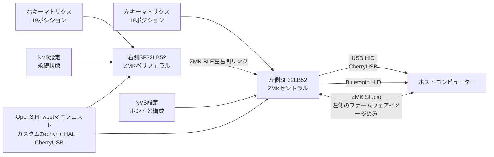

# SF32向けZMKキーボードファームウェア { #zmk-keyboard-firmware-on-sf32 }

## SF32向けZMKとは { #what-is-zmk-on-sf32 }

[ZMK Firmware](https://zmk.dev/)はZephyr上に構築されたMITライセンスのキーボードファームウェアです。上流のZMKは、有線・無線・左右に分かれたキーボードで広く使われているアプリケーションモデルを提供します。機能には、マトリクススキャン、キーマップとレイヤー、キー動作、USBおよびBluetooth HID、永続設定、拡張可能なボード／シールド定義があります。

[OpenSiFli/zmk](https://github.com/OpenSiFli/zmk)は、OpenSiFliが保守するZMKの下流フォークです。確認したフォークには、次の追加要素があります。

- `sf32lb52_devkit_lcd/sf32lb525uc6/zmk`ボードバリアント
- ZMKアプリケーションツリー内のSF32LB52 SoC統合
- 単体ボード、分割キーボード、ZMK Studio、`urchin_sf32lb52`シールドの設定
- SF32向けCherryUSBバックエンド
- 256 KBのNVS設定パーティションとBluetooth設定サポート
- 3レイヤー、Bluetoothプロファイル操作、ZMK Studioのロック解除用バインディングを備えるUrchin分割キーボード用キーマップ

これは開発用ポートであり、タグ付きのSF32向けZMK製品リリースではありません。フォークのトップレベルREADMEは上流ZMKの汎用READMEのままで、SF32向けのクイックスタートはありません。ボード、シールド、マニフェスト、ソース、コミットを実行可能な基準として扱い、変更を加える前に、クリーンビルド、書き込み、機能、復旧の証跡を自分で確認してください。

## SF32で実装する理由 { #why-the-sf32-implementation }

SF32ポートでは、Zephyrのデバイスツリー、Kconfig、`west`、キーマップ、シールド、分割キーボードの規約を保ちながら、ZMKのキーボードモデルをSF32LB52上で動作させる方法を確認できます。`urchin_sf32lb52`の構成では、38キーを左右の半分に分けます。左側はZMK分割構成のセントラルで、CherryUSBとZMK Studioを有効にし、USB HIDをホストに接続できます。右側は分割構成のペリフェラルです。両側でZMK BLEが有効です。

このフォークは、無線分割キーボード、USB／Bluetoothデスクトップ入力デバイス、プログラマブルマクロパッド、SF32を使ったカスタムHMI製品の評価に役立ちます。その代償は依存関係の成熟度です。フォークの`west`マニフェストは、カスタムZephyrブランチ（`v4.3+sf32-zmk_fixes`）、固定されたSiFli HALリビジョン、カスタムCherryUSBの`zephyr-adapt`ブランチを指定しています。これらはポートの互換性境界の一部であり、全面的な移行と回帰試験なしに上流の「最新版」へ置き換えることはできません。

## 目標、対象範囲、開始条件 { #outcome-scope-and-entry-criteria }

**目標：** バージョンを固定したUrchin左右のイメージをビルド・書き込みし、キーマトリクス全体、レイヤー、USB HID、BLE分割リンクとホスト接続、設定の永続化、ZMK Studioの適用範囲、復旧を検証します。そのうえで、再現可能な証跡を残しながらキーマップまたはハードウェアを1点、管理された手順で変更します。

このページは、上流ZMKとの完全な機能同等性、任意のZMKシールドとの互換性、量産可能なバッテリー駆動時間、検証済みの無線性能、または別のZephyr／ZMKリビジョンへのサポートされた移行を主張するものではありません。また、量産キーボードPCBの設計を定義するものでもありません。リポジトリーのUrchin設定では、基準キーマトリクスがSF32LB52-DevKit-LCDのピンに割り当てられており、カスタムハードウェアへは意図的に移植する必要があります。

開始前に、次のものを準備してください。

- フォークの`sf32lb525uc6/zmk`バリアントに一致するSF32LB52-DevKit-LCDを2台
- `urchin_sf32lb52_left`および`urchin_sf32lb52_right`オーバーレイどおりに配線した38キー分割キーボードの試験治具。初期ポート確認には、仕様を記録した小規模な試験用シールドでも構いません
- Zephyr／ZMKの`west`環境が動作し、フォークが固定するモジュールを展開できるストレージを備えたホスト
- 分割動作を試す前に、左右それぞれで確認済みの書き込み、シリアルコンソール、復旧用接続
- 左／セントラル側用のUSBデータケーブルと、右／ペリフェラル側を独立して給電・復旧する手段
- Bluetoothホスト、対象に含める場合はZMK Studio対応ホスト、左右それぞれの電流を測定する手段
- フォークのコミット、マニフェストの各リビジョン、ボード／シールド識別子、ビルド・書き込みログ、キー試験結果、ボンド情報、設定状態、電流測定を記録する帳票

<div align="center"><em>表：SF32向けZMKプロジェクトの前提条件</em></div>

<div align="center" markdown>

| 項目 | 確認済みの基準構成 | 変更前に必要な証跡 |
|:-----|:-------------------|:-------------------|
| フォーク | 固定コミットのOpenSiFli/zmk | フォークのコミット、上流との関係、マニフェストのリビジョン、ローカル差分の記録 |
| ボード | `sf32lb52_devkit_lcd/sf32lb525uc6/zmk` | 正確なボードリビジョン、書き込み／復旧手段、コンソールログ |
| 分割キーボード基準構成 | `urchin_sf32lb52_left`セントラルと`urchin_sf32lb52_right`ペリフェラル | 配線、イメージと左右の対応、全マトリクス試験、左右間リンクの結果 |
| ホスト接続 | セントラル側からのUSB／CherryUSBとBLE HID | USB認識、ペアリング／ボンド、再接続、プロファイル、故障復旧の証跡 |
| 設定 | 3レイヤーのキーマップ、NVS設定、左側のZMK Studio | キーごとの結果、永続化試験、Studioの認可、ロールバック記録 |
| 変更 | キーマップ、マトリクス、通信経路、電源、依存関係を一度に1点変更 | レビュー済みの変更、元のイメージ、回帰試験一式の結果 |

</div>

## ハードウェアとソフトウェアの仕様 { #hardware-and-software-specifications }

### ハードウェア仕様 { #hardware-specification }

<div align="center"><em>表：SF32上のZMKハードウェア仕様</em></div>

<div align="center" markdown>

| 部品 | 必要な仕様 | 役割 | 区分 | 入手先 | 互換性・置き換え時の注意 |
|:-----|:-----------|:-----|:-----|:-------|:-------------------------|
| SF32LB52-DevKit-LCDボード2台 | ターゲット`sf32lb52_devkit_lcd/sf32lb525uc6/zmk`。各ボードのリビジョンを記録 | 文書に記載された分割キーボード構成のセントラル側とペリフェラル側 | 分割キーボード試験に必須 | [μForgeボード資料](../sf32-products/devkits/SF32LB52-DevKit-LCD.md)；[確認済みコミットのOpenSiFliボードバリアント](https://github.com/OpenSiFli/zmk/tree/fd4d5843065f65ed5ed6198dc2e5d0520330bf8e/app/boards/sifli/sf32lb52_devkit_lcd) | セントラル側とペリフェラル側ではイメージの役割/設定が異なる。両ボードを個別に復旧できるようにする |
| Urchin分割キーボードの試験治具と配線 | `urchin_sf32lb52_left`と`urchin_sf32lb52_right`のoverlayに従った38キーのマトリクス | キーマトリクス、左右間通信、各側の役割を検証 | 分割構成の総合検証に必須 | [確認済みコミットのUrchin shield](https://github.com/OpenSiFli/zmk/tree/fd4d5843065f65ed5ed6198dc2e5d0520330bf8e/app/boards/shields/urchin_sf32lb52) | overlayは配線の参照情報であり、別のPCBや任意のshieldとの互換性を保証しない |
| USB/BLEホストとデータケーブル | central側用USBホスト、Bluetooth HIDホスト、peripheral側の独立した電源および書き込み/復旧手段 | ホスト接続、入力検証、ログ、復旧 | 必須 | [OpenSiFli ZMKフォーク](https://github.com/OpenSiFli/zmk) | ホストOS、BLEボンド状態、ケーブル/ポート、各側の復旧接続を記録する |

</div>

### ソフトウェア仕様 { #software-specification }

<div align="center"><em>表：SF32上のZMKソフトウェア仕様</em></div>

<div align="center" markdown>

| パッケージまたはサービス | 必要なバージョンまたはリビジョン | 役割 | 区分 | 入手先 | 互換性・更新時の注意 |
|:-------------------------|:---------------------------------|:-----|:-----|:-------|:---------------------|
| OpenSiFli/zmk | 確認済みコミット[`fd4d5843065f`](https://github.com/OpenSiFli/zmk/tree/fd4d5843065f65ed5ed6198dc2e5d0520330bf8e) | SF32ポート、ZMKアプリケーション、Urchin設定 | 必須 | [確認済みコミットのリポジトリー](https://github.com/OpenSiFli/zmk/tree/fd4d5843065f65ed5ed6198dc2e5d0520330bf8e) | SF32向けのタグ付きZMKリリースではない。移植と検証なしに上流版へ置き換えない |
| west manifestの依存関係 | 固定したフォークコミットの`app/west.yml`で解決される正確なリビジョン | Zephyr、`hal_sifli`、CherryUSBなどのモジュール | 必須 | [固定コミットのwest manifest](https://github.com/OpenSiFli/zmk/blob/fd4d5843065f65ed5ed6198dc2e5d0520330bf8e/app/west.yml) | `west list`を実行して結果を保存する。依存関係を個別に更新しない |
| `west`/Zephyrツールとビルドツールチェーン | 固定manifestと互換性のあるバージョン。インストール済みバージョンとホストOSを記録 | 左右のイメージを設定、ビルド | 必須 | [ZMKドキュメント](https://zmk.dev/docs)；[Zephyrドキュメント](https://docs.zephyrproject.org/) | クリーンな作業領域で両イメージを再ビルドし、ビルドディレクトリーとハッシュを分けて保存する |
| ZMK Studioホスト | 選択した設定でStudioを有効にする場合、対応するホスト/アプリのバージョン | オプションの設定/keymap経路 | 任意 | [ZMK Studioドキュメント](https://zmk.dev/docs/features/studio) | 確認済み設定では左/central側でStudioを有効にする。製品利用前に認可とロールバックを検証する |

</div>

## サポート対象の基準構成を選ぶ { #choose-a-supported-baseline }
確認済みのOpenSiFli基準は、2026-05-27時点のコミット`fd4d5843065f`です。このコミットで利用可能なUrchinシールドとボード設定の更新が含まれていますが、タグ付きSF32向けZMKリリースではありません。初回の再現ではこのコミットを固定するか、より新しいコミットを使う場合は明記してレビューしてください。

<div align="center"><em>表：SF32向けZMKの基準状態の選定</em></div>

<div align="center" markdown>

| 基準要素 | 推奨する開始点 | 重要な制約 |
|:---------|:---------------|:-----------|
| ZMKフォーク | OpenSiFli/zmk `fd4d5843065f` | 上流zmkfirmware/zmkにはこのSF32ポートが含まれないため、置き換えないでください |
| ボードターゲット | `sf32lb52_devkit_lcd/sf32lb525uc6/zmk` | SF32LB52-DevKit-LCDのZMK専用バリアントです |
| 製品に近いシールド | `urchin_sf32lb52_left`および`urchin_sf32lb52_right` | オーバーレイのGPIO割り当てと役割は左右で異なり、イメージを入れ替えて使用できません |
| 診断用シールド | `sf32lb52_test`、`sf32lb52_split_test_left/right`、`sf32lb52_zmkstudio_test` | ポート開発向けの基準であり、製品互換性を保証するものではありません |
| 分割構成の役割 | 左＝セントラル、右＝ペリフェラル | 左側の構成ではUSBとZMK Studioが有効です。左右が対称だと想定しないでください |
| 依存関係マニフェスト | カスタムZephyr `v4.3+sf32-zmk_fixes`、固定された`hal_sifli`、カスタムCherryUSB `zephyr-adapt` | 依存関係を1つでも更新すると互換性境界が変わります |
| ライセンス | ZMKフォークと識別済みSF32追加部分はMITヘッダー／ライセンスを使用 | 各モジュール、ハードウェア、キーマップ用アセット、製品コンテンツは別途確認してください |

</div>

以下は、フォーク独自の`west`ワークフローに、正確なSF32ボードとUrchinシールドの識別子を組み合わせたコマンドです。左右のイメージを取り違えないよう、2つのビルドディレクトリーを分けてください。

```bash
git clone https://github.com/OpenSiFli/zmk.git
cd zmk
git checkout fd4d5843065f

west init -l app
west update --fetch-opt=--filter=tree:0
west zephyr-export

west build -s app -p always -d build-left \
  -b sf32lb52_devkit_lcd/sf32lb525uc6/zmk -- \
  -DSHIELD=urchin_sf32lb52_left

west build -s app -p always -d build-right \
  -b sf32lb52_devkit_lcd/sf32lb525uc6/zmk -- \
  -DSHIELD=urchin_sf32lb52_right
```

最終的な`west list`、生成されたKconfigとデバイスツリー、成果物のハッシュ、左右を示すイメージのラベル、実際の書き込み手順を記録します。左右それぞれのボードを独立して復旧できることを確認するまで、分割キーボード試験を始めないでください。

## プロジェクトの開発段階と判断ポイント { #delivery-map }

<div align="center"><em>表：SF32 向け ZMK プロジェクトの開発段階と判断ポイント</em></div>

<div align="center" markdown>

| 段階 | 判断する内容 | 必要な成果物 |
|:-----|:-------------|:-------------|
| 1. ポートの未変更基準構成 | 固定したフォーク、ボードターゲット、シールド、配線、ホストが連携して動作するか | バージョンを固定した左右イメージと、正常動作を確認した入力試験の記録 |
| 2. 入力、通信、復旧 | マトリクス、USB、BLE、分割通信、設定、Studioの異常を診断・復旧できるか | キー網羅試験と故障注入・復旧記録 |
| 3. ソースビルドの再現 | 別の環境で隠れた状態に頼らず両方のイメージを再生成できるか | マニフェスト、クリーンビルド、成果物ハッシュ、書き込み、再現結果 |
| 4. 管理された変更 | 基準構成を壊さずキーボード動作またはハードウェア割り当てを1点変更できるか | 変更範囲、ロールバック手段、回帰試験の証跡 |
| 5. 製品レビュー | カスタムPCBやバッテリー試作へ進める成熟度があるか | リスクの担当者と、続行／保留／中止の判断 |

</div>

## システム構成と依存関係 { #system-architecture-and-dependencies }

<div align="center"><em>図：SF32LB52上のZMK分割キーボードの経路</em></div>



問題は、物理マトリクス／配線、右から左への分割リンク、左側USB、ホストのBluetooth、保存済みのボンド／設定、ZMK Studio、ボードの書き込み／復旧、固定した依存関係スタックに分けて扱ってください。キー入力がホストに届かない場合、スキャン前、分割通信中、セントラル側キーマップ、選択したHID接続先のいずれかで失敗している可能性があります。この順に診断します。

## 段階1 — ポートの未変更基準環境を確立する { #stage-1-establish-the-untouched-port-baseline }

**目標：** キーマップ、オーバーレイ、依存関係を変更する前に、OpenSiFliの正確な基準構成を確認します。

1. 両方のボードリビジョンを記録し、左右のUrchinオーバーレイどおりに2つの試験治具を配線します。ボードとUSB／書き込みケーブルには役割を示すラベルを貼ります。
2. 固定コミットで左右両方のイメージをビルドし、`west list`を保存します。生成された設定を確認し、ボード、シールド、分割役割、BLE、CherryUSB、ZMK Studio、NVSの各設定が想定どおりであることを確認します。
3. それぞれのボードで独立して確認済みの復旧手段を使って書き込みます。左右やホストを接続する前に、コールドブートとコンソールの動作を記録します。
4. BLEの左右間リンクを確立した後、`default`、`lower`、`raise`の各レイヤーで38ポジションすべてを確認します。Bluetoothプロファイルの選択／クリアとStudioのロック解除用バインディングも意図的に試し、タイピング試験中に誤って作動しないことを確認します。
5. 左側でUSB HIDとZMK Studioを検証し、その後、選択したホストへのBluetooth HIDを検証します。コールドスタート後にも繰り返します。

**保管する証跡：** ボードと配線の記録、フォークとマニフェストのリビジョン、生成設定、イメージのハッシュ、書き込み・起動ログ、全キーの位置マトリクス、レイヤーの結果、接続先の選択、ホスト／Studioのバージョン。

**段階1の終了条件：** コールドスタートを2回行い、38ポジションのキーマップ全体、3つすべてのレイヤー、右から左への分割リンク、少なくとも1つのホスト接続先を再現でき、左右両方を個別に復旧できること。

## 段階2 — 入力、通信、設定、復旧を検証する { #stage-2-validate-input-transport-settings-and-recovery }

**目標：** キーボードで想定される故障を、未知の状態から再ビルドすることなく検出・復旧できると確認します。

<div align="center"><em>表：SF32向けZMKの故障・復旧試験</em></div>

<div align="center" markdown>

| 試験 | 方法 | 合格の証跡 |
|:-----|:-----|:-----------|
| マトリクス網羅性 | 全ポジション、複数キー同時押し、各レイヤー、両側の直接入力を試す | 欠落、重複、押しっぱなし、左右の役割取り違えがなく、押下／解放の順序を記録している |
| 分割リンク断 | アイドル時とタイピング中に右側の電源を切るか、通信範囲外へ移動する | 左側のキーとホスト接続が定義どおり動作し、右側が再書き込みや古いキー状態を残さず再接続する |
| USB中断 | 入力またはStudio使用中に左側のUSBデータ接続を抜き差しする | HIDとStudioがそれぞれ復旧し、修飾キーが押されたままにならず、設定も破損しない |
| ホストBLE切断 | ホストのBluetoothを無効化し、プロファイル切り替えと再接続を試す | 接続先／プロファイル状態を確認でき、再接続と明示的なボンド消去の手順が記録されている |
| 設定の永続化 | 元に戻せる設定を変更し、左右両方を電源再投入してから基準状態へ戻す | 想定するNVS状態が保持され、破損または不要な状態を消去するリセット／復旧手段が文書化されている |
| ZMK Studioの境界 | 認可された変更を試し、復旧可能な環境でセッション中断後に復元する | Studioを公開するのはセントラル側のイメージのみ。無効／未完了の変更でキーボードが使用不能にならない |
| 電源サイクル | 電流とウェイクを記録しながら、左右個別および同時の電源サイクルを繰り返す | 役割、分割接続、接続先、キー解放状態が予測どおり復旧する |

</div>

**段階2の終了条件：** 該当するすべての故障で検出と復旧を再現でき、押しっぱなしのHID状態が残らず、未追跡ファイルに置き換えることなく設定やボンドを記録済みの基準状態へ戻せること。

## 段階3 — 再現可能なソースコード構成を整える { #stage-3-build-a-reproducible-source-baseline }

**目標：** 別のエンジニアがクリーンなソースから左右両方のイメージを再生成し、段階2を再実施できるようにします。

1. 記録済みコミットのクリーンなフォークチェックアウトから始め、ローカルのモジュール置き換えを行わずに`west init`、`west update`、`west zephyr-export`を実行します。
2. `west list`、コンパイラー／ツールのバージョン、生成`.config`、生成デバイスツリー、メモリー出力、ビルドログ、ハッシュ付きの両成果物を保存します。
3. 左右が分かるようラベルを付けたイメージを各ボードへ書き込み、段階2の試験一式を再実施します。
4. 成果物と設定を元の記録と比較し、再現できない差異があれば続行前に説明します。

**段階3の終了条件：** 2つ目の環境で、未追跡オーバーレイ、古いビルド出力、固定されていない依存関係リビジョンを使わず、正しくラベル付けされたイメージが生成され、段階2に合格すること。

## 段階4 — キーボードの境界を1つずつ変更する { #stage-4-adapt-one-keyboard-boundary-at-a-time }

**目標：** 既知正常なポートと左右独立の復旧手段を保ちながら、製品向けの変更を1つ加えます。

<div align="center"><em>表：SF32向けZMKの段階的な変更順序</em></div>

<div align="center" markdown>

| 変更の種類 | 最初に適した変更 | 必須の回帰試験 |
|:-----------|:-----------------|:---------------|
| キーマップ | バインディング、レイヤー、hold-tap、コンボを1つ変更 | 全ポジション／レイヤー、押下・解放順序、複数キー同時押し、分割リンク断、両ホスト接続先 |
| マトリクス／PCB | 行、列、直接入力、ダイオード方向を1つ変更 | 電気的レビュー、生成デバイスツリー、全マトリクス、短絡／ゴースト、ウェイク、復旧 |
| Studio | 編集可能パラメーターまたはレイアウト公開項目を1つ変更 | 認可、正常／異常変更、永続化、切断、復元、バージョン互換性 |
| 通信経路 | USB／BLE接続先または分割ポリシーを1つ変更 | USB認識、ペアリング、ボンド、プロファイル切り替え、分割再接続、押しっぱなし防止、電流 |
| 電力管理 | スリープ、ウェイク、スキャン、無線通信の設定を1つ変更 | 左右それぞれのアクティブ／アイドル／スリープ電流、レイテンシ、全ウェイク要因、分割再接続、設定保持 |
| 依存関係の移行 | ZMK、Zephyr、HAL、CherryUSBを1つ更新 | マニフェスト差分、クリーンビルド、生成設定の差分、段階2の全試験、電流、ロールバック |

</div>

**段階4の終了条件：** 変更がレビューされ、元のイメージと設定を復元でき、該当するマトリクス、レイヤー、分割通信、USB、BLE、Studio、電源、復旧の試験すべてに合格していること。

## 段階5 — 製品化準備のレビュー { #stage-5-product-readiness-review }

カスタムキーボードPCBやバッテリー試作機を設計する前に、次の質問に答えてください。

- OpenSiFliのZMKフォーク、カスタムZephyrブランチ、SiFli HALリビジョン、CherryUSB対応、今後のセキュリティ／互換性更新を誰が管理しますか。
- SF32上で実際に評価した上流ZMKの機能はどれで、継承したソースツリーに存在するだけの機能はどれですか。
- 左右のイメージ識別、ボードリビジョン、キーマップ、設定、ボンド、工場出荷時リセット状態を、製造・保守時にどう管理しますか。
- スキャン周期、再接続動作、バッテリー保護を含め、左右それぞれのアクティブ、接続アイドル、切断、スリープ時の電流の実測値はいくらですか。
- どのホスト、OS、USBコントローラー、Bluetoothスタック、ウェイク経路、複数キー同時押し、干渉条件を試験しましたか。
- 依存関係更新、Studioの変更、設定書き込み、現場更新に失敗したとき、製品を分解・廃棄せずに復旧できますか。
- ZMK／Zephyrのライセンス、PCBと筐体ファイル、キーマップの内容、ロゴ、フォント、同梱設定は配布可能ですか。

**段階5の終了条件：** 残るリスクすべてに担当者、証跡、対応方針が割り当てられ、チームが続行、保留、中止のいずれかを明示的に決定していること。

## 製品設計への引き継ぎ { #handoff-to-product-design }

正確なSF32型番とメモリー、左右の役割と通信方式、行／列／直接入力の割り当て、ダイオード方向、USB接続、アンテナと筐体の前提、NVS／設定方針、書き込み・復旧用インターフェース、左右別の電力予算、試験治具、イメージ識別方法、固定したマニフェストを引き継いでください。続けて、[SF32LB52-DevKit-LCD](../sf32-products/devkits/SF32LB52-DevKit-LCD.md)、[Zephyrプラットフォームの境界](../develop/platforms/zephyr/overview.md)、[Bluetoothアーキテクチャ](../learn/bluetooth/overview.md)、[SF32LB52xハードウェア設計ガイド](../hardware/chip-guides/SF32LB52x_hardware_design_guide.md)、[量産設計](../hardware/design-for-production.md)を参照してください。

## 主な情報源 { #authoritative-sources }
- [OpenSiFli/zmk SF32フォーク](https://github.com/OpenSiFli/zmk)
- [確認済みOpenSiFli/zmkコミット](https://github.com/OpenSiFli/zmk/tree/fd4d5843065f65ed5ed6198dc2e5d0520330bf8e)
- [確認済みコミットのSF32LB52 ZMKボードバリアント](https://github.com/OpenSiFli/zmk/tree/fd4d5843065f65ed5ed6198dc2e5d0520330bf8e/app/boards/sifli/sf32lb52_devkit_lcd)
- [確認済みコミットのUrchin SF32LB52分割シールド](https://github.com/OpenSiFli/zmk/tree/fd4d5843065f65ed5ed6198dc2e5d0520330bf8e/app/boards/shields/urchin_sf32lb52)
- [確認済みコミットのOpenSiFli ZMK westマニフェスト](https://github.com/OpenSiFli/zmk/blob/fd4d5843065f65ed5ed6198dc2e5d0520330bf8e/app/west.yml)
- [上流zmkfirmware/zmk](https://github.com/zmkfirmware/zmk)
- [ZMKドキュメント](https://zmk.dev/docs/)
- [Zephyrプロジェクトドキュメント](https://docs.zephyrproject.org/)
