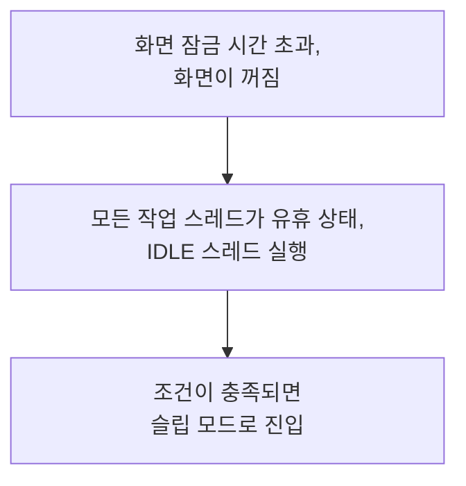
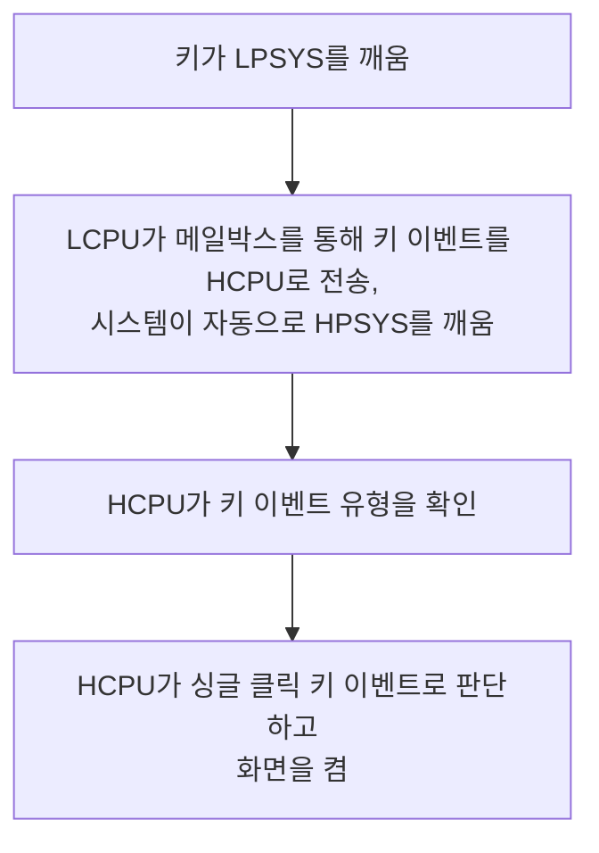

# 저전력 구성 및 측정 { #configure-and-measure-low-power }

SiFli SDK 저전력 가이드는 여러 SF32 아키텍처를 다룹니다. SF32LB52x, SF32LB55x, SF32LB56x는 고성능 작업에 HPSYS의 HCPU(최대 240 MHz)를, Bluetooth 및 센서 작업에 LPSYS의 LCPU(최대 48 MHz)를 사용합니다. SF32LB57x와 SF32LB58x는 HCPU/LCPU 아키텍처에 ACPU를 추가하며, 58x의 저전력 LCPU는 최대 96 MHz로 동작합니다. 코어 수, 클럭 한계, 저전력 동작은 제품군마다 다르므로 대상 디바이스에 해당하는 SDK 가이드를 따르십시오.

## 전원 관리 프레임워크 구성 { #configure-the-power-management-framework }

프로젝트 디렉터리에서 다음을 실행합니다.

```bash
sdk.py menuconfig
```

아래 menuconfig 설정은 SF32LB52x 원본 가이드의 내용입니다. 모드 이름과 사용 가능한 옵션은 제품군과 SDK 버전에 따라 다를 수 있으므로, 적용하기 전에 대상 제품군의 문서로 확인하십시오.

<div align="center" markdown>

<em>표: SF32LB52x 저전력 menuconfig 예시</em>

| Menuconfig 경로 | 심볼 | 용도 |
|---|---|---|
| `Sifli middleware → Enable Low power support` | `BSP_USING_PM` | SiFli 전원 관리 모듈을 활성화합니다. |
| `RTOS → RT-Thread Components → Device Drivers → Using Power Management device drivers → Select PM Mode → Enable Deep Mode` | `PM_DEEP_ENABLE` | Deep Sleep 지원을 선택합니다. |
| `Sifli middleware → Enable Low power support → Enable PM Debug` | `BSP_PM_DEBUG` | 전원 관리 전이를 출력합니다. 최종 전류 측정 시에는 비활성화하십시오. |
</div>

생성된 `rtconfig.h`에는 보통 `RT_USING_PM`, `BSP_USING_PM`, 그리고 선택한 모드 심볼이 들어 있습니다. 동작하는 레퍼런스로 시작하려면 `example/pm/classical`을 사용하십시오. 이 기능을 비활성화하려면 같은 menuconfig 선택을 반대로 되돌립니다.

아래 그림은 SF32LB52x 원본 가이드에서 가져온 것이며, 핵심 메뉴 위치 두 곳을 보여 줍니다. 실제 프로젝트에서는 대상 제품군의 SDK 메뉴를 기준으로 삼으십시오.

{ loading="lazy" }
<div align="center"><em>그림: SF32LB52x 원본 예시 — Sifli middleware → Enable Low power support에서 `BSP_USING_PM`을 활성화합니다.</em></div>

{ loading="lazy" }
<div align="center"><em>그림: SF32LB52x 원본 예시 — RTOS → RT-Thread Components → Device Drivers에서 `PM_DEEP_ENABLE`을 활성화합니다.</em></div>

## 웨이크업 소스 선택 { #select-a-wake-source }

보드의 `pinmux.c`/`drv_io.c`와 해당 SDK 예제의 API를 사용합니다.

<div align="center" markdown>

<em>표: 제품군별 Deep/Standby 및 Hibernate 웨이크업 동작</em>

| 제품군 | Deep/Standby 웨이크업 동작 | Hibernate 웨이크업 동작 |
|---|---|---|
| SF32LB52x | Deep Sleep에서는 모든 핀이 `WSR_GPIO1`을 통해 웨이크업할 수 있으며, 웨이크업 핀을 별도로 선택할 필요가 없습니다. HCPU와 LCPU는 서로 독립적으로 슬립할 수 있습니다. | `HAL_PMU_EnterHibernate()`를 호출하기 전에 PMU 웨이크업 핀과 레벨을 구성하십시오. |
| SF32LB55x | 55x AON 웨이크업 핀 맵을 사용합니다. | LCPU 웨이크업 핀 `PIN0`–`PIN5`만 Hibernate에서 웨이크업할 수 있습니다. 유효한 55x 핀 번호와 함께 `HAL_PMU_EnablePinWakeup()`을 사용하십시오. 이 핀들은 Hibernate에서 플로팅 상태가 되므로 보드에서 필요하면 외부 풀 저항을 추가합니다. |
| SF32LB56x | 제품군별 HPAON/LPAON 웨이크업 핀 맵을 사용합니다. | PMU는 `PIN0`과 `PIN1`의 두 웨이크업 소스를 지원하며, 각각 HCPU 또는 LCPU 웨이크업 핀에 매핑됩니다. 아래의 PMU 매핑 예제를 사용하십시오. |
| SF32LB57x | 제품군별 HPAON/LPAON 웨이크업 핀 맵을 사용합니다. | PMU는 `PIN0`과 `PIN1`의 두 웨이크업 소스를 지원하며, 57x의 Hibernate 핀 인덱스 범위는 0–13입니다. 각 소스를 의도한 HCPU/LCPU 웨이크업 핀에 매핑합니다. |
| SF32LB58x | 제품군별 HPAON/LPAON 웨이크업 핀 맵을 사용합니다. | PMU는 `PIN0`과 `PIN1`의 두 웨이크업 소스를 지원하며, 각각 HCPU 또는 LCPU 웨이크업 핀에 매핑됩니다. 아래의 PMU 매핑 예제를 사용하십시오. |
</div>

SF32LB52x, SF32LB56x, SF32LB57x, SF32LB58x의 Hibernate에서는 아래 예제가 GPIO를 PMU 웨이크업 소스 `PIN0`에 매핑합니다. 이 예제는 표에 나온 별도 절차를 사용하는 SF32LB55x에는 적용되지 않습니다. SF32LB57x에서 PMU 웨이크업 핀 인덱스 범위는 0–13이므로, 선택한 핀 매핑을 대상 디바이스의 사용자 매뉴얼 및 보드 설계와 대조하여 확인하십시오.

```c
HAL_PMU_SelectWakeupPin(0,
    HAL_HPAON_QueryWakeupPin(hwp_gpio1, BSP_KEY1_PIN));
HAL_PMU_EnablePinWakeup(0, AON_PIN_MODE_HIGH);
rt_kprintf("CR:0x%x, WER:0x%x\n", hwp_pmuc->CR, hwp_pmuc->WER);
```

Hibernate 웨이크업은 `PM_HIBERNATE_BOOT`이 설정된 콜드 부트이며, Standby처럼 중단된 명령 흐름을 이어서 실행하지 않습니다. 하나의 IO가 Standby와 Hibernate를 모두 웨이크업해야 한다면 두 경로를 모두 구성하십시오. 55x에서 Hibernate 웨이크업 핀은 플로팅 입력이므로 보드에서 필요한 경우 외부 풀 저항을 제공하십시오.

## 슬립 상태 이해 { #understand-the-sleep-states }

<div align="center" markdown>

<em>표: 슬립 모드와 일반적인 웨이크업 시간</em>

| SDK 모드 | CPU/주변 장치 상태 | SRAM 및 웨이크업 소스 | 가이드 수준 웨이크업 시간 범위 |
|---|---|---|---|
| `PM_SLEEP_MODE_IDLE` | CPU가 WFI/WFE에서 대기하며, 클럭과 주변 장치는 계속 동작합니다. | SRAM에 계속 접근할 수 있으며, 모든 인터럽트로 웨이크업할 수 있습니다. | <1 µs |
| `PM_SLEEP_MODE_LIGHT` | 고속 클럭이 정지하고, 서브시스템이 32 kHz로 전환됩니다. | LPTIM, RTC, LCPU BLE MAC, 메일박스 또는 웨이크업 핀. | 30–100 µs |
| `PM_SLEEP_MODE_DEEP` | Light Sleep과 같지만 전원이 `RET_LDO`로 전환됩니다. | SRAM 리텐션과 웨이크업 소스는 제품군에 따라 다릅니다. 아래 제품군별 표를 참조하십시오. | 100 µs–1 ms |
| `PM_SLEEP_MODE_STANDBY` | CPU와 해당 주변 장치가 리셋되거나 꺼지며, 핀 상태는 유지됩니다. | 리텐션되는 SRAM 용량과 웨이크업 소스는 제품군에 따라 다르며, 소프트웨어는 AON 상태로 Standby 부트를 식별합니다. | 1–2 ms |
| Hibernate | 모든 서브시스템의 전원이 꺼지며, 32 kHz 크리스털은 유지됩니다. | RTC 또는 PMU 웨이크업 핀. RAM은 유지되지 않습니다. `HAL_PMU_EnterHibernate()`. | >2 ms |
| Shutdown | 모든 서브시스템의 전원이 꺼지며, RC10K는 유지됩니다. | RTC 또는 PMU 웨이크업 핀. RAM은 유지되지 않으며 IO는 고임피던스 상태가 됩니다. `HAL_PMU_EnterShutdown()`. | >2 ms |
</div>

<div align="center" markdown>

<em>표: 제품군별 SRAM 리텐션 및 웨이크업 시간 예시</em>

| 제품군 | `PM_SLEEP_MODE_DEEP` | `PM_SLEEP_MODE_STANDBY` |
|---|---|---|
| SF32LB52x | HPSYS와 LPSYS SRAM은 접근할 수 없지만 유지되며, 약 250 µs입니다. | LPSYS SRAM은 접근할 수 없지만 전부 유지됩니다. HPSYS SRAM은 접근할 수 없으며 384 KB만 유지됩니다. 약 1 ms입니다. |
| SF32LB55x | HPSYS와 LPSYS SRAM은 접근할 수 없지만 유지되며, 약 250 µs입니다. | LPSYS SRAM은 접근할 수 없지만 전부 유지됩니다. HPSYS SRAM은 접근할 수 없으며 64 KB만 유지됩니다. 약 1.5 ms입니다. |
| SF32LB56x | HPSYS와 LPSYS SRAM은 접근할 수 없지만 유지되며, 약 250 µs입니다. | LPSYS SRAM은 접근할 수 없지만 전부 유지됩니다. HPSYS SRAM은 접근할 수 없으며 64 KB만 유지됩니다. 약 1.5 ms입니다. |
| SF32LB58x | HPSYS와 LPSYS SRAM은 접근할 수 없지만 유지되며, 약 250 µs입니다. | LPSYS SRAM은 접근할 수 없지만 전부 유지됩니다. HPSYS SRAM은 접근할 수 없으며 64 KB만 유지됩니다. 약 1.5 ms입니다. |

</div>

인용한 현재 SDK 저전력 가이드에는 57x에 대해 비교할 수 있는 SRAM 리텐션 및 웨이크업 시간 행이 없습니다. 다른 제품군의 리텐션 용량이나 타이밍 수치를 SF32LB57x에 그대로 가져다 쓰지 말고, 대상 SDK 릴리스와 디바이스 문서로 확인하십시오.

이 표에서 `PM_SLEEP_MODE_LIGHT`, `PM_SLEEP_MODE_DEEP`, `PM_SLEEP_MODE_STANDBY`는 각각 Light Sleep, Deep Sleep, Standby에 해당합니다.

위의 제품군별 값은 인용한 SDK 가이드의 참고 수치이며, 보드에서 보장되는 타이밍이 아닙니다. SF32LB52x 가이드에 따르면 PSRAM이 있을 때 HCPU는 전원이 꺼질 RAM의 데이터를 PSRAM에 백업하고 웨이크업 후 복원하며, PSRAM이 없으면 64 KB의 Retention RAM을 백업 대상으로 사용합니다. 이 백업 영역은 제품군별 표에 나온 SRAM 리텐션 용량과는 별개입니다(예를 들어 SF32LB52x Standby 항목에는 유지되는 HPSYS SRAM이 384 KB로 나와 있습니다). 다른 제품군의 SDK 가이드에서 확인되지 않는 한, 이 백업 정책이나 용량이 그 제품군에도 적용된다고 가정하지 마십시오. 실제 전류는 활성화된 주변 장치, IO 레벨, 외부 메모리, 보드에 따라서도 달라집니다.

## 동작 중 클럭 제어 { #control-clocks-while-awake }

idle 스레드가 슬립 상태로 진입할 수 없는 경우, WFI 자동 주파수 감소로 전류를 낮출 수 있습니다. 이 방법은 EPIC, EZIP, LCDC, USB, SD가 모두 유휴 상태일 때만 안전합니다. 애플리케이션이 SDK의 LVGL/디바이스 관리 기능을 사용하지 않는다면, 주변 장치 동작 구간을 `rt_pm_hw_device_start()`와 `rt_pm_hw_device_stop()`으로 감싸십시오. 분주비는 `HAL_RCC_HCPU_SetDeepWFIDiv()`로 구성하며, 오디오 워크로드는 보통 낮춘 클럭을 48 MHz로 제한하고 그 외 워크로드는 4 MHz를 사용할 수 있습니다. `HPSYS_RCC_DBGR_FORCE_HP`는 SDK 가이드에서 요구하는 대로 설정하십시오.

동작 중인 작업에는 `rt_pm_run_enter()`를 사용합니다.

<div align="center" markdown>

<em>표: Run 모드별 HCPU 클럭 선택</em>

| 모드 | HCPU 클럭 |
|---|---:|
| `PM_RUN_MODE_HIGH_SPEED` | 240 MHz |
| `PM_RUN_MODE_NORMAL_SPEED` | 144 MHz |
| `PM_RUN_MODE_MEDIUM_SPEED` | 48 MHz |
| `PM_RUN_MODE_LOW_SPEED` | 24 MHz |
</div>

`pm_scenario_start()`/`pm_scenario_stop()`은 SDK의 UI 및 Audio 정책을 제공합니다. 두 시나리오 중 하나라도 활성이면 고속이 선택되고, 둘 다 비활성이면 중속이 선택됩니다. 클럭을 낮추면 실행 시간이 길어질 수 있으므로, 순간 전류만이 아니라 에너지를 측정하십시오.

## 서브시스템 간 슬립 순서 이해 { #understand-inter-subsystem-sleep-sequencing }

화면이 꺼지면 HPSYS가 슬립에 들어갈 수 있습니다. 55x/56x/58x에서는 보통 HPSYS 다음에 LPSYS가 슬립에 들어가며, 52x 제품군은 HCPU/LCPU가 독립적으로 슬립하도록 허용하는, 문서화된 예외입니다. 인용한 자료에서는 57x ACPU에도 같은 순서가 적용되는지 확인되지 않으므로, 해당 SDK 릴리스에서 서브시스템 정책을 확인하십시오. 웨이크업 후에는 `gui_resume`이 새로운 화면 꺼짐 판단 주기를 시작합니다. 공유 주변 장치나 IPC 트랜잭션이 아직 코어를 필요로 하는 동안에는 해당 코어를 깨어 있는 상태로 유지하십시오.

`BSP_PM_DEBUG`를 일시적으로 활성화하고 로그에서 다음을 검색합니다.

<div align="center" markdown>

<em>표: 저전력 전이 로그 마커</em>

| 로그 | 의미 |
|---|---|
| `gui_suspend` / `gui_resume` | 화면 꺼짐/켜짐 전이. |
| `[pm]S: mode,gtime` | 슬립에 진입했습니다. `gtime`의 단위는 32,768-Hz 틱입니다. |
| `[pm]W: gtime` | 슬립에서 웨이크업했습니다. |
| `[pm]WSR:0x...` | 웨이크업 원인. 제품군 사용자 매뉴얼을 참조하여 비트를 해석합니다. |
</div>

예상한 슬립이 일어나지 않으면 `list_thread`, `pm_dump`, `list_timer`를 확인하십시오. idle 스레드가 실행되어야 하고, 어떤 코드도 `rt_pm_request(PM_SLEEP_MODE_IDLE)`를 유지하고 있지 않아야 하며, 가장 가까운 OS 타이머가 정책 임계값(일반적으로 HCPU는 100 ms, LCPU는 10 ms)보다 멀리 있어야 하고, 웨이크업 조건이 비활성 상태여야 하며, IPC 큐가 비어 있어야 합니다. 임계값보다 짧은 주기적 지연이 있으면 슬립이 계속 일어나지 않을 수 있습니다.

원본 가이드는 "화면 꺼짐 → IDLE → 조건이 충족되면 슬립" 경로와 "키가 LPSYS를 깨우고, LCPU가 메일박스를 통해 HCPU로 이벤트를 보내면 시스템이 자동으로 HPSYS를 깨우는" 경로도 도식화합니다. 이 도식은 로그 순서를 확인하는 데 유용하지만, 표현과 흐름은 SF32LB52x 예시이므로 다른 제품군의 WSR 비트 할당을 추정하는 데 사용해서는 안 됩니다.

{ loading="lazy" }
<div align="center"><em>그림: SF32LB52x 저전력 디버그 스위치(`BSP_PM_DEBUG`).</em></div>

<div align="center"><em>그림: SF32LB52x 예시 흐름 — 화면 꺼짐에서 슬립까지.</em></div>



<div align="center"><em>그림: SF32LB52x 예시 흐름 — LPSYS에서 HPSYS로의 웨이크업.</em></div>



## 보드 수준 누설 전류 줄이기 { #reduce-board-level-leakage }

먼저 최소 시스템을 측정합니다. 디스플레이, 센서, 충전기 등 분리할 수 있는 부하를 모두 연결 해제한 다음, 하나씩 다시 추가합니다. 흔한 누설 원인은 다음과 같습니다.

- 전원이 계속 공급되는 외부 디바이스
- 전원이 꺼진 디바이스로 High를 출력하는 출력 핀
- 플로팅 입력 또는 일치하지 않는 풀업/풀다운
- 저전력 상태로 전환하지 않은 PSRAM, NOR/NAND 플래시, eMMC 또는 SDIO
- 내부 풀다운과 충돌하는 55x USB `PA01` 구성

보드별 전환은 `BSP_IO_Power_Down()`과 `BSP_Power_Up()`에 구현하고, 화면 꺼짐/켜짐 시점에 디스플레이나 터치 전원을 즉시 바꾸어야 한다면 `BSP_TP_PowerDown/Up`과 `BSP_LCD_PowerDown/Up`을 사용하십시오. XIP가 NOR 플래시에서 실행되는 경우, 플래시 슬립/웨이크업 루틴은 리텐션 RAM(`HAL_RAM_RET_CODE_SECT`)에 배치하십시오.

## 재현 가능한 결과 측정 및 기록 { #measure-and-record-a-reproducible-result }

측정할 때마다 제품군과 SDK 리비전, 보드 리비전, 공급 전압, 계측기 위치와 대역폭, 펌웨어 구성, 메모리 실장 여부, 활성 주변 장치, 웨이크업 소스, 슬립 모드, 전이 로그를 기록하십시오. 전류 값에는 상태와 시험 조건을 함께 보고하고, 다른 보드나 다른 모드의 값을 조건 없이 비교하지 마십시오.

제품군별 공식 출처: [SF32LB52x](https://docs.sifli.com/projects/sdk/latest/sf32lb52x/app_note/low_power.html), [SF32LB55x](https://docs.sifli.com/projects/sdk/latest/sf32lb55x/app_note/low_power.html), [SF32LB56x](https://docs.sifli.com/projects/sdk/latest/sf32lb56x/app_note/low_power.html), [SF32LB58x](https://docs.sifli.com/projects/sdk/latest/sf32lb58x/app_note/low_power.html). SDK의 [PMU API 레퍼런스](https://docs.sifli.com/projects/sdk/latest/en/sf32lb52x/api/hal/pmu.html)에는 SF32LB57x의 Hibernate 웨이크업 핀 인덱스 범위가 문서화되어 있습니다.
