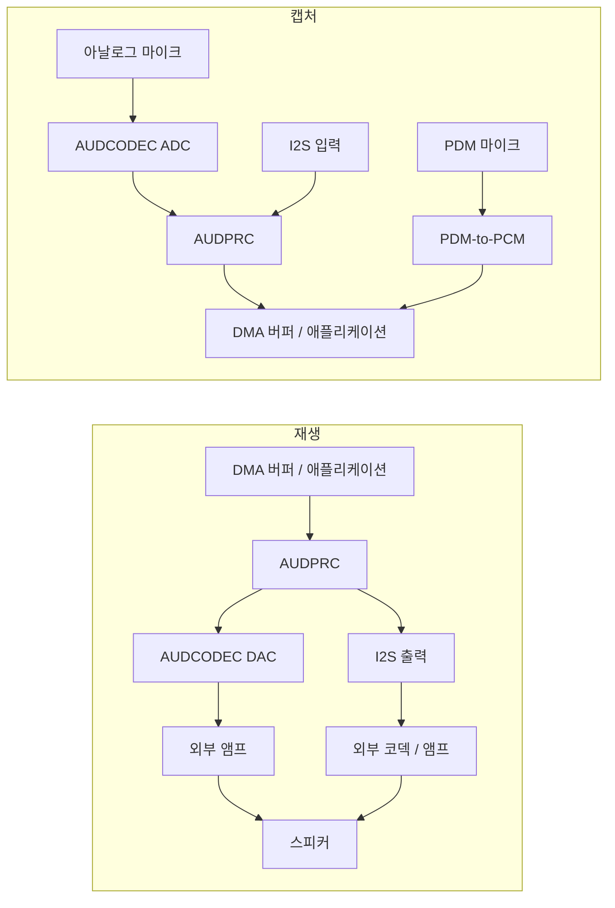

# 오디오 개요 { #audio-overview }

## 개요 { #overview }

이 가이드는 SF32 디바이스의 **로컬 오디오 서브시스템**, 즉 마이크 입력, 스피커/라인 출력, 온디바이스 재생 또는 녹음에 사용되는 코덱, DMA, 미들웨어 경로를 다룹니다. 인터페이스 선택, 버퍼링 전략, Audio Server 미들웨어, 코덱 선택, 전력처럼 실무에서 내려야 하는 결정에 초점을 맞춥니다.

Bluetooth 오디오(A2DP, LE Audio)는 관련되지만 별개의 주제이며 [Bluetooth 개요](../bluetooth/overview.md#bluetooth-audio-and-le-audio)에서 다룹니다. 해당 페이지는 무선 스트리밍 측면을 다루고, 이 페이지는 샘플이 칩 안에 들어온 이후의 과정, 즉 캡처, 믹싱, 디코딩, 물리적 오디오 경로 구동을 다룹니다.

이 가이드는 데모를 한 번 재생하는 데 그치지 않고, 마이크, 코덱, 버퍼링, 전력에 대한 제품 수준의 결정을 내리는 데 활용하십시오. Bluetooth, 디스플레이, 스토리지, 배터리 제약 조건과 함께 오디오 경로를 안정적으로 만들어야 하는 엔지니어를 위해 작성되었습니다.

## 제품의 오디오 요구 사항 정의 { #define-the-products-audio-requirements }

인터페이스나 버퍼 크기를 선택하기 전에 제품에 필요한 사항을 먼저 확정하십시오.

- 재생만, 녹음만, 아니면 둘 다 동시에(전이중) 필요한가?
- 마이크는 몇 개이며, 아날로그(AMIC)인가 디지털(DMIC)인가?
- 로컬 재생 포맷은 무엇인가? raw PCM, MP3, Opus 또는 다른 코덱?
- 로컬 오디오와 병행하여 Bluetooth 오디오(Classic 또는 LE Audio)도 필요한가?
- 음성 트리거 또는 상시 청취 동작이 필요한가, 그리고 그 전력 예산은 얼마인가?
- 스피커/라인 출력의 구동 요구 사항은 무엇인가, 아니면 출력을 외부 앰프/코덱으로 보내는가?
- 지연 시간 허용 범위 - 음성 통화와 실시간 모니터링은 알림음보다 훨씬 엄격합니다.

이러한 답에 따라 인터페이스(I2S 대 PDM 대 ADC/DAC), 코덱 구성, 파이프라인에서 깨어 있어야 하는 범위가 결정됩니다.

## SF32 오디오 신호 경로 { #the-sf32-audio-signal-path }

캡처와 재생은 서로 다른 경로를 따릅니다. 다음 다이어그램은 일반적인 경로를 보여 주며, 사용 가능 여부와 동시 라우팅은 정확한 디바이스, 패키지, 보드, SDK 구성에 따라 달라집니다.

<div align="center"><em>그림: 일반적인 SF32 로컬 오디오 신호 경로</em></div>



**AUDCODEC**은 아날로그-디지털 및 디지털-아날로그 변환을 수행합니다. **AUDPRC**는 지원되는 경로에서 믹싱, 게인, 샘플레이트 변환 같은 디지털 처리를 담당합니다. 반면 PDM 마이크는 PDM 블록을 사용하여 PCM을 생성하며, 아날로그 ADC를 거치지 않습니다. I2S는 외부 디바이스로 연결되는 디지털 경로를 제공합니다. PDM 인터페이스 하나에는 좌/우 채널 선택을 사용하여 호환되는 마이크를 최대 2개까지 연결할 수 있으며, 인터페이스 2개로는 최대 4개의 마이크를 지원할 수 있습니다. 단, 핀 가용성과 드라이버 지원에 따라 제한됩니다.

**Audio Server**는 스트림과 세션을 관리하는 소프트웨어이며, 마이크와 스피커 사이에 끼워 넣는 물리적 변환기가 아닙니다. 애플리케이션은 보통 해당 API와 대응하는 드라이버를 사용하며, 브링업 중에는 드라이버/HAL을 직접 사용하는 테스트가 유용합니다. 먼저 실제 캡처 및 재생 경로를 선택한 다음, 클럭, 샘플 포맷, DMA 요청, 출력 구동 요구 사항을 확인하십시오. 온칩 DAC가 외부 앰프 없이 선택한 스피커를 구동할 수 있다고 가정하면 안 됩니다.

이러한 경로는 [AUDPRC/AUDCODEC 드라이버 가이드](https://docs.sifli.com/projects/sdk/latest/en/sf32lb52x/drivers/audprc_audcodec.html)와 [PDM HAL 가이드](https://docs.sifli.com/projects/sdk/latest/en/sf32lb52x/hal/pdm.html)에 문서화되어 있습니다.

## 마이크와 디지털 인터페이스 { #choosing-interfaces-amic-dmic-and-i2s }

AMIC와 DMIC는 마이크 유형을 나타내고, PDM과 I2S는 디지털 인터페이스를 나타냅니다. 디지털 마이크는 PDM 또는 I2S 중 어느 쪽이든 사용할 수 있습니다. 마이크, 채널, 인터페이스를 같은 리소스로 계산하면 안 됩니다.

<div align="center"><em>표: 마이크와 디지털 인터페이스</em></div>

<div align="center" markdown>

| 마이크 / 버스 | 일반적인 용도 | 참고 사항 |
|:----------|:------------|:------|
| **AMIC (아날로그 마이크 입력)** | 범용 마이크 캡처 | 오디오 ADC를 사용하며, 마이크 바이어스, 게인, 입력 범위, 보드 노이즈 제어를 확인해야 합니다. |
| **DMIC (디지털 마이크)** | 음성 캡처, 멀티 마이크 어레이 | 실제 PDM 또는 I2S 버스를 선택합니다. 디지털 신호라고 해서 전원 노이즈, 클럭, 레이아웃 요구 사항이 없어지지는 않습니다. |
| **I2S** | 외부 코덱 또는 앰프와의 PCM 스트리밍 | 온칩 AUDCODEC 경로 대신 외부 오디오 코덱/앰프를 사용할 때 흔히 쓰입니다. |
| **PDM** | 디지털 마이크 입력 | 많은 DMIC 부품의 기본 인터페이스이며, 온칩 PDM-to-PCM 변환과 함께 사용됩니다. |

</div>

아날로그/디지털 혼합 어레이에는 지원되는 동시 경로와 동기화된 샘플 타이밍이 필요합니다. 빔포밍에도 적절한 마이크 배치, 보정, 알고리즘이 필요하며, 마이크를 여러 개 연결하는 것만으로는 빔포밍이 되지 않습니다.

## 검증된 오디오 예제에서 시작 { #start-from-a-verified-audio-example }

애플리케이션 동작을 설계하기 전에 가장 가까운 SiFli-SDK 기준 구성을 선택하고 검증하십시오. [오디오 SDK 예제](audio-sdk-examples.md)는 공식 PDM, 아날로그 캡처, 녹음/재생, 로컬 음악, SD 카드, FLAC, Opus, 믹싱 예제를 각각이 증명하는 엔지니어링 작업에 대응시켜 정리합니다. 또한 샘플을 제품에 맞게 적용하기 전에 다시 확인해야 하는 보드, 핀 먹스, 스토리지, 구성의 경계도 알려 줍니다.

## 적합한 SF32 디바이스 선택 { #pick-the-right-sf32-device }

오디오 기능은 제품군마다 다릅니다. 정확한 부품은 데이터시트에서 확인하되, 출발점으로는 다음을 참고하십시오.

<div align="center"><em>표: 적합한 SF32 디바이스 선택</em></div>

<div align="center" markdown>

| 디바이스 제품군 | 내장 오디오 ADC/DAC | PDM 인터페이스 (최대 마이크 수) | I2S 인터페이스 | 적용 방향 |
|:---|:---|:---|:---|:---|
| **SF32LB52x** | ADC 1개 + DAC 1개 | 1 (2) | 1 | 비용 최적화된 Bluetooth 오디오 액세서리, 음성 지원 소형 HMI. |
| **SF32LB55x** | 없음; 아날로그 오디오에는 외부 오디오 코덱을 사용합니다. | SF32LB551/555: 1 (2); SF32LB557: 2 (4) | SF32LB551/555: 1; SF32LB557: 2 | 오디오가 부차적인 BLE 웨어러블 및 센서 중심 제품. |
| **SF32LB56x** | ADC 1개 + DAC 1개 | 2 (4) | 1 | 멀티 마이크 음성 캡처도 필요한 고급 HMI/디스플레이 제품. |
| **SF32LB57x** | ADC 2개 + DAC 1개 | 2 (4) | 2 | 멀티 마이크 음성 캡처 및 로컬 재생. |
| **SF32LB58x** | ADC 2개 + DAC 2개 | 2 (4) | 3 | 오디오, 그래픽, AI, 복잡한 연결 기능을 결합한 플래그십 제품. |

</div>

디바이스를 선택하기 전에 정확한 모델, 패키지 핀 배치, 핀 먹스, 동시 경로를 확인하십시오. PDM 인터페이스 하나는 호환되는 마이크 2개를 지원할 수 있으며, ADC 채널, 마이크 채널, 디지털 인터페이스 인스턴스는 서로 다른 리소스입니다. I2S 기능은 인스턴스에 따라 다릅니다. SF32LB58x에서 I2S1은 수신(RX)만 지원하고, I2S2와 I2S3은 수신과 송신(RX/TX)을 모두 지원합니다. 또한 I2S2 수신에는 클럭 소스로서 TX 측을 활성화해야 합니다. 인스턴스별 세부 사항은 [SiFli I2S HAL 가이드](https://docs.sifli.com/projects/sdk/latest/en/sf32lb52x/hal/i2s.html)를, 더 넓은 선택 요소는 [SF32 제품군](../../sf32-products/family/SF32_family.md)를 참조하십시오.

출처 참고 자료: [DS5201](https://downloads.sifli.com/user%20manual/DS5201-SF32LB52x-Datasheet%20V2p5.pdf), [DS5501, Table 0-1](https://downloads.sifli.com/user%20manual/DS5501-SF32LB55x-Datasheet%20V1p7p2.pdf), [DS5601](https://downloads.sifli.com/user%20manual/DS5601-SF32LB56x-Datasheet%20V1p9p2.pdf), [DS5801](https://downloads.sifli.com/user%20manual/DS5801-SF32LB58x-Datasheet%20V1p8p3.pdf), [SF32LB57x AUDCODEC 레지스터 (ADC_CH0/1, DAC_CH0)](https://github.com/OpenSiFli/SiFli-SDK/blob/v2.5.1/drivers/cmsis/sf32lb57x/audcodec.h), [SF32LB57x PDM/I2S 인스턴스](https://github.com/OpenSiFli/SiFli-SDK/blob/v2.5.1/drivers/cmsis/sf32lb57x/register.h), [SiFli SDK v2.5.1 릴리스 노트 (57x 4마이크 PDM 구성)](https://github.com/OpenSiFli/SiFli-SDK/releases/tag/v2.5.1), [SiFli SDK PDM 예제 (57x 보드, PDM1, 스테레오 채널)](https://docs.sifli.com/projects/sdk/latest/en/sf32lb52x/example/rt_device/pdm/README.html).

## 오디오 세션 템플릿 { #audio-session-templates }

대부분의 제품은 몇 가지 반복되는 세션 형태로 분류됩니다. 가장 가까운 것을 골라 명시적으로 검증하십시오.

<div align="center"><em>표: 오디오 세션 템플릿</em></div>

<div align="center" markdown>

| 세션 | 일반적인 파이프라인 | 주요 리스크 |
|:--------|:-----------------|:----------|
| 알림음 | 플래시/PSRAM 에셋 -> 필요 시 디코더 -> Audio Server -> DAC/앰프 | 시작 및 정지 시 팝/클릭 노이즈. |
| 음성 녹음 | AMIC -> ADC/AUDPRC, 또는 PDM 마이크 -> PDM-to-PCM, 또는 I2S 입력 -> DMA 버퍼 -> 앱/스토리지/Bluetooth | 버퍼 오버런과 클럭 드리프트. |
| Bluetooth 스피커 | Bluetooth 오디오 -> 디코드/믹스 -> Audio Server -> DAC/앰프 | RF와의 공존 및 메모리 대역폭. |
| 음성 통화 | 마이크 캡처와 재생을 동시에 수행 | 전이중 지연 시간, 에코 경로 처리, 버퍼 소유권. |
| 웨이크/청취 기능 | 저속 캡처 -> 특징 추출 -> AI 트리거 | 유휴 전력과 오인식 웨이크업. |

</div>

각 세션에 대해 시작, 정상 상태, 언더런/오버런 복구, 종료 동작을 정의하십시오. 오디오 버그는 정상 재생 루프보다 전환 구간에 숨어 있는 경우가 많습니다.

## 버퍼 및 지연 시간 예산 { #buffer-and-latency-budget }

버퍼의 오디오 길이는 **샘플 프레임**에 따라 결정되며, 한 프레임에는 각 채널의 샘플이 하나씩 들어 있습니다.

```text
interleaved frames = buffer bytes / (channels * stored bytes per sample)
planar frames per channel = channel buffer bytes / stored bytes per sample
buffer duration (s) = frames / sample rate (Hz)
```

48 kHz에서 480 프레임은 10 ms에 해당합니다. 인터리브 스테레오에서는 이것이 960개의 스칼라 샘플이며, 480개의 스칼라 샘플은 5 ms에 불과합니다. 바이트 단위 버퍼를 프레임으로 변환할 때는 패딩을 포함한 샘플당 저장 바이트 수를 사용하십시오. 플래너 데이터의 경우 두 채널의 길이를 더하지 말고 각 채널 버퍼의 프레임 수를 세십시오.

이것은 버퍼의 길이일 뿐, 자동으로 엔드투엔드 지연 시간이 되는 것은 아닙니다. 핑퐁 버퍼링은 DMA가 한 영역을 사용하는 동안 소프트웨어가 다른 영역을 처리하게 해 줍니다. 이때의 지연 시간은 버퍼가 두 개 있다는 사실이 아니라, 큐에서 대기 중인 채워진 데이터와 절반/전체 전송 콜백 정책에 따라 달라집니다. 캡처, 처리, 전송, 재생, 스케줄링 지연을 함께 예산에 반영하고 측정하십시오.

## 재생 및 녹음 기본 사항 { #playback-and-recording-basics }

스피커를 구동하든 마이크를 캡처하든 동일한 기본 원칙이 적용됩니다.

- **버퍼 크기 결정** - 블록이 작으면 블록으로 인한 지연 시간은 줄일 수 있지만 인터럽트/DMA 오버헤드가 늘어납니다. 블록이 크면 스케줄링 여유가 커지는 대신 메모리를 더 사용합니다. 지연 시간은 버퍼 용량을 많이 할당했다는 이유만으로 늘어나는 것이 아니라, 처리나 재생 전에 더 많은 오디오가 대기할 때 늘어납니다.
- **DMA 기반 전송** - 주변 장치 샘플 전송에는 하드웨어 타이밍에 맞춰 동작하는 DMA를 사용하십시오. 소프트웨어가 메모리에서 블록을 복사하거나 처리하는 것은 여전히 가능하지만, 주변 장치를 실시간으로 서비스해야 하는 CPU 폴링이나 샘플 단위 루프는 피하십시오.
- **샘플레이트와 포맷 계획** - 샘플레이트(예: 음성은 16 kHz, 음악은 44.1/48 kHz)와 비트 심도를 처음부터 결정하십시오. 런타임에 포맷을 변환하면 CPU와 메모리가 소모됩니다.
- **더블 버퍼링** - DMA가 한 영역을 전송하는 동안 소프트웨어가 다른 영역을 채우거나 처리하게 하십시오. 해당 영역이 다시 필요해지기 전에 작업을 마쳐야 하며, 버퍼가 두 개라는 것만으로는 언더런이나 오버런을 막을 수 없습니다.

DMA와 공유하는 캐시 가능 버퍼는 소유권을 명확히 하고 SDK의 캐시 라인 정렬 및 캐시 관리 규칙을 따르십시오. DMA가 읽기 전에 CPU가 쓴 재생 데이터를 clean하십시오. 캡처 대상은 DMA가 쓰기 전에 준비하고, 완료된 영역은 대상의 캐시 정책에 따라 CPU가 읽기 전에 invalidate하십시오. DMA가 소유한 영역은 완료 콜백이 허용하기 전까지 수정하거나 재사용하지 말고, 관련 없는 데이터는 영향을 받는 캐시 라인에서 분리하십시오.

## 코덱 및 압축 선택 { #codec-and-compression-choices }

**하드웨어 오디오 코덱**(ADC/DAC 변환)과 **압축 코덱**(MP3나 Opus 등)을 구분하십시오. Raw PCM에는 압축 디코더가 필요하지 않습니다. 손실 압축 오디오는 일반적으로 동등한 신호에 대해 저장 크기와 읽기 대역폭을 줄여 주지만, 디코더 CPU 시간, 작업 버퍼, 에너지는 여전히 측정해야 합니다. 압축한다고 해서 런타임 메모리 사용량이 반드시 작아지는 것은 아닙니다.

<div align="center"><em>표: 코덱 및 압축 선택</em></div>

<div align="center" markdown>

| 포맷 | 일반적인 용도 | 참고 사항 |
|:-------|:-------------|:------|
| **Raw PCM** | 짧은 사운드, 저지연 모니터링, 음성 파이프라인 | 압축 디코드 단계가 없으며, 크기는 길이, 샘플레이트, 채널 수, 저장되는 샘플 폭에 따라 달라집니다. |
| **MP3** | 로컬 음악 재생 | 호환성이 넓고, 디코드 비용이 잘 알려져 있으며 SD 카드 음악 플레이어 예제에서 흔히 사용됩니다. |
| **Opus** | 음성 및 범용 압축 오디오 | 음성과 일반 오디오에 유용한 압축 포맷입니다. Opus를 지원한다는 사실만으로 A2DP, HFP, LE Audio 상호 운용성이 보장되지는 않으므로, 선택한 Bluetooth 프로파일의 코덱과 SDK 지원을 별도로 확인하십시오. |

</div>

SDK는 로컬 음악, SD 카드 MP3, Opus, 녹음, 듀얼 ADC/DAC 예제를 제공합니다. 듀얼 채널 예제에는 해당 채널을 제공하는 디바이스와 보드가 필요하며, 모든 SF32에 ADC/DAC가 두 개씩 있다는 뜻은 아닙니다. 지원되는 기준 구성에서 시작하고, 실제 타깃에서 디코드 비용을 측정하십시오.

## 로컬 오디오 대 Bluetooth 오디오 { #local-audio-vs-bluetooth-audio }

두 경로는 동시에 실행될 수 있더라도 개념적으로 분리해서 다루십시오.

- **로컬 오디오**(이 가이드) - AUDCODEC/AUDPRC, 마이크, 스피커/라인 출력, 온디바이스 재생 및 녹음.
- **Bluetooth 오디오**([Bluetooth 개요](../bluetooth/overview.md#bluetooth-audio-and-le-audio)) - Classic Bluetooth의 A2DP/AVRCP/HFP, 또는 디바이스, 스택, SDK가 필요한 역할을 지원하는 경우의 LE Audio 유니캐스트/브로드캐스트. BLE를 지원하는 무선 장치라는 사실만으로 LE Audio가 보장되지는 않습니다.

실제 제품은 두 경로를 연결하는 경우가 많습니다. 예를 들어 로컬 마이크로 캡처하여 Bluetooth로 스트리밍하거나, Bluetooth 오디오를 수신하여 Audio Server를 통해 로컬 알림음과 믹싱합니다. 두 경로가 동시에 활성화될 때는 버퍼 소유권과 믹싱 동작을 명시적으로 계획하십시오.

## 보드 수준 오디오 체크리스트 { #board-level-audio-checklist }

펌웨어로는 부실한 아날로그 설계를 완전히 감출 수 없습니다. 회로도와 PCB 작업 중에 다음 항목을 검토하십시오.

<div align="center"><em>표: 보드 수준 오디오 체크리스트</em></div>

<div align="center" markdown>

| 영역 | 지침 |
|:-----|:---------|
| 마이크 바이어스 및 라우팅 | 아날로그 마이크 트레이스는 짧고 조용하게 유지하고, 클럭/RF/대전류 스위칭에서 멀리 떨어뜨리십시오. |
| 그라운드 | 마이크나 스피커 기준을 통과하는 노이즈 많은 리턴 경로를 피하십시오. |
| 전원 레일 | 레퍼런스 디자인과 마이크 데이터시트에 따라 코덱 및 마이크 전원을 필터링하십시오. |
| 스피커/앰프 경로 | 부하, 게인, 열 특성, 팝 억제, 셧다운 핀 동작을 확인하십시오. |
| I2S/PDM 클럭 | 선택한 샘플레이트에서 타이밍 여유, 트레이스 길이, 클럭 품질을 확인하십시오. |
| 테스트 접근성 | 브링업과 양산 테스트 중에 오디오를 주입/캡처할 수 있는 현실적인 방법을 남겨 두십시오. |

</div>

RF와 아날로그 오디오가 모두 있는 제품은 Bluetooth 활성, 디스플레이 갱신, 충전기 연결, 최종 인클로저 조립 상태에서 노이즈를 검증하십시오.

## 오디오 전력 고려 사항 { #power-considerations-for-audio }

마이크 전원, 변환기, 디지털 처리, 메모리 접근, 앰프 전력을 각각 따로 측정한 다음, 전체 세션을 측정하십시오. 이들의 상대적인 비중은 하드웨어, 워크로드, 청취/재생 듀티 사이클에 따라 달라집니다.

- 사용하지 않는 오디오 경로는 부품과 드라이버에서 요구하는 순서에 따라 세션 사이에 중지하십시오. 앰프 뮤트/셧다운, 클럭, 전원, GPIO 상태를 확인하여 팝 노이즈, 역전원 공급, 인터페이스 누설을 방지하십시오.
- 상시 청취 음성 트리거의 경우 필요한 캡처 경로를 활성 상태로 유지하고 지원되는 가장 저전력의 처리 전략을 선택하십시오. 트리거가 의존하는 경로를 종료하면 안 됩니다. 트리거 모델은 경량으로 유지하십시오. [AI 개요](../ai/overview.md#audio-and-voice)를 참조하십시오.
- 지연 시간과 버퍼 데드라인 이내에서 처리를 일괄 수행하십시오. DMA가 샘플 전송을 담당하지만 완료된 블록은 여전히 제때 처리해야 하며, CPU 웨이크업을 줄이다가 오버런이나 언더런이 발생해서는 안 됩니다.
- 오디오 타이밍을 Bluetooth 및 디스플레이 동작과 조율하십시오. [저전력 설계 개요](../low-power/overview.md)와 [Bluetooth 개요: 공존](../bluetooth/overview.md#coexistence-with-other-workloads)를 참조하십시오.

## 오디오 검증 매트릭스 { #audio-validation-matrix }

코덱, Bluetooth, 디스플레이, 전원, 클럭을 변경한 후에는 동일한 오디오 테스트를 수행하십시오.

<div align="center"><em>표: 오디오 검증 매트릭스</em></div>

<div align="center" markdown>

| 테스트 | 확인 사항 |
|:-----|:--------------|
| 무음 캡처/재생 | 노이즈 플로어, 험, 팝/클릭, DC 오프셋. |
| 사인 스윕 또는 톤 | 샘플레이트 정확성, 왜곡, 클리핑. |
| 장시간 재생 | 언더런, 메모리 누수, 열/전력 안정성. |
| UI 표시 중 녹음 | DMA와 메모리 대역폭의 공존. |
| Bluetooth 오디오와 로컬 사운드 동시 사용 | 믹싱, 우선순위, 지연 시간. |
| 오디오 전후의 슬립/웨이크 | 코덱 종료/재시작, 팝 억제, PM 요청(vote, 적합한 전력 상태를 제한). |

</div>

검증된 정상 기준 WAV/PCM 파일과 평가 보드에서 캡처한 정상 기준 샘플을 보관하십시오. 주관적인 청취만으로 판단하는 것보다 회귀를 훨씬 쉽게 식별할 수 있습니다.

## 오디오 문제 디버깅 { #debugging-audio-issues }

<div align="center"><em>표: 오디오 문제 디버깅</em></div>

<div align="center" markdown>

| 증상 | 확인할 가능성이 높은 영역 |
|:--------|:----------------------|
| 클릭, 팝, 글리치 | 버퍼 언더런, 버퍼 개수/크기 부족, DMA 설정 오류. |
| 지속적인 노이즈 또는 험 | 아날로그 프런트엔드/보드 레이아웃, AMIC 그라운드, 전원 레일 노이즈. |
| 사용 사례에 비해 지연 시간이 너무 높음 | 버퍼 크기 과다, 불필요한 포맷 변환, DMA 시작 전 스케줄링 지연. |
| Bluetooth/디스플레이 동작 시 오디오 끊김 | 공존 및 메모리 대역폭 경합 - [공존](../bluetooth/overview.md#coexistence-with-other-workloads)를 참조하십시오. |
| 디코딩된 오디오가 이상하게 들림 (음높이/속도) | 소스, 디코더, AUDCODEC 구성 간 샘플레이트 불일치. |
| 유휴 재생 상태에서 전력이 높음 | 세션 사이에 코덱/DMA가 활성 상태로 남아 있음, 이벤트 기반 세션 종료 대신 불필요한 폴링 사용. |

</div>

## 흔한 실수 { #common-mistakes }

- 하드웨어 타이밍에 맞춰 동작하는 DMA 대신 CPU 폴링으로 모든 주변 장치 샘플을 처리하는 것.
- 크기가 부족하거나 관리가 부실한 버퍼 전략으로 DMA 데드라인을 놓치는 것. 지원되고 적절한 경우 더블 버퍼링을 사용하십시오.
- PDM/I2S 인스턴스, 노출된 핀, 동시 경로를 확인하지 않고 마이크 유형과 개수를 선택하는 것.
- 실제 제품에서 동시에 실행될 때에도 Bluetooth 오디오와 로컬 오디오를 완전히 독립적인 것으로 취급하는 것.
- DMA와 CPU가 공유하는 버퍼의 캐시 일관성 및 소유권 규칙을 무시하는 것.
- 세션 사이에 사용하지 않는 오디오 경로를 활성 상태로 두거나, 상시 청취 기능이 여전히 필요로 하는 캡처를 비활성화하는 것.
- 디코드 비용이 전력 및 CPU 예산에 맞는지 확인하기 전에 압축 포맷을 확정하는 것.

## 브링업 체크리스트 { #bring-up-checklist }

- [ ] 정확한 디바이스와 보드를 기준으로 마이크 유형 및 채널 수, PDM/I2S 인스턴스, 노출된 핀, 지원되는 동시 경로를 확인합니다.
- [ ] 캡처와 재생에 대해 샘플레이트, 저장 샘플 폭, 채널 레이아웃, 버퍼 크기를 설정합니다.
- [ ] 선택한 ADC/AUDPRC, PDM 또는 I2S 캡처 경로와 DAC 또는 I2S 재생 경로를 브링업하고, 전이중 테스트 전에 각 방향을 개별적으로 테스트합니다.
- [ ] 기본 하드웨어 경로가 동작한 후 지원되는 세션을 Audio Server 및 관련 드라이버와 통합하고, 진단을 위해 직접 HAL 테스트를 유지합니다.
- [ ] 오디오 포맷(PCM/MP3/Opus)을 선택하고, 해당하는 경우 CPU, 메모리, 에너지 예산을 포함하여 디코더 비용을 측정합니다.
- [ ] DMA 버퍼 소유권, 정렬, 캐시 clean/invalidate 동작을 검증합니다.
- [ ] 제품에서 로컬 오디오와 Bluetooth 오디오를 모두 사용하는 경우 동시 사용을 테스트합니다.
- [ ] 활성 및 유휴 전력을 측정하고, 종료 및 재시작 시퀀스, 인터페이스 핀 상태, 청취를 위해 유지해야 하는 캡처 경로를 검증합니다.

## 핵심 요약 { #key-takeaways }

- 물리적 경로를 명시적으로 선택하십시오. 아날로그 오디오는 AUDCODEC을, PDM 캡처는 PDM 블록을, 외부 디지털 오디오는 I2S를 사용합니다. 모든 경로를 동일한 코덱 파이프라인으로 취급하지 말고, Audio Server와 드라이버로 지원되는 세션을 관리하십시오.
- 다른 칩에서 가져온 가정이 아니라 정확한 디바이스의 기능과 제품의 마이크 배치를 기준으로 마이크 유형과 PDM/I2S 경로를 선택하십시오.
- 충분한 버퍼 깊이를 확보하고 하드웨어 타이밍에 맞춘 DMA 전송을 사용하십시오. 더블 버퍼링은 지원되는 경우 일반적인 기본 구성이지만, 올바른 동작은 여전히 콜백 및 버퍼 재사용 데드라인을 지키는 데 달려 있습니다.
- 로컬 오디오와 Bluetooth 오디오는 서로 별개의 서브시스템이지만 함께 실행해야 하는 경우가 많으므로, 믹싱과 버퍼 소유권을 명시적으로 계획하십시오.
- 오디오 전력도 Bluetooth 및 AI 전력과 같은 방식으로 다루십시오. 활성 시간을 최소화하고, 불필요한 CPU 웨이크업을 피하며, 정상 상태 재생만이 아니라 실제 세션을 측정하십시오.
