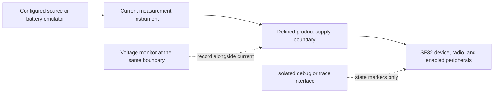
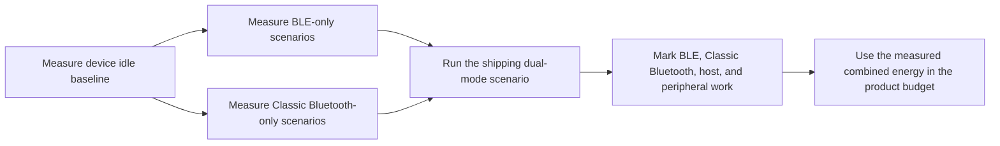
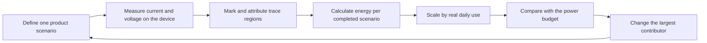

# Bluetooth 저전력 프로파일링 { #bluetooth-low-power-profiling }

이 문서는 Bluetooth 동작 중 디바이스의 **실제 전력 사용량**을 측정하는 방법을 설명합니다. 대상은 Bluetooth Low Energy(BLE), Classic Bluetooth(BR/EDR), 그리고 듀얼 모드 제품에서 두 방식이 결합된 동작입니다. 각 시나리오마다 전기적 측정 경계를 정의하고, 전류와 전압을 기록하며, 트레이스의 중요한 구간을 설명할 수 있을 만큼 충분한 펌웨어 증거를 확보하십시오.

이 문서의 Classic Bluetooth 및 듀얼 모드 부분은 BR/EDR을 지원하는 디바이스와 펌웨어 구성에만 적용하십시오. BLE 전용 제품에도 같은 방법을 사용하는 것이 좋지만, 시나리오 계획은 BLE까지만 다룹니다.

Nordic의 [Online Power Profiler for Bluetooth LE](https://devzone.nordicsemi.com/power/w/opp/2/online-power-profiler-for-bluetooth-le)는 BLE의 개념을 파악하는 데 유용한 레퍼런스입니다. Nordic은 이 도구를 측정에서 도출한 모델로서 기대값을 산출하는 것이지, 특정 디바이스를 측정한 결과가 아니라고 설명합니다. 공개된 정확도 경험은 Nordic 레퍼런스 부품에만 해당하므로 SF32에 적용해서는 안 됩니다. 또한 Classic Bluetooth나 듀얼 모드 제품은 모델링하지 않습니다. 모델은 무엇을 테스트할지 정하는 데 사용하고, 제품의 결과는 타깃 디바이스의 전류 측정으로 확정하십시오.

## 측정 대상 정의 { #define-what-you-are-measuring }

"Bluetooth 전력"은 의미가 매우 다양할 수 있습니다. 라디오만 측정하면 연결 파라미터를 최적화하는 데는 도움이 되지만, 컨트롤러, 애플리케이션 CPU, 센서, 디스플레이, 메모리, 전원 공급이 모두 관여하는 양산 디바이스의 소비 전력은 알 수 없습니다.

<div align="center"><em>표: Bluetooth 전력 측정 경계</em></div>

<div align="center" markdown>

| 경계 | 포함 범위 | 사용 시점 | 한계 |
|:---------|:-----------------|:---------------|:-----------|
| Bluetooth 서브시스템 또는 선택한 레일 | 라디오/컨트롤러와 선택한 전원 경로 | 라디오 또는 컨트롤러의 회귀 원인 분리 | 디바이스 전체의 배터리 소비와 같지 않음 |
| MCU 입력 레일 | 해당 레일로 전원을 공급받는 MCU, 컨트롤러, 온칩 주변 장치 | 조건을 통일한 보드에서 펌웨어 상태 비교 | 다른 레일의 외부 부품과 레귤레이터 손실은 제외됨 |
| 배터리 또는 제품 주 입력 | 레귤레이터, MCU, 외부 메모리, 센서, 디스플레이 등 전원을 공급받는 모든 부하 | 배터리 수명 모델링과 제품 인수 | 연결된 모든 하드웨어와 전원을 세심하게 통제해야 함 |

</div>

제품의 배터리 수명을 주장하려면 가능한 한 배터리 또는 제품 주 입력 경계에서 측정하십시오. 전류와 함께 전압도 기록해야 결과를 전원 조건과 분리된 전류값이 아니라 전력과 에너지로 표현할 수 있습니다.

## 반복 가능한 테스트 구성 { #set-up-a-repeatable-test }

계측기와 디바이스는 명확하게 문서화된 테스트 경계를 공유해야 합니다. Nordic의 Power Profiler Kit II(PPK II)는 전압 및 전류 범위가 구성에 맞는다면 레퍼런스급 소스 측정 도구로 사용할 수 있습니다. 동등한 소스 측정 유닛이나 전류 분석기도 사용할 수 있습니다. 계측기의 브랜드보다 측정 절차를 지키는 것이 더 중요합니다.

PPK II의 [Source Meter 모드](https://docs.nordicsemi.com/r/bundle/ug_ppk2/page/ug/ppk/measure_current_source_meter.html)에서는 계측기가 디바이스에 전원을 공급하고, [Ampere Meter 모드](https://docs.nordicsemi.com/r/bundle/ug_ppk2/page/ug/ppk/measure_current_ampere_meter.html)에서는 외부 전원이 계측기를 거쳐 디바이스에 전원을 공급합니다. 의도한 전원 경로에 맞는 모드를 선택하십시오. 설정한 공급 전압은 기록된 디바이스 전압 파형이 아닙니다. 특히 전압 강하나 배터리 전압 변화가 에너지에 영향을 줄 때는 측정 지점에서 전압을 모니터링하십시오.

DUT를 연결하기 전에 PPK II의 동작 한계를 확인하십시오. Source Meter 출력은 0.8~5.0 V에서 조정할 수 있으며 DUT 최대 전류는 600 mA입니다. Ampere Meter 모드에는 0.8~5.0 V의 외부 전원이 필요하며 최대 1 A까지 연속 측정을 지원합니다. Source Meter 모드에서 DUT가 400 mA를 초과하여 소비할 수 있다면, Nordic은 PPK II에 전원을 공급할 별도의 USB 전원(최소 1 A 정격)을 권장합니다. 이 값들은 계측기의 한계이며 디바이스의 권장 동작값이 아닙니다. Nordic의 [최대 DUT 전류](https://docs.nordicsemi.com/r/bundle/ug_ppk2/page/ug/ppk/ppk_max_dut_current.html)와 [전원 공급 가이드](https://docs.nordicsemi.com/r/bundle/ug_ppk2/page/ug/ppk/ppk_power_supply.html)를 참조하십시오.

<div align="center"><em>그림: 디바이스 수준 Bluetooth 전력 측정 구성</em></div>



각 실행 전에 다음을 수행하십시오.

1. 계측기를 우회하거나 부하를 추가할 수 있는 USB 전원, 디버거 및 기타 전원은 분리하십시오. 시나리오에 필요한 인터페이스만 남기십시오.
2. 선택한 경계에 문서화된 공급 전압을 인가하십시오. 전원이 공급되는 모든 레일, 점퍼, 모듈, 외부 디바이스를 기록하십시오.
3. 제품 펌웨어 빌드와 의도한 PM 구성을 사용하십시오. 양산 구성에 포함되지 않는다면, 최종 수치를 얻을 때는 대량의 진단 로깅을 비활성화하십시오.
4. 비교할 때마다 동일한 휴대폰, 액세서리, 테스트 애플리케이션, 거리, 안테나 방향, RF 환경을 준비하십시오.
5. 측정하기 편한 펄스 하나만이 아니라 반복되는 Bluetooth 이벤트를 많이 포함할 만큼 충분히 긴 구간을 캡처하십시오.

## BLE 광고 이벤트의 전력 단계 이해 { #read-a-ble-advertising-event-as-a-set-of-power-components }

일반적인 BLE 광고(advertising) 이벤트는 라디오 펄스 하나로 끝나지 않습니다. 짧은 전원 인가 및 준비 단계로 시작하여, 고주파 크리스털 오실레이터의 기동과 안정화가 이어집니다. 전원과 클럭이 준비되면 디바이스는 예약된 라디오 시작 시점까지 standby 상태에 들어갑니다. 여기에 제시한 scannable 또는 connectable 예시에서는 라디오를 시작하고, 기본 광고 채널(primary advertising channel)에서 송신한 뒤, 같은 채널에서 수신 윈도우를 엽니다. 처음 두 번의 수신 윈도우 이후에는 다음 채널에서 송신하기 전에 standby로 돌아가며, 마지막 수신 윈도우 이후에는 후처리를 수행합니다. non-connectable, non-scannable 이벤트는 요청을 수신하지 않습니다. 실제 단계는 구성한 광고 유형과 채널 맵에 따라 달라집니다.

도식에 그려진 전체 시퀀스는 Pre-processing → Crystal ramp-up → Standby → Start radio → Radio TX → Radio switch → Radio RX → Standby → Radio TX → Radio switch → Radio RX → Standby → Radio TX → Radio switch → Radio RX → Post-processing입니다. Start radio는 한 번만 발생하며, 채널 38과 39의 송신은 이전 채널의 RX 윈도우 이후 standby 구간을 거쳐 시작됩니다. 이 시퀀스는 Nordic의 [일반적인 BLE 광고 이벤트 도해](https://devzone.nordicsemi.com/power/w/opp/2/online-power-profiler-for-bluetooth-le)에 나온 단계를 따릅니다. 이는 일반적인 BLE 이벤트 단계이며 Nordic 고유의 라디오 상태가 아니고, 이 재작성본은 다른 상태를 추가하지 않습니다. 전류 수준과 시간 비율은 설명을 위한 것이며 SF32 측정값이 아닙니다. 타깃 디바이스에서 직접 측정하십시오.

<div align="center"><em>그림: BLE 광고 이벤트 단계</em></div>


이 도해는 세 개의 기본 채널을 모두 사용하는 레거시 scannable 또는 connectable 광고 이벤트를 나타내며, 요청/응답 교환은 표시하지 않습니다. 37, 38, 39라는 표기는 설명을 위한 것입니다. Bluetooth Core Specification은 사용하는 기본 채널 인덱스를 임의의 순서로 허용하며, 어떤 인덱스를 쓸지는 구성한 채널 맵이 결정합니다. 이벤트는 보통 사용하는 인덱스마다 광고 PDU를 하나씩, 인덱스당 최대 하나만 전송합니다. 세 번의 송신은 서로 다른 채널에서 광고 데이터의 사본을 전달하는 것이며, 확인 응답에 따른 재시도가 아닙니다. scannable 또는 connectable 광고에서는 Link Layer가 허용된 요청을 같은 기본 채널에서 수신 대기하며, non-connectable, non-scannable 이벤트는 요청을 수신하지 않습니다. [Bluetooth Core 6.2 Link Layer 사양](https://www.bluetooth.com/wp-content/uploads/Files/Specification/HTML/Core-62/out/en/low-energy-controller/link-layer-specification.html)과 [Bluetooth SIG 입문서](https://www.bluetooth.com/bluetooth-le-primer/)를 참조하십시오. 확장 광고, 다른 채널 맵, 또는 수신한 요청에 따라 트레이스가 달라질 수 있으므로 타깃 디바이스에서 구성한 동작을 확인하십시오.

<div align="center"><em>표: BLE 광고 이벤트 전력 트레이스의 단계</em></div>

<div align="center" markdown>

| 단계 | 일반적인 전력 소비 요인 | 측정 및 확인 항목 |
|:------|:----------------------------|:---------------|
| Pre-processing | 비교적 큰 전류를 소비할 수 있는 짧은 전원 인가 단계, 그리고 CPU/컨트롤러 준비, 페이로드 처리, DMA, 메모리 접근, 주변 장치 설정 | `I_pre`와 `t_pre`; 필요한 웨이크 및 전원 인가 작업을 파악하고, 피할 수 있는 작업은 제거하거나 일괄 처리 |
| Crystal ramp-up | 고주파 클럭의 기동과 안정화 | `I_xtal`과 `t_xtal`; 클럭 정책과 웨이크 시퀀스가 필요 이상으로 길지 않은지 확인 |
| Standby | 전원과 클럭이 준비된 뒤 선택한 저전력 상태, 리텐션 로직, 저주파 타이밍, 활성화된 웨이크 소스 | `I_standby`와 라디오 시작 전의 초기 대기, 그리고 RX 이후 채널 간 standby 구간; 이 이벤트 내 전류를 완전한 이벤트 사이의 슬립 전류와 같다고 보지 말 것 |
| Start radio | 첫 송신 전의 라디오/컨트롤러 준비와 필요한 RF 전원 경로 | `I_start`와 `t_start`; 불필요한 준비 작업이나 반복되는 기동 작업을 파악 |
| Radio TX | 라디오 송신 경로, 컨트롤러 작업, 채널 37, 38, 39에서의 광고 패킷 송신 | 모든 패킷에 대한 `I_tx`와 `t_tx`; TX 전력, 패킷 길이, 활성화된 채널이 패킷과 이벤트의 에너지를 결정 |
| Radio switch | 라디오의 송신-수신 전환과 컨트롤러 상태 전이 | `I_switch`와 `t_switch`; 전환을 무시할 수 있는 시간으로 취급하지 말고 모든 전환을 계수 |
| Radio RX, 활성화된 경우 | 스캔 요청 또는 연결 요청을 기다리는 동안의 수신 경로와 컨트롤러 작업 | `I_rx`와 `t_rx`; 광고 유형과 구성이 수신 윈도우를 여는 경우에만 포함 |
| Post-processing | 프로토콜 콜백, CPU 작업, 메모리/주변 장치 접근, 슬립 전의 애플리케이션 응답 | `I_post`와 `t_post`; 클럭, PM 제약, 외부 부품이 신속하게 해제되는지 확인 |

</div>

SF32 디바이스에서는 이 단계 이름을 트레이스 표시를 위한 힌트로 사용하십시오. Nordic 고유의 동작 상태나 가정된 타이밍 또는 전류값으로 사용해서는 안 됩니다. 타깃 광고 구성에 수신 동작이 포함되는지는 구성한 광고 동작에 따라 달라지므로, 타깃 트레이스에서 확인해야 합니다.

완전한 이벤트 하나의 에너지는 트레이스 아래 면적에 전압을 가중한 값입니다.

```text
E_event = sum(V_stage x I_stage x t_stage)
```

공급 전압이 일정할 때 주기적인 광고 구성은 다음과 같이 근사할 수 있습니다.

```text
Q_event = sum(I_stage x t_stage)
I_average = (Q_event + I_idle x (T_cycle - t_event)) / T_cycle
```

여기서 `Q_event`는 이벤트 내부의 standby 구간을 포함하여 완전한 이벤트의 모든 단계를 포함하고, `t_event`는 해당 이벤트의 전체 지속 시간입니다. `I_idle`은 완전한 이벤트 사이에서 측정한 전류이며, 이벤트 내 `I_standby`가 아닙니다. `T_cycle`은 광고 지연과 스케줄링 영향을 포함하여 측정한 시작 간 간격입니다. 간격이 가변적인 경우에는 구성한 광고 간격이 정확한 주기 길이라고 가정하지 말고, 대표성 있는 긴 트레이스를 적분하십시오.

전압이 고정된 상태에서 어떤 단계의 측정 전류 또는 지속 시간이 두 배가 되면 그 에너지도 두 배가 됩니다. 짧은 TX, RX, 기동 버스트가 이벤트 에너지를 지배할 수 있으며, 간격이 길면 이벤트 사이의 유휴 소비가 평균 전류를 지배할 수 있습니다. GPIO나 오버헤드가 낮은 펌웨어 이벤트로 단계를 표시하고, 최적화 대상을 정하기 전에 완제품의 전원 입력에서 측정하십시오.

Classic Bluetooth는 프로토콜 타이밍이 다르지만 같은 측정 절차가 적용됩니다. Bluetooth Core Specification은 Inquiry Scan과 Page Scan을 서로 다른 스캔 절차로 정의하며, Sniff는 페리퍼럴이 수신하는 슬롯을 예약된 sniff 기회로 줄이는 연결된 ACL 모드로 정의합니다. 상대 기기의 트래픽 때문에 활동이 앵커 간격을 넘어 길어질 수 있습니다. 이는 타이밍 동작이지 전류 추정치가 아닙니다. 구성한 스캔 정책, Sniff 파라미터, 실제 상대 기기 및 애플리케이션 활동을 타깃 디바이스에서 측정하십시오. [BR/EDR Baseband 사양](https://www.bluetooth.com/wp-content/uploads/Files/Specification/HTML/Core-62/out/en/br-edr-controller/baseband-specification.html)과 [HCI Scan Enable](https://www.bluetooth.com/wp-content/uploads/Files/Specification/HTML/Core-62/out/en/host-controller-interface/host-controller-interface-functional-specification.html)을 참조하십시오.

## 모드별 측정 계획 수립 { #build-a-mode-specific-measurement-plan }

"Bluetooth 활성화"를 하나의 동작 상태로 취급하지 마십시오. BLE와 Classic Bluetooth는 연결 및 저전력 절차가 다르며, 듀얼 모드 제품은 두 방식이 라디오 시간, 컨트롤러 리소스, 클럭, 메모리, 애플리케이션 작업을 공유할 수 있습니다. 반복 가능한 가장 작은 시나리오부터 시작한 다음, 제품이 실제로 출하되는 결합 동작을 정확히 측정하십시오.

<div align="center"><em>표: Bluetooth 시나리오 범위</em></div>

<div align="center" markdown>

| 라디오 기능 | 시나리오 | 측정 전에 정의할 사항 | 보존할 결과 |
|:-----------------|:---------|:--------------------------------|:-----------------|
| BLE | 광고, 연결 유휴, 애플리케이션 전송, 재연결 | 역할, 간격, TX 전력, 페이로드, 상대 기기, 시작/종료 조건 | 평균 전류, 이벤트 에너지, 완료된 동작당 에너지 |
| Classic Bluetooth (BR/EDR) | 스캔 상태 | inquiry scan, page scan 또는 둘 다 활성화되었는지; 검색 가능/연결 가능 정책 | 대표성 있는 스캔 윈도우에서의 평균 전류와 에너지 |
| Classic Bluetooth (BR/EDR) | 연결된 Sniff 모드 | Sniff 파라미터, 상대 기기, 링크 상태, 백그라운드 애플리케이션 활동 | 여러 Sniff 간격에 걸친 평균 전류와 에너지 |
| Classic Bluetooth (BR/EDR) | 활성 프로파일 워크로드 | 프로파일과 역할(예: SPP/PAN 데이터 또는 A2DP/HFP 오디오); 페이로드 또는 오디오 세션 지속 시간 | 완료된 전송 또는 세션당 에너지, 그리고 지속 평균 전력 |
| 듀얼 모드 | BLE와 Classic Bluetooth를 함께 사용 | 공존하는 링크, 해당 파라미터, 포그라운드 워크로드, 전환/재연결 동작 | 측정한 결합 평균 전력과 완전한 제품 시나리오당 에너지 |

</div>

SiFli의 [BLE/BT 소비 전력 테스트](https://docs.sifli.com/projects/sdk/latest/en/sf32lb52x/example/pm/bt/README.html)는 BLE 광고 및 연결 모드와 Classic Bluetooth Scan 및 Sniff 모드를 모두 다루므로 유용한 기준선입니다. 다만 특정 보드 하나의 결과를 제품 사양으로 바꿔 주지는 않습니다. 이 예제에서 지원하는 보드, 웨이크 핀, 콘솔, PM 설정을 사용하여 기준선을 반복 가능하게 만든 다음, 타깃 하드웨어에서 의도한 제품의 역할, 상대 기기, 트래픽, 전력 정책을 재현하십시오.

## 독립 라디오 모드로서의 BLE 프로파일링 { #profile-ble-as-a-standalone-radio-mode }

BLE만으로 시작하십시오. 그러면 Classic Bluetooth 프로파일 트래픽이나 모드 간 스케줄링이 트레이스를 가리지 않는 BLE 기준선을 확립할 수 있습니다.

<div align="center"><em>표: 독립 BLE 시나리오 세트</em></div>

<div align="center" markdown>

| 시나리오 | 구성 | 계산 항목 | 결과를 오도하는 일반적인 원인 |
|:---------|:------|:------------------|:-------------------------------------|
| 광고 | 문서화된 유형과 채널 맵으로 광고하는 연결되지 않은 디바이스 | 광고 간격당 평균 전류와 에너지 | 휴대폰의 스캔 동작, 디버그 트래픽, 또는 백오프하지 않는 광고 |
| 연결 유휴 | 애플리케이션 전송이 없는 연결된 디바이스; 페어링, 본딩, 암호화 활성화 여부를 기록 | 여러 연결 간격에 걸친 평균 전류 | 연결 이벤트마다 애플리케이션 CPU가 깨어남; 타이머나 알림이 계속 활성 상태임 |
| 사용자 상호작용 | 대표적인 GATT 명령, 센서 업로드 또는 UI에서 트리거된 동작 하나 | 완료된 동작당 에너지와 유휴 대비 추가 에너지 | 호스트, 디스플레이, 센서 작업은 무시하고 라디오만 측정 |
| 버스트 전송 또는 OTA | 완료 조건이 정의된 페이로드 | 바이트당 또는 완료된 전송당 에너지와 총 소요 시간 | 최고 속도를 전체 전송을 대표하는 값으로 사용 |
| 연결 해제 및 재연결 | BLE 상대 기기가 범위를 벗어났다가 돌아와 재연결 | 복구에 드는 에너지와 시간 | 무제한 재시도 또는 공격적인 광고 정책이 무기한 지속됨 |

</div>

BLE 역할, 상대 기기, 연결 또는 광고 파라미터, TX 전력, 페이로드, 시작 트리거, 종료 조건, 실제 사용 빈도를 기록하십시오. 이러한 정보가 없는 트레이스는 다른 펌웨어 리비전과 비교할 수 없습니다.

## 독립 라디오 모드로서의 Classic Bluetooth 프로파일링 { #profile-classic-bluetooth-as-a-standalone-radio-mode }

듀얼 모드 제품에서는 BLE를 추가하기 전에 Classic Bluetooth를 따로 측정하십시오. 그러면 BLE 이벤트가 섞이지 않은 상태에서 Scan 및 Sniff 기준선과 프로파일별 시스템 작업을 확인할 수 있습니다.

<div align="center"><em>표: 독립 Classic Bluetooth 시나리오 세트</em></div>

<div align="center" markdown>

| 시나리오 | 구성 | 계산 항목 | 결과를 오도하는 일반적인 원인 |
|:---------|:------|:------------------|:-------------------------------------|
| Scan | 양산 inquiry-scan, page-scan 또는 결합 정책이 활성 상태 | 대표성 있는 스캔 윈도우에서의 평균 전류와 에너지 | 양산 제품보다 공격적인 스캔 정책을 켜 둔 채 측정 |
| 연결된 Sniff 모드 | 연결된 Classic Bluetooth 링크가 의도한 Sniff 구성으로 진입 | 여러 Sniff 간격에 걸친 평균 전류 | 상대 기기의 트래픽이나 애플리케이션 작업 때문에 조용히 활성 상태를 유지하는 링크를 측정 |
| 활성 프로파일 워크로드 | 정의된 SPP/PAN 데이터 전송, A2DP 스트림, HFP 통화 또는 기타 양산 프로파일 워크로드 | 완료된 전송 또는 세션당 에너지와 지속 평균 전력 | 프로파일에 필요한 코덱, 앰프, 디스플레이, 메모리, 호스트 작업을 빼고 라디오만 측정 |
| 연결 해제 및 재연결 | Classic Bluetooth 상대 기기가 범위를 벗어났다가 돌아와 재연결 | 복구에 드는 에너지와 시간 | 무제한 재시도 또는 검색 정책이 무기한 활성 상태로 유지됨 |

</div>

Classic Bluetooth 역할, 상대 기기, Scan 또는 Sniff 정책, TX 전력, 프로파일, 페이로드 또는 세션 지속 시간, 시작 트리거, 종료 조건, 실제 사용 빈도를 기록하십시오. 오디오 프로파일의 경우, 측정 경계에 제품이 실제로 사용하는 오디오 경로가 포함되어야 합니다.

## 듀얼 모드 동작을 독립 시나리오로 측정 { #measure-dual-mode-behavior-as-its-own-scenario }

제품의 듀얼 모드 전력을 BLE 측정값과 Classic Bluetooth 측정값을 단순히 더해서 계산하지 마십시오. 두 모드는 라디오 시간, 컨트롤러 처리, 클럭, 메모리, 애플리케이션 웨이크업을 공유할 수 있습니다. 따라서 결합 결과는 고립된 두 평균의 산술 합과 크게 다를 수 있습니다.

<div align="center"><em>그림: 듀얼 모드 Bluetooth 프로파일링 순서</em></div>



독립 BLE 및 Classic Bluetooth 기준선을 파악한 뒤에 비로소 듀얼 모드 제품을 프로파일링해야 합니다. 예를 들어 Classic Bluetooth 오디오를 스트리밍하는 동안 BLE 링크도 유지하는 제품이라면, 동일한 하드웨어와 상대 기기 구성에서 다음을 모두 측정하십시오.

1. BLE 연결 유휴 정책만 단독으로.
2. Classic Bluetooth 스트림 또는 데이터 프로파일만 단독으로.
3. 의도한 BLE 트래픽을 포함한 실제 결합 정상 상태.
4. 결합 상태로 들어가고 나오는 전환, 그리고 오류 복구와 재연결 동작.

트레이스 마커는 BLE 이벤트, Classic Bluetooth 프로파일 작업, 애플리케이션 콜백, 오디오 또는 데이터 처리, PM 상태 변화를 식별할 수 있어야 합니다. 그러면 라디오 스케줄링과 그로 인해 유발되는 시스템 작업을 구분할 수 있고, Classic Bluetooth 세션 중 BLE 콜백이 애플리케이션 CPU가 슬립으로 돌아가는 것을 막는 것과 같은 예기치 않은 상호작용도 드러납니다.

## 트레이스와 펌웨어 동작의 대응 { #correlate-the-trace-with-firmware-behavior }

실제 디바이스 소비를 찾는 핵심은 귀속(attribution)입니다. 제품 작업의 시작과 끝을 표시하거나 로그로 남겨, 트레이스가 전류가 변한 이유에 답하도록 하십시오.

- 애플리케이션이 시작한 전송 또는 알림 버스트의 전후.
- 디스플레이, 센서, 플래시, 오디오 경로 또는 기타 외부 부품이 활성화되거나 비활성화될 때.
- 펌웨어가 PM 상태를 요청할 때와 디바이스가 실제로 그 상태에 진입할 때.
- 재연결, 재시도 또는 오류 복구 경로가 시작될 때.

GPIO 트레이스 포인트, 오버헤드가 낮은 이벤트 마커 또는 재현 가능한 테스트 스크립트를 사용하십시오. 시리얼 로그는 브링업에 도움이 되지만 전류 소비를 바꿀 수도 있습니다. 최종 측정 시의 로깅은 비용 없이 관찰하는 채널이 아니라 통제해야 할 테스트 변수로 취급하십시오.

<div align="center"><em>표: Bluetooth 전력 트레이스 해석</em></div>

<div align="center" markdown>

| 트레이스 관찰 내용 | 가능한 의미 | 펌웨어 또는 하드웨어에서 확인할 사항 |
|:------------------|:---------------|:-------------------------------|
| 낮은 기준선 위에 짧고 규칙적인 간격의 펄스 | 예약된 BLE 광고/연결 이벤트 또는 Classic Bluetooth Scan/Sniff 활동 | 모드, 간격 또는 Scan/Sniff 정책, 라디오 역할, 이벤트 사이의 실제 저전력 상태 |
| 각 라디오 이벤트 직후의 더 큰 버스트 | 호스트 콜백, 프로토콜 처리 또는 애플리케이션 작업 | 어떤 콜백이 실행되는지, 데이터가 유용한지, 작업을 일괄 처리할 수 있는지 |
| Classic Bluetooth 세션 중 지속되거나 조밀하게 반복되는 활동 | 활성 Classic Bluetooth 프로파일 트래픽, 흔히 호스트, 오디오 또는 데이터 처리를 동반 | 프로파일, 코덱/데이터 경로, 상대 기기 트래픽, 오디오 클럭, 외부 부품, 정의된 세션 경계 |
| BLE와 Classic Bluetooth 버스트가 교차함 | 듀얼 모드 스케줄 또는 관련된 호스트 작업 | 각 구간을 일으킨 링크, 작업의 공유 여부, 어느 한 모드가 슬립을 지연시키거나 재시도 활동을 늘리는지 여부 |
| 예상한 이벤트 이후에도 높은 전류가 유지됨 | PM 제약, 주변 장치 또는 외부 인터페이스가 계속 활성 상태임 | PM 요청, 타이머, 클럭, 핀 상태, 디스플레이/센서 전원, 오류 경로 |
| 간헐적으로 나타나는 긴 버스트 | 재시도, 스캔, 재연결, 상대 기기 트래픽 또는 사용자 활동 | RF 조건, 상대 기기 동작, 백오프/재시도 정책, 테스트 스크립트 |
| 모듈이나 케이블을 연결한 뒤 기준선이 변함 | 전기적 경계가 바뀌었음 | 역전원 경로, UART 어댑터, 외부 풀업/풀다운, 모듈 레일, 전원 라우팅 |

</div>

## 실제 에너지와 일일 소비량 계산 { #calculate-actual-energy-and-daily-consumption }

가변적인 트레이스는 시간에 따른 전류와 전압으로 에너지를 계산하십시오.

```text
E_scenario = integral(V(t) x I(t) dt)
P_average = E_scenario / T_scenario
```

측정 경계에서 전압이 일정하게 유지된다면 비교에 평균 전류를 사용할 수도 있습니다. 그래도 전압 기록은 유지하십시오. 특히 레귤레이션된 레일과 배터리 입력 사이를 오갈 때 그렇습니다.

반복되는 제품 시나리오에는 다음을 사용하십시오.

```text
E_day = sum(E_scenario x events_per_day) + E_mode_idle + E_other_states
```

하루를 서로 겹치지 않는 구간으로 나누십시오. `E_mode_idle`과 `E_other_states`는 전체 시나리오 에너지에 아직 포함되지 않은 시간만 다뤄야 합니다. 동시에 동작하는 BLE와 Classic Bluetooth는 고립된 모드의 합이 아니라 측정한 결합 시나리오 하나로 취급하십시오. 모델이 24시간 내내의 기준선 소비를 포함한다면, 각 동작의 전체 에너지가 아니라 그 기준선을 초과하는 에너지만 더하십시오. 볼트, 암페어, 초를 사용하면 결과는 줄(joule)이며, 3600으로 나누면 Wh로 변환됩니다.

시나리오 에너지에는 해당 시나리오를 완료하는 데 필요한 디바이스 작업 전체가 포함되어야 합니다. 예를 들어 휴대폰 알림에는 연결 이벤트, 호스트 처리, 센서 또는 플래시 접근, 디스플레이 갱신, 슬립 복귀가 포함될 수 있습니다. RF 펄스만 측정하면 디바이스의 에너지를 과소평가하게 되고, 트레이스 마커 없이 제품 전체를 측정하면 원인을 개선할 수 없게 됩니다.

## 모델과 디바이스의 정합 { #reconcile-the-model-with-the-device }

첫 번째 모델은 기여도가 큰 요인의 순위를 매기는 데 사용하고, 이후 실제 측정으로 갱신하십시오. 추정치와 트레이스의 차이는 가치가 있습니다. 누락된 이벤트, 잘못된 지속 시간, 예기치 않은 웨이크업, 포함하지 않은 외부 부하를 가리키기 때문입니다.

<div align="center"><em>그림: 실제 Bluetooth 전력 검증 루프</em></div>



<div align="center"><em>표: 정합 질문</em></div>

<div align="center" markdown>

| 모델과 측정값의 불일치 | 답해야 할 질문 |
|:--------------------------------|:-------------------|
| 평균 전류가 예상보다 높음 | 디바이스가 요청한 PM 상태에 진입하고 있습니까? 타이머, 로깅 또는 주변 장치 클럭이 디바이스를 깨어 있게 하고 있습니까? |
| 이벤트 에너지가 예상보다 높음 | 호스트, 디스플레이, 센서, 메모리 또는 재시도 경로가 추가 작업을 했습니까? RF 품질 때문에 재시도나 더 높은 TX 전력이 필요한 상황입니까? |
| BLE 또는 Classic Bluetooth 유휴 소비가 배터리 수명을 좌우함 | BLE 연결 파라미터, Classic Bluetooth Scan/Sniff 정책, 알림 주기, 애플리케이션 웨이크업이 제품 상태에 적절합니까? |
| 듀얼 모드 결과가 단일 모드 테스트의 합과 다름 | 어떤 라디오 구간, 컨트롤러 작업, 공유 클럭, 애플리케이션 콜백, 오디오/데이터 경로 또는 PM 제약이 겹치거나 슬립을 막고 있습니까? |
| 재연결 에너지가 지배적임 | 제품이 제한된 재시도/백오프 동작과 현실적인 검색 정책을 사용합니까? |
| 보드와 최종 제품의 결과가 다름 | 외부 레일, 레귤레이터 손실, 모듈, 안테나/인클로저 영향, 인터페이스 풀업/풀다운 중 무엇이 다릅니까? |

</div>

## 반복 가능한 SiFli 기준선에서 시작 { #start-from-a-repeatable-sifli-baseline }

제품 펌웨어를 측정하기 전에 SiFli-SDK 예제를 사용하여 Bluetooth 상태를 반복 가능하게 만드십시오. 예제가 지원하는 보드, 전원 경로, 점퍼 구성, SDK 설정, 테스트 절차는 기준선 증거이며 제품 사양이 아닙니다.

<div align="center"><em>표: SiFli-SDK Bluetooth 프로파일링 시작점</em></div>

<div align="center" markdown>

| 측정 대상 | 공식 시작점 | 이후 제품에서 측정할 항목 |
|:-------------------|:------------------------|:----------------------------|
| BLE 광고 및 연결 전력 | [BLE 브로드캐스트 및 연결 소비 전력 테스트](https://docs.sifli.com/projects/sdk/latest/en/sf32lb52x/example/pm/ble/README.html) | 제품의 광고 정책, 연결 파라미터, 콜백, 상대 기기 동작, 안테나 |
| Classic Bluetooth Scan 및 Sniff | [BLE/BT 소비 전력 테스트](https://docs.sifli.com/projects/sdk/latest/en/sf32lb52x/example/pm/bt/README.html) | 양산 스캔 정책, Sniff 설정, 상대 기기 동작, 실제 유휴 링크 상태 |
| Classic Bluetooth 프로파일 워크로드 | [Bluetooth SDK 예제](bluetooth-sdk-examples.md) | 필요한 호스트, 오디오, 메모리, 외부 부품 작업을 포함한 실제 SPP/PAN 전송 또는 A2DP/HFP 세션 |
| 듀얼 모드 제품 동작 | [BLE/BT 소비 전력 테스트](https://docs.sifli.com/projects/sdk/latest/en/sf32lb52x/example/pm/bt/README.html)와 가장 가까운 제품 프로파일 예제 | 전환, 공유 처리, 제품 PM 정책을 포함하여 BLE와 Classic Bluetooth가 동시에 또는 번갈아 동작하는 정확한 방식 |
| 연결된 GATT 서비스 | [BLE Peripheral](https://docs.sifli.com/projects/sdk/latest/sf32lb58x/example/ble/peripheral/README.html) | 실제 특성(characteristic), 알림 주기, 보안, 휴대폰 상호작용 |
| BLE 데이터 전송 | [BLE Throughput](https://docs.sifli.com/projects/sdk/latest/sf32lb58x/example/ble/throughput/README.html) | 완료된 페이로드당 에너지와 종단 간 완료 시간 |
| 기타 Bluetooth 워크플로 | [Bluetooth SDK 예제](bluetooth-sdk-examples.md) | 제품 통합 전에 가장 가까운 Classic Bluetooth, BLE 또는 LE Audio 역할/프로파일 |

</div>

## 릴리스 검토 체크리스트 { #release-review-checklist }

- [ ] 측정 경계와 공급 전압이 문서화되었습니다.
- [ ] 릴리스와 관련된 모든 시나리오에 대해 전류와 전압을 기록했습니다.
- [ ] USB, 디버거, UART 어댑터, 외부 모듈 전원을 제어했거나 명시적으로 포함했습니다.
- [ ] 트레이스를 펌웨어 이벤트, PM 상태 요청, 실제로 진입한 상태와 대응시켰습니다.
- [ ] 해당하는 경우 BLE 광고/연결 유휴 및 Classic Bluetooth Scan/Sniff 동작을 측정했습니다.
- [ ] 출하하는 각 Classic Bluetooth 데이터 또는 오디오 프로파일에 대해 정의되고 측정된 워크로드가 있습니다.
- [ ] 듀얼 모드 시나리오를 단일 모드 결과의 합으로 추정하지 않고 결합된 제품 상태로 측정했습니다.
- [ ] 해당하는 경우 대표적인 전송, 연결 해제, 재연결 동작을 측정했습니다.
- [ ] 시나리오 에너지를 현실적인 일일 빈도로 환산하여 배터리 예산과 정합시켰습니다.
- [ ] 가장 큰 에너지 요인에 담당자가 지정되어 있고 최적화 또는 인수 결정이 내려져 있습니다.

## 관련 리소스 { #related-resources }

- [Bluetooth 개요](overview.md): BLE, Classic Bluetooth, 프로파일, 보안, 시스템 공존.
- [Bluetooth SDK 예제](bluetooth-sdk-examples.md): Classic Bluetooth, BLE, LE Audio 프로젝트 선택.
- [저전력 설계 개요](../low-power/overview.md): PM 설계와 제품 전체 전력 예산.
- [전력 측정과 검증](../low-power/measurement-and-validation.md): 부품에서 제품까지의 검증 워크플로.
- [스마트워치 전력 프로파일링](../low-power/smartwatch-power-profiling.md): 일상 사용 에너지 모델의 실제 예.
