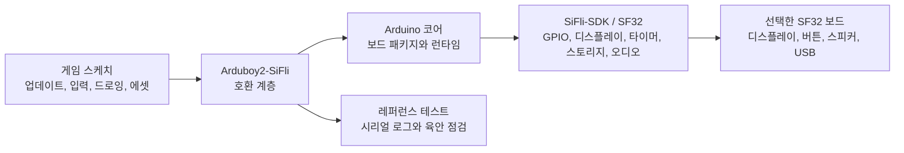

# SF32LB52용 Arduboy2 포트 { #arduboy2-on-sifli }

## Arduboy2-SiFli란 무엇인가? { #what-is-arduboy2-sifli }

[OpenSiFli/Arduboy2-SiFli](https://github.com/OpenSiFli/Arduboy2-SiFli)는 [Arduboy2 라이브러리](https://github.com/MLXXXp/Arduboy2)를 SiFli 개발 환경으로 옮긴 OpenSiFli의 포트입니다. Arduboy2는 소형 게임 기기를 위한 애플리케이션 계층 모델로, 프레임 루프, 디스플레이 버퍼, 버튼, 스프라이트, 텍스트, 선택적인 사운드 제어를 제공합니다. 따라서 SiFli 포트는 호환성 실험으로 유용합니다. 기반이 되는 보드, 디스플레이, 입력, 오디오, 빌드 경로가 SF32로 바뀌더라도 Arduboy 스타일 게임을 얼마나 그대로 유지할 수 있는지 테스트하기 때문입니다.

이 저장소는 완성된 게임기나 양산용 하드웨어 설계가 아니라 소프트웨어 레퍼런스입니다. 정확한 보드 타깃, 지원되는 API 범위, 빌드 방법, 재배포 조건은 저장소의 README, 소스 트리, 예제, 이슈 이력, 라이선스 파일을 기준으로 삼으십시오. 이 페이지는 해당 레퍼런스를 둘러싼 엔지니어링 의사결정을 정리한 것이며, 저장소의 실행 가능한 지침을 대체하지 않습니다.

## 왜 이 SF32 포트인가? { #why-the-sifli-implementation }

Arduboy 스타일 애플리케이션은 예측 가능한 렌더 루프, 작은 흑백 또는 저해상도 에셋, 버튼 입력, 오디오 타이밍, 엄격하게 제한된 메모리 예산처럼 여러 임베디드 제품 의사결정을 한 번에 점검하기에 간결한 방법입니다. 이 모델을 SF32로 옮기면 휴대용 게임, UI 데모, 교육용 기기처럼 상호작용이 로컬에서 결정적으로 이루어지는 제품을 위한 유용한 초기 레퍼런스가 될 수 있습니다.

가치는 모든 Arduboy 스케치가 수정 없이 실행된다는 데 있지 않습니다. 가치는 이 포트가 드러내는 경계에 있습니다.

- 지원되는 Arduboy2 API 범위 안에서는 게임이 상위 수준의 업데이트, 입력, 드로잉, 에셋 로직을 그대로 유지할 수 있습니다.
- 포트는 원래 하드웨어에서 암묵적으로 가정하던 디스플레이, 버튼, 오디오, 타이밍, 스토리지 가정을 변환해야 합니다.
- AVR 레지스터, Arduboy 전용 핀, 디스플레이 트랜잭션, 타이머, EEPROM 레이아웃을 직접 제어하는 스케치는 의도적인 적용 작업과 별도의 회귀 증거가 필요합니다.

이는 측정된 호환성 주장이 아니라 엔지니어링 기대치입니다. 현재 OpenSiFli 저장소와 대조해 확인하고, 선택한 보드와 커밋에 대한 정확한 결과를 기록하십시오.

## 목표, 범위, 시작 조건 { #outcome-scope-and-entry-criteria }

이 페이지는 OpenSiFli 레퍼런스에서 재현 가능한 SF32 게임 또는 인터랙티브 데모 하나에 이르는 단계별 경로를 정의합니다. 이 포트가 모든 Arduboy2 기능, 모든 Arduboy 게임, 모든 SF32 보드, 양산 수준의 디스플레이 및 오디오 타이밍을 지원한다고 주장하지 **않습니다**. 또한 서드파티 저장소에서 복사한 게임, 폰트, 그래픽 등의 에셋에 대한 라이선스 권리도 보증하지 않습니다.

**목표:** 저장소 예제 하나 또는 작은 테스트 스케치를 실행하고, 선택한 디스플레이/입력/오디오 경로를 시연하며, 더 큰 게임이나 제품 적용이 타당한지 판단하는 데 필요한 증거를 기록하는, 소스 관리되는 Arduboy2-SiFli 빌드입니다.

**대상 독자:** Arduino 도구를 사용하고, C/C++ 코드를 살펴보고, SF32 보드에 플래시를 기록하고, 시리얼 출력을 읽고, 기본적인 디스플레이, 입력, 전력 측정을 수행할 수 있는 펌웨어, 하드웨어, 제품 엔지니어입니다.

시작하기 전에 다음을 준비하십시오.

- ArduinoCore-Zephyr 변형 `sf32lb52_devkit_lcd_sf32lb525uc6`을 사용하는 SF32LB52 개발 보드와 아래에 설명된 외부 주변 장치. README에는 SF32LB52 하드웨어에서 디스플레이, 버튼, 외부 EEPROM, 오디오 경로를 시험했다고 나와 있습니다. RGB LED 경로는 문서화되어 있지만 그에 대한 테스트 결과는 명시되어 있지 않습니다. README는 물리적인 보드 리비전을 고정하지 않으며 정확한 OLED 모듈도 밝히지 않습니다.
- 검증된 Arduino 설치와 이에 맞는 OpenSiFli 보드 패키지. 변형 이름은 소프트웨어/핀 매핑 기준 구성일 뿐이며, 모든 SF32LB52-DevKit-LCD 어셈블리가 프로젝트의 외부 배선과 일치한다는 증거가 아닙니다. 주변 장치를 연결하기 전에 실제 보드 회로도를 확인하십시오.
- 정확한 Arduboy2-SiFli 커밋, Arduino 코어/패키지 버전, 호스트 OS, 업로드 도구.
- USB 데이터 연결과, 시리얼 로그를 캡처하고 디스플레이, 버튼, 오디오 출력을 관찰할 수 있는 수단.
- 다운스트림 적용에 포함되는 모든 게임, 이미지, 폰트, 사운드 에셋을 사용하고 재배포할 수 있는 권한.

<em>표: 프로젝트 계약</em>

| 영역 | 프로젝트 기준 구성 | 적용 전에 필요한 증거 |
|:-----|:-----------------|:---------------------------|
| 소스 | 기록된 OpenSiFli/Arduboy2-SiFli 커밋과 그 의존성 리비전. | 클린 체크아웃과 재현 가능한 빌드 기록. |
| 보드 | SF32LB52와 ArduinoCore-Zephyr 변형 `sf32lb52_devkit_lcd_sf32lb525uc6`, 아래에 나열된 외부 주변 장치. | 물리적인 보드 리비전, 배선, 전원, 업로드 성공 여부를 기록. 저장소는 보드 리비전이나 OLED 모델을 고정하지 않음. |
| 툴체인 | Arduino IDE 또는 CLI, OpenSiFli 보드 패키지, 문서화된 업로드 경로. | 패키지 버전, 보드 선택, 컴파일러 출력, 업로드 로그, 시리얼 로그. |
| 레퍼런스 동작 | 포트를 점검하는 업스트림 예제 또는 최소 스케치 하나. | 디스플레이 새로고침, 입력 응답, 지원되는 오디오 동작이 관찰되고 반복 가능함. |
| 제품 변경 | 범위가 제한된 게임 또는 UI 적용 하나. | 변경 후에도 레퍼런스 테스트가 통과하며, 에셋 및 라이선스 기록이 보존됨. |

## 하드웨어 및 소프트웨어 사양 { #hardware-and-software-specifications }

### 하드웨어 사양 { #hardware-specification }

<em>표: Arduboy2-SiFli 하드웨어 사양</em>

| 구성 요소 | 필수 사양 | 역할 | 상태 | 구하는 곳 | 호환성 및 대체 참고 사항 |
|:----------|:-----------------------|:-----|:-------|:----------------|:-------------------------------------|
| SF32LB52 개발 보드 | ArduinoCore-Zephyr 변형 `sf32lb52_devkit_lcd_sf32lb525uc6`; 저장소는 물리적인 보드 리비전을 고정하지 않음 | 포트를 실행하고 매핑된 MCU 핀을 제공 | 필수 | [Arduboy2-SiFli 소스](https://github.com/OpenSiFli/Arduboy2-SiFli); [ArduinoCore-zephyr 변형](https://github.com/OpenSiFli/ArduinoCore-zephyr) | 소프트웨어 보드 변형과 핀 맵을 식별하는 것이며 검증된 물리적 어셈블리가 아닙니다. 배선하기 전에 실제 보드 리비전과 회로도를 비교하십시오 |
| 흑백 OLED | 128 × 64 픽셀, SPI1로 연결; 저장소는 정확한 모듈이나 컨트롤러를 밝히지 않음 | 게임 프레임버퍼를 표시 | 필수 | [Arduboy2-SiFli 소스](https://github.com/OpenSiFli/Arduboy2-SiFli) | OLED는 외부 주변 장치입니다. 사용하기 전에 모듈 및 보드와 대조하여 컨트롤러, 전압, 커넥터, 방향, 타이밍을 확인하십시오 |
| 게임 버튼 6개 | Arduboy 호환 입력; 풀업을 사용하는 액티브 로우이며, 저장소의 핀 매핑을 사용 | 방향 및 A/B 컨트롤을 읽음 | 필수 | [Arduboy2-SiFli 소스](https://github.com/OpenSiFli/Arduboy2-SiFli) | 버튼은 외부 부품입니다. 매핑된 Arduino IO를 실제 보드와 대조해 확인하고 배선과 디바운스 동작을 기록하십시오 |
| 외부 EEPROM | I2C1의 주소 `0x50`에 연결된 AT24C02 또는 AT24C32 | EEPROM 기반 라이브러리 기능을 지원 | 선택; EEPROM을 사용하는 기능에만 필수 | [Arduboy2-SiFli 소스](https://github.com/OpenSiFli/Arduboy2-SiFli) | 선택한 디바이스, 전압, 풀업, 버스 배선을 확인하십시오. 저장소는 실장되는 EEPROM 어셈블리를 지정하지 않습니다 |
| 오디오 출력 및 RGB 표시등 | 저장소가 지원하는 오디오 백엔드는 매핑된 스피커 출력을 사용; 외부 공통 캐소드 RGB LED는 소프트웨어 PWM으로 구동 | 선택적인 사운드 및 색상 표시 | 선택; 테스트하는 스케치에 맞게 선택 | [Arduboy2-SiFli 소스](https://github.com/OpenSiFli/Arduboy2-SiFli) | 소스는 완전한 스피커/LED 자재 명세서를 정의하지 않습니다. 외부 회로, 핀 매핑, 전류, 오디오 동작을 확인하십시오 |
| 호스트와 USB 데이터 연결 | 선택한 Arduino 툴체인이 지원하는 호스트; 데이터 전송이 가능한 케이블과 시리얼 로그 접근 | 레퍼런스를 빌드, 업로드, 관찰 | 필수 | [ArduinoCore-zephyr](https://github.com/OpenSiFli/ArduinoCore-zephyr) | 호스트 OS, 케이블/포트, 패키지 버전, 복구 방법을 기록하십시오. 충전 전용 케이블로는 충분하지 않습니다 |

### 소프트웨어 사양 { #software-specification }

<em>표: Arduboy2-SiFli 소프트웨어 사양</em>

| 패키지 또는 서비스 | 필수 버전 또는 리비전 | 역할 | 상태 | 구하는 곳 | 호환성 및 업데이트 참고 사항 |
|:-------------------|:-----------------------------|:-----|:-------|:----------------|:-------------------------------|
| OpenSiFli/Arduboy2-SiFli | 커밋 하나를 고정하고 기록; 이 문서는 리비전을 고정하지 않음 | SF32 호환 계층과 예제 | 필수 | [저장소](https://github.com/OpenSiFli/Arduboy2-SiFli) | 선택한 커밋에서 보드 타깃, 의존성, 지원되는 API를 다시 확인하십시오 |
| OpenSiFli/ArduinoCore-zephyr 및 보드 패키지 | 포트에서 정확히 호환되는 커밋/패키지 버전을 확인하여 기록해야 함 | Arduino 런타임, 보드 정의, 컴파일러, 업로드 통합 | 필수 | [저장소](https://github.com/OpenSiFli/ArduinoCore-zephyr) | 클린 빌드와 주변 장치 회귀 테스트 없이 더 새로운 코어나 다른 보드 패키지로 대체하지 마십시오 |
| 테스트 스케치와 게임 에셋 | 저장소 예제 하나 또는 별도로 라이선스를 받은 테스트 스케치; 에셋 리비전과 라이선스를 기록 | 선택한 API와 제품 경로를 점검 | 하나 선택 | [Arduboy2-SiFli 예제](https://github.com/OpenSiFli/Arduboy2-SiFli) | 이 문서는 서드파티 게임, 폰트, 이미지, 사운드를 재배포할 권리를 부여하지 않습니다 |

## 지원되는 기준 구성 선택 { #choose-a-supported-baseline }

제품 카탈로그에서 비슷한 보드를 고르지 말고, OpenSiFli 저장소에 명시된 보드와 소프트웨어 조합에서 시작하십시오. 보드 패키지, 디스플레이 배선, 입력 매핑, 업로드 방법, 라이브러리 가정이 모두 기준 구성의 일부입니다.

Arduboy2-SiFli 저장소는 보드 핀 맵을 별도 파일로 제공하지 않으며, README에 [SiFli I/O 매핑 표](https://github.com/OpenSiFli/Arduboy2-SiFli#sifli-io-mapping)가 게시되어 있습니다. 라이브러리의 논리 핀 정의는 [`pins_sifli.h`](https://github.com/OpenSiFli/Arduboy2-SiFli/blob/master/src/platforms/sifli/pins_sifli.h)에 있으며, 보드별 라우팅은 ArduinoCore-Zephyr의 [Devicetree 오버레이](https://github.com/OpenSiFli/ArduinoCore-zephyr/blob/main/variants/sf32lb52_devkit_lcd_sf32lb525uc6/sf32lb52_devkit_lcd_sf32lb525uc6.overlay)에 있습니다. 이 자료들은 검증된 물리적 어셈블리가 아니라 소프트웨어 기준 구성을 정의합니다. 배선하기 전에 실제 보드 리비전과 회로도를 확인하십시오.

<em>표: 기준 구성 선택</em>

| 기준 구성 요소 | 선택 근거 | 가정하면 안 되는 것 |
|:-----------------|:---------------|:--------------|
| 타깃 보드 | Arduboy2-SiFli README가 지정한 ArduinoCore-Zephyr 변형 `sf32lb52_devkit_lcd_sf32lb525uc6`, 그다음 물리적 보드 회로도. | 소프트웨어 변형이 모든 물리적 보드 리비전이나 주변 장치 어셈블리와의 호환성을 증명한다는 가정. |
| Arduino 코어 | 타깃에 대해 문서화된 OpenSiFli 패키지와 리비전. | 최신 패키지가 저장소에서 사용한 리비전과 호환된다는 가정. |
| 디스플레이와 입력 | 저장소의 핀/구성 정의와 물리적 보드 회로도. | Arduboy 원본의 디스플레이 기하 구조, 버튼 극성, 핀 이름이 SF32 보드와 일치한다는 가정. |
| 오디오 | 저장소가 지원하는 출력 경로와 보드별 구성. | 톤 API가 있다고 해서 스피커 타이밍, 볼륨, 전력 동작이 제품 수준이라는 가정. |
| 업로드와 복구 | 선택한 보드에 대해 문서화된 Arduino 또는 `sftool` 흐름. | 한 호스트에서 업로드에 성공했다고 해서 복구 가능한 현장 업데이트 경로가 증명된다는 가정. |

저장소는 소프트웨어 보드 변형과 주변 장치 핀 맵을 식별하며, SF32LB52 하드웨어에서 디스플레이, 버튼, 외부 EEPROM, 오디오 경로를 시험했다고 보고합니다. 외부 RGB LED 경로는 문서화되어 있지만 테스트했다는 언급은 없습니다. 저장소는 물리적인 보드 리비전, 정확한 OLED 모듈/컨트롤러, 완전한 액세서리 어셈블리를 밝히지 않습니다. 배선하거나 재현 가능한 하드웨어 기준 구성을 주장하기 전에, 변형의 핀 맵을 실제 보드 회로도와 대조하고 사용한 부품과 리비전을 기록하십시오. 남은 공백을 다른 SF32 프로젝트에서 복사한 핀 매핑이나 주소로 채우지 마십시오.

## 프로젝트 개발 단계와 의사결정 지점 { #delivery-map }

각 단계를 기능 체크리스트가 아니라 의사결정 지점으로 사용하십시오.

<em>표: 프로젝트 개발 단계와 의사결정 지점</em>

| 단계 | 이 단계가 뒷받침하는 의사결정 | 필수 산출물 |
|:------|:---------------------|:----------------|
| 1. 수정하지 않은 레퍼런스 | 문서화된 포트가 선택한 기준 구성에서 빌드, 업로드, 실행되는가? | 정상 동작이 확인된 스케치, 커밋/패키지 기록, 업로드 로그, 관찰된 동작. |
| 2. 주변 장치 검증 | 디스플레이, 입력, 오디오, 리셋, 타이밍이 실제 보드에서 예측 가능하게 동작하는가? | 실패와 복구 동작을 포함한 주변 장치 테스트 기록. |
| 3. 재현 가능한 소스 기준 구성 | 다른 엔지니어가 클린 체크아웃에서 같은 이미지를 다시 빌드할 수 있는가? | 클린 빌드 산출물, 환경 기록, 반복 수행 결과. |
| 4. 범위를 제한한 게임 적용 | 포트를 깨뜨리지 않고 범위가 제한된 게임 또는 UI 변경 하나를 도입할 수 있는가? | 검토를 거친 변경, 에셋/라이선스 기록, 회귀 테스트 결과. |
| 5. 제품 준비 상태 검토 | 이 레퍼런스가 커스텀 하드웨어나 더 큰 소프트웨어 투자를 정당화할 만큼 충분히 탄탄한가? | 담당자, 증거, 완화책, 진행/보류/중단 결정을 포함한 리스크 등록부. |

## 시스템 아키텍처와 의존성 { #system-architecture-and-dependencies }

<em>그림: Arduboy2-SiFli 애플리케이션 경로</em>

이것은 저장소가 정확히 이러한 내부 모듈 이름을 사용한다는 주장이 아니라 의사결정 모델입니다. 포트를 수정하기 전에 실제 소스 경계를 확인하십시오. 중요한 제품 경로는 다음과 같습니다.

- **프레임과 타이밍:** 게임 루프는 반복 가능한 주기로 업데이트하고 렌더링해야 하며, 타이밍에 민감한 오디오나 입력 동작은 타깃 보드에서 측정해야 합니다.
- **디스플레이:** 호환 계층은 게임의 버퍼와 기하 구조를 선택한 디스플레이 컨트롤러, 픽셀 포맷, 방향, 새로고침 경로에 매핑해야 합니다.
- **입력:** 버튼 이름, 극성, 디바운스, 동시 입력, 웨이크/리셋 동작을 보드 배선과 대조해 확인해야 합니다.
- **오디오:** 톤 생성, 타이머 소유권, 스피커 연결, 볼륨, 음소거 동작은 검증되기 전까지 보드별 사항으로 취급해야 합니다.
- **에셋과 스토리지:** 폰트, 스프라이트, 사운드 데이터, 플래시 레이아웃, RAM 사용량은 선택한 게임을 링크한 뒤에 측정해야 합니다.
- **복구:** 타이밍, 메모리, 저전력 변경을 실험하기 전에 알려진 업로드 및 복구 경로를 보존하십시오.

주요 장애 영역은 애플리케이션/API 호환성, 디스플레이 구성, 입력 배선, 오디오/타이머 동작, 메모리와 에셋 배치, 업로드/복구입니다. 한 영역의 장애를 단순히 "포트가 동작하지 않는다"고 보고하지 않는 것이 좋습니다.

## 1단계 — 수정하지 않은 레퍼런스 확립 { #stage-1-establish-the-untouched-reference }

**목표:** 라이브러리나 게임을 변경하기 전에 저장소에 문서화된 기준 구성이 실제로 동작함을 증명합니다.

1. 저장소 지침을 읽고, 기본 브랜치 또는 릴리스를 기록하며, 예제, 보드 구성, 의존성, 라이선스 파일을 살펴봅니다.
2. 저장소에서 요구하는 정확한 Arduino 코어/패키지와 도구를 설치합니다. 호스트 OS와 도구 버전을 기록합니다.
3. 문서화된 가장 작은 예제 또는 테스트 스케치를 빌드하고 업로드합니다.
4. 시리얼 출력을 캡처하고, 디스플레이에 표시되는 내용, 반응하는 버튼, 예제가 오디오를 사용하는지 여부를 기록합니다.

**보관할 증거:** 저장소 커밋, 의존성/패키지 버전, 보드 리비전, 배선 또는 회로도 참조, 빌드 출력, 업로드 로그, 시리얼 로그, 간단한 기능 기록.

**게이트 1 종료 기준:** 수정하지 않은 레퍼런스가 선택한 보드에서 빌드 및 업로드되며, 문서화된 동작이 리셋이나 전원 사이클 후에도 반복됩니다.

## 2단계 — 주변 장치와 타이밍 경계 검증 { #stage-2-validate-peripheral-and-timing-boundaries }

**목표:** 컴파일 성공과 사용 가능한 게임 기기 기준 구성을 구분합니다.

1. 디스플레이 클리어, 전체 프레임 업데이트, 스프라이트 또는 비트맵 렌더링, 텍스트 경로와 예제에서 사용하는 기하 구조/방향 가정을 점검합니다.
2. 프로젝트에서 사용하는 모든 입력을 점검합니다. 해당하는 경우 손을 뗄 때, 동시 입력, 빠른 연타, 리셋 또는 웨이크 동작을 포함합니다.
3. 오디오가 포함된 경우, 톤 시작/정지, 타이머 상호작용, 음소거 동작, 디스플레이와 입력 활동이 사운드 경로에 미치는 영향을 확인합니다.
4. 리셋, 플러그 뽑기/다시 꽂기, 잘못되었거나 불완전한 입력 시퀀스로 정상 흐름을 중단시킵니다. 보드가 업로드와 실행이 가능한 상태로 돌아오는지 기록합니다.

**보관할 증거:** 시각적 또는 캡처한 디스플레이 결과, 입력 매트릭스, 타이밍 관찰 결과, 오디오 관찰 결과, 리셋/복구 로그, 제품 결정에 영향을 주는 측정된 전류나 지연 시간.

**게이트 2 종료 기준:** 선택한 주변 장치 경로를 충분히 이해하여 애플리케이션 버그와 보드 구성, 타이밍, 전력 문제를 구별할 수 있습니다.

## 3단계 — 재현 가능한 소스 기준 구성 빌드 { #stage-3-build-a-reproducible-source-baseline }

**목표:** 포트가 한 대의 개발 머신이나 제공된 바이너리에 의존하지 않고 재현 가능하도록 만듭니다.

1. 클린 체크아웃에서 시작하여 저장소에서 요구하는 모든 의존성을 초기화합니다.
2. 보드 패키지, Arduino IDE/CLI 버전, 컴파일러/도구 버전, 구성 파일, 생성된 에셋을 기록합니다.
3. 클린 디렉터리에서 빌드하고, 결과 이미지와 가능한 경우 맵/크기 정보를 저장하며, 업로드 명령 또는 도구 출력을 기록합니다.
4. 다른 머신에서 또는 빌드 디렉터리를 삭제한 뒤에 반복합니다.

**보관할 증거:** 소스 리비전, 의존성 리비전, 호스트/도구 매니페스트, 빌드 로그, 바이너리 또는 기타 산출물, 크기 보고서, 업로드 로그, 시리얼 로그.

**게이트 3 종료 기준:** 클린 체크아웃으로 문서화되지 않은 로컬 파일이나 수동 편집 없이 2단계의 주변 장치 점검을 통과하는 이미지를 재현할 수 있습니다.

## 4단계 — 게임 하나를 신중하게 적용 { #stage-4-adapt-one-game-deliberately }

**목표:** 범위를 제한한 제품 변경 하나로 호환성 경계를 증명합니다.

디스플레이, 입력, 오디오, 에셋 요구 사항이 눈에 보이는 작은 스케치나 게임에서 시작하십시오. 수정하지 않은 레퍼런스 이미지를 보존하고, 한 번에 한 종류의 동작만 변경하십시오.

<em>표: 범위를 제한한 적용 순서</em>

| 변경 유형 | 시작점 | 필수 회귀 테스트 |
|:-------------|:-----------|:--------------------|
| 브랜드 요소 및 UI | 타이틀 화면, 폰트, 스프라이트, 팔레트 또는 화면 레이아웃. | 빌드, 업로드, 프레임 업데이트, 입력, 에셋 무결성 점검. |
| 게임 로직 | 범위가 제한된 규칙, 레벨 또는 상태 전환 하나. | 반복 가능한 입력 시퀀스, 리셋, 사용하는 경우 점수/상태 영속성, 프레임 타이밍. |
| 오디오 | 지원되는 경로를 사용하는 톤 하나 또는 짧은 효과음. | 시작/정지, 음소거, 타이머 상호작용, 디스플레이/입력 부하 시의 동작. |
| 스토리지 | 작은 저장 또는 에셋 로딩 변경. | 크기 보고서, 전원 손실 시 동작, 손상 처리, 정상 복구. |
| 보드 적용 | 의도적인 디스플레이, 버튼 또는 스피커 매핑 변경. | 회로도/핀 증거, 전체 주변 장치 회귀 테스트, 레퍼런스 이미지로의 롤백. |

소스에 근거한 설계 결정 없이 AVR 레지스터 접근, Arduboy 원본의 핀 가정, 스토리지 주소를 SF32 프로젝트로 복사하지 마십시오. 서드파티 게임 및 에셋 라이선스를 적용된 소스와 함께 보관하고, 재배포 조건이 명확하지 않은 것은 제거하십시오.

**보관할 증거:** 검토를 거친 diff, 에셋 출처, 변경 전후 이미지, 빌드 및 업로드 로그, 회귀 테스트 결과, 롤백 이미지.

**게이트 4 종료 기준:** 적용된 게임이 레퍼런스 주변 장치 점검을 통과하며, 메모리, 타이밍, 복구, 라이선스 경계가 기록되어 있습니다.

## 5단계 — 제품 준비 상태 검토 { #stage-5-product-readiness-review }

팀이 다음 질문에 답할 수 있게 되기 전에는 포팅 시연에서 커스텀 하드웨어나 현장 시험으로 넘어가지 마십시오.

- 어떤 SF32 보드, 디스플레이, 버튼, 스피커, 전원이 지원되며, 어떤 것이 아직 가정에 머물러 있는가?
- 의도한 제품 기준 구성에서 어떤 프레임 레이트, 입력 지연 시간, 오디오 동작, 시작 시간, 전류 프로파일이 측정되었는가?
- 최악의 경우의 콘텐츠를 포함하여 게임, 에셋, 폰트, 런타임이 플래시와 RAM을 얼마나 소비하는가?
- 리셋, 브라운아웃, 저장 중 전원 손실, 손상된 에셋, 업로드 실패, 불완전한 업데이트 후에는 어떻게 되는가?
- 포트의 어느 부분을 제품 팀, OpenSiFli, SiFli 또는 원래 Arduboy2 커뮤니티가 유지 관리하는가?
- 모든 게임, 폰트, 이미지, 사운드, 라이브러리 라이선스가 의도한 배포 모델과 호환되는가?

**게이트 5 종료 기준:** 남은 리스크에 지정된 담당자와 증거가 있으며, 각 항목에 완화책, 명시적 보류, 중단 결정 중 하나가 있습니다.

## 제품 설계로의 인계 { #handoff-to-product-design }

선택한 SF32 디바이스, 디스플레이 및 입력 아키텍처, 오디오/타이머 계획, 플래시와 에셋 레이아웃, 전력 측정 결과, 복구 방법, 양산 테스트 가정을 [하드웨어](../hardware/index.md) 섹션으로 가져가십시오. 게임의 디스플레이, 메모리, 패키지, 전력 또는 연결성 요구 사항이 디바이스 후보 목록을 바꾸는 경우 [SF32 제품 선택기](../sf32-products/product-selector.md)를 사용하십시오. 소프트웨어 기준 구성은 [Arduino로 시작하기](../getting-started/arduino/getting-started-arduino.md)에서 시작하여 [Arduino 플랫폼 개요](../develop/platforms/arduino/overview.md)로 이어서 진행하십시오.

다른 엔지니어가 포트를 다시 빌드하고, 주변 장치 결과를 재현하고, 모든 보드별 적용 사항을 설명하고, 커스텀 보드나 확장된 게임 라이브러리가 승인되기 전에 증거를 검토할 수 있게 되면 이 레퍼런스는 제품 개발 목적을 다한 것입니다.

## 주요 정보 출처 { #authoritative-sources }

- [OpenSiFli/Arduboy2-SiFli](https://github.com/OpenSiFli/Arduboy2-SiFli)
- [MLXXXp/Arduboy2](https://github.com/MLXXXp/Arduboy2)
- [OpenSiFli/ArduinoCore-zephyr](https://github.com/OpenSiFli/ArduinoCore-zephyr)
- [SF32에서 Arduino로 시작하기](../getting-started/arduino/getting-started-arduino.md)
- [Arduino 플랫폼 개요](../develop/platforms/arduino/overview.md)
- [SF32 제품 선택기](../sf32-products/product-selector.md)
