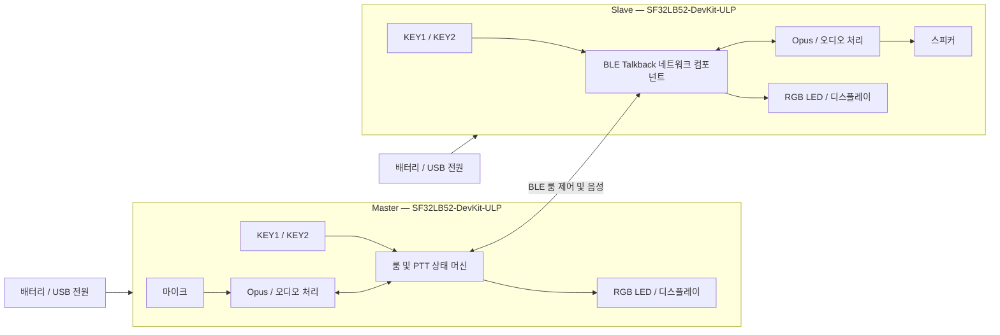

# SF32 BLE Talkback 인터컴 { #sf32-ble-talkback-intercom }

## Talkback이란 무엇인가? { #what-is-talkback }

[OpenSiFli Talkback](https://github.com/OpenSiFli/sifli-sdk-demo/tree/main/talkback)은 Huangshan Pi로도 알려진 `SF32LB52-DevKit-ULP`용 멀티 디바이스 BLE 푸시투토크(PTT) 예제입니다. 디바이스는 룸을 만드는 Master로 동작하거나, 룸을 스캔하여 참가하는 Slave로 동작할 수 있습니다. 참가한 뒤에는 말하기 키를 누르고 있으면 송신하고, 떼면 송신을 멈춥니다. 공식 기준 구성은 최대 8대의 디바이스를 수용하며 최대 3대가 동시에 말할 수 있습니다.

이 프로젝트는 음성 코딩에 Opus를 사용하고, RGB LED, 키, 디스플레이를 결합하여 최소한의 로컬 인터페이스를 구성합니다. 또한 한 번의 키 입력으로 Slave 재연결, 배터리 전압/잔량 보고, 입력 없이 60초가 지나면 슬립, 길게 눌러 전원 끄기 및 켜기 동작을 구현합니다. 따라서 독립된 일대일 오디오 예제보다 휴대용 인터컴 레퍼런스로서 훨씬 유용합니다.

## 왜 SF32 구현인가? { #why-the-sf32-implementation }

이 경로는 SF32LB52의 BLE, 오디오, 디스플레이, 키, 배터리 모니터링, 저전력 동작을 하나의 동작하는 기준 구성에 결합합니다. 팀은 커스텀 RF, 오디오, 전원 설계에 투자하기 전에 지원되는 개발 하드웨어에서 네트워킹과 오디오 성능을 평가할 수 있습니다.

"최대 8대의 디바이스와 3명의 동시 화자"는 업스트림 구현의 경계일 뿐, 거리, 간섭, 패킷 손실, 모든 동시 동작 패턴에 걸쳐 검증된 제품 기능이 아닙니다. 업스트림 자료에는 룸 인증, 링크 암호화 정책, 음성 프라이버시 보장, 무선 규제 상태, 바이너리 `talk_back` 컴포넌트의 전체 라이선스 경계도 명시되어 있지 않습니다. 이들은 각각 별도의 제품 검토가 필요합니다.

**보드 출처 참고:** SiFli의 중국어 ULP 보드 페이지에는 아직 제공되지 않는다고 명시되어 있으며, 저전력 센서/웨어러블 용도, 3축 또는 6축 센서 선택지, 예약된 저전력 테스트 포인트만 나와 있습니다. 완전한 보드 사양이 아닙니다. 주변 장치는 실제 보드 리비전과 회로도를 기준으로 확인하십시오. 아래의 Talkback 관련 동작은 고정된 애플리케이션 소스를 기준으로 합니다.

## 목표, 범위, 시작 조건 { #outcome-scope-and-entry-criteria }

**목표:** 리비전이 관리되는 보드 두 대 이상으로 룸 생성, 참가, PTT 음성, 나가기/재연결, 슬립/웨이크, 배터리 상태 동작을 재현한 다음, 커스텀 하드웨어가 정당한지 판단하기에 충분한 증거를 보관합니다.

**범위 밖:** 이 페이지는 장거리 커버리지, 열화된 링크에서의 음성 품질, 종단 간 암호화, 인증, 양산 전력, 안테나 일관성, 규제 준수, 임의의 BLE 디바이스와의 호환성을 입증하지 않습니다.

**시작 조건:** 팀이 SiFli-SDK 빌드 환경을 설치하고, UART로 펌웨어를 기록하고, 로그를 확인하고, 스피커와 배터리를 안전하게 연결할 수 있어야 합니다. 완전한 음성 기준 구성에는 동일한 리비전의 보드가 두 대 이상 필요합니다.

<div align="center"><em>표: 프로젝트 계약</em></div>

<div align="center" markdown>

| 영역 | 기준 구성 요구 사항 | 진행 전에 보관하는 증거 |
|:-----|:---------------------|:------------------------------------|
| 재현 경계 | 업스트림 타깃, 의존성, 기본 상호작용을 먼저 변경하지 않고 유지 | 보드 리비전, 애플리케이션 커밋, SDK 리비전, 의존성 해석 기록, 펌웨어 해시 |
| 기능 경계 | 생성/참가, PTT, 나가기, Slave 재연결, 슬립/웨이크, 배터리 보고를 입증 | 조작 기록, UART 로그, LED 상태, 장애 복구 결과 |
| 제품 경계 | 음향, RF, 보안, 프라이버시, 라이선스, 전력, 규제는 별도의 제품 검증이 필요 | 리스크, 담당자, 처리 계획, 진행/중단 결정 |

</div>

## 하드웨어 및 소프트웨어 사양 { #hardware-and-software-specifications }

### 하드웨어 사양 { #hardware-specification }

<div align="center"><em>표: 하드웨어 사양</em></div>

<div align="center" markdown>

| 구성 요소 | 필수 사양 | 역할 | 상태 | 구하는 곳 | 호환성 및 대체 참고 사항 |
|:----------|:-----------------------|:-----|:-------|:----------------|:-------------------------------------|
| SF32LB52-DevKit-ULP / LCKFB-HSPI-SF32LB52-ULP | `sf32lb52-lchspi-ulp` 타깃; 보드 2대 이상 8대 이하 | Talkback을 실행하며 BLE, 마이크, 디스플레이, 키, RGB LED, 전원, 오디오 경로를 제공 | 필수 | [μForge 보드 레퍼런스](../sf32-products/devkits/SF32LB52-DevKit-ULP.md); [LCKFB 보드 페이지](https://lckfb.com/project/detail/lckfb-hspi-sf32lb52-ulp?param=baseInfo); [SiFli 샘플/키트 스토어](https://sifli.taobao.com/) | 모든 하드웨어 리비전을 기록하십시오. 검증되지 않은 SF32LB52 보드는 동등한 대체품이 아닙니다 |
| 스피커 | 보드마다 GH-1.25 mm 커넥터를 통해 연결하는 3 W/4 Ω 또는 2 W/8 Ω 외장 스피커 1개 | 수신한 음성 재생 | 필수 | 보드 키트에 흔히 포함되어 있습니다. 구매 전에 [보드 레퍼런스](../sf32-products/devkits/SF32LB52-DevKit-ULP.md)로 구성품을 확인하십시오 | 온보드 Class-D 앰프와 커넥터의 한계를 벗어나는 부하를 연결하면 안 됩니다 |
| USB 데이터 케이블과 호스트 | 보드마다 데이터 전송이 가능한 USB-C 케이블 1개; SiFli-SDK 도구를 실행할 수 있는 호스트 | 전원, UART 플래싱, 로깅 | 필수 | 표준 USB-C 데이터 케이블; 도구는 [SiFli-SDK](https://github.com/OpenSiFli/SiFli-SDK)에서 시작 | 충전 전용 케이블로는 펌웨어를 기록할 수 없습니다. 포트 할당과 호스트 환경을 기록하십시오 |
| 단일 셀 리튬 배터리 | 보드 커넥터, 극성, 충전 경로와 일치해야 함 | 이동 사용, 슬립/웨이크, 배터리 잔량 검증 | 제품 검증에 필수; 벤치 기능 확인에는 선택 | Talkback 저장소에서 별도의 구매처를 게시하지 않습니다. 구매 전에 [보드 레퍼런스](../sf32-products/devkits/SF32LB52-DevKit-ULP.md)에서 인터페이스를 확인하십시오 | 연결하기 전에 극성, 전압 범위, 용량, 보호 회로를 확인하십시오. 커넥터가 비슷해 보인다고 호환이 보장되지는 않습니다 |
| 통합 마이크, 키, RGB LED, 디스플레이 | 개발 보드의 기본 부품 | 음성을 수집하고 역할, 페어링, 송신, 수신, 슬립 상태를 표시 | 통합 | 보드에 포함되어 있으며 별도로 구매하지 않음 | 오디오 또는 HMI 하드웨어를 교체하는 것은 적용 작업이며, 게인, 타이밍, 키 코드, 상태 맵 회귀 테스트가 필요합니다 |

</div>

### 소프트웨어 사양 { #software-specification }

<div align="center"><em>표: 소프트웨어 사양</em></div>

<div align="center" markdown>

| 패키지 또는 서비스 | 필수 버전 또는 리비전 | 역할 | 상태 | 구하는 곳 | 호환성 및 업데이트 참고 사항 |
|:-------------------|:-----------------------------|:-----|:-------|:----------------|:-------------------------------|
| OpenSiFli `sifli-sdk-demo/talkback` | 이 문서에서 검토한 커밋 [`6fa55ac`](https://github.com/OpenSiFli/sifli-sdk-demo/commit/6fa55ac65b51fca5eac6660a7e481a30e07388ee) | 애플리케이션, 보드 설정, 빌드 진입점 | 필수 | [Talkback 소스 디렉터리](https://github.com/OpenSiFli/sifli-sdk-demo/tree/main/talkback) | 업스트림 `main`은 계속 바뀌므로, 증거를 만들기 전에 커밋을 고정하십시오. 현재 경로는 `talkback/project`이며, README의 `example/ble/talkback/project` 경로는 오래된 것입니다 |
| SiFli-SDK | `conanfile.py`가 `^2.4`와의 호환성을 선언하며, 업스트림에 정확한 SDK 커밋은 고정되어 있지 않음 | RT-Thread, BLE, 오디오, 전원, 빌드, 플래싱 기반 | 필수 | [OpenSiFli/SiFli-SDK](https://github.com/OpenSiFli/SiFli-SDK) | `^2.4`를 만족하는 구체적인 커밋 하나를 선택하여 기록하십시오. 계속 바뀌는 `main`은 기준 리비전이 아닙니다 |
| `talk_back/1.2@sifli` | `1.2` | BLE Talkback 네트워킹/오디오 컴포넌트 | 필수 | 프로젝트의 [Conan 매니페스트](https://github.com/OpenSiFli/sifli-sdk-demo/blob/6fa55ac65b51fca5eac6660a7e481a30e07388ee/talkback/project/conanfile.py)로 해석됨 | 업스트림은 해당 페이지에서 독립 소스, 패키지 해시, 패키지 서버, 전체 라이선스를 게시하지 않습니다. 패키지와 해석 기록을 보관하고 제품에 사용하기 전에 이 리스크를 해소하십시오 |
| Opus 및 WebRTC AECM/AGC 구성 | 고정된 애플리케이션, SDK, Conan 의존성이 함께 결정 | 음성 코딩, 에코 처리, 게인 제어 | 필수 | [프로젝트 구성](https://github.com/OpenSiFli/sifli-sdk-demo/blob/6fa55ac65b51fca5eac6660a7e481a30e07388ee/talkback/project/proj.conf) 및 고정된 SDK 의존성 | 기능 매크로만 기록하지 마십시오. 해석된 라이브러리 버전과 라이선스 자료를 보관하십시오 |
| SCons, 컴파일러, UART 플래싱 도구 | 선택한 SiFli-SDK에 맞는 버전 | 이미지 구성, 빌드, 플래싱 | 필수 | [선택한 SiFli-SDK](https://github.com/OpenSiFli/SiFli-SDK) 환경에서 제공 | 호스트 OS, 툴체인 버전, 빌드 명령, 생성된 스크립트 해시를 기록하십시오 |

</div>

## 지원되는 기준 구성 선택 { #choose-a-supported-baseline }

리비전이 같은 `SF32LB52-DevKit-ULP` 보드 두 대로 시작하십시오. 데모 저장소를 `6fa55ac`에 고정하고, `^2.4`를 만족하는 구체적인 SiFli-SDK 커밋을 선택하여 기록하고, `talk_back/1.2@sifli`의 Conan 해석 결과를 보관하십시오. 첫 재현 단계에서는 오디오 파라미터, 역할 로직, 저전력 타이밍을 변경하지 마십시오.

저장소 루트에서 실제로 존재하는 경로로 이동합니다.

```bash
cd talkback/project
scons --board=sf32lb52-lchspi-ulp -j8
```

Windows에서 생성되는 플래싱 스크립트는 `build_sf32lb52-lchspi-ulp_hcpu\uart_download.bat`입니다. 이를 실행하고 프롬프트가 나오면 적절한 COM 포트를 입력하십시오. 모든 디바이스에 동일한 기준 구성 이미지를 사용하고 각 보드의 식별 정보와 이미지 해시를 기록하십시오.

### 기본 조작과 상태 표시 { #default-controls-and-state-indication }

<div align="center"><em>표: 기본 키 및 LED 동작</em></div>

<div align="center" markdown>

| 상태 | KEY1 | KEY2 | LED |
|:------|:-----|:-----|:----|
| Standby | 이전에 참가에 성공한 Slave는 짧게 눌러 재연결하며, 그렇지 않으면 짧게 눌러 슬립 타이머를 리셋 | 짧게 누르면 Master/Slave 전환, 길게 누르면 페어링 시작 | Master는 파란색 점등, Slave는 빨간색 점등 |
| 페어링 | — | Master는 룸을 생성하고 Slave는 스캔 | Master는 파란색 점멸, Slave는 빨간색 점멸 |
| 시작 대기 | — | Master가 길게 눌러 시작을 확정 | Master는 파란색 점멸, Slave는 빨간색 점멸 |
| 룸 안 | KEY2를 뗀 뒤 짧게 눌러 나가기 | 누르고 있으면 말하기, 떼면 중지 | 말하는 동안 녹색 점등, 수신하는 동안 주황색 점등 |
| 슬립 | 아무 키로 웨이크 | 아무 키로 웨이크 | 꺼짐 |

</div>

## 프로젝트 개발 단계와 의사결정 지점 { #delivery-map }

<div align="center"><em>표: 개발 단계와 의사결정</em></div>

<div align="center" markdown>

| 단계 | 뒷받침하는 의사결정 | 최소 증거 |
|:------|:-------------------|:-----------------|
| 수정하지 않은 기준 구성 확립 | 고정된 구성 요소 집합이 안정적으로 빌드, 플래싱, 시작되는가? | 버전 매니페스트, 클린 빌드 로그, 이미지 해시, 시작 기록 |
| 2대 디바이스 음성 검증 | 기본 룸 생성, 참가, PTT가 동작하는가? | 2대 디바이스의 역할, LED, 키 조작, 양방향 음성 기록 |
| 네트워킹 및 복구 검증 | 나가기, 타임아웃, 재연결, 동시 동작 경계를 수용할 수 있는가? | 장애 주입 매트릭스, 복구 시간, 로그, 실패 상태 |
| 오디오 및 전력 평가 | 음향과 배터리 동작이 의도한 폼 팩터에 맞는가? | 오디오 품질, 지연 시간, 통신 거리, 전류, 슬립, 웨이크 측정 |
| 제품 준비 상태 검토 | 커스텀 하드웨어에 투자하기에 충분한 증거가 있는가? | 리스크 대장, 담당자, 진행/보류/중단 결정 |

</div>

## 시스템 아키텍처와 의존성 { #system-architecture-and-dependencies }

<div align="center"><em>그림: Talkback 디바이스 역할, 오디오, 제어 경로</em></div>



주요 장애 영역은 BLE 스캔/룸 생성, 룸 상태 동기화, 동시 화자 스케줄링, Opus/음향 경로, 키 이벤트, 저배터리와 슬립, 전원 키 복구, 공개되지 않은 컴포넌트/라이선스 세부 사항입니다. 먼저 역할과 상태를 진단한 다음, 무선, 오디오, 로컬 전원 장애를 구별하십시오.

## 1단계 — 수정하지 않은 소스 기준 구성 확립 { #stage-1-establish-the-untouched-source-baseline }

**목표:** 고정된 소스, SDK, 해석된 의존성이 반복 가능한 이미지를 만들어 낸다는 것을 입증합니다.

1. 애플리케이션과 구체적인 SDK 커밋을 고정하고, 의존성 해석 출력을 보관합니다.
2. 클린 디렉터리에서 `sf32lb52-lchspi-ulp`를 빌드하여 보드 두 대에 기록합니다.
3. 각 디바이스가 빨간색 LED가 켜진 Slave로 시작하는지 확인한 다음, 키, 디스플레이, 배터리, 스피커 경로를 점검합니다.

**보관할 증거:** 전체 버전 매니페스트, 빌드/플래싱 로그, 펌웨어 해시, 두 보드의 리비전, 시작 기록.

**게이트 1 종료 기준:** 동일한 입력으로 동일한 기준 구성 이미지를 재현 가능하게 생성하여 두 디바이스에 기록하고, 시작 상태가 업스트림 동작과 일치합니다.

## 2단계 — 룸 설정과 양방향 PTT 검증 { #stage-2-validate-room-setup-and-bidirectional-ptt }

**목표:** 디버거 개입 없이 사용자가 최소 룸을 만들고 사용할 수 있음을 입증합니다.

1. Standby 상태에서 KEY2를 짧게 눌러 한 디바이스를 파란색 LED가 켜진 Master로 만들고, 다른 디바이스는 빨간색 Slave로 둡니다.
2. 두 디바이스에서 KEY2를 길게 누릅니다. Master는 룸을 생성하고 Slave는 스캔합니다. 페어링은 30초 후에 타임아웃됩니다.
3. 대기 상태에서 Master의 KEY2를 길게 눌러 시작합니다. 말하기 상태에서는 KEY2를 누르고 있으면 말하고, 떼면 중지합니다.
4. 송신하는 동안 녹색 점등, 수신하는 동안 주황색 점등이 되는지, 양방향에서 음성이 알아들을 수 있는지 확인합니다.

**보관할 증거:** 역할, 조작 타임라인, LED 상태, UART 로그, 양방향 오디오 샘플, 재시도 결과.

**게이트 2 종료 기준:** 디바이스 두 대 이상이 양방향 PTT 세션을 반복해서 완료하고, 표시등이 실제 오디오 방향과 일치하며, 30초 타임아웃 후 설명 가능한 상태로 돌아갑니다.

## 3단계 — 나가기, 재연결, 수용 한계 검증 { #stage-3-validate-leave-reconnect-and-capacity-boundaries }

**목표:** 업스트림의 복구 경로와 수용 한계로 인해 사용자가 막다른 상태에 빠지지 않음을 확인합니다.

1. 말하기 상태에서 나가려면 KEY2를 뗀 뒤 KEY1을 짧게 누릅니다. 송신하는 동안에는 디바이스가 나갈 수 없습니다.
2. 이전에 참가에 성공한 Slave는 Standby 상태에서 KEY1을 짧게 눌러 재연결합니다. Master에는 이에 해당하는 재연결 경로가 없습니다.
3. 통신 범위 이탈 상태에서의 동작, 페어링 타임아웃, Master 소실, 전원 재시작을 주입합니다.
4. 다자간 동작이 중요하다면 의도한 참가자 수까지 확장하여 명시된 한계인 8대의 디바이스와 3명의 동시 화자를 포함해 검증합니다.

**보관할 증거:** 모든 장애에 대한 초기 상태, 트리거, 복구 동작, 복구 시간, 로그, 최종 룸 멤버십.

**게이트 3 종료 기준:** 대상 장애마다 명시적이고 반복 가능하며 사용자가 이해할 수 있는 복구 경로가 있고, 필요한 수용 한계와 동시 동작 한계를 한계 설명에서 가져오지 않고 대상 RF 환경에서 측정했습니다.

## 4단계 — 오디오, RF, 전력 성능 평가 { #stage-4-qualify-acoustics-rf-and-low-power }

**목표:** 개발 보드의 동작이 의도한 인클로저, 통신 거리, 동작 시간을 뒷받침할 수 있는지 판단합니다.

1. 조용한 환경, 근단 더블토크, 배경 소음, 여러 스피커 볼륨 설정에서 명료도, 클리핑, 에코, PTT 시작/종료 시의 잘림을 기록합니다.
2. 대상 거리, 장애물 통과, 2.4 GHz 간섭 환경에서 연결, 끊김, 복구를 기록합니다.
3. 입력 없이 60초가 지나면 슬립에 들어가는지, 역할이 Slave로 리셋되는지, 아무 키로 웨이크되는지, 길게 눌러 전원을 끄고 켜는 동작이 되는지, 배터리 20% 미만에서 LED 표시가 나타나는지 검증합니다.
4. Standby, 송신, 수신, 슬립, 웨이크 전류를 측정합니다. 개발 보드의 측정값을 최종 제품의 배터리 수명과 동일시하면 안 됩니다.

**보관할 증거:** 환경, 보드/안테나 방향, 오디오 파일, 거리와 간섭, 전류 트레이스, 배터리 조건, 복구 결과.

**게이트 4 종료 기준:** 제품 팀이 대상 환경에 대한 음향, RF, 전력, 웨이크 임계값을 정의하고 충족했으며, 충족하지 못한 항목마다 담당자와 처리 방안이 있습니다.

## 5단계 — 제품 준비 상태 검토 { #stage-5-product-readiness-review }

커스텀 하드웨어로 넘어가기 전에 최소한 다음 질문에 답하십시오.

- 룸이 신뢰할 수 있는 디바이스를 어떻게 식별하며, 음성 및 제어 데이터에 어떤 인증, 암호화, 재전송 방지가 적용되는가?
- `talk_back/1.2@sifli`, Opus, WebRTC 컴포넌트, 저장소 소스 파일의 라이선스, 소스 제공, 취약점 대응은 누가 책임지는가?
- 대상 안테나, 인클로저, 인체에 의한 차폐, 동시 동작 조건에서 커버리지, 지연 시간, 패킷 손실, 복구를 어떻게 측정했는가?
- 마이크, 앰프, 스피커 캐비티, 볼륨 제한이 음향 및 안전 요구 사항을 어떻게 충족하는가?
- 디바이스는 저배터리, 비정상적인 전원 손실, 손상된 펌웨어, 실패한 현장 업데이트에서 어떻게 복구하는가?
- Bluetooth, EMC, 무선, 배터리 적합성 관련 활동 중 어느 것이 적용되는가?

**게이트 5 종료 기준:** 리스크 대장에 증거, 담당자, 완화책, 명시적인 진행, 보류 또는 중단 결정이 있습니다. 보안, 라이선스, 규제 문제를 담당자 없는 "나중에" 할 일로 남겨 두면 안 됩니다.

## 제품 설계로의 인계 { #handoff-to-product-design }

인계 패키지에는 고정된 소스/SDK/의존성, 역할과 상태 머신, 수용 한계 및 복구 매트릭스, 오디오/RF/전력 측정, 안테나와 음향 가정, 배터리/충전 경계, 보안/프라이버시 모델, 라이선스 자료, 양산 테스트 요구 사항, 복구 계획이 포함되어야 합니다. [SF32LB52x 통합 경로](../sf32-products/chips/SF32LB52x.md#integration-path)를 사용하여 칩, 모듈, 보드, 하드웨어 설계 가이드, 체크리스트를 선택하십시오. 검증된 동작을 커스텀 회로도와 레이아웃에 반영하고, 개발 보드의 결과가 그대로 이어진다고 가정하지 말고 다시 확인하십시오.

## 주요 정보 출처 { #authoritative-sources }

- [OpenSiFli Talkback 디렉터리](https://github.com/OpenSiFli/sifli-sdk-demo/tree/main/talkback)
- [애플리케이션 검토 커밋 `6fa55ac`](https://github.com/OpenSiFli/sifli-sdk-demo/commit/6fa55ac65b51fca5eac6660a7e481a30e07388ee)
- [공식 Talkback README](https://github.com/OpenSiFli/sifli-sdk-demo/blob/6fa55ac65b51fca5eac6660a7e481a30e07388ee/talkback/README.md)
- [Talkback Conan 매니페스트](https://github.com/OpenSiFli/sifli-sdk-demo/blob/6fa55ac65b51fca5eac6660a7e481a30e07388ee/talkback/project/conanfile.py)
- [Talkback 프로젝트 구성](https://github.com/OpenSiFli/sifli-sdk-demo/blob/6fa55ac65b51fca5eac6660a7e481a30e07388ee/talkback/project/proj.conf)
- [OpenSiFli/SiFli-SDK](https://github.com/OpenSiFli/SiFli-SDK)
- [공식 SF32LB52-DevKit-ULP Wiki 소스](https://github.com/OpenSiFli/SiFli-Wiki/blob/main/source/en/board/sf32lb52x/SF32LB52-DevKit-ULP.md)
- [중국어 SF32LB52-DevKit-ULP Wiki 소스](https://github.com/OpenSiFli/SiFli-Wiki/blob/main/source/zh_CN/board/sf32lb52x/SF32LB52-DevKit-ULP.md)
