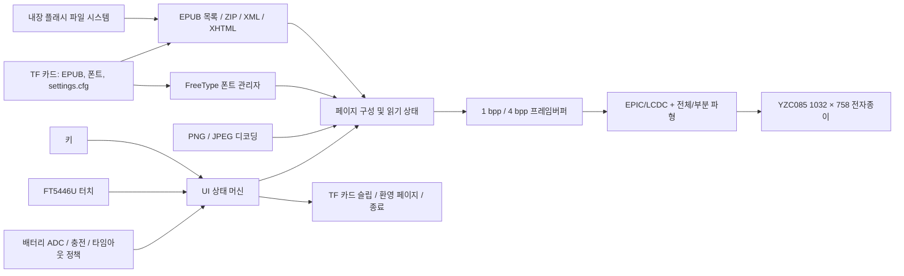

# SF32 E-Paper EPUB 리더 { #sf32-e-paper-epub-reader }

## EPD Reader란 무엇인가? { #what-is-epd-reader }

[OpenSiFli EPD Reader](https://github.com/OpenSiFli/EPD_Reader)는 [atomic14/diy-esp32-epub-reader](https://github.com/atomic14/diy-esp32-epub-reader)를 SiFli `SF32-OED-EPD` 하드웨어에 맞게 변형한 프로젝트입니다. SF32LB52x를 처리 코어로 사용하여 내장 파일 시스템 또는 TF 카드에서 EPUB 파일을 읽고, ZIP/XML/XHTML 파싱, FreeType 폰트, 이미지 디코더로 콘텐츠를 레이아웃한 다음, 전체 및 부분 리프레시 파형으로 전자종이 패널을 구동합니다.

현재 애플리케이션은 라이브러리, 목차, 읽기, 읽기 설정, 기능 설정, 환영/화면 끄기, 저배터리, 충전, 종료 페이지를 제공합니다. 키와 터치, 중국어와 영어 텍스트, 동적 TTF/OTF 폰트, 폰트 크기/굵기, 줄 간격, 여백, 읽기 설정의 TF 카드 저장을 지원합니다. 리소스를 아끼기 위해 기본으로 포함된 중국어 폰트는 별도의 굵은체/기울임체를 활성화하지 않으므로, 굵기 설정의 실제 결과는 대상 폰트로 검증하십시오. 이것은 낮은 리프레시 빈도의 독서 단말을 위한 완전한 레퍼런스이며, 일반적인 EPUB 적합성이나 양산 수준의 전자책 리더를 입증하는 것은 아닙니다.

## 왜 SF32 구현인가? { #why-the-sf32-implementation }

이 경로는 SF32LB52의 스토리지, EPIC/LCDC 디스플레이 가속, 터치, 키, 배터리 모니터링, 저전력 관리를 하나의 애플리케이션에 결합합니다. 제품 팀에게 이 경로의 가치는 단순히 한 페이지를 보여 주는 데 그치지 않고, 지원되는 하드웨어에서 레이아웃 메모리, 전체/부분 리프레시의 잔상, 파형 적응, TF 카드 전원 관리, 폰트 접근, 상호작용 흐름, 슬립 동작을 함께 평가할 수 있다는 데 있습니다.

SiFli의 보드 가이드는 샘플 목록으로 연결되는 링크를 제공하지만, 제공되는 보드, 패널, 터치 하드웨어가 프로젝트의 V1.1 소프트웨어 기준 구성과 일치한다는 점은 확인해 주지 않으며, 정확한 기준 어셈블리나 별도의 패널 소스도 명시되어 있지 않습니다. 업스트림에는 EPUB 지원 비율, 패널 동작 온도 범위, 양산 수명, 모드별 전류 수치도 없습니다. 따라서 이 페이지는 하드웨어 리비전, 패널/터치 조합, 소프트웨어 커밋을 필수 엔지니어링 기준 구성으로 취급합니다. 다른 전자종이 모듈은 그대로 바꿔 쓸 수 있는 대체품이 아닙니다.

**소스 기준 구성 확인:** SiFli의 [SF32LB52-OED-6'-EPD 가이드](https://github.com/OpenSiFli/SiFli-Wiki/blob/main/source/zh_CN/board/sf32lb52x/SF32LB52-OED-6%27-EPD.md)는 758 × 1024의 6인치 OPM060DA 패널을 설명합니다. 블록 다이어그램에는 보드 수준의 경로도 나와 있습니다. 8비트 8080 EPD 인터페이스, I²C 터치, SPI1 TF 카드, 아날로그 마이크/오디오 PA, USB-UART, 배터리/충전기 전원입니다. 반면 고정된 EPD Reader V1.1 구성은 1032 × 758의 YZC085 V1.05를 선택하며, Wiki의 보드 사진에는 V1.2라고 표시되어 있습니다. 이 소스들만으로는 OPM060DA와 YZC085를 서로 바꿔 쓸 수 있는지, 또는 Wiki의 패널이 V1.1과 함께 공급되는지 알 수 없습니다. 실제 보드와 패널의 마킹을 확인한 다음, 일치하는 프로젝트 타깃, 파형, VCOM 설정을 사용하십시오.

**전원 요구 사항:** SiFli의 보드 가이드는 동작 중에 배터리를 계속 연결해 두어야 한다고 요구하며, USB-C VBUS는 충전용이어서 그것만으로는 보드를 동작시킬 수 없습니다. 가이드는 1000~1500 mAh 배터리를 지정하고, MX1.25 커넥터가 있는 1500 mAh 단일 셀 Li-Po 팩을 권장합니다. 가이드에 사진으로 나온 보드는 V1.2로 표시되어 있고 이 프로젝트 기준 구성은 V1.1을 대상으로 하므로, 팩을 선택하기 전에 해당 보드의 전원 커넥터, 극성, 충전 한계를 확인하십시오.

## 목표, 범위, 시작 조건 { #outcome-scope-and-entry-criteria }

**목표:** 고정된 `SF32-OED-EPD_V1.1` 보드에서 설정된 해상도 1032 × 758의 YZC085 V1.05 패널을 사용하여 빌드/플래싱, 라이브러리/목차/읽기, 키/터치 입력, 설정 저장, 전체/부분 리프레시, 저배터리, 슬립, 종료 동작을 재현한 다음, 제품 결정에 필요한 증거를 보관합니다.

**범위 밖:** 이 페이지는 완전한 EPUB/CSS/폰트 호환성, DRM 지원, 임의 패널의 파형 호환성, 상업적 수준의 읽기 품질, 무선 콘텐츠 배포, 인증, 양산 신뢰성을 입증하지 않습니다. 고정된 소스는 Bluetooth/PAN 구성과 상태 UI를 노출하지만, 업스트림 README는 그 연결을 통한 콘텐츠 전달 워크플로를 정의하지 않습니다. 로컬 파일을 재현 가능한 기준 구성으로 취급하십시오. 네트워크 전달은 검증되지 않았으며 범위 밖입니다.

**시작 조건:** 팀이 SiFli-SDK 애플리케이션을 빌드하고 기록할 수 있어야 하며, 보드 리비전, 패널 모델, 플렉스 방향, 배터리 극성, TF 카드 파일 시스템을 식별할 수 있어야 합니다. 보드/패널 출처와 하드웨어 문서가 불분명하면, SiFli 또는 하드웨어 공급업체가 확인해 줄 때까지 구매 확정을 중단하십시오.

<div align="center"><em>표: 프로젝트 계약</em></div>

<div align="center" markdown>

| 영역 | 기준 구성 요구 사항 | 진행 전에 보관하는 증거 |
|:-----|:---------------------|:------------------------------------|
| 버전 경계 | 보드, 패널, 터치 컨트롤러, 애플리케이션 커밋, SDK 서브모듈 커밋을 고정 | 사진, 마킹, 구성, 커밋, 이미지 해시, 케이블 방향 |
| 읽기 경계 | 내장 샘플, TF 카드 도서, 목차, 이미지, 중국어/영어, 설정을 따로 테스트 | 콘텐츠 매니페스트, 페이지별 결과, 로그, 실패 분류 |
| 디스플레이 경계 | 파형, VCOM, 해상도, 버스, 온도가 패널과 일치해야 함 | 전체/부분 리프레시, 잔상, 리프레시 시간, 온도, 전류 기록 |
| 제품 경계 | 라이선스, 콘텐츠 권리, 전력, 신뢰성, 무선, 규제는 별도 검토가 필요 | 리스크 대장, 담당자, 진행/중단 결정 |

</div>

## 하드웨어 및 소프트웨어 사양 { #hardware-and-software-specifications }

### 하드웨어 사양 { #hardware-specification }

<div align="center"><em>표: 하드웨어 사양</em></div>

<div align="center" markdown>

| 구성 요소 | 필수 사양 | 역할 | 상태 | 구하는 곳 | 호환성 및 대체 참고 사항 |
|:----------|:-----------------------|:-----|:-------|:----------------|:-------------------------------------|
| SF32-OED-EPD V1.1 보드 | SF32LB52x; `sf32-oed-epd_v11` 소프트웨어 타깃; 프로젝트 맵은 16 MiB QSPI NOR 영역과 8 MiB PSRAM 영역을 제공 | 처리, 스토리지, 디스플레이, 입력, 배터리, 전원 관리 | 필수 | SiFli의 [보드 가이드](https://github.com/OpenSiFli/SiFli-Wiki/blob/main/source/zh_CN/board/sf32lb52x/SF32LB52-OED-6%27-EPD.md)가 샘플 목록으로 연결됩니다. 판매자에게 보드 리비전, 함께 공급되는 패널, 터치 하드웨어를 확인하십시오. 소프트웨어 타깃은 [고정된 V1.1 보드 구성](https://github.com/OpenSiFli/EPD_Reader/tree/7d72223c513d0a77eb251a3acb0f18cadb8d4d89/epdiy-epub/sf32-oed-epd_v11)으로 식별하십시오 | V1.2와 V1.2-SPI는 별도의 타깃이 있으며, 커넥터 모양이 비슷하다는 이유만으로 대체할 수 없습니다 |
| YZC085 V1.05 전자종이 모듈 | 1032 × 758; 8비트 EPD/DBI 경로; V1.1 기본값. 고정된 프로젝트 구성과 인용된 보드 가이드에서는 패널의 물리적 대각선 길이나 DPI를 알 수 없으므로, 패널 마킹과 공급업체 문서로 확인하십시오. | EPUB 페이지와 UI 표시 | 필수 | 구매처가 게시되지 않음. [고정된 Kconfig 항목](https://github.com/OpenSiFli/EPD_Reader/blob/7d72223c513d0a77eb251a3acb0f18cadb8d4d89/epdiy-epub/project/Kconfig.proj)을 실물 모델과 대조하십시오 | R7D005(1448 × 1072)와 OPM037A3(240 × 416, SPI)는 별도의 구성이며, 설정 없이 바꿔 쓸 수 있는 대체품이 아닙니다. 패널마다 파형, VCOM, 타이밍, 해상도를 검증하십시오 |
| FT5446U 터치 경로 | V1.1 기본값 `TSC_USING_FT5446U_V01` | 터치 선택, 페이지 넘김, 위로 쓸어올리기 오버레이 | 터치를 사용할 때 필수 | 일치하는 V1.1 보드/패널 어셈블리와 함께 구하십시오. 독립된 구매처는 게시되지 않았습니다 | V1.2의 기본값은 GT967이고 3.7인치 SPI 구성은 FT6336U를 선택하며, 드라이버는 서로 호환되지 않습니다 |
| TF 카드 | 보드 SPI 스토리지 드라이버와 FAT 파일 시스템이 인식할 수 있어야 함 | 대량 EPUB 저장, 외부 폰트, `/settings.cfg` 저장 | 전체 기능 기준 구성에 필수; 내장 샘플만 쓰는 경우에는 선택 | 표준 TF 카드; 업스트림은 브랜드나 용량을 지정하지 않음 | 펌웨어는 TF 카드를 우선합니다. 용량, 포맷, 파일 집합을 기록하고 카드 제거/손상 복구를 테스트하십시오 |
| USB 데이터 케이블과 빌드 호스트 | 데이터 전송이 가능한 케이블; SiFli-SDK 도구를 실행할 수 있는 호스트 | USB-UART 플래싱, 디버깅/로깅, 배터리 충전; 보드 단독 전원은 아님 | 필수 | 표준 데이터 케이블; 도구는 [고정된 SDK 커밋](https://github.com/OpenSiFli/SiFli-SDK/commit/8a1eb8a34be02c1df8529c9e8f0e69172bf9ef36)에서 구함 | 배터리를 연결하지 않으면 USB-C VBUS만으로는 보드가 동작하지 않으며, 충전 전용 케이블로는 펌웨어를 기록할 수 없습니다 |
| 배터리/전원 어셈블리 | SiFli의 보드 가이드는 1000~1500 mAh를 지정하고 MX1.25 커넥터가 있는 1500 mAh 단일 셀 Li-Po 배터리를 권장합니다. 정확한 V1.1 보드의 입력과 극성을 확인하십시오 | 필수 보드 동작 전원; 저배터리, 충전, 슬립, 휴대 사용 검증 | 보드를 동작시키는 데 필수 | 정확한 배터리 부품 번호는 게시되지 않았습니다. [SiFli 보드 가이드](https://github.com/OpenSiFli/SiFli-Wiki/blob/main/source/zh_CN/board/sf32lb52x/SF32LB52-OED-6%27-EPD.md)를 참조하고, 보드 공급업체와 커넥터, 극성, 한계를 확인하십시오 | SiFli는 선형 충전기의 최대 전류를 1 A, 기본 정전류 설정을 1000 mA로 지정합니다. 제품 설계 전에 V1.1 어셈블리가 이와 일치하는지 확인하십시오 |

</div>

### 소프트웨어 사양 { #software-specification }

<div align="center"><em>표: 소프트웨어 사양</em></div>

<div align="center" markdown>

| 패키지 또는 서비스 | 필수 버전 또는 리비전 | 역할 | 상태 | 구하는 곳 | 호환성 및 업데이트 참고 사항 |
|:-------------------|:-----------------------------|:-----|:-------|:----------------|:-------------------------------|
| OpenSiFli EPD Reader | 이 문서에서 검토한 커밋 [`7d72223`](https://github.com/OpenSiFli/EPD_Reader/commit/7d72223c513d0a77eb251a3acb0f18cadb8d4d89); 서브모듈은 재귀적으로 가져와야 함 | 최상위 프로젝트, 애플리케이션, 보드 정의, 파형, SDK 고정 | 필수 | [OpenSiFli/EPD_Reader](https://github.com/OpenSiFli/EPD_Reader) | `git clone --recursive`를 사용하거나 서브모듈을 초기화하십시오. 계속 바뀌는 `main`은 탐색용으로만 사용합니다 |
| `epdiy-epub` 애플리케이션 | `7d72223`으로 고정 | EPUB 탐색/파싱, 페이지 상태 머신, 폰트, 렌더링, 입력, 전원 정책 | 필수 | [고정된 애플리케이션 디렉터리](https://github.com/OpenSiFli/EPD_Reader/tree/7d72223c513d0a77eb251a3acb0f18cadb8d4d89/epdiy-epub) | atomic14 프로젝트를 변형한 것입니다. 메인 애플리케이션은 MIT 라이선스이고 서드파티 라이브러리는 각자의 라이선스를 유지합니다 |
| SiFli-SDK 서브모듈 | [`8a1eb8a`](https://github.com/OpenSiFli/SiFli-SDK/commit/8a1eb8a34be02c1df8529c9e8f0e69172bf9ef36) | RT-Thread, BSP, 파일 시스템, Bluetooth, 네트워킹, PM, 빌드, 플래싱 | 필수 | [저장소 서브모듈](https://github.com/OpenSiFli/EPD_Reader/tree/7d72223c513d0a77eb251a3acb0f18cadb8d4d89/SiFli-SDK) | 업스트림의 재현 가능한 SDK 고정입니다. 업데이트하려면 디스플레이, 스토리지, 입력, 전원 회귀 테스트가 필요합니다 |
| EPUB/렌더링 의존성 | 애플리케이션이 고정: EPDIY, tinyxml2, miniz 2.2.0, PNGdec, TJpgDec, FreeType, 번들 폰트 | 아카이브, XML/XHTML, PNG/JPEG, 폰트, EPD 렌더링 | 필수 | 고정된 [`lib/` 디렉터리](https://github.com/OpenSiFli/EPD_Reader/tree/7d72223c513d0a77eb251a3acb0f18cadb8d4d89/epdiy-epub/lib)와 [`font/` 디렉터리](https://github.com/OpenSiFli/EPD_Reader/tree/7d72223c513d0a77eb251a3acb0f18cadb8d4d89/epdiy-epub/font) | 각 라이선스와 폰트 NOTICE를 검토하십시오. 메인 프로젝트의 MIT 라이선스가 모든 서드파티 코드와 폰트를 자동으로 포괄하지는 않습니다 |
| SCons, 컴파일러, UART 플래싱 도구 | 고정된 SDK 커밋에 맞는 환경 | menuconfig, 빌드, 파일 시스템/파형 이미지, 플래싱 | 필수 | [고정된 SiFli-SDK](https://github.com/OpenSiFli/SiFli-SDK/commit/8a1eb8a34be02c1df8529c9e8f0e69172bf9ef36)에서 제공 | 환경, 명령, 생성된 이미지, 플래싱 로그를 보관하십시오 |
| EPUB 및 폰트 에셋 | 팀이 승인한 DRM 없는 EPUB; 선택적으로 `.ttf`/`.otf`, 외부 폰트 최대 64개 | 읽기 콘텐츠와 폰트 선택 | EPUB는 필수; 외부 폰트는 선택 | 직접 소유했거나 라이선스를 받은 콘텐츠; 저장소의 [`disk/`](https://github.com/OpenSiFli/EPD_Reader/tree/7d72223c513d0a77eb251a3acb0f18cadb8d4d89/epdiy-epub/disk)에 테스트 샘플이 있습니다 | 콘텐츠와 폰트의 권리는 팀에 있습니다. 제품에서 사용하는 EPUB 구조, 언어, 이미지를 테스트하십시오 |

</div>

## 지원되는 기준 구성 선택 { #choose-a-supported-baseline }

첫 재현에는 `SF32-OED-EPD V1.1 + YZC085 V1.05 + FT5446U`를 사용하십시오. 업스트림에는 명시적인 `sf32-oed-epd_v11` 빌드/플래싱 경로가 문서화되어 있으며, Kconfig는 이 조합을 V1.1의 기본값으로 삼습니다. 최상위 커밋 `7d72223`과 SDK 서브모듈 `8a1eb8a`를 고정하고, 첫 단계에서 보드, 패널, 터치 컨트롤러, 파형을 한꺼번에 바꾸지 마십시오.

```bash
git clone --recursive https://github.com/OpenSiFli/EPD_Reader.git
cd EPD_Reader/epdiy-epub/project
scons --board=sf32-oed-epd_v11 --board_search_path=.. -j8
```

Windows용 플래싱 스크립트는 `build_sf32-oed-epd_v11_hcpu\uart_download.bat`입니다. 이를 실행하고 프롬프트가 나오면 COM 포트를 입력하십시오. 구성 항목은 다음으로 확인합니다.

```bash
scons --board=sf32-oed-epd_v11 --board_search_path=.. --menuconfig
```

## 프로젝트 개발 단계와 의사결정 지점 { #delivery-map }

<div align="center"><em>표: 개발 단계와 의사결정</em></div>

<div align="center" markdown>

| 단계 | 뒷받침하는 의사결정 | 최소 증거 |
|:------|:-------------------|:-----------------|
| 하드웨어와 소스 고정 | 물리적 어셈블리가 업스트림 V1.1 기준 구성과 일치하는가? | 마킹/패널 사진, 연결 방향, 커밋, 서브모듈, 구성 |
| 읽기 기준 구성 확립 | 고정된 이미지가 로컬 EPUB 흐름을 완료할 수 있는가? | 빌드/플래싱 로그, 샘플 매니페스트, 페이지, 입력 기록 |
| 콘텐츠 및 복구 검증 | 실제 도서, 폰트, TF 카드, 설정이 반복 가능한가? | 호환성 매트릭스, 누락/손상된 스토리지와 폰트의 복구, 저장 결과 |
| 디스플레이 품질과 전력 평가 | 파형, 잔상, 리프레시, 배터리 동작이 제품 방향을 뒷받침할 수 있는가? | 온도, 전체/부분 리프레시, VCOM, 리프레시 시간, 전류 측정 |
| 적용 및 검토 | 한정된 변경 하나를 안전하게 적용할 수 있으며, 제품 개발을 계속해야 하는가? | 변경, 회귀, 리스크 대장, 진행/중단 결정 |

</div>

## 시스템 아키텍처와 의존성 { #system-architecture-and-dependencies }

<div align="center"><em>그림: EPUB 콘텐츠, 렌더링, 입력, 전자종이 경로</em></div>



주요 장애 영역은 콘텐츠 아카이브/XHTML 파싱, 폰트 파일과 메모리, TF 카드 감지/전원, 터치/키 매핑, 패널 모델/파형/VCOM, 전체/부분 잔상, 배터리 ADC/충전 상태, 종료/웨이크입니다. 향후 무선 기능은 프로젝트 지원과 전달 경로가 문서화되기 전까지 로컬 파일, 디스플레이, 전원 기준 구성에 포함하지 마십시오.

## 1단계 — 물리적 기준 구성과 소스 기준 구성 고정 { #stage-1-pin-the-physical-and-source-baseline }

**목표:** 보드, 패널, 터치 컨트롤러, 소스가 지원되는 하나의 조합을 기술한다는 것을 입증합니다.

1. V1.1 보드 마킹, SF32 디바이스, 패널 모델, 터치 컨트롤러, 플렉스 방향, 전원 공급원을 기록합니다.
2. 최상위 커밋과 SDK 서브모듈을 고정하고 서브모듈의 전체 상태를 보관합니다.
3. 클린 환경에서 빌드하고 기록합니다. 생성된 모든 이미지와 플래싱 스크립트의 해시를 계산합니다.

**보관할 증거:** 실물 사진, 부품 식별 정보, Git 상태, 구성, 빌드/플래싱 로그, 이미지 해시, 시작 로그.

**게이트 1 종료 기준:** 어셈블리가 `sf32-oed-epd_v11` 기본 조합과 일치하며, 고정된 입력으로 동일한 이미지를 재현 가능하게 생성하고 시작할 수 있습니다.

## 2단계 — 수정하지 않은 읽기 흐름 검증 { #stage-2-validate-the-untouched-reading-flow }

**목표:** 수정하기 전에 핵심 사용자 흐름을 입증합니다.

1. 내장 스토리지와 TF 카드에서 EPUB 파일 탐색을 각각 따로 확인합니다. 펌웨어는 TF 카드를 우선합니다.
2. Home → Library → Contents → Reading 흐름을 완료하면서, 라이브러리는 페이지당 항목 4개, 목차는 페이지당 항목 6개이며, 키/터치에서 "선택한 다음 확정"하는 동작이 되는지 확인합니다.
3. 좌우 페이지 넘김, 위로 쓸어올리기 오버레이, `-5/-1/+1/+5` 이동, 목차/라이브러리로 돌아가기, 읽기 설정 진입을 검증합니다.
4. 중국어, 영어, PNG/JPEG, 챕터 탐색을 점검하고, 지원되지 않거나 형식이 잘못된 콘텐츠 구조를 기록합니다.

**보관할 증거:** 테스트 EPUB의 출처/해시, 페이지 사진, 상호작용 타임라인, 로그, 메모리 여유, 분류된 실패.

**게이트 2 종료 기준:** 대상 샘플 집합에서 주요 흐름이 반복되며, 모든 실패가 "간헐적"이 아니라 콘텐츠, 폰트, 스토리지, 메모리, 입력, 디스플레이 중 하나로 분류됩니다.

## 3단계 — 설정, 스토리지, 복구 검증 { #stage-3-qualify-settings-storage-and-recovery }

**목표:** 스토리지 이벤트 이후 실제 콘텐츠와 설정으로 인해 사용자가 복구할 수 없는 상태에 빠지지 않도록 합니다.

1. `.ttf`/`.otf` 파일을 TF의 `/fonts`에 넣고, 외부 폰트 최대 64개의 탐색, 선택, 폰트가 사라졌을 때의 폴백을 검증합니다.
2. 폰트 크기 24~48 px, 폰트 굵기, 줄 간격 1.0×~2.0×, 여백 5~20 px, `/settings.cfg`를 통한 재부팅 후 유지를 테스트합니다.
3. 안전한 비쓰기 시점에 카드 없음, 카드 제거, 재삽입, 손상된 설정, 사용할 수 없는 폰트를 테스트합니다. 파일 시스템을 일부러 손상시키는 방식으로 핫 리무브하면 안 됩니다.
4. 현재의 경계를 확인합니다. Continue Reading은 현재 실행 중에 가장 최근에 연 도서 인덱스와 챕터를 유지합니다. 이를 재부팅 후에도 이어지는 완전한 읽기 진행 동기화라고 설명하면 안 됩니다.

**보관할 증거:** 카드 사양/포맷, 에셋 매니페스트, 설정 파일, 재부팅 결과, 오류 로그, 복구 동작.

**게이트 3 종료 기준:** 대상 콘텐츠와 설정이 반복해서 로드됩니다. 카드 없음, 잘못된 구성, 폰트 누락에 대해 Home으로 돌아가는 것을 막지 않는 이해할 수 있는 폴백이 있습니다.

## 4단계 — 전자종이 디스플레이 품질과 전력 평가 { #stage-4-qualify-e-paper-quality-and-power }

**목표:** 패널 드라이버와 저전력 정책이 의도한 읽기 경험에 맞는지 판단합니다.

1. 전체 리프레시 주기 5, 10, 20, 매번(`0`)을 검증하면서 잔상, 깜박임, 리프레시 시간, 페이지 일관성을 기록합니다.
2. 예상 온도 범위에서 대상 패널의 파형, VCOM, 타이밍을 검증합니다. 다른 패널 구성의 값을 복사하면 안 됩니다.
3. 사용자 타임아웃 선택지인 5/10/30분, 1시간, 사용 안 함을 검증하고, 메인 루프에서 5시간 동안 상호작용이 없으면 종료 페이지로 들어가는 독립적인 기본 정책도 검증합니다.
4. 상태 표시줄의 배터리 퍼센트와 충전 번개 아이콘을 검증하되, 98%에서 충전 아이콘이 사라지는지도 확인합니다. 페이지 구성, 부분 리프레시, 전체 리프레시, 유휴, TF 카드 웨이크/슬립, 저배터리, 충전, 종료 경로의 전류를 측정합니다.

**보관할 증거:** 패널/파형 버전, 온도, 페이지 이미지, 리프레시 통계, 전류 트레이스, 배터리 조건, 웨이크/종료 결과.

**게이트 4 종료 기준:** 디스플레이 품질, 리프레시 지연 시간, 온도, 전력, 복구 임계값이 정의되고 충족되었으며, 충족하지 못한 항목마다 명시적인 처리 방안이 있습니다.

## 5단계 — 범위를 제한한 적용 수행 및 준비 상태 검토 { #stage-5-make-a-controlled-adaptation-and-review-readiness }

**목표:** 팀이 기준 구성을 깨뜨리지 않고 한 가지 경계를 적용할 수 있음을 입증합니다.

적합한 변경으로는 라이선스를 받은 폰트 하나 추가, 페이지 하나 조정, 한정된 EPUB 호환성 수정 하나 구현, 새 패널 하나를 위한 별도 드라이버 추가가 있습니다. 새 패널 작업은 Kconfig, 해상도/DPI, 터치, 버스, 파형, 온도 구간, LUT, 타이밍, VCOM을 다루어야 하며, 회귀 테스트를 위해 원래 보드 타깃을 유지해야 합니다.

제품 검토에서는 최소한 다음 질문에 답해야 합니다.

- 대상 EPUB/XHTML/CSS/이미지/언어 코퍼스에는 어떤 호환 비율과 메모리 상한이 적용되는가?
- 패널 공급, 파형, VCOM, 온도 범위, 수명은 누가 통제하고 규정하는가?
- 콘텐츠, 폰트, 메인 애플리케이션, 모든 서드파티 라이브러리의 라이선스가 배포를 어떻게 허용하는가?
- 디바이스는 TF 카드 손상, 설정 손상, 저배터리, 비정상 종료, 손상된 펌웨어, 중단된 업데이트에서 어떻게 복구하는가?
- Bluetooth/PAN이 범위에 들어온다면, 그 목적, 페어링, 보안, 프라이버시, 무선 규정 준수는 어떻게 정의되는가?
- 양산 테스트는 디스플레이 결함/잔상, 터치, 키, 스토리지, 배터리 ADC, 충전, 슬립 전류를 어떻게 다루는가?

**보관할 증거:** 변경 검토, diff, 회귀 매트릭스, 리스크 대장, 담당자, 제품 결정.

**게이트 5 종료 기준:** 범위를 제한한 변경이 해당하는 모든 회귀 테스트를 통과하며, 남아 있는 콘텐츠, 디스플레이, 전력, 보안, 라이선스, 공급, 규제 리스크에 담당자, 완화책, 진행, 보류 또는 중단 결정이 있습니다.

## 제품 설계로의 인계 { #handoff-to-product-design }

인계 패키지에는 보드/패널/터치 리비전, 고정된 코드와 SDK, 메모리/파티션, 파일 시스템, 폰트/콘텐츠 에셋, 파형/VCOM/타이밍, 전체/부분 리프레시 정책, 입력 맵, 배터리 곡선, 전력 측정, 장애 복구, 라이선스 매니페스트, 양산 테스트 계획이 포함되어야 합니다. [SF32LB52x 통합 경로](../sf32-products/chips/SF32LB52x.md#integration-path)를 사용하여 칩, 모듈, 보드, 하드웨어 설계 가이드, 체크리스트를 선택한 다음, 검증된 기능 경계에서 출발하여 커스텀 하드웨어를 다시 설계하십시오.

## 주요 정보 출처 { #authoritative-sources }

- [OpenSiFli/EPD_Reader](https://github.com/OpenSiFli/EPD_Reader)
- [프로젝트 검토 커밋 `7d72223`](https://github.com/OpenSiFli/EPD_Reader/commit/7d72223c513d0a77eb251a3acb0f18cadb8d4d89)
- [공식 중국어 EPD Reader README](https://github.com/OpenSiFli/EPD_Reader/blob/7d72223c513d0a77eb251a3acb0f18cadb8d4d89/epdiy-epub/README.md)
- [고정된 SiFli-SDK 서브모듈 커밋 `8a1eb8a`](https://github.com/OpenSiFli/SiFli-SDK/commit/8a1eb8a34be02c1df8529c9e8f0e69172bf9ef36)
- [EPD Reader 보드/패널 Kconfig](https://github.com/OpenSiFli/EPD_Reader/blob/7d72223c513d0a77eb251a3acb0f18cadb8d4d89/epdiy-epub/project/Kconfig.proj)
- [EPD Reader V1.1 보드 구성](https://github.com/OpenSiFli/EPD_Reader/tree/7d72223c513d0a77eb251a3acb0f18cadb8d4d89/epdiy-epub/sf32-oed-epd_v11)
- [EPD Reader 메인 애플리케이션 MIT 라이선스](https://github.com/OpenSiFli/EPD_Reader/blob/7d72223c513d0a77eb251a3acb0f18cadb8d4d89/epdiy-epub/LICENSE)
- [atomic14/diy-esp32-epub-reader](https://github.com/atomic14/diy-esp32-epub-reader)
- [SiFli SF32LB52x 빌드 및 플래싱 가이드](https://docs.sifli.com/projects/sdk/latest/sf32lb52x/quickstart/build.html)
- [SF32LB52-OED-6'-EPD용 SiFli 중국어 하드웨어 가이드](https://github.com/OpenSiFli/SiFli-Wiki/blob/main/source/zh_CN/board/sf32lb52x/SF32LB52-OED-6%27-EPD.md)
