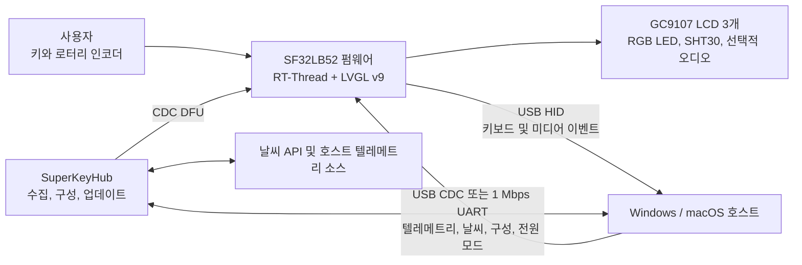

# SuperKey 다기능 매크로 키보드 { #superkey-multifunction-macro-keyboard }

## SuperKey란 무엇인가? { #what-is-superkey }

[SiFliSparks/SuperKey](https://github.com/SiFliSparks/SuperKey)는 디스플레이가 있는 다기능 매크로 키보드를 위한 SF32LB52 기반 레퍼런스입니다. 오픈소스 펌웨어는 RT-Thread와 LVGL v9에서 동작하며, 128 × 128 GC9107 LCD 3개, RGB LED 3개, 물리 키 4개, 로터리 인코더, SHT30 온습도 센서를 구동하고, 컴퓨터에는 복합 USB HID/CDC 디바이스로 연결됩니다.

SuperKey는 단순한 단축키 패드 이상입니다. 다음과 같은 제품 경로를 하나의 동작하는 레퍼런스에 결합합니다.

- USB HID 키보드 및 미디어 제어 출력
- USB CDC 또는 1 Mbps UART를 통한 컴퓨터 성능, 날씨, 구성, 전원 상태 데이터
- 성능 모니터링, 날씨, 시계, 유틸리티, 음악, 사용자 정의 키 매핑을 위한 3개 디스플레이 페이지
- 호스트 데이터를 수집하고, 기능을 구성하고, 펌웨어 업데이트를 실행하는 컴패니언 애플리케이션 [SuperKeyHub](https://github.com/SiFliSparks/SuperKeyHub)
- 공개된 [sf32-keyboard 설계](https://oshwhub.com/sifli/sf32-keyboard)를 통한 재현 가능한 하드웨어


<div align="center"><em>SuperKey 3개 디스플레이 사용자 인터페이스</em></div>

## 왜 SF32 구현인가? { #why-the-sf32-implementation }

SuperKey에는 그래픽, 여러 디스플레이, 복합 USB 디바이스, 키와 인코더, 센서, RGB 효과, 파일 시스템, 선택적 오디오가 필요합니다. SF32LB52는 이러한 실시간 작업을 MCU에서 처리하므로, 컴패니언 애플리케이션이 실행 중이 아니어도 디바이스가 UI를 부팅하고 기본 HID 동작을 제공할 수 있습니다. 컴퓨터 텔레메트리와 인터넷 데이터처럼 데스크톱 운영체제가 맡는 편이 나은 작업은 호스트 애플리케이션이 담당합니다.

이러한 역할 분담은 데스크톱 컨트롤러, 워크플로 키보드, 상태 패널, 소형 HMI에 적합하지만 명시적인 의존성이 생깁니다. 고급 데이터 표시에는 컴패니언 애플리케이션, 드라이버, 외부 API가 필요합니다. 펌웨어와 호스트의 버전은 서로 호환되어야 합니다. USB 끊김, 호스트 슬립, 손상된 구성은 각각 독립된 복구 테스트가 필요합니다.

## 목표, 범위, 시작 조건 { #outcome-scope-and-entry-criteria }

**목표:** 버전이 고정된 SuperKey를 재현하고, HID, CDC, 3개 디스플레이 UI, 입력, 센싱, 슬립 복구를 검증한 다음, 한 종류의 동작만 변경하면서 제품 검토에 적합한 빌드, 통신, 회귀 증거를 보관합니다.

이 페이지는 공개된 PCB가 양산 준비가 되어 있다거나, 모든 PC 텔레메트리 소스, 날씨 서비스, 시리얼 브리지, USB 호스트, 운영체제 버전과 호환된다는 것을 입증하지 않습니다. 주식, 날씨, 성능 데이터는 SuperKeyHub 버전, 서드파티 API, 시스템 권한, 호스트 하드웨어에 따라 달라질 수 있습니다.

시작하기 전에 다음을 준비하십시오.

- 공개된 설계로 조립한 SuperKey 하드웨어. GC9107 LCD 3개, 키, 인코더, USB 데이터 연결이 포함됩니다.
- 문서화된 주 경로를 위한 Windows 10/11 컴퓨터. SuperKeyHub 저장소에는 Windows와 macOS 지원이 나열되어 있지만, 선택한 호스트 OS에서 보드 플래싱, CDC, 복구를 검증하십시오.
- 펌웨어에 맞는 SuperKeyHub 버전.
- SiFli-SDK 환경, 재귀적으로 체크아웃한 SDK 서브모듈, 동작하는 플래싱/복구 연결.
- 날씨를 범위에 포함하는 경우, 유효한 QWeather API Key, API Host, 도시 설정.
- USB 열거, 시리얼 로그, 키 동작, 디스플레이 상태, 슬립 복구에 대한 테스트 기록.

<div align="center"><em>표: SuperKey 프로젝트 계약</em></div>

<div align="center" markdown>

| 영역 | 알려진 기준 구성 | 적용 전에 필요한 증거 |
|:-----|:---------------|:------------------------------------|
| 하드웨어 | 공개된 `sf32-keyboard` 하드웨어와 `sf32lb52-superkey` 보드 타깃 | PCB/어셈블리 리비전, LCD 및 입력 장치, 전원, USB 연결 기록 |
| 펌웨어 | SuperKey 저장소, SiFli-SDK 서브모듈, RT-Thread, LVGL v9, CherryUSB | 펌웨어 커밋, SDK 커밋, 빌드 로그, 이미지, 플래싱 로그 |
| 컴패니언 | 호환되는 펌웨어 프로토콜을 갖춘 SuperKeyHub | 애플리케이션 버전, OS, 포트, API 구성, 연결 로그 |
| 핵심 동작 | HID, CDC, 디스플레이 3개, 인코더, 키, 센서, 전원 모드 | 콜드 스타트, 데이터 갱신, 입력, 연결 끊김, 슬립 복구 기록 |
| 적용 | 한 번에 UI, 키, LED, 데이터 필드 중 하나만 변경 | 검토를 거친 변경, 롤백 이미지, 전체 회귀 결과 |

</div>

## 하드웨어 및 소프트웨어 사양 { #hardware-and-software-specifications }

### 하드웨어 사양 { #hardware-specification }

<div align="center"><em>표: SuperKey 하드웨어 사양</em></div>

<div align="center" markdown>

| 구성 요소 | 필수 사양 | 역할 | 상태 | 구하는 곳 | 호환성 및 대체 참고 사항 |
|:----------|:-----------------------|:-----|:-------|:----------------|:-------------------------------------|
| SuperKey 오픈 하드웨어 어셈블리 | 프로젝트에 기술된 대로 128 × 128 GC9107 LCD 3개, RGB LED 3개, 키 4개, 로터리 인코더, SHT30, USB 연결을 갖춘 SF32LB52 타깃 | 매크로 키보드 컨트롤러, 디스플레이, 입력, 센싱, USB HID/CDC | 필수 | [공개된 `sf32-keyboard` 설계](https://oshwhub.com/sifli/sf32-keyboard); [SuperKey 저장소](https://github.com/SiFliSparks/SuperKey) | 설계 파일은 구매 가능한 조립 완료 보드의 사양이 아닙니다. 핀과 어셈블리 리비전을 기록해야 합니다 |
| 호스트 컴퓨터와 USB 데이터 연결 | Windows 10/11이 문서화된 주 경로; 데이터 전송이 가능한 USB 연결 | SuperKeyHub 실행, HID/CDC 호스트 제공, 플래싱/복구 지원 | 필수 | [SuperKey 문서](https://sparks.sifli.com/projects/superkey/) | SuperKeyHub에는 Windows/macOS 지원이 나열되어 있습니다. 선택한 호스트 OS에서 CDC, DFU, 플래싱, 복구를 검증하십시오 |
| QWeather 계정/API 구성 | API Key, API Host, 도시 설정 | 선택적 날씨 표시 기능 | 선택 | [QWeather](https://www.qweather.com/) | 자격 증명을 소스 관리에 포함하지 마십시오. 서비스 약관과 가용성을 검증하십시오 |

</div>

### 소프트웨어 사양 { #software-specification }

<div align="center"><em>표: SuperKey 소프트웨어 사양</em></div>

<div align="center" markdown>

| 패키지 또는 서비스 | 필수 버전 또는 리비전 | 역할 | 상태 | 구하는 곳 | 호환성 및 업데이트 참고 사항 |
|:-------------------|:-----------------------------|:-----|:-------|:----------------|:-------------------------------|
| SuperKey 펌웨어 | 릴리스 v1.4.2; 사용한 정확한 저장소 커밋을 기록 | SF32 펌웨어, LVGL UI, USB, 센서, 업데이트 동작 | 필수 | [v1.4.2 릴리스](https://github.com/SiFliSparks/SuperKey/releases/tag/v1.4.2) | 펌웨어 커밋을 고정하십시오. 버전 번호만으로 호스트 호환성을 추정하면 안 됩니다 |
| SuperKeyHub | 펌웨어 v1.4.2와 대조하여 검증한 특정 릴리스 또는 커밋 | 호스트 텔레메트리, 구성, 펌웨어 업데이트 UI | 호스트 기능에 필수 | [저장소](https://github.com/SiFliSparks/SuperKeyHub) | 인용한 업스트림 릴리스 자료에는 고정된 펌웨어/앱 조합이 명시되어 있지 않습니다. 텔레메트리, 구성, DFU를 테스트한 다음 그 조합을 기록하십시오 |
| SiFli-SDK 서브모듈, RT-Thread, LVGL, CherryUSB | 선택한 펌웨어 체크아웃에 기록된 리비전 | 펌웨어 빌드와 USB 스택 | 소스 빌드에 필수 | [SuperKey 저장소](https://github.com/SiFliSparks/SuperKey) | 재귀적으로 클론하고 서브모듈 리비전을 보관하십시오. 의존성을 따로 업데이트하지 마십시오 |

</div>

## 지원되는 기준 구성 선택 { #choose-a-supported-baseline }

업스트림 릴리스 페이지에는 펌웨어 [v1.4.2](https://github.com/SiFliSparks/SuperKey/releases/tag/v1.4.2)가 나열되어 있어 고정된 출발점을 제공합니다. 인용한 자료에는 호환되는 특정 SuperKeyHub 릴리스가 명시되어 있지 않습니다. Hub 릴리스나 커밋을 선택하여 고정하고, v1.4.2와 함께 텔레메트리, 구성, DFU를 테스트한 다음, 버전 번호로 호환성을 가정하지 말고 테스트한 조합을 기록하십시오.

<div align="center"><em>표: SuperKey 기준 구성 선택</em></div>

<div align="center" markdown>

| 기준 구성 요소 | 권장 시작점 | 핵심 제약 |
|:-----------------|:------------------|:--------------------|
| 펌웨어 | SuperKey v1.4.2 또는 팀이 검증한 커밋 | 펌웨어와 호스트의 프로토콜 버전이 일치해야 합니다 |
| 컴패니언 | 펌웨어 v1.4.2로 검증한 SuperKeyHub 릴리스 또는 커밋 | 인용한 릴리스 자료에는 고정된 조합이 명시되어 있지 않습니다. 선택한 호스트 OS에서 CDC 데이터, 구성, DFU를 검증하십시오 |
| 빌드 타깃 | `sf32lb52-superkey`, 보드 파일은 `app/boards` 아래 | 범용 SF32LB52 개발 보드 타깃이 아닙니다 |
| 통신 | 복합 USB HID + CDC를 먼저 검증하고, 1 Mbps UART를 사용한다면 별도로 검증 | "USB가 열거되었다"는 것이 HID와 CDC 인터페이스가 모두 동작한다는 증거는 아닙니다 |
| 업데이트 | 컴패니언이 실행하는 CDC DFU와 보관해 둔 유선 플래싱/복구 경로 | 중단, 불일치, 복구가 입증되기 전에는 현장 업데이트 솔루션이 아닙니다 |

</div>

업스트림 CI는 다음 타깃을 사용합니다. 로컬에서 실행하기 전에 SiFli-SDK 환경을 설치하고 익스포트하십시오.

```bash
git clone --recursive https://github.com/SiFliSparks/SuperKey.git
cd SuperKey/SiFli-SDK
./install.sh
. ./export.sh
cd ../app/project
scons --board=sf32lb52-superkey --board_search_path="../boards" -j8
```

Windows에서는 이에 해당하는 SiFli-SDK PowerShell 설치 및 환경 스크립트를 사용하십시오. 병렬 처리 수는 바뀔 수 있지만, 보드 이름, 보드 검색 경로, 서브모듈 리비전은 빌드 기록에 포함해야 합니다.

## 프로젝트 개발 단계와 의사결정 지점 { #delivery-map }

<div align="center"><em>표: SuperKey 프로젝트 개발 단계와 의사결정 지점</em></div>

<div align="center" markdown>

| 단계 | 이 단계가 뒷받침하는 의사결정 | 필수 산출물 |
|:------|:---------------------|:----------------|
| 1. 수정하지 않은 기준 구성 | 공개된 하드웨어, 펌웨어, 컴패니언이 기록된 대로 함께 동작하는가? | 버전이 고정된 정상 동작 세션 |
| 2. 통신 및 복구 | USB, 시리얼, 슬립, 연결 끊김, 구성 장애를 진단하고 복구할 수 있는가? | 장애 주입 및 복구 기록 |
| 3. 소스 재현 | 팀이 클린 체크아웃에서 동일한 이미지를 다시 빌드할 수 있는가? | 환경, 이미지, 플래싱, 반복 결과 |
| 4. 범위를 제한한 적용 | 기준 구성을 깨뜨리지 않고 제품 동작 하나를 바꿀 수 있는가? | 한정된 변경, 롤백 경로, 회귀 증거 |
| 5. 제품 검토 | 이 레퍼런스가 커스텀 PCB, 인클로저 또는 파일럿 빌드에 충분히 탄탄한가? | 담당자가 지정된 리스크와 진행/보류/중단 결정 |

</div>

## 시스템 아키텍처와 의존성 { #system-architecture-and-dependencies }

<div align="center"><em>그림: SuperKey 제품 데이터 및 제어 경로</em></div>



장애를 다섯 가지 영역으로 나누어 다루십시오. 디바이스 하드웨어/디스플레이, HID 입력, CDC/UART 데이터 채널, 컴패니언/시스템 권한, 외부 데이터 서비스입니다. 날씨 패널이 비어 있다고 해서 자동으로 펌웨어 결함인 것은 아닙니다. API 키, API Host, 도시 설정, 데이터 푸시가 원인일 수 있습니다.

## 1단계 — 수정하지 않은 레퍼런스 기준 구성 확립 { #stage-1-establish-the-untouched-reference-baseline }

**목표:** 코드를 변경하기 전에 전체 레퍼런스 경로를 입증합니다.

1. 업스트림 조립 자료에 따라 LCD 케이블 방향, 스위치, 인코더, 인클로저, USB 커넥터를 확인하고, PCB와 펌웨어 리비전을 기록합니다.
2. 맞는 SuperKeyHub를 설치합니다. 디바이스 열거를 확인한 다음 HID와 CDC를 각각 독립적으로 테스트합니다.
3. 날씨 자격 증명, 포트, 1 Mbps 시리얼 동작을 구성합니다. 컴패니언이 없을 때의 동작을 기록한 다음, 컴패니언을 연결하고 데이터 전달을 활성화합니다.
4. 3개 디스플레이 탐색, 키 매핑, 미디어 제어, 인코더, SHT30 데이터, LED 효과, 텔레메트리 갱신 주기 한 번을 검증합니다.
5. 콜드 스타트하고 반복합니다. UI 사진, 컴패니언 로그, 디바이스 로그, 버전 조회 결과를 저장합니다.

**보관할 증거:** 하드웨어 리비전, 펌웨어 태그/커밋, SDK 커밋, 컴패니언 버전, OS, 포트와 API 구성, USB 열거, 로그, 디스플레이, 입력 기록.

**게이트 1 종료 기준:** 두 번의 콜드 스타트에서 HID 입력, CDC 데이터 갱신, 3개 디스플레이 상호작용이 완료됩니다. 각 장애 영역을 로그나 관찰 가능한 상태로 구별할 수 있습니다.

## 2단계 — 장애 및 복구 경계 검증 { #stage-2-validate-fault-and-recovery-boundaries }

**목표:** 흔한 데스크톱 중단 상황이 디바이스를 다시 플래싱해야 하는 데모로 만들지 않음을 입증합니다.

<div align="center"><em>표: SuperKey 장애 및 복구 테스트</em></div>

<div align="center" markdown>

| 테스트 | 방법 | 통과 증거 |
|:-----|:-------|:--------------|
| 컴패니언 없음 | SuperKeyHub를 닫고 디바이스를 재시작합니다 | 로컬 UI와 HID가 계속 동작하며, 컴패니언에 의존하는 값은 오래되었거나 사용할 수 없음을 알아볼 수 있게 표시됨 |
| CDC 끊김 | 데이터 전달 중에 USB를 뽑았다 꽂거나 포트를 변경합니다 | 디바이스가 멈추지 않고, 재연결 후 버전 조회와 데이터 전달이 복구됨 |
| 호스트 슬립 | `power_mode sleep/normal`을 활성화한 다음, 호스트 슬립/웨이크 주기를 한 번 수행합니다 | LCD, LED, 백라이트, 센서가 의도대로 멈췄다가 재개되며, 이후 데이터도 계속 갱신됨 |
| 버전 불일치 | 제어된 환경에서 호환되지 않는 컴패니언/펌웨어 조합을 테스트합니다 | 호환되지 않는 업데이트를 적용하는 대신, 해당 조합이 동작을 거부하거나 진단 가능한 오류를 표시함 |
| API 실패 | 잘못된 날씨 구성을 사용하거나 네트워크를 끊습니다 | 날씨 실패가 HID, CDC, 로컬 UI, 복구를 깨뜨리지 않음 |
| 중단된 DFU | 복구 가능한 테스트 유닛에서 업데이트를 중단시킵니다 | 보관해 둔 유선 플래싱 경로가 알려진 이미지를 복원함 |

</div>

**게이트 2 종료 기준:** 해당하는 모든 장애에 대해 반복 가능한 감지 및 복구 결과가 있으며, 문서화되지 않은 수동 상태 복구가 필요하지 않습니다.

## 3단계 — 재현 가능한 소스 기준 구성 빌드 { #stage-3-build-a-reproducible-source-baseline }

**목표:** 두 번째 엔지니어가 클린 체크아웃에서 빌드, 기록하고 2단계를 반복할 수 있게 합니다.

1. 재귀적으로 클론하고 SuperKey와 SiFli-SDK 커밋을 모두 기록합니다.
2. `sf32lb52-superkey`와 `../boards` 검색 경로로 클린 빌드합니다.
3. 빌드 로그, 메모리/파티션 출력, 플래싱 스크립트, 생성된 이미지, 시리얼 로그를 저장합니다.
4. 두 번째 컴퓨터에서 빌드하거나 빌드 디렉터리를 삭제한 뒤 다시 빌드하고, 같은 하드웨어에 기록한 다음, 핵심 회귀 테스트를 반복합니다.

**게이트 3 종료 기준:** 추적되지 않는 파일, 오래된 산출물, 수동 바이너리 교체 없이 2단계를 통과하는 이미지를 생성할 수 있습니다.

## 4단계 — 한 번에 제품 변수 하나씩 적용 { #stage-4-adapt-one-product-variable-at-a-time }

**목표:** 통과한 레퍼런스를 보호하면서 변경 경계를 검증합니다.

<div align="center"><em>표: 범위를 제한한 SuperKey 적용 순서</em></div>

<div align="center" markdown>

| 변경 유형 | 처음 변경하기 좋은 항목 | 필수 회귀 테스트 |
|:-------------|:------------------|:--------------------|
| 브랜드 요소 및 UI | 아이콘, 폰트, 페이지 레이아웃 또는 회전 설정 하나 | 3개 디스플레이 갱신, 회전, 폰트, 콜드 스타트, 메모리 사용량 |
| 키 워크플로 | HID 매핑 또는 키 조합 하나 | 누름/뗌, 여러 키, 예기치 않은 연결 끊김, 저장된 구성 |
| 데이터 필드 | 텔레메트리 또는 센서 값 하나 | 프로토콜 호환성, 범위 검사, 갱신 타임아웃, 이전 컴패니언의 동작 |
| LED 효과 | 색상 또는 애니메이션 하나 | 밝기 경계, 슬립, 키 피드백, 장시간 동작 |
| 업데이트 | 버전 정책 또는 업데이트 UI | 이미지 출처, 버전 검증, 중단, 롤백, 유선 복구 |

</div>

**게이트 4 종료 기준:** 변경이 검토되었고, 원래 이미지를 복구할 수 있으며, HID, CDC, 디스플레이, 입력, 슬립, 복구 테스트가 통과합니다.

## 5단계 — 제품 준비 상태 검토 { #stage-5-product-readiness-review }

커스텀 하드웨어나 파일럿 빌드로 넘어가기 전에 팀은 다음 질문에 답해야 합니다.

- 제품이 계속 SuperKeyHub, 관리자 권한, 서드파티 날씨 서비스에 의존하는가? 그렇다면 이러한 의존성은 누가 책임지는가?
- 펌웨어, 컴패니언, 프로토콜 버전은 어떻게 관리하며, 잘못된 조합은 어떻게 차단하는가?
- 대상 PC, USB 허브, 케이블, 슬립 정책, 보안 소프트웨어의 어떤 조합을 테스트했는가?
- 디스플레이 3개, USB 데이터, LED, 센싱, 선택적 오디오를 함께 실행할 때 메모리 사용량, 온도, 전류는 얼마인가?
- 구성, 키 매핑, 업데이트 상태는 전원 손실이나 손상된 스토리지에서 어떻게 복구되는가?
- 공개된 PCB, 인클로저, 폰트, 아이콘, 음악, 서드파티 API는 의도한 배포에 대해 라이선스가 허용되는가?

**게이트 5 종료 기준:** 남아 있는 모든 리스크에 담당자, 증거, 처리 방안이 있으며, 팀이 진행, 보류 또는 중단 결정을 내렸습니다.

## 제품 설계로의 인계 { #handoff-to-product-design }

SF32 및 메모리 선택, USB HID/CDC 디스크립터, 디스플레이 3개와 백라이트 연결, 입력/센서 인터페이스, 전원 및 슬립 정책, 파일 시스템과 업데이트 파티션, 컴패니언 프로토콜, 양산 테스트 포인트, 검증된 복구 경로를 이어서 가져가십시오. 이어서 [SF32LB52x](../sf32-products/chips/SF32LB52x.md), [SF32LB52x 하드웨어 설계 가이드](../hardware/chip-guides/SF32LB52x_hardware_design_guide.md), [빌드, 플래시, 모니터](../develop/platforms/sifli-sdk/build-flash-monitor.md), [양산 설계](../hardware/design-for-production.md)를 참조하십시오.

## 주요 정보 출처 { #authoritative-sources }

- [SiFliSparks/SuperKey 펌웨어 저장소](https://github.com/SiFliSparks/SuperKey)
- [SuperKey v1.4.2 릴리스](https://github.com/SiFliSparks/SuperKey/releases/tag/v1.4.2)
- [SiFliSparks/SuperKeyHub 컴패니언 저장소](https://github.com/SiFliSparks/SuperKeyHub)
- [SuperKey 프로젝트 문서](https://sparks.sifli.com/projects/superkey/)
- [공개된 sf32-keyboard 하드웨어](https://oshwhub.com/sifli/sf32-keyboard)
- [OpenSiFli/SiFli-SDK](https://github.com/OpenSiFli/SiFli-SDK)
