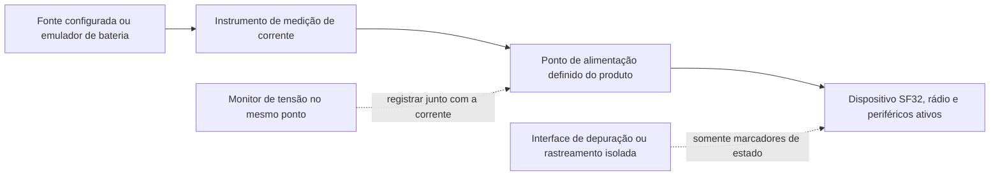
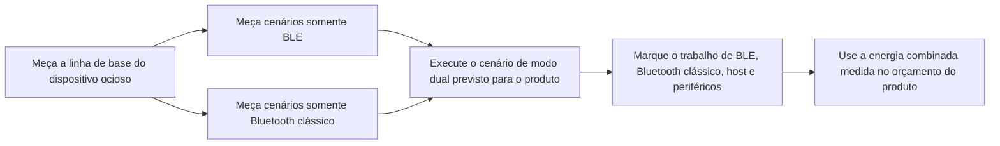

# Medição e análise do consumo de energia em Bluetooth { #bluetooth-low-power-profiling }

Este artigo explica como medir o **consumo real do dispositivo durante a operação Bluetooth**: Bluetooth Low Energy (BLE), Bluetooth clássico (BR/EDR) e o uso combinado dos dois em um produto de modo dual. Para cada cenário, defina com clareza o limite elétrico da medição, registre a corrente e a tensão e colete dados de firmware suficientes para explicar os trechos importantes da curva.

Use as seções sobre Bluetooth clássico e modo dual somente para dispositivos e configurações de firmware que ofereçam suporte a BR/EDR. Um produto somente BLE deve seguir o mesmo método, mas limitar o plano de cenários ao BLE.

O [Online Power Profiler for Bluetooth LE](https://devzone.nordicsemi.com/power/w/opp/2/online-power-profiler-for-bluetooth-le), da Nordic, é uma referência conceitual útil para BLE. A Nordic o descreve como um modelo baseado em medições que estima valores esperados, não como uma medição de um dispositivo específico. Os dados de precisão publicados se aplicam apenas a componentes de referência da Nordic e não devem ser extrapolados para SF32. A ferramenta não modela Bluetooth clássico nem produtos de modo dual. Use modelos para decidir o que testar; confirme o resultado do produto medindo o dispositivo-alvo.

## Defina o que será medido { #define-what-you-are-measuring }

“Consumo de energia do Bluetooth” pode significar coisas bem diferentes. Uma medição apenas do rádio pode ajudar a otimizar um parâmetro de conexão, mas não mostra o consumo do produto final com o controlador, a CPU da aplicação, os sensores, o display, a memória e a fonte de alimentação em funcionamento.

<div align="center"><em>Tabela: Escopos de medição do consumo Bluetooth</em></div>

<div align="center" markdown>

| Ponto de medição | O que inclui | Quando usar | Limitação |
|:-----------------|:-------------|:-----------|:----------|
| Subsistema Bluetooth ou linha de alimentação selecionada | Rádio/controlador e o caminho de alimentação selecionado | Isolar uma regressão do rádio ou do controlador | Não equivale ao consumo da bateria do produto inteiro |
| Entrada de alimentação do MCU | MCU, controlador e periféricos internos alimentados por essa linha | Comparar estados do firmware em uma placa controlada | Não inclui componentes externos em outras linhas de alimentação nem perdas do regulador |
| Bateria ou entrada principal do produto | Reguladores, MCU, memória externa, sensores, display e outras cargas alimentadas | Modelar a duração da bateria e aprovar o produto | Exige controlar cuidadosamente todo o hardware e as fontes conectadas |

</div>

Para fundamentar uma estimativa de autonomia do produto, meça, sempre que possível, na bateria ou na entrada principal do produto. Registre a tensão junto com a corrente para calcular potência e energia, em vez de obter um valor de corrente sem as condições da alimentação.

## Prepare um teste reproduzível { #set-up-a-repeatable-test }

O instrumento e o dispositivo precisam compartilhar um limite de medição claramente documentado. O Power Profiler Kit II (PPK II), da Nordic, é uma ferramenta de fonte e medição de classe de referência, desde que as faixas de tensão e corrente sejam adequadas à configuração. Também é possível usar uma unidade de fonte e medição (SMU) ou um analisador de corrente equivalente. A disciplina de medição importa mais que a marca do instrumento.

No [modo Source Meter](https://docs.nordicsemi.com/r/bundle/ug_ppk2/page/ug/ppk/measure_current_source_meter.html), o PPK II alimenta o dispositivo; no [modo Ampere Meter](https://docs.nordicsemi.com/r/bundle/ug_ppk2/page/ug/ppk/measure_current_ampere_meter.html), uma fonte externa fornece energia através do instrumento. Escolha o modo conforme o caminho de alimentação previsto. A tensão configurada não é uma forma de onda registrada no dispositivo: monitore também a tensão no ponto de medição, principalmente se quedas de tensão ou variações da bateria afetarem a energia.

Confira os limites de operação do PPK II antes de conectar o DUT. No modo Source Meter, a saída pode ser ajustada de 0,8 a 5,0 V e a corrente máxima do DUT é de 600 mA. O modo Ampere Meter requer uma fonte externa de 0,8 a 5,0 V e permite medição contínua de até 1 A. Se o DUT puder consumir mais de 400 mA no modo Source Meter, a Nordic recomenda uma fonte USB adicional, com corrente nominal de pelo menos 1 A, para alimentar o PPK II. Esses são limites do instrumento, não valores de operação recomendados para o dispositivo. Consulte as especificações da Nordic sobre [corrente máxima do DUT](https://docs.nordicsemi.com/r/bundle/ug_ppk2/page/ug/ppk/ppk_max_dut_current.html) e [alimentação](https://docs.nordicsemi.com/r/bundle/ug_ppk2/page/ug/ppk/ppk_power_supply.html).

<div align="center"><em>Figura: configuração para medir o consumo de energia Bluetooth no dispositivo</em></div>



Antes de cada execução:

1. Desconecte a alimentação USB, o depurador e quaisquer outras fontes que possam contornar o instrumento ou acrescentar carga. Mantenha somente as interfaces necessárias para o cenário.
2. Aplique a tensão de alimentação documentada no ponto selecionado. Registre todas as linhas de alimentação ativas, jumpers, módulos e dispositivos externos.
3. Use a versão do firmware do produto e a configuração de gerenciamento de energia (PM) prevista. Desative logs de diagnóstico de alto volume para obter os valores finais, exceto quando fizerem parte da configuração de produção.
4. Em cada comparação, use o mesmo telefone, acessório, aplicativo de teste, distância, orientação da antena e ambiente de RF.
5. Capture uma janela longa o suficiente para incluir muitos eventos Bluetooth repetidos, não apenas um pulso conveniente.

## Entenda as etapas de consumo de um evento de anúncio BLE { #read-a-ble-advertising-event-as-a-set-of-power-components }

Um evento típico de anúncio BLE não é um único pulso de rádio. Ele começa com uma breve fase de ativação e preparação, seguida pela partida e estabilização do oscilador de cristal de alta frequência. Quando a alimentação e os clocks estão prontos, o dispositivo permanece em standby até o instante programado para iniciar o rádio. No exemplo escaneável ou conectável mostrado aqui, o rádio é iniciado, transmite em um dos canais primários de anúncio e abre uma janela de recepção nesse mesmo canal. Após as duas primeiras janelas de recepção, o dispositivo volta ao standby antes de transmitir no canal seguinte; depois da última janela, executa o pós-processamento. Um evento não conectável e não escaneável não escuta solicitações. As etapas reais dependem do tipo de anúncio configurado e do mapa de canais utilizado.

A sequência completa representada é: pré-processamento → partida do cristal → em espera → inicialização do rádio → transmissão de rádio (TX) → comutação TX/RX → recepção de rádio (RX) → em espera → transmissão de rádio (TX) → comutação TX/RX → recepção de rádio (RX) → em espera → transmissão de rádio (TX) → comutação TX/RX → recepção de rádio (RX) → pós-processamento. O rádio é iniciado apenas uma vez; as transmissões nos canais 38 e 39 começam após o período de espera que sucede a janela RX do canal anterior. A sequência toma como referência as etapas da [ilustração da Nordic de um evento típico de anúncio BLE](https://devzone.nordicsemi.com/power/w/opp/2/online-power-profiler-for-bluetooth-le). São fases genéricas de um evento BLE, não estados de rádio específicos da Nordic, e este redesenho não acrescenta outras etapas. Os níveis de corrente e as proporções de tempo são ilustrativos, não medições do SF32. Meça-os no dispositivo-alvo.

<div align="center"><em>Figura: etapas de um evento de anúncio BLE</em></div>


A ilustração representa um evento legado de anúncio, escaneável ou conectável, nos três canais primários 37, 38 e 39; ela não mostra a interação após uma solicitação recebida. Os rótulos dos canais são ilustrativos: a especificação Bluetooth Core permite usar os índices de canal primário habilitados em qualquer ordem, enquanto o mapa configurado determina quais índices serão usados. Um evento normalmente transmite uma PDU de anúncio em cada índice utilizado, com no máximo uma PDU por índice. As três transmissões são cópias dos dados de anúncio em canais diferentes, não novas tentativas condicionadas a uma confirmação. Em eventos escaneáveis ou conectáveis, a camada de enlace escuta solicitações permitidas no mesmo canal primário; eventos não escaneáveis e não conectáveis não escutam solicitações. Consulte a [especificação da camada de enlace do Bluetooth Core 6.2](https://www.bluetooth.com/wp-content/uploads/Files/Specification/HTML/Core-62/out/en/low-energy-controller/link-layer-specification.html) e a [introdução da Bluetooth SIG](https://www.bluetooth.com/bluetooth-le-primer/). Anúncios estendidos, outro mapa de canais ou o recebimento de uma solicitação podem gerar um traçado diferente; verifique o comportamento configurado no dispositivo-alvo.

<div align="center"><em>Tabela: etapas no traçado de consumo de um evento de anúncio BLE</em></div>

<div align="center" markdown>

| Etapa | Principais atividades que podem consumir energia | O que medir e verificar |
|:------|:--------------------------------------------------|:------------------------|
| Pré-processamento | Fase breve de ativação, que pode envolver corrente relativamente alta, além da preparação da CPU/controlador, tratamento da carga útil, DMA, acesso à memória e configuração de periféricos | `I_pre` e `t_pre`; identifique as tarefas necessárias para despertar e alimentar o dispositivo e elimine ou agrupe as tarefas evitáveis |
| Partida do cristal | Inicialização e estabilização do clock de alta frequência | `I_xtal` e `t_xtal`; confirme que a política de clock e a sequência de ativação não duram mais que o necessário |
| Standby | Estado de baixo consumo selecionado após a estabilização da alimentação e dos clocks, além da lógica de retenção, temporização de baixa frequência e fontes de despertar ativas | Meça `I_standby`, a espera inicial antes da partida do rádio e os períodos de standby entre canais após RX; não confunda essa corrente interna com a corrente de repouso entre eventos completos |
| Inicialização do rádio | Preparação do rádio/controlador e do caminho de alimentação de RF necessário antes da primeira transmissão | `I_start` e `t_start`; identifique preparações desnecessárias ou trabalho de inicialização repetido |
| Transmissão de rádio (TX) | Caminho de transmissão, trabalho do controlador e envio dos pacotes de anúncio nos canais 37, 38 e 39 | Meça `I_tx` e `t_tx` de cada pacote; a potência de TX, o tamanho do pacote e os canais habilitados determinam a energia dos pacotes e do evento |
| Comutação do rádio | Transição do rádio de transmissão para recepção e mudança de estado do controlador | `I_switch` e `t_switch`; contabilize todas as transições, sem tratá-las como tempo sem consumo |
| Recepção de rádio (RX), se habilitada | Caminho de recepção e trabalho do controlador enquanto aguarda uma solicitação de varredura ou conexão | `I_rx` e `t_rx`; inclua essa etapa somente se o tipo e a configuração do anúncio abrirem janelas de recepção |
| Pós-processamento | Callbacks do protocolo, trabalho da CPU, acesso à memória/periféricos e qualquer resposta da aplicação antes de dormir | `I_post` e `t_post`; confirme que clocks, restrições de PM e componentes externos são liberados prontamente |

</div>

No SF32, use os nomes dessas etapas como referência para marcar o traçado; não os trate como estados de rádio específicos da Nordic nem como valores presumidos de corrente ou duração. A atividade de recepção depende do comportamento de anúncio configurado e deve ser confirmada no traçado do dispositivo-alvo.

Para um evento completo, a energia corresponde à área sob o traçado, ponderada pela tensão:

```text
E_event = sum(V_stage x I_stage x t_stage)
```

Com tensão de alimentação constante, é possível estimar uma configuração periódica de anúncio por:

```text
Q_event = sum(I_stage x t_stage)
I_average = (Q_event + I_idle x (T_cycle - t_event)) / T_cycle
```

`Q_event` inclui a carga de todas as etapas do evento completo, inclusive os períodos internos de standby; `t_event` é a duração total do evento. `I_idle` é a corrente medida entre eventos completos, não a `I_standby` interna do evento. `T_cycle` é o intervalo medido entre o início de um evento e o seguinte, incluindo o atraso de advertising e os efeitos do escalonamento. Se os intervalos variarem, integre um traçado longo e representativo em vez de tratar o intervalo configurado como um período exato.

Com tensão constante, dobrar a corrente medida ou a duração de uma etapa dobra sua energia. Pulsos curtos de TX, RX e inicialização podem dominar a energia do evento; com intervalos longos, o repouso entre eventos pode dominar a corrente média. Marque as etapas com GPIOs ou eventos de firmware de baixo impacto e meça na entrada de alimentação do produto completo antes de escolher o que otimizar.

O Bluetooth clássico tem uma temporização de protocolo diferente, mas aplica-se a mesma disciplina de medição. A especificação Bluetooth Core define Inquiry Scan e Page Scan como procedimentos de varredura distintos e Sniff como um modo ACL conectado que reduz as oportunidades de escuta do periférico aos pontos de ancoragem Sniff programados; o tráfego do dispositivo remoto pode prolongar a atividade além de um ponto de ancoragem. Esses são comportamentos de temporização, não estimativas de corrente. Meça no dispositivo-alvo a política de varredura configurada, os parâmetros Sniff e a atividade real do dispositivo remoto e da aplicação. Consulte a [especificação BR/EDR Baseband](https://www.bluetooth.com/wp-content/uploads/Files/Specification/HTML/Core-62/out/en/br-edr-controller/baseband-specification.html) e o [HCI Scan Enable](https://www.bluetooth.com/wp-content/uploads/Files/Specification/HTML/Core-62/out/en/host-controller-interface/host-controller-interface-functional-specification.html).

## Planeje as medições por modo Bluetooth { #build-a-mode-specific-measurement-plan }

Não trate “Bluetooth habilitado” como um único estado operacional. BLE e Bluetooth clássico usam procedimentos diferentes de conexão e baixo consumo; em um produto de modo dual, os dois podem compartilhar o subsistema de rádio, recursos do controlador, clocks, memória e, muitas vezes, tarefas da aplicação. Comece pelos menores cenários reproduzíveis e depois meça o comportamento combinado exato do produto.

<div align="center"><em>Tabela: cobertura de cenários Bluetooth</em></div>

<div align="center" markdown>

| Capacidade de rádio | Cenário | O que definir antes da medição | Resultado a registrar |
|:--------------------|:--------|:-------------------------------|:----------------------|
| BLE | Anúncio, conexão ociosa, transferência da aplicação e reconexão | Papel, intervalo, potência de TX, carga útil, dispositivo remoto e condições de início/fim | Corrente média, energia por evento e energia por ação concluída |
| Bluetooth clássico (BR/EDR) | Varredura | Se inquiry scan, page scan ou ambos estão habilitados; política de detectabilidade/conectabilidade | Corrente média e energia em uma janela de varredura representativa |
| Bluetooth clássico (BR/EDR) | Modo Sniff conectado | Parâmetros Sniff, dispositivo remoto, estado do enlace e atividade da aplicação em segundo plano | Corrente média e energia em vários intervalos Sniff |
| Bluetooth clássico (BR/EDR) | Carga ativa de perfil | Perfil e papel, por exemplo, transferência SPP/PAN ou áudio A2DP/HFP; carga útil ou duração da sessão de áudio | Energia por transferência ou sessão concluída, mais potência média sustentada |
| Modo dual | BLE e Bluetooth clássico no mesmo cenário do produto | Enlaces e modos envolvidos, seus parâmetros, carga em primeiro plano e comportamento de transição/reconexão | Potência média combinada medida e energia por cenário completo do produto |

</div>

O exemplo de [teste de consumo BLE/BT](https://docs.sifli.com/projects/sdk/latest/en/sf32lb52x/example/pm/bt/README.html) da SiFli é uma boa referência inicial porque abrange anúncio e conexão BLE, além dos modos Scan e Sniff do Bluetooth clássico. O resultado de uma placa não é uma especificação do produto. Use como base reproduzível a placa compatível, o pino de despertar, o console e a configuração de PM documentados; em seguida, reproduza no hardware-alvo o papel, o dispositivo remoto, o tráfego e a política de energia previstos para o produto.

## Meça o BLE como modo de rádio independente { #profile-ble-as-a-standalone-radio-mode }

Comece medindo apenas o BLE. Assim, você estabelece uma referência sem que o tráfego de perfis do Bluetooth clássico ou o escalonamento entre modos interfiram na leitura da forma de onda.

<div align="center"><em>Tabela: cenários de BLE independente</em></div>

<div align="center" markdown>

| Cenário | Configuração | O que calcular | Causa comum de resultado enganoso |
|:---------|:-------------|:--------------|:---------------------------------|
| Anúncio | Dispositivo não conectado que transmite anúncios com tipo e configuração de canais documentados | Corrente média e energia por intervalo de anúncio | Comportamento de varredura do telefone, tráfego de depuração ou anúncio que nunca reduz a atividade |
| Conectado ocioso | Dispositivo conectado, sem transferência da aplicação; registre se pareamento, vínculo (bonding) e criptografia estão habilitados | Corrente média em vários intervalos de conexão | A CPU da aplicação desperta a cada evento de conexão; timers ou notificações continuam ativos |
| Interação do usuário | Um comando GATT representativo, envio de dados do sensor ou ação iniciada pela interface | Energia por ação concluída e energia adicional em relação ao estado ocioso | Medir somente o rádio e ignorar o trabalho do host, display ou sensor |
| Transferência em rajada ou OTA | Carga útil definida, com condição de conclusão definida | Energia por byte ou por transferência concluída, além da duração total | Usar a taxa de pico como se representasse a transferência inteira |
| Desconexão e reconexão | O dispositivo BLE remoto sai do alcance, retorna e reconecta | Energia e tempo para recuperar a conexão | Novas tentativas sem limite ou política de anúncio agressiva mantida indefinidamente |

</div>

Registre o papel BLE, o dispositivo remoto, os parâmetros de conexão ou anúncio, a potência TX, a carga útil, o gatilho de início, a condição de término e a frequência de uso real. Sem essas informações, não é possível comparar o traçado com outra revisão do firmware.

## Meça o Bluetooth clássico como modo de rádio independente { #profile-classic-bluetooth-as-a-standalone-radio-mode }

Em um produto de modo dual, meça o Bluetooth clássico separadamente antes de introduzir o BLE. Assim, a referência dos modos Scan e Sniff e o trabalho específico de cada perfil ficam visíveis, sem a sobreposição de eventos BLE.

<div align="center"><em>Tabela: cenários de Bluetooth clássico independente</em></div>

<div align="center" markdown>

| Cenário | Configuração | O que calcular | Causa comum de resultado enganoso |
|:---------|:-------------|:--------------|:---------------------------------|
| Scan | Política de inquiry scan, page scan ou ambas, prevista para o produto, está ativa | Corrente média e energia em uma janela de varredura representativa | Manter uma política de varredura mais agressiva que a usada no produto final |
| Modo Sniff conectado | Um enlace Bluetooth clássico conectado entra na configuração Sniff prevista | Corrente média em vários intervalos Sniff | Medir um enlace que continua ativo sem que isso fique evidente por causa do tráfego do dispositivo remoto ou da aplicação |
| Carga ativa de perfil | Transferência SPP/PAN, fluxo A2DP, chamada HFP ou outra carga de perfil definida para o produto | Energia por transferência ou sessão concluída, além da potência média sustentada | Medir o rádio sem incluir codec, amplificador, display, memória ou trabalho do host exigido pelo perfil |
| Desconexão e reconexão | O dispositivo Bluetooth clássico remoto sai do alcance, retorna e reconecta | Energia e tempo para recuperar a conexão | Novas tentativas sem limite ou política de descoberta que permanece ativa indefinidamente |

</div>

Registre o papel Bluetooth clássico, o dispositivo remoto, a política Scan ou Sniff, a potência TX, o perfil, a carga útil ou a duração da sessão, o gatilho de início, a condição de término e a frequência de uso real. Para perfis de áudio, o ponto de medição precisa incluir o caminho de áudio usado pelo produto.

## Meça o modo dual como um cenário próprio { #measure-dual-mode-behavior-as-its-own-scenario }

Não estime o consumo de um produto de modo dual simplesmente somando uma medição BLE a uma medição de Bluetooth clássico. Os dois modos podem compartilhar tempo de rádio, processamento do controlador, clocks, memória e despertares da aplicação. Por isso, o resultado combinado pode ser bem diferente da soma aritmética das médias medidas separadamente.

<div align="center"><em>Figura: sequência de análise de Bluetooth em modo dual</em></div>



Só analise um produto de modo dual depois de compreender as referências independentes de BLE e Bluetooth clássico. Por exemplo, em um produto que mantém um enlace BLE disponível enquanto transmite áudio por Bluetooth clássico, meça todos estes itens no mesmo hardware e com a mesma configuração de dispositivos remotos:

1. A política de conexão BLE ociosa, isoladamente.
2. O fluxo de áudio ou perfil de dados Bluetooth clássico, isoladamente.
3. O estado estável combinado real, incluindo o tráfego BLE previsto.
4. As transições de entrada e saída desse estado combinado, além da recuperação de erros e do comportamento de reconexão.

Os marcadores do traçado devem identificar eventos BLE, trabalho dos perfis Bluetooth clássicos, callbacks da aplicação, processamento de áudio ou dados e mudanças de estado de PM. Isso separa o escalonamento do rádio do trabalho do sistema que ele aciona e revela interações inesperadas, como um callback BLE impedir que a CPU da aplicação volte a dormir durante uma sessão Bluetooth clássica.

## Relacione o traçado ao comportamento do firmware { #correlate-the-trace-with-firmware-behavior }

Para encontrar o consumo real do dispositivo, é essencial atribuir cada mudança ao trabalho correspondente. Marque ou registre o início e o fim das tarefas do produto para entender o motivo de uma variação na corrente:

- Antes e depois de uma transferência iniciada pela aplicação ou de uma rajada de notificações.
- Quando o display, um sensor, a Flash, o caminho de áudio ou outro componente externo é ligado ou desligado.
- Quando o firmware solicita um estado de PM e quando o dispositivo realmente entra nele.
- Quando começa uma reconexão, nova tentativa ou recuperação de erro.

Use um ponto de rastreamento GPIO, um marcador de evento de baixo impacto ou um roteiro de teste reproduzível. Um log serial pode ajudar durante a inicialização, mas também pode alterar o consumo de corrente. Trate a instrumentação final dos logs como uma variável de teste controlada, não como um canal de observação sem custo.

<div align="center"><em>Tabela: interpretação de um traçado de consumo Bluetooth</em></div>

<div align="center" markdown>

| Observação no traçado | Significado provável | O que verificar no firmware ou hardware |
|:----------------------|:--------------------|:----------------------------------------|
| Pulsos curtos e regulares acima de uma linha de base baixa | Eventos programados de anúncio/conexão BLE ou atividade Scan/Sniff do Bluetooth clássico | Modo, intervalo ou política Scan/Sniff, papel do rádio e estado real de baixo consumo entre eventos |
| Rajada maior logo após cada evento de rádio | Callback do host, processamento de protocolo ou trabalho da aplicação | Qual callback é executado, se os dados são úteis e se as tarefas podem ser agrupadas |
| Atividade contínua ou pulsos muito próximos durante uma sessão Bluetooth clássica | Tráfego ativo de um perfil Bluetooth clássico, possivelmente com processamento do host, áudio ou dados | Perfil, caminho do codec/dados, tráfego do dispositivo remoto, clocks de áudio, componentes externos e limite definido para a sessão |
| Rajadas intercaladas de BLE e Bluetooth clássico | Escalonamento em modo dual ou trabalho relacionado do host | Qual enlace causou cada trecho, se há tarefas compartilhadas e se algum modo atrasa o sono ou aumenta as tentativas |
| A corrente permanece alta depois do evento esperado | Uma restrição de PM, um periférico ou uma interface externa continua ativo | Solicitações de estado e restrições ativas no PM, timers, clocks, estados dos pinos, alimentação do display/sensor e caminhos de erro |
| Rajadas longas e esporádicas | Novas tentativas, varredura, reconexões, tráfego do dispositivo remoto ou atividade do usuário | Condições de RF, comportamento do dispositivo remoto, política de espera/repetição e roteiro de teste |
| A linha de base muda após conectar um módulo ou cabo | O limite elétrico de medição mudou | Caminhos de alimentação reversa, adaptadores UART, resistores externos de pull-up/pull-down, linhas de alimentação dos módulos e roteamento da alimentação |

</div>

## Calcule a energia real e o consumo diário { #calculate-actual-energy-and-daily-consumption }

Para um traçado variável, calcule a energia integrando corrente e tensão ao longo do tempo:

```text
E_scenario = integral(V(t) x I(t) dt)
P_average = E_scenario / T_scenario
```

Se a tensão permanecer constante no ponto de medição, a corrente média também pode ser usada para comparar os testes. Ainda assim, registre a tensão, especialmente ao alternar entre uma linha de alimentação regulada e a entrada da bateria.

Para um cenário de produto repetido:

```text
E_day = sum(E_scenario x events_per_day) + E_mode_idle + E_other_states
```

Divida o dia em períodos sem sobreposição. `E_mode_idle` e `E_other_states` devem cobrir apenas o tempo ainda não incluído na energia total dos cenários. Trate BLE e Bluetooth clássico simultâneos como um único cenário combinado medido, não como a soma dos modos isolados. Se o modelo já inclui o consumo de base das 24 horas, acrescente apenas a energia adicional de cada ação acima dessa base, não sua energia total. Com volts, amperes e segundos, o resultado é dado em joules; divida por 3600 para converter para Wh.

A energia do cenário precisa incluir todo o trabalho do dispositivo necessário para concluí-lo. Por exemplo, uma notificação recebida do telefone pode envolver um evento de conexão, processamento do host, acesso a um sensor ou à Flash, atualização do display e retorno ao sono. Medir apenas o pulso de RF subestima a energia do dispositivo; medir o produto inteiro sem marcadores de traçado impede identificar o que deve ser otimizado.

## Ajuste o modelo com medições do dispositivo { #reconcile-the-model-with-the-device }

Use o modelo inicial para priorizar os possíveis fatores de consumo e depois atualize-o com medições reais. A diferença entre a estimativa e o traçado é útil: pode indicar um evento não contabilizado, uma duração incorreta, um despertar inesperado ou uma carga externa que ficou de fora.

<div align="center"><em>Figura: ciclo de verificação do consumo real de Bluetooth</em></div>


<div align="center"><em>Tabela: perguntas para reconciliar modelo e medição</em></div>

<div align="center" markdown>

| Diferença entre modelo e medição | Perguntas a responder |
|:--------------------------------|:----------------------|
| Corrente média maior que o esperado | O dispositivo entra no estado de PM solicitado? Timers, logs ou clocks de periféricos o mantêm ativo? |
| Energia por evento maior que o esperado | O host, o display, o sensor, a memória ou o caminho de novas tentativas executou trabalho extra? A qualidade de RF provoca novas tentativas ou potência TX maior? |
| BLE ou Bluetooth clássico ocioso domina a duração da bateria | Os parâmetros de conexão BLE, a política Scan/Sniff do Bluetooth clássico, a cadência das notificações e os despertares da aplicação são adequados ao estado do produto? |
| Resultado do modo dual difere da soma dos testes de modo único | Quais períodos de rádio, tarefas do controlador, clocks compartilhados, callbacks da aplicação, caminhos de áudio/dados ou restrições de PM se sobrepõem ou impedem o sono? |
| Energia de reconexão domina | O produto limita as tentativas e usa uma política realista de espera e descoberta? |
| A placa e o produto final divergem | Quais linhas de alimentação externas, perdas dos reguladores, módulos, efeitos da antena/gabinete e pulls de interface são diferentes? |

</div>

## Comece por uma referência reproduzível da SiFli { #start-from-a-repeatable-sifli-baseline }

Use os exemplos do SiFli-SDK para tornar reproduzível um estado Bluetooth antes de medir o firmware do produto. A placa compatível, o caminho de alimentação, a configuração dos jumpers, os ajustes do SDK e o procedimento de teste do exemplo são evidências de referência, não especificações do produto.

<div align="center"><em>Tabela: pontos de partida do SiFli-SDK para análise de consumo Bluetooth</em></div>

<div align="center" markdown>

| Alvo da medição | Referência oficial inicial | O que medir depois no produto |
|:----------------|:---------------------------|:-----------------------------|
| Consumo de anúncio e conexão BLE | [Teste de consumo de anúncios e conexões BLE](https://docs.sifli.com/projects/sdk/latest/en/sf32lb52x/example/pm/ble/README.html) | Política de anúncio do produto, parâmetros de conexão, callbacks, comportamento do dispositivo remoto e antena |
| Scan e Sniff do Bluetooth clássico | [Teste de consumo BLE/BT](https://docs.sifli.com/projects/sdk/latest/en/sf32lb52x/example/pm/bt/README.html) | Política de varredura do produto, parâmetros Sniff, comportamento do dispositivo remoto e estado real do enlace ocioso |
| Carga de perfil Bluetooth clássico | [Exemplos do SDK Bluetooth](bluetooth-sdk-examples.md) | Transferência real SPP/PAN ou sessão A2DP/HFP, incluindo o trabalho necessário do host, áudio, memória e componentes externos |
| Comportamento do produto em modo dual | [Teste de consumo BLE/BT](https://docs.sifli.com/projects/sdk/latest/en/sf32lb52x/example/pm/bt/README.html) e o exemplo de perfil mais próximo do produto | Comportamento BLE e Bluetooth clássico exatamente como ocorre no produto, simultâneo ou alternado, incluindo transições, processamento compartilhado e política de PM |
| Serviço GATT conectado | [Periférico BLE](https://docs.sifli.com/projects/sdk/latest/sf32lb58x/example/ble/peripheral/README.html) | Características reais, cadência das notificações, segurança e interação com o telefone |
| Transferência de dados por BLE | [Taxa de transferência BLE](https://docs.sifli.com/projects/sdk/latest/sf32lb58x/example/ble/throughput/README.html) | Energia por carga útil concluída e tempo total de transferência |
| Outros fluxos de trabalho Bluetooth | [Exemplos do SDK Bluetooth](bluetooth-sdk-examples.md) | Papel ou perfil mais próximo em Bluetooth clássico, BLE ou LE Audio antes da integração ao produto |

</div>

## Lista de verificação antes da liberação do produto { #release-review-checklist }

- [ ] O ponto de medição e a tensão de alimentação estão documentados.
- [ ] Corrente e tensão foram registradas em todos os cenários relevantes para o lançamento.
- [ ] USB, depurador, adaptadores UART e fontes de módulos externos foram controlados ou incluídos explicitamente.
- [ ] Os traçados foram relacionados a eventos do firmware, solicitações de estado PM e estados realmente alcançados.
- [ ] Os anúncios e a conexão ociosa BLE, assim como os modos Scan/Sniff do Bluetooth clássico, foram medidos quando aplicáveis.
- [ ] Cada perfil de dados ou áudio Bluetooth clássico usado no produto tem uma carga de trabalho definida e medida.
- [ ] Os cenários de modo dual foram medidos como estados combinados do produto, sem estimá-los pela soma dos resultados dos modos isolados.
- [ ] O comportamento representativo de transferência, desconexão e reconexão foi medido quando aplicável.
- [ ] A energia dos cenários foi multiplicada por frequências diárias realistas e comparada com o orçamento da bateria.
- [ ] O principal fator de consumo tem um responsável e uma decisão registrada de otimização ou aceitação.

## Recursos relacionados { #related-resources }

- [Visão geral do Bluetooth](overview.md) para BLE, Bluetooth clássico, perfis, segurança e coexistência no sistema.
- [Exemplos do SDK Bluetooth](bluetooth-sdk-examples.md) para escolher projetos de Bluetooth clássico, BLE e LE Audio.
- [Visão geral de baixo consumo](../low-power/overview.md) para projeto de PM e orçamento completo de energia do produto.
- [Medição e validação do consumo de energia](../low-power/measurement-and-validation.md) para o fluxo de validação, de componentes ao produto.
- [Análise de consumo de um smartwatch](../low-power/smartwatch-power-profiling.md) para um modelo de energia diária desenvolvido passo a passo.
