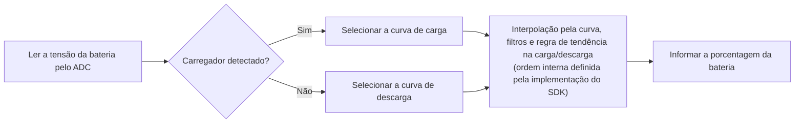

# Estimativa do estado de carga da bateria { #battery-capacity-calculation }

A calculadora do SiFli-SDK estima o estado de carga da bateria, em porcentagem, com base na tensão medida. Não é um contador de coulombs: a precisão depende das curvas configuradas e das informações corretas sobre o estado do carregador.

O middleware detecta o estado do carregador, seleciona a curva de carga ou descarga correspondente e estima a porcentagem por interpolação. Um filtro primário de variações bruscas e um filtro opcional de média ponderada também estabilizam o resultado. A documentação publicada não especifica por completo a ordem interna dos filtros; consulte a implementação da revisão do SDK usada pelo projeto antes de presumir uma sequência específica.

## O que a calculadora faz { #what-the-calculator-does }

<div align="center"><em>Tabela: Funcionamento da calculadora de bateria</em></div>
<div align="center" markdown>

| Função | Comportamento |
| --- | --- |
| Curvas de carga e descarga | Seleciona a curva de tensão para porcentagem adequada ao estado atual de carga ou descarga. |
| Interpolação linear | Calcula a porcentagem entre os pontos da curva selecionada. |
| Filtro primário | Filtra variações bruscas de tensão com o limite configurado e o número de amostras consecutivas que o ultrapassam. |
| Filtro secundário | Quando habilitado, calcula uma média ponderada dos valores de tensão anterior e atual. |
| Detecção do estado do carregador | Usa a configuração de detecção do carregador da placa para selecionar a curva de carga ou descarga. |

</div>

<div align="center"><em>Diagrama: Fluxo de estimativa da porcentagem da bateria</em></div>



Este diagrama é conceitual e não garante uma sequência interna de chamadas. A documentação publicada não define a ordem exata da interpolação, dos filtros e da regra de tendência na carga/descarga. Consulte a implementação da revisão do SDK usada pelo produto. A documentação informa que a porcentagem não diminui durante a carga nem aumenta durante a descarga.

## Configure primeiro a placa { #configure-the-board-first }

Antes de usar o middleware, configure a placa no menuconfig:

1. Habilite o suporte ao ADC para medir a tensão da bateria.
2. Habilite o recurso de cálculo da bateria.
3. Habilite o suporte a carregamento.
4. Selecione o CI carregador usado pela placa. Use a opção de carregador simples somente se nenhum dos CIs listados for aplicável.
5. Configure o pino da placa que detecta a conexão do carregador.
6. Selecione a polaridade do pino de detecção de acordo com o hardware.

`BSP_CHARGER_INT_PIN_ACTIVE_HIGH` define a polaridade da detecção do carregador. Quando essa macro está definida, nível alto indica que o carregador está conectado; quando não está definida, nível baixo indica a conexão. Uma polaridade configurada incorretamente seleciona a curva errada e pode fazer a porcentagem exibida parecer travada ou variar na direção errada.

## Use as curvas da célula instalada { #use-battery-curves-from-the-actual-cell }

O arquivo `battery_table.c` fornecido no diretório da placa é apenas um exemplo de referência, não um modelo universal de bateria. Obtenha do fabricante as curvas de tensão em função da porcentagem para a célula realmente usada e configure tabelas de consulta compatíveis com o produto.

<div align="center"><em>Tabela: Requisitos das curvas da bateria</em></div>
<div align="center" markdown>

| Tabela | Definição necessária |
| --- | --- |
| `charging_curve_table` | Tabela `const battery_lookup_point_t[]` para carregamento. Os valores de tensão devem estar ordenados do maior para o menor. |
| `discharge_curve_table` | Tabela `const battery_lookup_point_t[]` para descarga. Os valores de tensão devem estar ordenados do maior para o menor. |
| Conteúdo das tabelas | As porcentagens devem corresponder à sequência de 100 a 0 e refletir o comportamento real da bateria. |
| Localização da tabela | Arquivo `battery_table.c` específico da placa. |

</div>

Use curvas separadas porque a tensão da célula, para o mesmo estado de carga, é diferente durante o carregamento e a descarga. Não substitua a curva da célula real por uma curva arbitrária de bateria de lítio de 4,2 V apenas porque a química nominal é a mesma.

!!! warning "Verifique a escala de tensão do SDK e da placa usados"
    A documentação publicada da SiFli apresenta uma inconsistência de unidades: `voltage_mv` e os dois limites de filtragem são indicados em mV, mas o exemplo passa `38000` como `3.8 V` e a curva de exemplo usa `41808` para `4.18 V`. Esses valores são compatíveis com uma escala de 0,1 mV, mas a documentação não especifica essa escala; portanto, trata-se de uma inferência, não de uma garantia da API. Antes de usar a calculadora, verifique o caminho de conversão ADC, a tabela de bateria e as comparações dos limites na revisão exata do SDK e na configuração da placa.

    A leitura do ADC, a tabela de curvas selecionada e os limites de filtragem devem usar escalas compatíveis. A documentação indica os valores literais `50` e `30` para os limites e os descreve em mV; não os converta apenas com base nos exemplos de tensão. Verifique como a revisão do SDK de destino interpreta e compara cada campo. Não altere somente a escala da leitura do ADC deixando a tabela ou os limites em outra escala.

## Configure a calculadora { #configure-the-calculator }

`battery_calculator_config_t` fornece as duas tabelas de curvas e as configurações de filtragem.

<div align="center"><em>Tabela: Configuração da calculadora de bateria</em></div>
<div align="center" markdown>

| Campo | Finalidade | Literal do exemplo publicado (unidade indicada na documentação) |
| --- | --- | --- |
| `charging_table`, `charging_table_size` | Curva de carga e número de pontos | Específico da placa |
| `discharging_table`, `discharging_table_size` | Curva de descarga e número de pontos | Específico da placa |
| `charge_filter_threshold` | Limite de variação de tensão durante o carregamento | `50` (a documentação indica mV; verifique a escala do SDK-alvo) |
| `discharge_filter_threshold` | Limite de variação de tensão durante a descarga | `30` (a documentação indica mV; verifique a escala do SDK-alvo) |
| `filter_count` | Número de amostras consecutivas que devem ultrapassar o limite de variação para o filtro primário confirmar a mudança | `3` |
| `secondary_filter_enabled` | Habilita o filtro secundário ponderado | `true` |
| `secondary_filter_weight_pre` | Peso da tensão anterior | `90` |
| `secondary_filter_weight_cur` | Peso da tensão atual | `10` |

</div>

Quando o filtro secundário está habilitado, `secondary_filter_weight_pre + secondary_filter_weight_cur` deve ser igual a `100`. Ajuste os limites, a contagem e os pesos com base na bateria real, nos transientes de carga e no comportamento esperado do produto; os valores de referência do SDK não substituem a calibração.

## Inicialize e calcule { #initialize-and-calculate }

Inicialize a calculadora antes de solicitar uma porcentagem. A documentação publicada da SiFli declara o inicializador com retorno `void`; ao compilar, consulte o cabeçalho da revisão exata do SDK usada pelo projeto.

```c
void battery_calculator_init(battery_calculator_t *calc,
                             const battery_calculator_config_t *config);
```

A API retorna uma porcentagem de 0 a 100: é o estado de carga, não a capacidade da bateria em mAh. Antes da integração, consulte o cabeçalho e a implementação da revisão exata do SDK para verificar se existem outras restrições de parâmetros ou um estado de retorno da inicialização.

Informe a tensão na escala esperada pela revisão exata do SDK usada. Embora o nome do parâmetro na API publicada seja `voltage_mv`, verifique a escala real conforme explicado acima:

```c
uint8_t battery_calculator_get_percent(battery_calculator_t *calc,
                                       uint32_t voltage_mv);
```

<div align="center"><em>Tabela: Sequência recomendada de integração</em></div>
<div align="center" markdown>

| Etapa | Ação |
| --- | --- |
| 1 | Configure o ADC da placa, o tipo de carregador, o pino de detecção e sua polaridade. |
| 2 | Defina curvas validadas de carga e descarga em `battery_table.c`. |
| 3 | Inicialize `battery_calculator_t` com `battery_calculator_config_t`. |
| 4 | Leia a tensão da bateria pelo caminho ADC configurado. |
| 5 | Verifique se tensão, tabelas e limites usam a mesma escala antes de passar a tensão para `battery_calculator_get_percent()`. |
| 6 | Use o resultado filtrado na interface do usuário, na política de bateria fraca e na telemetria do produto. |

</div>

## Verifique o comportamento no hardware do produto { #verify-behavior-on-product-hardware }

A porcentagem exibida deve acompanhar o estado físico do produto, e não apenas apresentar valores plausíveis em laboratório. Durante o carregamento e a descarga, bem como ao conectar e desconectar o cabo, verifique em conjunto o estado de detecção do carregador, a leitura de tensão, a curva selecionada e a porcentagem exibida.

<div align="center"><em>Tabela: Diagnóstico de problemas na porcentagem da bateria</em></div>
<div align="center" markdown>

| Sintoma | O que verificar primeiro |
| --- | --- |
| A porcentagem muda abruptamente | Primeiro confirme se a leitura ADC, as tabelas de curvas e os limites usam a mesma escala. Em seguida, ajuste o limite correspondente ou `filter_count`; se necessário, habilite ou intensifique o filtro secundário. |
| A porcentagem é imprecisa | Obtenha uma curva compatível com a bateria real e recalibre os pontos da tabela. |
| A porcentagem não muda | Verifique o estado informado do carregador e a polaridade de `BSP_CHARGER_INT_PIN_ACTIVE_HIGH`. A documentação publicada informa que, durante o carregamento, a porcentagem não pode diminuir e, durante a descarga, não pode aumentar. |
| A porcentagem varia na direção errada | Verifique o pino de detecção do carregador, sua polaridade elétrica e a curva de carga ou descarga selecionada. |

</div>

Consulte a [documentação da estimativa do estado de carga da bateria no SiFli-SDK](https://docs.sifli.com/projects/sdk/latest/sf32lb58x/middleware/battery_calculator.html) para ver a referência oficial do middleware e as capturas de tela atuais da configuração. Para estimar a autonomia do sistema, continue com [Análise de consumo de um smartwatch](smartwatch-power-profiling.md); para validar os resultados com medições, consulte [Medição e validação do consumo de energia](measurement-and-validation.md).

A documentação publicada é um ponto de partida, mas não substitui a verificação da revisão do SDK usada pelo produto. Para resolver a inconsistência de escala, confira nessa revisão o caminho ADC, a tabela de bateria, as comparações dos limites e o cabeçalho da API.
