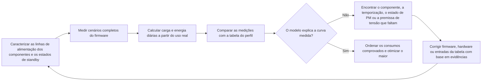

# Medição e validação do consumo de energia { #power-measurement-and-validation }

Uma estimativa de autonomia só é confiável quando suas premissas são compatíveis com as medições do hardware. Use esta página junto com a [Visão geral do projeto de baixo consumo de energia](overview.md) e o exemplo de [Análise de consumo de um smartwatch](smartwatch-power-profiling.md). O processo começa pelos componentes individuais, passa pela validação de cenários completos do firmware e pelo ajuste do modelo de uso diário, e termina com a otimização dos maiores consumos comprovados por medição.

## Meça energia, não apenas corrente { #measure-energy-not-current-alone }

A corrente é apenas parte do resultado. Registre a tensão do dispositivo em teste (DUT, `V_DUT`) junto com a curva de corrente para calcular a potência instantânea e a energia, além da carga elétrica:

```text
power_W(t) = voltage_V(t) x current_A(t)
energy_Wh = integral(power_W(t) dt) / 3600
energy_mWh = energy_Wh x 1000
charge_mAh = integral(current_mA(t) dt) / 3600
```

Nessas fórmulas, `t` está em segundos. O fator `3600` converte segundos em horas; use corrente em A no cálculo da potência e em mA no cálculo da carga.

A integral de energia resulta em Wh; multiplique esse valor por 1000 antes de somá-lo a um perfil expresso em mWh. Carga (mAh) e energia (mWh) são grandezas diferentes e não são intercambiáveis.

Se a alimentação for estável, registre o valor medido de `V_DUT` durante a captura e use-o com a curva de corrente. Se a tensão variar durante o teste, amostre-a na mesma base de tempo da corrente ou registre pontos de tensão sincronizados em quantidade suficiente para calcular uma potência média confiável. Comparar apenas mAh pode ocultar uma diferença real de energia quando a tensão de alimentação, o ponto de operação do regulador ou o estado da bateria muda entre capturas.

## Estabeleça as condições de referência { #set-up-the-measurement-baseline }

Use o [Power Profiler Kit II (PPK2)](https://docs.nordicsemi.com/r/bundle/ug_ppk2/page/ug/ppk/ppk_user_guide_intro.html) da Nordic como instrumento de referência para medir corrente. No modo Source Meter, ele alimenta o dispositivo em teste (DUT); no modo Ampere Meter, mede a corrente com o PPK2 conectado em série entre o DUT e a fonte externa. Em Source Meter, trate a tensão de saída configurada como uma condição controlada do teste. Em Ampere Meter, meça e registre a tensão da fonte externa nos terminais do DUT. Em ambos os casos, registre a tensão que chega ao DUT, não apenas o valor nominal da bateria ou o ajuste da fonte de bancada.

O PPK2 fornece a curva de corrente, a carga acumulada e dados de captura exportáveis. Sua porta lógica oferece as entradas digitais D0–D7 e conexões VCC/GND do DUT. Conecte VCC e GND à alimentação lógica e ao terra comum do DUT, depois conecte os GPIOs de marcação a D0–D7. Mantenha VCC dentro da faixa de 1,65–5,5 V especificada pela Nordic e confirme que os níveis lógicos dos sinais são compatíveis. As entradas digitais são amostradas a 100 kHz, com largura de banda típica de 50 kHz; fases muito curtas podem não ser resolvidas com confiabilidade. Consulte as especificações da Nordic sobre [conectores](https://docs.nordicsemi.com/r/bundle/ug_ppk2/page/ug/ppk/ppk_user_guide_connectors.html), [alimentação](https://docs.nordicsemi.com/r/bundle/ug_ppk2/page/ug/ppk/ppk_power_supply_specs.html) e [resolução das entradas digitais](https://docs.nordicsemi.com/r/bundle/ug_ppk2/page/ug/ppk/digital_input_resolution.html). Use marcadores GPIO para delimitar operações importantes, como despertar, atualização do display, transmissão por rádio, amostragem de sensores e retorno à suspensão. O [guia oficial do PPK2](https://docs.nordicsemi.com/r/bundle/ug_ppk2/) descreve os modos disponíveis e os requisitos de conexão.

Mantenha a conexão USB de dados e alimentação do PPK2 conectada durante o uso, conforme exigido pela Nordic. Ela é distinta da fonte USB adicional recomendada para cargas elevadas no modo Source Meter, descrita no parágrafo seguinte.

Antes de conectar o DUT, confirme se o modo selecionado do PPK2 é compatível com a tensão e a corrente de pico do dispositivo. A Nordic especifica uma faixa de tensão do DUT de 0,8–5,0 V, corrente contínua máxima de 1 A no modo Ampere Meter e máxima de 600 mA no modo Source Meter. Se o DUT consumir mais de 400 mA no modo Source Meter, a Nordic recomenda uma fonte USB adicional, capaz de fornecer pelo menos 1 A, para alimentar o PPK2. Consulte a [especificação da corrente máxima admissível do DUT](https://docs.nordicsemi.com/r/bundle/ug_ppk2/page/ug/ppk/ppk_max_dut_current.html) e as [orientações de alimentação](https://docs.nordicsemi.com/r/bundle/ug_ppk2/page/ug/ppk/ppk_power_supply.html). Esses são limites do instrumento, não condições recomendadas de operação do produto. Para testes fora da faixa compatível, use equipamentos de medição com capacidade adequada.

<div align="center"><em>Tabela: informações necessárias em cada captura</em></div>

<div align="center" markdown>

| Registro | Por que é necessário |
|:-------|:-----------------|
| ID do teste, revisão da placa, componentes montados e revisão do firmware | Permite reproduzir e comparar os resultados. |
| `V_DUT`: valor alvo, valores medidos no início e no fim e variação durante a captura | Permite calcular corretamente potência e energia. |
| Curva de corrente, corrente média e corrente de pico, potência média, carga (mAh), energia (mWh) e duração da captura | Distingue picos breves de corrente do consumo sustentado e registra a potência e a energia da captura. |
| Temperatura, estado da bateria ou ajuste da fonte de bancada e ambiente de rádio | Evita confundir mudanças nas condições do teste com melhorias no firmware. |
| Periféricos habilitados, política de clock, estado de PM e fontes de despertar | Explica por que o dispositivo entrou ou não no estado de baixo consumo previsto. |
| Marcadores do firmware e condições de disparo | Atribui a energia a uma operação específica, e não a um trecho indefinido da curva. |

</div>

## Caracterize cada componente antes de testar o sistema completo { #characterize-each-component-before-full-system-tests }

Meça cada componente em uma linha de alimentação que possa ser isolada ou em um dispositivo de teste antes de se basear na curva da placa inteira. O objetivo não é obter outro valor de catálogo, mas identificar quais modos, cargas e configurações do firmware determinam o consumo do componente no produto real.

<div align="center"><em>Tabela: plano de caracterização por componente</em></div>

<div align="center" markdown>

| Componente | Medir no mínimo | Registrar no modelo |
|:----------|:-------------------|:--------------------|
| MCU | Processamento ativo, Idle, cada modo de suspensão previsto e intervalos de despertar e transição de clock | Corrente e duração de cada estado do firmware, despertares inesperados e restrições de PM que impedem o baixo consumo. |
| PSRAM externa | Standby ou retenção, leituras, escritas, tráfego em rajadas e ciclos de refresh da memória quando aplicável | Corrente da linha de alimentação para cada padrão de acesso e tempo em cada padrão. |
| Flash externa | Deep Power-Down ou standby, leituras, escritas, apagamentos e latência de despertar | Energia por acesso ou operação e corrente no estado inativo. |
| Cada sensor externo | Todos os modos habilitados, taxa de dados de saída, política de FIFO ou interrupções e ciclo de trabalho | Energia por amostra ou intervalo, incluindo o processamento do MCU quando a medição abranger o cenário completo. |
| Motor háptico e circuito de acionamento | Partida, amplitude, padrão, duração e comportamento de frenagem ou desaceleração livre | Energia por padrão háptico, não apenas a corrente de pico do motor. |
| Codec de áudio e amplificador de potência | Desligado, standby, reprodução ou captura, nível de saída e impedância real do alto-falante ou da carga | Energia por sessão de áudio e corrente de fuga de toda a cadeia de áudio desligada. |
| Display, toque, rádio, PMIC e outras cargas | Estados ativos, inativos e de retenção pertinentes | Premissas de corrente separadas ou entradas explícitas em `Other`, com o escopo da medição claramente definido. |

</div>

Ao avaliar o consumo energético do produto como um todo, meça na entrada de alimentação do produto, pelo lado da bateria. As medições por linha de alimentação continuam essenciais para isolar as causas. Antes de incluí-las no modelo de autonomia, porém, converta-as para o lado da bateria com base nos valores medidos de eficiência e corrente quiescente dos reguladores. A soma das correntes das linhas não é uma medição da corrente de entrada da bateria.

## Verifique os estados de energia controlados pelo driver { #verify-driver-controlled-power-states }

Um componente só entra no estado de baixo consumo especificado quando seu driver aplica as configurações e a sequência documentadas. Um driver funcionalmente correto ainda pode desperdiçar energia se deixar uma habilitação ativa, usar o comando de standby errado, manter um clock ou barramento ativo ou alterar alimentação, reset e sinais de interface na ordem errada. Para cada estado previsto, reproduza no firmware as condições do datasheet e confirme que corrente, tensão, carga e energia medidas atendem à especificação aplicável ou ao ponto de operação validado para o produto.

<div align="center"><em>Tabela: revisão dos estados de energia controlados pelo driver</em></div>

<div align="center" markdown>

| Área de controle | Requisito do driver | Evidência da medição |
|:-------------|:-------------------|:---------------------|
| Registradores de modo e comandos de baixo consumo | Aplique as configurações documentadas de standby, desligamento, retenção, taxa de dados e interrupções; verifique o estado quando o componente permitir. | Corrente e energia correspondem ao modo selecionado, e a configuração aplicada consta no registro do teste. |
| Responsabilidade por bloqueios e restrições de PM | Defina se cada bloqueio ou restrição de PM fica sob responsabilidade do driver do componente ou de um serviço de nível superior. Mantenha esses bloqueios ou restrições ativos apenas enquanto o recurso protegido for necessário e libere-os, em todos os caminhos de sucesso, erro e retorno antecipado, quando o componente puder permanecer inativo com segurança. | Os registros confirmam que os bloqueios e as restrições cobrem o intervalo necessário, não são liberados cedo demais e não permanecem ativos após a conclusão do trabalho ou um erro, impedindo a suspensão. |
| Sequência de alimentação, habilitação, reset e clock | Respeite a ordem e os tempos exigidos ao ligar, usar e desligar o componente. | Os marcadores GPIO e a curva de consumo mostram que não restam intervalos de atividade ou picos de corrente não previstos. |
| SPI, I2C, UART e outros barramentos de controle | Interrompa o tráfego desnecessário; coloque seleção de chip, clock, dados e interrupções no estado inativo especificado. | O componente permanece no estado de baixo consumo previsto entre transações. |
| Pull-ups/pull-downs de GPIO e alta impedância | Configure cada pino de controle de forma deliberada: saída alta ou baixa, entrada com o pull-up ou pull-down correto, ou alta impedância apenas quando o circuito externo definir o nível. | Verifique a corrente com o dispositivo do outro lado da interface alimentado e sem alimentação, incluindo os estados de reset e padrão. |
| Interfaces entre domínios de alimentação | Não acione um componente desligado por um pino de controle ou de dados, a menos que o hardware permita expressamente esse funcionamento. | Não há alimentação reversa nem fuga quando qualquer lado da interface está desligado. |
| Caminhos de erro e retomada | Restaure o estado correto após timeouts, falhas de transferência, despertares e resets do firmware. | Capturas prolongadas não mostram excesso de corrente persistente ou crescente causado por rotinas de limpeza incompletas. |

</div>

Níveis lógicos válidos não garantem baixa corrente de fuga. Pull-ups/pull-downs internos, configurações de pull conflitantes, estados padrão após reset, caminhos ESD e pull-ups do barramento podem criar fugas ou alimentação reversa mesmo quando ambos os dispositivos parecem estar em estados lógicos adequados. Meça a corrente da interface com ambos os lados alimentados, com um lado sem alimentação e durante a transição entre essas condições. Se o resultado não corresponder ao esperado, diferencie primeiro um erro de configuração ou sequência do driver de um caminho de fuga na placa, antes de alterar a tabela do perfil de consumo.

## Valide os cenários do firmware { #validate-firmware-scenarios }

Depois de entender o comportamento dos componentes, meça os cenários completos do firmware que fazem parte da experiência do usuário. Um cenário inclui os componentes, estados de PM, despertares e tempos que ocorrem em conjunto. Para um smartwatch, comece pelos mesmos cenários do modelo de [Análise de consumo de um smartwatch](smartwatch-power-profiling.md): standby com tela apagada, notificações, alertas de chamada recebida, ativação da tela pelo gesto de erguer o pulso, medições automáticas de frequência cardíaca, medições manuais de SpO2, registro de exercícios, alarmes, monitoramento do sono e sincronização com o aplicativo. Adicione NFC, chamadas Bluetooth e AOD como cenários separados quando esses recursos estiverem habilitados.

<div align="center"><em>Tabela: registro de validação por cenário</em></div>

<div align="center" markdown>

| Para cada cenário | Verificar | Atualizar no perfil |
|:------------------|:-------|:---------------------------|
| Marcadores de início e fim | A curva inclui todo o caminho entre o despertar e o retorno à suspensão. | Limites e duração do cenário. |
| Atividade dos componentes e das linhas de alimentação | Apenas os componentes previstos estão ativos. | Premissas corretas sobre os componentes e alocação em `Other`. |
| Estado de PM após concluir a tarefa | O sistema entra no estado de suspensão previsto. | Corrente inativa ou de standby e premissa sobre o tempo restante. |
| Corrente, `V_DUT`, carga (mAh) e energia (mWh) por ocorrência | A captura representa o consumo no lado da bateria. | Carga (mAh) e energia (mWh) por evento. |
| Comportamento do produto | A medição preserva a latência, a confiabilidade de RF, a qualidade de áudio e a experiência de uso exigidas. | Um ponto de operação válido, e não uma configuração de baixo consumo que inviabilize o produto. |

</div>

Use marcadores GPIO do firmware para dividir a curva em fases. Por exemplo, uma captura do gesto de erguer o pulso para ativar a tela pode distinguir reconhecimento do gesto, despertar do MCU, habilitação do display, renderização, tempo de tela acesa, redução de brilho ou apagamento e retorno à suspensão. Assim, um único valor de corrente média se desdobra em operações que as equipes de firmware e hardware podem otimizar.

## Concilie o perfil de uso diário com as medições { #reconcile-the-daily-use-profile }

A verificação final não é uma coleção de capturas isoladas nas melhores condições. Execute ou reconstrua um dia representativo a partir da energia medida por cenário e da frequência real de uso. Compare o resultado medido com a tabela do perfil em carga e em energia:

```text
daily_charge_mAh = sum(occurrences_per_day x charge_per_occurrence_mAh)
daily_energy_mWh = sum(occurrences_per_day x energy_per_occurrence_mWh)
```

<div align="center"><em>Diagrama: ciclo de convergência do perfil de consumo</em></div>



Quando a medição e o modelo não concordarem, não altere a tabela apenas para forçar a concordância. Procure uma causa verificável: uma carga omitida, um ciclo de trabalho incorreto, uma premissa sobre perdas do regulador, um despertar inesperado, um componente que permaneceu habilitado ou uma medição que não inclui os mesmos circuitos previstos pelo modelo. Atualize a tabela somente com evidências obtidas após corrigir e medir novamente o hardware ou o firmware. Antes da liberação, defina um critério explícito de concordância adequado ao produto; o erro aceitável depende da autonomia declarada, da faixa de operação e da incerteza restante.

<div align="center"><em>Tabela: como interpretar divergências no perfil</em></div>

<div align="center" markdown>

| Divergência | Causa provável | Próxima verificação |
|:---------|:-------------|:-----------|
| A medição de um componente supera o esperado | Modo incorreto, fuga na linha de alimentação, perdas do regulador ou carga do dispositivo de teste | Isole a linha; verifique pinos de modo, tensão e componentes montados na placa. |
| A energia do cenário supera a soma dos componentes | Despertares adicionais, tempo extra de display ou rádio ativo, rotinas de serviço ou cargas sobrepostas | Adicione marcadores do firmware e compare os estados dos componentes durante todo o cenário. |
| O perfil diário supera a soma dos cenários | Frequência de uso, tempo inativo com conexão, recurso desabilitado ou tarefa em segundo plano modelados incorretamente | Verifique contagens de eventos, temporizadores, programação do rádio e a definição do tempo restante em standby. |
| O modelo e a medição concordam em apenas uma configuração | Tensão, temperatura, ambiente de RF, estado da bateria ou versão do firmware diferentes | Repita os mesmos cenários em toda a faixa de operação prevista. |

</div>

## Otimize os maiores consumos comprovados { #optimize-the-largest-verified-contributors }

Use o perfil conciliado com as medições para decidir onde o esforço trará mais resultado. Separe duas perguntas: qual componente consome mais energia e qual cenário do produto consome mais energia? As respostas podem ser diferentes. O display pode ser o maior consumidor entre os componentes, enquanto a frequência do gesto de erguer o pulso para ativar a tela é o que torna esse cenário dominante.

1. **Melhore primeiro o firmware quando o comportamento for a causa.** Elimine despertares inesperados, reduza o polling, agrupe tarefas, encurte o tempo de tela acesa, evite redesenhos desnecessários, libere rapidamente restrições de PM e reduza os ciclos de trabalho dos sensores ou do rádio sem comprometer os requisitos do produto.
2. **Melhore o hardware quando a limitação do componente for real.** Considere sensores, memórias, reguladores, codecs, amplificadores, displays ou soluções hápticas de menor consumo somente após comparar a energia medida no modo de operação previsto, não uma corrente destacada no datasheet para um estado sem relação com o uso.
3. **Meça novamente o componente e o cenário alterados.** Uma substituição pode deslocar o gargalo, alterar os tempos de despertar ou exigir outro ponto de operação do regulador.
4. **Atualize o perfil e repita a comparação do dia completo.** A mudança só está concluída quando tanto a curva do cenário quanto o orçamento de energia do produto melhoram.

## Evidências para liberação { #release-evidence }

Antes de declarar a autonomia, guarde as capturas dos componentes e dos cenários, o perfil de uso diário, os registros de tensão, os marcadores do firmware e as premissas versionadas que relacionam esses dados. Repita a parte afetada desse processo sempre que mudarem a programação do firmware, a política de display, os parâmetros de rádio, a cadência dos sensores, os componentes da alimentação ou as premissas de uso do produto.

!!! note "Conteúdo gerado automaticamente"
    Esta página foi compilada e redigida sem um documento-fonte existente. Verifique as afirmações técnicas na documentação oficial da SiFli antes de utilizá-las.
