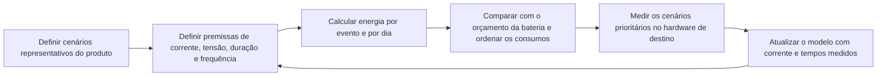

# Visão geral do projeto de baixo consumo de energia { #low-power-overview }

## Objetivo e público-alvo { #overview }

Este guia apresenta o projeto de baixo consumo em dispositivos SF32: modos de energia, o que realmente consome a bateria e como organizar o firmware para que o sistema permaneça o maior tempo possível em estados de baixo consumo. O consumo depende do sistema como um todo. Decisões sobre Bluetooth, gráficos, áudio e IA afetam diretamente a autonomia e, por isso, são analisadas em conjunto.

A documentação do SDK da SiFli descreve o middleware **PM (Power Management, gerenciamento de energia)** baseado em RT-Thread para algumas plataformas, incluindo o SF32LB52x. Os modos disponíveis e o comportamento de despertar podem variar conforme o dispositivo e a configuração do SDK; consulte a documentação do dispositivo em questão. Nas famílias em que o SDK atribui as tarefas do controlador Bluetooth a um processador separado (consulte [Processador Bluetooth](../bluetooth/processor.md)), o processador separado pode tratar os eventos de rádio sem despertar a CPU da aplicação a cada evento. A possibilidade de ela permanecer suspensa depende da distribuição das tarefas, das fontes de despertar configuradas e do tráfego entre processadores; valide esse comportamento no dispositivo de destino.

Use esta página para transformar uma meta de autonomia em decisões de hardware e firmware sustentadas por medições. Ela se destina a engenheiros que precisam equilibrar standby conectado, display, áudio, sensores, IA e tempo de resposta ao usuário. Entrar em suspensão não se resume a chamar uma API.

## Defina primeiro o orçamento de energia do produto { #define-the-products-power-budget-first }

Antes de escrever o código de gerenciamento de energia, estabeleça o que o produto precisa atingir:

- Autonomia alvo, em horas, dias ou semanas, e capacidade da bateria.
- Ciclo de trabalho esperado: que proporção do dia o dispositivo passa em uso ativo, inativo mas conectado e totalmente suspenso?
- Quais eventos devem despertar o sistema e com que rapidez?
- Quais subsistemas precisam permanecer ativos, como um enlace Bluetooth, um display sempre ativo ou uma função de ativação por voz? Quais podem funcionar apenas em resposta a eventos?
- Comportamento de carga e ciclos de carga previstos, quando forem relevantes para a política de energia do produto.

Essas metas devem orientar cedo as decisões de arquitetura, incluindo a escolha do chip e do display e a viabilidade de recursos como escuta contínua de voz ou tela sempre ativa dentro do orçamento de energia.

## Modos de energia e framework PM { #power-modes-and-the-pm-framework }

As categorias abaixo são estados conceituais do sistema, não uma lista exata dos modos de hardware SF32 nem dos valores de enumeração do SDK. Consulte a documentação do dispositivo e do SDK escolhidos para confirmar os modos disponíveis, as fontes de despertar e a retenção de estado:

<em>Tabela: modos de energia e framework PM</em>

| Modo | Estado típico | Quando usar |
|:-----|:---------------|:----------|
| **Ativo** | CPU em execução e periféricos habilitados conforme necessário | Interação com a interface, transferência Bluetooth, streaming de áudio e processamento de sensores. |
| **Inativo (Idle)** | A CPU aguarda um evento ou uma interrupção; o estado dos periféricos depende do dispositivo e da configuração | Entre quadros da interface ou enquanto aguarda a próxima tarefa programada ou uma interrupção habilitada. |
| **Suspensão / baixo consumo** | Uma CPU ou um subsistema entra em um estado de baixo consumo compatível; clocks, domínios e periféricos podem parar ou continuar ativos conforme esse estado | Standby conectado ou espera por um evento Bluetooth, uma interrupção de sensor ou um temporizador configurados. |
| **Suspensão profunda / standby** | Estado de baixo consumo mais profundo e específico do dispositivo; domínios ativos reduzidos; a retenção e o despertar variam | Períodos longos de inatividade, quando o modo escolhido e os requisitos de despertar permitem. |

Durante a execução normal, o sistema alterna entre estados. Uma fonte de despertar configurada acorda a CPU ou o subsistema; a sequência de despertar e restauração dos clocks varia conforme o dispositivo. Ao concluir o trabalho, os drivers ou tarefas responsáveis devem liberar as solicitações de PM que impedem a suspensão, para que a política configurada selecione um estado de baixo consumo permitido. A curva abaixo é ilustrativa: mostra transições relativas, não correntes ou tempos específicos de um dispositivo.

 <em>Diagrama: transições ilustrativas de energia durante uma tarefa curta</em>

A seleção do modo de baixo consumo e o bloqueio da suspensão são mecanismos distintos. A [referência do middleware PM para SF32LB52x](https://docs.sifli.com/projects/sdk/latest/en/sf32lb52x/middleware/pm.html) e o [guia de baixo consumo para SF32LB55x](https://docs.sifli.com/projects/sdk/latest/sf32lb55x/app_note/low_power.html) da SiFli documentam que `rt_pm_request(PM_SLEEP_MODE_IDLE)` bloqueia a entrada em LIGHT, DEEP e STANDBY até a chamada correspondente a `rt_pm_release(PM_SLEEP_MODE_IDLE)`; essa solicitação não seleciona um modo mais profundo.

Para implementar a gestão de energia, consulte o guia oficial da família do dispositivo: [SF32LB52x](https://docs.sifli.com/projects/sdk/latest/en/sf32lb52x/app_note/low_power.html), [SF32LB55x](https://docs.sifli.com/projects/sdk/latest/sf32lb55x/app_note/low_power.html), [SF32LB56x](https://docs.sifli.com/projects/sdk/latest/sf32lb56x/app_note/low_power.html) ou [SF32LB58x](https://docs.sifli.com/projects/sdk/latest/sf32lb58x/app_note/low_power.html). Os modos disponíveis, as condições de entrada, as fontes de despertar e o estado preservado dependem da família do chip, da placa e da configuração do SDK. O [guia de baixo consumo do SF32LB52x](https://docs.sifli.com/projects/sdk/latest/en/sf32lb52x/app_note/low_power.html) inclui um exemplo de configuração dos pinos de despertar Hibernate, explicitamente agrupado para 58x/56x/52x/57x. A referência comum da [API HAL PMU do SDK](https://docs.sifli.com/projects/sdk/latest/en/sf32lb52x/api/hal/pmu.html) informa que, no SF32LB57x, o intervalo de índices usado por `HAL_PMU_EnablePinWakeup()` vai de 0 a 13. Essas fontes comprovam apenas essa configuração de pinos; não comprovam que a disponibilidade dos modos RT-Thread, os limites da política de PM ou o comportamento de retenção do 52x também se apliquem ao 57x. Confirme esses pontos na documentação do SDK e do dispositivo-alvo. Em geral, uma política configurada só pode selecionar um estado elegível mais profundo quando o intervalo de inatividade e as demais condições de entrada permitem. Uma solicitação não liberada pode manter o sistema em um estado mais superficial do que o previsto.

## O que consome energia em um produto SF32 { #what-drains-power-on-an-sf32-product }

Cada subsistema tem um perfil de consumo diferente:

<em>Tabela: principais consumidores de energia em um produto SF32</em>

| Subsistema | Principal fator de consumo | Guia |
|:----------|:--------------------|:------|
| **CPU** | Tempo de execução ativa, não apenas frequência de clock | Este guia |
| **Rádio Bluetooth** | Intervalo de advertising, intervalo de conexão, latência do periférico (slave latency) e potência de TX | [Visão geral do Bluetooth](../bluetooth/overview.md#advertising-and-connection-parameters) |
| **Display** | Frequência de atualização, atualização completa ou parcial e iluminação de fundo | [Controlador de display: atualização parcial](../graphics/display-controller.md#partial-refresh-and-dirty-regions) |
| **Codec de áudio/DMA** | Duração da sessão ativa, taxa de amostragem e alimentação mantida entre sessões | [Visão geral de áudio](../audio/overview.md#power-considerations-for-audio) |
| **Inferência de IA** | Frequência de inferência e tamanho da janela, não apenas tamanho do modelo | [Visão geral de IA](../ai/overview.md#power-aware-inference-scheduling) |
| **Sistema de memória** | Atividade de cache/PSRAM e frequência de execução de código em memória externa lenta | [STAR-MC1](../architecture/star-mc1.md) |
| **Sensores** | Frequência de polling ou amostragem acionada por interrupções | Este guia |

Nenhuma medida isolada resolve todos esses fatores. Em um produto real, é preciso ajustar a contribuição de cada subsistema e verificar o efeito conjunto, pois todos influenciam a profundidade de suspensão possível.

## Projete o firmware para aproveitar a suspensão { #sleep-aware-firmware-design }

Os maiores ganhos costumam vir da estrutura do firmware, não de truques de baixo nível:

- **Prefira interrupções e eventos ao polling.** Um loop de polling mantém a CPU ativa mesmo quando não há trabalho.
- **Agrupe tarefas.** Quando a latência permitir, acumule amostras de sensores, eventos Bluetooth ou blocos de áudio e processe-os juntos, em vez de despertar para cada item.
- **Libere rapidamente as solicitações de PM que impedem o repouso.** Um driver ou tarefa que mantém uma solicitação bloqueando a entrada em um estado de baixo consumo mais profundo deve liberar a solicitação correspondente assim que esse bloqueio deixar de ser necessário. Caso contrário, o sistema pode permanecer em um estado menos profundo que o previsto.
- **Projete os caminhos de interface e áudio para responder a eventos**, em vez de polling periódico baseado em temporizadores, quando o framework permitir.
- **Revise os temporizadores.** Um temporizador periódico agenda trabalho futuro e pode despertar o sistema ou reduzir o intervalo de inatividade disponível para a política de PM. Por isso, vários temporizadores aparentemente inofensivos podem reduzir o tempo nos estados mais profundos de baixo consumo.

## Comece por um exemplo de energia validado { #start-from-a-verified-power-example }

Antes de estimar a autonomia, escolha um exemplo do SDK que permita verificar o aspecto mais incerto do consumo. [Exemplos de baixo consumo do SDK](low-power-sdk-examples.md) relacionam os projetos oficiais de PM, GPIO, processador, Bluetooth, display, GUI, atualização de tela e acendimento ao levantar o pulso aos cenários que verificam. A página também explica quais premissas sobre conexão de alimentação, placa, configuração, fonte de despertar, circuito externo e carga de trabalho precisam ser revalidadas antes de usar o exemplo como evidência para o produto.

## Ajuste o consumo de Bluetooth { #bluetooth-power-tuning }

Os parâmetros de conexão e advertising são os principais ajustes para o consumo de Bluetooth; consulte a tabela completa na [Visão geral do Bluetooth](../bluetooth/overview.md#advertising-and-connection-parameters):

- Aumente o intervalo de conexão e a latência do periférico em enlaces que passam a maior parte do tempo inativos.
- Reduza a potência de TX ao menor nível que ainda atenda ao alcance necessário.
- Diminua a frequência de advertising quando o produto estiver aguardando reconexão, em vez de precisar facilitar a descoberta inicial.
- Quando o SDK escolhido trata eventos do controlador Bluetooth em um processador separado, a CPU da aplicação pode dormir entre eventos de conexão se nenhuma tarefa, fonte de despertar ou mensagem entre processadores exigir sua ativação. Despertá-la a cada callback Bluetooth reduz essa vantagem; confirme a distribuição de núcleos e tarefas no dispositivo de destino.

Para medir, por cenário, o consumo real com apenas Bluetooth clássico, apenas BLE e ambos operando em modo dual, consulte [Medição e análise do consumo de energia em Bluetooth](../bluetooth/bluetooth-low-power-profiling.md).

## Consumo do display e da iluminação de fundo { #display-and-backlight-power }

Displays e iluminação de fundo frequentemente representam o maior consumo individual em produtos vestíveis ou portáteis:

- Use atualização parcial e de regiões alteradas em vez de redesenhar toda a tela quando o painel e a interface permitirem; consulte [Controlador de display: atualização parcial](../graphics/display-controller.md#partial-refresh-and-dirty-regions).
- Durante a inatividade, reduza o brilho da tela ou desligue a iluminação de fundo, se houver. Pare também as animações quando a tela estiver escurecida ou coberta.
- Para produtos com tela sempre ativa, compare painéis como EPD, JDI/memory-in-pixel, AMOLED e TFT pela energia medida nesse modo e pela experiência de uso exigida. Escolha o painel e a política de operação que atendam ao orçamento, em vez de manter continuamente um modo normal de tela ativa.
- Trate a tela sempre ativa como uma linha independente no orçamento, pois ela muda substancialmente o significado de “inativo” para o produto.

## Ajuste o consumo de IA e sensores { #ai-and-sensor-power-tuning }

A inferência no dispositivo e a amostragem de sensores devem ser programadas deliberadamente, não executadas continuamente:

- Execute inferência apenas quando houver dados novos e úteis, não em um temporizador fixo independentemente da atividade na entrada.
- Transfira tarefas leves de sensoriamento contínuo para o processador de baixo consumo quando o dispositivo e o SDK permitirem, em vez de despertar a CPU principal a cada amostra.
- Meça **energia por inferência ou por amostra**, não apenas latência. Uma operação mais rápida só reduz o consumo se permitir que o sistema volte antes à suspensão.

Consulte a [Visão geral de IA](../ai/overview.md#power-aware-inference-scheduling) para aprofundar o equilíbrio entre precisão, latência e consumo.

## Memória e clocks { #memory-and-clock-considerations }

O local de execução do código afeta tanto o desempenho quanto o consumo. Em dispositivos SF32 que implementam e habilitam os recursos de cache correspondentes, os caches de instruções e dados podem reduzir o tempo de espera por acessos à Flash ou à PSRAM. Menos tempo ativo pode deixar mais tempo para suspensão. Consulte [STAR-MC1](../architecture/star-mc1.md#memory-system-optimization) para saber mais sobre cache e sistema de memória.

Além da CPU:

- PSRAM e Flash externas têm características próprias de consumo ativo e em standby. Verifique no datasheet o consumo de retenção e acesso, sobretudo se buffers grandes precisarem preservar seus dados durante a suspensão.
- A escolha da fonte de clock, cristal ou oscilador interno, e dos domínios de PLL/clock que permanecem ativos afeta a latência de despertar e o consumo em suspensão.
- Reduzir a frequência da CPU em fases menos exigentes pode ajudar, mas verifique se o aumento do tempo ativo não elimina o ganho. Meça a energia real, não apenas a corrente instantânea.

## Hardware e RF { #hardware-and-rf-power-considerations }

A política do firmware só pode funcionar dentro dos limites do hardware:

- A eficiência do PMIC/LDO nas correntes reais do produto importa mais que valores destacados para cargas sem relação com o uso.
- Layout de RF e ajuste da antena afetam a potência de TX necessária para obter alcance confiável. Um projeto de RF ruim força o firmware a compensar com mais potência e reduz a autonomia; consulte [Processador Bluetooth: considerações sobre RF e clock](../bluetooth/processor.md#rf-and-clock-considerations).
- A precisão do cristal afeta as margens de temporização de RF e o quanto o firmware precisa ser conservador nos timeouts de supervisão e nas margens de despertar.
- Preveja acesso para teste e calibração na produção. O ajuste de energia e RF costuma continuar após a primeira revisão do hardware.

## Caso prático: acender a tela ao levantar o pulso { #case-study-raise-to-wake }

Acender a tela quando o usuário levanta o pulso é um caso de uso comum em dispositivos vestíveis, mas a implementação depende do sensor, da placa e do SDK. O [exemplo da SiFli para SF32LB52x](https://docs.sifli.com/projects/sdk/latest/en/sf32lb52x/example/pm/raise_wrist/README.html) destina-se à placa `sf32lb52-lchspi-ulp` e usa um LSM6DSL (acelerômetro/giroscópio), amostrando a aceleração a cada 200 ms para reconhecer os gestos de levantar e abaixar o pulso. O dispositivo entra em suspensão após 10 segundos de inatividade e desperta para acender a tela ao detectar o gesto de levantar o pulso. Essa é uma implementação específica da placa e não demonstra que outros alvos usem interrupção do sensor ou o mesmo comportamento de PM. Se o sensor de destino oferecer interrupções de movimento ou de limite, o firmware poderá configurá-las como fonte de despertar para evitar polling contínuo pela CPU da aplicação. Caso contrário, inclua a amostragem do sensor e os despertares da CPU no orçamento de energia. Verifique o sensor, a placa, as fontes de despertar e a configuração de PM do alvo específico.

## Planilha de orçamento de energia { #power-budget-worksheet }

Transforme as metas do produto em números antes de ajustar o firmware. Uma planilha simples costuma ser suficiente:

<em>Tabela: planilha de orçamento de energia</em>

| Estado | Pergunta orientadora | Item do orçamento |
|:------|:-----------------|:------------|
| Transporte / armazenamento | Quanto tempo o produto pode ficar armazenado antes do primeiro uso? | Corrente de suspensão profunda, retenção do RTC e fugas em componentes externos. |
| Conectado e inativo | Quantas horas por dia ele fica pareado, mas sem uso? | Intervalo BLE, latência do periférico, interrupções de sensores e corrente com a tela apagada. |
| Consulta rápida da tela | Com que frequência a tela desperta e por quanto tempo? | Iluminação de fundo, atualização parcial, atividade breve de CPU/interface e controlador de toque. |
| Sessão de áudio | Quanto tempo dura a reprodução, a gravação ou a chamada? | Codec, DMA, áudio Bluetooth e largura de banda da memória. |
| Processamento breve de IA | Com que frequência a inferência é executada? | Captura do sensor, pré-processamento, tempo do acelerador/CPU e pós-processamento. |
| OTA / manutenção | Com que frequência são esperadas atualizações? | Intervalo de conexão curto, apagamento/escrita de Flash e armazenamento para rollback. |

Para um conjunto de estados de operação mutuamente exclusivos, estime `average current = state current x duty cycle` e some as contribuições de cada estado. Se houver cargas simultâneas, inclua-as no total do cenário correspondente para não contar estados sobrepostos duas vezes. Isso revela problemas de projeto cedo: uma meta de 20 μA em suspensão não compensa um produto que passa tempo demais com iluminação de fundo intensa ou inferência ativa em intervalos fixos.

## Análise de consumo: modele, meça e atualize { #power-profiling-model-measure-update }

A análise de consumo transforma o orçamento em um ciclo de engenharia reproduzível. Defina cenários representativos, registre tensão e corrente no limite de alimentação pertinente e considere a duração e a frequência de cada carga. Calcule a energia ao longo do tempo e converta as medições de cada linha de alimentação para o consumo equivalente no lado da bateria, incluindo as perdas de conversão; não some diretamente correntes de linhas com tensões diferentes. Assim, estime a corrente média da bateria, a carga consumida por dia e a autonomia, além de priorizar os cenários que devem ser medidos e otimizados.

<em>Diagrama: ciclo de análise de consumo</em>

Trate o perfil como uma estimativa, não como uma medição. O [Online Power Profiler for Bluetooth LE](https://devzone.nordicsemi.com/power/w/opp/2/online-power-profiler-for-bluetooth-le) da Nordic segue o mesmo princípio: usa modelos derivados de medições, mas seus resultados são valores esperados, não a medição de um produto específico. A corrente pode variar com o silício, o projeto da placa, a tensão da bateria, a temperatura, as condições de RF, os tempos do firmware e o caso de uso.

Em cada cenário, registre as premissas que afetam significativamente a energia:

- Quais subsistemas estão ligados e em que modo de energia o MCU realmente entra?
- Qual é a corrente na entrada da bateria ou em cada linha de alimentação regulada?
- Quanto tempo dura a tarefa e quantas vezes ela ocorre em um dia típico?
- Quais picos de corrente são esperados e quais indicam trabalho desnecessário ou falha ao entrar em suspensão?

Use a estimativa para identificar as maiores parcelas do orçamento e valide os cenários no hardware antes de declarar a autonomia. [Análise de consumo de um smartwatch](smartwatch-power-profiling.md) aplica esse método a um modelo de uso diário; [Medição e validação do consumo de energia](measurement-and-validation.md) define o fluxo de captura reproduzível.

## Revise as responsabilidades de PM e as fontes de despertar { #pm-ownership-and-wake-source-review }

Um projeto de baixo consumo confiável precisa de um responsável claro para cada fonte de despertar e cada solicitação que iniba a suspensão. Acompanhe estes itens na revisão:

<em>Tabela: responsabilidades de PM e fontes de despertar</em>

| Item | Pergunta de revisão | Modo de falha |
|:-----|:----------------|:-------------|
| Responsável pelas solicitações/bloqueios de PM | Qual driver ou tarefa pode impedir a entrada em um estado mais profundo? | Uma solicitação não liberada pode manter o sistema em um estado mais superficial. |
| Condição de liberação | Qual evento ou caminho de erro garante a liberação da solicitação correspondente? | Uma solicitação ativa pode impedir a suspensão mais profunda e aumentar o consumo. |
| Fonte de despertar | Qual interrupção, temporizador, evento BLE ou sensor compatível e configurado no dispositivo pode despertar a CPU? | Despertares periódicos inesperados podem representar a maior parcela da corrente em repouso. |
| Dependência de clock | Qual domínio de clock precisa permanecer ativo? | Um periférico impede a suspensão mais profunda sem um erro evidente. |
| Necessidade de retenção | Que memória ou estado precisa sobreviver à suspensão? | Retenção excessiva desperdiça corrente; retenção insuficiente prejudica o despertar. |

Durante a depuração, registre a política de PM configurada, as solicitações ativas que inibem modos mais profundos e o último modo de baixo consumo indicado pelo SDK ou pelos logs. Se o sistema chegar a um estado mais superficial do que o esperado, esses dados costumam ser mais úteis que o valor de corrente isolado.

## Meça o consumo na prática { #measuring-power-in-practice }

Não adivinhe: meça. Um conjunto básico para validar o consumo inclui:

- Uma ponta de prova de corrente ou analisador de potência em série entre bateria/fonte e placa.
- Cenários que correspondam ao uso real: conectado e inativo, interação com a interface, reprodução de áudio, inferências breves de IA e a pior carga combinada.
- Registro ou marcação dos estados do firmware, ativo/inativo/suspensão, junto com a curva de consumo para atribuir picos de corrente a caminhos de código específicos.

A documentação do SDK da SiFli oferece exemplos de caracterização de consumo para alguns dispositivos e placas, incluindo cenários com displays AMOLED e JDI, GPIO, BLE/Bluetooth Classic e carga de CPU semelhante a CoreMark. Consulte a documentação do SDK e da placa de destino para confirmar a disponibilidade e a configuração. Os exemplos aplicáveis podem servir como referência de medição e verificação de plausibilidade, mas não garantem o consumo do produto.

## Matriz de validação de energia { #power-validation-matrix }

Use cenários reproduzíveis para comparar melhorias entre revisões do firmware. No mínimo, meça:

<em>Tabela: matriz de validação de energia</em>

| Cenário | O que habilitar | Critério de aprovação |
|:-----------|:---------------|:---------------|
| Inicialização até o estado inativo | Inicialização normal, sem pareamento, tela apagada | Nenhum trabalho periódico além dos temporizadores necessários. |
| Conectado e inativo | Enlace BLE com bonding e parâmetros de conexão de produção | Verifique se a CPU ou o núcleo que deveria dormir atinge o estado de baixo consumo desejado entre eventos de enlace; confirme a distribuição das tarefas Bluetooth e o comportamento de despertar. |
| Consulta da interface | Despertar do display, atualização típica de uma tela e timeout de redução de brilho | Iluminação de fundo e animações param após o timeout. |
| Áudio ativo | Caminho de reprodução ou gravação ativo | Sem underrun; o codec desliga após a sessão. |
| IA ativa | Entrada real do sensor e inferência breve | Energia por inferência compatível com o orçamento. |
| Pior caso | Bluetooth + display + áudio/IA, conforme o produto | Sem desconexões, falhas ou problemas de limite térmico ou de potência. |

Registre versão do firmware, revisão da placa, tensão da bateria/fonte, temperatura, configuração de antena/gabinete e script de teste. Sem esses dados, os valores de consumo ficam difíceis de comparar e fáceis de interpretar incorretamente.

## Investigue o consumo elevado { #debugging-high-power-consumption }

<em>Tabela: diagnóstico de consumo elevado</em>

| Sintoma | O que verificar |
|:--------|:----------------------|
| O dispositivo nunca entra em suspensão profunda | Driver ou tarefa mantém uma solicitação de PM ativa; procure chamadas de liberação ausentes. |
| Consumo alto apesar de uma conexão Bluetooth inativa | Latência do periférico não configurada ou aplicação despertando em cada evento de conexão. |
| Picos de consumo coincidem com atividade do display | Redesenho completo em vez de atualização parcial ou iluminação de fundo mantida no brilho máximo. |
| Consumo cresce após atualizar o firmware | Novo temporizador, loop de polling ou periférico sempre ativo sem revisão de energia. |
| Bom consumo na bancada, pior no produto | Desajuste de RF/antena exige mais potência de TX, ou há efeitos térmicos/do gabinete ausentes na bancada. |
| Áudio ou IA consomem bateria em excesso | Codec ou caminho de inferência permanece ativo entre sessões; consulte [Visão geral de áudio](../audio/overview.md#power-considerations-for-audio) e [Visão geral de IA](../ai/overview.md#power-aware-inference-scheduling). |

## Erros comuns { #common-mistakes }

- Tratar a otimização de energia como acabamento final, em vez de requisito de projeto desde o início.
- Fazer polling de sensores, estado Bluetooth ou temporizadores em vez de usar interrupções e eventos.
- Deixar uma solicitação de PM ativa após concluir o trabalho que a exigia.
- Redesenhar toda a tela para pequenas mudanças na interface.
- Ignorar a qualidade do layout de RF e compensar com mais potência de TX no firmware.
- Medir apenas corrente instantânea em vez da energia de um cenário de uso realista.
- Validar apenas na bancada, nunca no gabinete final com antena e bateria reais.

## Lista de verificação para a integração inicial { #bring-up-checklist }

- [ ] Defina autonomia alvo, ciclo de trabalho e fontes de despertar necessárias.
- [ ] Identifique quais subsistemas precisam permanecer ativos continuamente e quais podem ser totalmente acionados por eventos.
- [ ] Confirme que cada driver/tarefa libera a solicitação de PM logo após o uso.
- [ ] Ajuste os parâmetros de advertising/conexão Bluetooth ao uso real do produto.
- [ ] Confirme a atualização parcial quando disponível e uma política de iluminação de fundo compatível com o uso.
- [ ] Revise os temporizadores periódicos e elimine ou agrupe os desnecessários.
- [ ] Prepare a medição de corrente e valide separadamente os estados ativo, inativo e em suspensão.
- [ ] Teste a pior carga combinada, Bluetooth + display + áudio + IA conforme aplicável, e confirme o orçamento de energia.
- [ ] Revalide o consumo após cada mudança significativa de firmware, não apenas no fim do projeto.

## Pontos principais { #key-takeaways }

- O consumo é uma propriedade do sistema: Bluetooth, display, áudio, IA e memória determinam a profundidade e a frequência da suspensão.
- A política de PM configurada escolhe entre os estados de baixo consumo permitidos; uma solicitação não liberada que iniba modos mais profundos pode manter o sistema em um estado mais superficial do que o previsto.
- Em quase todas as situações em que energia importa, o projeto por eventos e interrupções é melhor que polling.
- Os parâmetros de conexão Bluetooth e a atualização do display costumam ser os dois maiores ajustes em um produto vestível conectado.
- Meça energia real com cargas combinadas e realistas no hardware dentro do gabinete final. Medições de bancada ou de subsistemas isolados podem subestimar o consumo do produto real.
