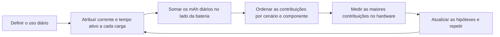
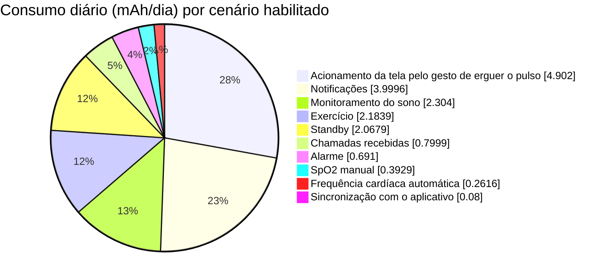
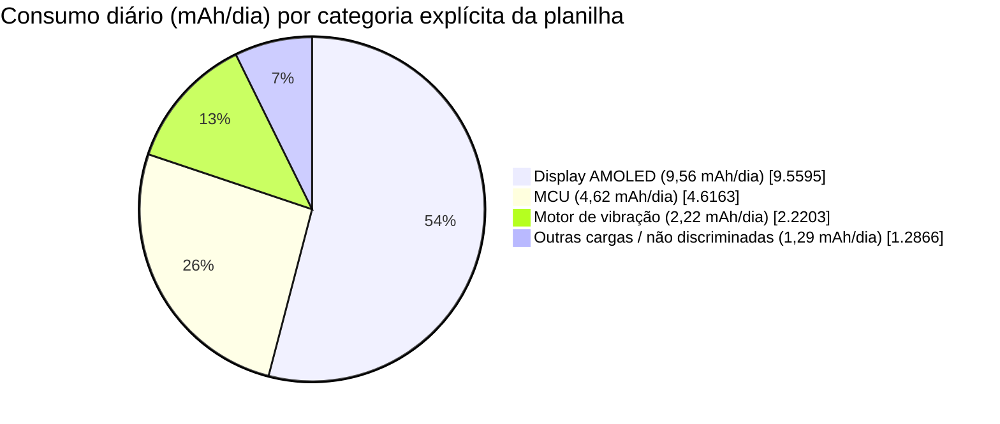
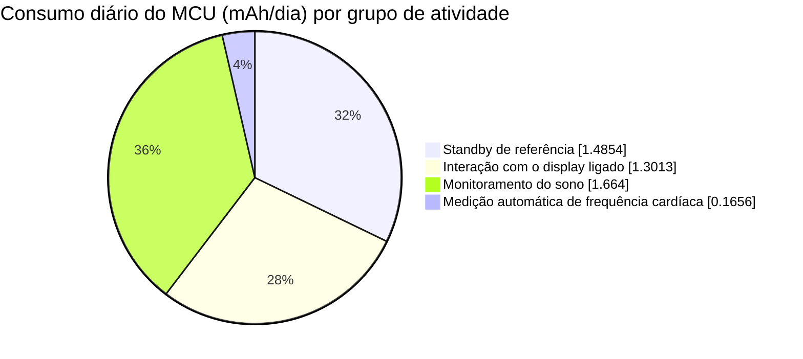

# Análise de consumo de um smartwatch { #power-profiling-a-smartwatch }

A análise de consumo transforma o uso diário esperado em uma estimativa de autonomia e, sobretudo, em uma lista das cargas que mais vale a pena otimizar. Este artigo usa a [planilha de dados de consumo de um smartwatch, em inglês](assets/smartwatch-power-profile-data.xlsx), como exemplo prático. Você verá como converter o comportamento do usuário em mAh por dia, identificar as cargas que dominam o orçamento de consumo e transformar o modelo em um plano de medição.

!!! warning "Um modelo, não uma especificação de dispositivo"
    As correntes e as hipóteses de uso deste exemplo pertencem ao modelo fornecido. Não são dados de caracterização de um dispositivo SF32, display, bateria ou projeto de relógio específico. Substitua essas hipóteses por medições do seu hardware antes de usar o resultado para divulgar a autonomia de um produto.
    A planilha não contém registros de medição; portanto, não permite saber se algum valor de entrada foi medido. O resultado de 13,15 dias é uma estimativa do modelo, não uma autonomia observada.

Leia também a [Visão geral do projeto de baixo consumo de energia](overview.md), para orientações de arquitetura e firmware, e [Medição e validação do consumo de energia](measurement-and-validation.md), para o procedimento de medição que valida o modelo.

## Visão geral do sistema { #smartwatch-system-overview }

Comece definindo os limites do modelo. A planilha representa um smartwatch alimentado por bateria, com MCU, display AMOLED, motor de vibração e uma categoria agregada `Other` para cargas ainda não discriminadas. Ela não informa tamanho, resolução ou brilho do painel, arquitetura de rádio nem sensores individuais. Trate as correntes do display como entradas do modelo, não como medições nem como especificações de um painel específico. `Other` reúne cargas ainda não identificadas; não representa um único componente físico.

<div align="center"><em>Tabela: sistema do smartwatch e entradas do modelo</em></div>

<div align="center" markdown>

| Item | Valor na planilha | Por que importa |
|:-----|----------------------:|:---------------|
| Corrente do AMOLED em uso normal | 15 mA | Usada em notificações, alertas de chamada e acionamento da tela pelo gesto de erguer o pulso. |
| Corrente do AMOLED com display sempre ativo (AOD) | 2 mA | Definida no modelo, mas o cenário AOD está desativado nesta configuração de referência. |
| Capacidade nominal da bateria | 250 mAh | Capacidade inicial, antes da margem aplicada pelo modelo. |
| Margem para degradação da bateria | 7% | Reduz a capacidade disponível para 232,5 mAh. |
| Tensão nominal da bateria | 3,87 V | Usada no cálculo auxiliar de normalização de tensão da planilha. |

</div>

## Consumo por cenário { #power-consumption-by-scenario }

Um cenário representa um evento completo do usuário ou do sistema, não o funcionamento isolado de um componente. Uma notificação de mensagem pode despertar o MCU, acender o AMOLED, acionar o motor de vibração e manter cargas de fundo ativas. Na matriz de origem, cada linha `Display` corresponde ao AMOLED. A matriz agrupa as linhas dos componentes de cada cenário e mantém os valores diários calculados para permitir sua conferência. As hipóteses de frequência e duração que determinam esses valores são detalhadas mais adiante, no perfil diário de uso.

<div align="center"><em>Tabela: modelo completo de consumo por componente</em></div>

<div align="center" markdown>

| Cenário | Componente | Tensão | Corrente | Fator de tensão* | Consumo diário | Participação no consumo diário |
|:---------|:----------|--------:|--------:|----------------:|-------------:|----------------------:|
| Standby de referência | MCU | 3,3 V | 0,102 mA | 85,27% | 1,4854 mAh | 8,40% |
| Standby de referência | Display | 3,3 V | 0 mA | 85,27% | 0 mAh | 0,00% |
| Standby de referência | Motor de vibração | 3,3 V | 0 mA | 85,27% | 0 mAh | 0,00% |
| Standby de referência | Other (outras cargas) | 3,87 V | 0,04 mA | 100,00% | 0,5825 mAh | 3,29% |
| Notificação de mensagem | MCU | 3,3 V | 2,507 mA | 85,27% | 0,3482 mAh | 1,97% |
| Notificação de mensagem | Display | 3,3 V | 15 mA | 85,27% | 2,0833 mAh | 11,78% |
| Notificação de mensagem | Motor de vibração | 3,3 V | 11,25 mA | 85,27% | 1,5625 mAh | 8,84% |
| Notificação de mensagem | Other (outras cargas) | 3,87 V | 0,04 mA | 100,00% | 0,0056 mAh | 0,03% |
| Alerta de chamada recebida | MCU | 3,3 V | 2,507 mA | 85,27% | 0,0696 mAh | 0,39% |
| Alerta de chamada recebida | Display | 3,3 V | 15 mA | 85,27% | 0,4167 mAh | 2,36% |
| Alerta de chamada recebida | Motor de vibração | 3,3 V | 11,25 mA | 85,27% | 0,3125 mAh | 1,77% |
| Alerta de chamada recebida | Other (outras cargas) | 3,87 V | 0,04 mA | 100,00% | 0,0011 mAh | 0,01% |
| Acionamento da tela pelo gesto de erguer o pulso | MCU | 3,3 V | 2,607 mA | 85,27% | 0,7242 mAh | 4,10% |
| Acionamento da tela pelo gesto de erguer o pulso | Display | 3,3 V | 15 mA | 85,27% | 4,1667 mAh | 23,56% |
| Acionamento da tela pelo gesto de erguer o pulso | Motor de vibração | 3,3 V | 0 mA | 85,27% | 0 mAh | 0,00% |
| Acionamento da tela pelo gesto de erguer o pulso | Other (outras cargas) | 3,87 V | 0,04 mA | 100,00% | 0,0111 mAh | 0,06% |
| Medição automática de frequência cardíaca | MCU | 3,3 V | 0,207 mA | 85,27% | 0,1656 mAh | 0,94% |
| Medição automática de frequência cardíaca | Display | 3,3 V | 0 mA | 85,27% | 0 mAh | 0,00% |
| Medição automática de frequência cardíaca | Motor de vibração | 3,3 V | 0,08 mA | 85,27% | 0,0640 mAh | 0,36% |
| Medição automática de frequência cardíaca | Other (outras cargas) | 3,87 V | 0,04 mA | 100,00% | 0,0320 mAh | 0,18% |
| Medição manual de SpO2 | MCU | 3,3 V | 2,6 mA | 85,27% | 0,0578 mAh | 0,33% |
| Medição manual de SpO2 | Display | 3,3 V | 15 mA | 85,27% | 0,3333 mAh | 1,89% |
| Medição manual de SpO2 | Motor de vibração | 3,3 V | 0 mA | 85,27% | 0 mAh | 0,00% |
| Medição manual de SpO2 | Other (outras cargas) | 3,87 V | 0,08 mA | 100,00% | 0,0018 mAh | 0,01% |
| Registro de exercício | MCU | 3,3 V | 0,207 mA | 85,27% | 0,0296 mAh | 0,17% |
| Registro de exercício | Display | 3,3 V | 15 mA | 85,27% | 2,1429 mAh | 12,12% |
| Registro de exercício | Motor de vibração | 3,3 V | 0 mA | 85,27% | 0 mAh | 0,00% |
| Registro de exercício | Other (outras cargas) | 3,87 V | 0,08 mA | 100,00% | 0,0114 mAh | 0,06% |
| Vibração do alarme | MCU | 3,3 V | 2,6 mA | 85,27% | 0,0650 mAh | 0,37% |
| Vibração do alarme | Display | 3,3 V | 15 mA | 85,27% | 0,3750 mAh | 2,12% |
| Vibração do alarme | Motor de vibração | 3,3 V | 10 mA | 85,27% | 0,2500 mAh | 1,41% |
| Vibração do alarme | Other (outras cargas) | 3,87 V | 0,04 mA | 100,00% | 0,0010 mAh | 0,01% |
| Monitoramento do sono | MCU | 3,3 V | 0,208 mA | 85,27% | 1,6640 mAh | 9,41% |
| Monitoramento do sono | Display | 3,3 V | 0 mA | 85,27% | 0 mAh | 0,00% |
| Monitoramento do sono | Motor de vibração | 3,3 V | 0 mA | 85,27% | 0 mAh | 0,00% |
| Monitoramento do sono | Other (outras cargas) | 3,87 V | 0,08 mA | 100,00% | 0,6400 mAh | 3,62% |
| Sincronização de dados com o aplicativo | MCU | 3,3 V | 2,5 mA | 85,27% | 0,0069 mAh | 0,04% |
| Sincronização de dados com o aplicativo | Display | 3,3 V | 15 mA | 85,27% | 0,0417 mAh | 0,24% |
| Sincronização de dados com o aplicativo | Motor de vibração | 3,3 V | 11,25 mA | 85,27% | 0,0313 mAh | 0,18% |
| Sincronização de dados com o aplicativo | Other (outras cargas) | 3,87 V | 0,04 mA | 100,00% | 0,0001 mAh | 0,0006% |
| Transação com cartão NFC | MCU | 3,3 V | 2,5 mA | 85,27% | 0 mAh | 0,00% |
| Transação com cartão NFC | Display | 3,3 V | 15 mA | 85,27% | 0 mAh | 0,00% |
| Transação com cartão NFC | Motor de vibração | 3,3 V | 11,25 mA | 85,27% | 0 mAh | 0,00% |
| Transação com cartão NFC | Other (outras cargas) | 3,87 V | 0,04 mA | 100,00% | 0 mAh | 0,00% |
| Chamada Bluetooth | MCU | 3,3 V | 10 mA | 85,27% | 0 mAh | 0,00% |
| Chamada Bluetooth | Display | 3,3 V | 15 mA | 85,27% | 0 mAh | 0,00% |
| Chamada Bluetooth | Motor de vibração | 3,3 V | 11,25 mA | 85,27% | 0 mAh | 0,00% |
| Chamada Bluetooth | Other (outras cargas) | 3,87 V | 0,04 mA | 100,00% | 0 mAh | 0,00% |
| AOD, atualização do MCU uma vez por minuto | MCU | 3,3 V | 2,5 mA | 85,27% | 0 mAh | 0,00% |
| AOD, atualização do MCU uma vez por minuto | Display | 3,3 V | 0 mA | 85,27% | 0 mAh | 0,00% |
| AOD, atualização do MCU uma vez por minuto | Motor de vibração | 3,3 V | 0 mA | 85,27% | 0 mAh | 0,00% |
| AOD, atualização do MCU uma vez por minuto | Other (outras cargas) | 3,87 V | 0,08 mA | 100,00% | 0 mAh | 0,00% |
| AOD, display ligado | MCU | 3,3 V | 0 mA | 85,27% | 0 mAh | 0,00% |
| AOD, display ligado | Display | 3,3 V | 2 mA | 85,27% | 0 mAh | 0,00% |
| AOD, display ligado | Motor de vibração | 3,3 V | 0 mA | 85,27% | 0 mAh | 0,00% |
| AOD, display ligado | Other (outras cargas) | 3,87 V | 0,08 mA | 100,00% | 0 mAh | 0,00% |

</div>

\*A planilha identifica essa coluna como “Power-Conversion Efficiency (%)”, mas a fórmula calcula apenas uma razão entre tensões, não a eficiência medida do regulador. A subseção “Verificar a hipótese de conversão da planilha” explica o efeito dessa aproximação na estimativa de autonomia. Os valores de consumo diário e as porcentagens desta tabela foram arredondados a partir da planilha; consulte o arquivo para conferir fórmulas e valores exatos. Use as tabelas ordenadas abaixo para definir prioridades e volte a esta matriz para verificar a hipótese de corrente ou tensão de cada contribuição.

<div align="center"><em>Diagrama: ciclo de análise de consumo do smartwatch</em></div>



### Converter um cenário em consumo diário { #convert-a-scenario-into-daily-charge }

Para uma carga cuja corrente já esteja expressa no lado da bateria, o cálculo é direto:

```text
daily_charge_mAh = current_mA x active_time_seconds_per_day / 3600
```

Se a carga for alimentada por um regulador, calcule primeiro a corrente no lado da bateria e depois aplique o tempo:

```text
battery_current_mA = (load_voltage_V x load_current_mA) /
                     (battery_voltage_V x regulator_efficiency)
```

Use a eficiência medida do regulador na corrente de carga prevista. A eficiência de pico anunciada raramente é representativa de um relógio que passa grande parte do dia com carga leve.

### Verificar a hipótese de conversão da planilha { #check-the-workbooks-conversion-assumption }

A coluna “Power-Conversion Efficiency (%)” da planilha é calculada como `load voltage / battery voltage`. A fórmula de carga divide por esse valor e pela tensão da bateria, cancelando os termos de tensão. Assim, o consumo diário resulta apenas da corrente da carga multiplicada pelo tempo: a corrente da bateria é considerada igual à corrente da carga, em vez de se modelar uma conversão de potência ideal. Isso se aproxima de um regulador linear sem corrente quiescente; não é um modelo geral para reguladores chaveados.

Por exemplo, uma carga de 1 mA a 3,3 V alimentada por uma bateria de 3,87 V através de um conversor ideal exigiria cerca de 0,853 mA da bateria, mas a planilha contabiliza 1 mA. Em um conversor real, o resultado depende da eficiência e da corrente quiescente. Portanto, essa hipótese de conversão, por si só, não permite dizer se a estimativa de autonomia é otimista ou conservadora. A classificação continua útil para uma primeira análise das correntes e dos tempos assumidos, mas não constitui um orçamento final de consumo da bateria. Para um produto, substitua o fator auxiliar pela eficiência medida de cada linha de alimentação e faixa de carga. Inclua a corrente quiescente sem contá-la duas vezes se já estiver incorporada à medição, além das perdas nos circuitos de proteção da bateria e no caminho de alimentação do carregador.

## Calcular o consumo diário a partir do uso do produto { #calculate-daily-consumption-from-product-usage }

O mesmo cenário pode ter efeito desprezível ou dominar o consumo, dependendo do uso do produto. A planilha considera um dia de uso representativo com os seguintes cenários habilitados: standby de referência, notificações, alertas de chamada, acionamento da tela pelo gesto de erguer o pulso, medições de frequência cardíaca e SpO2, registro de exercício, alarmes, monitoramento do sono e sincronização com o aplicativo. NFC, chamadas Bluetooth e ambos os cenários AOD estão zerados; por isso, não entram no resultado de 13,15 dias.

<div align="center"><em>Tabela: perfil de uso diário do produto e contribuições</em></div>

<div align="center" markdown>

| Cenário | Ocorrências por dia | Duração por ocorrência | Duração total por dia | Participação no consumo diário | Estado no modelo |
|:---------|--------------------:|------------------------:|-----------------------:|----------------------:|:----------------|
| Standby de referência | 1 | Segundos restantes do dia (`=G7`) | 52.425,7 s | 11,69% | Habilitado |
| Notificação de mensagem | 100 | 5 s | 500 s | 22,62% | Habilitado |
| Alerta de chamada recebida | 10 | 10 s | 100 s | 4,52% | Habilitado |
| Acionamento da tela pelo gesto de erguer o pulso | 200 | 5 s | 1.000 s | 27,72% | Habilitado |
| Medição automática de frequência cardíaca | 48 | 60 s | 2.880 s | 1,48% | Habilitado |
| Medição manual de SpO2 | 2 | 40 s | 80 s | 2,22% | Habilitado |
| Registro de exercício | 1 | `3600 / 7` s | 514,3 s | 12,35% | Habilitado; uma hora por semana, distribuída pela média diária |
| Vibração do alarme | 3 | 30 s | 90 s | 3,91% | Habilitado |
| Monitoramento do sono | 1 | `8 x 3600` s | 28.800 s | 13,03% | Habilitado |
| Sincronização de dados com o aplicativo | 20 | 0,5 s | 10 s | 0,45% | Habilitado |
| Transação com cartão NFC | 0 | 5 s | 0 s | 0,00% | Desabilitado |
| Chamada Bluetooth | 0 | `2 x 60` s | 0 s | 0,00% | Desabilitado |
| AOD, atualização do MCU uma vez por minuto | 0 | 0,05 s | 0 s | 0,00% | Desabilitado |
| AOD, display ligado | 0 | `(24 - 8) x 3600` s | 0 s | 0,00% | Desabilitado |

</div>

As células vazias na coluna de cenários da matriz de origem são intencionais. Cada cenário nomeado é seguido pelas linhas de display, motor de vibração e `Other`. Essas linhas usam a mesma frequência diária e duração da linha de cenário acima; por isso, o nome aparece apenas uma vez na origem.

<div align="center"><em>Tabela: resultado calculado do uso diário</em></div>

<div align="center" markdown>

| Resultado | Cálculo | Valor |
|:-------|:------------|------:|
| Capacidade disponível da bateria | `250 mAh x (1 - 7%)` | 232,5 mAh |
| Consumo diário modelado | Soma das cargas de todos os cenários habilitados | 17,68 mAh/dia |
| Corrente média da bateria | `17.68 mAh/day / 24 h` | 0,74 mA |
| Autonomia estimada | `232.5 mAh / 17.68 mAh/day` | 13,15 dias |

</div>

A classificação dos cenários orienta melhor as decisões do que o número final de dias de autonomia. As maiores contribuições são os primeiros pontos em que vale testar uma hipótese de otimização.

<div align="center"><em>Tabela: contribuição dos cenários habilitados no modelo do smartwatch</em></div>

<div align="center" markdown>

| Cenário | Consumo diário | Participação no consumo diário | Uso diário assumido |
|:---------|------------:|----------------------:|:-----------------------|
| Acionamento da tela pelo gesto de erguer o pulso | 4,90 mAh | 27,72% | 200 eventos, com 5 s cada. |
| Notificação de mensagem | 4,00 mAh | 22,62% | 100 notificações, com 5 s cada. |
| Monitoramento do sono | 2,30 mAh | 13,03% | 8 h. |
| Registro de exercício | 2,18 mAh | 12,35% | 1 h por semana, distribuída pela média diária. |
| Standby de referência | 2,07 mAh | 11,69% | Tempo restante após as atividades habilitadas. |
| Alerta de chamada recebida | 0,80 mAh | 4,52% | 10 alertas, com 10 s cada. |
| Vibração do alarme | 0,69 mAh | 3,91% | 3 alarmes, com 30 s cada. |
| Medição manual de SpO2 | 0,39 mAh | 2,22% | 2 medições, com 40 s cada. |
| Medição automática de frequência cardíaca | 0,26 mAh | 1,48% | 48 medições, com 60 s cada. |
| Sincronização de dados com o aplicativo | 0,08 mAh | 0,45% | 20 transferências, com 0,5 s cada. |

</div>

<div align="center"><em>Gráfico: contribuição dos cenários habilitados no modelo do smartwatch</em></div>



Os dois cenários de interação com a tela ligada que mais contribuem para o consumo representam cerca de metade do consumo diário modelado. Esse é um resultado que pode ser verificado por medição, não apenas uma afirmação genérica de que displays consomem energia. Antes de investir nas cargas menores, confirme quantas vezes o gesto de erguer o pulso ativa a tela, por quanto tempo ela permanece ligada, o brilho, a política de atualização da tela e a política de notificações.

<div align="center"><em>Tabela: consumo diário por categoria de componente</em></div>

<div align="center" markdown>

| Categoria de componente | Consumo diário | Participação no consumo diário | Pergunta para a análise |
|:-------------------|------------:|----------------------:|:-------------------|
| Display AMOLED | 9,56 mAh | 54,06% | Brilho, tempo ligado e atualizações correspondem ao uso real? |
| MCU | 4,62 mAh | 26,11% | O firmware retorna ao estado de suspensão previsto entre períodos de trabalho? |
| Motor de vibração | 2,22 mAh | 12,56% | A intensidade, o padrão e a duração da vibração são necessários em cada evento? |
| Outras cargas / não discriminadas | 1,29 mAh | 7,28% | As hipóteses de consumo de sensores, PMIC, rádio e correntes de fuga foram medidas separadamente? |

</div>

<div align="center"><em>Gráfico: distribuição conhecida do consumo diário no modelo do smartwatch</em></div>



A última fatia permanece, intencionalmente, como `Other / unallocated` (outras cargas / não discriminadas). A planilha não fornece valores independentes no lado da bateria para Bluetooth, acelerômetro ou giroscópio. Desativar o cenário de chamadas Bluetooth não significa que o Bluetooth não consome energia: a sincronização com o aplicativo também pode usar o rádio, mas a planilha não discrimina esse consumo. Da mesma forma, o consumo dos sensores pode estar em `Other`, mas os dados fornecidos não permitem separá-lo em acelerômetro e giroscópio.

Para obter um gráfico com cinco categorias — MCU, display, motor de vibração, Bluetooth e uma categoria conjunta para acelerômetro e giroscópio —, acrescente linhas para os estados ocioso e de transferência do Bluetooth, os modos e ciclos de trabalho do acelerômetro e os modos e ciclos de trabalho do giroscópio. Meça cada carga na entrada da bateria. Se a medição for feita apenas em uma linha de alimentação, converta o consumo para mAh no lado da bateria usando a fórmula anterior, a eficiência medida do regulador e as tensões correspondentes. Substitua então a fatia `Other / unallocated`, em vez de acrescentar uma segunda fatia de sensores ou Bluetooth que sobreponha o consumo já contabilizado.

### Separar o consumo de referência do MCU, o trabalho por cenário e as cargas dos sensores { #separate-standby-mcu-active-mcu-and-sensors }

A planilha tem uma categoria explícita `MCU`, mas não isola a renderização gráfica como um caminho de execução próprio. A análise mais confiável separa o item de referência do MCU em standby dos itens atribuídos ao MCU em cada cenário; o consumo dos sensores não aparece como uma categoria independente.

<div align="center"><em>Tabela: detalhamento da categoria MCU na planilha</em></div>

<div align="center" markdown>

| Grupo de atividade do MCU | Consumo diário | Participação no consumo diário total | Participação na carga do MCU | Interpretação |
|:-------------------|------------:|----------------------------:|--------------------:|:---------------|
| Standby de referência | 1,49 mAh | 8,40% | 32,18% | 0,102 mA durante as 14,56 h restantes do modelo. É uma hipótese para a categoria MCU no sistema, não uma medição verificada da fuga do die isolado. |
| Interação com o display ligado | 1,30 mAh | 7,36% | 28,19% | Cenários de mensagem, chamada recebida, acionamento da tela pelo gesto de erguer o pulso, SpO2, exercício, alarme e sincronização. Inclui o processamento dos eventos e qualquer trabalho gráfico. |
| Monitoramento do sono | 1,66 mAh | 9,41% | 36,04% | 0,208 mA durante 8 h; a maior contribuição individual do MCU no modelo. |
| Medição automática de frequência cardíaca | 0,17 mAh | 0,94% | 3,59% | Medições programadas e o trabalho correspondente do MCU. |
| **Total do MCU** | **4,62 mAh** | **26,11%** | **100%** | Soma de todos os itens explicitamente atribuídos ao MCU na planilha. |

</div>

<div align="center"><em>Gráfico: detalhamento do consumo diário da categoria MCU</em></div>



Duas comparações ajudam a evitar uma conclusão enganosa:

- **Item de referência do MCU em standby versus itens dos cenários com o display ligado:** o standby de referência contribui com 1,49 mAh/dia, um pouco mais que os 1,30 mAh/dia atribuídos ao MCU no conjunto dos cenários de interação com o display ligado. Neste modelo, reduzir a corrente de referência presumida é pelo menos tão importante quanto reduzir o trabalho total do MCU associado a esses cenários. A planilha não mede separadamente os períodos de processamento gráfico.
- **Item de referência do MCU em standby versus os demais itens explícitos do MCU:** os demais itens atribuídos ao MCU somam 3,13 mAh/dia, ou 2,11 vezes o valor de referência. O monitoramento do sono é o maior item individual fora do standby de referência, com 1,66 mAh/dia; trata-se de uma atribuição de consumo do MCU a um cenário, não de uma medição exclusiva da corrente da CPU em atividade.

A planilha não tem uma categoria exclusiva para sensores. `Other` é a única categoria que poderia incluir seu consumo, mas também pode conter PMIC, rádio, correntes de fuga ou outras cargas de fundo. Ela soma 1,29 mAh/dia (7,28%). Mesmo que todo o consumo de `Other` fosse atribuído aos sensores, o item explícito do MCU ainda seria maior: 4,62 mAh/dia contra 1,29 mAh/dia, cerca de 3,59 vezes mais. Esta é uma comparação entre categorias do modelo, não uma medição direta do silício do MCU em relação aos sensores. A parcela real dos sensores só pode ser determinada quando o modelo separar suas linhas de alimentação da categoria genérica `Other`.

<div align="center"><em>Tabela: próximas medições para separar as cargas restantes</em></div>

<div align="center" markdown>

| Pergunta | Limite atual da planilha | Medição necessária |
|:---------|:--------------------------|:-------------------|
| Qual é a corrente de fuga do MCU? | A corrente de referência de `MCU` inclui mais que a fuga do die isolado. | Meça a alimentação do MCU no estado de suspensão previsto e, separadamente, as correntes de fuga da placa. |
| Quanta energia a renderização gráfica consome? | O tempo do MCU com o display ligado também inclui despertar, processamento de eventos e trabalho do driver do display. | Marque o intervalo de renderização no firmware e integre a corrente nesse intervalo. |
| Que parte do consumo corresponde aos sensores? | Os sensores não têm categoria própria; podem estar em `Other`. | Meça a alimentação de cada sensor ou acrescente uma linha à planilha para cada modo e ciclo de trabalho. |
| O que resta em `Other`? | PMIC, rádio, correntes de fuga e sensores estão agrupados. | Desative ou isole uma linha de alimentação ou um subsistema de cada vez e confira o total no lado da bateria. |

</div>

## Transformar a classificação em ações de projeto { #turn-the-ranking-into-design-work }

Comece pela maior contribuição modelada e valide a ordem por medição. Neste modelo, uma sequência razoável é:

1. **Política do display:** meça a curva de corrente completa do gesto de erguer o pulso para ativar a tela. Reduza falsos acionamentos, tempo de tela ligada, brilho, redesenhos de tela inteira e animações desnecessárias antes de buscar reduções de poucos microampères no MCU.
2. **Política de notificações:** agrupe notificações não urgentes quando a experiência do produto permitir. Verifique se todo evento precisa acionar tanto o display quanto a vibração.
3. **Standby conectado:** confirme que o MCU atinge o estado de suspensão previsto após cada evento. Revise timers periódicos, laços de polling, callbacks do Bluetooth e solicitações de estado ao gerenciamento de energia.
4. **Padrões de vibração:** ajuste amplitude e duração com testes de percepção. Um padrão mais curto ou suave pode reduzir a energia sem prejudicar a utilidade dos alertas.
5. **Sensoriamento prolongado:** analise monitoramento do sono e registro de exercício como cenários completos, incluindo ciclo de trabalho dos sensores, processamento, acessos à memória e atividade de rádio.

Não otimize um número isolado na planilha. Uma mudança aparentemente eficiente pode aumentar a frequência de despertares, prejudicar a experiência do usuário ou prolongar o tempo ativo a ponto de anular a economia esperada.

## Validar o modelo no hardware { #validate-the-model-on-hardware }

O modelo ganha utilidade quando é continuamente ajustado às medições. Para cada contribuição importante, registre a tensão da bateria ou da fonte, a temperatura, a revisão da placa, a revisão do firmware, os rádios habilitados, o modo do display e a faixa de medição.

<div align="center"><em>Tabela: plano mínimo de validação deste perfil de smartwatch</em></div>

<div align="center" markdown>

| Cenário analisado | O que medir | O que atualizar no modelo |
|:---------------|:----------------|:---------------------------------|
| Standby com o display desligado | Corrente média e despertares inesperados em uma captura longa | Correntes de referência de MCU, sensores, PMIC e outras cargas de fundo. |
| Acionamento da tela pelo gesto de erguer o pulso | Detecção do gesto, latência de despertar, corrente do display e tempo de tela ligada | Número real de eventos, duração da tela ligada e custo energético da interface. |
| Notificação | Atividade de MCU, display, motor de vibração e Bluetooth durante um alerta | Energia por notificação e frequência diária correta. |
| Monitoramento do sono | Uma curva de corrente de toda a noite ou uma janela representativa e repetível | Ciclo de trabalho dos sensores e consumo do processamento periódico. |
| Registro de exercício | Atividade de sensores, display, armazenamento e rádio durante a sessão prevista | Energia por sessão e frequência semanal realista. |
| AOD, NFC e chamadas Bluetooth | Medições separadas antes de incluí-los na previsão | Cenários próprios, não um pequeno ajuste na corrente de standby. |

</div>

## Manter o modelo confiável { #keep-the-profile-honest }

- Considere cenários desabilitados como não orçados, não como funções sem consumo. A planilha atribui carga zero aos cenários de NFC, chamadas Bluetooth e AOD.
- Separe cenários de funções visíveis ao usuário e tarefas de fundo. Isso deixa claras as decisões de compromisso nas revisões do produto.
- Sempre que possível, meça na entrada da bateria. Medições por linha de alimentação também são úteis, mas precisam considerar perdas do regulador e corrente quiescente antes de virarem números de autonomia.
- Altere uma hipótese por vez e compare mAh por dia, não apenas a corrente instantânea.
- Refaça o perfil quando mudar a política do display, uma configuração do Bluetooth, a frequência de medição dos sensores, a política de gerenciamento de energia ou uma função importante do firmware.

## Principais conclusões { #key-takeaways }

- A autonomia é estimada dividindo-se a capacidade útil da bateria pelo consumo diário. Com 232,5 mAh disponíveis e 17,68 mAh/dia nos cenários habilitados, este modelo projeta 13,15 dias.
- Nesta configuração de referência, o display domina o orçamento de consumo. O acionamento da tela ao erguer o pulso e as notificações representam, juntos, cerca de metade do consumo diário.
- A classificação dos cenários indica o que medir e otimizar primeiro; é mais útil que um único valor de corrente média.
- Use eficiência real de conversão e corrente quiescente antes de tratar uma previsão da planilha como uma declaração de autonomia de produto.
- Repita o ciclo: modele um uso realista, meça os cenários dominantes, atualize as hipóteses e então otimize.
